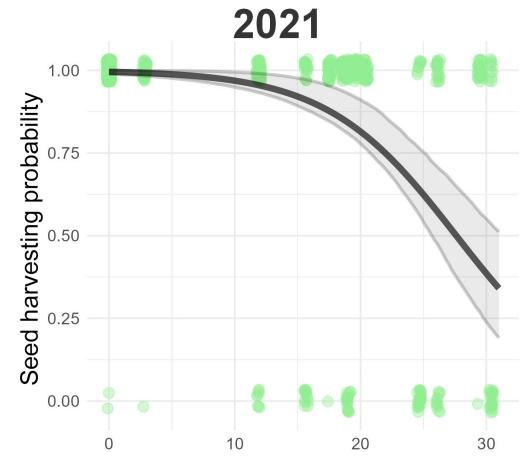
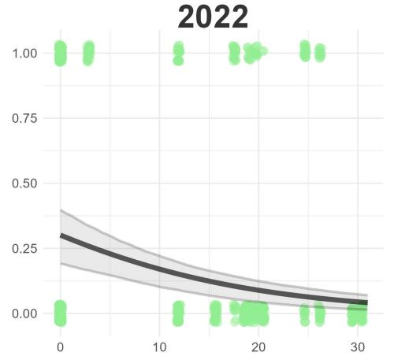
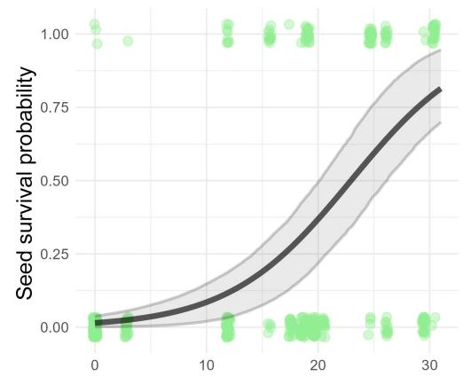
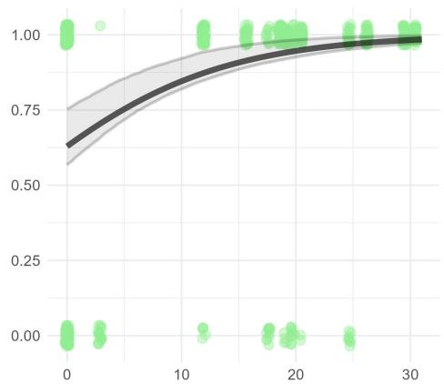
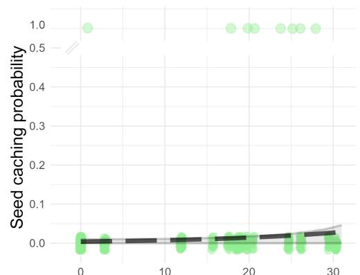
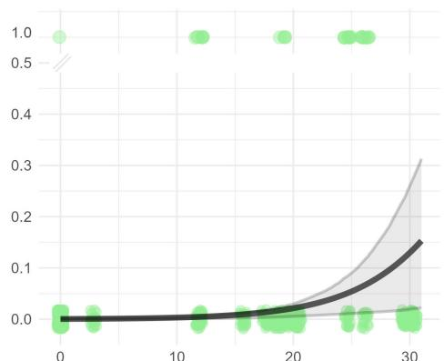
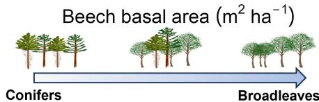
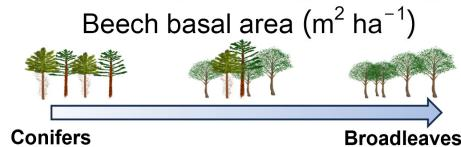
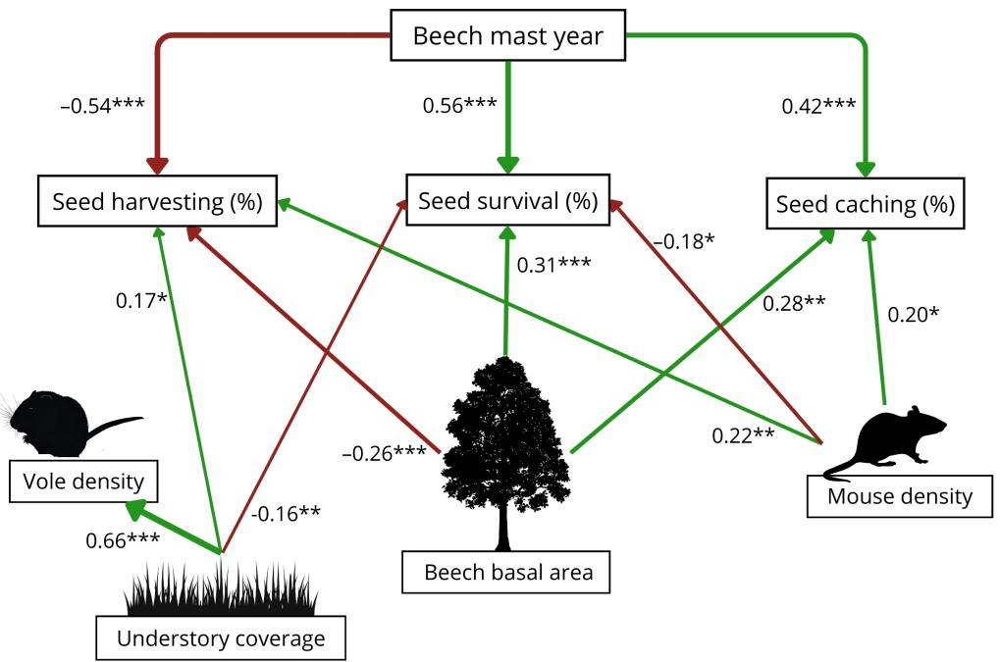

# Forest composition shapes seed-rodent interactions in a gradient of broadleaves and conifers

Pedro Mittelman | Scott M. Appleby | Niko Balkenhol

Wildlife Sciences, University of Göttingen, Göttingen, Germany

Correspondence

Pedro Mittelman

Email: uchoa.mitt@gmail.com

Funding information

Deutsche Forschungsgemeinschaft,

Grant/Award Number: 316045089/

GRK2300

Handling Editor: Cecile Remy

# Abstract

1. Non-native tree species and mixed forests have been increasingly employed in forestry practice as a safeguard against climate change and as a tool to foster biodiversity while providing economic benefits. Though these changes in forest composition may affect animal communities and ecosystem processes, they are seldom studied through a plant-animal interaction perspective.   
2. Here we investigated how forests with varying proportions of a native broadleaf (Fagus sylvatica) and two conifers (introduced Pseudotsuga menziesii and native Picea abies) affect rodents and their interactions with seeds. We surveyed terrestrial small mammal communities, estimated species' densities, assessed seed preference by rodents, collected data on environmental variables (understory density and tree basal area), measured Fagus sylvatica seed production and tracked 1200 seeds of Fagus sylvatica in 20 different forest plots in northern Germany in a mast and non-mast year for Fagus sylvatica.   
3. Forest composition influenced the interactions between rodents and seeds. In forests with a lower proportion of broadleaves, beech seeds were harvested faster and in greater quantities, had diminished survival and were less often cached. These results are in agreement with three other findings: (a) seed fate responded to the proportion of broadleaves and conifers irrespective of conifer tree identity, (b) rodents preferred nutritious beech seeds over small conifer seeds, and (c) higher proportions of seeds were harvested during the period when beech seeds were scarce (non-mast year).   
4. Synthesis and applications: This work provides evidence of how forest composition can affect plant-animal interactions without necessarily altering animal communities or population densities. Specifically, we found no differences between forests with native and non-native conifer trees regarding small mammal community, seed-rodent interactions or seed fate. Furthermore, rodents may provide a service in mixed forests by primarily preying upon seeds of Fagus sylvatica, a superior-competitive species, and thus mitigate beech dominance over conifer species.

# KEYWORDS

Douglas fir, European beech, forest admixtures, forest management, granivory, non-native tree species, scatter-hoarding, seed predation

# 1 | INTRODUCTION

In many parts of the world, forests are experiencing increased disturbances associated with climate change (Seidl et al., 2017), which can exacerbate the ongoing biodiversity crisis (Johnson et al., 2017). Two important factors influencing biodiversity in temperate forests are tree species composition and management practices (Gossner et al., 2014; Leidinger et al., 2021). The use of mixed forests is a promising method to maintain natural processes and biodiversity while also maintaining forest commercial productivity (Brockerhoff et al., 2017). Tree mixtures most often incorporate naturally occurring broadleaves with cultivated conifer trees, providing a wider range of resources, habitat features and micro-environmental conditions that promote biodiversity (Scherer-Lorenzen, 2014). Nonnative trees are also under consideration for extensive utilisation in managed forests, either in isolation or in mixed stands, since they show some signs of resistance to climate change while still maintaining high productivity (Pötzelsberger et al., 2020).

In central Europe, non-native Douglas-fir (Pseudotsuga menziesii) has shown reduced vulnerability to extreme weather compared to the more commonly employed Norway spruce (Picea abies), which has been severely impacted by drought in recent years (Popkin, 2021; Vitali et al., 2017). However, Douglas-fir's impact on European forest ecosystems remains a subject of debate, exacerbated by a paucity of studies on the matter (Thomas et al., 2022).

Granivorous rodents, for instance, can be affected by forest composition and non-native species (Appleby & Balkenhol, 2023; Malo et al., 2013), which can lead to changes in seed-rodent interactions, alter processes like seed dispersal and predation, and ultimately influence germination and forest regeneration (Godó et al., 2022).

In Central European forests, small mammals maintain a close relationship with European beech (Fagus sylvatica), consuming and caching its seeds, thereby influencing beech regeneration (Zwolak, Bogdzielicz, Wrobel, et al., 2016). Caching of beech seeds by rodents plays a vital role in the germination success of beech, due to the favourable microhabitat provided for buried seeds (Zwolak, Bogdzielicz, Wrobel, et al., 2016) and the vulnerability of uncached seeds to winter frost on the soil surface (Jensen, 1985). Furthermore, increased seed production by beech during mast events plays an important role in determining small mammal abundance and shaping population cycles (Zwolak et al., 2021). Nevertheless, the interaction between beech and rodents in a mixed forest context has rarely been studied (but see Perea et al., 2012 for mixed beech-oak stands), and—as far as we know—never in mixtures with Douglas-fir.

Two common small mammal species found across Central European forests are the yellow-necked mouse (Apodemus flavicollis) and the bank vole (Clethrionomys glareolus). Bank voles prefer habitats with dense understory vegetation, while yellow-necked

mice also inhabit closed canopy forests with less ground vegetation (Amori et al., 2015; Baláž et al., 2016). Although both species are considered generalists, yellow-necked mice rely heavily on seeds, while bank voles more readily consume soft plant material like shoots and seedlings in the absence of seeds (Butet & Delettre, 2011).

Here, we studied a range of different forest compositions including monocultures of European beech, Norway spruce and Douglas-fir as well as mixed forests including European beech and each of the two conifer species. Our objective was to investigate the effects of economically important tree species on the interactions between rodents and seeds. We focused on European beech as the dominant tree species under natural conditions, Norway spruce as a commonly employed conifer in forestry practice and Douglas-fir as a non-native conifer increasingly cultivated in Central Europe. To better capture the effects of forest composition on seed interactions, we also quantified two forest features that play an important role in seed fate; (1) beech seed production, which has a major influence on total food resources available for small mammals in forest habitats (Jensen, 1985) and (2) the amount of understory vegetation, which is known to affect small mammals' abundance and activity (Menezes et al., 2018).

Our main question was: (1) Are rodents' interactions with seeds affected by forest composition? Additionally, we addressed the following questions: (2) What roles do understory vegetation and seed production play in seed fate in the context of stands with different tree composition? And (3) does non-native Douglas-fir have a different effect on seed fate than native Norway spruce?

We hypothesised that (1) forest composition will affect small mammal community composition and populations densities; this, in turn, would lead to different responses in terms of seed predation and seed dispersal (e.g. higher seed predation in plots with higher animal abundance); (2) greater understory vegetation will increase small mammal numbers and activity, increasing seed predation, while greater seed production will decrease proportional seed predation and increase seed caching due to greater seed availability per capita and satiation of rodents; (3) forest plots with non-native Douglas-fir will have reduced small mammal numbers since Douglas-fir is a novel and nutrient-poor resource; this reduction in animals' abundance will decrease number of interactions and seed harvesting (Table 1).

# 2 MATERIALS AND METHODS

# 2.1 Study area

Our study was conducted between 2021 and 2023 at four sites, each comprised of five study plots, in the state of Lower Saxony, Germany. All 20 plots were 0.5-hectare in size, in state-managed

TABLE 1 Summary of results according to each initially postulated hypothesis.   

<table><tr><td>Hypothesis</td><td>Evidence found</td><td>Effect</td></tr><tr><td>(1a) Forest composition influences rodent communities and populations&#x27; abundance</td><td>No</td><td>/</td></tr><tr><td>(1b) Forest composition influences rodents&#x27; interactions with seeds</td><td>Yes</td><td>Beech presence decreases seed harvesting, and increases seed survival and seed caching</td></tr><tr><td>(2a) Amount of understory vegetation influences rodent communities and populations&#x27; abundance</td><td>Only for bank vole densities</td><td>Plots with more understory plants had higher bank vole densities</td></tr><tr><td>(2b) Amount of understory vegetation influences rodents&#x27; interactions with seeds</td><td>Only for seed harvesting and survival</td><td>Plots with more understory plants had higher seed harvesting and lower seed survival rates</td></tr><tr><td>(2c) Seed production influences rodents&#x27; interactions with seeds</td><td>Yes</td><td>Mast year decreases seed harvesting, and increases seed survival and seed caching</td></tr><tr><td>(3) Douglas-fir has different effects on rodents and their interactions compared to Norway spruce</td><td>No</td><td>/</td></tr></table>

forests older than 60 years. Sites were split between two regions, with two sites in the south within the Solling uplands, and two sites in the northeast of Lower Saxony neighbouring the Sudheide and the Elbe River. Southern sites have a mean annual temperature of $8.5^{\circ}\mathrm{C}$ , elevations from 277 to $493\mathrm{m}$ , 815-1029 mm annual rainfall and mostly loamy soils. Northern sites have a mean annual temperature of $9.3^{\circ}\mathrm{C}$ , elevations from 47 to $138\mathrm{m}$ , 672-746 mm annual rainfall and mostly sandy soils (Foltran et al., 2022).

At each site, five forest plots were chosen that capture a gradient of European beech and conifer proportions, consisting of pure plots of each of the three species (three plots), as well as admixtures of beech with Douglas-fir and beech with Norway spruce (two plots). Replicating this design across four different sites allowed us to assess the impact of forest composition in general, and to capture possible differences between Norway-spruce and Douglas-fir.

# 2.2 Forest structure—Tree species' basal area

We recorded the diameter at breast height (DBH) and species of each tree in our forest plots in 2017 and updated this information yearly; total basal area for each tree species was calculated as $\mathfrak{m}^2$ per ha. Forest plots did not experience significant tree mortality, harvest or any major changes regarding basal area between 2021 and 2022.

Trees other than our three focal species always comprised less than $6\%$ of a forest plot's basal area. Thus, we used beech basal area as a measure that encompasses both the amount of beech and

the (inverse) proportion of conifers in our forests. Douglas-fir and Norway spruce had very similar effects on our measured variables (see forest composition results) and for most analyses we grouped them together as 'conifers'.

# 2.3 Understory survey

The composition of the forest understory was assessed between June and July 2021. In each forest plot, we systematically surveyed six quadrats of $100\mathrm{m}^2$ ( $10 \times 10\mathrm{m}$ ) and counted the number of saplings, shrubs, herbaceous plants and any ground vegetation between 30 and $80\mathrm{cm}$ in height. We used the total count of all categories of plants to represent the understory composition of each plot.

# 2.4 Seed production

We measured beech seed production in study plots where beech represented $10\%$ or more of the total plot basal area (12 out of 20 forest plots). Measurements were taken during the last week of October in both 2021 and 2022 using a stratified random approach: each study plot was divided in five systematically selected subplots and inside each, two $0.25\mathrm{m}^2$ quadrats were randomly placed and seeds counted (Chianucci et al., 2021). During these years there were no masting events of Douglas-fir or Norway spruce, and conifer seeds were mostly ignored by rodents when beech was present (see seed preference results).

# 2.5 | Small mammal survey-Species composition and density estimation

Each forest plot was surveyed for terrestrial small mammals during July and August of 2021 and 2022 using Sherman traps arranged in a six-by-six grid with traps placed $10\mathrm{m}$ apart, covering $0.25\mathrm{ha}$ . Each survey lasted three or four nights in 2021 and three nights in 2022, with traps set on the evening of the first day and removed after being checked on the morning of the last day. Traps were checked twice per day, once at dawn and once in the late afternoon. Captured animals were identified to species and uniquely marked by injecting a passive integrated transponder (PIT-tag) (Peddymark $1.4\mathrm{mm} \times 10\mathrm{mm}$ ISO 11784/5 FDX-B) and given a secondary mark by trimming a small patch of their fur.

# 2.6 Seed fate

To assess seed fate, we attached a stainless-steel wire (100 mm in length, 0.2 mm in diameter) and a numbered pink plastic tag to each beech seed (wire and tag combined weighed 0.15 g). This method replicated the technique used by Xiao et al. (2006) and many other recent seed-tracking studies (Yu et al., 2023; Zwolak, Bogdzielicz, Wróbel, et al., 2016) and has been shown to not affect removal rates by rodents (Wróbel & Zwolak, 2013). Beech seeds were obtained from the State Forest Department of Lower-Saxony and discarded if they had holes or any sign of attack by invertebrates. Seed stations were composed of 10 tagged seeds placed on the forest floor with a camera trap (Browning BTC-8A) positioned to record videos of animals interacting with seeds. We set three seed stations at each plot during the third week of October each year, at a distance of at least $30\mathrm{m}$ from one another. In total, 1200 seeds were tracked over both years. Tagged seeds were checked 1, 2, 4 and 8 days after placement. We defined seed fates as follows: (1) Seed harvesting: all seeds that rodents interacted with, whether eaten in situ or transported away from the seed pile; (2) seed survival: viable seeds not eaten by rodents (either seeds not harvested or cached); (3) seed caching: seeds taken away from seed piles and buried in the soil (here 'seed dispersal' and 'seed caching' are synonyms because all dispersed seeds that remained viable after 8 days were cached).

# 2.7 Seed preference

To assess seed preference between beech and conifer seeds by rodents, we placed seed removal boxes in eight mixed forest plots (1 per plot) that had a relatively equal amount of beech and conifer trees (35%–65% of each in the mixture). The wooden boxes had a 15 cm diameter plate filled half with beech (40 seeds, between 9.8 and 11.2 g) and half with either Norway spruce (150 seeds, between 5.7, and 6.2 grams) or Douglas-fir (150 seeds, between 4.3 and 4.9 g). Conifer seeds were placed on plates with wings and woody scales

the same way they are found on the forest floor. Each box had openings on the sides to allow rodents to enter and a camera-trap to record animal seed removal behaviour. Boxes were placed in May 2023 and retrieved 30 days later.

# 2.8 Statistical analyses

Because two species of Apodemus mice accounted for more than $90\%$ of interactions with seeds (see Section 3) and individual mouse species could not be identified from videos, we combined the two species to estimate 'mouse density', as well as bank vole density on our plots using spatially explicit capture-recapture models (Efford et al., 2009–R package secr–M. Efford & Efford, 2023). We estimated the density of each species for each forest plot separately for each year, but modelled sigma and g0 combining the 2 years as these parameters varied more between plots than between years.

To assess the impact of forest composition and understory vegetation on small mammal densities, we used linear mixed models, with the estimates obtained from the spatially explicit capture-recapture models (without the uncertainty associated with these estimates) as response variables. We included beech basal area, the number of understory plants per hectare and year as explanatory variables, and the site as a random effect.

To estimate the probabilities of seed harvest, survival and caching according to the understory vegetation density, mouse density, mast year and beech basal area, we used generalised linear mixed models (GLMMs) with a binomial response, with site and seed stations as nested random factors. Missing seeds were not included in survival and cache analyses because of their unknown fate, but they were considered as harvested seeds. Models were fitted using the 'lme4' package in R software (Bates et al., 2015) and checked for residual correlation, heteroscedasticity, or under-/overdispersion with the package 'DHARMa' (Hartig & Lohse, 2022).

To not over-rely on $p$ -values (Sullivan & Feinn, 2012), we also report effect sizes for all our analyses. We decided to use most metrics as 'numbers per hectare' to ease the interpretation of absolute effect sizes, such as beech basal area ( $m^2$ per ha), understory vegetation (number of understory plants per ha) and density of small mammals (estimated individuals per ha). In the case of binomial GLMMs we chose odds ratios as estimators of effect size; the odds ratio is the average factor by which the probability of the response variable being 1 (e.g. the probability of a seed being cached) will change given an increase in one unit of the independent variable.

We also used structural equation models (SEM) applied by the package 'lavaan' in R (Rosseel, 2012) to connect all our measured variables in a single model. To develop the SEM, we initially assumed that all measured environmental variables could influence seed fate and animal densities and then we eliminated non-significant variables from our model structure one by one, checking if the model

improved its fit by bootstrapping estimates of the comparative fit index (CFI) until a final model was obtained. The SEM was used to validate the results obtained by GLMMs and to report standardised effect sizes, so the influence among all variables could be comparable.

# 2.9 Ethics statement

Small mammal surveys were approved by the internal animal welfare committee of the University of Göttingen (permit number: 33.9-42502-04-18/2790) and are in compliance with the German Animal Welfare Act.

# 3 | RESULTS

# 3.1 | Effect of forest composition and understory vegetation on small mammal density

Across both years, 794 captures of 401 individuals resulted from a total trapping effort of 4716 trap nights. Six different species of small mammals were captured (Table S1), but two species represented more than $89\%$ of all captures: the yellow-necked mouse $(45.1\%)$ and the bank vole $(44\%)$ (Figure S1).

Neither species richness nor the Shannon diversity index was related to the basal area of beech, Doulgas-fir or Norway spruce on our study plots (Table S2, Figure S2). During our study period, mice (Apodemus spp.) and bank vole densities did not show any clear pattern in relation to forest composition, even when taking the amount of understory vegetation into account (Table S3, Figure S3). Nevertheless, there was a pronounced difference between sites in terms of community composition (Figure S1); the majority of animals captured at the southern sites ( $>57\%$ of all captured individuals) were bank voles, and at the northern sites, over $70\%$ were yellow-necked mice.

The amount of understory vegetation was not correlated with beech basal area in forest plots (lmm; estimate $= -49.5$ , $p$ -value $= 0.347$ ). Douglas-fir basal area showed a small, marginally significant correlation with the amount of understory vegetation (estimate $= 79.75$ , $p$ -value $= 0.053$ ) while Norway spruce did not (estimate $= -57.17$ , $p$ -value $= 0.139$ ). Understory vegetation had a positive effect on bank vole densities but no effect on mouse densities (Table S3).

# 3.2 Seed fate and animals interacting with seeds

After 8 days of seed tracking, out of the 1200 seeds placed in both years, 725 (60.4%) were harvested. Of the 725 harvested seeds, 239 went missing with unknown fate (33.01% of harvested seeds), 449 were eaten (61.92%), and 36 were cached (4.97%). Camera traps placed at seed stations revealed that most harvesting events

were done by mice (90% of all interactions). We were not able to differentiate between yellow-necked mice (Apodemus flavicollis) and wood mice (Apodemus sylvaticus) from recorded footage. However, since wood mice were only present on 4 of 20 forests plots and represented only $8\%$ of all captured mice, it is safe to attribute most harvesting events to yellow-necked mice. Other animals recorded interacting with seeds were bank voles ( $\approx 9\%$ of interactions) and common shrews ( $\approx 1\%$ ).

# 3.3 | Effect of forest composition and understory vegetation on seed fate

The basal area of beech trees in our forest plots strongly influenced the fate of beech seeds (Figure 1). In both years, beech basal area was associated with decreased probability of seed harvesting (odds ratio $= -1.203$ ; $p$ -value $< 0.001$ ), a slower harvest rate (effect size $= 0.042$ , $p$ -value $< 0.005$ ), greater seed survival (odds ratio $= 1.242$ , $p$ -value $< 0.001$ ) and a higher probability of seed caching (odds ratio $= 1.075$ , $p$ -value $< 0.005$ ). A summary of models' results is available in Table S4. Adding Douglas-fir or Norway spruce basal area to our models did not help to further explain seed fate (Table S5). Furthermore, we reran seed fate analyses selecting only plots with European beech and Douglas-fir or European beech and Norway Spruce and found the same trends regarding the effect of beech basal area on seed fate (Figure S4).

Greater amounts of understory vegetation increased the proportion of seeds harvested (odds ratio $= 1.008$ ; $p$ -value $= 0.016$ ) and harvesting speed (effect size $= 0.0019$ ; $p$ -value $< 0.005$ ), reduced seed survival (odds ratio $= -1.010$ ; $p$ -value $= 0.005$ ) and had a small negative but statistically non-significant effect on the proportion of seeds cached (odds ratio $= -1.006$ ; $p$ -value $= 0.0103$ ). Since understory vegetation was not significantly associated with beech basal area, these two variables had complementary effects on seed fate. We observed more seed removal in plots with Douglas-fir than in plots with similar proportions of Norway spruce, but this effect was non-significant (pairwise t-test: effect size: 5.37 more seeds removed per plot (18% increase), $p = 0.062$ ) and disappeared when understory vegetation was accounted for in our models.

# 3.4 Yearly beech seed production

Mean seed production was substantially different between years (paired t-test; effect size=150.3, p-value <0.001). In 2021, mean seed production was 10.4 seeds per $\mathrm{m}^2$ (SD=4.2, min=4.4, max=18), in 2022 seed production was 15 times higher: 160.7 seeds per $\mathrm{m}^2$ (SD=60.8, min=88, max=305.6).

Beech seed production was correlated with the total beech basal area in each forest plot, both in mast and non-mast years (linear mixed model: 2021: estimate $= 0.51$ , $p$ -value $< 0.001$ ; 2022: estimate $= 7.86$ , $p$ -value $< 0.001$ ).

  
FIGURE 1 Seed fate probability according to beech basal area in 2021 (non-mast year) and 2022 (mast year). Each green dot represents a seed. Filled blacked lines are significant model predictions of seed fate probability with increasing beech basal area. The dashed line represents non-significant model predictions. Grey bands are models' $95\%$ confidence interval around predictions.

# 3.5 Effect of seed production on seed fate

The effects of forest composition on seed harvesting, survival and caching followed similar patterns in both the mast and non-mast year (Figure 1). However, during the mast year, seeds were less likely to be harvested (harvesting probability decreased by 2.34 times, paired t-test: $p$ -value $< 0.001$ ). The proportion of removed seeds found alive increased by 4.02 times (paired t-test; $p$ -value $< 0.001$ )

and proportion of cached seeds increased 3.5 times (paired t-test; $p$ -value $= 0.039$ ) in the mast year compared to the non-mast year.

# 3.6 | Effects of small mammal density on seed fate

Bank vole densities were not related to any seed fate outcome (seed harvesting: odds ratio=1.068, $p$ -value=0.291; survival:

odds ratio $= -1.088$ , $p$ -value $= 0.301$ ; caching: odds ratio $= 1.072$ , $p$ -value $= 0.298$ . Mouse densities had a positive effect on seed harvesting (odds ratio $= 1.363$ , $p$ -value $< 0.001$ ), a negative effect on seed survival (odds ratio $= -1.291$ , $p$ -value $< 0.001$ ) and a small positive effect on seed caching (odds ratio $= 1.068$ , $p$ -value $= 0.013$ ; Table S4, Figure 2).

# 3.7 Seed preference

Video analyses from seed boxes revealed that beech seeds were preferentially removed or eaten in situ compared to either Norway spruce or Douglas-fir seeds. When both beech and conifer seeds were available, rodents chose beech seeds consistently (98% of the time, 283 out of 289 harvesting events). Conifer seeds were primarily harvested after all beech seeds had already been eaten or removed. When rodents interacted with conifer seeds, seeds were often eaten in situ (114 interactions, 95% of total) and rarely carried away (six interactions, 5%).

# 4 | DISCUSSION

We assessed the fate of Fagus sylvatica seeds at 20 forest plots across Northern Germany in a mast and non-mast year and examined its relationship with forest composition, seed production, small mammal densities and understory vegetation (Table 1). Beech seeds were harvested faster and in greater quantities in plots with more conifer trees. This can be attributed to rodents' preference for nutritious large beech seeds compared to the much smaller seeds of Douglas fir and Norway spruce, as seen in our seed preference experiments

and other seed selection studies (e.g. Moore et al., 2022). In conifer-dominated forests, trees bearing large seeds are rarer and thus beech seeds have a relatively higher value, leading to their preferential harvest. This in line with studies showing that perceived food value increases in resource-scarce environments (Delgado et al., 2014; Vander Wall et al., 2019).

Higher beech basal area was related to higher seed caching and survival rates due to the strong influence of beech on the total amount of available resources in forest plots. Greater resource abundance is known to increase rodent satiation and reduce total seed predation (Predator Satiation Hypothesis, Janzen, 1971) and to increase seed caching (Predator Dispersal Hypothesis-Vander Wall, 2002; Xiao et al., 2013). Our results lend support to both hypotheses: Plots with a greater proportion of beech had greater seed survival, with lower proportions of harvested and eaten seeds (predator satiation hypothesis), and showed an increase in the proportion of cached seeds (predator dispersal hypothesis).

Seed production estimates clearly characterised a year of very low seed production (2021) versus a mast year (2022) (Ascoli et al., 2017). This strongly affected seed fate outcomes: higher seed harvesting and predation rates were noted not only when beech seeds were scarce in space (conifer-dominated plots) but also when they were scarce in time (non-mast years; Figure 2). Both patterns occurred simultaneously, from low seed production years in plots with little beech presence (scarcity scenario) to high seed production years in plots dominated by beech trees (abundance scenario), creating stark contrasts in seed fate. For instance, seed survival probability varied from $3\%$ in the low seed production year at conifer-dominated plots to $98\%$ in the mast year in beech-dominated plots (Figure 1). Seed caching was also influenced by the amount

  
FIGURE 2 Diagram depicting the results for the final structural equation model. Numbers closer to each arrow show standardised effect sizes for each relation. Arrow width is proportional to effect size. Green arrows represent positive effects of one variable over another and red arrows represent negative ones. Asterisks show the degree of statistical significance ( $^{*}p < 0.05$ , $^{**}p < 0.01$ , $^{***}p < 0.005$ ).

of beech trees and the masting event, with both increasing caching rates, as previously observed in resource abundant scenarios (Rong et al., 2013; Souza et al., 2023). Harvesting rates were lower in the mast year, but it should be noted that the absolute number of seeds harvested was likely higher, (as expected for masting plants—Vander Wall, 2010), since the 2.34 times decrease in the proportion of harvested seeds was accompanied by 15.4 times increase in seed production.

Forest plots with higher amounts of understory vegetation had higher seed harvesting rates without an increase in mouse densities. We surmise that this effect is due to an increase in animals' exploratory and foraging behaviour (Boone et al., 2021). Forest stand characteristics seem to be directly influencing interactions and seed fate through behavioural changes, without altering community composition or animal densities.

We must point out some limitations of our study: some plots presented high uncertainty associated with density estimates, especially ones with very low rodent numbers where lots of recaptures are necessary. Nevertheless, when we did not use density estimates in our models, we found similar effects of forest composition on seed fate, and northern sites (where most mice were found) had higher seed harvesting and caching rates, and lower seed survival (Figure S5), that is the same effect as greater mouse densities. Second, we surveyed only one mast and one non-mast year. However, other studies which surveyed beech forests found similar effects of mast years on seed fate (Jensen, 1985; Zwolak, Bogdiewicz, Wróbel, & Crone, 2016). Moreover, we should mention that mouse densities were at their lowest point during our study period, probably due to a long period without beech masting (previous masting year was in 2018). We did not measure mouse densities after the masting in 2022, when population density would likely increase substantially, and we might have seen an effect of beech basal area on mouse populations. After the masting year, we would expect low rates of seed caching and survival (Zwolak et al., 2023) as seed production returns to a low level, but mouse numbers are still high. Nevertheless, higher mouse densities could subsequently push mice to sub-optimal habitats (Zwolak, Bogdiewicz, & Rychlik, 2016), like conifer stands, weakening this effect. Appleby and Balkenhol (2023), estimated small mammal densities including a year after a beech mast event and found that mice were present at higher densities in pure beech as compared to conifer forests; but found no effect of forest composition on bank voles. Overall, this in line with our findings that yellow-necked mice rely more heavily on beech seeds than other small mammals in our study area.

# 4.1 Management implications

In mixed forest plots, beech seeds were overwhelmingly preferred by rodents compared to conifer seeds. When rodents did harvest conifer seeds, they were mostly eaten in situ. Accordingly, other studies point out that small conifer seeds are mostly eaten and rarely cached (Lobo, 2014; Wang & Chen, 2009). Thus, a reduced

number of interactions between rodents and conifer seeds would be beneficial for conifers. As a result, Apodemus species may counterbalance the competitive advantages of beech over conifer trees (Küppers, 1985; Schmid, 2002) by preferentially preying on beech seeds. In that manner, conifer seeds would be protected by the presence of a more preferred resource. This effect would function similarly to 'Predator-mediated Coexistence'—where predators regulate competitively superior prey species, allowing the persistence of other less competitive species in the community (often applied to animal predation—Caswell, 1978; Paine, 1966, but also valid here for seed predation). Another relevant theory that can explain our results are 'Associational Effects' (Hay, 1986; Underwood et al., 2014), when the interaction between a resource and a consumer is influenced by the identity of neighbouring individuals. Associational effects are usually employed in herbivory contexts where plant species associations can be used to reduce herbivory (Tudoran et al., 2021). Similarly, here we surmise that beech presence in forest stands may mitigate granivory of conifer seeds. Thus, the dominance achieved by beech trees through changes in soil properties and light access (Peters, 2013; Schmid, 2002) may be partially alleviated by mice's strong predation on beech seeds.

Douglas-fir is being considered as an alternative species to be widely employed in Central European forestry (Spiecker et al., 2019), thus it is crucial to understand the implications of cultivating this non-native species on wildlife before these changes are put into action. Here, forest plots composed of Douglas-fir and Norway spruce were not very different regarding small mammal composition, abundance, or seed fate. Seed fate responded to the proportion of beech and conifers irrespective of conifer tree identity. Thus, general tree traits like seed size and abundance seem to be driving this interaction rather than tree species per se.

Overall, our findings lead to three practical implications for forest management: (1) Long-term rodenticide use in mixed forests may prove disadvantageous, considering rodents' role in mitigating beech over-dominance. (2) Coordinated sowing of conifer seeds concurrent with beech masting can be advantageous, leveraging the combined effect of beech preference and availability to reduce rodent predation of sown seeds. (3) The adoption of Douglas-fir in forestry practices in Central Europe might be a viable option as it presents no apparent ecological disruption in rodent communities or their interactions with seeds when compared to Norway spruce forests.

# 5 CONCLUSIONS

The environmental context can directly influence plant-animal interactions without necessarily altering animal community composition or population densities. This might be even more relevant for synzoochory interactions where environmental context might be able to change the degree of antagonism/mutualism (Sawaya et al., 2018; Zwolak et al., 2023). Specifically, seed fate rates, like predation and dispersal, might be highly influenced by tree composition. Although

forest composition effects on seed fate exist between broadleaves and conifers, no difference in effects could be observed between the non-native Douglas-fir and the widely employed Norway spruce. In the long term, mice may contribute to the maintenance of mixed stands by mitigating beech dominance over conifer species through strong predation on beech seeds and reduced consumption of conifer seeds.

# AUTHOR CONTRIBUTIONS

Pedro Mittelman, Scott M. Appleby and Niko Balkenhol conceived the ideas and designed methodology; Pedro Mittelman and Scott M. Appleby collected the data. Pedro Mittelman analysed the data. Pedro Mittelman led the writing of the manuscript. All authors contributed critically to the drafts and gave final approval for publication.

# ACKNOWLEDGEMENTS

We thank all members of the RTG 2300 project for their support, the students and technicians that helped with data collection, and Alice Penanhoat and Larissa Topanotti for providing data about understory vegetation. This study was supported by Deutsche Forschungsgemeinschaft (DFG), grant number 316045089/GRK 2300. Open Access funding enabled and organised by Projekt DEAL.

# CONFLICT OF INTEREST STATEMENT

The authors declare no conflict of interest.

# DATA AVAILABILITY STATEMENT

Data are available from GRO.data at https://doi.org/10.25625/47SCUZ (Mittelman, 2024).

# ORCID

Pedro Mittelman https://orcid.org/0000-0003-0428-463X   
Scott M. Appleby https://orcid.org/0000-0002-2031-2752

# REFERENCES

Amori, G., Castigiani, V., Locasciulli, O., & Luiselli, L. (2015). Long-term density fluctuations and microhabitat use of sympatric Apodemus flavicollis and Myodes glareolus in central Italy. Community Ecology, 16(2), 196-205. https://doi.org/10.1556/168.2015.16.2.7   
Appleby, S. M., & Balkenhol, N. (2023). Douglas fir and Norway spruce have similar effects on small mammal density, but not survival, in Central European managed forests. *Mammalian Biology*, 104, 25-39. https://doi.org/10.1007/s42991-023-00384-1   
Ascoli, D., Maringer, J., Hacket-Pain, A., Conedera, M., Drobyshev, I., Motta, R., Cirolli, M., Kantorowicz, W., Zang, C., Schueler, S., Croise, L., Piussi, P., Berretti, R., Palaghianu, C., Westergren, M., Lageard, J. G. A., Burkart, A., Gehrig Bichsel, R., Thomas, P. A., ... Vacchiano, G. (2017). Two centuries of masting data for European beech and Norway spruce across the European continent. Ecology, 98(5), 1473. https://doi.org/10.1002/ecy.1785   
Baláž, I., Jakab, I., Tulis, F., & Ambros, M. (2016). Spatial density of two sympatric species Yellow-necked Mouse Apodemus flavicollis and Bank vole Clethrionomys glareolus in different environment. Folia Oecologica, 43(2), 121-128.   
Bates, D., Mächler, M., Bolker, B., & Walker, S. (2015). Fitting linear mixed-effects models using lme4. Journal of Statistical Software, 67(1), 1-48. https://doi.org/10.18637/jss.v067.i01

Boone, S. R., Brehm, A. M., & Mortelliti, A. (2021). Seed predation and dispersal by small mammals in a landscape of fear: Effects of personality, predation risk and land-use change. Oikos, 2022, 1-15. https://doi.org/10.1111/oik.08232   
Brockerhoff, E. G., Barbaro, L., Castagneyrol, B., Forrester, D. I., Gardiner, B., González-Olabarria, J. R., Lyver, P. O., Meurisse, N., Oxbrough, A., Taki, H., Thompson, I. D., Van Der Plas, F., & Jactel, H. (2017). Forest biodiversity, ecosystem functioning and the provision of ecosystem services. *Biodiversity and Conservation*, 26(13), 3005-3035. https://doi.org/10.1007/s10531-017-1453-2   
Butet, A., & Delettre, Y. R. (2011). Diet differentiation between European arvicoline and murine rodents. Acta Theriologica, 56(4), 297. https://doi.org/10.1007/s13364-011-0049-6   
Caswell, H. (1978). Predator-mediated coexistence: A nonequilibrium model. The American Naturalist, 112(983), 127-154. https://doi.org/10.1086/283257   
Chianucci, F., Tattoni, C., Ferrara, C., Ciolli, M., Brogi, R., Zanni, M., Apollonio, M., & Cutini, A. (2021). Forest ecology and management evaluating sampling schemes for quantifying seed production in beech (Fagus sylvatica) forests using ground quadrats. Forest Ecology and Management, 493(April), 119294. https://doi.org/10.1016/j.foreco.2021.119294   
Delgado, M. M., Nicholas, M., Petrie, D. J., & Jacobs, L. F. (2014). Fox squirrels match food assessment and cache effort to value and scarcity. PLoS One, 9(3), e92892. https://doi.org/10.1371/journal.pone.0092892   
Efford, M., & Efford, M. M. (2023). Package 'secr'.   
Efford, M. G., Borchers, D. L., & Byrom, A. E. (2009). Density estimation by spatially explicit capture-recapture: Likelihood-based methods. In Modeling demographic processes in marked populations (pp. 255-269). Boston, MA: Springer. https://doi.org/10.1007/978-0-387-78151-8_11   
Foltran, E. C., Ammer, C., & Lamersdorf, N. (2022). Douglas fir and Norway spruce admixtures to beech forests along in Northern Germany—Are soil nutrient conditions affected? bioRxiv, 2020.09.25.313213. https://doi.org/10.1101/2020.09.25.313213   
Godó, L., Valkó, O., Borza, S., & Deák, B. (2022). A global review on the role of small rodents and lagomorphs (clade Glires) in seed dispersal and plant establishment. Global Ecology and Conservation, 33, e01982. https://doi.org/10.1016/j.gecco.2021.e01982   
Gossner, M. M., Schall, P., Ammer, C., Ammer, U., Engel, K., Schubert, H., Simon, U., Utschick, H., & Weisser, W. W. (2014). Forest management intensity measures as alternative to stand properties for quantifying effects on biodiversity. *Ecosphere*, 5(9), 1-111. https://doi.org/10.1890/ES14-00177.1   
Hartig, F., & Lohse, L. (2022). DHARMa: Residual diagnostics for hierarchical (multi-level/mixed) regression models, R package version 0.4. 6; 2022.   
Hay, M. E. (1986). Associational plant defenses and the maintenance of species diversity: Turning competitors into accomplices. The American Naturalist, 128(5), 617-641. https://doi.org/10.1086/284593   
Janzen, D. H. (1971). Seed predation by animals. Annual Review of Ecology and Systematics, 2(1), 465-492. https://doi.org/10.1146/annurev.es.02.110171.002341   
Jensen, T. S. (1985). Seed-seed predator interactions of European Beech, Fagus silvatica and forest rodents, Clethrionomys glareolus and Apodemus flavicollis. Oikos, 44(1), 149. https://doi.org/10.2307/3544056   
Johnson, C. N., Balmford, A., Brook, B. W., Buettel, J. C., Galetti, M., Guangchun, L., & Wilmshurst, J. M. (2017). Biodiversity losses and conservation responses in the Anthropocene. Science, 356(6335), 270-275. https://doi.org/10.1126/science.aam9317   
Küppers, M. (1985). Carbon relations and competition between woody species in a Central European hedgerow: IV. Growth form and

partitioning. Oecologia, 66, 343-352. https://doi.org/10.1007/BF00378296   
Leidinger, J., Blaschke, M., Ehrhardt, M., Fischer, A., Gossner, M. M., Jung, K., Kienlein, S., Kozak, J., Michler, B., Mosandl, R., Seibold, S., Wehner, K., & Weisser, W. W. (2021). Shifting tree species composition affects biodiversity of multiple taxa in Central European forests. Forest Ecology and Management, 498, 119552. https://doi.org/10.1016/j.foreco.2021.119552   
Lobo, N. (2014). Conifer seed predation by terrestrial small mammals: A review of the patterns, implications, and limitations of top-down and bottom-up interactions. Forest Ecology and Management, 328, 45-54. https://doi.org/10.1016/j.foreco.2014.05.019   
Malo, A. F., Godsall, B., Prebble, C., Grange, Z., McCandless, S., Taylor, A., & Coulson, T. (2013). Positive effects of an invasive shrub on aggregation and abundance of a native small rodent. Behavioral Ecology, 24(3), 759-767. https://doi.org/10.1093/beheco/ars202   
Menezes, J. F. S., Mourão, G. M., & Kotler, B. P. (2018). Understory cover increases patch use in rodent Thrichomys fosteri. Ethology Ecology & Evolution, 30(3), 267-276. https://doi.org/10.1080/03949370.2017.1354921   
Mittelman, P. (2024). Data from "Forest composition shapes seed-rodent interactions in a gradient of broadleaves and conifers." GRO.data. https://doi.org/10.25625/47SCUZ   
Moore, N. B., Stephens, R. B., & Rowe, R. J. (2022). Nutritional and environmental factors influence small mammal seed selection in a northern temperate forest. *Ecosphere*, 13(4), e4036. https://doi.org/10.1002/ecs2.4036   
Paine, R. T. (1966). Food web complexity and species diversity. The American Naturalist, 100(910), 65-75. https://doi.org/10.1086/282400   
Perea, R., San Miguel, A., Martínez-Jauregui, M., Valbuena-Carabaña, M., & Gil, L. (2012). Effects of seed quality and seed location on the removal of acorns and beechnuts. European Journal of Forest Research, 131(3), 623-631. https://doi.org/10.1007/s10342-011-0536-y   
Peters, R. (2013). Beech forests (Vol. 24). Springer Science & Business Media.   
Popkin, G. (2021). Forest fight. Science, 374(6572), 1184-1189. https://doi.org/10.1126/science.acx9733   
Pötzelsberger, E., Spiecker, H., Neophytou, C., Mohren, F., Gazda, A., & Hasenauer, H. (2020). Growing non-native trees in European forests brings benefits and opportunities but also has its risks and limits. Current Forestry Reports, 6(4), 339-353. https://doi.org/10.1007/s40725-020-00129-0   
Rong, K., Yang, H., Ma, J., Zong, C., & Cai, T. (2013). Food availability and animal space use both determine cache density of Eurasian red squirrels. PLoS One, 8(11), e80632. https://doi.org/10.1371/journal.pone.0080632   
Rosseel, Y. (2012). Lavaan: An R package for structural equation modeling. Journal of Statistical Software, 48, 1-36. https://doi.org/10.18637/jss.v048.i02   
Sawaya, G. M., Goldberg, A. S., Steele, M. A., & Dalgleish, H. J. (2018). Environmental variation shifts the relationship between trees and scatterhoarders along the continuum from mutualism to antagonism. Integrative Zoology, 13(3), 319-330. https://doi.org/10.1111/1749-4877.12311   
Scherer-Lorenzen, M. (2014). The functional role of biodiversity in the context of global change. In *Forests and global change* (pp. 195-237). Cambridge University Press. https://doi.org/10.1017/CBO9781107323506.011   
Schmid, I. (2002). The influence of soil type and interspecific competition on the fine root system of Norway spruce and European beech. Basic and Applied Ecology, 3(4), 339-346. https://doi.org/10.1078/1439-1791-00116   
Seidl, R., Thom, D., Kautz, M., Martin-Benito, D., Peltoniemi, M., Vacchiano, G., Wild, J., Ascoli, D., Petr, M., Honkaniemi, J., Lexer, M. J., Trotsiuk, V., Mairota, P., Svoboda, M., Fabrika, M., Nagel, T. A.,

& Reyer, C. P. O. (2017). Forest disturbances under climate change. Nature Climate Change, 7(6), 395-402. https://doi.org/10.1038/nclimate3303   
Souza, F. C., Viana-Junior, A. B., Mittelman, P. U., & de Azevedo, F. C. C. (2023). Tree density-dependence effects on seed dispersal of a large-seeded tropical tree. Journal of Tropical Ecology, 39, e17. https://doi.org/10.1017/S0266467423000068   
Spiecker, H., Lindner, M., & Schuler, J. K. (2019). Douglas-fir: An option for Europe. European Forest Institute.   
Sullivan, G. M., & Feinn, R. (2012). Using effect size—Or why the $P$ value is not enough. Journal of Graduate Medical Education, 4(3), 279-282. https://doi.org/10.4300/JGME-D-12-00156.1   
Thomas, F. M., Rzepecki, A., & Werner, W. (2022). Non-native Douglas fir (Pseudotsuga menziesii) in Central Europe: Ecology, performance and nature conservation. Forest Ecology and Management, 506, 119956. https://doi.org/10.1016/j.foreco.2021.119956   
Tudoran, A., Bylund, H., Nordlander, G., Oltean, I., & Puentes, A. (2021). Using associational effects of European beech on Norway spruce to mitigate damage by a forest regeneration pest, the pine weevil Hylobius abietis. Forest Ecology and Management, 486(January), 118980. https://doi.org/10.1016/j.foreco.2021.118980   
Underwood, N., Inouye, B. D., & Hambäck, P. A. (2014). A conceptual framework for associational effects: When do neighbors matter and how would we know? The Quarterly Review of Biology, 89(1), 1-19. https://doi.org/10.1086/674991   
Vander Wall, S. B. (2002). Masting in animal-dispersed pines facilitates seed dispersal. Ecology, 83(12), 3508-3516.   
Vander Wall, S. B. (2010). How plants manipulate the scatter-hoarding behaviour of seed-dispersing animals. Philosophical Transactions of the Royal Society, B: Biological Sciences, 365(1542), 989-997. https://doi.org/10.1098/rstb.2009.0205   
Vander Wall, S. B., Dimitri, L. A., Longland, W. S., & White, J. D. M. (2019). Seed value influences cache pilfering rates by desert rodents. Integrative Zoology, 14(1), 75-86. https://doi.org/10.1111/1749-4877.12358   
Vitali, V., Buntgen, U., & Bauhus, J. (2017). Silver fir and Douglas fir are more tolerant to extreme droughts than Norway spruce in southwestern Germany. Global Change Biology, 23(12), 5108-5119. https://doi.org/10.1111/gcb.13774   
Wang, B., & Chen, J. (2009). Seed size, more than nutrient or tannin content, affects seed caching behavior of a common genus of Old World rodents. Ecology, 90(11), 3023-3032. https://doi.org/10.1890/08-2188.1   
Wrobel, A., & Zwolak, R. (2013). The choice of seed tracking method influenced fate of beech seeds dispersed by rodents. Plant Ecology, 214(3), 471-475. https://doi.org/10.1007/s11258-013-0183-0   
Xiao, Z., Jansen, P. A., & Zhang, Z. (2006). Using seed-tagging methods for assessing post-dispersal seed fate in rodent-dispersed trees. Forest Ecology and Management, 223(1-3), 18-23. https://doi.org/10.1016/j.foreco.2005.10.054   
Xiao, Z., Zhang, Z., & Krebs, C. J. (2013). Long-term seed survival and dispersal dynamics in a rodent-dispersed tree: Testing the predator satiation hypothesis and the predator dispersal hypothesis. Journal of Ecology, 101(5), 1256-1264. https://doi.org/10.1111/j.1365-2745.12113   
Yu, F., Zhang, L., Wang, Y., Yi, X., Zhang, S., Ma, J., Dong, Z., Chen, G., & Ma, K. (2023). High rodent abundance increases seed removal but decreases scatter-hoarding and seedling recruitment along an elevational gradient. Integrative Zoology, 18(5), 843-858. https://doi.org/10.1111/1749-4877.12695   
Zwolak, R., Bogdzielicz, M., & Rychlik, L. (2016). Beech masting modifies the response of rodents to forest management. Forest Ecology and Management, 359, 268-276. https://doi.org/10.1016/j.foreco.2015.10.017   
Zwolak, R., Bogdzielicz, M., Wróbel, A., & Crone, E. E. (2016). Advantages of masting in European beech: Timing of granivore satiation and

benefits of seed caching support the predator dispersal hypothesis. Oecologia, 180(3), 749-758. https://doi.org/10.1007/s00442-015-3511-3   
Zwolak, R., Clement, D., Sih, A., & Schreiber, S. J. (2021). Mast seeding promotes evolution of scatter-hoarding. Philosophical Transactions of the Royal Society, B: Biological Sciences, 376(1839), 20200375. https://doi.org/10.1098/rstb.2020.0375   
Zwolak, R., Clement, D., Sih, A., & Schreiber, S. J. (2023). Granivore abundance shapes mutualism quality in plant-scatterhoarder interactions. New Phytologist, 241, 1840-1850. https://doi.org/10.1111/nph.19443

# SUPPORTING INFORMATION

Additional supporting information can be found online in the Supporting Information section at the end of this article.

Table S1. Number of individuals and captures of each small mammal species during our study period.   
Table S2. Results of linear mixed effect models predicting species richness and diversity according to stand composition (basal area of area of Norway spruce—Picea abies, Douglas-fir—Pseudotsuga menziesii, and European beech—Fagus sylvatica), year and the amount of understory vegetation on forest plots.   
Table S3. Results of linear mixed models predicting the density of bank voles (Clethrionomys glareolus) and mouse (Apodemus sp) according to stand composition (basal area of area of Norway spruce—Picea abies, Douglas-fir—Pseudotsuga menziesii, and European beech—Fagus sylvatica), year and the amount of understory vegetation.   
Table S4. Results of Generalized Linear Mixed Models with binomial distribution for seed harvesting, seed survival and, seed caching

according to beech basal area, amount of understory vegetation, mice density and year.

Table S5. Model comparison with different species basal area.

Figure S1. Proportion of individual captures during different years and in different regions of our surveyed plots.   
Figure S2. Richness and diversity (Shannon Index) according to the basal area of Norway spruce (Picea abies), Douglas-fir (Pseudotsuga menziesii) and European beech (Fagus sylvatica) in each surveyed plot.   
Figure S3. Bank vole and mouse (Apodemus sp.) densities according to the basal area of Norway spruce (Picea abies), Douglas-fir (Pseudotsuga menziesii) and European beech (Fagus sylvatica) in each surveyed plot.   
Figure S4. Seed fate probability according to beech basal area using only Douglas-fir and beech plots (1st column) or only Norway Spruce and beech (2nd column).   
Figure S5. Seed fate probability according to beech basal area in Northern (mouse abundant) and Southern (vole abundant) sites.

How to cite this article: Mittelman, P., Appleby, S. M., & Balkenhol, N. (2024). Forest composition shapes seed-rodent interactions in a gradient of broadleaves and conifers. Journal of Applied Ecology, 61, 1944-1954. https://doi.org/10.1111/1365-2664.14711