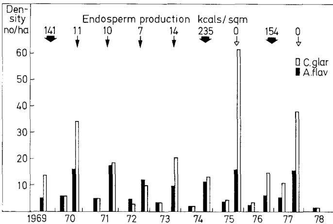
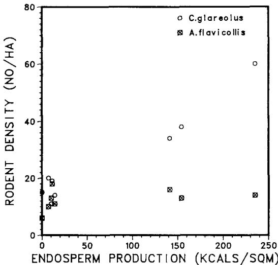
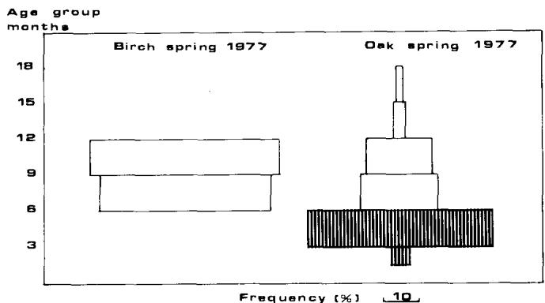
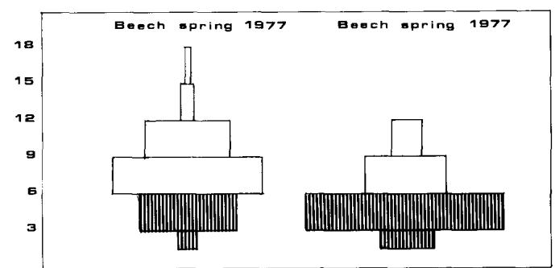
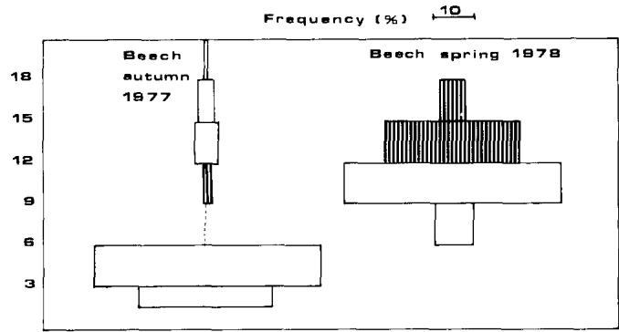
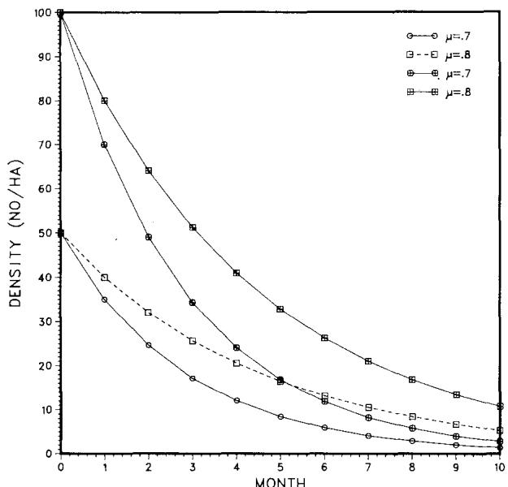

# Seed Production and Outbreaks of Non-Cyclic Rodent Populations in Deciduous Forests

Thomas Secher Jensen  
Institute of Zoology and Zoophysiology, University of Aarhus, DK-8000 Aarhus, Denmark

Summary. In a 10-year study period, outbreaks of the bank vole, Clethrionomys glareolus, Schreber only occurred in years following huge seed production of European beech, Fagus sylvatica. Intensive winter reproduction preceded the outbreaks, in contrast to a normal breeding season from April through September. No winter reproduction occurred in nearby populations from habitats without mast production. During the winter, the average weight of $C$ glareolus remained high in the mast forests and the age structure resembled that of a summer breeding population. Despite excess energy requirements of winter breeding, survival rates were similar to that of non-breeding winter populations. In mast years, rodent consumption in the beech forest was estimated as $1.0 - 10.3\%$ of endosperm production available to postdispersal seed predators. Between mast years rodent consumption made up $30 - 100\%$ of endosperm production available. Mast years occurred at irregular intervals and seed production seems to be synchronized between individual trees over large areas and induced by climatic events. These phenomena lead to seed predator satiation.

# Introduction

Central European and Southern Scandinavian populations of forest rodents are considered to be rather stable with small fluctuations in annual peak density. Compared to North Scandinavian populations of the same species and to Central European grassland species, peak densities of forest rodents are generally reported to be of smaller magnitude.

The forest-type rodent species of Europe mainly belong to the murid genus Apodemus and the microtine genus Clethrionomys. Apodemus spp. are mainly granivorous and Clethrionomys spp. herbivorous-granivorous, but much more granivorous than their microtine grassland relatives within the genus Microtus (Hansson 1971). Thus, seeds play an important role in the diet of forest rodents and it has often been inferred (e.g. Bergstedt 1966) that rodent survival is affected by the magnitude of seed production, however, few investigations have dealt with rodent seed ecology.

Quantitative information on seed production in forest ecosystems is generally scare. In beech (Fagus sylvatica L.) and oak (Quercus robur L.) forests huge production of seeds occur irregularly and often with long intervals, and few rodent investigations have covered such extended periods.

In the present paper results from a long-term study on rodents in a Danish deciduous forest dominated by beech are analysed. The investigations include estimates of seed production in the forest and comparisons with rodent populations and seed production in other deciduous forests. A subsequent paper will deal with rodent seed dispersal and its role in forest regeneration.

# Study Areas and Methods

All study sites were situated in Eastern Jutland, Denmark. The long-term study was performed in Hestehave Wood near Ronde, in an almost pure stand of 90-100 year old beech (F. sylvatica), growing on a mully soil. This forest was used as the Danish IBP-PT main study site and detailed descriptions of the flora are given by Hughes (1975). Other beech forests on mully soil included Lisbjerg Forest and Konstantinsborg Forest. Lovenholm Forest represented a beech community growing on a very poor mor soil. Beside the beech forests, a 50 year old oak (Quercus robur) stand in Frijsenborg Forest represented communities with occasional production of large tree-seed crops.

Three sites represented plant communities without such production. A Phragmites communis reedswamp with intermittent willows (Salix spp.) along Lake Brabrand, a birch-larch (Betula verrucosa - Larix europaea) wood on sandy soil near the village of Sovind and a birch-willow community on drained peat soil near the village of Pindstrup.

In addition, captures were made in the mixed, moist Askelunden Wood in the Mols area, a wood which is dominated by ash (Fraxinus excelsior) and alder (Alnus glutinosa), with smaller numbers of oak and beech, mainly at the border of the wood.

At the main study site rodents have been captured by means of removal trappings in large and small quadrats since 1968. In the winters 1970-1971, 1976-1977 and 1978-1979 live-trapping schemes were adopted. In the other study sites rodents were snap-trapped in 1976-1977. Trappings were performed in May and October, the months of normal minimum and maximum rodent abundance.

All specimens captured were weighed, dissected and classified into juveniles, subadults, reproductive and postreproductive adults (Jensen 1975a). In females, classification were based upon examinations of ovaries, uteri and mammary glands. Litter size was calculated from the number of visible embryos, obvious resorptions excluded. The number of previous litters were noted, based upon observa

tions of placental scars. In males, classifications were based on examination of the presence or absence of sperm in the cauda epididymis and the condition and size of the testes (Jensen 1975a).

Age determination were performed by measuring the length of the $\mathbf{M}_1$ -root of Clethrionomys glareolus (Zejda 1976 and pers. comm.) and in Apodemus flavicollis (Melch.), by examination of tooth wear (Andrzejewska 1971). The root measurements yield direct information of the date of birth, whereas tooth wear analysis permits classification into five age groups.

At the main study site beech mast production has been estimated for the years 1968-1975 (Nielsen 1977). In the autumn of 1976 and 1977 estimates were based on litter samples taken from the forest floor in each of the forests producing the huge seed crops. The seeds were counted and separated into endosperm and pericarp. The endosperm was ovendried for $48\mathrm{h}$ at $60^{\circ}\mathrm{C}$ , weighed, milled, and made into ${}^{1}/_{2}-1$ g pellets. The same procedure was used for animal carcasses and green plant material. Calorific content and ash content of seeds, plants, and animals were determined by combustion in an automatic adiabatic Gallenkamp bomb-calorimeter. Nitrogen content was determined by Kjeldahl-analysis.

Laboratory experiments on food preferences were conducted in $20 \times 15 \times 30$ cm plastic cages provided with insulated nestboxes. The individuals were kept singly and starved for $5\mathrm{h}$ prior to the experiment, which lasted $3\mathrm{h}$ . 10-15 individuals were used in each experiment. Test food items and standard pellets were weighed and given to the animals in separate glass jars. After the experiment the remaining food was collected, dried and reweighed. Controls were weighed, dried and reweighed.

# Results

# Variation in Rodent Density and Beechmast Production

In the ten year study period rodent populations were rather stable with fluctuations not exceeding a 15-fold interseasonal amplitude (Fig. 1). Even locally, densities never exceeded 125 individuals per ha. Variations in densities of the bank vole Clethrionomys glareolus were much more pronounced than variations in the density of yellow-necked field mice Apodemus flavicollis, with peak densities of 10-15 individuals/ha in A. flavicollis compared with 10-60 in C. glareolus.

In 1970, 1975 and 1977 C. glareolus had considerably higher autumn densities than all other years. In 1970 and 1975 the autumn peak occurred in September-October whereas in 1977 the populations peaked earlier, probably in July-August according to age structure analysis. Spring densities were generally higher these years.

Beech mast production in the study period is shown in Fig. 1, too. In 1969, 1974 (Nielsen 1977), and 1976 heavy seeds crops were recorded, viz. 141.9, 235.1 and $154.0\mathrm{kcal / }$ $\mathrm{m}^2$ (594, 984 and $647~\mathrm{KJ / m^2}$ ), whereas in all other years production was very small and sometimes nil (0-13.8 kcals (58 KJ) endosperm/m²).

Apparently, in $C$ . glareolus a positive correlation between seed production and rodent density the following autumn exists, as mast years always seem to precede peak densities. In $A$ . flavicollis, no correlation seems to be present (Fig. 2).

  
Fig. 1. Fluctuations in rodent density and beech mast endosperm production. Hestehave Wood 1968-1978

  
Fig. 2. Seed production and rodent density the consecutive autumn. Hestehave Wood 1969-1978

Table 1. Percentage of pregnant and reproductive female C. glareolus in consecutive October samplings   

<table><tr><td>Year</td><td>Pregnant females</td><td>Total reproductive females</td><td>n</td></tr><tr><td>1971</td><td>0.0</td><td>0.0</td><td>18</td></tr><tr><td>1972</td><td>7.4</td><td>25.9</td><td>27</td></tr><tr><td>1973</td><td>21.9</td><td>65.6</td><td>32</td></tr><tr><td>1974</td><td>35.3</td><td>100.0</td><td>17</td></tr><tr><td>1975</td><td>0.0</td><td>0.0</td><td>46</td></tr><tr><td>1976</td><td>43.8</td><td>100.0</td><td>16</td></tr><tr><td>1977</td><td>0.0</td><td>5.7</td><td>35</td></tr><tr><td>1978</td><td>0.0</td><td>5.5</td><td>18</td></tr></table>

# Rodent Winter Reproduction

In the Hestehave beech forest the normal September-October situation is that of a gradual termination of reproduction (Jensen 1975b), with few females pregnant by the end of October (Table 1). At that time, populations consist mainly of subadult individuals born in mid- or late summer, individuals that do not enter the breeding population in spite of adult age. The weight of subadult overwintering

Table 2. Percentage of reproductive individuals in various samples during winter 1974/75   

<table><tr><td rowspan="2">Locality</td><td rowspan="2">Habitat</td><td rowspan="2">Period</td><td colspan="2">% Reproductive adults (n)</td></tr><tr><td>Clethrionomys</td><td>Apodemus</td></tr><tr><td rowspan="4">Hestehaven</td><td rowspan="4">Beech</td><td>Sept. 74</td><td>85.7 (21)</td><td>61.3 (31)</td></tr><tr><td>Oct. 74</td><td>81.6 (49)</td><td>89.7 (39)</td></tr><tr><td>Dec. 74</td><td>53.3 (30)</td><td>39.5 (38)</td></tr><tr><td>Feb. 75</td><td>4.7 (21)</td><td>46.6 (15)</td></tr><tr><td>Mols</td><td>Hedges</td><td>Dec. 74</td><td>0.0 (35)</td><td>0.0 (14)</td></tr><tr><td>Sövind</td><td>Birch</td><td>Dec. 74</td><td>0.0 (32)</td><td>0.0 (35)</td></tr></table>

C. glareolus remains low, less than 15 grams, a weight also gradually attained by postreproductive adults during winter. A. flavicollis do not stop growth or decrease weight during winter (Jensen 1975b).

However, the situation in autumn 1974 was much different (Table 2). The percentage of reproductive $C.$ glareolus individuals remained high, decreasing only from $86\%$ in September to $54\%$ in December. Even in February some reproductive individuals were found. In $A.$ flavicollis the percentage of reproductive individuals decreased from $90\%$ in October to $40\%$ in December and $47\%$ were reproductive in February. In contrast, no reproductive adults were found at two nearby habitats, a birch forest and some hedgerows.

Occasionally, winter reproduction has been found among forest rodents e.g. C. glareolus, A. flavicollis and A. sylvaticus elsewhere in Europe the year following heavy seed crops (Kulicke 1960; Zejda 1962; Newson 1963; Grodzinski et al. 1966; Ashby 1967; Smyth 1968; Bobek 1971; Hoffmeyer and Hansson 1974). However, direct relations between seed crops and winter-reproduction has not been demonstrated and other factors e.g. climate or rodent density acting directly upon the rodents and not through plant primary production could be important. In order to elucidate the effect of seed production under similar climatic conditions, rodent reproduction was followed during winter 1976/77 when a large production of acorns and beech nuts occurred in beech and oak forests, and compared to reproduction in nearby forests without mast production. C. glareolus occurred in all habitats whereas A. flavicollis in the reedswamp was displaced by A. sylvaticus. This latter spe

cies was also caught in low numbers in the birch-willow forest.

Table 3 shows the results of late November/early December catches in these habitats. No reproductive adults were found in forest without seed-production whereas in beech and oak forests reproductive adults made up $75 - 100\%$ of the total number captured. In the mixed community $33\%$ of C. glareolus and $70\%$ of A. flavicollis were reproductive.

These differences between adjacent populations can hardly be explained by climatic factors. Further, climatic observations from a nearby forest meteorological station show that the autumn weather during the two seed years in respect to snow cover, air temperature, and precipitation by no means differed significantly from a 30-year normal (pers. comm. Danish Meteorological Institute).

The investigations were replicated in November-December 1977 when seed production was virtually nil in beech and oak forests all over Europe according to seed-suppliers. No reproductive individuals were found in any habitat investigated. This lack of winter breeding could be attributed to the high population densities this year as it is known that high densities tend to stop reproduction. However, winter breeding is not likely to be a function of density alone, as no winter breeding was found in e.g. 1972, 1973, 1978 and 1979, when low densities were recorded.

Thus, the field evidence suggests that in certain years surplus of food increases the length of the breeding season in forest rodents. In order to investigate the evidence further, a laboratory feeding experiment was performed. Fifteen pairs of newly weaned juvenile bank voles were placed in a cool $(10^{\circ}\mathrm{C})$ room with $8\mathrm{h}$ of daylight. They were fed beech nuts and laboratory pellets. A control group was fed laboratory pellets only. Two other control groups, one fed beech nuts and laboratory pellets, one fed laboratory pellets only, were placed at room temperature $(21^{\circ}\mathrm{C})$ with $16\mathrm{h}$ of light. In the experimental group vaginal smears showed that $86\%$ of the females came into estrus within a month compared to $7\%$ in the cool, dark control and $87\%$ and $57\%$ in the warm, light group. Large-scale field experiments designed to demonstrate the effect of supplementary beech mast were planned, however, the total failure of seed crops all over Europe in 1977-1979 made such experiments impossible.

It is noteworthy that a small sample of individuals, five $C$ glareolus and four $A$ flavicollis captured in the seed

Table 3. Percentage of reproductive individuals in late November/early December samples in various deciduous forests. Numbers in parenthesis   

<table><tr><td rowspan="2">Locality, habitat</td><td colspan="2">1976</td><td colspan="2">1977</td></tr><tr><td>Clethrionomys</td><td>Apodemus</td><td>Clethrionomys</td><td>Apodemus</td></tr><tr><td>Lövenholm, beech</td><td>100.0 (5)</td><td>87.5 (16)</td><td>0.0 (13)</td><td>0.0 (20)</td></tr><tr><td>Frijsenborg, oak</td><td>74.5 (47)</td><td>100.0 (3)</td><td>0.0 (40)</td><td>- (0)</td></tr><tr><td>Lisbjerg, beech</td><td>89.5 (19)</td><td>73.3 (15)</td><td>0.0 (14)</td><td>0.0 (7)</td></tr><tr><td>Konstantinsborg, beech</td><td>76.5 (56)</td><td>92.3 (13)</td><td>0.0 (39)</td><td>0.0 (7)</td></tr><tr><td>Askelunden, mixed</td><td>33.3 (27)</td><td>70.8 (24)</td><td>no data</td><td>no data</td></tr><tr><td>Brabrand, reed/willow</td><td>0.0 (10)</td><td>0.0 (8)</td><td>0.0 (15)</td><td>0.0 (3)</td></tr><tr><td>Pindstrup, birch/willow</td><td>0.0 (17)</td><td>0.0 (2)</td><td>0.0 (17)</td><td>0.0 (6)</td></tr><tr><td>Sövind, birch</td><td>0.0 (14)</td><td>0.0 (31)</td><td>0.0 (20)</td><td>0.0 (8)</td></tr></table>

Table 4. Palatability indices (p.i.), nitrogen content, energy content and ash content of plant green parts and seeds (n.p. = not present)   

<table><tr><td rowspan="2">Species</td><td colspan="2">p.i.</td><td rowspan="2">Energy content (Kcal/s g dwt)</td><td rowspan="2">Ash content (%dwt)</td><td colspan="2">N-content (% dwt)</td></tr><tr><td>Spring</td><td>Autumn</td><td>Spring</td><td>Autumn</td></tr><tr><td colspan="7">Green parts:</td></tr><tr><td>Oxalis acetosella</td><td>0.07</td><td>0.11</td><td>4.20</td><td>5.4</td><td>4.87</td><td>1.53</td></tr><tr><td>Carex silvatica</td><td>0.11</td><td>0.17</td><td>4.64</td><td>9.0</td><td>3.20</td><td>1.56</td></tr><tr><td>Hordeum europaeum</td><td>0.10</td><td>0.11</td><td>4.74</td><td>6.9</td><td>4.32</td><td>2.72</td></tr><tr><td>Melica uniflora</td><td>0.16</td><td>0.01</td><td>4.67</td><td>6.6</td><td>4.67</td><td>2.04</td></tr><tr><td>Ficaria verna</td><td>0.32</td><td>n.p.</td><td>4.11</td><td>15.2</td><td>4.02</td><td>n.p.</td></tr><tr><td>Anemone nemorosa</td><td>0.23</td><td>n.p.</td><td>4.49</td><td>8.5</td><td>4.07</td><td>n.p.</td></tr><tr><td>Fagus seedlings</td><td>0.24</td><td>0.07</td><td>4.70</td><td>4.2</td><td>no data</td><td>no data</td></tr><tr><td>Stellaria holosteia</td><td>0.21</td><td>0.02</td><td>4.69</td><td>8.1</td><td>5.22</td><td>1.85</td></tr><tr><td>Asperula odorata</td><td>0.15</td><td>0.18</td><td>4.38</td><td>10.3</td><td>4.87</td><td>1.75</td></tr><tr><td>Circaea lutea</td><td>0.08</td><td>0.01</td><td>4.42</td><td>8.6</td><td>3.52</td><td>2.32</td></tr><tr><td>Viola silvestris</td><td>0.23</td><td>0.03</td><td>4.37</td><td>10.7</td><td>3.41</td><td>2.68</td></tr><tr><td>Fraxinus excelsior</td><td>0.10</td><td>0.01</td><td>4.76</td><td>5.6</td><td>5.50</td><td>2.16</td></tr><tr><td>Veronica montana</td><td>0.16</td><td>0.05</td><td>4.36</td><td>5.5</td><td>1.80</td><td>1.26</td></tr><tr><td colspan="7">Seeds:</td></tr><tr><td>Hordeum europaeum</td><td>n.p.</td><td>0.28</td><td>5.20</td><td>-</td><td>n.p.</td><td>3.78</td></tr><tr><td>Asperula odorata</td><td>-</td><td>0.10</td><td>4.85</td><td>3.9</td><td>-</td><td>2.20</td></tr><tr><td>Fraxinus excelsior</td><td>-</td><td>0.12</td><td>6.28</td><td>2.0</td><td>-</td><td>3.00</td></tr><tr><td>Melica uniflora</td><td>-</td><td>0.38</td><td>5.46</td><td>-</td><td>-</td><td>2.96</td></tr><tr><td>Fagus sylvatica</td><td>-</td><td>0.83</td><td>7.02</td><td>3.9</td><td>-</td><td>4.78</td></tr><tr><td>Anemone nemorosa</td><td>-</td><td>0.67</td><td>6.42</td><td>2.3</td><td>-</td><td>3.18</td></tr><tr><td>Vicia sepium</td><td>-</td><td>0.18</td><td>4.64</td><td>2.9</td><td>-</td><td>4.65</td></tr><tr><td>Milium effusum</td><td>-</td><td>0.77</td><td>4.71</td><td>2.9</td><td>-</td><td>2.80</td></tr></table>

winter 1974/75 had body calorific content just as high as individuals from a normal autumn breeding population (Jensen 1981). In contrast, a small sample from the winter 1970/71 showed much lower values, similar to results found by Gorecki (1968). These results support the view that winter breeding is associated with optimal food conditions.

# Food Preferences of C. glareolus

Informations on food preferences can be obtained by analyzing stomach contents of snap-trapped voles provided that the various food items all occur in substantial quantities (Drozdz 1966; Hansson 1971; Holisova 1971). However, as seed production is so variable, laboratory tests using standard conditions are necessary.

Table 4 presents the results of trials where food items were tested against standard laboratory pellets. These pellets are eaten by voles, however, not highly preferred. In the table the food intake per animal per $3\mathrm{h}$ is expressed as the palatability index:

$$
\mathrm {p . i .} = \frac {\sum_ {1} ^ {n} C _ {t}}{\sum_ {1} ^ {n} C _ {t} + \sum_ {1} ^ {n} C _ {s}}
$$

where $C_t$ is the consumption of test item and $C_s$ the consumption of standard pellets. Generally, the plants were more acceptable in spring than in autumn, and some of the most preferred species in spring, i.e. Anemone nemorosa (L.) and Ficaria verna (L.) were not present in autumn. Similarly, in autumn seeds were much more preferred than

the green parts of the plants, and seeds of Fagus sylvatica, Anemone nemorosa and Milium effusum L. had very high rankings.

The quality of the food items change markedly from spring to autumn. Table 4 shows some aspects of food quality, viz. nitrogen content, energy content and ash content of seeds and green parts in spring and autumn. In seeds and spring greens the nitrogen value was much higher compared to autumn greens. Similarly, the energy content of many seeds except the carbohydrate rich ones was higher than in autumn green parts and the ash content was lower in seeds than in green parts.

# Age Structure, Weight Distribution and Litter Size

As regards the winter populations from the seed-producing forests in 1976, weight distribution of trapped animals resembled that of a summer breeding population closely (Table 5). These individuals had on an average higher weights than individuals from the same forests in winter 1977 and individuals from forests without seed production in 1976 and 1977. Standard deviations were generally higher in the former case, reflecting the range of weights from juveniles to pregnant females.

In $C.$ glareolus, population age structure was drastically changed due to winter reproduction (Fig. 3). Normally, spring populations are composed of individuals born the previous year, i.e. 6-12 months old. In spring 1977 succeeding the mast fall 1976, the situation in oak and beech forest populations was quite different as many newborn individuals entered the populations during winter. These individuals survived well and formed a large part of the small spring population 1978.

Table 5. Mean weight (g) $\left( {\pm \mathrm{{SD}}}\right)$ of all individuals from late November/early December samples   

<table><tr><td rowspan="2">Locality, habitat</td><td colspan="2">1976</td><td colspan="2">1977</td></tr><tr><td>Clethrionomys</td><td>Apodemus</td><td>Clethrionomys</td><td>Apodemus</td></tr><tr><td>Lövenholm, beech</td><td>20.2±2.1 (5)</td><td>37.3±5.2 (16)</td><td>17.0±1.7 (12)</td><td>28.2±4.6 (20)</td></tr><tr><td>Frijsenborg, oak</td><td>21.4±4.8 (44)</td><td>33.2±6.7 (3)</td><td>16.2±1.8 (40)</td><td>-</td></tr><tr><td>Lisbjerg, beech</td><td>19.6±4.2 (19)</td><td>28.6±9.6 (15)</td><td>17.0±2.9 (14)</td><td>24.0±2.6 (7)</td></tr><tr><td>Konstantinsborg, beech</td><td>20.0±4.0 (59)</td><td>33.6±9.1 (13)</td><td>16.0±1.6 (37)</td><td>26.8±5.9 (7)</td></tr><tr><td>Askelunden, mixed</td><td>17.4±5.1 (26)</td><td>31.3±9.6 (24)</td><td>no data</td><td>no data</td></tr><tr><td>Brabrand, reed/willow</td><td>16.5±2.3 (9)</td><td>- (0)</td><td>15.4±2.1 (15)</td><td>- (0)</td></tr><tr><td>Pinstrup, birch/willow</td><td>17.2±1.7 (17)</td><td>- (0)</td><td>16.9±2.1 (17)</td><td>- (0)</td></tr></table>

  
Fig. 3. Age structure of $C$ glareolus populations in various deciduous forests following the seed fall atumn 1976. Shaded bars indicate winterborn individuals

In $A$ . flavicollis age determination is not as precise as in $C$ . glareolus and only broad age groups can be recognized. However, the trend is similar to that of $C$ . glareolus, as in the seed winter 1976/77 $57\%$ of the individuals captured in seedproducing forests belonged to age groups I or II (approximate age less than 5 months) whereas in winter 1977/78 only $4\%$ belonged to this group. Early spring samples in 1977 contained $39\%$ group I and II indi

viduals, in contrast to $0\%$ captured in forests without seed production. In samples from the seed winter 1974/75 $60\%$ of the individuals from the seedproducing forests and $0\%$ from other forests belonged to group I and II. In 1977 A.flavicollis was captured in very low numbers in the forests without seed production.

The mean age of individuals caught during the seed year autumn was generally less than the mean age of individuals caught during the post seed year autumn (Table 6). Similar differences were found between individuals from peak year springs and post peak year springs.

In $C.$ glareolus average litter size expressed as embryo counts was $3.9 \pm 1.0$ (s.d.) during winter, a number that is not significantly $(p > 0.10)$ different from autumn litter size $(4.2 \pm 1.1)$ and summer litter size $(4.0 \pm 0.9)$ but significantly $(p < 0.001)$ smaller than average spring litter size $(5.9 \pm 1.3)$ . Zejda (1962) found winter litter size of 3.6 in a Czechoslovakian lowland forest and Smyth (1966) reported winter litter size of 3.5 in an English oakwood. In $A.$ flavicollis, sample size was too low for comparisons.

Females of all age classes participated in reproduction, indicating that even young females born in autumn became reproductive during winter. Nulliparous females, i.e. females pregnant for the first time, made up $34.2\%$ of the total sample of individuals that were pregnant.

# Rodent Winter Survival

The survival rates of populations during the seed year winter 1976/77 was compared to that of the post seed year winter 1970/71 and the winter 1978/79. The average monthly survival rate $\mu = \exp (-\ln (N_t / N_0) / t))$ , where $N_{0}$ is the number of individuals captured in December and $N_{t}$ the number recaptured $t$ months later, was calculated. In practice, it is not possible to distinguish between losses through death and emigration and, hence, $\mu$ is a minimum estimate of survival. It is assumed that there is no change in behaviour towards the traps.

Table 7 shows that there was little difference in average monthly survival rate between the populations investigated. In the seed year, females had the highest survival rate, however, not significantly higher than in the post seed year $(\mathrm{d} = 1.51, p > 0.10)$ . The seed year breeding population captured in December 1976 was categorized into juveniles, subadults, and reproductive adults, and the survival rate for each category was calculated. Again, little difference between categories was noted with the exception of juvenile males, where no individuals were recaptured. However, sample size in the latter case was very small.

Table 6. Mean age of C. glareolus populations in a seed year and the following year, when populations in beech and oak forests reached peak numbers. Age in months ±s.d.   

<table><tr><td>Locality, habitat</td><td>Seed year autumn 1976</td><td>Peak year autumn 1977</td><td>Peak year spring 1977</td><td>Post peak spring 1978</td></tr><tr><td>Konstantinsborg, beech</td><td>4.1±1.2 (59)</td><td>6.1±1.6 (37)</td><td>no data</td><td>no data</td></tr><tr><td>Løvenholm, beech</td><td>2.9±0.5 (5)</td><td>5.5±2.1 (12)</td><td>-</td><td>-</td></tr><tr><td>Lisbjerg, beech</td><td>3.8±1.5 (19)</td><td>6.7±1.1 (14)</td><td>-</td><td>-</td></tr><tr><td>Hestehave, beech</td><td>no data</td><td>6.1±1.6 (37)</td><td>7.5±2.9 (95)</td><td>12.5±2.0 (75)</td></tr><tr><td>Frijsenborg, oak</td><td>5.6±3.4 (44)</td><td>6.1±1.1 (40)</td><td>7.0±3.1 (109)</td><td>12.9±0.8 (8)</td></tr><tr><td>Askelunden, mixed</td><td>3.8±1.6 (26)</td><td>no data</td><td>no data</td><td>no data</td></tr><tr><td>Brabrand, reed</td><td>4.1±0.8 (9)</td><td>5.2±1.8 (15)</td><td>-</td><td>-</td></tr><tr><td>Pinstrup, birch</td><td>4.7±2.3 (17)</td><td>4.8±1.2 (17)</td><td>-</td><td>-</td></tr><tr><td>Søvind, birch</td><td>no data</td><td>4.4±1.6 (20)</td><td>9.0±1.3 (23)</td><td>-</td></tr></table>

Table 7. Survival rates of $C$ . glareolus during the seed year winter 1976/77 and the winters 1970/71 and 1978/79. Sample size in parenthesis   

<table><tr><td rowspan="2">Period</td><td colspan="3">Average monthly survival rate (%)</td></tr><tr><td>Males</td><td>Females</td><td>Total</td></tr><tr><td>3/12 1970–3/4 1971</td><td>80.1 (46)</td><td>69.1 (35)</td><td>77.4 (81)</td></tr><tr><td>14/12 1976–20/4 1977</td><td>72.1 (71)</td><td>82.0 (71)</td><td>77.6 (142)</td></tr><tr><td>13/12 1978–13/3 1979</td><td>75.4 (44)</td><td>79.3 (52)</td><td>77.5 (101)</td></tr></table>

  
Fig. 4. Simulated survival model of $C$ . glareolus assuming survival rates of $\mu = 0.7$ and 0.8 and initial population density at reproduction termination of $N = 50$ and 100

By use of the density estimations and the calculated monthly survival rates it is possible to construct population survivorship curves under various conditions. Apparently, the length of the breeding season depends on the summer-autumn density, i.e. the higher summer population, the earlier termination of reproduction. In normal years breeding terminates in middle October and weaned youngsters enter the population in middle of May, corresponding to a period of population decrease of 7 months. However, if breeding stops in August or even July, this period will be 9 or 10 months. In Fig. 4 is shown a number of models in which

Table 8. Estimated endosperm production (EP) and rodent consumption during winter (C) in deciduous forests. 1969, 1974 and 1976 were mast years. The EP-figures 1969-1975 according to Nielsen (1977)   

<table><tr><td>Locality</td><td>Habitat</td><td>Year</td><td>EP Kcal/s \( {}^{2} \)</td><td>C</td><td>C/EP·100 (%)</td></tr><tr><td>Frijsenborg</td><td>Oak</td><td>1976</td><td>106.2</td><td>6.1</td><td>14.2</td></tr><tr><td>Lövenholm</td><td>Beech</td><td>1976</td><td>406.7</td><td>8.5</td><td>1.0</td></tr><tr><td>Konstantins-borg</td><td>Beech</td><td>1976</td><td>246.0</td><td>6.0</td><td>3.8</td></tr><tr><td>Hestehaven</td><td>Beech</td><td>1969</td><td>141.9</td><td>6.1</td><td>4.3</td></tr><tr><td>-</td><td>-</td><td>1970</td><td>11.6</td><td>8.5</td><td>73.2</td></tr><tr><td>-</td><td>-</td><td>1971</td><td>10.2</td><td>6.0</td><td>59.1</td></tr><tr><td>-</td><td>-</td><td>1972</td><td>7.4</td><td>4.2</td><td>57.4</td></tr><tr><td>-</td><td>-</td><td>1973</td><td>13.8</td><td>4.2</td><td>30.4</td></tr><tr><td>-</td><td>-</td><td>1974</td><td>235.1</td><td>4.2</td><td>1.7</td></tr><tr><td>-</td><td>-</td><td>1975</td><td>0.0</td><td>9.6</td><td>-</td></tr><tr><td>-</td><td>-</td><td>1976</td><td>154.0</td><td>3.4</td><td>3.4</td></tr><tr><td>-</td><td>-</td><td>1977</td><td>0.0</td><td>6.0</td><td>-</td></tr></table>

initial density and monthly survival rate are used as variables. The figure shows that a population of 100 individuals per ha, subjected to a monthly survival rate of even 0.7 will be reduced to merely 10 individuals (5 females) per ha in 10 months, the same number as an initial population of 50 individuals per ha in 7 months. The earlier breeding terminates in summer, the smaller is the proportion surviving as founder population next spring, but apparently the density remains rather constant.

# Rodent Seed Consumption

In the mast year 1976 endosperm production (EP), i.e. seeds minus pericarp, available to rodents and other postdispersal seed predators ranged from 154 to $406\mathrm{kcal / m}^2$ $(645 - 1,700\mathrm{KJ / M}^2)$ (Table 8). As samples were taken from the forest floor, consumption in the canopy due to dispersal seed predators, e.g. seed worms (Cydia fagiglandana), pigeons (Columba livida), and squirrels (Sciurus vulgaris) was not included. Seeds were available from the middle of October to the end of April, i.e. around 180 days. Germinated seeds with necrotized roots and intact, nongerminated seeds were available during summer, however, decomposition rate was high (Nielsen 1977).

In the period when seeds were available, rodent consumption (C) was estimated from

$$
C = \bar {N} \times \bar {W} \times \mathrm {D E B} \times T,
$$

where $\bar{N}$ is the mean rodent density in the period of $T$ months, $\bar{W}$ is the average weight (grams wetweight) and DEB the daily energy requirement per unit weight including faeces and urine production. The respiration component of the DEB was estimated as $0.63\mathrm{kcal / g}$ $(2.64\mathrm{KJ})\mathrm{g}$ wetweight/day in $C.$ glareolus and $0.55\mathrm{kcal / g}$ $(2.30\mathrm{KJ})\mathrm{g}/$ day in A.flavicollis (Jensen 1981). Faeces and urine production make up five and four percent of consumption when beech mast is the food item. Thus, DEB amounts to $0.69\mathrm{kcal}$ $(2.90\mathrm{KJ})\mathrm{g} / \mathrm{day}$ in C. glareolus and $0.60\mathrm{kcal}$ $(2.52\mathrm{KJ})\mathrm{g} / \mathrm{day}$ in A.flavicollis (Jensen 1981).

In the four forests, average rodent consumption following the huge seed crop was estimated as $4.0 - 9.6\mathrm{kcal / m}^2$ $(16.7 - 40.3\mathrm{KJ / m}^2)$ . Assumed that rodents consume seeds exclusively, consumption/endosperm production ratio would be only $1.0 - 14.2\%$ during seed years (Table 8). In the beech forest similar calculations in the years of low mast production show C/EP ratios of $30.4 - 73.2\%$ , $100\%$ in years with insignificant production.

The assumption that seeds are the only food item for rodents during autumn and winter is not completely valid. Drozdz (1966) estimated that in a seed year seeds made up $74\%$ of stomach volume in A. flavicollis and $68\%$ in C. glareolus. In corresponding periods with little seed production, tree seeds made up 69 and $19\%$ , respectively. When these figures are used as corrections, rodent C/EP ratios was $1 - 6\%$ in the beech forest and $10\%$ in the young oak forest.

The figures mentioned above derive from calculations using average rodent density in the forests as a basis. As consumption is proportional to rodent density, it is evident that large local variations in density cause similar variations in rodent seed predation. Such variation can be due to factors as variation in composition and cover of forest floor vegetation or amount of scrub left by forestry operations.

In the seed winter 1974/75 Nielsen (1977) found no significant decrease in the number of seeds/m² from the time of seed fall to the time of seed germination. In the particular area where these samples were taken, rodent density was estimated as 26 ind./ha in December and 6 ind./ha in May (Jensen unpubl.). A population that size would consume an amount of seeds equal to $5.5\mathrm{kcal / m^2}$ $(23.0\mathrm{KJ / m^2})$ corresponding to merely $2.3\%$ of the endosperm available. In the seed year 1976/77 litter samples from a nearby area showed a decrease from $21.8\mathrm{g}\mathrm{dwt} / \mathrm{m}^2$ in January to $6.1\mathrm{g}/$ $\mathrm{m}^2$ in April. In this area rodent density was extremely high, approximately 125 individuals/ha in December, and had the same high density in April due to continuous breeding. A population of this size would have an estimated seed consumption of $16.0\mathrm{kcal / m^2}$ $(670\mathrm{KJ / m^2})$ ,corresponding to $10.5\%$ of endosperm available. This means, then, that rodent consumption only accounts for $14.6\%$ of the reduction in seed endosperm. The remaining part must be attributed to other seed predators e.g. pigeons, pheasants (Phasianus cholcicus), roe deer (Capreolus capreolus) or jays (Garrulus glandarius), but rodent caching should also be taken into account.

# Discussion

Results from the long term study are in general accordance with reported short term studies. In a review of patterns of demography in small mammal populations, French et al. (1975) found that $C$ . glareolus annual peak densities range

between 13 and 62 individuals per ha. Exceptional high densities $(>100$ ind./ha) were recorded on a small island by Petrusewicz et al. (1971). In $A$ . flavicollis fewer studies have been performed, and densities seem to be lower than in $C$ . glareolus, viz. 5-14 individuals per hectare. However, the outbreaks of $C$ . glareolus reported in this study have a much lower amplitude than outbreaks of other microtine species e.g. lemmings (Lemmus spp.) and voles Microtus spp.). Similarly, the amplitude of the present outbreaks is considerably lower than the amplitude of outbreaks of $C$ . glareolus in Northern Scandinavia (Hornfeldt 1978; Hansson 1978; Wiger 1979).

In terms of absolute maximal densities it is difficult to compare populations in Northern and Southern Scandinavia as most work in Northern Scandinavia has been performed by means of index-trappings. However, it appears that the maximal densities recorded in the present study, viz. 75-125 individuals/ha are fully comparable to those found in Northern Scandinavia. Even in tundra habitats, famous for the abundance of lemmings, maximal densities recorded are in the order of 75-200 individuals/ha (e.g. Kalela et al. 1971; Krebs 1964). Thus, the main difference between northern and southern populations of forest rodents is not the higher peak densities of the former but the lack of absolute low years in the latter.

The present knowledge on rodent winter reproduction in Europe is summarized in Table 9 with information on abundance the following year. A few studies have been included in which investigations were only carried out during the snowfree period. The table shows that a fair number of investigations connect mast production with subsequent winter reproduction or high abundance the following year, and several studies include both aspects. No evidence in the literature has been found in which winter breeding has occurred among the species in question without preceding seed production.

These findings seem to support the view that food quality and quantity are two of the environmental factors influencing reproductive rates in microtine rodents. Negus and Berger (1977) presented experimental evidence from a natural population of Microtus montanus of a reproductive triggering stimulus in the plant food resources. A nonbreeding winter population was given limited supplements of fresh green wheatgrass over a 2-week period. At the end of the feeding period all of the experimental females were pregnant, while animals from a control area remained in nonbreeding conditions. Tast and Kaikusalo (1976) suggested that the first observation of winter breeding in Microtus economus was due to exceptional autumn formation of new shoots of Eriophorum angustifolium, the main winter food of the vole. The dependency of reproduction on food conditions is known for other vertebrates as well. Beatley (1969) concluded that occurrence and failure of reproduction in desert rodents are correlated with the presence and absence of winter annuals in the environment. Reynolds and Turkowski (1972) state that breeding performance in round-tailed ground squirrels is related to the effect that rainfall has upon production of spring annuals. Ligon (1978) found that availability of Pinon pine seeds permits both winter and summer breeding by Pinon jays.

It is worth noticing that the population with a surplus of food did not show higher individual survival than populations without, but certainly no lower survival, either. This situation should be viewed against the cost of winter breed

Table 9. Literature evidence of rodent winter reproduction and seed years   

<table><tr><td>Species</td><td>Ecosystem</td><td>Country</td><td>Seed year</td><td>Winter reproduction</td><td>Highest abundance</td><td>Source</td></tr><tr><td>C. glareolusA. flavicollis</td><td>beech</td><td>Germany</td><td>1958</td><td>Yes</td><td>?</td><td>Kulicke (1960)</td></tr><tr><td>C. glareolus</td><td>mixed</td><td>Czechoslovakia</td><td>1960</td><td>yes</td><td>1961</td><td>Zejda (1962)</td></tr><tr><td>C. glareolus</td><td>mixed forest mainly oak</td><td>England</td><td>1958</td><td>yes</td><td>1959</td><td>Newson (1963)</td></tr><tr><td>C. glareolus</td><td>beech-oak Sycamore</td><td>England</td><td>1959</td><td>yes</td><td>1960</td><td>Ashby (1967)</td></tr><tr><td rowspan="5">C. glareolusA. sylvaticus</td><td rowspan="5">oak</td><td rowspan="5">England</td><td>1951</td><td>yes</td><td></td><td rowspan="5">Smyth (1966)</td></tr><tr><td>1956</td><td>yes</td><td rowspan="4">?</td></tr><tr><td>1958</td><td>yes</td></tr><tr><td>1962</td><td>yes</td></tr><tr><td>1964</td><td>yes</td></tr><tr><td>C. glareolusA. flavicollis</td><td>beech</td><td>Poland</td><td>1964</td><td>?</td><td>1965</td><td>Grodzinski et al. (1966)</td></tr><tr><td>C. glareolus</td><td>oak-hornbeam</td><td>Poland</td><td>1966</td><td>?</td><td>1967</td><td>Bobek (1971)</td></tr><tr><td>A. flavicollis</td><td>beech</td><td>Sweden</td><td>1971</td><td>?</td><td>1972</td><td>Hoffmeyer and Hansson (1974)</td></tr><tr><td rowspan="3">C. glareolus</td><td>beech</td><td>Denmark</td><td>1969</td><td>?</td><td>1970</td><td></td></tr><tr><td>beech</td><td></td><td>1974</td><td>yes</td><td>1975</td><td rowspan="2">This study</td></tr><tr><td>beech + oak</td><td></td><td>1976</td><td>yes</td><td>1977</td></tr><tr><td rowspan="2">A. flavicollis</td><td>beech</td><td>Denmark</td><td>1969</td><td>?</td><td>+</td><td></td></tr><tr><td>beech</td><td></td><td>1974, 1976</td><td>yes</td><td>+</td><td>This study</td></tr></table>

ing. Breeding females have an overall excess energy requirement of $24\%$ during pregnancy and $92\%$ during lactation (Kaczmarski 1966) and breeding males increase their activity considerably during breeding season (Jensen 1975b). These figures derive from breeding summer populations and no doubt the energetic cost, at least in females, must be much higher during winter breeding.

The demographic implication of winter reproduction presented here i.e. high survival rate, change in age structure, and high spring densities, seem to be sufficient explanation of the high densities recorded in post seed year autumns. In the post seed year the time of peak abundance of rodents vary from the middle of summer to autumn. Possibly, populations reach an upper density limit when social self-regulatory factors start operating. In $A$ .flavicollis, this limit might be so low as to explain the total lack of post seed year peaks. $A$ .flavicollis is known to be more strictly selfregulated than $C$ . glareolus (Flowerdew 1974) although in the latter species female selfregulatory mechanisms have been described (Bujalska 1973).

Early termination of breeding during the peak year may in itself produce a decline of sufficient magnitude as to explain the very low post peak numbers the following spring. The majority of overwintering individuals forming the spring breeding population normally belong to cohorts born in late summer or early autumn. If these cohorts are entirely missing, mortality of overwintering and early born voles will severely reduce populations to such an extent that few individuals would be expected to survive till the following spring. Wiger (1979) explained the crash of a Norwegian cyclic $C$ . glareolus population in this way. However, it is worth noticing that the cyclic populations crash completely whereas the non-cyclic populations are reduced only to a certain level.

The seed production estimates reported by Nielsen (1977) supplemented by the present study showed a fruiting pattern of heavy seed crops separated by an irregular number of light crops. According to Danish forestry reports on beech seed crops this seems to be a general rule (Holmsgaard and Olsen 1966). Similarly, oaks (Quercus spp.) exhibit extreme variation in yearly acorn production, the pattern being much similar to that of beech, although the average interval between peak years might be shorter. However, forestry estimates of seed production is normally not quantitative but based on an arbitrary five-degree scale. Thus, it is difficult to convert these information to more quantitative data, especially with regard to medium sized crops. Svardson (1957) suggested, based on forestry estimates of seed production in spruce, beech and other tree species, that the rhythm of fructification of some perennial plants, animals cycles and the invasion type of bird migration form one great ecological complex of mutual adaptation.

The factors determining seed production in beech have been investigated by Holmsgaard and Olsen (1966). They showed that low precipitation in June-July determines formation of reproductive buds and hence seed production the following year. Frost in April might influence the magnitude of seed production, but the initial early summer drought is necessary for seed setting. However, two mast years in a row is not possible as a mast year depletes the energy resources of the trees. The results explain why synchronization of seed production might occur over large areas. In a large part of Europe 1976 was a seed year and a total lack of seeds was found 1977, 1978, 1979. The results might also explain why drought-exposed trees, e.g. solitary trees or trees planted at larger distances, set seeds at shorter intervals than non-exposed trees.

In relation to the many seed eating invertebrates and

vertebrates present in deciduous forest, a synchronization of seed production has the advantage of maximizing the probability of seeds escaping predation. Janzen (1971) used the term seed predator satiation strategy to describe the phenomenon. How synchronization evolved as a response to predator pressure is not certain and might as Harper (1977) points out be a function of group selection. The present investigation and the results by Nielsen (1977) clearly show that in a seed year a large number of beech nuts survive predation and hence have the potential of germinating into new plant individuals. In contrast, between mast years, calculations show that rodents alone have the ability to consume very large percentages of the seeds produced.

Data on other seed eating vertebrates were not collected. However, no migratory bird flocks occurred in Denmark 1974-1977 and the density of squirrels and pheasants in the forest was quite low.

Acknowledgements. I thank Dr. B.O. Nielsen and Dr. G. Peakin for critical revision of the manuscript and J. Pedersen, J. Reddersen and A. Eriksen for indispensable laboratory and field assistance.

# References

Adamczewska-Andrzejewska K (1971) Age reference model for Apodemus flavicollis (Melchior). Ekol Polska A15:787-780   
Ashby KR (1967) Studies on the ecology of field mice and voles (Apodemus sylvaticus, Clethrionomys glareolus and Microtus agrestis) in Houghall Wood, Durham. J Zool 152:389-512   
Beatley JC (1969) Dependence of desert rodents on winter annuals and precipitation. Ecology 50:721-724   
Bergstedt B (1966) Distribution, reproduction, growth and dynamics of the rodent species Clethrionomys glareolus (Schreber), Apodemus flavicollis (Melch.) and Apodemus sylvaticus (L.) in Southern Sweden. Oikos 16:132-160   
Bobek, B (1971) Influence of population density upon rodent production in a deciduous forest. Ann Zool Fenn 8:137-144   
Bujalska G (1973) The role of spacing behaviour among females in the regulation of reproduction in the bank vole. J Reproduction Fert Suppl 19:465-474   
Droźdz A (1966) Food habits and food supply of rodents in the beech forest. Acta Theriol 11:363-384   
Droźdz A (1968) Digestibility and assimilation of natural foods in small rodents. Acta Theriol 13:467-489   
Flowerdew JR (1974) Field and laboratory experiments on the social behaviour and population dynamics of the wood mouse (Apodemus sylvaticus). J Anim Ecol 43:499-511   
French NR, Stoddart DM & Bobek B (1975) Patterns of demography in small mammal populations. In: Golley FB et al.: Small mammals, their productivity and population dynamics   
Gorecki A (1968) Metabolic rate and energy budget in the bank vole. Acta Theriol 13:341-365   
Grodzinski W, Pucek Z & Ryszkowski L (1966) Estimation of rodent numbers by means of prebaiting and intensive removal. Acta Theriol 11:297-314   
Hansson L (1971) Small rodent food, feeding and population dynamics Oikos 22:183-198   
Hansson L (1979) Food as a limiting factor for small rodent numbers. Oecologia 37:297-314   
Harper JL (1977) Population biology of plants. London   
Hornfeldt B (1978) Synchronous population fluctuations in voles, small game, owls and tularemia in Northern Sweden. Oecologia 32:141-152

Hoffmeyer I & Hansson L (1974) Variability in number and distribution of Apodemus flavicollis (Melch.) and A. sylvaticus (L.) in South Sweden. Z Säugetierk 39:15-23   
Holisova V (1971) The food of Clethrionomys glareolus at different population densities. Acta Sci Nat Brno 5(11):1-43   
Holmsgaard E & Olsen HC (1966) Experimental induction of flowering in beech. Det Forstlige Forsogsvaesen i Danmark 30(1):1-18   
Hughes M (1975) Ground vegetation net production in a Danish beech wood. Oecologia 20:251-258   
Janzen DH (1971) Seed predation by animals. Ann Rev Ecol Syst 2:465-492   
Jensen TS (1975a) Trappability of various functional groups of the forest rodents Clethrionomys glareolus and Apodemus flavicollis, and its application in density estimations. Oikos 26:196-204   
Jensen TS (1975b) Population estimation and population dynamics of two Danish forest rodent species. Vid Medd 138:65-86   
Jensen TS (1981) Energy flow through Danish forest rodent populations. Nat Jutl 19   
Kaczmarski F (1966) Bioenergetics of pregnancy and lactation in the bank vole. Acta Theriol 11:409-417   
Kalela O, Kilpeläinen L, Koponen T & Tast J (1971) Seasonal differences in habitats of the Norwegian lemming, Lemmus lemmus (L.) in 1959 and 1960 at Kilpisjarvi, Finnish Lapland. Ann Acad Sci Fenn, Ser A, IV Biology 178:1-22   
Krebs CJ (1964) The lemming cycle at Baker Lake, Northwest Territories, during 1959-1962. Arctic Institute of North America, Tech Pap No 15   
Kulicke H (1960) Wintervermehrung von rotelmaus (Clethrionomys glareolus), erdmaus (Microtus agrestis) und gelbhalsmaus (Apodemus flavicollis). Z Säugetierkunde 25:89-91   
Ligon JD (1978) Reproductive interdependence of pinon jays and pinon pines. Ecol Mon 48:111-126   
Negus NC & Berger PJ (1977) Experimental triggering of reproduction in a natural population of Microtus montanus. Science 196:1230-1231   
Newson R (1963) Differences in numbers, reproduction and survival between two neighbouring populations of bank voles (Clethrinomys glareolus). Ecology 44(1):110-120   
Nielsen BO (1977) Beech seeds as an ecosystem component. Oikos 29:268-274   
Petrusewicz K, Bujalska G, Andrzejewski R & Gliwicz J (1971) Productivity processes in an island population of Clethrinomys glareolus. Ann Zool Fenn 8:127-132   
Reynolds H & Turkowski T (1972) Reproductive variations in the round-tailed ground squirrels as related to winter rainfall. J Mammal 53(4):893-898   
Smyth M (1966) Winter breeding in woodland mice, Apodemus sylvaticus, and voles, Clethrionomys glareolus and Microtus agrestis, near Oxford. Journ Anim Ecol 35:471-485   
Svardson G (1957) The "invasion" type of bird migration. British Birds 50:314-343   
Tast J, Kaikusalo A (1976) Winter breeding of the root vole Microtus oeconomus in 1972/73 at Kilpisjarvi, Finnish Lapland. Ann Zool Fenn 13:174-178   
Wiger R (1979) Demography of a cyclic population of the bank vole Clethrionomys glareolus. Oikos 33:373-385   
Zejda J (1962) Winter breeding in the bank vole, Clethrionomys glareolus. Zool Listy 10:249-264   
Zejda J (1976) A device serving to determine the birth date of Clethrionomys glareolus by the length of MI roots. Folia zoologica 26(3):207-211

Received March 24, 1982