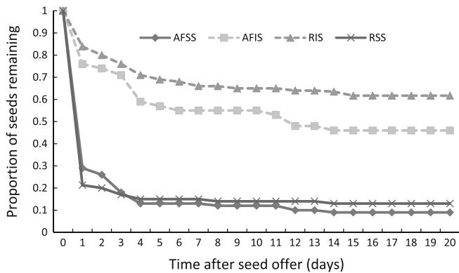
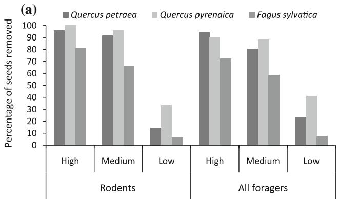
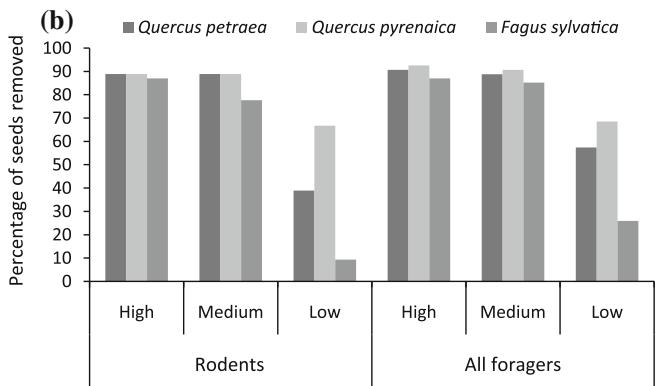
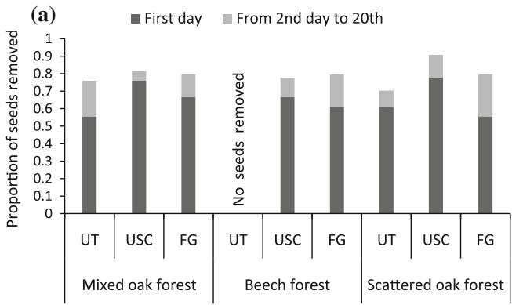
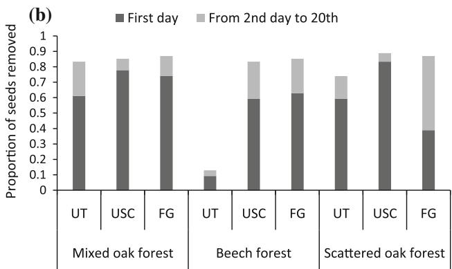
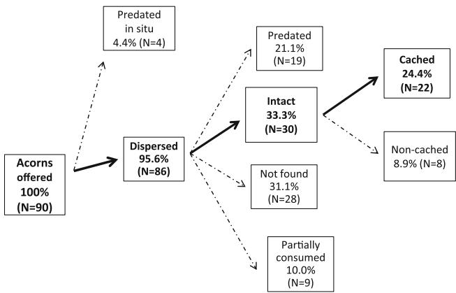
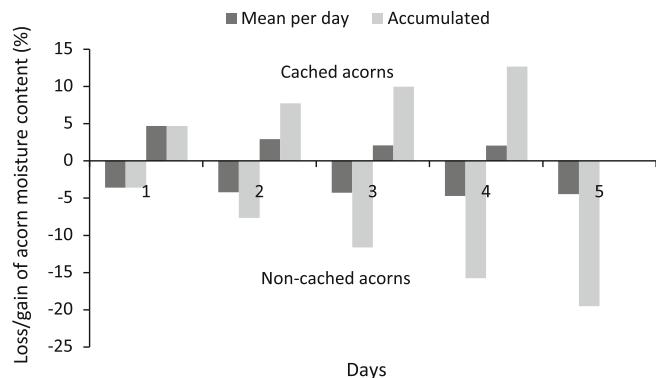

# Effects of seed quality and seed location on the removal of acorns and beechnuts

Ramo´n Perea $\cdot$ Alfonso San Miguel $\cdot$ Marı´a Martı´nez-Jauregui • Marı´a Valbuena-Caraban˜a $\cdot$ Luis Gil

Received: 9 August 2010 / Revised: 29 April 2011 / Accepted: 20 May 2011 / Published online: 12 June 2011 $©$ Springer-Verlag 2011

Abstract We examine whether different guilds of foragers remove seeds differentially according to seed quality (seed size and insect infestation) and seed location (habitat and microhabitat) in a mixed oak-beech forest. Video recordings indicated that the wood mouse (Apodemus sylvaticus) was first to encounter seeds. Foragers preferred acorns to beechnuts, large to small size and sound to infested. Nevertheless, infested seeds were removed by rodents even when sound seeds were present. Seeds that were not preferred by scatter-hoarding rodents remained longer on the ground and were more vulnerable to predation and desiccation $4 \%$ moisture loss per day). However, seeds that were removed by scatter-hoarders were moved away from their mother trees $( 9 6 \% )$ and cached individually $( 3 2 \% )$ , increasing their moisture content $3 \%$ per day). Buried seeds, simulating scatter-hoarding behavior, experienced only a $17 \%$ removal after 4 months. Seed removal differences among habitats were not due to habitat attributes but to the spatial distribution of rodent-preferred microhabitats. Thus, a significant lower seed removal was observed under the tree canopy with no shrubs. However, seed removal in forest gaps with deadwood cover was not significantly different from the preferred microhabitat (under shrub cover). In pure beech forests, seed removal by rodents only occurred under Ilex aquifolium (the only perennial cover) and under woody debris. This study concludes that seed quality and seed location determine the

contribution of different removers (predators vs. dispersers), their seed selection and their removal speed, leading to different seed fates which will eventually affect tree regeneration.

Keywords Seed size $\cdot$ Insect infestation - Scatterhoarding $\cdot$ Apodemus sylvaticus $\cdot$ Fagus sylvatica $\cdot$ Quercus

# Introduction

Seeds are the products of sexual reproduction in most vascular plants and are the principal means by which trees move across landscapes (Vander Wall et al. 2005). Seed dispersal is an important component of the regeneration process, frequently mediated by biotic agents (Herrera 2002). Thus, heavy seeds, such as nuts, can only be potentially dispersed if they are moved by animals. However, seed removal is not equal to effective seed dispersal and a high proportion of seeds may be preyed upon by the animals or dispersed to non-favorable microsites (Vander Wall 2001), thus reducing plant reproductive output. Although some guilds of seed foragers only consume the seeds (predators), some others also contribute to seed dispersal (Herrera 2002).

Seed removal depends on many factors, involving both intrinsic seed characteristics and environmental variables. Seeds that contain more energy (reserves) or are more palatable result more attractive to seed foragers (Pons and Pausas 2007). Larger seeds within a particular species contain more energy and promote higher chances for establishment (Bonal et al. 2007; Perea et al. 2011) and with farther dispersal distances (Xiao et al. 2005; Perea et al. 2011). Thus, seed size is considered the dominant determinant of dispersal effectiveness of many tree species,

including Fagaceous species (Xiao et al. 2005). However, other unexplored seed properties may also have strong influences on seed removal and dispersal. Insect infestation of seeds is a common event in many Fagaceous species which can affect a high proportion of the seed crop (Crawley and Long 1995; Branco et al. 2002; Pulido and Dı´az 2005), reducing the amount of seed reserves and seed palatability (Mun˜oz and Bonal 2008). As a result, infested nuts tend to be avoided by seed foragers (Crawley and Long 1995; Steele et al. 1996). In addition, infested seeds present lower germination rates and, therefore, contribute less to plant reproduction in comparison to sound seeds (Bonal et al. 2007). Nevertheless, an important proportion of infested nuts may germinate (Branco et al. 2002) and, thus, secondary dispersal of infested nuts may contribute to natural regeneration. However, previous studies have neglected to explore whether different guilds of foragers treat infested seeds differentially (seed selection and removal speed), which may determine the ability of infested seeds to reach a favorable microsite away from the mother tree.

Seed removal can also be affected by the spatial scale and structure of the dominant vegetation (Vander Wall 2001; Hulme and Kollmann 2005) since some habitats and microhabitats are more suitable for certain foragers (Janzen 1971; Hulme 1994). Microhabitat effects significantly influences seed encounter rates by seed removers (Hulme 1994), which may have positive or negative relationships with plant cover depending on the guild of seed foragers (Manson and Stiles 1998). But within a microhabitat, foraging on the seed rain and the soil seed bank are recognized as two different processes (Price and Joyner 1997). Beechnuts and acorns are found under the soil surface since they are cached by scatter-hoarding animals (Jensen and Nielsen 1986; Go´mez 2003; Den Ouden et al. 2005; Perea et al. 2011). Removal rate under the soil surface has been quantified at some temperate forests with very different results (Go´mez et al. 2003; Pe´rez–Ramos and Maran˜o´n 2008). Thus, differences in seed removal in the seed bank are not well understood and could vary depending on many factors such as habitat/microhabitat of location, animal community, and foraging behavior. Consequently, habitat and microhabitat may determine the proximity of certain seed removers, which will eventually affect the probability of seed encounter and the speed at which seeds are removed.

Tree regeneration will be favored by seed removal only if two requirements are satisfied: first, seeds must be removed by potential dispersers (not predators) and second, seeds must be dispersed to favorable microsites, even though a variable proportion of them will be retrieved and consumed by the dispersers to maintain seed dispersal mutualism (Vander Wall 2001). Favorable microsites

include appropriate moisture conditions, which is an essential requirement for recalcitrant seeds such as acorns. This is because acorns become nonviable when seed moisture content is below certain threshold (Suszka and Tylkowski 1980). However, dispersal studies have not fully addressed the relationship between the hoarding behavior of nut dispersers and the moisture loss/gain in recalcitrant seeds.

The relative contribution of different seed removers may play an important role in forest regeneration since different guilds of animals are likely to differ in their foraging ecology (predation vs. dispersal), in the spatial scales of their effects and their seed preferences (Hulme and Borelli 1999). Therefore, factors such as seed quality and seed location are likely to determine whether the seeds are removed by seed dispersers, by seed predators or even not removed, leading to different potential seed fates that will determine tree regeneration. Hence, the aims of this experimental study are: (1) to estimate the relative contribution of scatter-hoarding rodents to the total removal rate compared to other guilds of foragers; (2) to determine how seed quality (seed size and seed infestation) affect seed choice and seed removal speed; (3) to examine the influence of seed location (habitat and microhabitat) on foraging activities; (4) to quantify the burial effect on seed removal rate for different microhabitats by simulating scatter-hoarding behavior; and (5) to examine the effect of seed removal speed on acorn desiccation. Finally, we integrate all these aspects to analyze the consequences of seed removal (choice and speed) for the regeneration of mixed oak-beech forests.

# Materials and methods

# Study area

This study was conducted in a mixed forest comprising three tree species: a sub-Mediterranean oak (Quercus pyrenaica Willd.), a temperate oak (Quercus petraea Matt. (Liebl.)), and the European beech (Fagus sylvatica L.). The study area is located in the Ayllon mountain range in central Spain $( 3 ^ { \circ } 3 0 ^ { \prime } \mathrm { W }$ , $4 1 ^ { \circ } 0 7 ^ { \prime } \mathrm { N }$ , Madrid province), at $1 4 0 0 \ \mathrm { m }$ a.s.l., under a sub-Mediterranean climate with $9 5 8 ~ \mathrm { m m }$ annual rainfall and a 2 month summer dry season. The forest comprises a mosaic of mixed to pure stands of variable density (Pardo et al. 2004) with a large proportion of stems less than $3 0 ~ \mathrm { c m }$ dbh. The understory is formed mainly by a few species of evergreen shrubs (Erica arborea L., Juniperus communis L., Ilex aquifolium L., Genista florida L. and Adenocarpus hispanicus (Lam.) DC).

We distinguished three main habitats according to the tree inventory performed in 2000 (Alonso 2001): (1) mixed

oak stands of $Q$ . pyrenaica and $Q$ . petraea (380 stems $\mathrm { \ h a } ^ { - 1 }$ ; basal area of $2 2 . 2 ~ \mathrm { m } ^ { 2 } \mathrm { { h a } } ^ { - 1 } .$ ) with scattered beech trees (83 stems $\mathrm { { h a } } ^ { - 1 }$ ; $0 . 8 ~ \mathrm { m } ^ { 2 } ~ \mathrm { h a } ^ { - 1 }$ ), containing several shrub species in the understorey (mostly $E$ . arborea and G. florida); (2) scattered oak forest of $Q$ . pyrenaica and Q. petraea (74 stems $\mathrm { { h a } } ^ { - 1 }$ ; $2 . 3 ~ \mathrm { m } ^ { 2 } \mathrm { h a } ^ { - 1 }$ ) in a matrix of evergreen shrubs (mainly A. hispanicus and J. communis); and (3) pure stand of $F$ . sylvatica (848 stems $\mathrm { \ h a } ^ { - 1 }$ -1 ; $1 8 . 0 \ \mathrm { m } ^ { 2 } \ \mathrm { h a } ^ { - 1 } )$ ) with little ground cover mostly comprising leaf litter and isolated or small clumps of holly trees (I. aquifolium).

# Identification of seed removers

To identify the seed removers, two motion-detection digital video cameras with night vision were used. Cameras were placed at $1 . 5 ~ \mathrm { m }$ height on a tree trunk and $3 { \mathrm { - } } 4 { \mathrm { ~ m } }$ away from a wood platform containing ten Q. pyrenaica acorns. Cameras were placed within the three habitats (3 sites per habitat) and were rotated every 13–16 days. Cameras were 150–350 m from the seed choice plots (see below) to prevent attracting seed removers to these experiments. Cameras were used during October–December 2007 and November 2008, coinciding with the peak-acorn drop period.

# Seed removal experiment

Three plots were randomly established within each habitat. The distance between plots within the same habitat was $2 0 0 { - } 5 0 0 \ \mathrm { m }$ . Three microhabitats were considered in each habitat: (1) beneath a tree canopy with no shrubs; (2) beneath a tree and under evergreen shrubs with dense cover; and (3) in a recent forest gap created by tree fall and in which only grasses and deadwood were present. Thus, a total of 27 sample plots were selected (three plots $\times$ three habitats $\times$ three microhabitats). In each point, three groups of seeds (units) were placed according to the following: (u1) non-enclosed units, group of seeds placed on the ground available for all foragers; (u2) enclosed units, group of seeds placed on the ground and under a wire mesh (mesh width $= 1 . 2 ~ \mathrm { c m }$ ) in a cubic shape (50 cm length $\times ~ 5 0 ~ \mathrm { c m }$ width $\times \ 3$ cm height) which excluded removers other than small mammals; and $( u 3 )$ buried units, group of seeds under the soil surface (buried $3 { \mathrm { - } } 6 \ \mathrm { c m }$ ). Burial points were marked with sticks to easy relocate them. Each group (unit) contained 27 seeds (placed randomly side by side), so that a total of 2,187 seeds was offered to the foragers (81 units $\times ~ 2 7$ seeds). Each seeds unit was made up of nine different types of seeds (three seeds per type, see Table 1). Seeds were labeled with a waterproof permanent marker by species (Q. pyrenaica, Q. petraea and F. sylvatica), seed size (large or small), and condition (sound vs. insect

infested). Seed size and seed quality criteria are represented in Table 1. Infested acorns were identified by the combination of both emergence hole and oviposit hole of weevil-larvae (Curculio sp., Col.: Curculionidae) and infested beechnuts were identified by a smaller emergence hole of the larvae of Cydia fagiglandana Zeller (Lep.: Tortricidae). Sound acorns were tested by flotation method and only sunken seeds were chosen. All seeds were collected from the study area or in nearby locations during the first fortnight of October 2008. There was no possibility of offering large and infested seeds due to the lack of them in the field. The experiment took place during the end of October and throughout November 2008, experimental units were checked each day during the first 20 days after seeds were offered. Buried seeds were revisited 4 months later (March 2009). Each day we noted the seeds that foragers removed. In this study, we consider that a seed is removed when the seed is missing in the supply station regardless their fate (predated or dispersed) or when the seed is consumed in situ. Autumn 2008 was a normal seed production season with an average of 11.6 beechnuts per $\mathrm { m } ^ { 2 }$ of ground cover in the beech forest (habitat 3) and 16.7 acorns per $\mathrm { m } ^ { 2 }$ of ground cover (both oak species included) in the mixed oak stand (habitat 1; unpublished data).

# Seed fate and desiccation experiment

In September 2009, we collected $2 0 0 \ Q$ . pyrenaica acorns from the study area and stored them inside a plastic bag at $4 \mathrm { { } ^ { \circ } C }$ in a refrigerator for approximately 2 months. Twenty of them were weighed and imbibed in water for $4 8 \ \mathrm { h }$ . Then, we weighed the acorns to obtain the acorn weight at $100 \%$ humidity. Finally, acorns were dried in an oven at $8 0 \mathrm { { } ^ { \circ } C }$ for 5 days and weighed again to calculate the mean percentage of water content in the acorns. In November 2009, ninety acorns of those 200 were placed on the ground under two oak trees (45 each) for five consecutive days under a wire mesh $( 1 \mathrm { ~ m ~ } \times \mathrm { ~ 1 ~ m ~ } )$ , not accessible for foragers. We measured the acorn weight daily using a portable balance. Differences in weight were attributed to acorn water loss or gain. We obtained the mean atmospheric humidity per day from a weather station located at $0 . 5 \mathrm { ~ m ~ }$ height inside the mixed oak-beech forest. Simultaneously, the other ninety sound acorns were weighed, labeled, and offered to the rodents. Acorns were offered to the rodents to examine their natural fates and the effects of rodent acorn burial on seed water content. A wire $3 \mathrm { c m }$ long and $0 . 6 ~ \mathrm { m m }$ wide) was attached to each acorn by drilling a hole with a needle $( 0 . 8 ~ \mathrm { m m } )$ . A $1 4 . 5 \ \mathrm { c m } \times 1 . 2 \ \mathrm { c m }$ yellow plastic tag was attached to the wire and numbered with a waterproof permanent marker to easily relocate the acorns (Xiao et al. 2006). We assumed that the effect of the puncture on water loss/gain was negligible since the hole was covered by the

Table 1 Seeds types according to tree species, size, and infestation status   

<table><tr><td>Tree species</td><td>Size</td><td>Area (mm2)</td><td>Sanitary status</td><td>Seed quality</td></tr><tr><td rowspan="3">Q. petraea</td><td>Large</td><td>375 ≤ W*L ≤ 450</td><td>Sound</td><td>High</td></tr><tr><td>Small</td><td>120 ≤ W*L ≤ 150</td><td>Sound</td><td>Medium</td></tr><tr><td></td><td></td><td>Infested</td><td>Low</td></tr><tr><td rowspan="3">Q. pyrenaica</td><td>Large</td><td>375 ≤ W*L ≤ 450</td><td>Sound</td><td>High</td></tr><tr><td>Small</td><td>120 ≤ W*L ≤ 150</td><td>Sound</td><td>Medium</td></tr><tr><td></td><td></td><td>Infested</td><td>Low</td></tr><tr><td rowspan="3">F. sylvatica</td><td>Large</td><td>120 ≤ W*L ≤ 150</td><td>Sound</td><td>High</td></tr><tr><td>Small</td><td>70 ≤ W*L ≤ 100</td><td>Sound</td><td>Medium</td></tr><tr><td></td><td></td><td>Infested</td><td>Low</td></tr></table>

Three seeds per each type were contained in a single unit making a total number of 27 seeds per unit. $L$ is the seed length and W is the maximum seed width. Seed quality was defined according to seedling establishment success and attractiveness to foragers

wire. Then, we searched for tags, noted the acorn fates (cached, completely predated, partially predated or deposited on the ground) and weighed the acorns that were cached for the same five consecutive days.

# Data analysis

Seed removal was analyzed using Generalized Linear Mixed Models with R 2.8.1 software. For all models, we used a binary response variable (seed removed or not). Random effects were always considered in a nested structure (microhabitat nested within plot, and plot nested within habitat). Fixed effects were always the studied factors [tree species, seed quality, habitat, microhabitat, and unit type (enclosed vs. non-enclosed)] and all their possible interactions. We built this model for two different times. First, to analyze the factors affecting seed encounter and seed choice we restricted the data to the first day that units were encountered (model M1) and, second, to analyze whether the studied factors affect overall removal we used the data for the last day of the experiment (20th day; model M2). Finally, we ran a third model to analyze the burial effect after 4 months (M3). To do so, we restricted the data to the buried units $( u 3 )$ . In all cases, to choose the best model and obtain the appropriate $P$ -values we did model simplification following stepwise procedures and parsimony criteria (Crawley 2007). Thus, the nonsignificant interactions and terms were removed to achieve the minimal adequate model.

# Results

Identification of seed removers

Eighty-two video samples were taken. Wood mouse (Apodemus sylvaticus) was the main seed remover $76 \%$ of

videos), followed by European jay (Garrulus glandarius) with $8 \%$ of videos, great tit (Parus major), and nuthatch (Sitta europaea), both with $6 \%$ and finally the roe-deer (Capreolus capreolus) with $4 \%$ .

Impact of different guilds of seed foragers

Rodents were the first guild of seed foragers to encounter the seed sample units. Percentage of seeds removed from enclosed $( u 2 )$ and non-enclosed units $( u 1 )$ were not significantly different on the first day after units were encountered (Table 2). Enclosed and non-enclosed units from the same point were discovered simultaneously (the same day) in $92 \%$ of cases. Three enclosed units were not discovered during the experiment. The proportion of remaining sound seeds after the first day decreased to 0.21 for rodents and to 0.29 for all foragers (Fig. 1). Over the experiment (20 days), the percentage of seeds removed did differ between enclosed (u2) and non-enclosed units (u1) (Table 2), with a higher removal percentage $( 8 \% )$ from the non-enclosed units.

Seed choice

Seed removal throughout the experiment was fastest for Q. pyrenaica acorns, then Q. petraea acorns and finally seeds from F. sylvatica, for both sound and infested seeds and for all possible foragers (Fig. 2). Acorns were clearly preferred over beechnuts regardless the seed quality (Fig. 2). Besides, Q. pyrenaica acorns were preferred over those from Q. petraea (Fig. 2), obtaining significant differences (Table 2). Foragers also preferred large seeds (high quality) over small seeds (medium quality) on the first day (when all seeds were available) but no differences were found between sizes at the end of the experiment (Table 2). Infested seeds (low quality) were removed less for the three tree species (Fig. 2) with significant

Table 2 Summary of the results from the mixed models implemented to analyze seed removal   

<table><tr><td rowspan="2"></td><td colspan="2">M1. first day</td><td colspan="2">M2. last day (20th)</td><td colspan="2">M3. burial (4 months)</td></tr><tr><td>Z</td><td>P</td><td>Z</td><td>P</td><td>Z</td><td>P</td></tr><tr><td>Tree species</td><td></td><td></td><td></td><td></td><td></td><td></td></tr><tr><td>Q. petraea</td><td>-</td><td>-</td><td>-</td><td>-</td><td>-</td><td>-</td></tr><tr><td>Q. pyrenaica</td><td>3.22</td><td>0.001</td><td>3.29</td><td>&lt;0.001</td><td>0.97</td><td>0.338</td></tr><tr><td>F. sylvatica</td><td>-6.21</td><td>&lt;0.001</td><td>-5.69</td><td>&lt;0.001</td><td>-2.07</td><td>0.039</td></tr><tr><td>Seed quality</td><td></td><td></td><td></td><td></td><td></td><td></td></tr><tr><td>High (large &amp; sound)</td><td>-</td><td>-</td><td>-</td><td>-</td><td>-</td><td>-</td></tr><tr><td>Medium (small &amp; sound)</td><td>-2.66</td><td>0.007</td><td>-1.84</td><td>0.065</td><td>-0.77</td><td>0.437</td></tr><tr><td>Low (small &amp; infested)</td><td>-10.81</td><td>&lt;0.001</td><td>-10.11</td><td>&lt;0.001</td><td>-1.53</td><td>0.125</td></tr><tr><td>Habitat</td><td></td><td></td><td></td><td></td><td></td><td></td></tr><tr><td>Mixed oak forest</td><td>-</td><td>-</td><td>-</td><td>-</td><td>-</td><td>-</td></tr><tr><td>Beech forest</td><td>-2.59</td><td>0.009</td><td>-10.71</td><td>&lt;0.001</td><td>-1.8·10-6</td><td>1.00</td></tr><tr><td>Scattered oak forest</td><td>0.25</td><td>0.800</td><td>-1.87</td><td>0.166</td><td>2.78</td><td>0.005</td></tr><tr><td>Microhabitat</td><td></td><td></td><td></td><td></td><td></td><td></td></tr><tr><td>Under tree</td><td>-</td><td>-</td><td>-</td><td>-</td><td>-</td><td>-</td></tr><tr><td>Under shrub</td><td>3.26</td><td>0.001</td><td>3.23</td><td>0.001</td><td>0.92</td><td>0.358</td></tr><tr><td>Forest gap</td><td>2.07</td><td>0.038</td><td>2.06</td><td>0.039</td><td>0.08</td><td>0.976</td></tr><tr><td>Guild of foragers</td><td></td><td></td><td></td><td></td><td></td><td></td></tr><tr><td>All foragers (non-enclosed units)</td><td>-</td><td>-</td><td>-</td><td>-</td><td>Not applicable</td><td></td></tr><tr><td>Rodents (enclosed units)</td><td>1.20</td><td>0.230</td><td>-3.28</td><td>0.001</td><td></td><td></td></tr><tr><td>Interactions</td><td></td><td></td><td></td><td></td><td></td><td></td></tr><tr><td>Medium quality: rodents foragers</td><td>-</td><td>-</td><td>Not found</td><td></td><td>Not applicable</td><td></td></tr><tr><td>Medium quality: all foragers</td><td>-2.03</td><td>0.042</td><td></td><td></td><td></td><td></td></tr><tr><td>Forest gap: mixed oak forest</td><td>-</td><td>-</td><td>Not found</td><td></td><td>Not found</td><td></td></tr><tr><td>Forest gap: scattered oak forest</td><td>-2.53</td><td>0.011</td><td></td><td></td><td></td><td></td></tr><tr><td>Forest gap: beech forest</td><td>-0.99</td><td>0.317</td><td></td><td></td><td></td><td></td></tr><tr><td>Under tree: mixed oak forest</td><td>-</td><td>-</td><td>-</td><td>-</td><td>Not found</td><td></td></tr><tr><td>Under tree: scattered oak forest</td><td>-2.59</td><td>0.800</td><td>-1.87</td><td>0.062</td><td></td><td></td></tr><tr><td>Under tree: beech forest</td><td>-2.59</td><td>0.009</td><td>-10.71</td><td>&lt;0.001</td><td></td><td></td></tr></table>

First day refers to the first day that units were encountered by the foragers. Z is the Z-score for normal distribution and $P$ the statistical significant level (referred to the first factor level)   
Bold type indicates statistical significance $( P < 0 . 0 5$   
M1: AIC 520.4, Deviance 482.8. M2: AIC 484.1, Deviance 450.1, M3: AIC101.7, Deviance 77.7

differences throughout the experiment (Table 2). Seed choice between enclosed and non-enclosed units showed no significant differences except for the first day, when all foragers removed less medium quality seeds (small and sound) in comparison to rodents (Fig. 3a; Table 2). No other significant interactions attending to seed choice were found.

The influence of habitat and microhabitat

Beech forest had the lowest percentage of seed removal for both rodents (Fig. 3a) and all foragers (Fig. 3b) and it was the only habitat with significant differences in seed removal (Table 2). Seeds took longer to be encountered by

foragers in the forest gaps of scattered oak forest in comparison to the forest gaps of mixed oak and beech forests (Table 2). A lower seed removal (throughout the experiment) was observed under the tree canopy as compared with evergreen shrub land and forest gaps (Fig. 3), with significant differences (Table 2). Although more seeds were removed under shrub cover (Fig. 3), we found no significant differences in seed removal between forest gap and shrub cover throughout the experiment. There was a strong interaction between beech forest habitat and under tree microhabitat since seeds were removed in a lower significant number under beech trees as compared to under oak trees (Fig. 3; Table 2), especially for rodents that did not remove any seeds under beech trees (Fig. 3a).

  
Fig. 1 Proportion of seeds remaining during the first 20 days after all seeds were offered. Data for sound and infested seeds and both rodents and all foragers. AFSS all foragers sound seeds, AFIS all foragers infested seeds, RSS rodents sound seeds, RIS rodents infested seeds

  
Fig. 2 Percentage of seeds removed for enclosed (rodents) and nonenclosed units (all foragers) and for different seed quality and tree species. a Seed removal for the first day that units were encountered and b overall seed removal (last day of the experiment, including encountered and no encountered units). High quality refers to sound large seeds, medium quality to small sound seeds, and low quality to small infested seeds

# Seed fate

Most tagged acorns were dispersed and only four acorns were predated in situ (Fig. 4). Twenty-eight acorns $( 3 1 . 1 \%$ of the acorns initially offered) were dispersed and not

  
Fig. 3 Proportion of seeds that were removed by rodents (a) and by all foragers (b) for different habitats and microhabitats. Data for the first day that seeds were encountered (black bar) and for the rest of the experiment (gray bar). Microhabitats were UT under tree, USC under shrub cover, $F G$ forest gap

found. From those 68 acorns that were dispersed and relocated, 22 of them were cached and 8 deposited on the ground (32.3 and $1 1 . 7 \%$ of the relocated and dispersed acorns, respectively). The rest of acorns were either predated or partially consumed (Fig. 4). All caches contained only one seed. Acorns that were not found were

  
Fig. 4 Diagram of acorn fate, showing the percentages and number of acorns for each fate category. Bold arrows indicate the best possible acorn fate for tree regeneration

consistently similar along the seed mass $( 7 . 8 \pm 2 . 6 \ \mathrm { g }$ for lost acorns and $7 . 3 \pm 2 . 3 \ \mathrm { g }$ for the original mean weight).

# Burial effect

All burial points were reviewed after 4 months and $17 \%$ $( N = 1 2 5 )$ ) of the buried seeds had been removed. We found burrows (and no rooting activity) where buried seeds were removed so that seed removal was attributed to wood mice. Beechnuts were less preferred in comparison to acorns and no significant differences were found between levels of seed quality (Table 2). Seeds were removed only in the scattered oak habitat and no differences were found between microhabitats (Table 2).

In the laboratory, water accounted for $4 6 . 2 \pm 1 . 9 \%$ $( N = 2 0 )$ ) of the total acorn weight. Original moisture content of those acorns was $8 6 . 4 \pm 2 . 4 \%$ $N = 2 0 $ . Acorns that were not cached by rodents (remained on the ground) lost an average of $4 . 3 \pm 2 . 0 \%$ of their moisture content per day (Fig. 5). In contrast, seeds that were cached by wood mice gained an average of $3 . 0 \pm 1 . 5 \%$ of moisture content per day (Fig. 5; $N = 2 2$ for the fifth day). Mean relative humidity per day varied from 68 to $7 5 \%$ .

# Discussion

Impact of different guilds of seed foragers

Rodents were the main guild of seed removers on the ground, as has been recorded for other temperate and Mediterranean ecosystems (Crow 1988; Pons and Pausas 2007). Furthermore, videos and choice experiments reveal that wood mice are the first species to encounter acorns and

  
Fig. 5 Mean and accumulated moisture loss (negative values) and gain (positive values) for cached and non-cached acorns $( N = 1 8 0 )$ ) along the first 5 days after seed offer. Initial moisture content was $8 6 . 4 \pm 2 . 4 \%$ , obtained from a sample of 20 acorns. A fully saturated acorn is at $100 \%$ of moisture content. Cached acorns remained cached for 4 days at most since they were encountered by rodents 1 day after seed offer

beechnuts. Thus, scatter-hoarding rodents discover seeds much more rapidly than non-scatter-hoarding mammals or birds. Birds were the second main guild of acorn removers from the soil, exceeding removal rates of ungulates. Birds like jays or nuthatches are considered primary removers since they usually remove seeds from the trees (Hutchins et al. 1996; Go´mez 2003). Nevertheless, birds can make up an important guild of secondary dispersers. The higher removal rate found for all foragers compared to small mammals at the end of the experiment and the video recordings suggest that after small mammals have selected the seeds, seed removal is mostly due to other guilds of foragers such as birds or ungulates.

# Seed choice

Wood mice preferred acorns to beechnuts of all sizes and regardless of whether they were infested or not. Large seeds were positively selected, showing that size has a great influence on seed choice. This has been suggested for other oak species, indicating that size plays an important role in natural regeneration with large acorns preferred and farther dispersed (Xiao et al. 2005) and with higher successful establishment (Bonal et al. 2007; Perea et al. 2011). Small acorns and beechnuts were eventually taken after 20 days, indicating that small seeds are more vulnerable than large seeds to consumption by predators or desiccation.

Whether a seed was infested or not was the most relevant characteristic in seed choice and infested seeds from all species were less preferred (Table 2). A relative high removal percentage of infested acorns was observed on the first day. Thus, infested seeds are removed even when sound seeds are available. Weevil-infested acorns are known to germinate and establish (Branco et al. 2002; Bonal et al. 2007; Xiao et al. 2007) and are less likely to be completely consumed by rodents compared to sound acorns (Mun˜oz and Bonal 2008). This together with the fact that rodents rarely damage the embryo when eating the acorns partially (Perea et al. 2011) leads to the possibility that infested acorns could contribute to the natural regeneration, especially in years of high infestation rates when most sound acorns are eaten (Crawley and Long 1995). However, infested beechnuts are much smaller than infested acorns and, thus, have higher probability of embryo damage, with very low germination success (Kelbel 1999).

# The influence of habitat and microhabitat

No differences in seed removal between oak habitats were found. Pure beech forest was the habitat with significantly lower seed removal. Surprisingly, no seeds were removed by rodents under the beech trees (Fig. 3a). We suggest that

this is because there is no ground cover for rodents beneath beech trees. Higher rodent activity (seed removal) was found under shelter in comparison to open. Thus, wood mice populations in dense and pure beech forests are dependent on cover provided by holly trees (I. aquifolium), since this is the only perennial cover provided. Despite open microhabitats are thought to be less preferred by small rodents (Hulme and Kollmann 2005), herein we demonstrate that recently created forest gaps do not show any differences in seed removal in comparison to shrub cover microhabitat. This provides that foraging activity of rodents is not only confined to vegetation cover but also to deadwood cover. Finally, this study indicates seed removal differences among habitats were not due to habitat attributes but to the spatial distribution of rodent-preferred microhabitats.

# Burial effect

Acorn and beechnut burial, simulating the effect of dispersal by scatter-hoarders, significantly reduced the number of seeds removed. Burial decreases the probability that a seed will be discovered by any foragers (Hulme and Borelli 1999). Thus, burial has positive implications for natural regeneration of beeches and oaks since it avoids desiccation (Fig. 5) and stimulates germination and establishment (Sonesson 1994). As acorns are recalcitrant seeds, they become nonviable when moisture content is low, e.g., ${ < } 4 0 \%$ for the temperate Quercus robur (Suszka and Tylkowski 1980). Thus, acorns that are not removed or hoarded by animals will become unviable, especially under xeric conditions.

# Implications of seed removal for forest regeneration

This study shows that seed quality and seed location are important factors to determine whether the seeds are rapidly removed by predators or potential dispersers, leading to different seed fates that will eventually influence tree regeneration. Those seeds that fall into sheltered microhabitats will be rapidly removed and cached by scatterhoarding rodents. This foraging behavior avoids possible predation by ungulates, one the main detrimental fates of acorns (Gosling 1989; Herrera 1995; Pulido and Dı´az 2005). Although this study provides weak information about seed dispersal, other studies show stronger evidence of wood mice as effective dispersers of nuts, contributing to tree regeneration (Pulido and Dı´az 2005; Den Ouden et al. 2005; Go´mez et al. 2008; Perea et al. 2011). This study adds that wood mice cache a high proportion of acorns immediately after removal and in one-seed caches, decreasing possible competition among seedlings and increasing seed moisture content, an important requirement for recalcitrant seeds. Thus, the best possible initial fate for these

recalcitrant seeds is probably to be rapidly removed by scatter-hoarding rodents. Besides, seeds need to be moved away from their parents to decrease density-dependent mortality and to allow gene flow and colonization of new environments (Vander Wall 2001; Valbuena–Caraban˜a et al. 2005).

Whether tree regeneration is favored by those seeds that are preferred by rodents might depend on masting, a common phenomenon in Fagaceous species. In high seed production years, seeds that are removed first (preferred) by rodents (e.g., large and sound seeds) would have higher probability to be effectively dispersed in comparison to non-preferred seeds (small and infested) that will remain longer on the ground. Those effectively dispersed seeds would drive not only tree regeneration but also species composition (Hooper et al. 2004).

This study also has implications for forest management since seed removal by scatter-hoarding rodents strongly depends on the presence/absence of their preferred microhabitats. Thus, leaving isolated or small patches of holly trees inside beech forests will favor rapid removal by scatter-hoarding rodents. Besides, woody debris enhances seed removal in forest gaps or edges and serves as a useful complement to perennial shrub cover. Essentially, the conclusion of this study is that seed quality and seed location determine the contribution of different removers (predators vs. dispersers), their seed selection and their removal speed, leading to different seed fates which will eventually affect tree regeneration.

Acknowledgments We would like to thank Steve B. Vander Wall for numerous suggestions and corrections, Christopher Moore for his English corrections and assistance with some of the figures, Mariana Ferna´ndez for valuable comments and help on data analysis and Jesu´s Alonso for his fieldwork assistance. Ramo´n Perea is supported by a PhD grant from Universidad Polite´cnica de Madrid. This study was funded by the project REGENFOR-CM (S2009AMB-1668) of Comunidad Auto´noma de Madrid and the project AGL2006-00813 of the Spanish CICYT.

# References

Alonso J (2001) Inventario forestal del sitio natural de intere´s nacional Hayedo de Montejo de La Sierra, monte no 89 del C.U.P. El Chaparral y La Solana. Comunidad de Madrid   
Bonal R, Mun˜oz A, Dı´az M (2007) Satiation of predispersal seed predators: the importance of considering both plant and seed level. Evol Ecol 21:367–380   
Branco M, Branco C, Merouani H, Almeida MH (2002) Germination success, survival and seedling vigour of Quercus suber acorns in relation to insect damage. For Ecol Manage 166:159–164   
Crawley MJ (2007) The R book. Wiley Editorial, England   
Crawley MJ, Long CR (1995) Alternate bearing, predator satiation and seedling recruitment in Quercus robur L. J Ecol 83:683–696   
Crow TR (1988) Reproductive mode and mechanisms for selfreplacement of northern red oak (Quercus-rubra)—a review. For Sci 34:19–40

Den Ouden J, Jansen PA, Smit R (2005) Jays, mice and oaks: Predation and dispersal of Quercus robur and Q.petraea in North-western Europe. In: Forget PM, Lambert J, Vander Wall SB (eds) Seed fate. CABI Publishing, Wallingford, pp 223–240   
Go´mez JM (2003) Spatial patterns in long-distance dispersal of Quercus ilex acorns by jays in a heterogeneous landscape. Ecography 26:573–584   
Go´mez JM, Garcı´a D, Zamora R (2003) Impact of vertebrate acornand seedling-predators on a Mediterranean Quercus pyrenaica forest. For Ecol Manage 180:125–134   
Go´mez JM, Puerta-Pin˜eiro C, Schupp EW (2008) Effectiveness of rodents as local seed dispersers of Holm oaks. Oecologia 155:529–537   
Gosling PG (1989) The effect of drying Quercus robur acorns to different moisture contents, followed by storage, either with or without imbibition. Forestry 62:41–50   
Herrera CM (2002) Seed dispersal by vertebrates. In: Herrera CM, Pellmyr O (eds) Plant-animal interactions. An evolutionary approach. Blackwell, Oxford, pp 185–208   
Herrera J (1995) Acorn predation and seedling production in a lowdensity population of cork oak (Quercus suber L.). For Ecol Manage 76:197–201   
Hooper ER, Legendre P, Condit R (2004) Factors affecting community composition of forest regeneration in deforested, abandoned land in Panama. Ecology 85:3313–3326   
Hulme PE (1994) Post-dispersal seed predation in grasslands: its magnitude and sources of variation. J Ecol 82:645–652   
Hulme PE, Borelli T (1999) Variability in post-dispersal seed predation in deciduous woodland: relative importance of location, seed species, burial and density. Plant Ecol 145:149–156   
Hulme PE, Kollmann J (2005) Seed predator guilds, spatial variation in post-dispersal seed predation and potential effects on plant demography. In: Forget PM, Lambert J, Vander Wall SB (eds) Seed fate. CABI Publishing, Wallingford, pp 9–30   
Hutchins HE, Hutchins SA, Liu BW (1996) The role of birds and mammals in Korean pine (Pinus koraensis) regeneration dynamics. Oecologia 107:120–130   
Janzen D (1971) Seed predation by animals. Annu Rev Ecol Syst 2:465–492   
Jensen TS, Nielsen OF (1986) Rodents as seed dispersers in a heathoak wood succession. Oecologia 70:214–221   
Kelbel P (1999) Results of monitoring of carpophagus fauna on the European beech (Fagus sylvatica) in Slovakia. J For Sci 45:443–448   
Manson RH, Stiles EW (1998) Links between microhabitat preferences and seed predation by small mammals in old fields. Oikos 82:37–50

Mun˜oz A, Bonal R (2008) Seed choice by rodents: learning or inheritance? Behav Ecol Sociobiol 62:913–922   
Pardo F, Gil L, Pardos JA (2004) Structure and composition of polestage stands developed in an ancient wood pasture in central Spain. Forestry 77:67–74   
Perea R, San Miguel A, Gil L (2011) Leftovers in seed dispersal: ecological implications of partial seed consumption for oak regeneration. J Ecol 99:194–201   
Pe´rez-Ramos IM, Maran˜o´n T (2008) Factors affecting post-dispersal seed predation in two coexisting oak species: microhabitat, burial and exclusion of large herbivores. For Ecol Manage 255:3506–3514   
Pons J, Pausas JG (2007) Rodent acorn selection in a Mediterranean oak landscape. Ecol Res 22:535–541   
Price MV, Joyner JW (1997) What resources are available to desert granivores: seed rain or soil seed bank? Ecology 78:764–773   
Pulido FJ, Dı´az M (2005) Regeneration of a Mediterranean oak: a whole-cycle approach. Ecoscience 12:92–102   
Sonesson LK (1994) Growth and survival after cotyledon removal in Quercus robur seedlings, grown in different natural soil types. Oikos 69:65–70   
Steele MA, Hadj-Chikh LZ, Hazeltine J (1996) Caching and feeding decisions by Sciurus carolinensis: responses to weevil-infested acorns. J Mammal 77:305–314   
Suszka B, Tylkowski T (1980) Storage of acorns of the English oak (Quercus robur L.) over 1–5 winters. Arboretum Ko´rnickie 25:199–229   
Valbuena-Caraban˜a M, Gonza´lez Martı´nez SC, Sork VL, Collada C, Soto A, Goicoechea PG, Gil L (2005) Gene flow and hybridisation in a mixed oak forest (Quercus pyrenaica Willd. and Quercus petraea (Matts.) Liebl. in central Spain. Heredity 95:457–465   
Vander Wall SB (2001) The evolutionary ecology of nut dispersal. Bot Rev 67:74–117   
Vander Wall SB, Kuhn KM, Beck MJ (2005) Seed removal, seed predation, and secondary dispersal. Ecology 86:801–806   
Xiao ZS, Zhang ZB, Whang YS (2005) Effects of seed size on dispersal distance in five rodent-dispersed fagaceous species. Acta Oecol 28:221–229   
Xiao ZS, Jansen PA, Zhang ZB (2006) Using seed-tagging methods for assessing post-dispersal seed fate in rodent-dispersed trees. For Ecol Manage 223:18–23   
Xiao ZS, Harris MK, Zhang ZB (2007) Acorn defenses to herbivory from insects: Implications for the joint evolution of resistance, tolerance and escape. For Ecol Manage 238:302–308