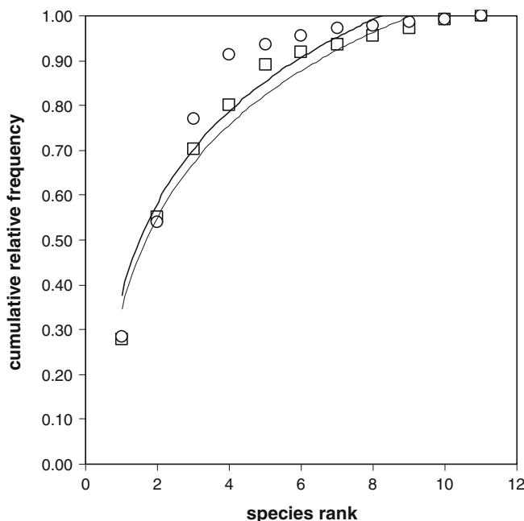

# Applying abundance/biomass comparisons on a small mammal assemblage from Barn owl (Tyto alba) pellets (Mount Soratte, central Italy): a cautionary note

Simona Prete $\cdot$ Corrado Battisti $\cdot$ Francesca Marini • Paolo Ciucci

Received: 2 November 2011 / Accepted: 14 May 2012 / Published online: 8 June 2012 $©$ Accademia Nazionale dei Lincei 2012

Abstract Abundance/biomass comparisons (or ABC curves) allow to obtain information on the level of (anthropogenic or natural) disturbance that may sensu lato affect specific communities. In order to verify the general validity of the ABC curves, we applied these comparisons to a small mammal dataset obtained by a sample of Barn owl (Tyto alba) pellets collected in a nature reserve of central Italy (Monte Soratte). From 43 pellets, we obtained 111 individuals belonging to 11 shrews and rodents species. Microtus savii, Apodemus sylvaticus, and Apodemus flavicollis were the species most frequently preyed upon by owls. Indices such as absolute (and normalized) species richness and Shannon–Wiener diversity consistently showed higher values than those obtained in similar studies in central Italy, highlighting the complex structure of this assemblage occurring in a landscape with low anthropization. From ABC curves, abundance was slightly lower than biomass, even though differences between paired cumulative frequencies were not significant. This pattern suggests that the small mammal community in our study area

features a low level of disturbance. Nevertheless, whereas in undisturbed assemblages a higher biomass in ABC curves indicate a higher frequency of larger species at higher trophic level, in small mammal assemblages such as those revealed by owl pellets, large-sized species are herbivorous, synanthropic and typical of disturbed habitats. Accordingly, we caution that in disturbed habitats an increase of small mammals with high body mass may results in ABC curves with biomass higher than abundance. Our results therefore suggest that there might be relevant exceptions to the general patterns so far developed for ABC curves.

Keywords Abundance $\cdot$ Biomass $\cdot$ ABC curves - Disturbance - Owl pellets - Italy

# 1 Introduction

In community ecology, we may obtain large datasets on the abundance and biomass of species assemblages that may be analyzed using different approaches (e.g., Wiens 1989; Krebs 2001; Magurran 2004). Among them, the most used are the diversity/dominance diagrams (or Whittaker plots), the $\mathbf { k }$ -dominance plots and the abundance/biomass comparisons (or ABC curves; Warwick 1986; Lambshead et al. 1983; Krebs 1999; Magurran 2004). All the diagrams obtained by these analyses explicit the frequency ratio (or dominance) among species, either calculated on individual abundance (e.g., diversity/dominance diagrams, and k-dominance plots) or cumulatively, based on abundance and biomass contemporarily (e.g., ABC curves). These representations provide an explicit information on the structure of species assemblages (e.g., diversity and evenness), but they also allow to obtain general information on

S. Prete - P. Ciucci Dipartimento di Biologia e Biotecnologie, Universita` di Roma ‘‘La Sapienza’’, Viale dell’Universita`, 32, 00185 Rome, Italy e-mail: simona_prete@hotmail.it

P. Ciucci e-mail: paolo.ciucci@uniroma1.it

C. Battisti ( ) - F. Marini Provincia di Roma, Servizio Ambiente (‘‘aree protette-parchi regionali’’), via Tiburtina, 691, 00159 Rome, Italy e-mail: c.battisti@provincia.roma.it

F. Marini e-mail: f.marini@provincia.roma.it

the natural or anthropogenic stress that might affect the assemblages. For example, under Whittaker’s and k-dominance plots more elevated abundance curves represent the less diverse and more stressed assemblages, while in ABC curves comparison between the biomass and abundance curves is used to make inferences on the level of disturbance affecting the assemblages (Magurran 2004).

Terrestrial small mammals (shrews and rodents) constitute a significant component of vertebrate communities, and their monitoring allows large sets of data with a moderate research effort. In turn, these datasets may provide information on the naturalness or, on the contrary, the level of disturbance at a site (Avenant 2005). Indeed, small mammal communities, for their large number of individuals and species, may be largely affected from environmental changes and anthropogenic or natural disturbances (e.g., de la Pena et al. 2003).

Studies on small mammal communities utilizing owl (Strigiformes) pellets have been widely carried out in the last 30 years (Contoli 1976a, 1976b, 1976c, 1976d; Lovari et al. 1976; Mikkola 1983). These studies focused on autecology of the predator (e.g., Love et al. 2000), synecology of the species assemblage and their variations in time and space (Aste and Contoli 1987; Aloise et al. 1990; Bontzorlos et al. 2005), biogeography at population and community level (e.g., Barbosa et al. 1992; Battisti et al. 1997), and nature reserve management (e.g., Amori and Pasqualucci 1987; de la Pena et al. 2003). In these studies, Barn owl (Tyto alba) is a widely utilized species because of its wide distribution and because owl pellets are easy to collect (Contoli 1980; Mikkola 1983).

Some authors (e.g., Mikkola 1983) believe that species’ frequencies in Barn owl pellets are proportional to the true relative abundance of their prey. Nevertheless, evidences from other authors (e.g., Capizzi and Luiselli 1996; Yom-Tov and Wool 1997) suggest that prey assemblages from owl pellets reveal different species proportions when compared to trapping.

In this work, we report the structure of a small mammal assemblage obtained by Barn owl pellets from a nature reserve located in central Italy. In particular, we applied ABC curves to compare abundance and biomass obtained from this assemblage to evaluate its degree of natural or anthropogenic disturbance. Among vertebrates, the ABC approach has been recently applied in fish and bird assemblages (Penczak and Kruk 1999; Magurran and Phillip 2001; Benassi et al. 2009), but it was never applied to a mammal assemblage. In particular, we verified if the general validity of the abundance/biomass comparison, and its relative management implications (i.e., disturbed vs. undisturbed assemblages) may be extended to a small mammal assemblage as reconstructed from owl’s pellets.

# 2 Materials and methods

# 2.1 Study area

The study area is located inside the ‘‘Monte Soratte’’ nature reserve (hereafter, MSNR; 444.6 ha), a protected area sited in central Italy $( 4 2 ^ { \circ } 1 4 ^ { \prime }$ Lat N; $1 2 ^ { \circ } 3 1 ^ { \prime }$ Long E) along the Tiber valley (province of Rome, Latium region). This relatively undisturbed area is also designated as a site of conservation concern (code IT6030014) according to 92/43/EEC ‘‘habitat’’ directive. MSNR features a karstic relief (691 m a.s.l.) with an elongated shape along the NW–SE axis, neighbouring to a small town (Sant’Oreste; $4 1 3 \mathrm { ~ m ~ }$ a.s.l.).

According to ‘‘habitat’’ directive, the habitat types occurring in the MSNR are: (1) 6220—pseudo-steppe with grasses and annuals of the Thero-Brachypodietea; (2) 6110—rupicolous calcareous or basophilic grasslands of the Alysso-Sedion albi; (3) 9340—Quercus ilex and Q. rotundifolia forests, dominated by Quercus ilex or Q. rotundifolia, often, but not necessarily, calcicolous; (4) 8210—calcareous rocky slopes with chasmophytic vegetation (including the vegetation of fissures of limestone cliffs belonging essentially to the Potentilletalia caulescentis and Asplenietalia glandulosi orders; further details in Provincia di Roma 2006).

# 2.2 Field methods and data analysis

The research was carried out on a sample of Barn owl’s pellets collected in December 2010 inside an abandoned rural house named ‘‘Fornace’’ $3 0 0 \ \mathrm { m }$ a.s.l.). Once collected, owl pellets were dried in open air and subsequently processed according to standardized techniques (Contoli 1980; Mikkola 1983).

Mammal species represented inside owl pellets can be easily identified and classified according to their skulls or other diagnostic bones, following the keys reported in Chaline et al. (1974), Contoli (1976d, 1983), Mikkola (1983), Nappi (2001), Amori et al. (2008). We identified the species using a binocular microscope at $1 0 \times$ . Skulls of Apodemus sp. were classified by a specialist (G. Amori, pers. comm.).

To estimate the proportions of species in the small mammal community using prey proportions as revealed in owl pellets, we assumed that: (1) owls hunted unselectively (i.e., randomly) within the small mammal community; (2) the collected pellets are a representative sample of the owls’ catch. Accordingly to the limitations known for these studies (see Introduction), we limit our inferences from owl pellets only to the assemblage of species preyed by owls and their related community without implications on their true proportion in the community.

The collected data were summarized using a set of quantitative indices: (1) absolute species richness (number of preyed species (S)); (2) normalized species richness, obtained by Margalef index as $D = ( S { - } 1 ) / 1 0 \mathrm { g } N$ (where $s$ is the number of species sampled, and $N$ is the number of prey, i.e., the number of individual records in the pellet sample); (3) Shannon–Wiener diversity index (H’, Shannon and Weaver 1949); (4) trophic level index (TLI, obtained by the Insectivora/Rodentia ratio; Contoli 1980; Contoli and Di Russo 1985); (5) Microtinae/Murinae ratio (MMR, an environmental index with an agronomic value; Contoli 1980). For biomass calculation, the average weight of each species was estimated following Amori et al. (2008).

For each species in the assemblage, we additionally obtained two values related to abundance (N) and biomass (B), and for both we calculated their relative $\mathrm { f r } _ { \mathrm { N } }$ and frB, respectively) and cumulative frequency (i.e., relative proportion). We then ranked the species, from the most to the least important based on either abundance or biomass, along the $x$ -axis in a Cartesian space in order to obtain two curves both for abundance and biomass (ABC curves; Warwick 1986; Magurran 2004).

Finally, we performed a W statistic (Clarke 1990) as:

$$
W = \sum \left(\mathrm {f r} _ {\mathrm {B}} - \mathrm {f r} _ {\mathrm {N}}\right) / \left[ 5 0 (\mathrm {S} - 1) \right],
$$

where $\mathrm { f r } _ { \mathrm { B } }$ and $\mathrm { f r } _ { \mathrm { N } }$ are the biomass and abundance frequency, respectively, of the ith-species, and S is the number of preyed species. $N _ { \mathrm { i } }$ and $B _ { \mathrm { i } }$ do not necessarily refer to the same species, since species are ranked separately in decreasing order for each abundance/biomass value. W ranges from $^ { - 1 }$ to $+ 1$ , with positive values if the biomass curve is consistently above the abundance curve, implying an undisturbed assemblage (Magurran 2004). On the contrary, negative values of W reveal an abundance curve consistently above the biomass curve, implying a disturbed assemblage. Overlapping biomass and abundance curves produce a W value of about zero, implying a moderate disturbance on the assemblage (Magurran 2004, p. 156). To formally assess differences between biomass and abundance cumulative frequencies, we performed a Kolmogorov–Smirnov two-sample test using SPSS v.13.0 (SPSS 2003).

# 3 Results

From 43 pellets, we obtained 111 individuals belonging to 11 small mammal species (four shrew species and seven rodent species; Table 1; Margalef index $( D ) = 4 . 8 9 $ ). Microtus savii, Apodemus sylvaticus, Apodemus flavicollis were the most preyed species.

Table 1 Small mammal species identified from 43 Barn owl pellets collected at the ‘‘Monte Soratte’’ nature reserve (central Italy)   

<table><tr><td>Species</td><td>Average weight</td><td>Ni</td><td>frN</td><td>Bi</td><td>frB</td></tr><tr><td>Crocidura suaveolens(Pallas, 1811)</td><td>4</td><td>11</td><td>0.099</td><td>44</td><td>0.016</td></tr><tr><td>Suncus etruscus(Savi, 1822)</td><td>2</td><td>10</td><td>0.090</td><td>20</td><td>0.007</td></tr><tr><td>Crocidura leucodon(Hermann, 1780)</td><td>10</td><td>2</td><td>0.018</td><td>20</td><td>0.007</td></tr><tr><td>Sorex cfr. samniticus(Altobello, 1926)</td><td>10</td><td>2</td><td>0.018</td><td>20</td><td>0.007</td></tr><tr><td>Soricomorpha</td><td></td><td>25</td><td>0.225</td><td>104</td><td>0.037</td></tr><tr><td>Microtus savii(de Sèlys Longchamps, 1838)</td><td>21</td><td>31</td><td>0.279</td><td>651</td><td>0.231</td></tr><tr><td>Apodemus sylvaticus(Linnaeus, 1758)</td><td>24</td><td>30</td><td>0.270</td><td>720</td><td>0.255</td></tr><tr><td>Apodemus flavicollis(Melchior, 1834)</td><td>24</td><td>17</td><td>0.153</td><td>408</td><td>0.145</td></tr><tr><td>Mus musculus(Linnaeus, 1758)</td><td>19</td><td>3</td><td>0.027</td><td>57</td><td>0.020</td></tr><tr><td>Muscardinus avellanarius(Linnaeus, 1758)</td><td>30</td><td>2</td><td>0.018</td><td>60</td><td>0.021</td></tr><tr><td>Rattus norvegicus(Berkenhout, 1769)</td><td>400</td><td>2</td><td>0.018</td><td>800</td><td>0.284</td></tr><tr><td>Myodes glareolus(Schreder, 1780)</td><td>21</td><td>1</td><td>0.009</td><td>21</td><td>0.007</td></tr><tr><td>Rodentia</td><td></td><td>86</td><td>0.775</td><td>2,717</td><td>0.963</td></tr><tr><td>Total</td><td></td><td>111</td><td>1</td><td>2,821</td><td>1</td></tr></table>

Average weight (in g, from Nappi 2001 and Amori et al. 2008)   
$N _ { i }$ number of individual prey, $f r _ { N }$ relative frequency of prey species, $B _ { i }$ species biomass (in g), $f r _ { B }$ relative biomass proportion

Rodents were more represented then shrews both in abundance $( 7 7 . 5 ~ \% )$ and biomass $( 9 6 . 3 ~ \% )$ . In our study site, the quantitative indices at the assemblage level revealed somehow higher values with respect to previous, similar studies in other study areas in central (Tyrrhenian) Italy (Table 2).

A comparison of the ABC curves shows that the abundance curve is slightly lower then the biomass curve, but we did not reveal any significant difference $( Z = 0 . 2 1 3$ , $n = 1 1$ $n = 1 1 , ~ p = 1$ , Kolmogorov–Smirnov 2-sample test; Fig. 1), nor a W value different from zero.

# 4 Discussion

In the small mammal assemblage of our study area, absolute species richness and diversity index show values on average higher than those reported in similar studies from Tyrrhenian central Italy, while trophic level index show a medium value and Microtinae/Murinae ratio a medium–

Table 2 Indices computed from the small mammal dataset obtained by 43 owl pellets collected at the ‘‘Monte Soratte’’ nature reserve (central Italy, December 2010)   

<table><tr><td rowspan="2">Index</td><td colspan="2">Index value</td></tr><tr><td>This study</td><td>Tyrrhenian central Italy (range)</td></tr><tr><td>Absolute species richness (S)</td><td>11</td><td>3–11</td></tr><tr><td>Shannon-Wiener diversity index (H&#x27;)</td><td>1.87</td><td>0.76–1.87</td></tr><tr><td>Trophic Level index (TLI)</td><td>0.29</td><td>0.05–0.63</td></tr><tr><td>Microtine/Murinae ratio (MMR)</td><td>0.61</td><td>0.45–4.72</td></tr></table>

Range of data from Contoli and Sammuri (1978), Contoli (1981), Contoli and Di Russo (1985), Amori and Pasqualucci (1987), Aloise et al. (1990), Pennesi and Battisti (2003), Trotta (2003), Celauro and Battisti (2006)

  
Fig. 1 Abundance-biomass comparisons (ABC curves) for the small mammal assemblage from ‘‘Monte Soratte’’ nature reserve (central Italy) as revealed by analysis of 43 Barn owl pellets. Species are ranked separately in decreasing order for each abundance/biomass value (x-axis). Circles (continuos line): biomass cumulative frequency; quadrats (dashed line): abundance cumulative frequency

low value. Normalized species richness is higher when compared to a suburban site (3.04 in Celauro and Battisti 2006).

The values obtained may reflect the wide and heterogeneous agro-forest landscape, with a low anthropogenic impact, represented by the ‘‘Monte Soratte’’ nature reserve. Reflecting this landscape heterogeneity, the small mammal assemblage at our study site includes species, which differ ecologically; among them: (1) thermo-xerophilous species of high trophic level (shrews), (2) synanthropic species (es,

murinae as Rattus sp. and Mus musculus), and (2) species linked both to agricultural (e.g., Microtus savii) and forested habitats (Muscardinus avellanarius and Myodes glareolus).

The locally more abundant species (Microtus savii, Apodemus sylvaticus, Apodemus flavicollis) are also those more frequently observed in the agro-forested landscape mosaics of central Italy (e.g., Amori et al. 2009), confirming their dominance in these Mediterranean environments.

Abundance/biomass comparisons curves partially overlapped and, even though the biomass curve was slightly higher than the abundance curve (Fig. 1), the difference was not significant nor the W value different from zero. Following the general ABC model, this implies that the small mammal assemblage we studied could be affected by a low to moderate disturbance (Magurran 2004 and reference therein). However, it is noteworthy that ABC curves emphasize the different ecological role that the biomass and abundance parameters have at the community level. In particular, the abundance curves indicate a relative distribution of the spatial niche and dominance of the species, while biomass curves indicate the relative distribution of the energy flow in the assemblage, according to the trophic resources used by species (Begon et al. 1986; Krebs 2001). The abundance/biomass comparisons are based on the assumption that in disturbed habitats, small-sized species (i.e., with low body weight, low trophic level and/or r-selected) tend to increase in their abundance. As consequence, the abundance curves approach an asymptote before the biomass curves. On the contrary, in undisturbed habitats the opposite pattern may be observed, with the biomass curves cumulating before the abundance curves, an indication that a higher number of large-sized species of high trophic level occur in a more complex and diverse assemblage (Magurran 2004). Following this approach, early cumulating abundance curves may indicate that the resources are used by few dominant (i.e., more abundant) species with a broad spatial niche (i.e., generalist), while early cumulating biomass curves may indicate that the individuals with high body weight (and species with a high biomass) largely occur in the assemblage (Magurran 2004). When abundance and biomass curves are compared, we then may obtain information on the level of anthropogenic or natural disturbance that, sensu lato, affects the assemblage by alternating relative dominance patterns among large specialized species versus small and generalist species.

Following this general model, the pattern we observed suggests that the small mammal assemblage in our study area is characterized by a low level of (anthropogenic or natural) disturbance, as also indicated by diversity and trophic level indices, as well as by other evidences (e.g., the study site is comprised in a nature reserve with low level of rural and urban anthropization).

According to our findings, we nevertheless believe that when the ABC model is applied to small mammal assemblages, a cautionary interpretation of the results is needed. In small mammal assemblages, large body species are herbivorous, often synanthropic (e.g., Rattus sp.) and typical of disturbed and anthropized habitats, while small body species are carnivorous (e.g., shrews), in higher trophic levels and associated to undisturbed habitats (e.g., insectivores are sensitive to a chemical disturbance in agriculture; Amori et al. 2008 and references therein). This pattern is different compared to the other communities to which the ABC model was originally applied (i.e., large body mass species are specialized and of higher trophic level; Krebs 2001; Magurran 2004). Therefore, in disturbed habitats the increase in abundance frequency of small mammal individuals with high body mass (e.g., Rattus sp.) may correspond to an early cumulating biomass curve that may be wrongly interpreted in terms of an undisturbed assemblage. On the contrary, in undisturbed habitats an increase of frequency of individuals belonging to small species (i.e., with low body mass) may develop an early cumulating abundance curve, higher when compared to biomass curve that may wrongly suggest disturbed assemblages. Therefore, the pattern hypothesized for ABC curves (i.e., biomass frequencies early cumulating when compared to abundance frequencies in undisturbed assemblages) is probably not universal but limited only to assemblages where high body mass species coincide to species of higher trophic level. A cautionary interpretation of ABC curves has been also suggested for different taxonomic groups (invertebrates; Warwick and Clarke 1994).

Small mammal assemblages obtained indirectly by owl’s pellets may be considered ‘‘opportunistic’’ assemblages where we assume that the relative frequencies in abundance (and biomass) are proportional to the true abundance. As stated previously, this assumption is weak and difficult to test (Capizzi and Luiselli 1996; Yom-Tov and Wool 1997). Therefore, although small mammal studies by pellets may be useful to obtain first and indirect information on autecology, biogeography and environmental management, analyses that foresee the use and comparisons of single species abundance may induce incorrect conclusions (e.g., in ABC approaches). Further research, such as comparing pellet-derived assemblages from undisturbed and disturbed sites, should be carried out to verify our cautionary interpretation.

Acknowledgments This study has been performed within the activities of the Environmental Service—Province of Rome, that manages ‘‘Monte Soratte’’ nature reserve. We would like to acknowledge Lanfranco Marchetti, Fausto Grassetti, Piero Tirabassi, Paolo Segoni for field support and data collection. We also thank Giovanni Amori (C.N.R.—Center for Ecosystem Studies) for the identification of Apodemus skulls.

# References

Aloise G, Pelosi M, Ronca M (1990) I popolamenti di micromammiferi della riserva naturale ‘‘Monte Rufeno’’ (Lazio): dati da borre di barbagianni Tyto alba. Hystrix 2:23–34   
Amori A, Pasqualucci F (1987) Elementi di valutazione ambientale di tre siti nell’Italia centrale (Lazio): dati da borre di Barbagianni (Tyto alba). Hystrix 2:23–34   
Amori G, Contoli L, Nappi A (2008) Fauna d’Italia. Mammalia II. Edagricole- Il Sole 24 Ore, Milano   
Amori G, Battisti C, De Felici S (2009). I Mammiferi della Provincia di Roma. Dallo stato delle conoscenze alle strategie di gestione e conservazione. Provincia di Roma, Assessorato alle politiche agricole e dell’ambiente, Stilgrafica, Roma, pp 347   
Aste F, Contoli L (1987) Diversita` ed affinita` dei sistemi trofici ‘‘Tyto alba—mammiferi terragnoli’’ nei comprensori vulcanici del Lazio. Hystrix 2:15–25   
Avenant NL (2005) Barn owl pellets: a useful tool for monitoring small mammal communities? Belg J Zool 135(supplement): 39–43   
Barbosa A, Lopez-Sanchez MJ, Nieva A (1992) The importance of geographical variation in he diet of Tyto alba Scopoli in central Spain. Glob Ecol Biogeogr Lett 2:75–81   
Battisti C, Cignini B, Contoli L (1997) Effects of geographical peninsularity on the trophic system ‘‘Tyto alba-micromammals’’ in Salento (Italy). Hystrix 9:13–22   
Begon M, Harper JL, Townsend CR (1986) Ecology, Individuals, Population, Communities. Blackwell, London   
Benassi G, Battisti C, Luiselli L (2009) Applying abundance/biomass comparisons in breeding bird assemblages of a set of remnant wetlands in central Italy. J Mediterr Ecol 10:13–18   
Bontzorlos VA, Peris SJ, Vlachos CG, Bakaloudis DE (2005) The diet of barn owl in the agricultural landscapes of central Greece. Folia Zool 54:99–110   
Capizzi L, Luiselli L (1996) Feeding relationship and competitive interactions between phylogenetically unrelated predators (owls and snakes). Acta Oecol 17:265–284   
Celauro D, Battisti C (2006) Small mammal communities in a suburban agro-forest landscape (Rome, central Italy): faunal and ecological considerations using Tyto alba pellets. Aldovrandia 2:55–60   
Chaline J, Baudvin M, Jammot D, Saint Girons MC (1974) Les proies des rapaces. Doin ed, Paris   
Clarke KR (1990) Comparisons of dominance curves. J Exp Mar Biol Ecol 138:143–157   
Contoli L (1976a) Predazione di Tyto alba su micromammiferi e valutazioni sullo stato dell’ambiente. In: atti del VI simposio nazionale sulla conservazione della natura, Bari 1976, pp 229–243   
Contoli L (1976b) Sul ruolo di uno strigiforme, il Barbagianni, (Tyto alba, Scopoli), quale predatore di Mammiferi in Italia centrale. In: atti del I convegno siciliano di ecologia, Noto, pp 54–60   
Contoli L (1976c) Dati circa la predazione operata dal Barbagianni (Tyto alba (Scop.)) su alcuni Mammiferi nei Monti della Tolfa (Roma). Suppl Ric Biol Selvaggina 7:237–245   
Contoli L (1976d) Micromammals and environment in central Italy: data from Tyto alba (Scop.) pellets. Boll Zool 42:223–229   
Contoli L (1980) Borre di Strigiformi e ricerca teriologica in Italia. Natura e Montagna 3:73–94   
Contoli L (1981) Ruolo dei micromammiferi nella nicchia trofica del Barbagianni (Tyto alba) nell’Italia centromeridionale. Avocetta 5:49–64   
Contoli L, Di Russo C (1985) Sul livello trofico di Tyto alba in rapporto all’antropizzazione e alla diversita` ambientale nella provincia di Roma. Avocetta 9:99–107

Contoli L, Sammuri G (1978) Predation on small mammals by tawny owl and comparison with barn owl in the Farma valley (central Italy). Boll Zool 45:323–335   
Contoli L, Agostini F, Aloise G, Testa A (1983) Sul rapporto trofico tra i micromammiferi terragnoli ed il Barbagianni (Tyto alba, Scopoli) nei Monti della Tolfa (Lazio). Ricerche ecol, flor, faun nel comprensorio Tolfetano Cerite-Manziate. Quad Acc Naz Lincei 256:183–228   
De La Pena MN, Butet A, Deletre Y, Paillat G, Morant P, Le Du L, Burel F (2003) Response to small mammal community to change in western French agricultural landscapes. Landsc Ecol 18:65–278   
Krebs CJ (1999) Ecological methodology. Harper and Row, New York   
Krebs CJ (2001) Ecology: the experimental analysis of distribution and abundance, 5th edn. Benjamin-Cummings Pub Co, London   
Lambshead PJD, Platt HM, Shaw KM (1983) The detection of differences among assemblages of marine benthic species based on an assessment of dominance and diversity. J Nat Hist 17:859–874   
Lovari S, Renzoni A, Fondi R (1976) The predatory habits of the Barn owl (Tyto alba) in an area of central Italy. Le Gerfaut 67:25–234   
Love AR, Webon C, Glue DE, Harris S, Harris S (2000) Changes in the food of British Barn owls (Tyto alba) between 1974 and 1997. Mamm Rev 30:107–129   
Magurran A (2004) Measuring biological diversity. Blackwell, New York   
Magurran AE, Phillip SAT (2001) Implications of species loss in freshwater fish assemblages. Ecography 24:645–650

Mikkola H (1983) Owls of Europe. T and A D Poyser, Calton   
Nappi A (2001) I micromammiferi d’Italia. Esselibri Simone, pp 112   
Penczak T, Kruk A (1999) Applicability of the abundance/biomass comparison method for detecting human impact on fish populations in the Pilica River. Pol Fish Res 39:229–240   
Pennesi G, Battisti C (2003) La componente a micromammiferi nell’alimentazione del Barbagianni Tyto alba nella riserva naturale ‘‘Macchia di Gattaceca e del Barco’’ (Roma, Italia centrale). Alula 10:50–55   
Provincia di Roma (2006) Piano di gestione sito di Importanza comunitaria Monte Soratte IT 6030014. Servizio ‘‘Ambiente’’, Assessorato alle Politiche dell’Agricoltura, Provincia di Roma, Roma   
SPSS Inc. (2003) SPSS for Windows—release 13.0 (1st Sep 2004), Leadtools (c), Lead Technologies Inc   
Trotta M (2003) Variazione stagionale dell’alimentazione del Barbagianni Tyto alba nella Riserva naturale Decima-Malafede (Roma). Alula 10:56–63   
Warwick RM (1986) A new method for detecting pollution effects on marine macro-benthic communities. Mar Biol 92:557–562   
Warwick RM, Clarke KR (1994) Relearning the ABC-taxonomic changes and abundance biomass relationships in disturbed benthic communities. Mar Biol 118:739–744   
Wiens JA (1989) The ecology of bird communities, vol 2, Processes and variations. Cambridge University Press, Cambridge   
Yom-Tov Y, Wool, D (1997) Do the contents of Barn owl pellets accurately represent the proportion of prey species in the field? Condor 99:972–976