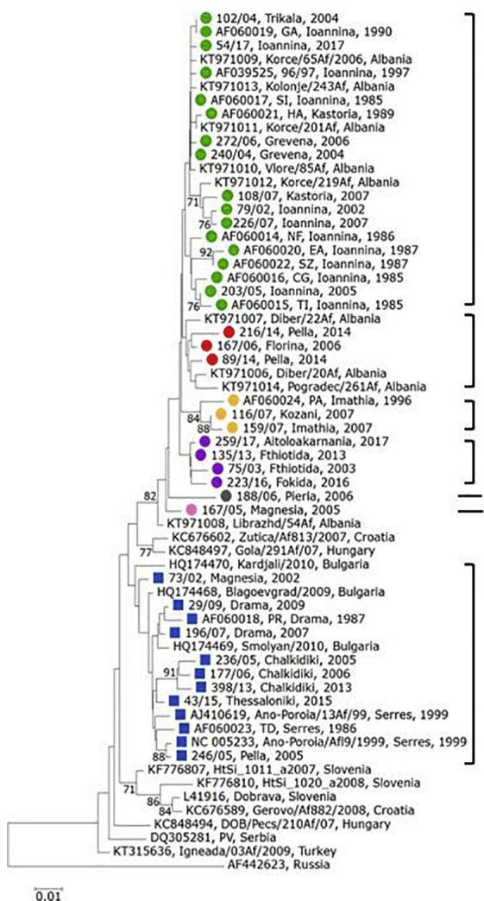
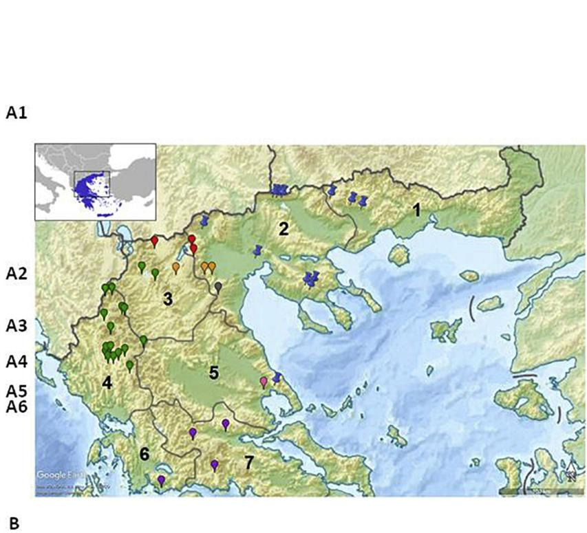
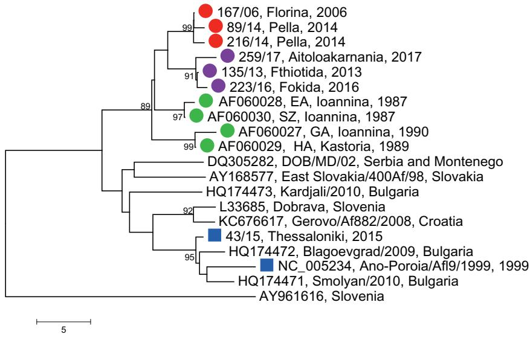

Research paper

# Molecular epidemiology of Dobrava-Belgrade virus in Greece

Katerina Tsergouli, Elpida Papadopoulou, Katerina Tsioka, Anna Papa⁎

Department of Microbiology, Medical School, Aristotle University of Thessaloniki, Thessaloniki, Greece

# A R T I C L E I N F O

Keywords:

Hantavirus

Dobrava-Belgrade virus

Greece

# A B S T R A C T

In order to gain an insight into the genetic relatedness of the Dobrava-Belgrade virus (DOBV) in Greece, a phylogenetic analysis was performed based on all currently available DOBV sequences obtained from hospitalized cases with hemorrhagic fever with renal syndrome (HFRS). Most cases occurred in northwestern and north central part of the country. Two sequence datasets consisted of 41 S and 12 M partial DOBV RNA segment sequences were analyzed. All DOBV strains belong to Dobrava genotype which is associated with the rodent Apodemus flavicollis. In both phylogenetic trees (S and M segments), two main clusters of Greek strains could be distinguished. Phylogenetic analysis showed a spatial rather than temporal relation of the strains, since their genetic clustering was highly associated with the geographic distribution of the cases. Besides previous characterized endemic foci, novel ones have been identified, expanding our knowledge on the epidemiology of HFRS in Greece.

# 1. Introduction

Hantaviruses (genus Orthohantavirus, family Hantaviridae) are single-stranded, negative-sense RNA viruses with a three-segmented genome consisting of the S (small), M (medium) and L (large) segments which encode the nucleocapsid protein (N), a precursor protein giving rise to the two envelope glycoproteins Gn and Gc, and the RNA-dependent RNA polymerase (RdRp), respectively (Battisti et al., 2011; Schmaljohn et al., 1985). Hantaviruses are transmitted to humans through inhalation of infected rodents' excreta. While hantaviruses cause to rodents a persistent and asymptomatic infection, they cause to humans two severe syndromes: hemorrhagic fever with renal syndrome (HFRS) in Europe and Asia, and hantavirus pulmonary syndrome in the Americas. More than 40 hantavirus species have been currently recognized, each of them associated with a specific rodent host, while spill-over events have been also described (Jonsson et al., 2010).

The main hantaviruses in Europe are Dobrava-Belgrade virus (DOBV) associated with rodents of the Apodemus species, and Puumala virus (PUUV) associated with Myodes glareolus rodents. A sub-division of DOBV species into 4 genotypes, Dobrava, Kurkino, Saaremaa, and Sochi, has been proposed; the primary rodent hosts of Dobrava and Sochi genotypes are Apodemus flavicollis and Apodemus ponticus rodents, respectively, whereas Apodemus agrarius serves as host of Saaremaa and Kurkino genotypes (Klempa et al., 2012). The most severe form of HFRS is caused by Dobrava and Sochi genotypes. The disease is characterized by fever, myalgia, thrombocytopenia, and acute renal insufficiency; the case fatality rate is $9 \mathrm { - } 1 5 \%$ (Papa, 2012; Kruger et al., 2015).

Greece is located in the southernmost region of the Balkan peninsula in the southwestern Europe. Since the first serological evidence of hantavirus presence in Greece in 1981 (Lee and Antoniadis, 1981), the annual reported number of HFRS cases is 2–10, with approximate fatality $9 \%$ (Papa et al., 1998; Papa, 2012). It is believed that some mild cases remain unrecognized. Since the first direct genetic detection of DOBV in two HFRS patients in 1996 in Greece (Antoniadis et al., 1996), molecular methods were included for the laboratory diagnosis of hantavirus infections in the country. A retrospective study showed that all PCR-positive hospitalized cases in Greece were caused by DOBV associated with A. flavicollis (Dobrava genotype) (Papa et al., 1998). The number of PUUV cases is limited [(Papa et al., 2000) and few unpublished cases].

As more sequences from Greek HFRS cases became available during the last 20 years, the aim of the present study was to gain an overall insight into the molecular epidemiology of DOBV in Greece by investigating the spatial and temporal genetic relationships among viral strains detected in the country.

# 2. Materials and methods

The study was based on all DOBV sequences currently available from Greece. They were obtained from 27 HFRS cases observed during the last 20 years in Greece by applying two nested RT-PCRs: one amplifying a 599-bp fragment of the S RNA segment and a second amplifying a 317-bp fragment of the M RNA segment from hantaviruses associated with rodents of the Muridae subfamily (Papa et al., 1998).

  
Fig. 1. Correlation of phylogenetic clustering and geographic distribution of DOBV sequences. (A) Neighboring-joining phylogenetic tree based on 599-bp fragment of the DOBV S RNA segment. The percentage of replicate trees in which the associated taxa clustered together in the bootstrap test (1000 replicates) is shown next to the branches. Values lower than $7 0 \%$ are not shown. Greek sequences are marked. Sequences from western and central (clade A) and from northeastern (clade B) Greece are marked with circle and square, respectively. The six subgroups of clade A are colored (A1-green, A2-red, A3-orange, A4-purple, A5-grey and A6-pink), while clade B is colored blue. Scale bar indicates number of nucleotide substitutions per site. (B) Geophysical map of Greece in which the location of the cases are shown. The administrative regions are numbered as: 1. East Macedonia and Thrace; 2. Central Macedonia; 3. West Macedonia; 4. Epirus; 5: Thessaly; 6. West Greece; 7. Central Greece). (For interpretation of the references to colour in this figure legend, the reader is referred to the web version of this article.)

Table 1 Matrix of genetic distances between subgroups of clade A in S segment. The nucleotide and amino acid distances are shown in the lower and upper triangle, respectively.   

<table><tr><td rowspan="2">Subgroup</td><td colspan="6">Clade A subgroups</td></tr><tr><td>A1</td><td>A2</td><td>A3</td><td>A4</td><td>A5</td><td>A6</td></tr><tr><td>A1</td><td></td><td>0.0</td><td>0.0</td><td>0.2</td><td>0.0</td><td>0.0</td></tr><tr><td>A2</td><td>1.6</td><td></td><td>0.0</td><td>0.1</td><td>0.0</td><td>0.0</td></tr><tr><td>A3</td><td>1.6</td><td>1.6</td><td></td><td>0.1</td><td>0.0</td><td>0.0</td></tr><tr><td>A4</td><td>2.2</td><td>2.5</td><td>2.2</td><td></td><td>0.1</td><td>0.1</td></tr><tr><td>A5</td><td>1.9</td><td>2.0</td><td>2.2</td><td>1.9</td><td></td><td>0.0</td></tr><tr><td>A6</td><td>3.0</td><td>2.9</td><td>2.3</td><td>3.7</td><td>2.3</td><td></td></tr></table>

Sequences from previous studies in HFRS patients (12 cases) and rodents (2 A. favicollis) were also included in the study (Papa et al., 1998, 2001).

Two sequence datasets consisted of 41 S and $\bf { 1 2 M }$ partial RNA segment DOBV sequences were analyzed. Among the 41 S RNA sequences, 39 were obtained from HFRS cases observed in Greece during 1985–2017 and two were obtained from DOBV-positive A. flavicollis

rodents trapped in 1999 in northern Greece. Among the 12 M RNA sequences, 11 were taken from HFRS cases and one from a DOBV-positive A. flavicollis.

The HFRS patients were residents of 17 Greek prefectures [Nomenclature of Territorial Units for Statistics (NUTS) 3] which belong to seven administrative regions (NUTS 2): East Macedonia and Thrace $\left( \mathtt { n } = 3 \right)$ , Central Macedonia ${ \bf ( n = 1 1 }$ ), West Macedonia $( \mathtt { n } = 6 )$ ), Epirus $( \mathbf { n } = 1 2 )$ ), Thessaly $\left( \mathtt { n } = 3 \right)$ ), West Greece $( \mathtt { n } = 1 )$ ) and Central Greece $\left( \mathtt { n } = 3 \right)$ .

Nucleotide sequences were aligned with respective ones retrieved from GenBank DataBase using Clustal W. Phylogenetic trees were generated by applying the neighboring-joining method, and the evolutionary distances were computed using the Tamura 3-parameter method applying the MEGA v7 software (Kumar et al., 2016).

# 3. Results

All Greek S and M RNA fragment sequences belonged to the Dobrava genotype of DOBV and presented a clear geographic distribution. The S segment sequences formed two distinct genetic clades, A and B, differing each other by $4 . 5 \%$ and $0 . 1 \%$ at the nucleotide and amino acid levels, respectively. Clade A contained sequences from cases

  
Fig. 2. Neighboring-joining phylogenetic tree based on 247- bp fragment of the DOBV M RNA segment. The percentage of replicate trees in which the associated taxa clustered together in the bootstrap test (1000 replicates) is shown next to the branches. Values lower than $7 0 \%$ are not shown. Greek sequences are marked. Sequences from western and central (clade A) and from northeastern (clade B) Greece are marked with circle and square, respectively. The subgroups of clade A are colored (A1-green, A2-red, A4-purple), while clade B is colored blue. Scale bar indicates number of nucleotide substitutions per site. (For interpretation of the references to colour in this figure legend, the reader is referred to the web version of this article.)

observed in the western and central part of Greece, while clade B contained sequences from cases observed in northeastern Greece and A. flavicollis rodents trapped in the same area (Fig. 1). The nucleotide genetic distances of clades A and B from the prototype DOBV strain (S segment, GenBank accession number L41916) are $5 . 3 \%$ and $3 . 9 \%$ , respectively. The respective distances at the amino acid level are $1 . 2 \%$ and $1 . 3 \%$ . Clade A could be further divided into 6 subgroups (A1–A6). Genetic distances between subgroups of clade A are seen in Table 1.

Similarly, the Greek M RNA sequences formed two distinct genetic clades (A and B) differing each other by $9 . 3 \%$ and $0 . 1 \%$ at the nucleotide and amino acid levels, respectively (Fig. 2). The nucleotide genetic distances between clade A and clade B and the prototype DOBV strain (M segment, GenBank accession number L33685) are $8 . 8 \%$ and $5 . 1 \%$ , respectively. At the amino acid level the respective distances are $0 . 1 \%$ and $0 \%$ .

Sequences of the present study were submitted to GenBank DataBase under the accession numbers MH427107-ΜΗ427133 (for S segment sequences) and MH427134-MH427140 (for M segment sequences).

# 4. Discussion

Greece is situated on the crossroads of Europe, Asia and Africa, located at the southernmost tip of the Balkan peninsula. The first direct genetic detection of DOBV in two HFRS patients was reported in 1996 in Greece, providing evidence that DOBV can cause severe disease in humans (Antoniadis et al., 1996). Besides Greece, DOBV has been often detected in HFRS patients and in rodent virus reservoirs in several Balkan countries (Emmerich et al., 2014; Papa and Christova, 2006, 2011, 2016; Stamenkovic et al., 2015; Avsic-Zupanc et al., 1999). Furthermore, DOBV sequences have been detected in A. flavicollis rodents trapped in the European part of Turkey and in the Black Sea region (Polat et al., 2018; Oktem et al., 2014).

The areas where Dobrava genotype infections are observed coincide with the typical habitats of A. flavicollis, the yellow necked mouse, which is the main reservoir of the virus. This rodent species prefers the non-inhabited forested or shrubby areas with altitude ranging from 150 to $1 3 5 0 \mathrm { m }$ above sea level (Rogozi et al., 2012). Based on an earlier study which was based on HFRS cases observed in Greece up to 1996, the most endemic foci were in the northwestern and northeastern parts of the country, where Pindus and Rodopi mountains predominate, respectively (Papa et al., 1998). Pindus is a range of high altitude mountains and it is considered a continuation of the Dinaric Alps crossing vertically Greece and separating naturally the western and eastern mainland of Greece. Rodopi mountain ranges horizontally in

the northeastern part of Greece and forms a natural boundary with Bulgaria. Since 1996, additional cases were observed in the known endemic foci, but also in novel areas where no cases have been reported previously, expanding the geographic distribution of the virus to southern regions. Among overall cases, most occurred in Epirus $( 3 0 . 8 \% )$ , and in central and western Macedonia $( 2 8 . 2 \%$ and $1 5 . 4 \%$ , respectively). A strong relation between genetic clustering and geographic location was seen, reflecting the limited range of rodents' activity.

Phylogenetic analysis showed that the Greek DOBV strains belong to the Dobrava genotype and cluster together with respective strains from other Balkan countries, with which they share a common ancestry. Specifically, clade A consisting of Dobrava sequences from the northeastern part of the country, clusters together with Albanian strains, while clade B, consisting from Dobrava sequences from the northwestern part of the country, clusters together with Bulgarian strains (Fig. 1). Several mountains separate geographically the mainland of Greece, and form local ecosystems in which Dobrava virus evolved through the years, giving rise to subgroups in the phylogeny. It is of interest that the sequences from two cases observed in the same prefecture (cases 167/05 and 73/02 observed in Magnesia prefecture) clustered into different clades, A and B, respectively, suggesting that either this region might represent the meeting zone of the two clades, or the location where any of the two patients was infected was different than that reported.

In conclusion, the present study provides further insight into the molecular epidemiology of DOBV in Greece and gives evidence that at present the PCR-positive cases are caused by Dobrava genotype, which shows a strong geographic distribution. Awareness among clinicians is needed to include HFRS in the differential diagnosis of febrile cases with thrombocytopenia and acute renal insufficiency in order to elucidate further the epidemiology of HFRS in Greece and study in more detail the virus spread and evolution.

# Acknowledgement

We thank Elpida Gavana for the excellent technical assistance.

The study was financially supported by the Hellenic Centre for Infectious Disease and Control and the EU Horizon 2020 research and innovation programme COMPARE (grant agreement No 643476).

# References

Antoniadis, A., Stylianakis, A., Papa, A., Alexiou-Daniel, S., Lampropoulos, A., Nichol, S.T., Peters, C.J., Spiropoulou, C.F., 1996. Direct genetic detection of Dobrava virus

in Greek and Albanian patients with hemorrhagic fever with renal syndrome. J. Infect. Dis. 174, 407–410.   
Avsic-Zupanc, T., Petrovec, M., Furlan, P., Kaps, R., Elgh, F., Lundkvist, A., 1999. Hemorrhagic fever with renal syndrome in the Dolenjska region of Slovenia—a 10- year survey. Clin. Infect. Dis. 28, 860–865.   
Battisti, A.J., Chu, Y.K., Chipman, P.R., Kaufmann, B., Jonsson, C.B., Rossmann, M.G., 2011. Structural studies of Hantaan virus. J. Virol. 85, 835–841.   
Emmerich, P., Muller, N., Heinemann, P., Rother, E., Jakupi, X., Gunther, S., Cadar, D., Schmidt-Chanasit, J., 2014. Human Dobrava-Belgrade hantavirus infection, Kosovo. J. Clin. Virol. 61, 439–441.   
Jonsson, C.B., Figueiredo, L.T., Vapalahti, O., 2010. A global perspective on hantavirus ecology, epidemiology, and disease. Clin. Microbiol. Rev. 23, 412–441.   
Klempa, B., Avsic-Zupanc, T., Clement, J., Dzagurova, T.K., Henttonen, H., Heyman, P., Jakab, F., Kruger, D.H., Maes, P., Papa, A., Tkachenko, E.A., Ulrich, R.G., Vapalahti, O., Vaheri, A., 2012. Complex evolution and epidemiology of Dobrava-Belgrade hantavirus: definition of genotypes and their characteristics. Arch. Virol. 158, 521–529.   
Kruger, D.H., Tkachenko, E.A., Morozov, V.G., Yunicheva, Y.V., Pilikova, O.M., Malkin, G., Ishmukhametov, A.A., Heinemann, P., Witkowski, P.T., Klempa, B., Dzagurova, T.K., 2015. Life-threatening Sochi virus infections, Russia. Emerg. Infect. Dis. 21, 2204–2208.   
Kumar, S., Stecher, G., Tamura, K., 2016. MEGA7: molecular evolutionary genetics analysis version 7.0 for bigger datasets. Mol. Biol. Evol. 33, 1870–1874.   
Lee, H.W., Antoniadis, A., 1981. Serological evidence for Korean haemorrhagic fever in Greece. Lancet 1, 832.   
Oktem, I.M., Uyar, Y., Dincer, E., Gozalan, A., Schlegel, M., Babur, C., Celebi, B., Sozen, M., Karatas, A., Ozkazanc, N.K., Matur, F., Korukluoglu, G., Ulrich, R.G., Ertek, M., Ozkul, A., 2014. Dobrava-Belgrade virus in Apodemus flavicollis and A. uralensis mice, Turkey. Emerg. Infect. Dis. 20, 121–125.   
Papa, A., 2012. Dobrava-Belgrade virus: phylogeny, epidemiology, disease. Antivir. Res.

95, 104–117.   
Papa, A., Christova, I., 2011. Genetic detection of Dobrava/Belgrade virus, Bulgaria. Emerg. Infect. Dis. 17, 308–309.   
Papa, A., Johnson, A.M., Stockton, P.C., Bowen, M.D., Spiropoulou, C.F., Alexiou-Daniel, S., Ksiazek, T.G., Nichol, S.T., Antoniadis, A., 1998. Retrospective serological and genetic study of the distribution of hantaviruses in Greece. J. Med. Virol. 55, 321–327.   
Papa, A., Pliakogiannis, T., Lundkvist, A., Antoniadis, A., 2000. First case of Puumala virus infection in Greece. Infection 28, 334–335.   
Papa, A., Nemirov, K., Henttonen, H., Niemimaa, J., Antoniadis, A., Vaheri, A., Plyusnin, A., Vapalahti, O., 2001. Isolation of Dobrava virus from Apodemus flavicollis in Greece. J. Clin. Microbiol. 39, 2291 2293.   
Papa, A., Bojovic, B., Antoniadis, A., 2006. Hantaviruses in Serbia and Montenegro. Emerg. Infect. Dis. 12, 1015–1018.   
Papa, A., Rogozi, E., Velo, E., Papadimitriou, E., Bino, S., 2016. Genetic detection of hantaviruses in rodents, Albania. J. Med. Virol. 88, 1309–1313.   
Polat, C., Sironen, T., Plyusnina, A., Karatas, A., Sozen, M., Matur, F., Vapalahti, O., Oktem, I.M.A., Plyusnin, A., 2018. Dobrava hantavirus variants found in Apodemus flavicollis mice in Kirklareli Province, Turkey. J. Med. Virol. 90, 810–818.   
Rogozi, E., Bego, F., Papa, A., Mersini, K., Bino, S., 2012. Distribution and ecology of small mammals in Albania. Int. J. Environ. Health Res. 23, 258–268.   
Schmaljohn, C.S., Hasty, S.E., Dalrymple, J.M., Leduc, J.W., Lee, H.W., von Bonsdorff, C.H., Brummer-Korvenkontio, M., Vaheri, A., Tsai, T.F., Regnery, H.L., et al., 1985. Antigenic and genetic properties of viruses linked to hemorrhagic fever with renal syndrome. Science 227, 1041–1044.   
Stamenkovic, G., Nikolic, V., Blagojevic, J., Bugarski-Stanojevic, V., Adnadevic, T., Stanojevic, M., Vujosevic, M., 2015. Genetic analysis of Dobrava-Belgrade virus from western Serbia—a newly detected focus in the Balkan peninsula. Zoonoses Public Health 62, 141–150.