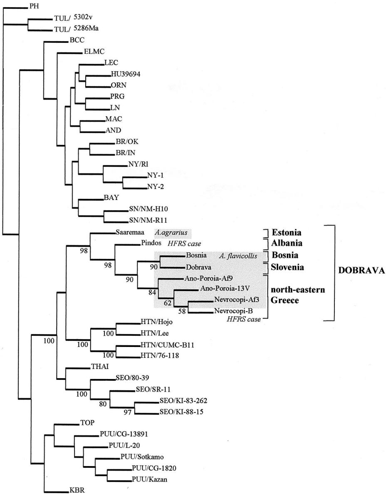

# Isolation of Dobrava Virus from Apodemus flavicollis in Greece

ANNA PAPA,1 * KIRILL NEMIROV,2 HEIKKI HENTTONEN,3 JUKKA NIEMIMAA,3 ANTONIS ANTONIADIS,1 ANTTI VAHERI,2 ALEXANDER PLYUSNIN,2 AND OLLI VAPALAHTI2

Department of Microbiology, School of Medicine, Aristotelian University of Thessaloniki, Thessaloniki, Greece,1 and Department of Virology, Haartman Institute, University of Helsinki,2 and Finnish Forest Research Institute, Vantaa,3 Finland

Received 12 January 2001/Returned for modification 23 February 2001/Accepted 14 March 2001

Dobrava virus (DOBV) carried by Apodemus flavicollis is the causative agent of severe hemorrhagic fever with renal syndrome (HFRS). DOBV was isolated from an A. flavicollis mouse trapped in northeastern Greece. This is the third DOBV cell culture isolate in the world, clustering together with other Greek DOBV sequences from HFRS patients and rodents.

Hantaviruses belong to the genus Hantavirus in the Bunyaviridae family and are causative agents of hemorrhagic fever with renal syndrome (HFRS) in Europe and Asia and hantavirus pulmonary syndrome in the Americas. HFRS is caused by Hantaan virus, Seoul virus, Puumala virus, and Dobrava virus (DOBV), while Sin Nombre and related viruses are the causative agents of hantavirus pulmonary syndrome. A number of other hantaviruses, not associated at present with human disease, have also been identified (9).

Hantaviruses are endemic in the Balkan Peninsula. Since the first description of HFRS cases in Greece in 1984 (1), a number of 200 HFRS cases have been diagnosed. DOBV is the predominant hantavirus in Greece and is associated with severe HFRS cases, with a mortality rate of $9 \%$ (2, 6). The host of DOBV in Greece is the rodent Apodemus flavicollis (the yellow-necked mouse) (7). Recently it was found that Apodemus agrarius (the field mouse) also serves as a reservoir host of DOBV in Europe (5). In countries where DOBV cases are associated with A. agrarius, the severity of the disease appears to be milder, with no mortality (Å. Lundkvist, N. Apekina, Y. Myasnikov, O. Vapalahti, A. Vaheri, and A. Plyusnin, Letter, Lancet 350:781–782, 1997). In some countries, such as Slovenia, both lineages of DOBV (one in A. flavicollis and one in A. agrarius) have been found to cocirculate in the same locality (3).

Isolation of hantaviruses is a tedious process including several blind passages in cell culture during a period of 2 months, and it is only rarely successful. So far, only two cell culture isolates of DOBV exist, one from A. flavicollis from Slovenia (4) and another from A. agrarius from Estonia (5).

In this study, a hantavirus was isolated from the lungs of an A. flavicollis mouse captured near the village of Ano Poroia, in the northeastern part of Greece, a region where HFRS is highly endemic. This strain was identified by sequencing of the S and M genome fragments as DOBV and is to date the only hantavirus strain isolated from Greece and the second isolate from A. flavicollis.

Small mammals were collected with live traps at two sites in northeastern Greece: the Ano Poroia and Siderokastro villages, near the Greek-Bulgarian border, which is an area where HFRS is endemic. Another site of collection was at Hortiatis Mountain, near Thessaloniki, north central Greece. Rodent lung samples were tested for the presence of DOBV by using immunoblotting with a rabbit antibody raised against recombinant DOB-N, as previously described (5). Two A. flavicollis rodents, no. 9 and 13, both of them trapped at the first site (Ano Poroia village), were found to be antigen positive. Total RNA was extracted from their lung tissues by the acidic guanidine thiocyanate-phenol-chloroform method. Parts of DOBV M RNA segments (nucleotides 1724 to 3644) were amplified by reverse transcription-PCR using primers described elsewhere (5).

A small part of the lung tissue of the two antigen-positive rodents was homogenized, and suspensions $( 1 0 \% )$ of both were inoculated into three $2 5 \mathrm { - c m } ^ { 2 }$ flasks containing confluent Vero E6 cells as described previously (5). Trypsinization of the cells and passage with fresh uninfected Vero E6 cells (ratio, 2:1) were performed every 3 weeks. The cells were checked for hantavirus antigen by immunofluorescence assay using rabbit antisera raised against recombinant DOB-N and monoclonal antibodies 1C12 and 4C3, and at day 45 of passage positive cells were detected in all three flasks containing cells originating from A. flavicollis mouse 9 (but not in flasks containing cells originating from mouse 13). The supernatant from the cells at day 47 $9 0 \%$ hantavirus antigen) was used to infect fresh Vero E6 cultures, and the virus was further passaged three times. The virus was designated DOBV/Ano-Poroia/Af9V/1999 (DOBV/AP). The nucleotide sequence of the third passage of the DOBV/AP strain was amplified and sequenced in parallel to the amplification products obtained from the rodent tissue.

Both strands of the amplified DNA fragments from rodents and the cell culture strain were sequenced with the ABI PRISM Dye Terminator Cycle Sequencing kit (Perkin-Elmer). Sequences were aligned with the PileUp program of the GCG software package (Genetics Computer Group, Madison, Wis.). PHYLIP software (version 3.5c, 1993; J. Felsenstein) was used for phylogenetic analysis.

The partial DOBV M sequence (nucleotides 2557 to 2794) from the Vero E6 cell isolate was identical to that derived from

  
FIG. 1. Phylogenetic tree based on partial sequences of the M segment (nucleotides 2557 to 2794). The unrooted tree was constructed using neighbor-joining algorithms. Five hundred bootstrap replicates were calculated. Only those bootstrap support values exceeding $5 0 \%$ are shown for Murinae-borne hantaviruses. For comparison, sequences of the following hantaviruses were obtained from the GenBank nucleotide sequence database: Prospect Hill virus (PH) strain PH-1 (X55129); Tula virus (TUL) strains Moravia/5302v/95 (Z69993) and Moravia/5286Ma/94 (Z66538); Black Creek Canal virus (BCC) (L39950); El Moro Canyon virus (ELMC) strain RM-97 (U26828); Lechiguanas virus (LEC) strain Of22819 (AF028022); HU39694 virus (AF028023); Oran virus (ORN) strain Ol22996 (AF028024); Pergamino virus (PRG) strain Aa14403 (AF028028); Laguna Negra virus (LN) strain 510B (AF005728); Maciel virus (MAC) strain Bo13796 (AF028027); Andes virus (AND) strain Ol23133 (AF028026); Blue River virus (BR) strains Oklahoma (AF030552) and Indiana (AF030551); New York virus (NY) strains Rhode Island-1 (U36801), New York-1 (U36802), and New York-2 (U36803); Bayou virus (BAY) strain Louisiana (L36930); Sin Nombre virus (SN) strains NM-H10 (L25783) and NM-R11 (L37903); DOBV strains Saaremaa/160Aa/96 (AJ009774), Pindos (AF060013), Nevrocopi-B (AF060011), Nevrocopi-Af3 (AF060012), and Dobrava (L33685); Hantaan virus (HTN) strains HoJo (D00376), Lee (D00377), CUMC-B11 (U38117), and 76–118 (M14627); Thailand virus (THAI) strain 749 (L08756); Seoul virus (SEO) strains 80–39 (S47716), SR-11 (M34882), KI-88–15 (D17594), and KI-83–262 (D17592); TOP virus strain Topografov/Ls136V (AJ011647); Puumala virus (PUU) strains CG-13891 (U22418), L-20 (U14136), Sotkamo (X61034), CG-1820 (M29979), and Kazan (Z84205); and Khabarovsk virus (KBR) strain MF-43 (AJ011648).

the lung of the originating rodent (A. flavicollis mouse 9) and $9 8 . 7 \%$ identical to the respective DOBV sequence from A. flavicollis mouse 13. DOBV/AP clustered together with other DOBV sequences from Greek HFRS patients (nucleotide identity, $9 7 . 9 \%$ ) and A. flavicollis but was more distantly related to the lineage of DOBV sequences from A. agrarius

(nucleotide identity, $8 0 . 3 \%$ ) (Fig. 1). This is in agreement with the data of distinct lineages of DOBV found in the two carrier rodents (3, 5).

It will be of interest to study further the putative pathogenic differences of these two closely related DOBV lineages. Towards this end and also for differentiating seroresponses in

neutralization assays, it is necessary to establish isolates of DOBV lineages, and of hantaviruses in general, in addition to merely performing limited sequence analysis of reverse transcription-PCR products. To date, the new strain, DOBV/AP, is the third established DOBV cell culture isolate, the second obtained from an A. flavicollis rodent, and the only currently existing hantavirus isolate from Greece.

Nucleotide sequence accession numbers. Nucleotide sequences for DOBV/AP and DOBV/Ano-Poroia/Af13/1999 were sent to GenBank and assigned accession numbers AJ294722 and AJ294723, respectively.

We thank Angelina Plyusnina for screening of rodent samples by immunoblotting and Tytti Manni for help with cell culture isolation experiments.

# REFERENCES

1. Antoniadis, A., M. Pyrpasopoulos, M. Sion, S. Daniel, and C. J. Peters. 1984. Two cases of hemorrhagic fever with renal syndrome in northern Greece. J. Infect. Dis. 149:1011–1013.   
2. Antoniadis, A., A. Stylianakis, A. Papa, S. Alexiou-Daniel, A. Lampropoulos,

S. T. Nichol, C. J. Peters, and C. F. Spiropoulou. 1996. Direct genetic detection of Dobrava virus in Greek and Albanian patients with hemorrhagic fever with renal syndrome. J. Infect. Dis. 174:407–410.   
3. Avsic-Zupanc, T., K. Nemirov, M. Petrovec, T. Trilar, M. Poljak, A. Vaheri, and A. Plyusnin. 2000. Genetic analysis of wild-type Dobrava hantavirus in Slovenia: co-existence of two distinct genetic lineages within the same natural focus. J. Gen. Virol. 81:1747–1755.   
4. Avsic-Zupanc, T., A. Toney, K. Anderson, Y. K. Chu, and C. Schmaljohn. 1995. Genetic and antigenic properties of Dobrava virus: a unique member of the Hantavirus genus, family Bunyaviridae. J. Gen. Virol. 76:2801–2808.   
5. Nemirov, K., O. Vapalahti, Å. Lundkvist, V. Vasilenko, I. Golovljova, A. Plyusnina, J. Niemimaa, J. Laakkonen, H. Henttonen, A. Vaheri, and A. Plyusnin. 1999. Isolation and characterisation of Dobrava hantavirus carried by the striped field mouse (Apodemus agrarius) in Estonia. J. Gen. Virol. 80:371–379.   
6. Papa, A., A. M. Johnson, P. C. Stockton, M. D. Bowen, C. F. Spiropoulou, T. G. Ksiazek, S. T. Nichol, and A. Antoniadis. 1998. Retrospective genetic study of the distribution of hantaviruses in Greece. J. Med. Virol. 55:321– 325.   
7. Papa, A., C. Spiropoulou, S. Nichol, and A. Antoniadis. 2000. Tracing Dobrava hantavirus infection. J. Infect. Dis. 181:2116–2117.   
8. Papa, A., T. Pliakogiannis, Å. Lundkvist, and A. Antoniadis. 2000. First case of Puumala infection in Greece. Infection 28:334–335.   
9. Plyusnin, A., O. Vapalahti, and A. Vaheri. 1996. Hantaviruses: genome structure, expression and evolution. J. Gen. Virol. 77:2677–2687.