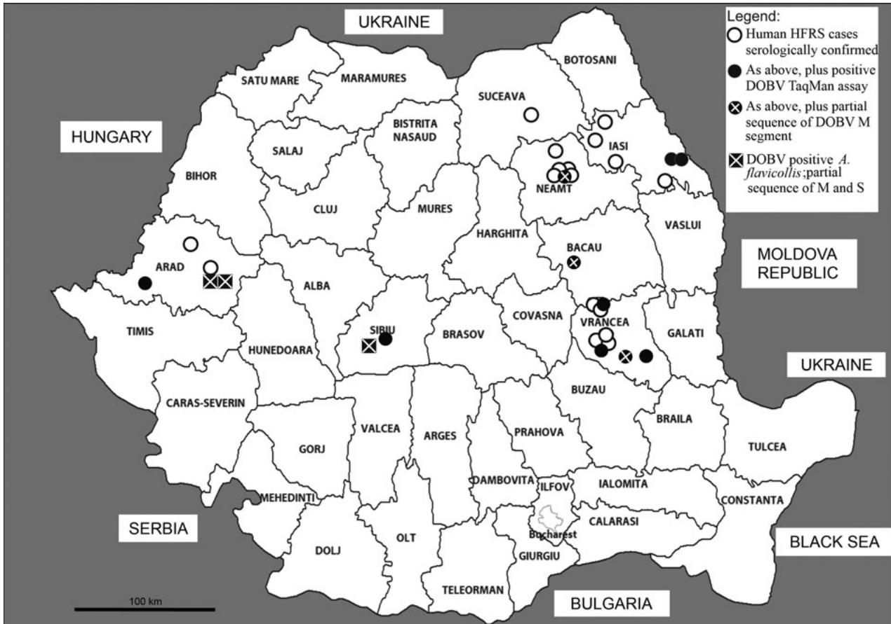
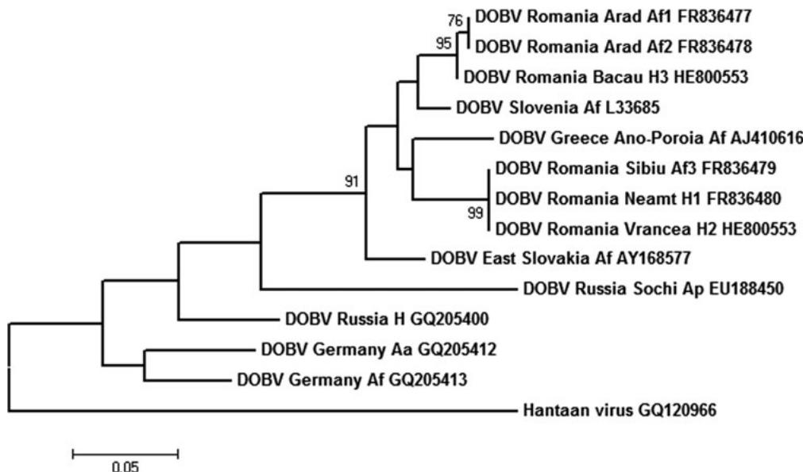
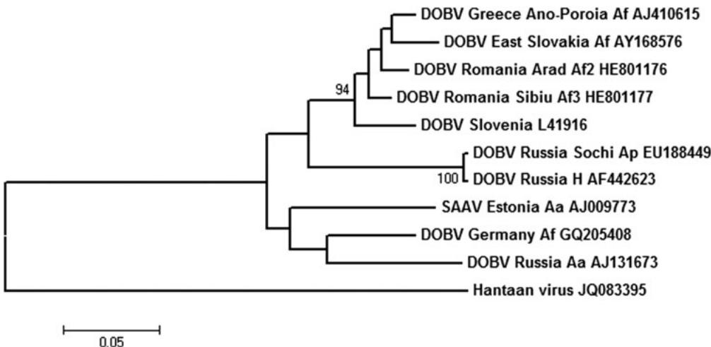

# Dobrava Virus Carried by the Yellow-Necked

# Field Mouse Apodemus flavicollis, Causing

# Hemorrhagic Fever with Renal Syndrome in Romania

Raluca Ioana Panculescu-Gatej, $^{1,8}$ Anca Sirbu, $^{2}$ Sorin Dinu, $^{3}$ Maria Waldstrom, $^{4}$ Paul Heyman, $^{5}$ Dimitru Murariu, $^{6}$ Angela Petrescu, $^{6}$ Camelia Szmal, $^{3}$ Gabriela Oprisan, $^{3}$ Åke Lundkvist, $^{7,4}$ and Cornelia S. Ceianu $^{1}$

# Abstract

Hemorrhagic fever with renal syndrome (HFRS) has been confirmed by serological methods during recent years in Romania. In the present study, focus-reduction neutralization tests (FRNT) confirmed Dobrava hantavirus (DOBV) as the causative agent in some HFRS cases, but could not distinguish between DOBV and Saaremaa virus (SAAV) infections in other cases. DOBV was detected by a DOBV-specific TaqMan assay in sera of nine patients out of 22 tested. Partial sequences of the M genomic segment of DOBV were obtained from sera of three patients and revealed the circulation of two DOBV lineages in Romania. Investigation of rodents trapped in Romania found three DOBV-positive Apodemus flavicollis out of 83 rodents tested. Two different DOBV lineages were also detected in A. flavicollis as determined from partial sequences of the M and S genomic segments. Sequences of DOBV in A. flavicollis were either identical or closely related to the sequences obtained from the HFRS patients. The DOBV strains circulating in Romania clustered in two monophyletic groups, together with strains from Slovenia and the north of Greece. This is the first evidence for the circulation of DOBV in wild rodents and for a DOBV etiology of HFRS in Romania.

Key Words: Zoonoses—Rodent borne—Hantavirus.

# Introduction

HANTAVIRUSES (family Bunyaviridae, genus Hantavirus) are enveloped RNA viruses with a segmented negative-stranded genome composed of small (S), medium (M), and large (L) segments that encode a nucleocapsid protein (N), two glycoproteins (Gn, Gc), and a RNA polymerase, respectively. These viruses are responsible for two clinical syndromes in humans—hemorrhagic fever with renal syndrome (HFRS) in Europe and Asia and hantavirus pulmonary syndrome (HPS) in the Americas (Vaheri et al. 2013).

In general, it is believed that each hantavirus has a different primary rodent reservoir species. Recent data also associated hantaviruses with insectivores (Kang et al. 2009) and bats (Weiss et al. 2012); however, only rodent-borne hantaviruses have so far been found to be pathogenic to humans. Transmission of hantaviruses to humans occurs through the inhalation of aerosolized excreta from infected rodents.

Among the hantaviruses circulating in Europe (Puumala virus [PUUV], Dobrava virus [DOBV], Saaremaa virus [SAAV], Tula virus [TULV], and Seoul virus [SEOV]), the most widespread is PUUV, carried by the bank vole (Myodes

glareolus), which is causing significant outbreaks of nephropathia epidemiica, a rather mild form of HFRS, in large areas of Europe (Heyman et al. 2011). DOBV and SAAV are at present listed as unique viruses by the International Committee on Taxonomy of Viruses, but the nomenclature of the European Apodemus-derived hantaviruses is still under debate and probably needs further revision (Vaheri et al. 2013). Klempa et al. (2013) proposed classification into four genotypes within the species "Dobrava-Belgrade virus," i.e., Dobrava, Kurkino, Saaremaa, and Sochi, based on the differences in their phylogeny, specific host reservoir, geographical distribution, and pathogenicity for humans. DOBV, carried by Apodemus flavicollis, the yellow-necked field mouse (DOBV-Af), is causing more severe disease than the closely related SAAV, which is carried by A. agrarius, the striped field mouse. TULV is carried by species of voles in the genus Microtus, and its significance as a pathogenic agent in humans is not clear. SEOV, carried by rats (Rattus norvegicus and R. rattus), is widespread in Asia, but its circulation in Europe has been documented, as well as its likely involvement in human disease (Heyman et al. 2011, Jameson et al. 2013, Å. Lundkvist and H. Zeller, unpubl.).

Sporadic HFRS cases, either isolated or clustered, have been reported in Romania (Manasia et al. 1977). A comprehensive presentation of the clinical picture in a first series of laboratory-confirmed HFRS cases among residents from Eastern Romania was recently published (Maftei et al. 2012).

Our objectives for the present study were to identify the hantaviruses causing HFRS in Romania and their circulation in rodents in areas where human cases were confirmed. As with different diagnostic assays, high levels of cross-reactive antibodies to DOBV, Hantaan virus (HTNV), and, in some cases, SEOV and PUUV were found, we tested samples with a focus-reduction neutralization test (FRNT), which is the only serological assay that allows precise serotyping. We also performed classical and real-time reverse-transcription PCR followed by sequencing and sequence analysis of hantavirus genomic targets detected in rodent tissues and HFRS patients' sera.

# Materials and Methods

# Samples from HFRS patients and serological tests

Sera from patients hospitalized in the departments of infectious diseases, nephrology, gastroenterology, or intensive care units were received for diagnosis at the National Reference Laboratory in Bucharest, Romania, between 2005 and 2012. Sera were split into two aliquots conserved at $2-4^{\circ}\mathrm{C}$ and at $-70^{\circ}\mathrm{C}$ for serological and for molecular testing, respectively.

The serological diagnostic criteria for a confirmed hantavirus acute infection were any of the following: (1) the presence of hantavirus-specific immunoglobulin M $(\mathrm{IgM})$ and IgG in a single serum sample, or (2) the presence of IgM and seroconversion of IgG in paired sera, or (3) a four-fold titer-rise of hantavirus-specific antibodies in paired sera. Although RT-PCR was not used routinely for diagnosis of HFRS-suspected patients, the detection of hantavirus nucleic acid in a sequenced RT-PCR product was regarded as confirmatory for hantavirus diagnosis.

For routine serological diagnosis of HFRS, during the period 2005-2012, several different methods and commer

cial kits were used as follows: Indirect IgM and IgG enzyme-linked immunosorbent assay (ELISA) for HTNV and PUUV Progen Biotechnik, Heidelberg, Germany); Hantavirus Pool 1-Eurasia IgM and IgG (Euroimmun, Lubeck, Germany); immunofluorescence assay (IFA; Progen Biotechnik); Mosaic Hantavirus Eurasia (Euroimmun); Point of Care tests for IgM PUUV and DOBV (Reagena, Toivala, Finland); and immunoblotting (recomLine Bunyavirus IgG/IgM, Mikrogen, Neuried, Germany).

For serotyping, acute and late convalescent sera from five patients were tested for the presence of neutralizing antibodies against DOBV, SAAV, HTNV, SEOV, and PUUV by FRNT (Lundkvist et al. 1997).

Acute-phase serum samples from 22 patients confirmed for hantavirus infection or presenting with borderline IgM values were subjected to RNA extraction using a QIAamp Viral RNA Mini Kit (Qiagen, Hilden, Germany) according to the manufacturer's protocol.

# Rodent trapping and tissue sample processing

Rodents were captured in 2007 (September 10 to 22) and 2008 (from June 2 to 5) in the Arad and Sibiu counties where human HFRS cases, FRNT confirmed as DOBV infections, had earlier been recorded (Fig. 1). In the Arad county, capture sites were set in the foothills of the Zarand Mountains (Western Carpathians), in the valley of a small tributary of Mures river, between localities of Baia and Slatina de Mures. In the Sibiu county, the capture sites were set starting with the locality Gura Raului along the right shore of its dam lake, and in the Cindrel Mountains (Southern Carpathians). The collection stations were set in the belt of deciduous, mainly beech forests, and mixed spruce forests, in bushy areas, grasslands, most of them along streamlets.

Rodents were captured using Sherman-type live traps, set overnight, and collected in the morning. Rodents were euthanized, and lung tissue samples were preserved in the field in RNAlater (Qiagen). When brought to the laboratory, the samples were stored at $-70^{\circ}\mathrm{C}$ until processing.

For extraction of nucleic acids, $30\mathrm{mg}$ of lung samples were ground in a bead mill homogenizer (2 min at 2000 rpm) in lysis buffer, and then subjected to total RNA and DNA extraction with SV Total RNA Isolation System (Promega, Madison, WI) and DNeasy® Blood & Tissue Kit (Qiagen), respectively, according to the manufacturer's instructions.

# Molecular assays

A real-time TaqMan assay targeting the S segment of DOBV (Weidmann et al. 2005) was used as a screening tool to detect DOBV-positive samples. RT-nested PCR with DOBV-specific primers (Avsic-Zupanc et al. 2000) targeted a sequence of 281 nucleotides from the M segment. RT-PCR (Avsic-Zupanc et al. 1995) was used to amplify a 877-nucleotide sequence from the S segment.

The identification of rodent species was confirmed by sequencing a fragment of cytochrome c oxidase subunit I (COI) mitochondrial gene (Alcaide et al. 2009).

# Sequencing and phylogenetic analysis

All amplicons were purified and sequenced with BigDye Terminator v3.1 on an Avant 3100 Genetic Analyzer (Applied

  
FIG. 1. Map of Romania counties (NUTS3) with the sites of collection of Dobrava virus (DOBV)-positive A. flavicollis (partial sequences of M and S genomic segments), and the distribution of human hemorrhagic fever with renal syndrome (HFRS) cases diagnosed between 2005 and 2012, as follows: Cases with serological confirmation only, with positive DOBV TaqMan assay test, and with sequenced DOBV M segment.

Biosystems, Foster City, CA). Sequences were edited and alignments were constructed in the BioEdit software package (Hall 1999). M segment sequences, of approximately $250\mathrm{bp}$ from both human and rodent samples were compared with similar ones from the DOBV clade associated with A. flavicollis (DOBV-Af) (Klempa et al. 2005). Phylogenetic analysis was performed using MEGA5.1 software (Tamura et al. 2011) and the maximum likelihood method based on the Tamura-3 parameter model (Tamura 1992) with a discrete Gamma distribution with five rate categories and 1000 bootstrap, previously calculated. The trees were rooted to the corresponding sequences of prototype Hantaan virus. The deduced amino acid sequences were analyzed to identify nonsynonymous mutations.

# Results

# Rodents molecular testing

Eighty-three rodents of four species (31 A. flavicollis, 11 A. agrarius, 24 A. sylvaticus, 17 M. glareolus [bank vole] individuals) were captured, and lung tissue samples were analyzed. The TaqMan RT-PCR detected DOBV RNA in three tissue samples from A. flavicollis captured during the field trip of June 2–5, 2008.

In the same three A. flavicollis, partial DOBV M segments were amplified by an RT-nested PCR. Two of these three DOBV-positive rodents were captured in the Arad county (DOBV RO Af1 08 and DOBV RO Af2 08), and one in the

Sibiu county (DOBV RO Af3 08) (Fig. 1). Sequences were deposited in GenBank with the accession numbers FR836477, FR836478, and FR836479, respectively. Sequence analysis was performed on a 215-nucleotide common region (positions 1361-1575 according to the M segment complete sequence of DOBV-Af prototype strain Slovenia; GenBank acc. no L33685). The sequences from rodents captured in the Arad county (DOBV RO Af1 08 and DOBV RO Af2 08) showed $100\%$ nucleotide identity among each other and $93.4\%$ with the one from the Sibiu county (DOBV RO Af3 08). High sequence identity was calculated with DOBV Slovenia and DOBV Ano-Poroiia (Greece), ranging from $93\%$ to $96.2\%$ . At the amino acid level, $100\%$ identity was calculated between A. flavicollis-derived DOBV strains from Romania and DOBV Slovenia, and $98.5\%$ with DOBV Ano-Poroiia. One nonsynonymous mutation versus DOBV Ano-Poroiia was found (proline replacing leucine at position 512).

The PCR for the S genomic segment yielded the band of interest for two out of 83 rodents tested, one from the Arad county (DOBV RO Af2 08) and one from Sibiu (DOBV RO Af3 08), which had yielded M segment sequences also. Sequences were deposited in GenBank under the accession numbers HE801176 and HE801177, respectively. Sequence analysis was conducted on a common region of 482 nucleotides (positions 730-1211 according to the S segment complete sequence of DOBV-Af prototype strain, GenBank acc. no. L41916). A high degree of nucleotide

  
FIG. 2. Phylogenetic tree generated by the maximum likelihood method based on the Tamura 3-parameter model, on a partial sequence of M segment of Dobrava virus (DOBV; nucleotides 1389-1571), with Hantaan virus (HTNV; acc. no. GQ120966) as an outgroup. Numbers at nodes represent the percentage of 1000 bootstrap replicates (values $< 70$ are not shown). Scale bar indicates the estimated number of nucleotide substitutions per site. Accession numbers for sequences extracted from GenBank: DOBV Slovenia L33685, DOBV East Slovakia/400Af/98 AY168577, DOBV Russia Lip9/hu GQ205400, DOBV Russia Ap1584/Sochi-01 EU188450, DOBV Germany/08/131/Af GQ205413, DOBV Germany/08/118/Aa GQ205412, DOBV Greece Ano-Poroia/Afl9/1999 AJ410616, HTNV GQ120966.

and amino acid sequence similarity between the strains from Romania (96.8% and 100%) as well as 94.5% and 95.2% nucleotide and 97.5% and 98.7% amino acid sequence identity to the DOBV-Af prototype strain Slovenia were found. By comparing the sequence of 577 nucleotides of DOBV RO Af3 08 with the prototype S segment, many synonymous substitutions (28) and only one nonsynonymous substitution were found, leading to the replacement of cysteine by valine at position 345. All rodents from which DOBV genomic targets

were amplified were confirmed as A. flavicollis by COI mitochondrial sequence (sequences deposited in GenBank under acc. nos. JQ935785, JQ935786, and JQ935787).

DOBV sequences were obtained only from the lungs of A. flavicollis; no other rodent species tested were found positive. As revealed by the partial sequences of the M and S genomic segments, two different, however closely related, lineages of DOBV were associated to A. flavicollis from the Arad and Sibiu capture sites, respectively (Figs. 2 and 3).

  
FIG. 3. Phylogenetic tree generated by the maximum likelihood method based on the Tamura 3-parameter model, on a partial sequence of S segment of Dobrava virus (DOBV; nucleotides 730-1211), with Hantaan virus (HTNV; accession no. JQ083395) as an outgroup. Numbers at nodes represent the percentage of 1000 bootstrap replicates (values $< 70$ are not shown). Scale bar indicates the estimated number of nt substitutions per site. Accession numbers for sequences extracted from GenBank: DOBV Slovenia L41916, DOBV Greece Ano-Poroiia/Afl9/1999 AJ410615, DOBV Russia Ap1584/Sochi01 EU188449, DOBV Russia Krasnodar P-s 1223/2000 AF442623, Saaremaa virus (SAAV) Estonia/160V AJ009773, DOBV Germany/08/131/Af GQ205408, DOBV Russia Kurkino/53 Aa/98 AJ131673, HTNV JQ083395.

# Human HFRS cases

Between year 2005 and 2012, 27 patients suspected of HFRS have been confirmed for hantavirus infection by the National Reference Laboratory in Bucharest, Romania: 26 patients with HFRS were confirmed by routine serological methods with commercial diagnostic kits, and one patient, for whom only a single acute serum was available, was confirmed by the molecular assay followed by sequencing. In most cases, a significant cross-reactivity of antibodies was found against DOBV, HTNV, SEOV, and sometimes also PUUV. However in one case (a resident of the Vrancea county/2009 year), a PUUV infection was indicated by using the Point of Care IgM Puumala (Reagena) and immunoblotting (Mikrogen).

Sera from five patients were tested by FRNT for hantavirus serotyping (Table 1). In two patients only, residents of the Arad and Sibiu counties, respectively, the end-point titers of neutralizing antibodies confirmed DOBV infections, whereas in the other three patients (two residents of the Arad county and one resident of the Vrancea county) a distinction between DOBV and SAAV could not be made.

The following numbers of confirmed HFRS cases were diagnosed in the reference laboratory per year: 1/2005, 1/2006, 2/2007, 4/2008, 8/2009, 4/2010, 4/2011, and 3/2012. The distribution of cases, number/county of residence, for the period 2005-2012, was 9/Vrancea, 6/Neamt, 6/Iasi, 3/Arad, 1/Sibiu, 1/Bacau, 1/Suceava (Fig. 1).

# Molecular testing of human sera

Sera from 22 patients in the acute phase of disease were tested in a TaqMan assay for DOBV RNA genomic targets. Serum samples from nine patients produced a weak positive signal in a TaqMan assay, with high cycle threshold (Ct) values (between 30.13 and 38.24). Patients in whom DOBV RNA was detected via TaqMan assay lived in the following counties: Arad (one patient), Sibiu (one patient), Vrancea (three patients), Neamt (one patient), Iasi (two patients), and Bacau (one patient) (Fig. 1). The M segment target could be amplified in RT-nested PCR in only three of these patients, from Neamt, Vrancea, and Bacau counties. We designated these sequences DOBV RO H1 09, DOBV RO H2 09, and DOBV RO H3 12, respectively. Sequences were deposited in GenBank under the accession numbers FR836480, FR836482, and HE800553. No S genomic segment amplicon could be obtained from human sera. Of the nine positive patients in the TaqMan assay, eight patients had also been serologically confirmed, and in one patient the confirmation was based on the sequenced amplicon of partial DOBV genomic segment.

In two patients (from Neamt and Vrancea), the amplified M sequences of DOBV were identical among each other and also with the M sequence detected in A. flavicollis captured in the Sibiu county. In one patient, from the Bacau county, the M sequence was $93.4\%$ similar to the other two sequences detected in humans and $99.4\%$ similar to the DOBV M sequences detected in A. flavicollis from Arad. For the fragment of 60 amino acids analyzed, there was no difference between the DOBV strains from Romania. High sequence similarity was calculated when comparing with M segment sequences of DOBV Ano-Poroia and DOBV Slovenia strains, ranging from $92.8\%$ to $96.7\%$ for the nucleotides and $98.3 - 100\%$ for the amino acid sequences. For DOBV RO H2 09 as compared with DOBV Slovenia and DOBV Ano-Poroia, 18- and 20-

TABLE 1. SEROTYPING OF HFRS PATIENT SERUM SAMPLES BY FOCUS-REDUCTION NEUTRALIZATION TEST (FRNT): END POINT TITERS   

<table><tr><td>Hemorrhagic fever with renal syndrome patient code</td><td>Time post onset of symptoms (POS) for serum sample collection</td><td>DOBV</td><td>SAAV</td><td>SEOV</td><td>HTNV</td><td>PUUV</td><td>Serotyping</td></tr><tr><td>AR1-05</td><td>5 months POS</td><td>1:640</td><td>1:640</td><td>&lt;1:40</td><td>1:40</td><td>&lt;1:40</td><td>Distinction between SAAV and DOBV not possible</td></tr><tr><td>AR2-07</td><td>Acute</td><td>1:640</td><td>1:40</td><td>1:40</td><td>1:40</td><td>&lt;1:40</td><td>Confirmed DOBV; confirmed acute infection (4 fold titer increase)</td></tr><tr><td></td><td>3 months POS</td><td>1:2560</td><td>1:640</td><td>1:40</td><td>1:40</td><td>&lt;1:40</td><td></td></tr><tr><td>AR3-07</td><td>Acute</td><td>&gt;1:10240</td><td>&gt;1:10240</td><td>&lt;1:40</td><td>&lt;1:40</td><td>&lt;1:40</td><td>High titers for both DOBV and SAAV due to the acute stage</td></tr><tr><td>SB1-07</td><td>Acute</td><td>1:640</td><td>1:160</td><td>&lt;1:40</td><td>&lt;1:40</td><td>&lt;1:40</td><td>Confirmed DOBV; confirmed acute infection (four-fold titer increase)</td></tr><tr><td></td><td>Day 7 POS</td><td></td><td></td><td></td><td></td><td></td><td></td></tr><tr><td></td><td>2 months POS</td><td>1:2560</td><td>1:640</td><td>&lt;1:40</td><td>&lt;1:40</td><td>&lt;1:40</td><td></td></tr><tr><td>VR2-08</td><td>Acute</td><td>1:2560</td><td>1:10240</td><td>1:40</td><td>1:640</td><td>1:160</td><td>Acute high titer to SAAV</td></tr><tr><td></td><td>Day 9 POS</td><td></td><td></td><td></td><td></td><td></td><td></td></tr><tr><td></td><td>Convalescent</td><td>1:2560</td><td>1:2560</td><td>1:160</td><td>1:640</td><td>1:160</td><td>Distinction between SAAV and DOBV not possible</td></tr><tr><td></td><td>Day 42</td><td></td><td></td><td></td><td></td><td></td><td></td></tr></table>

DOBV, Dobrava virus; SAAV, Saaremaa virus; SEOV, Seoul virus; HTNV, Hantaan virus; PUUV, Puumala virus.

nucleotide substitutions and two nonsynonymous substitutions could be observed (valine to isoleucine in position 445 and proline to leucine in position 512). Phylogenetic analysis of the partial M segment showed that DOBV strains from Romania belong to two monophyletic groups of DOBV (Fig. 2). The first monophyletic group is clustering sequences from rodents DOBV RO Af 3 08 and humans DOBV RO H1 09 and DOBV RO H2 09 from Romania, with the Greek Ano-Poroia DOBV strain. The second one is clustering sequences from rodents (DOBV RO Af 1 and DOBV RO Af 2) and from human serum DOBV RO H3 12 from Romania, with the prototype strain DOBV-Af. The sequence variability within the M segment for European DOBV strains on the analyzed fragment was calculated as being $17.7\%$ , as compared with $4.7\%$ calculated for the sequences of DOBV strains from Romania.

# Discussion

Clinical HFRS in Romania has been reported, between 1956 and 1974, in 27 cases: Six cases in a family cluster from the Bacau county, 1956 (Corneleac et al. 1956); 10 cases in Neamt county, 1961-1962 (Talasman et al. 1968); five cases in Alba county, in Western Carpathians in 1972; and six cases in Harghita county in 1972-1974 (Manasia et al. 1977). For a period of time, the disease was completely overlooked by clinicians (Maftei et al. 2012). The first serologically confirmed HFRS case was reported in 2005 in a man spending a fortnight in his forest hut, from the Zarand Mountains in Arad county (C.S. Ceianu, unpubl.).

We here present evidence for a DOBV etiology of hospitalized patients presenting with HFRS in Romania. Among the 27 laboratory-confirmed cases during 2005-2007, only one has been serologically diagnosed as a PUUV infection, a resident of the Vrancea county (2009). Nine out of the remaining 26 cases were confirmed as DOBV infections either by FRNTs, or by real-time RT-PCR with DOBV-specific TaqMan probe, or by sequenced DOBV amplicons. For the other 17 cases, either FRNT could not discriminate between DOBV and SAAV (in three cases), or it was not possible to distinguish a specific virus, because of the high cross-reactivity of serum antibodies in the routine diagnostic tests that we used. The clinical picture in some of these cases was severe, and patients had to be dialyzed (Maftei et al. 2012). Most of the patients were hospitalized in the Nephrology Clinic with severe or moderate disease. This selection of rather severe cases might explain the fact that only one serologically confirmed case with indication of PUUV virus infection was found.

DOBV carried by A. flavicollis was detected in both rodents from this species and patients. Cases were distributed mainly in the area of broad leaf forests, beech forests, and coniferous forests mixed with deciduous species. In the east and northeast of the country, most cases were recorded from rural localities situated in Eastern Carpathian Mountains and foothills, but also from the Plateau of Moldova and Prut river lowland, where cases occurred in both rural and urban settings. In the west of the country, cases occurred in areas of Zarand Mountains (Western Carpathians), but also in the Plain of Mures river, Arad county.

Some of the HFRS foci found in the Eastern Carpathians either overlap with areas in which clinical cases have been already described (Bacau and Neamt), as reported by Cor

neleac et al. (1956) and Talasman et al. (1968), or are contiguous to previously affected areas—new foci in the Vrancea and old foci in the Harghita counties situated on the Eastern and Western slopes of the Carpathian Mountains, respectively. In the Western Carpathians, new foci in the Arad county are contiguous with the old focus in the Alba county, identified in 1972-1974 (Manasia et al. 1977).

A seasonal pattern of cases was noticed, with a higher number of cases having onset in warmer seasons—spring (12 cases), summer (six cases), fall (five cases), and winter (four cases). HFRS risk factors, established by interviewing the patients and by visits on sites by local epidemiologists (CPCBT 2009), were identified as follows: being a shepherd or a forester, farming, working on a building site, having recreational activities in the forest, sleeping in forest hut, having house placed in the proximity of forest, presenting rodents or rodent traces in the premises, cutting/manipulating wood, and cleaning the basement of a building.

DOBV partial genomic sequences were obtained from both human and A. flavicollis samples, with high similarity between them (92.8% up to 100% sequence identity), thus confirming the epidemiological link between the rodent reservoir and the HFRS patients. The M segment partial sequences recovered from rodents in two geographical areas differed from each other, suggesting the existence of two distinct variants of DOBV circulating in Romania. They do not cluster together on a tree topology but rather with sequences from Slovenia and northern Greece, respectively. As documented by DOBV M segment sequences obtained from rodents and HFRS patients in Romania, DOBV strains of both these lineages are circulating along the entire Carpathian Mountains range, including Western, Southern and Eastern Carpathians and their foothills. Indeed, the A. flavicollis area is continuous at this level, as even fragmented forests are linked by corridors that favor migration and contact of rodent populations.

We have shown that two distinct strains of DOBV are circulating in rodent populations and are transmitted to humans, causing HFRS in western, central, and eastern regions of the country. They both belong to the group of DOBV strains circulating in southeastern and Central Europe (Papa 2012).

# Acknowledgments

C.S. Ceianu and R.I. Panculescu-Gatej were partially funded for this work by the Romanian Agency for Research (EVIRNET/CEEX 86/2006/Viasan Program and PN 09-22-01-02, Nucleus Program). Dr. M. Weidmann (Virology Institute, Göttingen University, Germany) is acknowledged for kindly providing reference material for molecular biology. The contributions of Dr. I.D. Maftei, and the other clinicians from the "CI Parhon" Hospital (Iasi, Romania) as well as of the epidemiologists from the Public Health districts of Arad, Sibiu, Vrancea, Iasi, Neamt, and Suceava counties are gratefully acknowledged.

This study was partially funded by European Union (EU) grant FP7-261504 EDENext and is catalogued by the EDENext Steering Committee as EDENext000 (www.edenext.eu). The contents of this publication are the sole responsibility of the authors and do not necessarily reflect the views of the European Commission.

R.P.G. performed the serological and molecular testing and analysis and wrote the paper; A.S. provided the

epidemiological data; S.D., C.S., and G.O. assisted with sequencing and sequence analysis; M.W., ÅL., and P.H. performed confirmatory serological testing and manuscript revision, D.M. and A.P. collected rodent samples, and C.S.C. coordinated the laboratory work of the Romanian team and the zoonotic investigation.

# Author Disclosure Statement

No competing financial interests exist.

# References

Alcaide M, Rico C, Ruiz S, Soriguer R, et al. Disentangling vector-borne transmission networks: A universal DNA barcoding method to identify vertebrate hosts from arthropod bloodmeals. PLoS One 2009; 4:e7092.   
Avsic-Zupanc T, Toney A, Anderson K, Chu YK, et al. Genetic and antigenic properties of Dobrava virus: A unique member of the Hantavirus genus, family Bunyaviridae. J Gen Virol 1995; 76:2801-2808.   
Avsic-Zupanc T, Nemirov K, Petrovec M, Trilar T, et al. Genetic analysis of wild-type Dobrava hantavirus in Slovenia: Co-existence of two distinct genetic lineages within the same natural focus. J Gen Virol 2000; 81:1747-1755.   
Corneleac D, Alexandrescu V, Vasoiu F, Solomon B, et al. Exista febra hemoragica epidemiica in regiunea Bacau? Considerati in legatura cu un focar familial de sindrom hemoragipar cu fenomene de nefrozonefrita.[Is there epidemic hemorrhagic fever in the region of Bacau? Considerations on a family focus of nephroso-nephritis hemorrhagic syndrome] In Roum. Microbiologie, Parazitologie, Epidemiologie 1956; 3:8-15.   
CPCBT. Febre Hemoragice cu Sindrom Renal-Romania, 2009.[Hemorrhagic fever with renal syndrome, Romania 2009]. In Roum. Bulletin Informativ Lunar al CPCBT [Monthly Informative Bulletin of the Center for Prevention and Control of Communicable Diseases], 2009; 10:2-4.   
Hall TA. BioEdit: A user-friendly biological sequence alignment editor and analysis for Windows 95/98/NT. Nucleic Acids Symp 1999; 41:95-98.   
Heyman, P, Ceianu CS, Christova I, Tordo N, et al. A five-year perspective on the situation of haemorrhagic fever with renal syndrome and status of the hantavirus reservoirs in Europe, 2005-2010. Euro Surveill 2011; 16:pii=19961.   
Jameson LJ, Logue CH, Atkinson B, Baker N, et al. The continued emergence of hantaviruses: Isolation of a Seoul virus implicated in human disease, United Kingdom, October 2012. Euro Surveill 2013; 18:pii=20344.   
Kang HJ, Bennett SN, Dizney L, Sumibcay L, et al. Host switch during evolution of a genetically distinct hantavirus in the American shrew mole (Neurotrichus gibbsii). Virology 2009; 388:8-14.   
Klempa B, Stanko M, Labuda M, Ulrich R, et al. Central European Dobrava Hantavirus isolate from a striped field

mouse (Apodemus agrarius). J Clin Microbiol 2005; 43: 2756-2763.   
Klempa B, Avsic-Zupanc T, Clement J, Dzagurova TC, et al. Complex evolution and epidemiology of Dobrava-Belgrade hantavirus: Definition of genotypes and their characteristics. Arch Virol 2013; 158:521-529.   
Lundkvist A, Hukic M, Horling J, Gilljam M, et al. Puumala and Dobrava viruses cause haemorrhagic fever with renal syndrome in Bosnia-Herzegovina: evidence of highly cross-neutralising antibody responses in early patient sera. J Med Virol 1997; 53:51-59.   
Maftei ID, Segall L, Panculescu-Gatej R, Ceianu C, et al. Hantavirus infection—hemorrhagic fever with renal syndrome: The first case series reported in Romania and review of the literature. Int Urol Nephrol 2012; 44:1185-1191.   
Manasia M, Olinic N, Zägreanu I, Serban A. Hemorrhagic fever with renal syndrome: Report of 11 observations. Int Urol Nephrol 1977; 9:177-184.   
Papa A. Dobrava-Belgrade virus: Phylogeny, epidemiology, disease. Antiviral Res 2012; 95:104-117.   
Talasman P, Gheorghita L, Inchilovici L. Nefropatie epidemiica Myhrman in raionul Targu Neamt [Epidemic Myhrman nephropathy in Targu Neamt area]. In Roum. Medicina interna 1968; 20:207-215.   
Tamura K Estimation of the number of nucleotide substitutions when there are strong transition-transversion and $\mathrm{G + C}$ content biases. Mol Biol Evol 1992; 9:678-687.   
Tamura K, Peterson D, Peterson N, Stecher G, et al. MEGA5: Molecular evolutionary genetics analysis using maximum likelihood, evolutionary distance, and maximum parsimony methods. Mol Biol Evol 2011; 28:2731-2739.   
Vaheri A, Henttonen H, Voutilainen L, Mustonen J, et al. Hantavirus infections in Europe and their impact on public health. Rev Med Virol 2013; 23:35-49.   
Weidmann M, Schmidt P, Vackova M, Krivanec K, et al. Identification of genetic evidence for Dobrava virus spillover in rodents by nested reverse transcription (RT)-PCR and TaqMan RT-PCR. J Clin Microbiol 2005; 43:808-812.   
Weiss S, Witkowski PT, Auste B, Nowak K, et al. Hantavirus in bat, Sierra Leone. Emerg Infect Dis 2012; 18:159-161.

Address correspondence to:

Cornelia S. Ceianu

Cantacuzino National Institute of Research-Development

for Microbiology and Immunology

Laboratory for Vector-Borne Infections

and Medical Entomology

103 Spl Independentei

050096 Bucharest

Romania

E-mail: ceianu@cantacuzino.ro