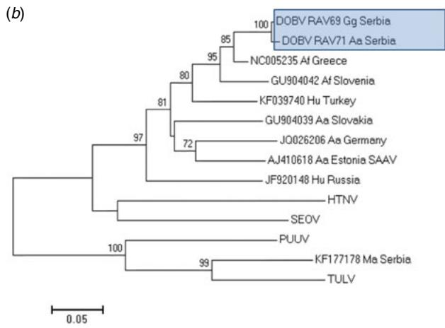
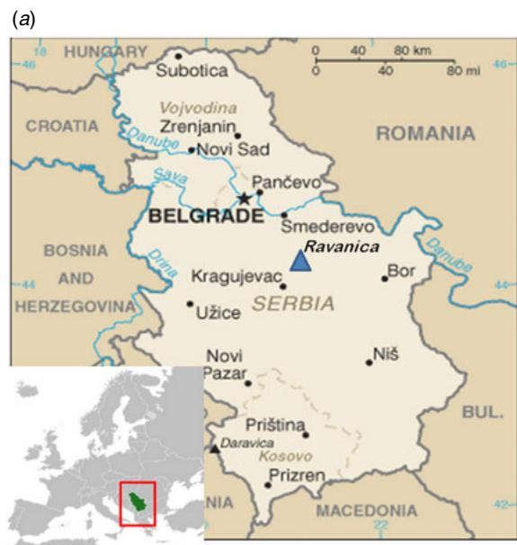
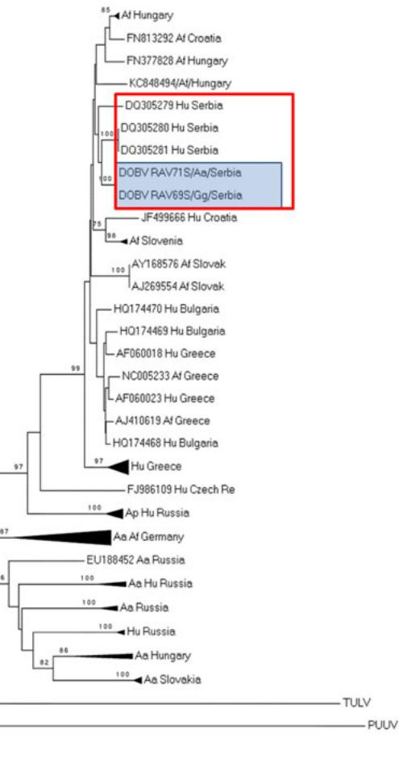

# SHORT REPORT Genetic detection of Dobrava-Belgrade hantavirus in the edible dormouse ( ) in central Serbia

M. STANOJEVIC1 *, V. NIKOLIC1 , N. STAJKOVIC2 , G. STAMENKOVIC3 , B. BOZOVIC4 , R. CEKANAC2 , P. MARUSIC5 AND A. GLIGIC4

1 University of Belgrade Faculty of Medicine, Belgrade, Serbia   
2 Military Medical Academy, Belgrade, Serbia   
3 University of Belgrade, Institute for Biological Research ‘Siniša Stankovic´’, Belgrade, Serbia   
4 Institute of Virology, Vaccines and Sera Torlak, Belgrade, Serbia   
5 Institute of Public Health, Zajecˇar, Serbia

Received 28 October 2013; Final revision 19 March 2014; Accepted 7 April 2014; first published online 24 April 2014

# SUMMARY

Hantaviruses are endemic in the Balkans, particularly in Serbia, where sporadic cases and/or outbreaks of hantaviral human disease have been reported repeatedly, and evidenced serologically. Here, we present genetic detection of Dobrava-Belgrade virus (DOBV) hantaviral sequences in wild rodents trapped in central Serbia. All the animals were pre-screened serologically by indirect immunofluorescence (IF) test and only those with a positive finding of hantaviral antigens were further tested by polymerase chain reaction. Of the total of 104 trapped animals, 20 were found to be IF positive and of those three were positive for hantaviral RNA: one Microtus arvalis for Tula virus, and one each of Apodemus agrarius and Glis glis for DOBV. Phylogenetic analysis of the obtained sequences implies putative DOBV spillover infection of A. agrarius and G. glis from Apodemus flavicollis. However, future investigations should help to identify the most common natural host and geographical distribution of DOBV in its reservoir hosts in Serbia.

Key words: Balkans, DOBV, Glis glis.

Members of the genus Hantavirus, within the family Bunyaviridae, are negative-stranded RNA viruses with a tripartite genome, designated large (L), medium (M) and small (S), encoding an RNA-dependent RNA polymerase, viral glycoprotein precursor (GPC) and viral nucleocapsid protein, respectively [1]. Some Old World hantaviruses, such as Hantaan virus (HTNV), Dobrava-Belgrade virus (DOBV) and Puumala virus (PUUV), cause haemorrhagic fever

* Author for correspondence: M. Stanojevic, MD, PhD, University of Belgrade, Faculty of Medicine, Institute of Microbiology and Immunology, Dr Subotica 1, 11000 Belgrade, Serbia. (Email: mstanojevic@med.bg.ac.rs)

with renal syndrome (HFRS), whereas some New World hantaviruses, such as Sin Nombre virus (SNV) and Andes virus (ANDV), are the causative agents of hantaviral cardiopulmonary syndrome (HCPS) [1].

Unlike other viruses of the Bunyaviridae family, which are arthropod borne, hantaviruses are harboured by small mammals, which become persistently infected and transmit infection to humans by direct contact. With some exceptions, each hantavirus is associated with a particular animal host. For example, rodents (order Rodentia, families Muridae and Cricetidae) of the Murinae, Arvicolinae, Sigmodontinae and Neotominae subfamilies serve as reservoir hosts and periodically shed infectious virus in urine and faeces.

Human infection occurs through respiratory exposure to contaminated secreta and excreta. Other than rodents, genetically distinct hantaviruses have been detected in shrews and moles (order Soricomorpha, families Soricidae and Talpidae) and bats (order Chiroptera) [1, 2]. The evolution of hantaviruses was previously thought to be inextricably linked with the evolution of their hosts, but this relationship has recently been vigorously debated [2].

Since the first epidemic of HFRS in Serbia in 1961, sporadic cases have been reported yearly, with multiple epidemics periodically described, based mainly on clinical and serological findings [3, 4]. Several hantaviral isolates, from both animals and humans in Serbia have also been described, which included Belgrade virus, isolated from blood and urine samples of patients with severe HFRS, during an epidemic in 1989 [5]. After this initial identification, further molecular and epidemiological analyses of hantaviruses in Serbia have been scarce. Yellow-necked mouse, Apodemus flavicollis, is considered to be the main DOBV host species in the Balkan region. Here we report of genetic evidence of DOBV hantavirus in wild rodents captured in central Serbia, namely the striped field mouse (Apodemus agrarius) and the edible dormouse (Glis glis).

Rodent trapping was performed in autumn 2007, during several consecutive nights, using overnight strategically placed baited wooden live traps. The trapping site was in central Serbia (Fig. 1a), in the region of the Ravanica River $( 4 4 ^ { \circ } ~ 0 0 ^ { \prime } ~ 1 7 { \cdot } 8 9 ^ { \prime \prime } ~ \mathrm { N } .$ , $2 1 ^ { \circ } \ 3 5 ^ { \prime } \ 2 6 { \cdot } 0 0 ^ { \prime \prime } \ \mathrm { E } )$ , at altitudes ranging between 580 m and $7 1 6 \mathrm { m }$ , along hilly and wooded terrain of mixed deciduous forest (beech, oak, oak, hazel, hornbeam) with wild pear and apple trees on the fringes. Captured animals were identified to species, and tissue samples (lung, liver and kidney) were removed aseptically and stored in liquid nitrogen for further processing. All animals were pre-screened serologically by indirect immunofluorescence (IF) test of tissue sections, using human convalescent hantavirus antisera and only those with positive finding of hantaviral antigens were further tested. Depending on the intensity of hantavirus antigen positivity, the IF finding was described as weak to strongly positive ( $^ +$ to $+ + + +$ ), respectively. RNA was Trizol extracted from tissue samples and a nested protocol for reverse transcription–polymerase chain reaction (RT–PCR) was performed using degenerate primers that amplify a partial L segment sequence of 412 nt of all known hantaviruses and DOBV specific primers that amplify

a 599 nt partial S segment, as described previously [6, 7]. All samples found to be PCR positive were confirmed by repeated testing of a second tissue sample, originating from a different organ. All PCR products were sequenced using the ABI PRISM Dye Terminator Cycle Sequencing Ready Reaction kit (PE Applied Biosystems, USA). First identification of the obtained sequences was performed using BLAST (http://blast.ncbi.nlm.nih.gov/Blast.cgi) and sequences were then further explored by phylogenetic analysis, according to clustering in relation to hantaviral reference sequences. Analysed sequences were processed into jModeltest, MEGA5.1, Paup 4.2 software packages. The evolutionary history was inferred by neighbour-joining, maximum-likelihood and minimum evolution methods.

A total of 104 animals were trapped: 50 A. flavicollis, 14 A. agrarius, eight Apodemus sylvaticus, 17 Myodes glareolus, eight Microtus arvalis, four G. glis, and three Sorex araneus. At the time of trapping, serological screening found 20 animals testing positive for hantaviral antigens: six A. flavicollis, three A. agrarius, one A. sylvaticus, six My. glareolus, two M. arvalis and two G. glis. Except for two strongly positive animals (one My. glareolus and one G. glis) all positive samples were characterized as weakly positive for hantavirus antigens. Tissue samples from all but one (the strongly positive My. glareolus) of these animals were available for molecular analysis.

Of the 19 samples tested by RT–PCR, three were positive for hantavirus RNA: one A. agrarius, one M. arvalis and one G. glis. Notably, the PCR-positive G. glis was among the strongly hantavirus antigen IF-positive animals. Partial L-segment sequences from the A. agrarius and G. glis samples were identified as DOBV by both BLAST and phylogenetic analysis. The sequence from M. arvalis (KF177178), found to be Tula virus (TULV), is described elsewhere [8]. DOBV sequences obtained in this study, DOBV_RAV69 and DOBV_RAV71, have been submitted to GenBank with accession numbers for the L segment KF177176 and KF177177, respectively, and for the S segment sequences KJ437511 and KJ437510, respectively. The newly found sequences were aligned and compared to all corresponding DOBV L segment sequences existing in the NCBI database (accessed October 2013), including A. flavicollis from Slovenia and Greece, and A. agrarius from Germany and Slovakia (accession nos. NC005235, JQ026206, JF920148, GU904039, GU904042, KF039740, AJ410618). TULV strain

  
( c)   
Fig. 1 . [colour online] . (a) Map of Serbia showing location of the trapping site (Ravanica) in the central part of the country, ${ \sim } 1 5 0 \mathrm { k m }$ south of the capital, Belgrade (indicated by a solid blue triangle) . Neighbour-j oining phylogenetic trees based on (b) a 2 1 2 nt L segment of nine examined DOBV sequences, (c) a 50 1 nt S segment of 67 examined DOBV sequences . Newly obtained sequences are shaded in blue, the clade with Serbian sequences is outlined in red. For better viewing, some clusters of phylogenetically closely related sequences were compressed to triangles : Af Hungary (KC 84849 5–848497), Af Slovenia (GU904029 , AJ25 1 996, AJ25 1 997), Hu Greece (AF0600 1 4–AF0600 1 7, AF060024), Ap Hu Russia (JF920 1 50–JF920 1 52, EU 1 8 8449, AF442622, AF442623), Aa Af Germany (GQ20540 1 –GQ205407, JQ026204, JQ344 1 1 4), Aa Hu Russia (GQ205 393 , GQ205 395 , GQ205 398), Aa Russia (EU562989–EU56299 1 ), Hu Russia (GQ205 394, GQ205396, GQ205 397), Aa Hungary (KC848499–KC848 50 1 ), Aa Slovakia (AY5 3 3 1 1 8 , AY5 3 3 1 20, AY96 1 6 1 5 , AY96 1 6 1 8) . Gg, Glis glis; Aa, Apodemus agrarius; Af, Apodemus flavicollis; Ap, Apodemus ponticus; Hu, human.

from Serbia (KF177178) and Seoul virus, HTNV, PUUV and TULV reference strains were used as outgroups (accession nos. NC005238, NC005222, NC005225, NC005226, respectively). The accession numbers of the S segment sequences used in phylogenetic analysis are given in the legend for Figure 1. Mean nucleotide divergence between all examined DOBV L segment sequences was $1 4 { \cdot } 5 5 \%$ (S.D. $= 4 { \cdot } 5$ , range $1 { \cdot } 3 { - } 2 0 { \cdot } 1 9 \%$ ), while nucleotide distance between two newly detected DOBV sequences from Serbia was $1 { \cdot } 3 \%$ . Mean nucleotide distance in all 67 examined S segment sequences was $1 0 { \cdot } 0 3 \%$ $( 0 - 1 6 { \cdot } 7 7 \%$ , S.D. $=$ 0·047), whereas the nucleotide distance between newly detected S segment sequences from Serbia was $0 \%$ . Deduced amino acid sequences of two newly detected strains were mutually identical in both genetic segments tested. Two phylogenetic trees were constructed, one for the L segment (Fig. 1b) and another for the S segment (Fig. 1c). Phylogenetic analysis showed high level of congruence between the employed methods. The trees were generated by MEGA5 software using a transitional model with gamma-distributed rate heterogeneity and a proportion of invariant sites $\left( \mathrm { T I M } 2 { + } \mathrm { G } { + } \mathrm { I } \right)$ and a threeparameter model with gamma-distributed rate heterogeneity and a proportion of invariant sites (TPM1uf $+ \mathrm { G } { + } \mathrm { I }$ ) for L and S segment sequences, respectively, as a nucleotide substitution model chosen in model selection analysis. The phylogenetic tree for the L segment revealed the existence of highly supported distinct clusters, matching either geographical territories in which rodents were trapped, or reflecting the hosts harbouring the virus (Fig. 1b). However, the number of available sequences is rather limited (nine, including the newly detected ones to allow broader conclusions). The overall topology of the S segment phylogenetic tree showed the existence of two different clades: the DOBV-Af lineage together with DOBV-Ap and the other clade with the DOBV-Aa linage. Newly detected Serbian sequences clustered together with $100 \%$ bootstrap support, but were also closely related to previously described sequences isolated from Serbian patients. Although one of the newly detected sequences was isolated from A. agrarius, it was placed in the DOBV-Af lineage together with other sequences from Serbia (Fig. 1c)

Hantaviruses are endemic in the Balkan region, particularly in Serbia, where sporadic cases and/or outbreaks of HFRS have been reported repeatedly. Ever since the first clinical and epidemiological evidence of HFRS in Serbia, dating to the middle of

the last century, serological evidence of hantaviral infection has been detected in both humans and animal reservoirs. Positive detection of hantaviral antigens and/or antibodies has been found in multiple species of rodents (A. flavicollis, A. sylvaticus, A. agrarius, A. microps, M. arvalis, Pitymis subterraneus, Mus musculus, Rattus norvegicus, My. glareolus) and insectivores (Sorex alpinus, S. araneus, Crocidura suaveolens) [3]. So far, serological findings imply circulation of multiple hantaviruses in Serbia, including HFRS-causing DOBV and PUUV and also TULV, currently considered non-pathogenic [1, 3]. Recently, we have genetically characterized TULV strains form Serbia [8], whereas molecular characterization of DOBV circulating in Serbia has not been performed, leaving the natural host and geographical distribution of DOBV in its reservoir host in Serbia largely unknown. As such, this report represents the first genetic evidence of DOBV sequences in wild rodents in central Serbia, i.e. A. agrarius and G. glis. Newly acquired L and S segment sequences of DOBV suggest local geographically specific clustering, as evidenced by phylogenetic analysis, with highly supported distinct lineages related to geographical territories in which rodents were trapped. Separate clusters, reflecting the main host species harbouring the hantavirus (A. flavicollis and A. agrarius) can also be seen. In both trees, for L and S segment sequences, newly acquired DOBV strains from Serbia cluster with other DOBV sequences associated with the rodent A. flavicollis.

The yellow-necked mouse, A. flavicollis, is considered to be the main rodent reservoir of DOBV in the Balkan region [1]. Considering phylogenetic results, it may also be regarded as the putative source of the spillover infection for the species found in our study (A. agrarius and G. glis). Phylogenetic evidence of spillover DOBV infections between A. flavicollis and A. agrarius have been described, with possible implications for genetic reassortment on these grounds [9]. However, despite the fact that it was the most abundant trapped species (50/104), the rate of IF-positive animals in our study was rather low ( $12 \%$ , 6/50) and not a single hantavirus RNA-positive A. flavicollis was found. Moreover, based on the clustering in the S segment phylogenetic tree, both sequences described in our study were found to be very similar to DOBV strains isolated from Serbian patients, with nucleotide divergence between these sequences of $1 { \cdot } 7 { - } 2 { \cdot } 5 \%$ , implying local circulation of DOBV strains between different hosts [10].

Furthermore, one DOBV sequence was retrieved from G. glis, which was also found to be strongly positive for hantaviral antigens in tissue sections. Previously, this species, or any other species of the Gliridae rodent family, has not been associated with DOBV infection. This finding implies an uncommon DOBV spillover event; further studies are underway to explore the scope and nature of DOBV infection in Gliridae rodent species in Serbia.

In conclusion, genetic detection and phylogenetic analyses demonstrated putative DOBV spillover infection of A. agrarius and G. glis from A. flavicollis. Future investigations should help to identify the most common natural host and geographical distribution of DOBV in its reservoir hosts in Serbia.

# ACKNOWLEDGEMENTS

The authors thank Professor Richard Yanagihara for critical reading of the manuscript. The authors also thank the anonymous reviewers for their valuable comments and suggestions to improve the quality of the paper.

This work was partially funded by the Ministry of Education and Science Republic of Serbia (grant no. 175024).

# DECLARATION OF INTEREST

None.

# REFERENCES

1. Papa A. Dobrava-Belgrade virus: phylogeny, epidemiology, disease. Antiviral Research 2012; 95: 104–117.   
2. Guo W-P, . Phylogeny and origins of hantaviruses et alharbored by bats, insectivores, and rodents. PLoS Pathogens 2013; 9(2): e1003159.   
3. Gligic A, . Hemorrhagic fever with renal syndrome et alin Yugoslavia: detection of hantaviral antigen and antibody in wild rodents and serological diagnosis of human disease. Scandinavian Journal of Infectious Diseases 1988; 20: 261–266.   
4. Gligic A, . Epidemic hemorrhagic fever with renal et alsyndrome in Yugoslavia, 1986. American Journal of Tropical Medicine and Hygiene 1989; 41: 102–108.   
5. Gligic A,  . Belgrade virus: a new hantavirus causing et alsevere hemorrhagic fever with renal syndrome in Yugoslavia. Journal of Infectious Diseases 1992; 166: 113–120.   
6. Klempa B, . Hantavirus in African wood mouse, et alGuinea. Emerging Infectious Diseases 2006; 12: 838– 840.   
7. Sibold C, . Dobrava hantavirus causes hemorrhagic et alfever with renal syndrome in central Europe and is carried by two different Apodemus mice species. Journal of Medical Virology 2001; 63: 158–167.   
8. Nikolic V, . Evidence of recombination in Tula virus et alstrains from Serbia. Infection Genetics and Evolution 2014; 21: 472–478.   
9. Schlegel M, . Dobrava-Belgrade virus spillover et alinfections, Germany. Emerging Infectious Diseases 2009; 15: 2017–2020.   
10. Papa A, Bozovic B, Antoniadis A. Hantaviruses in Serbia and Montenegro. Emerging Infectious Diseases 2006; 12: 1015–1018.