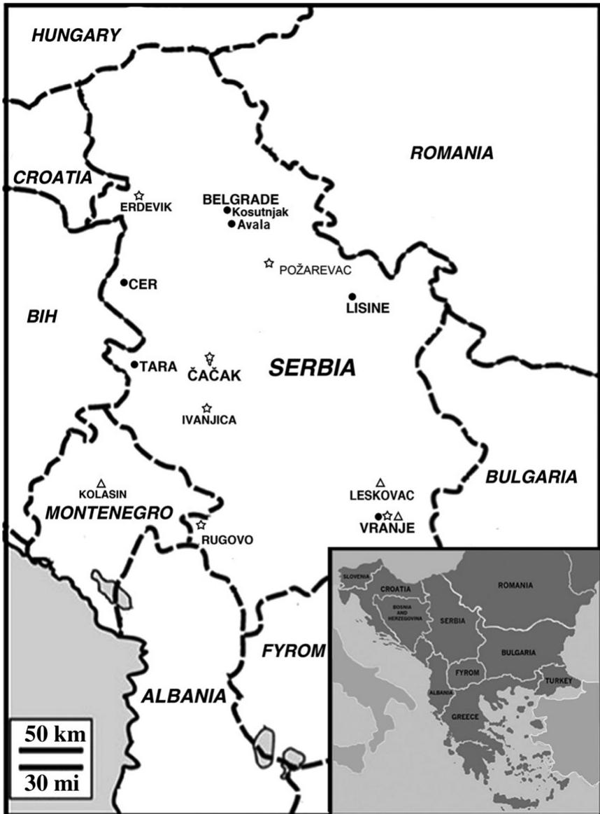
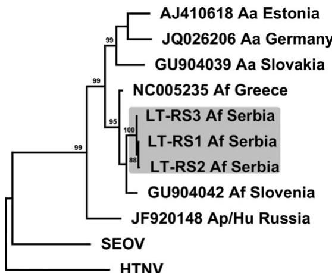
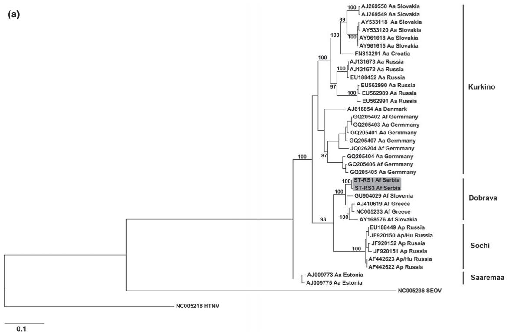
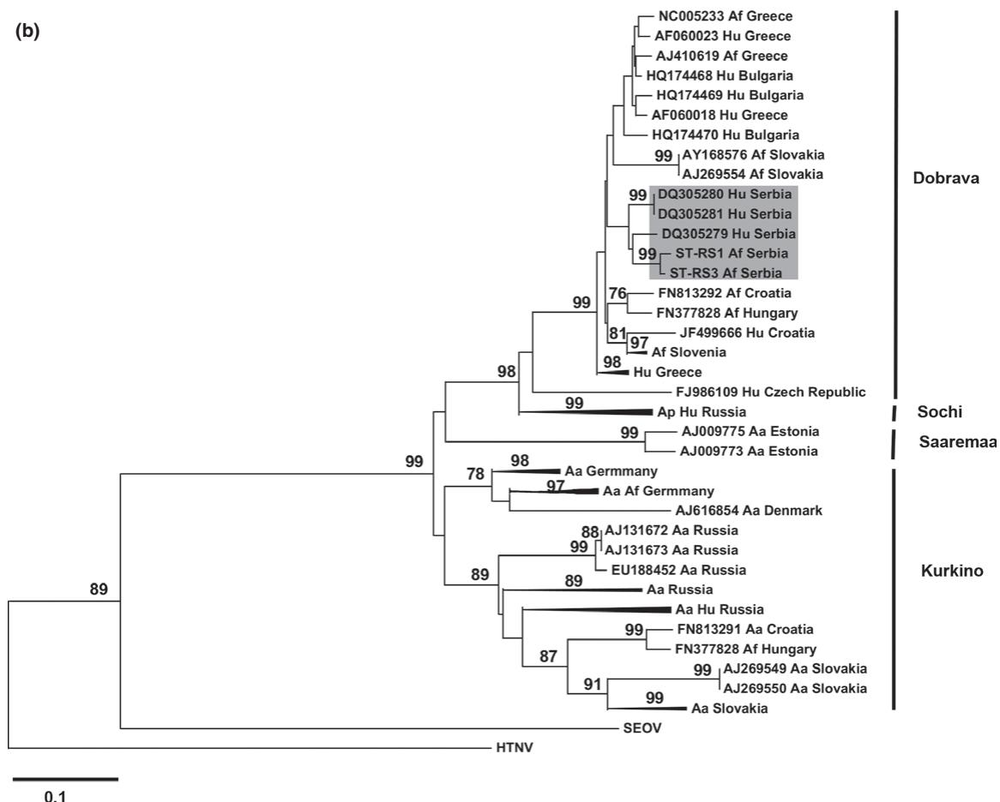

# ORIGINAL ARTICLE

# Genetic Analysis of Dobrava–Belgrade Virus from Western Serbia – A Newly Detected Focus in the Balkan Peninsula

G. Stamenkovic1 , V. Nikolic2 , J. Blagojevic1 , V. Bugarski-Stanojevic1 , T. Adnadevi  c1 , M. Stanojevic2 and M. Vujosevic1

1 Department of Genetic Research, Institute for biological research “Sinisa Stankovic”, University of Belgrade, Belgrade, Serbia   
2 Institute for Microbiology and Immunology, Faculty of Medicine, University of Belgrade, Belgrade, Serbia

# Impacts

• Among hantavirus infection in Europe, species Dobrava-Belgrade virus causes the most severe hemorrhagic fever with renal syndrome with high mortality rate. First prerequisite for organized prevention are epidemiologi cal studies of hantavirus infection in animal reservoirs with genetic analyses as a precise tool for definition of hantavirus species.   
• Four of six examined focuses in Serbia have hantavirus-positive Apodemus flavilollis mice. This finding points widespread presence of the virus and the necessity of continuous control of rodent infection, especially in places with frequent human visits.   
• Phylogenetic confirmation of the presence of Dobrava–Belgrade virus in A. flavilollis in new detected focus (Western Serbia) is the first detection of this hantavirus species in animals in Serbia.

# Keywords:

Hantavirus; Dobrava–Belgrade virus (DOBV); Apodemus flavicollis; Balkan Peninsula

# Correspondence:

G. Stamenkovic. PhD, Research associate, Department of Genetic Research, Institute for biological research “Sinisa Stankovic”, University of Belgrade, Despot Stephan Blvd 142, Belgrade, 11000, Serbia. Tel.: $+ 3 8 1 ~ 1 1 ~$ 207 83 30; Fax: +381 11 276 14 33; E-mail: gorana.stamenkovic@ibiss.bg.ac.rs, gorana_stamenkovic@yahoo.com

Mladen Vujosevic and Maja Stanojevic have contributed equally.

Received for publication January 8, 2014

doi: 10.1111/zph.12136

# Summary

Dobrava–Belgrade virus (DOBV) is a hantavirus species that causes the most severe form of haemorrhagic fever with renal syndrome (HFRS) in Europe. DOBV has been detected in three Apodemus rodents: A. flavicollis, A. agrarius and A. ponticus. These emerging viruses appear throughout the Balkan Peninsula including Serbia as its central part. In this study, we examined the seroprevalence, molecular epidemiology and phylogenetics of DOBV from A. flavicollis captured at six Serbian localities. Furthermore, we applied microsatellite typing of host animal genome to analyse the role of host kinship in DOBV animal transmission. The overall IgG seropositivity rate over 3 years (2008–2010) was $1 1 . 9 \%$ (22/185). All seropositive samples were subjected to RT-PCR and DNA sequencing for S and L genome segments (pos. 291–1079 nt and 2999–3316 nt, respectively). DOBV was genetically detected in three samples from mountain Tara in western Serbia, a newly detected DOBV focus in the Balkans. No sequence data from human cases from Serbia are available for the studied period. However, collected DOBV isolates in this work phylogenetically clustered together with isolates from Serbian human cases dating from 2002, with $1 . 9 \%$ nucleotide divergence. We determined the level of kinship between seropositive and seronegative animal groups and found no significant difference, suggesting that horizontal virus transmission in the studied population was the same within and among the hatches. Our findings are the first genetic detection of DOBV in rodents in Serbia. We confirm wide and continuous hantavirus presence in the examined parts of the Balkans, underlying the necessity of continual monitoring of hantavirus circulation in A. flavicollis.

# Introduction

Hantaviruses (family Bunyaviridae, genus Hantavirus) cause at least two types of human zoonoses: haemorrhagic fever with renal syndrome (HFRS) and hantavirus cardiopulmonary syndrome (HCPS). Hantaviruses are enveloped, with a negative sense three-segmented RNA genome, consisting of large – L (6.5–6.6 kb), medium – M $( 3 . 6 { - } 3 . 7 ~ \mathrm { k b } )$ ) and small – S (1.7–2.4 kb) segments, coding for viral polymerase, viral glycoprotein precursor further processed into two separate envelope glycoproteins (G1 and G2) and viral nucleocapsid protein, respectively (Jonsson et al., 2010). On the basis of complete protein sequences coded by the S and M segments, Maes et al. (2009) proposed classification of hantaviruses into four main groups, with about 20 different species that subdivide into lineages and members.

Hantaviruses are rodent borne (families Muridae and Cricetidae), each species being mainly associated with a particular rodent host as the source of human infection and/or disease (Maes et al., 2009; Jonsson et al., 2010). New published data have extended hantavirus hosts to insectivores (families Soricidae and Talpidae) and bats (order Chiroptera) (Guo et al., 2013). The first isolation of Dobrava–Belgrade virus was made from a patient suffering from HFRS in Belgrade, Serbia in 1992 (Gligic et al., 1992). Soon thereafter, the existence of a new hantavirus strain was confirmed by isolation and analysis of a virus genome segment obtained from Apodemus flavicollis captured in Dobrava, Slovenia (Avsic-Zupanc et al., 1992). In 1993, based on a 420 bp sequence of the S fragment, the Belgrade virus and Dobrava virus were found to be genetically highly similar (Taller et al., 1993). Therefore, both viruses are now considered to be the same and named Dobrava–Belgrade virus (DOBV). In the following years, DOBV was detected throughout the Balkan Peninsula (Papa, 2012). Furthermore, it is associated with different rodent host species that are members of the subfamily Murinae. Earlier phylogenetic analysis revealed separate genetic lineages or genotypes of DOBV hosted by different Apodemus species (Papa, 2012). However, new proposed classification subdivided DOBV species into four genotypes (Dobrava, Kurkino, Saaremaa and Sochi) in relation to their phylogeny, host reservoir, geographical distribution and pathogenicity for humans (Klempa et al., 2013; Vaheri et al., 2013). The Kurkino and Saaremaa genotypes are associated with the striped field mouse, Apodemus agrarius, Dobrava genotype with the yellow-necked field mouse, A. flavicollis, while Sochi genotype is found in the Caucasian wood mouse, Apodemus ponticus. DOBV hantaviruses induce HFRS with significant differences in case-fatality rate, from ${ > } 1 0 \%$ in DOBV hosted in A. flavicollis to ${ \leq } 1 \%$ in DOBV hosted in A. agrarius (Gligic, 2008; Papa, 2012).

Epidemiological studies from Serbia described sporadic individual human cases or episodic outbreaks of HFRS induced by hantavirus infection. The first serologically confirmed hantavirus infection in HFRS case in Serbia was reported in 1979 (Diglisic et al., 1994). Up to now, a number of serologically confirmed hantavirus infections in HFRS cases were observed yearly, with outbreaks occurring in 1986, 1989 and 1995–96 (Gligic et al., 1988, 1989, 1992; Diglisic et al., 1994; Avsic-Zupanc et al., 2000). The most recent available data about HFRS patients in Serbia refer to 2002, during a large epidemic in Serbia and Montenegro with 128 confirmed cases, including genetic detection of DOBV (Papa et al., 2006). However, hantaviral genetic analyses obtained from rodent populations in Serbia are very scarce. Up to now, limited genetic data are available: Puumala-like virus genome isolated from the house mouse, Mus musculus (Diglisic et al., 1994) and Tula virus genome (TULV) isolated from Microtus subterraneus and M. arvalis (Song et al., 2002; Nikolic et al., 2014).

The yellow-necked field mouse, A. flavicollis, is the most common woodland rodent through much of Central and Eastern Europe (Macdonald and Barrett, 1993). According to current knowledge, this species is also the most frequent natural reservoir of DOBV in the Balkan Peninsula (Avsic-Zupanc et al., 2000; Papa et al., 2001). The purpose of our study was to explore the prevalence of hantavirus infection in A. flavicollis in several localities with high frequencies of human visits, especially the National Park Tara, touristic destination in western Serbia with over 100 000 visitors annually from all over the region and Europe.

Furthermore, the aim was to study the influence of animal kinship in hantavirus transmission, in the context of molecular genome analyses. Detection and nucleotide sequencing of hantavirus genome was set up to determine hantavirus species and genome characteristics.

# Materials and Methods

# Rodent trapping and species identification

Rodents were trapped on several occasions during the 3- year study period (2008–2010), at six different trapping sites in central, western and southern Serbia (Fig. 1). Traps were set in mesophilic oak and hornbeam forests that are habitat for A. flavicollis, subject species of our investigation. We used long worth traps provided with hay, bait and food. There were 100 traps arranged in four rows with $1 0 \textrm { m }$ distances between traps and between rows. The animals were treated according to Directive 2010/63/EU of the European Parliament and the Council of 22 September 2010 on the protection of animals used for scientific purposes. Blood and tissue (liver, kidney or lung) samples were taken from each captured animal and stored at $- 2 0 ^ { \circ } \mathrm { C }$ until use. Concerning lower stability of RNA molecule, we avoided

repeated freeze-thawing cycles and RNA isolation was performed immediately after tissue collection. Nuclear DNA was extracted from animal livers using a DNeasy Blood and Tissue Kit (QIAgen, Hilden, Germany). A. flavicollis species status was confirmed by recently developed ISSR-PCR analyses (for details see Bugarski-Stanojevic et al., 2011).

# Kinship testing by microsatellite typing

Microsatellites were typed by allele detection of six microsatellite loci developed specifically for A. flavicollis (Gockel et al., 1997; Harr et al., 2000; Gryczynska-Siemia tkowska et al., 2008). Amplifications were performed in two separate multiplex reactions using a QIAgen multiplex PCR kit (QIAgen, Hilden, Germany) with fluorescence labelled forward primers. One reaction included the primer set: MSAf-16,

MSAA-5 and MSAA-6, while that for the other reaction was as follows: As-12, As-20 and MsAf-22. Six loci for each individual were genotyped by capillary electrophoresis on an ABI PRISM 3130 Genetic Analyzer (Applied Biosystem, Foster City, CA, USA). Fragment length was determined by internal size standard (GeneScen LIZ500, Applied Biosystem), and genotypes of loci were scored by GENEMAPER version 3.0 and GENOTYPER version 2.5 (Applied Biosystems, Foster City, CA, USA). Using ML-relate software, we calculated the maximum likelihood relatedness coefficient (ML relatedness) based on detected microsatellite alleles in animal’s genome. ML relatedness value determines belonging to the same hatch, that is, relationship at the kinship level of parents, full siblings and half siblings (Kalinowski et al., 2006). The obtained results were analysed statistically using one-way ANOVA and Fisher’s exact test, respectively.

  
Fig. 1. Map of localities with detected hantavirus infection in the territory of Serbia. Points indicate trapping sites examined in this article; stars indicate sites where hantavirus IgG-positive small rodents were found earlier (Gligic et al., 1989; Gligic, 2008); triangles indicate sites where infection of human cases probably happened and whose genome sequence used for comparison in this article (Papa et al., 2006). GPS coordinates for trapping sites: Tara Mt.: 43°530 48″N, 19°320 23″E: Kosutnjak: 44°450 20″N, $2 0 ^ { \circ } 2 6 ^ { \prime } 2 0 ^ { \prime \prime } \mathsf { E }$ : Avala Mt.: 44°410 19″N, 20°310 14″E: Cer Mt: 44°380 37″N, 19°200 40″E: Vranje: 42°200 28″N, 21°530 39″E: Lisine: $4 4 ^ { \circ } 6 ^ { \prime } 2 ^ { \prime \prime } \mathsf { N } _ { i }$ 21°380 23″E.

# Serology

Hantavirus IgG antibodies in rodent sera were detected by indirect immunofluorescent antibody assay (IFA) by fluorescein-isothiocyanate-conjugated sheep anti-mouse IgG (H) (Institute for Application of Nuclear Energy, Belgrade, Serbia). Briefly, cultures of Vero E6 cells were separately infected with the HTNV strain 76–118. Rodent sera were serially diluted (1: 16 to 1: 32) and applied on previously prepared antigen spot slides. After incubation, slides were fixed and examined by fluorescence microscopy (Avsic-Zupanc et al., 2000). Control samples, hantavirus IgGpositive and IgG-negative rodent serums, were provided by National Reference Laboratory for ARBO viruses and HF viruses, Institute of Virology, Vaccines and Sera - Torlak, Belgrade, Serbia. Sera that gave a characteristic cytoplasmic fluorescence in hantavirus-infected cells, at any or both mentioned dilutions, were considered positive. All readings were confirmed by double check.

# RT-PCR and sequencing

All rodent samples found to be seropositive were examined by reverse transcription-polymerase chain reaction (RT-PCR) for the presence of hantavirus genomic RNA. Total RNA was extracted from lung, liver or kidney tissues using the TRIZOL Reagent (GibcoBRL, Invitrogen, Karlsruhe, Germany). Cross-contamination was avoided in accordance with the principles of good laboratory practice for detection of pathogens by PCR (separation of pre-PCR and post-PCR procedures, strict unidirectional flow of specimens and use of decontamination procedure using bleach between handling different samples etc.). Small pieces of tissues, approximately $1 0 ~ \mathrm { m g }$ , were homogenized in liquid nitrogen using a mortar and pestle. The mixture was then transferred to a $1 . 5 ~ \mathrm { m l }$ tube containing $1 ~ \mathrm { m l }$ of TRIZOL. RNA was isolated following the manufacturer’s protocol. The RNA pellet was air-dried and dissolved in $2 5 ~ \mu \mathrm { L }$ of RNase-free water with 5 U of RNase inhibitor.

Extracted RNA was reverse-transcribed and amplified by a nested RT-PCR protocol, using the one-step RNA PCR Kit (Qiagen, Hilden, Germany) for the outer reaction and the Taq PCR Core Kit (Qiagen, Hilden, Germany) for the inner PCR reaction. For L segment detection, a set of degenerate primers for all known hantaviruses, amplifying the 390 bp part of the highly conserved region, was used (Klempa et al., 2006). We designed primer pairs for nested RT-PCR, which amplified 1322 bp and 1283 bp parts of the S segment (1stPCR: DOB-S-F1 $5 ^ { \prime }$ -GTAGTAGGCTCC CTAAAAAGC- $3 ^ { \prime }$ , DOB-S-R1 $5 ^ { \prime }$ -GGGATTACATAAAGCA TGGGA- $. 3 ^ { \prime }$ : 2ndPCR: DOB-S-F2 $5 ^ { \prime }$ -CACTACACTAAAGA TGGCAA- ${ } . 3 ^ { \prime }$ , DOB-S-R2 $5 ^ { \prime }$ -GGATAATGCAACAAATACA-ATTA- ${ } . 3 ^ { \prime }$ ). Negative control (RNA/DNA free sterile water)

has been included in all rounds of RNA isolation and RT-PCR. For every sample, universal primers for mouse betaactin mRNA: $5 ^ { \prime }$ -GTGGGCCGCTCTAGGCACCAA- $3 ^ { \prime }$ and $5 ^ { \prime }$ -TCTTTGATGTCACGCACGATTTC- $\cdot 3 ^ { \gamma }$ were used as external positive control for RT-PCR (Ponte et al., 1984). RT-PCR products were visualized by electrophoresis using $1 \%$ agarose gel. Positive samples were sequenced in both directions by dye-terminator DNA sequencing on an ABI 310 Genetic Analyzer (Applied Biosystem, Foster City, CA, USA).

# Sequence comparison and phylogenetic analysis

All sequence data in the NCBI database by 2013 accepted as DOBV and Saaremaa hantavirus were used for comparison with Serbian (RS) sequences. Analysed part of L segment sequences was 318 bp in length (nt 2999–3316, Fig. 2). S segment sequences corresponding to the 789 bp part (nt 291–1079) were compared with 36 animal isolates (Fig. 3a). Further, phylogenetic analysis of the 528 bp part of the S segment (nt 387–914), which includes human and animal isolates, was performed with 32 additional sequences (Fig. 3b). Each phylogenetic tree was outgroup rooted by reference sequences cited in figure legend.

Multiple nucleotide sequence alignments were processed in a CLUSTAL W algorithm (Larkin et al., 2007). The bestfit nucleotide substitution model for aligned sequences was determined by jModeltest 0.1.1 software (Posada, 2008) using all 88 proposed models. Further, phylogenetic analysis was performed with PHYML v.3.0 (Guindon et al.,

  
Fig. 2. ML phylogenetic tree of DOBV isolates based on partial L segment sequences (318 nt: 2999–3316 nt) and generated by the PHYML software package using a transitional model 2 of nucleotide substitution and a proportion of invariant sites (TIM2 + I) as proposed by jModeltest. Phylogenetic tree was outgroup rooted by reference sequences: SEOV (NC005222) and HTNV (NC005238). Sequences indicated by GeneBank Accession Number, host name with abbreviation (A. flavicollis –Af, A. agrarius – Aa and A. ponticus - Ap) and country.

2010) and PAUP v. 4.0 software packages (Swoffor, 2000). The evolutionary history was inferred by neighbour-joining (NJ), maximum likelihood (ML) and minimum evolution statistical methods, showing a high level of congruence between these methods. Bootstrap support for the tree nodes of the reconstructed phylogenetic trees was calculated with 1000 replicates. Bootstrap values that exceeded $7 0 \%$ were considered significant.

Alignments were screened for recombination using a Bootscan recombination detection approach as implemented in the RDP3 program (Martin et al., 2010). Overall selection pressure, measured as the mean ratio of non-synonymous (dN) to synonymous substitutions (dS) per site (dN/dS), was estimated using the single likelihood ancestor counting (SLAC) and random effects likelihood (REL) methods from the HyPhy package (Pond and Frost, 2005), available at http://www.datamonkey.org.

# Results

During the three-year study period (2008–2010), a total of 185 A. flavicollis were characterized by intersimple sequence repeat (ISSR) markers. The number of trapped animals at different sites varied yearly during the study period (Table 1). Positive finding of specific hantavirus IgG was detected in the total of 22/185 $( 1 1 . 8 9 \%$ ) blood samples, of which only three reacted positive on $1 : 3 2$ dilution. Seropositive animals were detected in all but two trapping sites: Cer Mt. and Lisine. The highest prevalence of IgG antibody was observed in Vranje and on Tara Mt., $2 5 \%$ (3/ 12) and $2 0 \%$ (10/50), respectively.

All seropositive samples were further analysed by genetic detection of hantavirus sequences. Amplification from beta-actin mRNA, as external control, was present in all examined samples by RT-PCR. Three of 22 seropositive samples were positive on RT-PCR for hantavirus L segment, and the isolates were marked: RS1 to RS3. Two the three animals were also positive in the nested PCR for S segment (RS1 and RS3). All RT-PCR-positive animals were trapped at the same site on mountain Tara, western Serbia (Fig. 1). An initial BLAST search demonstrated the highest similarity of RS sequences with isolates submitted in NCBI database as DOBV and Saaremaa virus. Further phylogenetic analyses of the obtained RS sequences, in both L and S segments, showed that all three genomes belong to the DOBV-Dobrava genotype (Fig. 2 and 3a).

# Relatedness between hantavirus-positive rodents

Levels of kinship were calculated for the Tara Mt. population, based on six microsatellite loci by ML-relate software. Comparison of mean ML relatedness of seropositive $\left( 0 . 0 4 8 \pm 0 . 0 8 0 \right.$ , $\operatorname* { m i n } = 0 . 0 0 0$ , $\mathrm { \ m a x } = 0 . 2 9 0$ ) vs. seronega-

tive animals $\left( 0 . 0 3 7 \pm 0 . 0 7 5 \right.$ , $\operatorname* { m i n } = 0 . 0 0 0$ , $\operatorname* { m a x } = 0 . 5 2 0$ did not reveal statistical significance $\mathrm { \Delta } \mathrm { \left( F _ { 1 , 4 0 5 } \right) = 0 . 5 5 }$ $P = 0 . 4 6 0$ ). The frequency of relatives was higher in the seronegative group $9 6 . 6 \%$ in the seronegative group vs. $8 5 . 7 \%$ in the seropositive group), but this difference was also found not to be statistically significant $P = 0 . 3 5 6$ ).

# Phylogenetic analysis of the partial L segment sequences

We successfully recovered a partial L segment from three isolates (sequences LT-RS1 to LT-RS3). The L segment sequences recovered (318 bp in length, pos. 2999–3316) encoded 106 amino acids (pos. 988–1087) of the RNAdependent RNA polymerase. The mean nucleotide distance among nine aligned L segment sequences was 0.137 (0.006– 0.195, $\mathrm { S D } = 0 . 0 5 6$ ). Amino acid divergence for the examined region was $3 . 4 \%$ . Nucleotide and amino acid divergence among the newly detected sequences from Serbia was $1 . 1 \%$ and $1 . 3 \%$ , respectively. Comparison of the corresponding region of DOBV-Dobrava and DOBV-Kurkino genotypes revealed a nucleotide divergence of $5 . 4 \%$ and $1 4 . 8 \%$ , respectively.

In the L segment phylogenetic tree, our sequences from A. flavicollis formed a distinct clade with Slovenian and Greek DOBV isolates from the same species. Moreover, DOBV-Kurkino and DOBV-Saaremaa have a monophyletic origin, while DOBV-Sochi clustered into a separate branch (Fig. 2).

# Phylogenetic analysis of the partial S segment sequences

The obtained 789-bp (nt 291–1079) DOBV S segment sequences (ST-RS1 and ST-RS3) comprise 263 amino acids of the N protein (aa 86–348). Prior to phylogenetic analyses, screening for recombination between aligned sequences was performed and no putative recombinant regions could be detected. Mean nucleotide distance found for DOBV alignment of the examined S segment part was 0.113 (0.0– 0.155, $\mathrm { S D } = 0 . 0 3 5$ ), with amino acid divergence $1 . 9 \%$ Comparative analysis of the DOBV S segment revealed the nucleotide divergence within DOBV-Dobrava, DOBV-Sochi and DOBV-Kurkino clusters: $3 . 6 \%$ , $1 . 6 \%$ and $9 . 0 \%$ respectively. Nucleotide divergence between RS samples was $0 . 8 \%$ , with amino acid divergence $0 . 4 \%$ .

Consensus sequence analysis from the obtained alignment (BioEdit v.7.0.0., Hall, 1999) with $9 5 \%$ threshold frequencies for inclusion in consensus revealed that RS isolates have three unique synonymous substitutions (T584C, T733G, C771T). Amino acid sequences for RS1 and RS3 were identical to the DOBV reference sequence (NC_005233), with the exception of two non-synonymous changes (A328G and Y98C) in RS3, which are unique in the alignment. Within the overall analysed S segment align-

ment, amino acid substitutions (12 homologous and 7 non-homologous) appeared between 218 and 348 aa in the N protein. Non-homologous amino acid substitutions have appeared as rare or unique in the alignment in ${ < } 5 \%$ isolates. To examine the nature of codon selection on the aligned S segment sequences (263 codons on 36 aligned isolates), we performed per-site SLAC and REL tests, under TrN93 substitution model and based on the NJ Tree. On the analysed alignment, 0.296 subs/site were found, with 220 variable codon sites (625 synonymous and 38 non-synonymous substitutions). At the protein level, there were 22 amino acid variable sites. The overall value of the dN/dS ratio was $< 0 . 1$ (SLAC: $\mathrm { d N } / \mathrm { d S } = 0 . 0 2 3 4$ , estimated $9 5 \%$ , CI from 0.016 to 0.031, for $P < 0 . 0 0 1$ : REL: $\mathrm { d N } / \mathrm { d S } = 0 . 0 3 0$ , for Bayes factor $= 5 0$ ).

The general topology of the phylogenetic tree for the S segment showed two separate clades of DOBV species: the first one, consisting of Dobrava, Sochi and Kurkino genotypes, and the second one with Saaremaa genotypes (Fig. 3a).

In addition, we aligned 68 corresponding S segment sequences of both human and animal isolates available in the NCBI database (nt 387–914). The topology of the phylogenetic tree revealed similar clustering as for the 789 bp part of the S segment (Fig. 3b). Isolates from Serbian rodent and human cases, collected in 2008 (this paper) and 2002 (Papa et al., 2006), clustered together with $8 4 \%$ bootstrap value. The nucleotide divergence found among Serbian human isolates was $1 . 3 \%$ and between human and rodent isolates $1 . 9 \% .$ , without amino acid changes in analysed part of S segment.

# Discussion

DOBV is the causative agent of the most severe form of HFRS in Europe, with case-fatality rate over $1 0 \%$ (Jonsson et al., 2010; Papa, 2012). Considering that Apodemus mice are the main natural reservoir of DOBV, detailed epidemiological investigation of DOBV infection in these small mammals would be a pre-conditional first step in organizing measures to prevent spread to humans. Most of the examined locations in our work are popular tourist areas (Fig. 1). In the examined rodent populations, total preva-

lence of seropositivity was $1 1 . 8 9 \%$ . The frequency of seropositivity varied among examined trapping sites from zero to $2 5 \%$ , the highest one being at Vranje. The first published serological results of hantavirus in small mammals in Serbia, in 1986, concerned the localities, Rugovo and Ca cak (app. $2 5 0 ~ \mathrm { k m }$ and $7 0 ~ \mathrm { k m }$ from our main trapping area on Tara Mt.) with $3 4 \%$ and $3 0 \%$ positivity, respectively (Fig. 1, Gligic et al., 1989). In the following decade, hantavirus antigen and/or antibodies-positive rodents have been repeatedly found in these and other foci, at similar or slightly lower frequencies (Fig. 1, Gligic, 2008). The reported frequency of serological DOBV detection in Apodemus mice or small rodents in other Balkan countries ranges from $3 . 6 \%$ in Bosnia and Hercegovina, $6 . 3 \%$ i n Croatia, $1 7 \%$ in northern Croatia and Hungary to $2 1 . 2 1 \%$ in Slovenia (Lundkvist et al., 1997; Avsic-Zupanc et al., 2000; Plyusnina et al., 2009, 2011; Nemeth et al., 2011). DOBV seroprevalence of $1 3 \%$ in Greece was established particularly in A. flavicollis (Papa et al., 2001). In our study, three of 22 serum samples positive by the IFA method were confirmed for hantavirus genome presence by RT-PCR. Different frequency of genetic hantavirus detection in seropositive animals has been reported. In some studies, hantavirus genome was detected in almost all seropositive animal samples, whereas in the others, RT-PCR was positive in ${ < } 1 0 \%$ , depending on applied primers or/and analysed genome segments (Avsic-Zupanc et al., 2000; Chandy et al.,

Table 1. Frequency of hantavirus IgG-positive animals in studied populations of A. flavicollis from Serbia (number of hantavirus IgG-positive animals/number of animals examined)   

<table><tr><td rowspan="2">Trapping site</td><td colspan="3">Trapping year</td><td rowspan="2">All</td></tr><tr><td>2008</td><td>2009</td><td>2010</td></tr><tr><td>Tara Mt.</td><td>6/33</td><td>4/16</td><td>0/1</td><td>10/50</td></tr><tr><td>Košutnjak</td><td>0/14</td><td>0/8</td><td>5/35</td><td>5/57</td></tr><tr><td>Avala Mt.</td><td>0</td><td>1/15</td><td>3/17</td><td>4/32</td></tr><tr><td>Cer Mt.</td><td>0</td><td>0/17</td><td>0/3</td><td>0/20</td></tr><tr><td>Vranje</td><td>0</td><td>0</td><td>3/12</td><td>3/12</td></tr><tr><td>Lisine</td><td>0/11</td><td>0/3</td><td>0</td><td>0/14</td></tr><tr><td>All</td><td>6/58</td><td>5/59</td><td>11/68</td><td>22/185</td></tr><tr><td></td><td>(10.34%)</td><td>(8.47%)</td><td>16.18%)</td><td>(11.89%)</td></tr></table>

Fig. 3. ML phylogenetic trees of DOBV rodent isolates, based on S segment sequences and generated by PHYML software package. (a) 36 isolates from rodents (789 nt: 291–1079 nt) analysed by a TrN + G evolutionary model. (b) 68 isolates from rodents and humans (528 nt: 387–914 nt) analysed by a TPM2uf+I+G evolutionary model. For better weaving, clusters of phylogenetically closely related sequences were compressed to triangles: Af Slovenia (GU904029, AJ251996, AJ251997), Hu Greece (AF060014-AF060017, AF060019-AF060022, AF060024), Ap Hu Russia (JF920150- JF920152, EU188449, AF442622, AF442623), Aa Russia (EU562989- EU562991), Aa Hu Russia (GQ205393-GQ205393), Aa Slovakia (AY533118, AY533120, AY961615, AY961618), Aa Germany (JQ026204, GQ205401-GQ205403, GQ205407), Aa Af Germany JQ344114, GQ205404- GQ205406). SEOV (NC005236) and HTNV (NC005218) were used as outgroups. Sequences indicated by GeneBank Accession Number, host name with abbreviation (A. flavicollis –Af, A. agrarius – Aa, A. ponticus - Ap and Hu – isolate from human case) and country. DOBV genotypes are marked by brackets.

2013). In our work, PCR-positive animals were among those positive for hantavirus IgG on dilution 1:32. Other samples, IgG-positive on dilution 1:16, were RT-PCR negative, which indicate the shorter period of detectable viremia in relation to long-lasting low titre of antibody response (Jonsson et al., 2010; Nemeth et al., 2011).

All RT-PCR-positive animals were caught on Tara Mt. tourist complex where seropositivity was among the highest $( 2 0 \% )$ . Up to now, western Serbia, where mountain Tara is located, has not been detected as a hantavirus focus in the animal reservoir. Regarding human infection, the majority of reported serologically documented DOBV human infections so far in Serbia occurred in the south of the country, represented by the Vranje trapping site in this study (Papa et al., 2006). Two of the locations in our work were Kosutnjak and Avala, in the municipality of Belgrade, where the first human DOBV case was detected (Gligic et al., 1992). During the period of animal collection, 40 cases of human hantavirus infection were immunologically detected in Serbia (unpublished data from National Reference Laboratory for ARBO viruses and HF viruses). Unfortunately, epidemiological data regarding exact or most probable place of infection are very scarce or completely missing. Detection of seropositive animals throughout our 3-year study period and identification of a new infection focus in west Serbia indicates the need for permanent monitoring. Preventive tasting should include not only previously confirmed hantavirus localities, but also other areas, especially forests with frequent human visits.

We investigated the influence of kinship on DOBV transmission in the examined A. flavicollis population from Tara. While the frequency of relatives was higher in seronegative in relation to seropositive group, the difference did not reach statistical significance. We have to underline that we did not detect any immigrants, that is, animals without relatives in the examined population. This result could be a consequence of the small size of the trapping area (app. $5 0 0 0 \ \mathrm { m } ^ { 2 }$ ) and behavioural characteristics of Apodemus rodents, such as a small home range. Investigation of TULV and PUUV spread in populations of Cricetidae species revealed that infected animals were more closely related to each other than non-infected ones, emphasizing the importance of virus transmission in hatches (Deter et al., 2008). Our preliminary results did not support this trend of transmission for A. flavicollis as a host, probably due to differences in social organization of different host species.

# Molecular analyses

Conversely, to previous rather extensive epizootical studies of hantavirus distribution in Serbia, based on serological detection, up to now, molecular studies are very scarce (Diglisic et al., 1994; Song et al., 2002; Nikolic et al., 2014). We

found three A. flavicollis captured on mountain Tara to be positive for hantavirus genome by nested RT-PCR for a partial L segment (RS1 to RS3), whereas two isolates (RS1 and RS3) were also positive for a partial S segment. Absence of amplification for the S segment in the RS2 isolate confirms better detection sensitivity by degenerate primers for the L segment even in cases of strict hantavirus genotypes (Klempa et al., 2006). Comparison of Serbian L and S segment isolates with animal isolates clustered them together with DOBV hosted by A. flavicollis from Greece, Slovakia and Slovenia, revealing host-related clustering (Fig. 2 and 3a). The same phylogenetic relation was shown by Papa (2012) in analyses of complete sequence of DOBV L segments.

With the aim to elucidate nucleotide sequence relations between Serbian human and animal isolates, we analysed all NCBI database accepted as DOBV and Saaremaa sequences for the corresponding S segment (68 isolates with the 528 bp part). The phylogenetic tree again showed strict geographical clustering (Fig. 3b). Consequently, Serbian human and rodent isolates clustered together with 0.019 nucleotide distance. It is important to emphasize that human isolates were collected in 2002 at sites about 200– $4 0 0 ~ \mathrm { k m }$ away from mountain Tara, where we found infected A. flavicollis 6 years later (Fig. 1). A similar trend, concerning high phylogenetic similarity regardless of temporal and spatial distance, has also been shown in Greek and Slovenian isolates from humans and animals (Fig. 3b). This phenomenon points to unidirectional transmission of infection, from mice to man. In accordance with that, the short residence time of the virus in human tissue could be insufficient to induce fixation of virus genome changes in different hosts (Schilling et al., 2007).

According to the classification by Klempa et al. (2013), analysed isolates from Serbia (RS-1 to RS-3 from A. flavicollis and DQ305279 to DQ305281 from human serum) belong to DOBV species and Dobrava genotypes (Fig. 3A and B).

Although the examined fragment of the L segment is rather conservative, the obtained LT-RS sequences were found to be slightly polymorphic (genetic divergence $1 . 1 \%$ ). The analysed DOBV L segment protein coding sequence includes the complete motif B and almost complete inter-motif (between A and B motif) of the L protein (pos. 988–1087 aa). Motifs B, E and pre-motif A found in all RNA-dependent RNA polymerases are responsible for positioning of the template and primer relative to the active site (Nemirov et al., 2003). In all aligned DOBV L protein sequences in our study, motif B (pos. 1044–1065 aa) was fully conserved and the A-to-B inter-motif was highly conserved with rare amino acid changes, suggesting their importance in enzyme function (Kukkonen et al., 2005).

The examined part of the S segment partly codes for the conserved amino-terminal N protein that forms the main

human IgG epitope (pos. 1–118 aa) and genome RNAbinding domain (pos. 175–217 aa) important for RNP assembly (Kaukinen et al., 2005). These parts of the N protein are very conservative, characterized by a strict cluster of 15 lysines/arginines (pos. 136–213 aa), present in all isolates included in the S segment alignment. The function of the portion of the N protein analysed in our study with detected amino acid changes (218–348 aa) is currently unknown (Kaukinen et al., 2005). However, the type of detected amino acid changes and evidence of purifying selection $( \mathbf { \omega } _ { \infty } < 0 . 1 $ ) in action on this region imply a high tendency for protein structure conservation. Consequently, examined part of S segment has lower nucleotide divergence in relation to examined part of L segment $( 1 1 . 3 \%$ versus $1 3 . 7 \%$ , respectively), conversely to results given in comparison with their whole-nucleotide sequences (Nemirov et al., 2003; Papa, 2012).

Our findings are the first genetic confirmation of DOBV presence in wild rodents in Serbia, initially detected serologically three decades ago. We confirmed the persistence of hantavirus seroprevalence in A. flavicollis in Serbia. The finding of a new hantavirus focus in western Serbia points to widespread presence of the virus and the necessity of continuous control of rodent infection, especially in places with frequent human visits.

# Acknowledgements

We are very grateful to Dr Ana Gligic and Dr Bojana Bozovic for useful advice during realization of this study and Bozica Jankovic for excellent technical assistance (Institute of Virology, Vaccines and Sera - Torlak, National Reference Laboratory for ARBO viruses and HF viruses, Belgrade, R Serbia). This work was financed by a grant from the Ministry of Education, Science and Technological Development of the Republic of Serbia, Contract No. 173003 and Contract No. 175024.

# Disclosure Statement

No competing financial interests exist.

# References

Avsic-Zupanc, T., S. Y. Xiao, R. Stojanovic, A. Gligic, G. van der Groen, and J. W. LeDuc, 1992: Characterization of dobrava virus: a hantavirus from slovenia. Yugoslavia. J. Med. Virol. 38, 132–137.   
Avsic-Zupanc, T., K. Nemirov, M. Petrovec, T. Trilar, M. Poljak, A. Vaheri, and A. Plyusnin, 2000: Genetic analysis of wild-type Dobrava hantavirus in Slovenia: co-existence of two distinct genetic lineages within the same natural focus. J. Gen. Virol. 81, 1747–1755.

Bugarski-Stanojevic, V., J. Blagojevic, G. Stamenkovic, T. Adnadevi c, E. Giagia-Athanasopoulou, and M. Vujosevic, 2011: Comparative study of the phylogenetic structure in six Apodemus species (Mammalia, Rodentia) inferred from ISSR-PCR data. Syst. Biodivers. 9, 95–106.   
Chandy, S., R. G. Ulrich, M. Schlegel, R. Petraityte, K. Sasnauskas, D. J. Prakash, V. Balraj, P. Abraham, and G. Sridharan, 2013: Hantavirus infection among wild small mammals in Vellore, South India. Zoonoses Public Hlth. 60, 336–340.   
Deter, J., Y. Chaval, M. Galan, B. Gauffre, S. Morand, H. Henttonen, J. Laakkonen, L. Voutilainen, N. Charbonnel, and J. F. Cosson, 2008: Kinship, dispersal and hantavirus transmission in bank and common voles. Arch. Virol. 153, 435–444.   
Diglisic, G., S. Y. Xiao, A. Gligic, M. Obradovic, R. Stojanovic, D. Velimirovic, V. Lukac, C. A. Rossi, and J. W. LeDuc, 1994: Isolation of a Puumala-like virus from Mus musculus captured in Yugoslavia and its association with severe hemorrhagic fever with renal syndrome. J. Infect. Dis. 169, 204–207.   
Gligic, A. 2008: Etiology of hemorrhagic fever with renal syndrome, viruses and their reservoirs. In: Kovacevic, Z., D. Jovanovic, A. Gligic, and V. Skataric, (eds), Hemorrhagic Fever with Renal Syndrome. pp. 17–34. Medicinski faklultet, Kragujevac.   
Gligic, A., M. Obradovic, R. Stojanovic, D. Hlaca, B. Antonijevic, A. Arnautovic, J. M. Gaon Frusic, P. Lee, D. Goldgaber, et al., 1988: Hemorrhagic fever with renal syndrome in Yugoslavia: detection of hantaviral antigen and antibody in wild rodents and serological diagnosis of human disease. Scand. J. Infect. Dis. 20, 261–266.   
Gligic, A., M. Frusic, M. Obradovic, R. Stojanovic, D. Hlaca, C. J. Jr Gibbs, R. Yanagihara, C. H. Calisher, and D. C. Gajdusek, 1989: Hemorrhagic fever with renal syndrome in Yugoslavia: antigenic characterization of hantaviruses isolated from Apodemus flavicollis and Clethrionomys glareolus. Am. J. Trop. Med. Hyg. 41, 109–115.   
Gligic, A., N. Dimkovic, S. Y. Xiao, G. J. Buckle, D. Jovanovic, D. Velimirovic, R. Stojanovic, M. Obradovic, G. Diglisic, and J. Micic, 1992: Belgrade virus: a new hantavirus causing severe hemorrhagic fever with renal syndrome in Yugoslavia. J. Infect. Dis. 166, 113–120.   
Gockel, J., B. Harr, C. Schlotterer, W. Arnold, G. Gerlach, and€ D. Tautz, 1997: Isolation and characterization of microsatellite loci from Apodemus flavicollis (rodentia, muridae) and Clethrionomys glareolus (rodentia, cricetidae). Mol. Ecol. 6, 597–599.   
Gryczynska-Siemia tkowska, A., T. Gortat, A. Kozakiewicz, R. Rutkowski, J. Pomorski, and M. Kozakiewicz, 2008: Multiple paternity in a wild population of the yellow-necked mouse Apodemus flavicollis. Acta Theriol. 53, 251–258.   
Guindon, S., J. F. Dufayard, V. Lefort, M. Anisimova, W. Hordijk, and O. Gascuel, 2010: New algorithms and methods to estimate maximum-likelihood phylogenies: assessing the performance of PhyML 3.0. Syst. Biol. 59, 307–321.   
Guo, W. P., X. D. Lin, W. Wang, J. H. Tian, M. L. Cong, H. L. Zhang, M. R. Wang, R. H. Zhou, J. B. Wang, M. H. Li, J. Xu, E. C. Holmes, and Y. Z. Zhang, 2013: Phylogeny and origins

of hantaviruses harbored by bats, insectivores, and rodents. PLoS Pathog. 9, e1003159.   
Hall, T. A., 1999: BioEdit: a user-friendly biological sequence alignment editor and analysis program for Windows 95/98/ NT. Nucl. Acids Symp. Ser. 41, 95–98.   
Harr, B., K. Musolf, and G. Gerlach, 2000: Characterization and isolation of DNA microsatellite primers in wood mice (Apodemus sylvaticus, Rodentia). Mol. Ecol. 9, 1664–1665.   
Jonsson, C. B., L. T. Figueiredo, and O. Vapalahti, 2010: A global perspective on hantavirus ecology, epidemiology, and disease. Clin. Microbiol. Rev. 23, 412–441.   
Kalinowski, S. T., A. P. Wagner, and M. L. Taper, 2006: ML-Relate: a computer program for maximum likelihood estimation of relatedness and relationship. Mol. Ecol. Notes 6, 576–579.   
Kaukinen, P., A. Vaheri, and A. Plyusnin, 2005: Hantavirus nucleocapsid protein: a multifunctional molecule with both housekeeping and ambassadorial duties. Arch. Virol. 150, 1693–1713.   
Klempa, B., E. Fichet-Calvet, E. Lecompte, B. Auste, V. Aniskin, H. Meisel, C. Denys, L. Koivogui, J. terMeulen, and D. H. Kruger, 2006: Hantavirus in African wood mouse.€ Guinea. Emerg. Infect. Dis. 12, 838–840.   
Klempa, B., T. Avsic-Zupanc, J. Clement, T. K. Dzagurova, H. Henttonen, P. Heyman, F. Jakab, D. H. Kruger, P. Maes, A. Papa, E. A. Tkachenko, R. G. Ulrich, O. Vapalahti, and A. Vaheri, 2013: Complex evolution and epidemiology of Dobrava-Belgrade hantavirus: definition of genotypes and their characteristics. Arch. Virol. 158, 521–529.   
Kukkonen, S. K., A. Vaheri, and A. Plyusnin, 2005: L protein, the RNA-dependent RNA polymerase of hantaviruses. Arch. Virol. 150, 533–556.   
Larkin, M. A., G. Blackshields, N. P. Brown, R. Chenna, P. A. McGettigan, H. McWilliam, F. Valentin, I. M. Wallace, A. Wilm, R. Lopez, J. D. Thompson, T. J. Gibson, and D. G. Higgins, 2007: Clustal W and Clustal X version 2.0. Bioinformatics 23, 2947–2948.   
Lundkvist, A., M. Hukic, J. Horling, M. Gilljam, S. Nichol, and€ B. Niklasson, 1997: Puumala and Dobrava viruses cause hemorrhagic fever with renal syndrome in Bosnia-Herzegovina: evidence of highly cross-neutralizing antibody responses in early patient sera. J. Med. Virol. 53, 51–59.   
Macdonald, D. W., and P. Barrett, 1993: Mammals of Britain and Europe. Harper Collins, London, UK.   
Maes, P., B. Klempa, J. Clement, J. Matthijnssens, D. C. Gajdusek, D. H. Kruger, and M. Van Ranst, 2009: A proposal for new€ criteria for the classification of hantaviruses, based on S and M segment protein sequences. Infect. Genet. Evol. 9, 813–820.   
Martin, D. P., P. Lemey, M. Lott, V. Moulton, D. Posada, and P. Lefeuvre, 2010: RDP3: a flexible and fast computer program for analyzing recombination. Bioinformatics 26, 2462–2463.   
Nemeth, V., M. Madai, A. Maraczi, B. Berczi, G. Horvath, M. Oldal, P. Kisfali, K. Banyai, and F. Jakab, 2011: Detection of Dobrava-Belgrade hantavirus using recombinant-nucleocapsid-based enzyme-linked immunosorbent assay and SYBR

Green-based real-time reverse transcriptase-polymerase chain reaction. Arch. Virol. 156, 1655–1660.   
Nemirov, K., O. Vapalahti, A. Papa, A. Plyusnina, A. Lundkvist, A. Antoniadis, A. Vaheri, and A. Plyusnin, 2003: Genetic characterization of new Dobrava hantavirus isolate from Greece. J. Med. Virol. 69, 408–416.   
Nikolic, V., N. Stajkovic, G. Stamenkovic, R. Cekanac, P. Marusic, M. Siljic, A. Gligic, and M. Stanojevic, 2014: Evidence of recombination in Tula virus strains from Serbia. Infect. Genet. Evol. 21, 472–478.   
Papa, A., 2012: Dobrava-Belgrade virus: Phylogeny, epidemiology, disease. Antiviral Res. 95, 104–117.   
Papa, A., K. Nemirov, H. Henttonen, J. Niemimaa, A. Antoniadis, A. Vaheri, A. Plyusnin, and O. Vapalahti, 2001: Isolation of Dobrava virus from Apodemus flavicollis in Greece. J. Clin. Microbiol. 39, 2291–2293.   
Papa, A., B. Bojovic, and A. Antoniadis, 2006: Hantaviruses in Serbia and Montenegro. Emerg. Infect. Dis. 12, 1015–1018.   
Plyusnina, A., E. Ferenczi, G. R. Racz, K. Nemirov, A. Lundkvist, A. Vaheri, O. Vapalahti, and A. Plyusnin, 2009: Co-circulation of three pathogenic hantaviruses: Puumala, Dobrava, and Saaremaa in Hungary. J. Med. Virol. 81, 2045–2052.   
Plyusnina, A., L. C. Krajinovic, J. Margaletic, J. Niemimaa, K. Nemirov, A. Lundkvist, A. Markotic, M. Miletic-Medved, T. Avsic-Zupanc, H. Henttonen, and A. Plyusnin, 2011: Genetic  evidence for the presence of two distinct hantaviruses associated with Apodemus mice in Croatia and analysis of local strains. J. Med. Virol. 83, 108–114.   
Pond, S. L., and S. D. Frost, 2005: Datamonkey: rapid detection of selective pressure on individual sites of codon alignments. Bioinformatics 21, 2531–2533.   
Ponte, P., S. Y. Ng, J. Engel, P. Gunning, and L. Kedes, 1984: Evolutionary conservation in the untranslated regions of actin mRNAs: DNA sequence of a human b-actin cDNA. Nucleic Acids Res. 12, 1687–1696.   
Posada, D., 2008: jModelTest: phylogenetic model averaging. Mol. Biol. Evol. 25, 1253–1256.   
Schilling, S., P. Emmerich, B. Klempa, B. Auste, E. Schnaith, H. Schmitz, D. H. Kruger, S. G€ unther, and H. Meisel, 2007:€ Hantavirus disease outbreak in Germany: limitations of routine serological diagnostics and clustering of virus sequences of human and rodent origin. J. Clin. Microbiol. 45, 3008–3014.   
Song, J., A. Gligic, and R. Yanagihara, 2002: Identification of Tula hantavirus in Pitymys subterraneus captured in the Ca cak region of Serbia - Yugoslavia. Int. J. Infect. Dis. 6, 31–36.   
Swoffor, D. L., 2000: PAUP*: Phylogenetic Analysis Using Parsimony and Other Methods. Sinauer, Sunderland, MA.   
Taller, A., S. Xiao, M. Godec, A. Gligic, T. Avsic-Zupanc, L. G. Goldfarb, R. Yanagihara, and D. M. Asher, 1993: Belgrade virus, a cause of hemorrhagic fever with renal syndrome in the Balkans, is closely related to Dobrava virus of field mice. J. Infect. Dis. 168, 750–753.   
Vaheri, A., T. Strandin, J. Hepojoki, T. Sironen, H. Henttonen, S. M€akel€a, and J. Mustonen, 2013: Uncovering the mysteries of hantavirus infections. Nat. Rev. Microbiol. 11, 539–550.

Copyright of Zoonoses & Public Health is the property of Wiley-Blackwell and its content may not be copied or emailed to multiple sites or posted to a listserv without the copyright holder' s expres s written permis sion . However, users may print, download, or email articles for individual use.