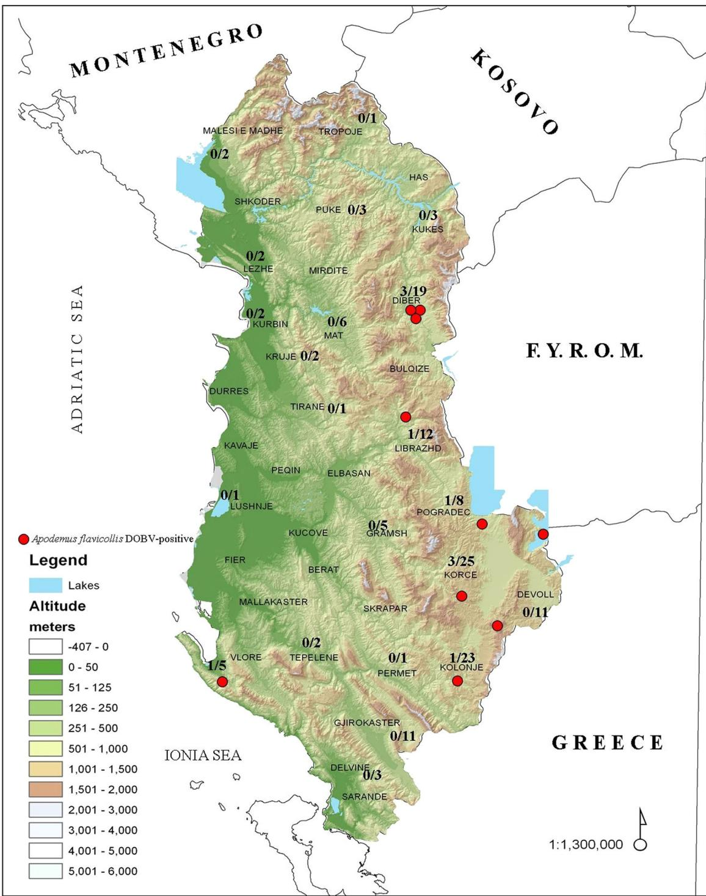
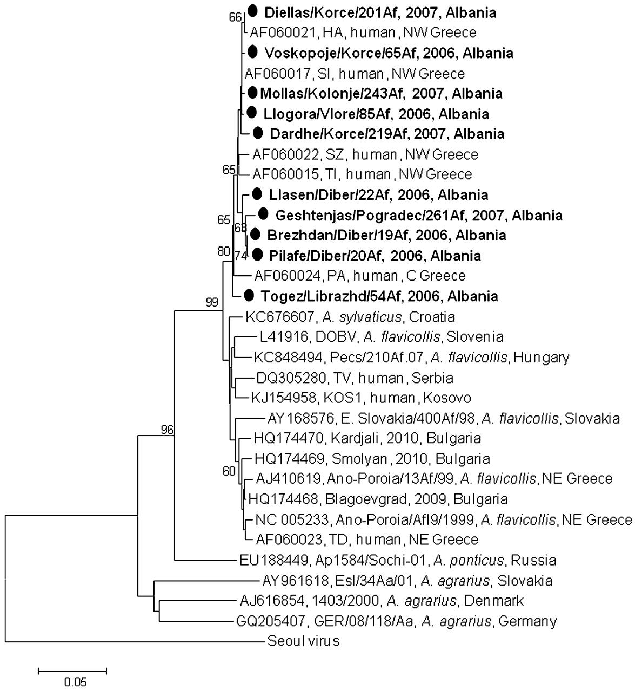

# Genetic Detection of Hantaviruses in Rodents, Albania

Anna Papa,1 * Elton Rogozi,2 Enkelejda Velo,2 Evangelia Papadimitriou,1 and Silvia Bino2

1 Department of Microbiology, School of Medicine, Aristotle University of Thessaloniki, Thessaloniki, Greece 2 Department of Epidemiology and Infectious Diseases Control, Institute of Public Health, Tirana, Albania

In order to have a first insight into the epidemiology of hantaviruses in Albania, 263 small mammals (248 rodents, 15 insectivores) were captured in 352 locations in 29 districts and tested for hantavirus infection. Dobrava– Belgrade virus (DOBV) was detected in 10 of 148 $( 6 . 7 \% )$ Apodemus flavicollis rodents. DOBV-positive A. flavicollis were detected in six districts (Diber, Korce, Kolonje, Librazhd, Pogradec, and Vlore). The obtained nucleotide sequences were highly similar to each other and to DOBV sequences from northwestern Greece. Understanding the epidemiology of hantaviruses and identifying the endemic foci enables the public health strategies to minimize the risk of human infection. J. Med. Virol. 88:1309–1313, 2016.

$©$ 2016 Wiley Periodicals, Inc.

KEY WORDS: hantavirus; rodents; Albania

# INTRODUCTION

Hantaviruses (genus Hantavirus, Family Bunyaviridae) are transmitted to humans via inhalation of aerosolized excreta of infected rodents, and cause to humans hemorrhagic fever with renal syndrome (HFRS) in Eurasia, and hantavirus pulmonary syndrome (HPS) in the US. Like other members of the Bunyaviridae family, hantaviruses have a trisegmented negative-sense RNA genome composed of the small (S), medium (M), and large (L) segments. The main hantaviruses which cause human disease in Europe are Dobrava–Belgrade virus (DOBV) associated with Apodemus flavicollis, Apodemus agrarius, and Apodemus ponticus, and Puumala virus (PUUV) associated with Myodes glareolus. DOBV strains associated with A. flavicollis and A. ponticus have the potential to cause the most severe form of HFRS, which is characterized by fever, headache, gastrointestinal symptoms, renal dysfunction, and hemorrhagic manifestations, with a fatality rate of approximately $10 \%$ [Papa, 2012; Kruger et al., 2015].

HFRS is endemic in the Balkan Peninsula and sporadic cases or outbreaks are observed every year. Groups at increased occupational risk for infection are farmers, shepherds, forest workers, and soldiers. The main hantavirus in southern Balkan countries is DOBV, while PUUV infections predominate in northern Balkans. For example, DOBV was detected in all PCR-positive HFRS cases in Greece, while approximately $70 \%$ of HFRS cases in Slovenia and Croatia are caused by PUUV [Papa et al., 1998; Avsic Zupanc et al., 2014]. The Republic of Albania is a Balkan country consisting of 36 districts. The country is mostly hilly and mountainous. Since 1985 when the first HFRS case was serologically confirmed in Albania [Eltari et al., 1987], only few reports exist [Puca et al., 2011, 2012]. In a study conducted during 2003–2006 among 34 Albanian patients with suspected Crimean Congo hemorrhagic fever (CCHF), CCHF virus was detected in 13 cases, while four patients were serologically diagnosed as hantavirus infections [Papa et al., 2008]. In order to provide a first insight into the epidemiology of hantaviruses in Albania, small mammals trapped in several regions of Albania were tested for probable hantavirus infection.

# MATERIALS AND METHODS

# Animals and Samples

A total number of 263 small mammals were captured using snap traps during 2006–2007 in field surveys conducted in 352 locations in 29 districts of Albania (Supplementary Table SI). Among them, 96

  
Fig. 1. Map of Albania with the locations where DOBV-positive Apodemus flavicollis have been detected. The number of A. flavicollis tested per district is seen. F.Y.R.O.M.: Former Yugoslav Republic of Macedonia.

were trapped in 2006 and 167 in 2007. Data about the location where traps were set (latitude, longitude, altitude, vegetation, source of water) were written down. Small mammals were identified based on morphological characteristics [Corbet and Ovenden, 1985] and internal organs (liver, spleen, lungs, heart, kidneys) were collected and stored at $- 8 0 ^ { \circ } \mathrm { C }$ until testing.

# Molecular and Phylogenetic Methods

Total RNA was extracted from homogenized spleen sections using the RNeasy Mini kit (Qiagen) according to manufacturer’s instructions. Rodents of the Murinae (Apodemus spp., Rattus spp. and Mus spp.) and Arvicolinae (Myodes spp. and Microtus spp.)

  
Fig. 2. Neighboring-joining phylogenetic tree of DOBV strains constructed by using MEGA6 based on 537 bp fragment of the S RNA segment. Virus strains are labeled by GenBank accession number, name, and country of origin. Bootstrap values were obtained based on 1,000 replicates; only ${ > } 6 0 \%$ values are shown. Scale bar indicates nucleotide substitutions per site. The sequences of the present study are marked. NE, northeastern; NW, northwestern; C, central.

subfamilies were tested for probable hantavirus infection using previously described RT-nested PCR protocols which amplify partial S RNA fragments of hantaviruses associated with rodents of the Murinae and Arvicolinae subfamilies, respectively [Papa et al., 1998]. A different RT-nested PCR was applied for insectivores (Crocidura spp. and Talpa spp.) [Arai et al., 2007]. PCR products were sequenced and the nucleotide sequences were aligned by using Clustal W; a phylogenetic tree was constructed

applying the neighbor-joining method by using MEGA v6 [Tamura et al., 2013].

# RESULTS

In total, 10 rodent and three insectivore species were identified. Among the 263 animals (male $4 7 . 1 \% )$ , 248 belonged to the Rodentia and 15 to the Insectivora order. Apodemus flavicollis was the predominant rodent species accounting for $5 9 . 7 \%$

(148/263); 68 were male. They were trapped in 22 of the 29 districts tested. Details about the species of small mammals trapped in each district of Albania are provided in Supplementary Table SI.

Ten A. flavicollis (10/148, $6 . 7 \%$ were positive for hantavirus infection; six of them were captured in 2006 and four in 2007. A significantly higher prevalence was observed in males (8/68, $1 1 . 8 \%$ ) than in females (2/80, $2 . 5 \%$ ; $P < 0 . 0 5$ ).

DOBV-positive A. flavicollis rodents were detected in six districts of Albania (three in Diber, three in Korce, and one each in Kolonje, Librazhd, Pogradec, and Vlore) (Fig. 1). Characteristics related with the DOBV-positive animals and the trapping sites are seen in Supplementary Table SII. It can be seen that all sites were in shrubbery or forested areas, nearby canals, streams, or ponds, with a mean altitude of 866 meters above sea level (range 266–1494 meters).

Phylogenetic analysis showed that all sequences were clustered together with DOBV sequences obtained from rodents or HFRS patients from other Balkan countries (Fig. 2). Nucleotide sequences were submitted to the GenBank database and assigned accession numbers KT971005 through KT971014.

Albanian DOBV sequences had $1 . 3 \%$ mean genetic distance to each other and to respective sequences obtained from HFRS cases occurred in northwestern Greece. The divergence was greater when Albanian sequences were compared with those from northeastern Greece (mean difference $4 \%$ ) and other Balkan countries (Croatia, Kosovo, Bulgaria, Serbia, and Slovenia: mean differences $3 . 2 \%$ , $3 . 5 \%$ , $3 . 7 \%$ , $4 \%$ and $4 . 2 \%$ , respectively).

# DISCUSSION

Given that hantaviruses are a frequent cause of human disease in the Balkan peninsula, it is essential to identify their endemic foci in the countries in order to facilitate the public health interventions. The present study provides a first insight into the epidemiology of hantaviruses in Albania extending the knowledge about their distribution in the Balkans. It was shown that all positive samples came only from A. flavicollis and that $6 . 7 \%$ of this rodent species were infected by DOBV. The respective percentage in the neighboring Greece is $10 \%$ , where endemic foci are present in the mountainous areas of northwestern and northeastern part of the country [Papa et al., 2000a; Papa and Antoniadis, 2001]. A previous study showed that A. flavicollis is the most common and widespread small mammal in Albania, except for coastal lowlands where Apodemus sylvaticus predominates. The typical habitats preferred by A. flavicollis are non-inhabited forested and shrub areas with altitude ranging from 150 to $1 3 5 0 \mathrm { m }$ [Rogozi et al., 2013].

The DOBV prevalence was significantly higher in male $( 1 1 . 8 \% )$ than in female A. flavicollis $( 2 . 5 \% )$ Higher DOBV prevalence among male A. flavicollis,

especially those having scars, has been previously reported, supporting the hypothesis that hantaviruses are transmitted when aggressive male animals fight [Papa et al., 2000a].

DOBV-positive A. flavicollis rodents were detected in six districts of Albania (Diber, Korce, Kolonje, Librazhd, Pogradec, and Vlore). In general, the distribution of hantaviruses is closely related with the population of the rodent reservoirs. Indeed, Korce, Kolonje, and Librazhd are the districts with the highest A. flavicollis density [Rogozi et al., 2013]. Although hantaviruses have been detected in several rodent and insectivore species, DOBV was the only hantavirus detected in Albania, and A. flavicollis was the only rodent species found DOBV-positive. Similarly in Greece, the majority of HFRS cases are caused by DOBV, with very few cases caused by PUUV [Papa et al., 1998, 2000b; Papa and Antoniadis, 2001].

In conclusion, the present study showed that DOBV is present in Albania, as in other Balkan countries. Therefore, surveillance studies and awareness of the physicians are needed, especially in the regions where DOBV-positive rodents have been identified. Since it is not unexpected that additional rodent and/or insectivore species are infected with hantaviruses, further studies in small mammals are needed to increase our knowledge on the genetic diversity of hantavirus strains in Albania, while seroepidemiological and molecular studies in HFRS patients will show the spatial and temporal distribution of cases and the risk for the disease.

# ACKNOWLEDGMENTS

We thank Bajram Kastrati, Et’hem Llabani, Ina Loci, and Marsida Krasniqi from the Institute of Public Health, Albania, for the excellent technical assistance in the field work.

# REFERENCES

Arai S, Song JW, Sumibcay L, Bennett SN, Nerurkar VR, Parmenter C, Cook JA, Yates TL, Yanagihara R. 2007. Hantavirus in northern short-tailed shrew, United States. Emerg Infect Dis 13:1420–1423.   
Avsic Zupanc T, Korva M, Markotic A. 2014. HFRS and hantaviruses in the Balkans/South-East Europe. Virus Res 187:27–33.   
Corbet G, Ovenden D. 1985. Guida dei Mammiferi d’ Europa. Prima edizione. editore FMC, editor. Padova (Italy) 288 p.   
Eltari E, Nuti M, Hasko I, Gina A. 1987. Haemorrhagic fever with renal syndrome in a case in northern Albania. Lancet 2:1211.   
Kruger DH, Tkachenko EA, Morozov VG, Yunicheva YV, Pilikova OM, Malkin G, Ishmukhametov AA, Heinemann P, Witkowski PT, Klempa B, Dzagurova TK. 2015. Life-threatening Sochi virus infections, Russia. Emerg Infect Dis 21:2204–2208.   
Papa A. 2012. Dobrava–Belgrade virus: Phylogeny, epidemiology, disease. Antiviral Res 95:104–117.   
Papa A, Antoniadis A. 2001. Hantavirus infections in Greece—An update. Eur J Epidemiol 17:189–194.   
Papa A, Johnson AM, Stockton PC, Bowen MD, Spiropoulou CF, Alexiou-Daniel S, Ksiazek TG, Nichol ST, Antoniadis A. 1998. Retrospective serological and genetic study of the distribution of hantaviruses in Greece. J Med Virol 55:321–327.   
Papa A, Mills JN, Kouidou S, Ma B, Papadimitriou E, Antoniadis A. 2000a. Preliminary characterization and natural history of

hantaviruses in rodents in northern Greece. Emerg Infect Dis 6:654–655.   
Papa A, Pliakogiannis T, Lundkvist A, Antoniadis A. 2000b. First case of Puumala virus infection in Greece. Infection 28:334–335.   
Papa A, Bino S, Papadimitriou E, Velo E, Dhimolea M, Antoniadis A. 2008. Suspected crimean congo haemorrhagic fever cases in Albania. Scand J Infect Dis 40:978–980.   
Puca E, Pilaca A, Pipero P, Bino S, Kote M, Rogozi E, Puca E, Kraja D. 2011. Hemorrhagic fever with renal syndrome complicated by orchitis. Virol Sin 26:285–288.   
Puca E, Pilaca A, Pipero P, Kraja D, Puca EY. 2012. Hemorrhagic fever with renal syndrome associated with acute pancreatitis. Virol Sin 27:214–217.

Rogozi E, Bego F, Papa A, Mersini K, Bino S. 2013. Distribution and ecology of small mammals in Albania. Int J Environ Health Res 23:258–268.   
Tamura K, Stecher G, Peterson D, Filipski A, Kumar S. 2013. MEG A6: Molecular evolutionary genetics Analysis version 6.0. Mol Biol Evol 30:2725–2729.

# SUPPORTING INFORMATION

Additional supporting information may be found in the online version of this article at the publisher’s web-site.