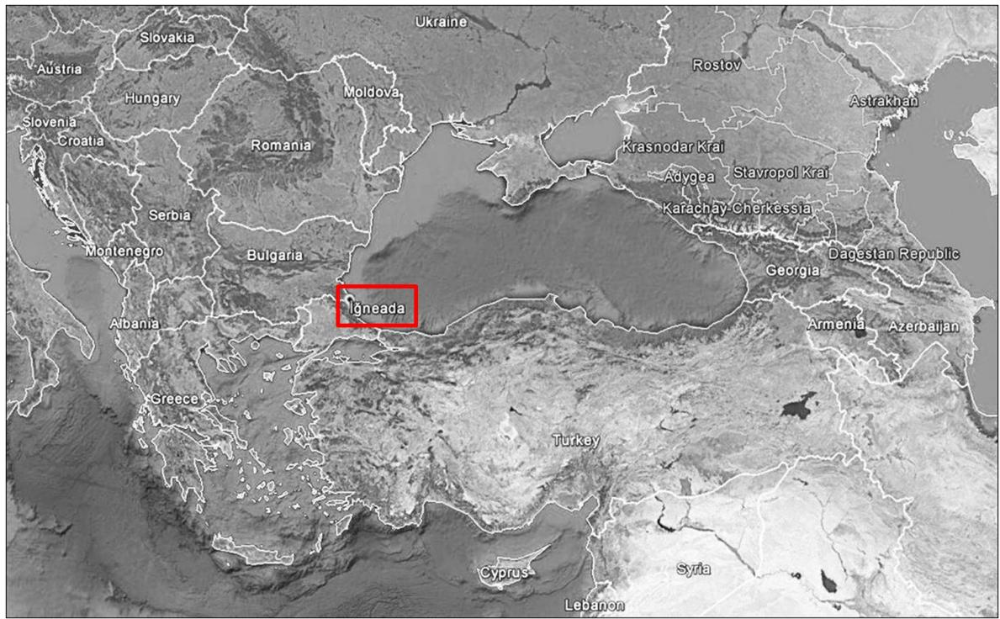
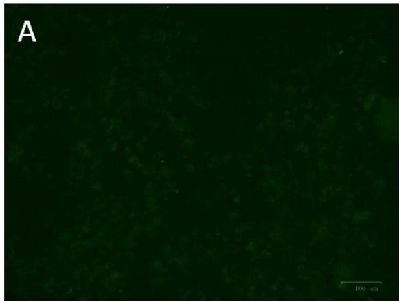
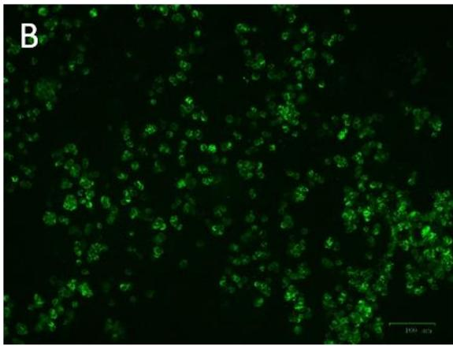
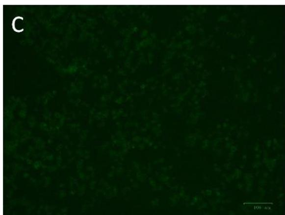
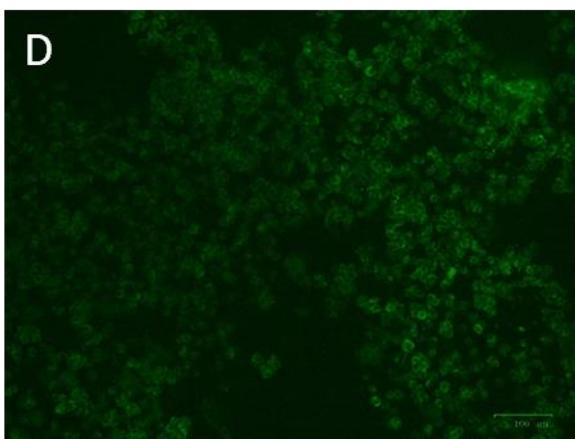
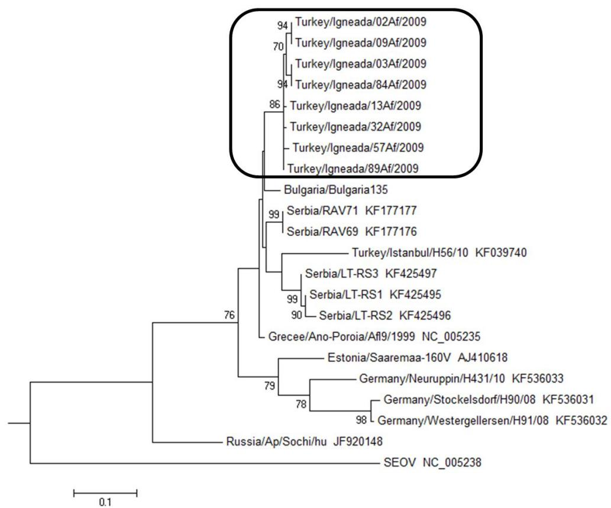
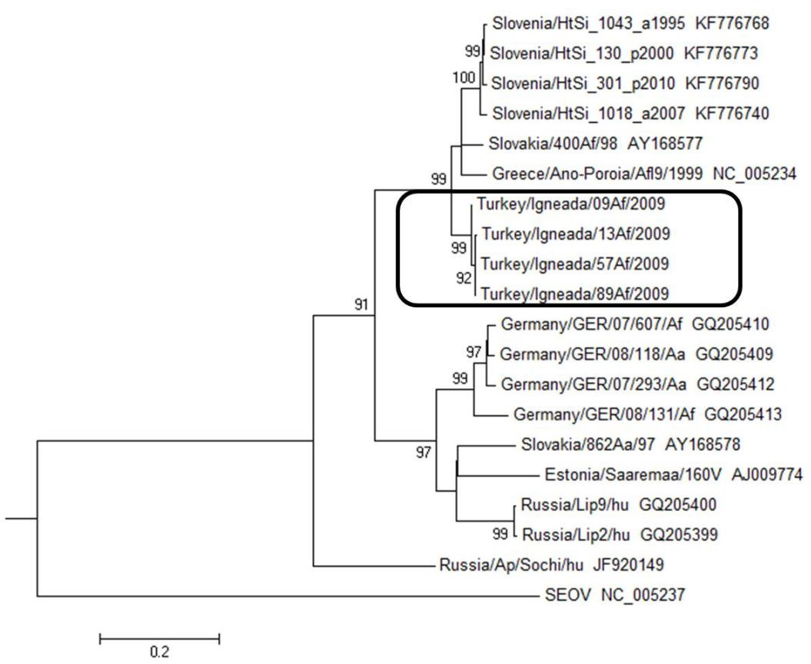
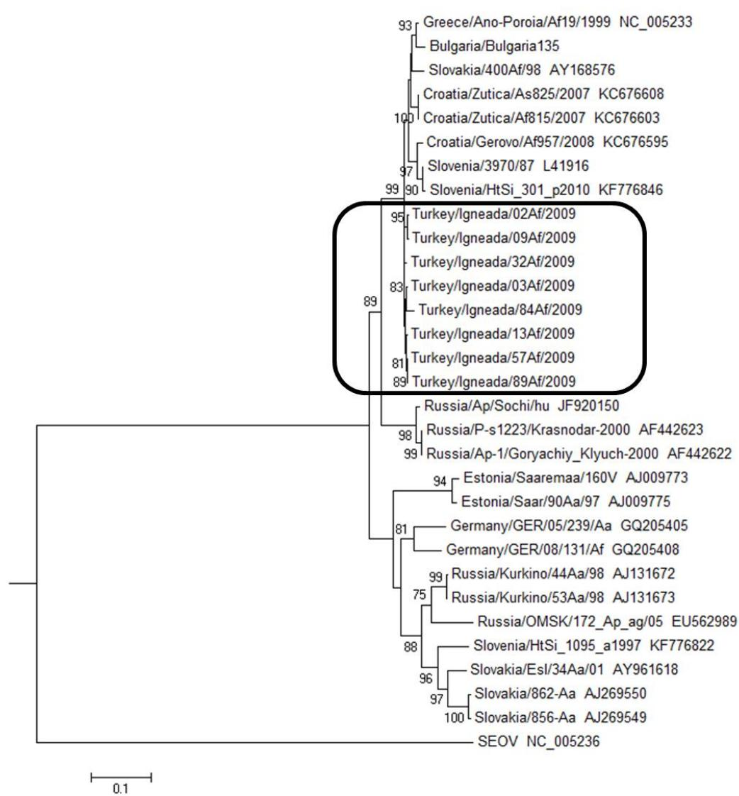

# Research Article

# Dobrava Hantavirus Variants Found in Apodemus flavicollis Mice in Kirklareli Province, Turkey†

Running title: Phylogeny of DOBV in Turkish rodents

Ceylan Polat $^{1*}$ , Tarja Sironen $^{2}$ , Angelina Plyusnina $^{2}$ , Ahmet Karatas $^{3}$ , Mustafa Sozen $^{4}$ , Ferhat Matur $^{4}$ , Olli Vapalahti $^{2}$ , Ibrahim Mehmet Ali Oktem $^{1}$ , Alexander Plyusnin $^{2}$

$^{1}$ Dokuz Eylül University, Medical School, Department of Medical Microbiology, Izmir, Turkey   
$^{2}$ University of Helsinki, Department of Virology, Helsinki, Finland   
$^{3}$ Ömer Halisdemir University, Faculty of Arts and Sciences, Department of Biology, Nizde, Turkey   
$^{4}$ Bülent Ecevit University, Faculty of Arts and Sciences, Department of Biology, Zonguldak, Turkey   
*Corresponding author:

Ceylan Polat, Dokuz Eylül University, Medical School, Department of Medical Microbiology, 35340 Izmir, Turkey.

E-mail: ceylanpolat88@gmail.com

†This article has been accepted for publication and undergone full peer review but has not been through the copyediting, typesetting, pagination and proofreading process, which may lead to differences between this version and the Version of Record. Please cite this article as doi: [10.1002/jmv.25036]

Received 25 July 2017; Revised 9 January 2018; Accepted 10 January 2018

Journal of Medical Virology

This article is protected by copyright. All rights reserved

DOI 10.1002/jmv.25036

This article is protected by copyright. All rights reserved

# Abstract

Hantaviruses infect humans via inhalation of viral particles within secretions of infected rodents or rarely through direct contact with infected rodents. Determining the prevalence of hantavirus infections among rodent populations is of vital importance to obtain information on hantavirus-related cases and to predict possible outbreaks.

We hypothesized that DOBV strains circulating in the Thrace Region in Turkey would be related to other Balkan DOBV strains. In this study, hantavirus infections in the rodent population of the Kırçmarelı-ğneada Region (north-western Turkey, near the Bulgarian border) were investigated. This region is of particular importance, as it is located in the south-eastern margin of the European continent and was used as an entrance point of Asian faunal elements into Europe.

DOBV infection was detected in eight of 73 rodents; all were of the Apodemus flavicollis species. Partial sequences of the viral S-, M- and L-genome segments were recovered and compared with previously reported DOBV sequences. The newly characterised Turkish strains were similar to other DOBV variants. Silent nucleotide mutations were dominant. The hantavirus prevalence in the Igneada region was similar to what has been reported in Greece and Bulgaria. For the first time, the M-segment sequences of DOBV from Turkey were recovered and genetic data of hantaviruses from Thrace region of Turkey were obtained. This article is protected by copyright. All rights reserved

Keywords: Zoonosis; Hantavirus; DOBV; rodent; Turkey; phylogenetic analysis

# 1. Introduction

Hantaviruses belong to the Bunyaviridae family and Hantavirus genus1. Enveloped virions have a negative-sense, single-stranded RNA genome consisting of S (small), M (medium) and L (large) segments2.

Hantaviruses are rodent-borne but are also carried by insectivores and bats. Several members of the Hantavirus genus cause infections in humans via inhalation of viral particles found within contaminated secretions of rodents (such as saliva, urine or faeces) $^{3}$ . Generally, each member of the genus is carried by a specific host species. Hantaviruses are known to be the causitive agent of two diseases, namely haemorrhagic fever with renal syndrome (HFRS) and hantavirus pulmonary syndrome (HPS). These diseases are a significant public health problem in Eurasia and the Americas $^{4}$ ; following the distribution of hantavirus-carrying rodent species. HFRS is mainly observed in Eurasia while HPS mainly occurs in America $^{4,5}$ .

In geographic areas where the hantavirus infections are rare, the diagnosis is very challenging due to nonspecific, flu-like symptoms6. Prevention is important due to the lack of effective antivirals4. Surveillance offers important data on the infection in wildlife and hantavirus prevalence and thus facilitates prediction of possible outbreaks7-14.

The presence of hantaviruses in wild rodents in Turkey was reported for the first time in $2006^{7}$ . The first HFRS cases were reported from the Western Black Sea Region in $2009^{15}$ . Follow-up studies described more hantavirus infections in rodents and suspicious HFRS cases in humans in different regions of Turkey. Several rodent hosts have been identified to carry hantaviruses, namely Apodemus flavicollis (Dobrava-Belgrade virus [DOBV]), Myodes glareolus (Puumala virus [PUUV]), Apodemus agrarius (Saaremaa virus [SAAV]), Microtus arvalis (Tula virus [TULV]) and Rattus norvegicus (Seoul virus [SEOV]); these rodent species are all found in Turkey.

Apodemus flavicollis (the yellow-necked field mouse) is distributed throughout most of Europe, Turkey, Syria, Jordan, Israel and Iran $^{24}$ . During the last glaciation, the Balkans and Turkey played an important role for A. flavicollis as refugia $^{25}$ . The yellow-necked field mouse This article is protected by copyright. All rights reserved

population in the Igneada Region in Kirklareli Province-located in Turkish Thrace (neighbouring Bulgaria)-, represents the most eastern margin of the European lineage in the Balkans. A. flavicollis in Thrace lives sympathrically with A. sylvaticus and A. agrarius $^{21,26}$ .

In this study, we searched for hantavirus markers in wild rodents from the Kirklareli Igneada region, with the objective to map natural foci of infection.

# 2. Materials and Methods

# 2.1 Samples

In July 2009, a total of 73 rodents were collected from the Kirklareli Igneada Region of Turkey located at the Bulgarian border; using Sherman-type traps (H.P. Sherman Traps Inc.) (Fig. 1). Live rodents were collected at five different locations using 100 Sherman-type traps for four trap-nights. Traps were set at 10-meter intervals on the field. Rodents were sacrificed by cervical dislocation. Whole blood samples were collected by intracardiac intervention via a fine needle; followed by centrifugation at 3000 rpm at $4^{\circ}\mathrm{C}$ for 15 minutes to collect the serum. Lung and serum samples of all rodents were used in this study. Lung samples were preserved with a RNA stabilization solution (Invitrogen, RNAlater) and stored at $-80^{\circ}\mathrm{C}$ .

Study design and all experimental approaches were approved by Dokuz Eylül University, Local Ethical Committee of Animal Experiments (No: 41/2009).

# 2.2 Enzyme immunoassay (EIA) and Immunoblot Assay (IBA)

The antigen-coated microplates of a commercially available enzyme immunoassay kit (Euroimmun DE, Anti-Hantavirus Pool ELISA IgG) was used in the optimization process of EIA for rodent serum. Similarly, immunoblot strips of an immunoblot assay (Euroimmun DE, Hantavirus Profile 1 Euroline IgG) were used for the optimization process of IB. The EIA microplates and IBA strips coated with Hantaan virus (HTNV), PUUV and DOBV recombinant nucleocapsid antigens were used for the detection of antibodies in rodent sera. Positive and negative control serum samples were provided by the Public Health Institution of Turkey. The serum samples of 73 rodents were screened $^{27}$ .

This article is protected by copyright. All rights reserved

For EIA, $100~\mu \mathrm{L}$ of 1:50 phosphate-buffered saline (PBS) diluted rodent sera were added into each well, in duplicate. Microplates were incubated for 60 minutes at $37^{\circ}C$ , followed by three times washing with $300~\mu \mathrm{L}$ 1x wash buffer for 30 to 60 seconds. $100~\mu \mathrm{L}$ of 1:10,000 PBS diluted horseradish peroxidase (HRP) conjugated goat anti-mouse IgG (Millipore) were added to the wells after the washing cycle. Microplates were then incubated for 60 minutes at $37^{\circ}C$ . After incubation, the washing step was repeated as described above. $100~\mu \mathrm{L}$ of $3,3',5,5'$ -tetraamethylbenzidine/hydrogen peroxide (TMB/ $\mathsf{H}_2\mathsf{O}_2$ ) were added and incubated in the dark at room temperature for 15 minutes. After incubation the reaction was stopped by the addition of $0.5\mathrm{M}$ sulfuric acid ( $\mathsf{H}_2\mathsf{SO}_4$ ). The optical density (OD) of the samples was measured at $450~\mathrm{nm}$ wavelength (reference wavelength $620~\mathrm{nm}$ ). Serum samples that had OD values higher than 0.325 were considered positive[27].

For IBA, the strips were incubated in $1500~\mu \mathrm{L}$ blocking buffer on a shaker at room temperature for 15 minutes. The blocking buffer was removed and $1500~\mu \mathrm{L}$ of 1:100 1x universal buffer diluted rodent sera were added followed by incubation at room temperature for 30 minutes (on a shaker). Diluted rodent sera was removed and the strips were washed three times in $1500~\mu \mathrm{L}$ 1x universal buffer for 5 minutes. $1500~\mu \mathrm{L}$ of 1:5000 (diluted with 1x universal buffer) alkaline phosphatase (AP) conjugated goat anti-mouse IgG (Santa Cruz Biotechnology) were added and incubated on a shaker at room temperature for 30 minutes. Following incubation, the washing step was repeated as described above. $1500~\mu \mathrm{L}$ of nitroblue tetrazolium chloride/5-bromo-4-chloro-3-indolyl phosphate (NBT/BCIP) substrate solution were added to each strip and incubated on a shaker, at room temperature for 10 minutes. The substrate solution was removed and the strips were washed three times with distilled water for 1 minute27.

# 2.3 Immunofluorescence assay (IFA)

Serum samples of seropositive wild rodents were further tested with IFA against the DOBV strain Greece/Ano Poroia. Vero E6 cells were infected with DOBV for 14 days, detached with trypsin, mixed with uninfected Vero E6 cells (in a ratio of 1:3), and washed with PBS. The slides were allowed to dry overnight before fixing with ice-cold acetone for 7 min. Serum samples were diluted 1:20 in PBS. $20~\mu \mathrm{l}$ of each diluted sample were added to an IFA slide well. The slides were incubated for 30 minutes at $37^{\circ}C$ followed by a washing procedure, three times

This article is protected by copyright. All rights reserved

with PBS for 5 minutes and once with distilled water for 5 minutes to remove any unbound antibodies. After drying, $25\mu l$ of 1:30 PBS diluted polyclonal rabbit anti-mouse FITC conjugate (Dako A/S) were added to each well of the IFA slides. The slides were incubated for 45 minutes at $37^{\circ}C$ . Excess antibody was removed by washing three times with PBS for 5 minutes and once with distilled water for 5 minutes. After drying, cover slips were placed on the IFA slides with mounting medium, and the slides were evaluated with a fluorescence microscope[28].

# 2.4 RNA/DNA Isolation and cDNA Synthesis

Total RNA and DNA extraction from lung tissues of rodents was performed with TriPure Isolation Reagent (Roche) according to the manufacturer's instructions.

RNA from tissue samples were reverse-transcribed with random hexamers using RevertAid Premium reverse transcriptase (Thermo Scientific) according to manufacturer's instructions.

# 2.5 Pan-Hanta L Segment-specific PCR

A semi-nested PCR approach was adopted to amplify the 390-base pair (bp) stretch of the hantavirus L segment (encoding the RNA-dependent RNA polymerase). PCR reactions were performed in a $20 - \mu \mathrm{L}$ volume using Phusion Flash high-fidelity PCR master mix (Thermo Scientific) and 100 pmol of primers. The sequences of HanLF1 and HanLR1 primers (first reaction) and HanLF2 and HanLR2 primers (second reaction) are given in Table I $^{29}$ .

Cycling parameters for the first reaction are as follows: pre-denaturation at $98^{\circ}\mathrm{C}$ for 1 minute, 7 cycles of denaturation at $98^{\circ}\mathrm{C}$ for 1 second, annealing at $45^{\circ}\mathrm{C}$ for 5 seconds and extension at $72^{\circ}\mathrm{C}$ for 15 seconds; followed by 35 cycles of denaturation at $98^{\circ}\mathrm{C}$ for 1 second, annealing at $55^{\circ}\mathrm{C}$ for 5 seconds and extension at $72^{\circ}\mathrm{C}$ for 15 seconds; and a final extension step of $72^{\circ}\mathrm{C}$ for 5 minutes. For the second reaction is pre-denaturation at $98^{\circ}\mathrm{C}$ for 1 minute, 40 cycles of denaturation at $98^{\circ}\mathrm{C}$ for 1 second, annealing at $61^{\circ}\mathrm{C}$ for 5 seconds and extension at $72^{\circ}\mathrm{C}$ for 15 seconds and a final extension at $72^{\circ}\mathrm{C}$ for 1 minute. PCR products were loaded onto $2\%$ agarose gels, separated by electrophoresis and visualised. Positive samples were extracted from the gel using a gel extraction kit (Qiagen) according to the manufacturer's instructions. Sequencing was performed by the Sanger method.

This article is protected by copyright. All rights reserved

# 2.6 Cytochrome-b Gene Analysis

Cytochrome- $b$ gene analysis was performed on pan-hanta L-segment PCR-positive rodents to determine species The PCR reaction was performed in $20~\mu \mathrm{L}$ using Phusion Flash high-fidelity PCR master mix (Thermo Scientific) and 20 pmol of sense (Cytb-F: $5^{\prime}$ -CGA AGC TTG ATA TGA AAA ACC ATC GTT G-3') and antisense (Cytb-R: $5^{\prime}$ -CTG GTT TAC AAG ACC AGA GTA AT-3') primers $^{30}$ . Cycling parameters for the reaction were as follows: pre-denaturation at $98^{\circ} \mathrm{C}$ for 1 minute, 40 cycles of denaturation at $98^{\circ} \mathrm{C}$ for 1 second, annealing at $53^{\circ} \mathrm{C}$ for 5 seconds, extension at $72^{\circ} \mathrm{C}$ for 15 seconds and the final extension step of $72^{\circ} \mathrm{C}$ for 1 minute. PCR products were loaded onto $2 \%$ agarose gels, separated by electrophoresis and visualised. Positive samples were purified using a PCR purification kit (Qiagen) according to the manufacturer's instructions. Sequencing was performed by the Sanger method. The recovered sequences were analysed by BLAST $^{31}$ .

# 2.7 DOBV S- and M- Segment PCR

A 1215-bp stretch from the DOBV S segment was amplified in L-segment RT-PCR positive samples by a hemi-nested PCR protocol. The PCR reaction was performed in a volume of $20~\mu \mathrm{L}$ using Phusion Flash high-fidelity PCR master mix (Thermo Scientific) and 20 pmol of primers. DOBV-1F primer (first reaction) and DOBV-2F (second reaction) were used as sense primers; whereas the Dob/S/1440/R primer8 was used as an antisense primer for both reactions (Table I). Cycling parameters were the following: pre-denaturation at $98^{\circ} \mathrm{C}$ for 1 minute, 40 cycles of denaturation at $98^{\circ} \mathrm{C}$ for 1 second, annealing at $58^{\circ} \mathrm{C}$ for the first reaction and $55^{\circ} \mathrm{C}$ for the second reaction for 5 seconds, extension at $72^{\circ} \mathrm{C}$ for 1 minute and a final extension step of $72^{\circ} \mathrm{C}$ for 1 minute.

We attempted to amplify a 1078-bp stretch of the M segment by a semi-nested PCR protocol. This reaction was performed in a volume of $20~\mu \mathrm{L}$ using Phusion Flash high-fidelity PCR master mix (Thermo Scientific) and 100 pmol of primers DOBV-M1F and DOBV-M1R (first reaction) and DOBV-M2F and DOBV-M2R (second reaction) (Table I). The cycling parameters for the first reaction were: pre-denaturation at $98^{\circ}C$ for 1 minute, 40 cycles of denaturation at $98^{\circ}C$ for 1 second, annealing at $60^{\circ}C$ for the first reaction and $61^{\circ}C$ for the second reaction for 5 seconds, extension at $72^{\circ}C$ for 15 seconds and a final extension step of $72^{\circ}C$ for 5 minutes. PCR products were loaded onto $1\%$ agarose gels, separated by electrophoresis and visualised. Positive This article is protected by copyright. All rights reserved

samples were extracted from the gel using a gel extraction kit (Qiagen). Sequencing was performed by the Sanger method.

# 2.8 Genetic Characterization and Phylogenetic Analysis

The sequences of Kırklareli İgneada DOBV strains were compared with related sequences of other hantaviruses retrieved from existing databanks. The sequences were aligned using Clustal W modality provided in MEGA 6.06 software32. Between-group and within-group distances for each segment were calculated by MEGA 6.06 software32.

The newly recovered sequences of the Kirklareli Igneada DOBV strains were subjected to phylogenetic analyses. The corrected Akaike's information criterion (AlCc) was chosen to estimate the best nucleotide substitution models for each segment by jModeltest v2.1.633. Phylogenetic trees were constructed using MEGA 6.06 software for Maximum Likelihood (ML) method32. Bootstrap support values were calculated using 1000 replicates for the trees.

# 3. Results

# 3.1. Detection of hantaviruses in Turkish rodents

A total of 73 Apodemus species were collected and identified by phenotype as A. flavicollis (51/69.9%), A. agrarius (18/24.6%), A. sylvaticus (3/4.1%) and A. witherby (1/1.4%). All 73 rodents were screened with optimised EIA and IBA methods and pan-hantavirus L-segment PCR. Fourteen rodents were found to be seropositive by optimised EIA and IBA. Of these 14 rodents, eight were also positive by IFA (Table II) (Fig. 2).

Eight out of the 73 rodent lung tissue samples were shown to be positive for DOBV RNA after screening with pan-hanta L-segment primers. Based on cytochrome- $b$ gene sequences, these eight DOBV RNA-positive rodents belong to A. flavicollis species (Table II). Partial S-segment sequences were amplified from all eight rodents while partial M-segment sequences were amplified from four (Table II). All the Kírklareli òngeada DOBV strains reported in this study are deposited into GenBank. The strains were assigned the accession numbers KT315635 to KT315642 for the S-segment sequences, KT315623 to KT315626 for the M-segment sequences and KT315627 to KT315634 for the L-segment sequences.

This article is protected by copyright. All rights reserved

# 3.2. Genetic Characterization and phylogenetic analysis of the Kirklareli strains of DOBV

Eight partial S segments, four partial M segments and eight partial L segments of Kirklareli sequences were aligned with the corresponding sequences of the DOBV strain Greece/Anoporoia.

At the nucleotide level, Kırklareli DOBV strains differ from each other by $1.2\%$ for the S segment, $0.4\%$ for the M segment and $1.3\%$ for the L segment. At the nucleotide level, the distances of Kırklareli strains from the DOBV strain Greece/Ano-Poroiia were $3.2\%$ , $3.4\%$ and $5.4\%$ for the S, M and L segments, respectively.

Total of eight S (627 bp), four M (834 bp), and eight L (257 bp) partial segments of the iñneada strains were analysed phylogenetically. When the Kirklareli iñneada sequences were compared with the prototype DOBV strain Greece/Ano-Poroia, 37, 66 and 20 point mutations at the nucleotide level in addition to three (Q151R, G154E, I182R), five (I11V, P19K, I28V, L173P, V181A) and two (R1K, G84R) amino acid substitutions were detected in the S, M and L segments, respectively. The majority of point mutations were silent mutations for all three segments.

The S, M and L segment sequences of the Kırklareli ügneada strains clustered into a separate clade within the Dobrava genotypes of DOBV, distinct from strains of Saaremaa virus (found in A. agrarius) and Sochi virus (found in A. ponticus) (Fig. 3-5). The Kırklareli ügneada L and S segment sequences were found to be close to Balkan strains (especially Bulgaria) (Fig 3. and 5.); while the Kırklareli ügneada M-segment sequences were equally distant from the other Dobrava genotypes of DOBV (Fig. 4). Of note, the DOBV strain from Istanbul is distant and ancestral when compared with the newly recovered Turkish DOBV sequences (however, with a bootstrap support value that is not remarkably high).

# 4. Discussion

The iğneada region in Turkish Thrace is located at the south-eastern border of Europe. The Marmara Sea, Dardanelle and Bosporus separate Asia and Europe and its faunas. Accordingly, these geographical elements have sometimes (but not always) played a role as a barrier34;

This article is protected by copyright. All rights reserved

even though historical and geographical events sometimes allow faunas to cross both sides. Thus, some rodent species and their parasites cross from the Asian side to the European side or vice versa. As a result of such migratory events, these areas contain genetic lineages that represent both continents. It is particularly important to study such bridge areas with the aim to follow the present and past movements and distribution of parasites and their hosts.

The Apodemus species is important for hantavirus infections in the Balkan Peninsula. Both A. flavicollis and A. agrarius are responsible for the transmission of DOBV and SAAV hantavirus strains, respectively. In this study, the majority of the rodents were A. flavicollis, which are reservoirs for DOBV $^{35}$ . The distribution and prevalence of rodent species and hantavirus type were similar among the Kırklareli region and other Balkan regions $^{36,37}$ .

After the end of the last glaciation, the A. flavicollis population that formed the Italo-Balkan refugia, recolonised Europe including the Turkish Thrace. On the other hand the A. flavicollis population from the Anatolian refugium, colonised Anatolia and the Middle East. These represent genetically different lineages25. As expected from these evolutionary migration and recolonization events, the sequences isolated from DOBV-positive A. flavicollis mice from the Turkish Thrace are similar to the sequences of Balkan and European mice. This finding in itself is a reflection of the coevolutionary history of mice and the virus.

DOBV infections in rodents have been reported from Balkan countries and Turkey. A total of 173 rodents were captured in 2009, from the Bartin province (an outbreak region) of the Western Black Sea Region of Turkey. Twenty-one percent were found to be anti-hantavirus IgG positive. Hantaviral RNA was detected in $13.3\%$ of these rodents. Two DOBV strains in A. flavicollis and A. uralensis were reported8. In this study, 73 Apodemus spp. rodents were collected from the Kirklareli İngeada region of Turkey in 2009. Hantaviral RNA was detected in $11\%$ of these rodents. All the positive rodents were infected with DOBV, and all rodents were A. flavicollis.

The first paper from Greece on hantavirus infections in rodents reported that $13.1\%$ of 61 A. flavicollis rodents were positive by serological or molecular methods9. In 2001, DOBV was isolated from an A. flavicollis rodent captured in Ano Poroia (a village near the Bulgarian border) where HFRS is endemic10. In Bulgaria, 691 rodents were captured by traps in three different HFRS-endemic locations during 2011-2012. Eight rodents were found to be infected This article is protected by copyright. All rights reserved

(7 were A. flavicollis and 1 was A. agrarius). Similar to the igneada strains, the sequences clustered with the sequences from Bulgaria, Greece, Slovenia and Slovakia $^{11}$ . Hantavirus prevalence in rodents of the Kirklareli igneada region is comparable with the prevalence in neighbouring countries, such as Greece and Bulgaria. In Serbia, 185 A. flavicollis rodents were captured between 2008 and 2010 and approximately $12\%$ of them were tested to be seropositive. The hantaviral genome was detected in three of 22 seropositive rodents in this study $^{12}$ . In Romania, 83 rodents were captured in 2007 and 2008, from two different locations where confirmed DOBV infections have been reported. Three A. flavicollis rodents were infected with DOBV and the sequences were very similar to those from reported HFRS cases. Phylogenetic analysis revealed that two variants of DOBV circulate in Romania $^{13}$ . In Albania, 263 small mammals were trapped during 2006-2007; 10 of 148 A. flavicollis rodents were found to be infected with DOBV $^{14}$ .

When the existence of anti-hantavirus IgG antibody and hantaviral RNA were compared, $42.8\%$ of the combined EIA and IBA method results were false positive. The combined EIA and IBA methods, which were used in this study, have high sensitivity and low specificity. These methods are thus used for the rapid screening and detection of possible hantavirus carrier rodents. After this serological screening, the lung tissue samples of potentially infected rodents were always screened with pan-hantavirus PCR and IFA yielding eight rodents confirmed positive.

M segment sequences were not obtained from all DOBV-positive rodents. M segment sequences are likely to be divergent, and our primers did not sufficiently capture all eight M segment sequences. Therefore, L segment and S segment amplifications should be preferred in screening.

The M segment and S segment sequences of Kirkareli strains could not be compared with other DOBV strains found in Turkey. The different regions of the M segment were amplified for Istanbul and Kirkareli strains, so they did not overlap with each other. Also, the S segment sequences of the Bartin strains (as reported by Oktem et al.) from Turkey only partially overlapped with the sequences of Kirkareli strains8. Bartin DOBV sequences were obtained from an outbreak region in the Western Black Sea Region of Turkey. These sequences formed a

This article is protected by copyright. All rights reserved

separate cluster in the Dobrava genotype of DOBV and shared ancestry with strains from Greece, Slovenia and Slovakia (similar to Kırklareli strains).

Interestingly, although the Kirklareli and Istanbul provinces are very close geographically, the Kirklareli and Istanbul strains did not cluster together on the L-segment phylogenetic tree. In contrast to the Kirklareli strains isolated from infected rodents, the Istanbul strain sequence was recovered from humans. The exact location where the infection was transmitted remains unknown. Kirklareli and Istanbul strains might be carried by different A. flavicollis populations evolutionarily, suggesting that this region might indeed represent the zone where DOBV variants originating from the two different refugia meet, thus warranting further studies in nearby regions.

This study demonstrates the existence of hantavirus-infected rodents in the European part of Turkey. Further genetic information about hantaviruses is needed to evaluate the spread and distribution of this infection in Turkey.

# Acknowledgments

Ceylan Polat was funded by a Federation of European Microbiological Societies (FEMS) Research Fellowship. We thank Mira Utriainen and Sanna Mäki for performing the IFA technique and Jiaxin Ling for cloning of the S segment.

This article is protected by copyright. All rights reserved

# References

1. Plyusnin A, Beaty BJ, Elliott RM, et al. Bunyaviridae. In: King AMQ, Lefkowitz EJ, Adams MJ, Carstens EB, eds. Virus taxonomy: Classification and nomenclature of viruses. Ninth Report of the International Committee on Taxonomy of Viruses. San Diego: Elsevier; 2012: 725-41.   
2. Schmaljohn CS, Nichol ST. Bunyaviridae. In: Knipe DM, Howley PM, eds. Fields Virology. Philadelphia: Lippincott, Williams and Wilkins; 2007:1741-89.   
3. Vaheri A, Henttonen H, Voutilainen L, Mustonen J, Sironen T, Vapalahti O. Hantavirus infections Europe and their impact on public health. Rev Med Virol 2013; 23(1), 35-49.   
4. Jonsson CB, Figueriedo LT, Vapalahti O. A global perspective on hantavirus ecology, epidemiology, and disease. *Clin Microbiol Rev* 2010; 23(2), 412-41.   
5. Plyusnin A, Sironen T. Evolution of hantaviruses: co-specification with reservoir hosts for more than 100 MYR. *Virus Res* 2014; 187, 22-6.   
6. Vapalahti O, Mustonen J, Lundqvist A, Henttonen H, Plyusnin A, Vaheri A. Hantavirus infections in Europe. Lancet Infect Dis 2003; 3(10), 653-61.   
7. Laakkonen J, Kallio-Kokko H, Oktem MA, et al. Serological survey for viral pathogens in Turkish rodents. J Wild Dis 2006; 42(3), 672-6.   
8. Oktem IMA, Uyar Y, Dincer E, et al. Dobrava-Belgrade virus in Apodemus flavicollis and A. uralensis mice, Turkey. Emerg Infect Dis 2014; 20(1), 121-5.   
9. Papa A, Mills JN, Kouidou S, Ma B, Papadimitriou E, Antoniadis A. Preliminary characterization and natural history of hantaviruses in rodents in Nothern Greece. Emerg Infect Dis 2000; 6(6),654-5.   
10. Papa A, Nemirov K, Henttonen H, et al. Isolation of Dobrava virus from Apodemus flavicollis in Greece. J Clin Microbiol 2001; 39(6), 2291-3.

11. Christova I, Plyusnina A, Gladnishka T, et al. Detection of Dobrava Hantavirus RNA in Apodemus mice in Bulgaria. J Med Virol 2015; 87(2), 263-8.   
12. Stamenković G, Nikolić V, Blagojević J, et al. Genetic analysis of Dobrava-Belgrade virus from Western Serbia- a newly detected focus in the Balkan Peninsula. Zoonoses Public Health 2014; 62(2), 141-50.   
13. Panculescu-Gatej RI, Sirbu A, Dinu S, et al. Dobrava virus carried by yellow-necked field mouse Apodemus flavicollis, causing hemorrhagic fever with renal syndrome in Romania. Vector Borne Zoonotic Dis 2014; 14(5), 358-64.   
14. Papa A, Rogozi E, Velo E, Papadimitriou E, Bino S. Genetic detection of hantaviruses in rodents, Albania. J Med Virol 2016; 88(8), 1309-13.   
15. Ertek M, Buzgan T. An outbreak caused by Hantavirus in the Black Sea Region of Turkey, January-May 2009. Euro Surveill 2009; 14(20).   
16. Kaya S, Caglayik SY, Uyar Y, et al. Can Hantavirus infections be predicted on admission to hospital? J Med Virol 2012; 84(11), 1790-6.   
17. Sarigüzel N, Hofmann J, Canpolat AT, et al. Dobrava Hantavirus infection complicated by panhypopituitarism, Istanbul, Turkey, 2010. Emerg Infect Dis 2012; 18(7), 1180-3.   
18. Oncul O, Atalay Y, Onem Y, et al. Hantavirus infection in Istanbul, Turkey. *Emerg Infect Dis* 2011; 17(2), 303.   
19. Gozalan A, Kalaycioglu H, Uyar Y, et al. Human Puumala and Dobrava Hantavirus infections in the Black Sea Region of Turkey: a cross-sectional study. Vector Borne Zoonotic Dis 2013; 13(2), 111-8.   
20. Kefelioglu H, Tez C, Gunduz I. The Taxonomy and Distribution of Apodemus agrarius (Pallas, 1771) (Mammalia: Rodentia) in the European Part of Turkey. Turkish Journal of Zoology 2003; 27, 141-6.   
21. Yigit N, Çolak E, Sözen M, Karataş A. Rodents of Türkiye: Türkiye Kemiricileri. Ankara: Meteksan Yayınevi; 2006.   
22. Kryštufek B, Vohralik V. Distribution of field mice (Apodemus) (Mammalia: Rodentia) in Anatolia. Zoology in the Middle East 2007; 42, 25-36.

This article is protected by copyright. All rights reserved

23. Kryštufek B, Vohralik V. Mammals of Turkey and Cyprus. Rodentia II: Cricetinae, Muridae, Spalacidae, Calomyscidae, Capromyidae, Hystricidae, Castoridae. Koper: University of Primorska, Science and Research Centre; 2009. 371 p.   
24. Wilson DE, Reeder DM. Mammal Species of the World. A Taxonomic and Geographic Reference (3 $^{rd}$ ed). Baltimore: John Hopkins Univ. Press; 2005. 142 p.   
25. Michaux JR, Libois L, Paradis E, Filippucci MG. Phylogeographic history of the yellow-necked fieldmouse (Apodemus flavicollis) in Europe and in the Near and Middle East. Mol Phylogenet Evol 2004; 32(3), 788-98.   
26. Kryštufek B, Vohralik V. Mammals of Turkey and Cyprus. Rodentia I: Sciuridae, Dipodidae, Gliridae, Arvicolinae. Koper: University of Primorska, Science and Research Centre; 2005. 292 p.   
27. Polat C, Oktem MA, Karatas A, Sozen M, Matur F, Abacioglu H. Optimization of an IgG enzyme immunoassay and immunoblot for the detection of old world hantaviruses in wild rodents. Mikrobiol Bul 2016; 50(2), 245-55.   
28. Kallio-Kokko H, Laakkonen J, Rizzoli A, et al. Hantavirus and arenavirus antibody prevalence in rodents and humans in Trentino, Northern Italy. *Epidemiol Infect* 2006; 134(4), 830-6.   
29. Klempa B, Fichet-Calvet E, Lecompte E, et al. Hantavirus in African wood mouse, Guinea. Emerg Infect Dis 2006; 12(5), 838-40.   
30. Kang HJ, Bennett SN, Dizney L, et al. Host switch during evolution of a genetically distinct hantavirus in the American shrew mole (Neurotrichus gibbsii). Virology 2009; 388(1), 8-14.   
31. Altschul SF, Gish W, Miller W, Myers EW, Lipman DJ. Basic local alignment search tool. J Mol Biol 1990; 215(3), 403-10.   
32. Tamura K, Stecher G, Peterson D, Filipski A, Kumar S. MEGA6: Molecular evolutionary genetics analysis version 6.0. Mol Biol Evol 2013; 30(12), 2725-29.   
33. Posada D. jModelTest: phylogenetic model averaging. Mol Biol Evol 2008; 25(7), 1253-6.

This article is protected by copyright. All rights reserved

34. Chobanov DP, Kaya S, Grzywacz B, Warchałowska- 'Sliwa E, Ciplak B. The Anatolio-Balkan phylogeographic fault: a snapshot from the genus Isophya (Orthoptera: Tettigoniidae). Zoologica Scripta 2016; 46, 165-79.   
35. Avsic-Zupanc T, Xiao SY, Stojanovic R, Gligic A, van der Groen G, LeDuc JW. Characterization of Dobrava virus: a Hantavirus from Slovenia, Yugoslavia. J Med Virol 1992; 38(2), 132-7.   
36. Mitchell-Jones AJ, Amori G, Bogdanowicz W, et al. The atlas of European Mammals (Poyser Natural History). London: T & AD Poyser Ltd.; 1999. 484p.   
37. Avsic-Zupanc T, Korva M, Marcotic A. HFRS and hantaviruses in the Balkans/South-East Europe. *Virus Res* 2014; 187, 27-33.

# Figure Legends

Figure 1. Map of the Kirklareli Igneada region of Turkey.

Figure 2. Detection of antibodies by IFA. A slide spot stained with no primary antibody (A) shows no unspecific staining, while a spot stained with a known positive serum (B) shows a clear signal. The blood sample from mouse number 73 (C) is negative for anti-DOBV antibodies, while the sample from mouse number 89 (D) is positive. The pictures have been taken with ZOETM fluorescent cell imager (BioRad).   
Figure 3. The L-segment tree (257 nucleotides) was generated by the ML method under the best-fit GTR+G model of evolution based on partial sequences of the L segments of DOBV Dobrava, Saaremaa and Sochi strains and SEOV as an outgroup. Only bootstrap values of $\geq 70\%$ were indicated for the trees.   
Figure 4. The M-segment tree (834 nucleotides) was generated by ML method under the best-fit GTR+G+I model of evolution based on partial sequences of the M segments of DOBV Dobrava, Saaremaa and Sochi strains and SEOV as an outgroup. Only bootstrap values of $\geq 70\%$ were indicated for the trees.   
Figure 5. The S-segment tree (627 nucleotides) was generated by ML method under the best-fit GTR+G+I model of evolution based on partial sequences of the S segments of DOBV Dobrava, Saaremaa and Sochi strains and SEOV as an outgroup. Only bootstrap values of $\geq 70\%$ were indicated for the trees.

Table I. Primers for PCR and sequencing.   

<table><tr><td>Segment</td><td>Primer</td><td>Polarity</td><td>Sequence</td><td>Positions
(According to DOBV Greece/Ano-Poroia, Accession Numbers: NC_005233, NC_005234, NC_005235)</td></tr><tr><td rowspan="4">L segment</td><td>\(HanLF1^{22}\)</td><td>Sense</td><td>5&#x27;-ATG TAY GTB AGT GCW GAT GC-3&#x27;</td><td>2936-2955</td></tr><tr><td>\(HanLR1^{22}\)</td><td>Antisense</td><td>5&#x27;-AAC CAD TCW GTY CCR TCA TC-3&#x27;</td><td>3368-3387</td></tr><tr><td>\(HanLF2^{22}\)</td><td>Sense</td><td>5&#x27;-TGC WGA TGC HAC IAA RTG GTC-3&#x27;</td><td>2947-2967</td></tr><tr><td>\(HanLR2^{22}\)</td><td>Antisense</td><td>5&#x27;-GCR TCR TCW GAR TGR TGD GCA A-3&#x27;</td><td>3315-3336</td></tr><tr><td rowspan="2">S segment</td><td>DOBV/1F (This study)</td><td>Sense</td><td>5&#x27;- ATG GCA ACA YTA GAR GAA CTC CA-3&#x27;</td><td>36-58</td></tr><tr><td>DOBV/2F</td><td>Sense</td><td>5&#x27;- CAG CTR GCT GAY CGT GTG -3&#x27;</td><td>225-242</td></tr></table>

This article is protected by copyright. All rights reserved

<table><tr><td rowspan="2"></td><td>(This study)</td><td></td><td></td><td></td></tr><tr><td>Dob/S/1440/R8</td><td>Antisense</td><td>5&#x27;- CCA ACC CAA CCC CTA GTG TA-3&#x27;</td><td>1421-1440</td></tr><tr><td rowspan="4">M segment</td><td>DOBV-M1F (This study)</td><td>Sense</td><td>5&#x27;- GAR GTX GCA ACW TAT TCA ATT G -3&#x27;</td><td>901-922</td></tr><tr><td>DOBV-M1R (This study)</td><td>Antisense</td><td>5&#x27;- CAA ACC ART GRC CTA AWG CAT -3&#x27;</td><td>2190-2212</td></tr><tr><td>DOBV-M2F (This study)</td><td>Sense</td><td>5&#x27;- CAY ACT GCA AAT GCA GCA A -3&#x27;</td><td>949-967</td></tr><tr><td>DOBV-M2R (This study)</td><td>Antisense</td><td>5&#x27;- CCA TGT GCR TTR TCA TTC CA -3&#x27;</td><td>2008-2027</td></tr></table>

Y: C, T B: C, G, T W: A, T D: A, G, T R: A, G H: A, C, T K: G, T I: Inosine

This article is protected by copyright. All rights reserved

Table II. Analysis of 14 rodents (presumably Apodemus spp.*) identified as positive by EIA and IBA pre-screening.   

<table><tr><td>Identification number</td><td>Rodent species identification by genotyping</td><td>EIA</td><td>IBA</td><td>IFA DOBV</td><td>L segment</td><td>DOBV S segment</td><td>DOBV M segment</td></tr><tr><td>1</td><td>ND</td><td>0.857</td><td>+</td><td>-</td><td>-</td><td>-</td><td>-</td></tr><tr><td>2</td><td>Apodemus flavicollis</td><td>1.343</td><td>+</td><td>+</td><td>+</td><td>+</td><td>-</td></tr><tr><td>3</td><td>Apodemus flavicollis</td><td>1.157</td><td>+</td><td>+</td><td>+</td><td>+</td><td>-</td></tr><tr><td>5</td><td>ND</td><td>1.041</td><td>+</td><td>-</td><td>-</td><td>-</td><td>-</td></tr><tr><td>9</td><td>Apodemus flavicollis</td><td>1.430</td><td>+</td><td>+</td><td>+</td><td>+</td><td>+</td></tr><tr><td>13</td><td>Apodemus flavicollis</td><td>1.649</td><td>+</td><td>+</td><td>+</td><td>+</td><td>+</td></tr><tr><td>32</td><td>Apodemus flavicollis</td><td>0.947</td><td>+</td><td>+</td><td>+</td><td>+</td><td>-</td></tr></table>

This article is protected by copyright. All rights reserved

<table><tr><td>48</td><td>ND</td><td>0.340</td><td>+</td><td>-</td><td>-</td><td>-</td><td>-</td></tr><tr><td>56</td><td>ND</td><td>0.381</td><td>+</td><td>-</td><td>-</td><td>-</td><td>-</td></tr><tr><td>57</td><td>Apodemus flavicollis</td><td>1.018</td><td>+</td><td>+</td><td>+</td><td>+</td><td>+</td></tr><tr><td>58</td><td>ND</td><td>0.500</td><td>+</td><td>-</td><td>-</td><td>-</td><td>-</td></tr><tr><td>83</td><td>ND</td><td>0.418</td><td>+</td><td>-</td><td>-</td><td>-</td><td>-</td></tr><tr><td>84</td><td>Apodemus flavicollis</td><td>1.100</td><td>+</td><td>+</td><td>+</td><td>+</td><td>-</td></tr><tr><td>89</td><td>Apodemus flavicollis</td><td>1.069</td><td>+</td><td>+</td><td>+</td><td>+</td><td>+</td></tr><tr><td>Total: 14</td><td>8
A. flavicollis</td><td>14</td><td>14</td><td>8</td><td>8</td><td>8</td><td>4</td></tr></table>

ND: Not determined

*The rodents were identified as Apodemus spp. according to their morphological characteristics, such as back and belly colours, collar existence, medial stripe and supraorbital ridges, weight and the length of body, tail, hindfoot, ear and maxillary tooth row17. Hantavirus carrier rodents were identified with cytochrome-b sequencing32.

  
Figure 1

This article is protected by copyright. All rights reserved

  
Figure 2

This article is protected by copyright. All rights reserved

  
Figure 3

This article is protected by copyright. All rights reserved

  
Figure 4

This article is protected by copyright. All rights reserved

  
Figure 5

This article is protected by copyright. All rights reserved