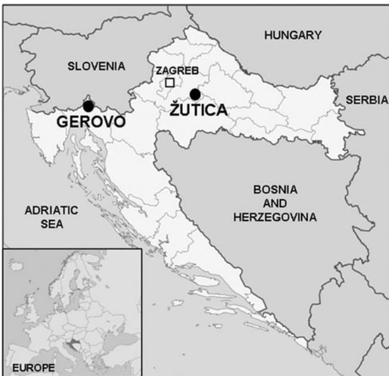
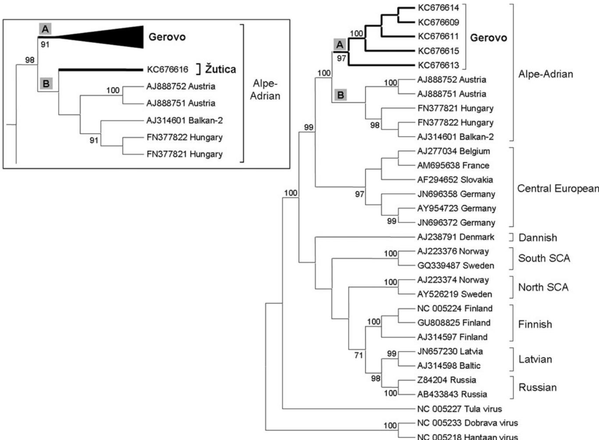
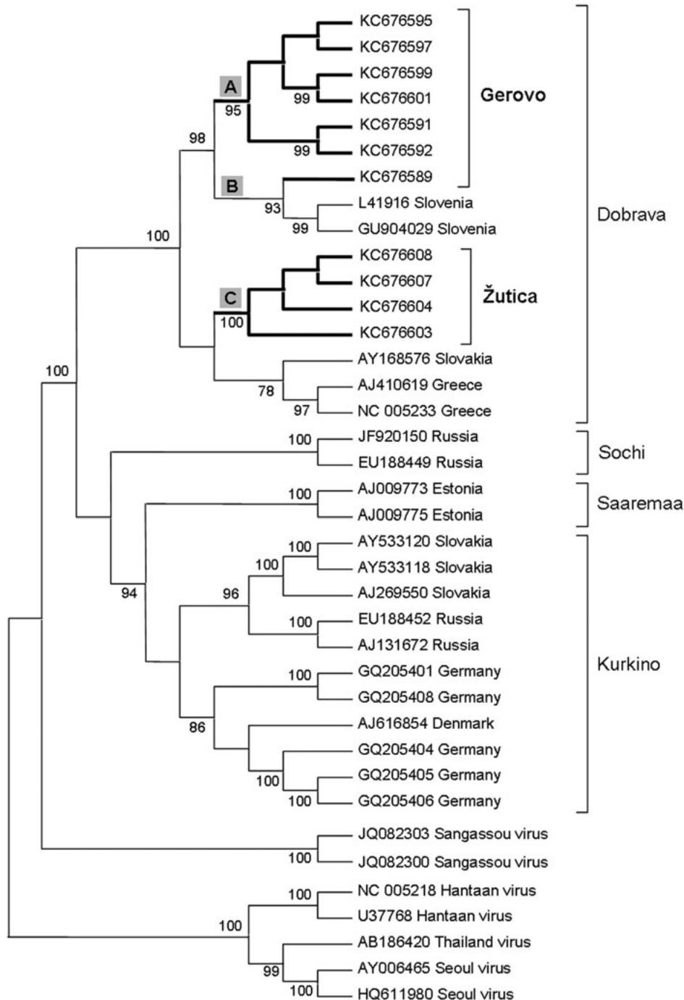

# Survey for Hantaviruses, Tick-Borne Encephalitis Virus, and Rickettsia spp. in Small Rodents in Croatia

Petra Svoboda, $^{1}$ Gerhard Dobler, $^{2}$ Alemka Markotić, $^{1}$ Ivan-Christian Kurolt, $^{1}$ Stephanie Speck, $^{2}$ Josipa Habus, $^{3}$ Marko Vucelj, $^{4}$ Lidija Cvetko Krajinović, $^{1}$ Ante Tadin, $^{1}$ Josip Margaletić, $^{4}$ and Sandra Essbauer $^{2}$

# Abstract

In Croatia, several rodent- and vector-borne agents are endemic and of medical importance. In this study, we investigated hantaviruses and, for the first time, tick-borne encephalitis virus (TBEV) and Rickettsia spp. in small wild rodents from two different sites (mountainous and lowland region) in Croatia. In total, 194 transudate and tissue samples from 170 rodents (A. flavicollis, $n = 115$ ; A. agrarius, $n = 2$ ; Myodes glareolus, $n = 53$ ) were tested for antibodies by indirect immunofluorescence assays (IIFT) and for nucleic acids by conventional (hantaviruses) and real-time RT-/PCRs (TBEV and Rickettsia spp.). A total of $25.5\%$ (24/94) of the rodents from the mountainous area revealed specific antibodies against hantaviruses. In all, $21.3\%$ (20/94) of the samples from the mountainous area and $29.0\%$ (9/31) from the lowland area yielded positive results for either Puumala virus (PUUV) or Dobrava-Belgrade virus (DOBV) using a conventional RT-PCR. All processed samples ( $n = 194$ ) were negative for TBEV by IIFT or real-time RT-PCR. Serological evidence of rickettsial infection was detected in $4.3\%$ (4/94) rodents from the mountainous region. Another $3.2\%$ (3/94) rodents were positive for Rickettsia spp. by real-time PCR. None of the rodents ( $n = 76$ ) from the lowland area were positive for Rickettsia spp. by real-time PCR. Dual infection of PUUV and Rickettsia spp. was found in one M. glareolus from the mountainous area by RT-PCR and real-time PCR, respectively. To our knowledge, this is the first detection of Rickettsia spp. in small rodents from Croatia. Phylogenetic analyses of S- and M-segment sequences obtained from the two study sites revealed well-supported subgroups in Croatian PUUV and DOBV. Although somewhat limited, our data showed occurrence and prevalence of PUUV, DOBV, and rickettsiae in Croatia. Further studies are warranted to confirm these data and to determine the Rickettsia species present in rodents in these areas.

Key Words: Hantavirus—Rickettsia—Rodents—Tick-borne encephalitis virus—Zoonosis.

# Introduction

CROATIA IS ENDEMIC FOR VARIOUS ZOONotic agents. Due to biological and ecological diversity, differences in occurrence and prevalence of various pathogens in small rodent populations can be expected throughout the country (Markotić et al. 2009).

Hantaviruses (family Bunyaviridae) may be the most important rodent-borne pathogens in the country. Human infections caused by hantaviruses are endemic, with hemorrhagic fever with renal syndrome (HFRS) cases varying between sporadic annual reports of 30 cases (Epidemiology Unit of the Croatian National Institute of Public Health) up to epidemic

occurrence with 400 human cases (Cvetko et al. 2005). In Croatia, as well as in Europe, several hantaviruses are circulating with Puumala virus (PUUV) and Dobrava-Belgrade virus (DOBV) being of medical importance (Markotić et al. 2002, Cvetko et al. 2005). Tula (TULV) and Saaremaa (SAAV) viruses have also been reported, but the medical importance is unknown (Scharninghausen et al. 2002, Plyusnina et al. 2011).

Tick-borne encephalitis virus (TBEV, family Flaviviridae), transmitted by Ixodes ticks, is endemic in parts of Europe, including northern Croatia. It causes human infections of the central nervous system (Mansfield et al. 2009, Dobler et al. 2012), with up to 50 reported cases annually in

Croatia (Borcić et al. 1999). For Croatia, only few seroepidemiological data regarding TBEV in humans are available (Borcić et al. 1999, Miletić-Medved et al. 2011). Limited data have suggested small rodents as a reservoir of this virus (Achazi et al. 2011, Knap et al. 2012). Rodents may also be key hosts for amplification of TBEV in the natural transmission cycle (Süss 2003, Dobler et al. 2012). However, this aspect has not been investigated in Croatia so far.

Rickettsiae (genus Rickettsia) are obligate intracellular bacteria transmitted by arthropods, causing human diseases of various severities (Roux and Raoult 2000). Rodents have been suggested to act as reservoir hosts for certain rickettsiae (Schex et al. 2011). In Croatia, data regarding rickettsioses in humans are very limited. Due to unspecific clinical symptoms, human cases may be misdiagnosed and undetected. On average, seven cases are recorded annually (Epidemiology Unit of the Croatian National Institute of Public Health). The human seroprevalence against spotted fever group (SFG) rickettsiae varies between $\leq 44\%$ in southern Croatia (Punda-Polic et al. 2003) and $\leq 7.1\%$ in continental Croatia (Pandak et al. 2011). So far, no epidemiological data exists for the mountainous area of the country.

Identification of reservoir hosts of zoonotic agents is a prerequisite for an effective prevention of human infections. Therefore, this study was conducted to investigate the occurrence and prevalence of Rickettsia spp. and TBEV and to determine the prevalence of hantaviruses in small wild rodents in two geographically and ecologically distinct localities in Croatia.

# Materials and Methods

# Study sites

Gerovo is located in a mountainous area of Gorski kotar adjacent to the border of Slovenia, approximately $150\mathrm{km}$ southwest of the Croatian capital of Zagreb (Fig. 1). The area

  
FIG. 1. Geographic location of the trapping sites in Croatia—Gerovo $(45^{\circ}30'53''\mathrm{N}, 14^{\circ}38'32''\mathrm{E})$ in mountainous area and Zutica $(45^{\circ}37'48''\mathrm{N}, 16^{\circ}26'18''\mathrm{E})$ in lowland area.

is covered in deciduous (beech) and mixed coniferous forests (beech and fir). Zutica lies within a lowland area in central Croatia, approximately $50\mathrm{km}$ southeast of Zagreb (Fig. 1). This area is characterized as a floodplain deciduous common oak forest. Both localities are being exploited for timber and are known recreational areas for tourists and sportsmen.

# Animal samples

During November, 2007, 76 rodents were trapped at Zutica, and from April to May, 2008, 94 rodents were collected at Gerovo using snap traps. Guidelines by Gannon et al. (2007) were followed. Trapping was performed along linear transects at 100 meters above sea level (a.s.l.) in Zutica and from 360 to 1220 meters a.s.l. in Gerovo. Tissue samples $(n = 194)$ available for investigation in this study were lung $(n = 75)$ and kidney $(n = 25)$ from rodents trapped at Zutica and heart tissue $(n = 94)$ from animals captured at Gerovo. Hearts were stored in $0.5\mathrm{mL}$ of phosphate-buffered saline solution. All samples were stored at $-80^{\circ}\mathrm{C}$ until further investigation.

# Detection of anti-hantavirus, anti-TBEV, and anti-Rickettsia spp. antibodies

Transudate was collected from heart tissue $(n = 94)$ , and $10\mu \mathrm{L}$ were tested undiluted for the presence of immunoglobulin G (IgG) antibodies by indirect immunofluorescence tests (IIFTs) as recommended by the manufacturer. Hantavirus Mosaic 1 (Euroimmun AG, Lubeck, Germany), TBE virus (Euroimmun AG), Rickettsia conorii IgG IFA Kit (Fuller Laboratories, Fullerton, CA), and Rickettsia typhi IgG IFA Kit (Fuller Laboratories) were used. As secondary antibody fluorescein isothiocyanate (FITC)-conjugated polyclonal rabbit anti-mouse IgG was used (dilution 1:20; Dako, Glostrup, Denmark) together with Evans Blue counterstaining (BioMerieux, Marcy l'Etoile, France). Slides were read on a fluorescent microscope Eclipse 50i (Nikon Instruments Inc., Japan) by two independent examiners.

# Nucleic acid isolation

Each sample (total $n = 194$ ) was homogenized in cell culture medium (minimum essential medium [MEM] + GlutaMAX; Invitrogen Life Technologies, Carlsbad, CA) using the FastPrep 24 (MP Biomedicals, Santa Ana, CA). Nucleic acids were extracted using the QIAamp Viral RNA Mini Kit (Qiagen, Hilden, Germany) following manufacturer's instructions.

# Detection and phylogenetic analysis of hantaviral RNA

A total of 94 heart and 31 lung samples were screened for hantaviruses by a reverse transcription polymerase chain reaction (RT-PCR) targeting the partial S-segment of PUUV, DOBV, and TULV (Table 1) as described previously (Essbauer et al. 2006). The remaining 44 lung samples (Apodemus flavicollis, $n = 28$ ; Myodes glareolus, $n = 16$ ) from Zutica had been screened and published before (Tadin et al. 2012). For amplification of almost complete S-segment sequences of DOBV, new primer pairs were designed (Table 1). For PUUV, previously published primers (Mertens et al. 2011) were used (Table 1). Partial M-segments of PUUV and DOBV were gained from screening-positive heart samples using

TABLE 1. OLIGONUCLEOTIDES USED IN THIS STUDY   

<table><tr><td>Genomic target</td><td>Oligonucleotide name</td><td>Forward (5&#x27;-3&#x27;)</td><td>Oligonucleotide name</td><td>Reverse (5&#x27;-3&#x27;)</td><td>Reference</td></tr><tr><td rowspan="5">Hantaviruses S-segment</td><td>DOBV-M6</td><td>AGYCCWGTNATGRGWGTRATTGG</td><td>DOBV-M8</td><td>GAKGCCATRATNGTRTTYCKCATRTCCTG</td><td>Essbauer et al. 2006</td></tr><tr><td>PUU Fpuni</td><td>TAGTAGACTCCTTGAARAGCTRCTACGA</td><td>cPUUV1122</td><td>GCCATDATDGTTTYCTCAT</td><td>Mertens et al. 2011</td></tr><tr><td>PUU M6</td><td>AGYCCWGTNATGGGDGTNATTGG</td><td>cPUUV 1910</td><td>TAGTAGTAKVCTCCTTGAAA</td><td>Essbauer et al. 2006</td></tr><tr><td>DOBV Fpuni</td><td>TAGTAGTAKRCTCCCTAAARAG</td><td>cDOB_S_FP</td><td>CACGGGAGGTCAAGCCA</td><td>This paper</td></tr><tr><td>DOBV_S_957F</td><td>TCTGGGTCTTTGCAGGAGCA</td><td>cDOBV_S_1620R</td><td>AGGTAGTGTTGTTGTTTTGAGGTA</td><td>This paper</td></tr><tr><td rowspan="2">Hantaviruses M-segment</td><td>PUU B3</td><td>CARTTACARAAYCCIGCMAATGA</td><td>PUU C2</td><td>CCAACTCCTGAACCCCATGC</td><td>Asikainen et al. 2000</td></tr><tr><td>DOBV_M_kroa1</td><td>Available upon request</td><td>DOBV_M_kroa2</td><td>Available upon request</td><td>Plyusnina et al. 2011</td></tr><tr><td rowspan="3">Rickettsia spp.</td><td>PanRick_2_for</td><td>ATAGGACAACCGTTTATTT</td><td>PanRick_2_rev</td><td>CAAACATCATATGCAGAAA</td><td>Wölfel et al. 2008, Schex et al. 2011</td></tr><tr><td>Probe: PanRick_3_taq</td><td>FAM-CCTGATAATTCGTTAGATTTTACCG-TMR</td><td></td><td></td><td></td></tr><tr><td>ompB -120-2788</td><td>AAACAATAATCAAGGTACTGT</td><td>ompB-120-3599</td><td>TACTTCCGGTTACAGCAAAGT</td><td>Roux and Raoult 2000</td></tr><tr><td rowspan="2">TBEV</td><td>F-TBE1</td><td>GGGCGGTTCTTGTTCTCC</td><td>R-TBE1</td><td>ACACATCACCTCCTTGTCAGACT</td><td>Schwaiger and Cassinotti 2003</td></tr><tr><td>Probe: TBE-WT</td><td>FAM-TGAGCCACCATCACCCAGACACA-TMR</td><td></td><td></td><td></td></tr><tr><td rowspan="2">mt-Cytb</td><td>L14648</td><td>TGAATYGAGGRGGATTCTCAGTA</td><td>H16</td><td>CWGGTTGRCCTCCRATTCAWGT</td><td>Essbauer et al. 2006</td></tr><tr><td>CB_F</td><td>ATGACARTCATCCGAAARAAACAC</td><td>CB_R</td><td>TTARTCTAGGTCYAKRATGTYGTTTTC</td><td>Dekonenko et al. 2003</td></tr></table>

TBEV, tick-borne encephalitis virus; mt-Cytb, mitochondrial cytochrome $b$ gene.

published primer pairs (Asikainen et al. 2000, Plyusnina et al. 2011) (Table 1). All S- and M-segment sequences were submitted to GenBank (accession no. KC676589-635).

The phylogeny was inferred using the maximum likelihood method based on the Tamura-Nei model implemented in MEGA5 software (Tamura et al. 2011) with additional sequences from GenBank.

# Detection of Rickettsia spp. DNA

Real-time screening PCR targeting citrate synthase gene (gltA) was performed for all samples $(n = 194)$ using LightCycler FastStart DNA Master HybProbe (Roche Applied Science, Indianapolis, IN) on a LightCycler 1.5 instrument (Roche) as published previously (Wolfel et al. 2008, Schex et al. 2011). A conventional PCR targeting the partial outer membrane protein B gene $(ompB)$ was performed to determine the Rickettsia species in positive samples as described (Roux and Raoult 2000).

# Detection of TBEV RNA

Real-time RT-PCR targeting a fragment of the $3^{\prime}$ noncoding region of the TBEV was performed for all samples $(n = 194)$ using QuantiTect Virus RT-PCR-Kit System (Qiagen) on a Stratagene Mx3000P (Agilent Technologies, Santa Clara, CA) following a published protocol (Schwaiger and Cassinotti 2003). Langat virus RNA served as a positive control.

# Rodent species determination

Rodent species were determined morphologically and confirmed genetically on rodents from Gerovo $(n = 94)$ and Apodemus mice from Zutica $(n = 17)$ using PCR targeting the mitochondrial cytochrome $b$ gene (mt-Cytb) (Dekonenko et al. 2003, Essbauer et al. 2006). Part of mt-Cytb sequences were submitted to GenBank (accession no. KC676636-655).

# Results

A total of 194 heart, lung, and kidney samples of 170 rodents from two localities in Croatia were analyzed (Table 2). At Žutica $(n = 76)$ , 15 A. flavicollis and two A. agrarius were genetically identified, genetic determination of 28 A. flavicollis was done before by Tadin et al. (2012), and 31 M. glareolus were morphologically identified. From Gerovo $(n = 94)$ , 72 A. flavicollis and 22 M. glareolus were genetically confirmed.

# Hantaviruses

Specific antibodies to hantaviruses were found in 24/94 $(25.5\%)$ investigated heart transudates from Gerovo (Table 2). Seventeen of these originated from A. flavicollis and seven from M. glareolus. Fewer animals from Gerovo, 20/94 $(21.3\%)$ , were positive by RT-PCR, all of which were positive by IIFT; 7/22 $(31.8\%)$ M. glareolus revealed PUUV and 13/72 $(18.1\%)$ A. flavicollis were DOBV positive. From Zutica, nine of 31 $(29.0\%)$ rodents were positive by RT-PCR, including one of 15 $(6.7\%)$ M. glareolus (PUUV) and eight of 14 $(57.1\%)$ A. flavicollis (Table 2). In five of seven PUUV positives from Gerovo, almost complete S-segment sequences (1766 base pairs, nucleotides 52-1830) were recovered showing $98.4 - 100\%$ similarity to each other, whereas deduced amino acid sequences were $98.1 - 100\%$ similar. The PUUV sequence obtained from Zutica was 345 base pairs (nucleotides

TABLE 2. NUMBER OF POSITIVE AND NUMBER OF TESTED RODENTS FROM GEROVO AND ZUTICA ON HANTAVIRUSES AND RICKETTSIA SPP.  

<table><tr><td rowspan="2">Locality</td><td rowspan="2">Rodent species</td><td colspan="2">Hantaviruses</td><td colspan="2">Rickettsia spp.</td></tr><tr><td>\( IIFT^d \)</td><td>RT-PCR</td><td>\( IIFT \)</td><td>PCR</td></tr><tr><td rowspan="3">Gerovo (mountainous Croatia)a</td><td>Apodemus flavicollis</td><td>17/72</td><td>13/72c (DOBV)</td><td>2/72</td><td>2/72</td></tr><tr><td>Myodes glareolus</td><td>7/22</td><td>7/22e (PUUV)</td><td>2/22</td><td>1/22</td></tr><tr><td>Total Gerovo</td><td>24/94 (25.5%)</td><td>20/94 (21.3%)</td><td>4/94 (4.3%)</td><td>3/94 (3.2%)</td></tr><tr><td rowspan="4">Žutica (lowland Croatia)b</td><td>Apodemus flavicollis</td><td>nd</td><td>8/14 (DOBV)</td><td>nd</td><td>0/43g</td></tr><tr><td>Apodemus agrarius</td><td>nd</td><td>0/2</td><td>nd</td><td>0/2</td></tr><tr><td>Myodes glareolusc</td><td>nd</td><td>1/15 (PUUV)</td><td>nd</td><td>0/31</td></tr><tr><td>Total Žutica</td><td>nd</td><td>9/31f (29.0%)</td><td>nd</td><td>0/76 (0%)</td></tr><tr><td>Total</td><td></td><td>24/94 (25.5%)</td><td>29/125 (23.2%)</td><td>4/94 (4.3%)</td><td>3/170 (1.8%)</td></tr></table>

aHeart samples were available for testing.   
bLung and kidney samples were available for testing.   
${}^{c}$ Rodents were morphologically determined but not confirmed by mt-Cytb PCR.   
In IIFT a cross-reactivity pattern was seen: Bank vole samples reacted to all six tested hantaviruses (Hantaan, Sin Nombre, Puumala, Dobrava-Belgrade, Seoul, Saaremaa), whereas yellow-necked mice samples were only reactive on DOBV, Hantaan virus, and Seoul virus. Serial dilutions of the positive samples were not performed.   
eThe same animals were positive by IIFT.   
${}^{f}$ A total of 44 animals were already tested for hantaviruses (16 PUUV-positive M. glareolus and 28 positive A. flavicollis) by Tadin et al. (2012) and are therefore not included in this table.   
gIncludes one more Apodemus flavicollis that was not tested for hantaviruses in this paper or by Tadin et al. (2012), as samples were not available.   
DOBV, Dobrava-Belgrade virus; IIFT, indirect immunofluorescence test; nd, not determined; PCR, polymerase chain reaction; PUUV, Puumala virus; RT-PCR, reverse transcription polymerase chain reaction.

714-1058) due to unsuccessful amplification of further S-segment sequences by additional RT-PCRs and shared 94.2- $95.5\%$ similarity to the sequences from Gerovo, while the deduced amino acid sequences were $97.3 - 98.2\%$ similar. Therefore, two phylogenetic trees were constructed, one for the almost complete S-segment sequences from Gerovo and other European PUUV strains (nucleotides 52-1674) and the second comparing partial sequences from Gerovo, Zutica and other strains (nucleotides 714-1058). The phylogenetic analysis for the almost complete S-segment (Fig. 2) revealed eight PUUV lineages. The Alpe-Adrian PUUV lineage formed a sister group to the Central European lineage. Within the Alpe-Adrian lineage, the subgroup A, with good bootstrap support, included only sequences from Gerovo that subdivided into distinct inferior branches. The subgroup B included sequences of previously described PUUV strains from Austria, Hungary, and the Balkans. The phylogenetic analysis for a partial S-segment of 345 nucleotides (with the sequences in this analysis adjusted to the same length; Fig. 2, inset) revealed that PUUV sequences from Gerovo and Zutica lay within two separate subgroups within the Alpe-Adrian lineage. Subgroup A only included the sequences from Gerovo, whereas subgroup B included the sequence from Zutica and sequences of previously described PUUV strains from Austria, Hungary, and the Balkans.

Almost complete S-segment sequences (1567 base pairs, nucleotides 23-1677) were gained in seven of 13 DOBV positive samples from Gerovo and revealed $98.7 - 100\%$ similarity among themselves, whereas deduced amino acid sequences showed $96.6 - 100\%$ similarity. In four of eight DOBV positive samples from Zutica, almost complete S-segment sequences (1568 base pairs) were obtained showing a $100\%$ similarity among each other, and the similarity to sequences from Gerovo was $96.6 - 96.8\%$ . Interestingly, the

sequences from Gerovo have one less nucleotide (nucleotide 1333) in the noncoding region compared to sequences from Žutica and sequences from Greece or Slovakia. The phylogenetic analysis for the almost complete DOBV S-segment revealed four lineages (nucleotides 23-1590; Fig. 3). The phylogenetic analysis of DOBV showed that the sequences from Gerovo and Žutica were situated in three well-supported subgroups A-C within genotype Dobrava. Subgroup A comprised sequences from Gerovo that subdivide into inferior branches. Subgroup B included one sequence from Gerovo together with sequences from Slovenian genotype Dobrava strains. This sequence from Gerovo had more nucleotide differences $(1.3\%)$ compared to other sequences from Gerovo. Subgroup C represented sequences from Žutica together with sequences of previously described genotype Dobrava strains from Greece and Slovakia.

Partial M-segment sequences of PUUV and DOBV were obtained from rodents trapped at Gerovo. The seven PUUV M-segment sequences of 850 base pairs (nucleotides 2161-3010) had $99.4 - 100\%$ similarity to each other, whereas deduced amino acid sequences were $95.5 - 100\%$ identical. The gained 11 DOBV M-segment sequences of 520 base pairs (nucleotides 1489-2008) bore $98 - 100\%$ resemblance to one another, whereas deduced amino acid sequences showed $93.9 - 100\%$ identity. The phylogenetic analysis of PUUV and DOBV M-segment sequences for the partial corresponding region is in line with the phylogenetic analysis of the S-segment sequences but is not shown due to insufficient bootstrap support in the branches.

# TBEV

All processed samples were negative for TBEV by IIFT $(n = 94)$ and real-time RT-PCR $(n = 194)$ . All respective

  
FIG. 2. Phylogenetic analysis of the almost complete Puumala virus (PUUV) S-segment (corresponding to nucleotides 52-1674 of the reference strain, accession no. NC_005224) using the maximum likelihood method based on the Tamura-Nei model. The inset part of the tree is calculated for the PUUV partial S-segment region of 345 base pairs (corresponding to nucleotides 714-1058 of the reference strain, accession no. NC_005224). Only bootstrap values $>70\%$ , calculated from 1000 replicates, are shown at the tree branches.

controls on all IIFT slides and in real-time RT-PCR reactions were accurate.

# Rickettsia spp.

Only animals from Gerovo were positive for Rickettsia spp. Four out of 94 $(4.3\%)$ from two M. glareolus and two A. flavicollis) heart transudates showed serological evidence of reactivity with SFG rickettsiae (Table 2). Additionally, another three individuals (three of 94, $3.2\%$ ) from Gerovo (one M. glareolus, two A. flavicollis) were positive for Rickettsia spp. by gltA real-time PCR. Species determination could not be confirmed by ompB PCR due to lesser sensitivity of the conventional PCR.

# Multiple infections

All four samples reactive for antibodies against Rickettsia spp. were also positive for hantavirus antibodies and hantavirus RNA (two PUUV and two DOBV positive) (data not shown). Additionally, one $M.$ glareolus from Gerovo revealed simultaneous detection of rickettsial DNA and PUUV RNA (data not shown).

# Discussion

The high percentage (25.5% by IIFT, 23.2% by RT-PCR) of hantavirus-positive rodents found in this study is in accordance with previous studies on hantaviruses in Croatia (Cvetko et al. 2005, Tadin et al. 2012) and other countries (Avsic-Zupanc et al. 2000, Essbauer et al. 2006, Heyman et al. 2012), although the sampling was performed in different years/seasons and in nonepidemic periods in Croatia. Overall, 21.3% of the rodents from Gerovo and 29.0% of the animals from Žutica were positive. In 2008, 13 cases of HFRS were recorded from the mountainous area of Gorski kotar (Institute of Public Health of the Primorsko-goranska county) where Gerovo is situated. Moreover, Gerovo is adjacent to Slovenia, where a higher number of human infections had been noticed in 2008 (Heyman et al. 2011). As indicated by Borcić et al. (1991), the area of Gorski kotar can be considered as HFRS endemic with a seroprevalence of 4.4% in the human population. Compared to the seroprevalence (25.5%) measured in rodent transudates from mountainous Gerovo, 43% of the rodents from lowland Žutica reacted seropositive in another study (Tadin et al. 2012).

  
FIG. 3. Phylogenetic analysis of the almost complete Dobrava-Belgrade virus (DOBV) S-segment (corresponding to nucleotides 23-1590 of the reference strain, accession no. NC_005233) using the maximum likelihood method based on the Tamura-Nei model. Only bootstrap values $>70\%$ , calculated from 1000 replicates, are shown at the tree branches. DOBV genotypes within the tree were termed according to the subdivision of DOBV suggested by Klempa et al. (2013).

For Zutica, human seroprevalence data regarding hantavirus infections were not investigated so far.

The samples available from Gerovo unfortunately only comprised heart tissue. Due to lower detection rates of hantavirus RNA in heart specimens in other studies or depending on the molecular method used (Essbauer et al. 2006, Korva et al. 2009), these results may not allow definite conclusions on hantavirus prevalence in Gerovo. They rather suggest that the percentage of hantavirus positives would be even higher if other tissue (e.g., lung) had been used (Essbauer et al. 2006).

Phylogenetic analyses of partial S- and M-segments revealed that the sequences from Gerovo and Zutica formed two well-supported distinct genetic subclusters in Croatian PUUV and DOBV. Separation into genetic geographic clusters where the genetic distances of DOBV and PUUV strains increase with increasing geographical separation has been described (Avsic-Zupanc et al. 2000, Ettinger et al. 2012). The genetic distance between virus sequences obtained from mountainous Gerovo and lowland Zutica was demonstrated by the two subclusters within PUUV and

DOBV and might be explained by geographical barriers (mountainous area between the two localities) that prevent the spreading of rodents and virus. Gerovo lies within the Dinarides (Dinaric Alps) that form a mountain chain in a northeast-southwest direction. Žutica is located in the Panonic-peripanonic area in a Sava river valley. The two sites are approximately $200\mathrm{km}$ apart. The two strains of PUUV and DOBV could also suggest that there were two routes of rodent postglacial colonization dispersing from Balkan Peninsula refugia for both Myodes and Apodemus rodents, respectively (Bilton et al. 1998, Michaux et al. 2004). A similar situation has been postulated in Fennoscandia (Asikainen et al. 2000) for bank vole populations and PUUV. Further studies are needed to discriminate whether rodent host genetic lines at our study sites are different. Moreover, data from other geographic areas in Croatia are needed to prove this hypothesis.

To date, there are no available data about the presence of rickettsiae in wild rodents from Croatia and only limited data are available about Rickettsia spp. in small rodents worldwide (Schex et al. 2011, Dantas-Torres et al. 2012). In our study, $4.2\%$ of the rodents (two A. flavicollis, two M. glareolus) from Gerovo revealed anti-Rickettsia antibodies. From Germany, $29.3\%$ of wild rodents were positive for anti-Rickettsia antibodies (Schex et al. 2011). Three out of 170 $(1.8\%)$ rodents in our study were positive for Rickettsia DNA by real-time PCR, with only hearts being positive. In contrast, only ear tissue $(5.8\%)$ and spleen samples $(5.2\%)$ were positive in other studies (Kim et al. 2006, Schex et al. 2011). The low percentage of Rickettsia spp.-positive samples in the present study might be explained by the suboptimal tissue choice. However, it might also suggest that both sampling sites are within areas of low Rickettsia spp. circulation, which coincides with low seroprevalence in humans in continental (Pandak et al. 2011) compared to coastal Croatia (Punda-Polic et al. 2003).

None of the samples examined tested positive for TBEV RNA or antibodies against TBEV. The real-time RT-PCR used is specific for all Western subtypes of TBEV strains published so far (Schwaiger and Cassinotti 2003, Essbauer, unpublished data). Although there are reports about TBEV detected in rodents in Europe (Achazi et al. 2011, Knap et al. 2012), either none of the captured rodents from this study were infected with TBEV or viral infection could not be demonstrated. TBEV RNA in heart tissue is detectable only at late days postinfection (Achazi et al. 2011). Furthermore, TBE natural foci seem to be very focal (Kupca et al. 2010) and therefore TBE may be nonexistent in the areas tested, which might have hampered TBEV detection in this study with animals of unknown infection status.

Although one might expect simultaneous infections with the pathogens investigated in this study, only one $M.$ glareolus from Gerovo was found harboring both Rickettsia DNA and PUUV RNA. Comparable studies showed, by proving etiological agents, dual infections of PUUV and Leptospira (Cvetko et al. 2006) and even triple infections with hantaviruses, Leptospira, and Babesia in Croatian rodents (Tadin et al. 2012).

# Conclusions

Herein we have presented data on the occurrence and prevalence of three zoonotic pathogens in wild rodents from mountainous and lowland Croatia. Overall, nearly $30\%$ of rodents showed evidence of hantavirus infection. The study areas con

stitute HFRS risk areas due to the high percentage of hantavirus-positive rodents. Almost complete hantavirus S-segment sequences were gained for PUUV from a mountainous region and DOBV from both study sites. Within the phylogenetic trees, the sequences from the two sites formed well-supported subgroups revealing two variants in Croatian PUUV and DOBV for S- and M-segment with the sequences from the mountainous locality separating into distinct subgroups. To our knowledge, this is the first description of the detection of Rickettsia spp. in Croatian rodents. Our data also demonstrate that Myodes carry and may transmit different zoonotic agents (Rickettsia spp. and PUUV). Regarding TBEV, further investigations are needed to clarify whether the virus is present at the study sites. Because Gerovo and Žutica are situated near protected recreational areas with high numbers of annual visitors, the current and future data will contribute to risk assessment and prevention strategies.

# Acknowledgments

Petra Svoboda had a "Gaining Experience Grant" funded by Unity through Knowledge Fund (UKF grant no. 75/10) to perform this work at the Bundeswehr Institute of Microbiology, Munich, Germany. The study was in part supported by the network "Rodent-borne pathogens" and BMBF project, by a grant from the Bavarian Ministry of Health, Vector-borne Infectious Diseases in Climate Change Investigations (VICCI). It was also supported by projects from the Ministry of Science, Education and Sports of the Republic of Croatia (143-1430115-0103, 068-1430115-2119, and 053-1430115-2116).

We acknowledge Tomislav Kuzele for field work in collecting rodents from Gerovo locality and the technical assistance of Stephan Motzkus for performing RT-PCRs of Zutica locality hantaviruses almost total S-segment.

# Author Disclosure Statement

No competing financial interests exist.

# References

Achazi K, Rüzek D, Donoso-Mantke O, Schlegel M, et al. Rodents as sentinels for the prevalence of tick-borne encephalitis virus. Vector Borne Zoonotic Dis 2011; 11:641-647.   
Asikainen K, Hanninen T, Henttonen H, Niemimaa J, et al. Molecular evolution of puumala hantavirus in Fennoscandia: Phylogenetic analysis of strains from two recolonization routes, Karelia and Denmark. J Gen Virol 2000; 81:2833-2841.   
Avsic-Zupanc T, Nemirov K, Petrovec M, Trilar T, et al. Genetic analysis of wild-type Dobrava hantavirus in Slovenia: Co-existence of two distinct genetic lineages within the same natural focus. J Gen Virol 2000; 81:1747-1755.   
Bilton DT, Mirol PM, Mascheretti S, Fredga K, et al. Mediterranean Europe as an area of endemism for small mammals rather than a source for northwards postglacial colonization. Proc Biol Sci 1998; 265:1219-1226.   
Borcić B, Turković B, Aleraj B, Tvrtković N. Hemorrhagic fever with renal syndrome in Croatia: Incidence of infection in human and wild animal reservoirs. Lijec Vjesn 1991; 113:320-323. [Article in Croatian]   
Borcić B, Kaić B, Kralj V. Some epidemiological data on TBE and Lyme borreliosis in Croatia. Zentralbl Bakteriol 1999;289:540-547.   
Cvetko L, Markotic A, Plyusnina A, Margaletic J, et al. Puumala virus in Croatia in the 2002 HFRS outbreak. J Med Virol 2005; 77:290-294.

Cvetko L, Turk N, Markotic A, Milas Z, et al. Short report: Dual infections with Puumala virus and Leptospira interrogans serovar lora in a bank vole (Clethrionomys glareolus). Am J Trop Med Hyg 2006; 74:612-614.   
Dantas-Torres F, Alessio FM, Siqueira DB, Mauffrey J-F, et al. Exposure of small mammals to ticks and rickettsiae in Atlantic Forest patches in the metropolitan area of Recife, North-eastern Brazil. Parasitology 2012; 139:83-91.   
Dekonenko A, Yakimenko V, Ivanov A, Morozov V, et al. Genetic similarity of Puumala viruses found in Finland and western Siberia and of the mitochondrial DNA of their rodent hosts suggests a common evolutionary origin. Infect Genet Evol 2003; 3:245-257.   
Dobler G, Gniel D, Petermann R, Pfeffer M. Epidemiology and distribution of tick-borne encephalitis. Wien Med Wochenschr 2012; 162:230-238.   
Epidemiology Unit of the Croatian National Institute of Public Health. Epidemiological News. Available at www.hzjz.hr/ epidemiology/news/   
Essbauer S, Schmidt J, Conraths FJ, Friedrich R, et al. A new Puumala hantavirus subtype in rodents associated with an outbreak of nephropathia epidemiica in South-East Germany in 2004. Epidemiol Infect 2006; 134:1333-1344.   
Ettinger J, Hofmann J, Enders M, Tewald F, et al. Multiple synchronous outbreaks of Puumala virus, Germany, 2010. Emerging Infect Dis 2012; 18:1461-1464.   
Gannon WL, Sikes RS, Banack S, Burt MS, et al. Guidelines of the American Society of Mammalogists for the use of wild mammals in research. J Mammal 2007; 88:809-823.   
Heyman P, Ceianu CS, Christova I, Tordo N, et al. A five-year perspective on the situation of hemorrhagic fever with renal syndrome and status of the hantavirus reservoirs in Europe, 2005-2010. Euro Surveill 2011; 16.   
Heyman P, Thoma BR, Marié J-L, Cochez C, et al. In search for factors that drive hantavirus epidemics. Front Physiol 2012; 3:237.   
Institute of Public Health of the Primorsko-goranska county. Zdravstveno-statistikki ljetopus Primorsko-goranske zupanije za 2008. godinu. Available at www.zzzjzpgz.hr/statistika/statistika2008/index.html [Article in Croatian]   
Kim C-M, Yi Y-H, Yu D-H, Lee M-J, et al. Tick-borne rickettsial pathogens in ticks and small mammals in Korea. Appl Environ Microbiol 2006; 72:5766-5776.   
Klempa B, Avsic-Zupanc T, Clement J, Dzagurova TK, et al. Complex evolution and epidemiology of Dobrava-Belgrade hantavirus: Definition of genotypes and their characteristics. Arch Virol 2013; 158:521-529.   
Knap N, Korva M, Dolinšek V, Sekirnik M, et al. Patterns of tick-borne encephalitis virus infection in rodents in Slovenia. Vector Borne Zoonotic Dis 2012; 12:236-242.   
Korva M, Duh D, Saksida A, Trilar T, et al. The hantavirus load in tissues of naturally infected rodents. Microbes Infect 2009; 11:344-351.   
Kupca AM, Essbauer S, Zoeller G, De Mendonca PG, et al. Isolation and molecular characterization of a tick-borne encephalitis virus strain from a new tick-borne encephalitis focus with severe cases in Bavaria, Germany. Ticks Tick Borne Dis 2010; 1:44-51.   
Mansfield KL, Johnson N, Phipps LP, Stephenson JR, et al. Tick-borne encephalitis virus—a review of an emerging zoonosis. J Gen Virol 2009; 90:1781-1794.   
Markotic A, Nichol ST, Kuzman I, Sanchez AJ, et al. Characteristics of Puumala and Dobrava infections in Croatia. J Med Virol 2002; 66:542-551.

Markotic A, Krajinovic LC, Margaletić J, Turk N, et al. Zoonoses and vector-borne diseases in Croatia—a multidisciplinary approach. Vet Ital 2009; 45:55-66.   
Mertens M, Kindler E, Emmerich P, Esser J, et al. Phylogenetic analysis of Puumala virus subtype Bavaria, characterization and diagnostic use of its recombinant nucleocapsid protein. Virus Genes 2011; 43:177-191.   
Michaux JR, Libois R, Paradis E, Filippucci M-G. Phylogeographic history of the yellow-necked field mouse (Apodemus flavicollis) in Europe and in the Near and Middle East. Mol Phylogenet Evol 2004; 32:788-798.   
Miletić-Medved M, Daković Rode O, Cvetko Krajinović L, Markotić A. Tick-borne meningoencephalitis in central Posavina, Croatia: Seroepidemiological survey among forest workers. Infektoloski Glasnik 2011; 31:87-94. [Article in Croatian]   
Pandak N, Sprong H, Tijssse Klassen E, Trošelj-Vukić B, et al. Borrelia and rickettsia in skin bioptates of erythema migrans patients. Infektoloski Glasnik 2011; 31:133-137. [Article in Croatian]   
Plyusnina A, Krajinovic LC, Margaletic J, Niemimaa J, et al. Genetic evidence for the presence of two distinct hantaviruses associated with Apodemus mice in Croatia and analysis of local strains. J Med Virol 2011; 83:108-114.   
Punda-Polic V, Klismanic Z, Capkun V. Prevalence of antibodies to spotted fever group rickettsiae in the region of Split (southern Croatia). Eur J Epidemiol 2003; 18:451-455.   
Roux V, Raoult D. Phylogenetic analysis of members of the genus Rickettsia using the gene encoding the outer-membrane protein rOmpB (ompB). Int J Syst Evol Microbiol 2000; 50(Pt 4):1449-1455.   
Scharninghausen JJ, Pfeffer M, Meyer H, Davis DS, et al. Genetic evidence for Tula virus in Microtus arvalis and Microtus agrestis populations in Croatia. Vector Borne Zoonotic Dis 2002; 2:19-27.   
Schex S, Dobler G, Riehm J, Müller J, et al. Rickettsia spp. in wild small mammals in Lower Bavaria, South-Eastern Germany. Vector Borne Zoonotic Dis 2011; 11:493-502.   
Schwaiger M, Cassinotti P. Development of a quantitative real-time RT-PCR assay with internal control for the laboratory detection of tick borne encephalitis virus (TBEV) RNA. J Clin Virol 2003; 27:136-145.   
Süss J. Epidemiology and ecology of TBE relevant to the production of effective vaccines. Vaccine 2003; 21(Suppl 1):S19-S35.   
Tadin A, Turk N, Korva M, Margaletic J, et al. Multiple coinfections of rodents with hantaviruses, Leptospira, and Babesia in Croatia. Vector Borne Zoonotic Dis 2012; 12:388-392.   
Tamura K, Peterson D, Peterson N, Stecher G, et al. MEGA5: Molecular evolutionary genetics analysis using maximum likelihood, evolutionary distance, and maximum parsimony methods. Mol Biol Evol 2011; 28:2731-2739.   
Wölfe R, Essbauer S, Dobler G. Diagnostics of tick-borne rickettsioses in Germany: A modern concept for a neglected disease. Int J Med Microbiol 2008; 298:368-374.

Address correspondence to:

Petra Svoboda

University Hospital for Infectious Diseases

"Dr. Fran Mihaljevic"

Mirogojska 8

HR-10000 Zagreb

Croatia

E-mail: psvoboda@bfm.hr