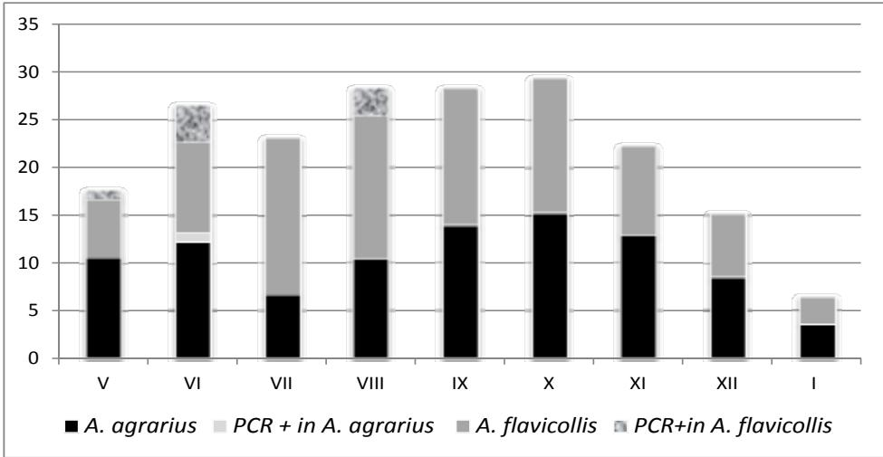

# Hantavirus Infections in Host Populations of Yellow-Necked and Field Mice (Rodentia: Muridae) in South Bulgaria

Tsenka G. Chassovnikarova1 , Nasko I. Atanassov1 , Iva S. Christova2 , Hristo A. Dimitrov3 , Vesela I. Mitkovska3 , Iva P. Trifonova2 , Teodora K. Gladnishka2 , Nikolay Z. Kalvatchev2 , Emad Mohareb4

1 Institute of Biodiversity and Ecosystem Research, BAS, 1 Tsar Osvoboditel Blvd., 1000 Sofia, Bulgaria; E-mail: t.tchasovnikarova@gmail.com

2 National Centre of Infectious and Parasitic Diseases, 26 Janko Sakazov Blvd., 1504 Sofia, Bulgaria

3 Plovdiv University “St. P. Hilendarski”, Faculty of Biology, Department of Zoology, 24 Tsar Asen Str., 4000 Plovdiv, Bulgaria 4 NAMRU, Cairo, Egypt

Abstract: The wood and field mice of the genus Apodemus are natural reservoirs of hantaviruses: Dobrava, Puumala and Saarema virus types. In the last few years, cases of hemorrhagic fever with renal syndrome were reported from different regions in Bulgaria, but the factors, influencing hantavirus transmission within host populations have not been well investigated. Sensitive molecular genetic methods (real time PCR) for detection of hantaviruses in wood and field mice, captured in endemic for the virus region in Southern Bulgaria, were used. Dobrava virus type (DOBV) was genetically determined in two Apodemus species: Apodemus flavicollis (Melchior, 1834) and Apodemus agrarius (Pallas, 1771). The overall DOBV prevalence was $7 . 7 \%$ for A. flavicollis and $1 . 4 3 \%$ for A. agrarius. A number of factors, influencing the association of DOBV infections in yellow-necked wood and field mice, were evaluated. The logistic regression model showed four factors in the model outcome: species, age, gender and reproductive status. This analysis highlights the importance of population demography in the successful circulation of hantaviruses. The overwintered reproductively active males of yellow-necked mice appear critical to the success of DOBV circulation and persistence within host populations in South Bulgaria.

Key words: Dovrava virus, Apodemus flavicollis, Apodemus agrarius

# Introduction

Dobrava virus type (DOBV) is European hantavirus that causes hemorrhagic fever with renal syndrome (HFRS) and seems to be the most life-threatening hantavirus in Europe. Case-fatality rates in Balkan countries are as high as $12 \%$ (Glig ich et al. 1992; Avsic-Zupa nc et al. 1999; Pa pa , Antonia dis 2001). DOBV is hosted by two different rodent species, Apodemus flavicollis (yellow-necked wood mouse) and A. agrarius (striped field mouse) (Ka ma rinchev 1996; Sibold et al. 2001; Klempa et al. 2003). In the last few years, cases of HFRS were reported from different regions in Bulgaria (Ka ma rinchev 1996; Pa pa ,

Christova 2011), but the factors, influencing hantavirus transmission within host populations have not been well investigated. The prevention of the disease agent requires a detailed knowledge of the ecology and epizootiology of the hosts of zoonotic viruses.

The hantavirus transmission appears to be a function of many factors, including geographic area, climate change, types of biotope alterations and the Hantavirus species (Dea ring , Diz ney 2010). The demographic factors and the ecology of the hosts play a key role in hantavirus prevalence. A relation between the male gender and hantavirus

prevalence was reported for numerous hantaviruses (Gla ss et al. 1988; Ca ntoni et al. 2001). The role of individual body mass and antibody prevalence has been demonstrated for several hantaviruses (Gla ss et al. 1988, Mills et al. 1999, Escutena ire et al. 2000), implying that these viruses are transmitted horizontally among hosts. Varying seasonal patterns in the prevalence of infection with hantaviruses in their host populations have also been reported (Nik la sson et al. 1995, Escutena ire et al. 2000, Tersag o et al. 2011). A positive relation between hantavirus prevalence and population density in deer mouse (Peromyscus maniculatus) and brush mouse (Peromyscus boylii) was reported by Beg on et al. (2002) and Mills et al. (1999).

Knowing the population demographic factors associated with DOBV infection in their rodent hosts in Bulgaria is important because it leads to an understanding of the mechanisms of DOBV transmission and this knowledge, in turn, may lead to the improved prediction of the relative risk of HFRS for humans.

The focus of the present study was to relate and rank individual and population factors, influencing the prevalence of DOBV and determine which of these factors are essential for the spread of Hantavirus within a host population species.

# Material and Methods

# Rodent sampling and species abundance

Small-mammal trapping was done in the vicinity of Peshtera, an endemic for the HFRS region in Southern Bulgaria $( 4 2 ^ { \circ } 0 3 3 ^ { \circ } - 4 2 ^ { \circ } \ 0 5 1 ^ { \circ } \mathrm { N }$ , $2 4 ^ { \circ } 3 1 0 ^ { \circ }$ $2 4 ^ { \circ } 5 5 0 ^ { \circ } \mathrm { E }$ ). The collection of animals took place for three nights each month, beginning in the spring of 2011 until the spring of 2012. Each month, ten 100 m-lines of 20 Sherman live-traps per 3 nights were set in the moist grassy, wooded and shrubby habitats. The species from genus Apodemus were monitored.

As a measure of relative abundance, trap success was calculated as the number of individuals captured per 100 trap nights.

# Species identification

The morphological diagnostics of the species Apodemus sylvaticus, (Linnaeus, 1758) and Apodemus flavicollis (Melchior, 1834) in the south part of their genus range in Europe is heavily complicated by the morphological parallelism. The simple diagnostics of

the species is hampered by the strong opposite clinal variability of the external size characteristics. The wood mice individuals were identified to the species A. flavicollis or A. sylvaticus on the basis of analysis of cytochrome oxidase c subunit I (COI) and cytochrome b (cytb) gene fragments. Tissues were submitted to the Canadian Centre for DNA Barcoding, Biodiversity Institute of Ontario, University of Guelph (Guelph, Canada) and standard barcoding protocols for PCR amplification and sequencing were employed, following PCR and sequencing with regular and M13- tailed universal vertebrate primer cocktails (Cla re et al. 2007; Iva nova et al. 2006).

# Hantavirus detection

TaqMan RT-PCR for the detection of hantaviruses in host species was used. Primers and probes described by Kra msk i et al. (2007) were applied. Reactions were conducted in $2 5 ~ \mu \mathrm { l }$ final volume and consisted of $1 2 . 5 ~ \mu \mathrm { l }$ QuantiTect Master Mix, $4 . 5 ~ \mu \mathrm { l }$ $\mathrm { d d H } _ { 2 } \mathrm { O }$ , $1 \mu \mathrm { l }$ of each primer pair (Forward-Reverse), $0 . 2 5 ~ \mu \mathrm { l }$ probe, ROX Dye $0 . 5 ~ \mu \mathrm { l } .$ , QuantiTect RT Mix $0 . 2 5 ~ \mu \mathrm { l }$ and $5 \mu \mathrm { l }$ of extracted viral RNA.

# Investigated individual and population factors associated with hantavirus transmission

The following data were recorded for each animal: species, age, gender and reproductive status. The age determination was done according to criteria of the degree of teeth wearing out (Ada mcz ewska - Andz eewska 1973) and each animal was subsequently assigned to one of four age classes: juvenile $( < 3$ months of age), sub adult (between 3 and 5 months of age), adult (between 6 and 9 months of age) or senile (overwintered, $>$ of 10 months of age). Males with scrotal testes and females with a perforate vaginal orifice, lactating, or with enlarged mammary glands were defined as reproductively active individuals. The phase of the population density was designated as “increase,” “peak” or “decline”, depending on the relative amplitude of trap success.

Multivariable logistic regression models in STATA were used to identify statistically significant characteristics. The risk factors of infection were studied at the individual and at the population level as well. The species, age, gender and reproductive status were investigated as explanatory factors. The DOBV status (PCR positive or PCR negative) was used as a dichotomous dependent variable. Rodent ID number was included as a random effect. The critical probability was $\mathrm { p } { < } 0 . 0 5$ throughout. The odds

ratios (OR) were presented in favor of infection in relation to reference levels for nominal variables.

# Results

# Molecular-genetic species identification of the wood mice (subgenus Apodemus)

Based on the provided analysis of cytochrome oxidase c subunit I (COI) and cytochrome b (cytb) gene fragments, all captured individuals from the subgenus Apodemus were identified as yellow-necked mice ( A. flavicollis).

# Trapping summary

Overall 7240 trap nights were accumulated. In all, 198 captures of Apodemus individuals were recorded from May 2011 to January 2012. Of these, 102 $( 5 1 . 5 \% )$ individuals were of the species Apodemus agrarius, and 92 $( 4 6 . 5 \% )$ were of the species Apodemus flavicollis. The striped field mouse (A. agrarius) prevailed in the moist grassy habitats, whereas the yellow-necked mouse (A. flavicollis) inhabited the wooded and shrubby habitats.

Patterns in population dynamics differed among species. The striped field mouse exhibited increasing abundance levels during spring and declined in summer, whereas the yellow necked mouse peaked in summer, remained high in autumn and declined to a trough in winter (Fig. 1).

# Hantavirus detection and investigated individual and population factors associated with hantavirus transmission

The overall DOBV prevalence was $7 . 7 \%$ in Apodemus flavicollis and $1 . 4 3 \%$ in Apodemus agrar-

ius. Univariate analyses showed that yellow-necked mice were significantly more likely to have been PCR positive than field mice (OR 8.15, $9 5 \%$ confidence interval [CI] 3.08 to 21.59, $\mathrm { p } { < } 0 . 0 0 1$ ). The male rodents were significantly more likely to be PCR positive for DOBV Hantavirus (OR 5.49, CI 1.62 to 18.54, $\mathrm { p } { = } 0 . 0 0 6 )$ than the females. Reproductively active animals and senile individuals were also significantly and positively associated with the likelihood that rodents were PCR positive (OR 4.9, CI 1.54 to15.86, $\mathrm { p { = } } 0 . 0 0 7$ ; OR 8.84, CI 2.74 to 28.47, $\mathrm { p } { < } 0 . 0 0 1 $ ) than the non active, sub adult animals respectively. In the most parsimonious multivariable model, yellow-necked mice remained significantly more likely to be PCR positive and rodents were significantly more likely to be PCR positive if they were reproductively active, male and overwintered individuals. The peak of the population phase seems to also be an important population demographic factor for the species A. flavicollis, with a 20.7-fold higher risk than the decrease population phase $\mathrm { ( p < 0 . 0 0 1 }$ ). Because of insufficient data for DOBV PCR positive individuals of A. agrarius, no significant results for the population phase were obtained.

# Discussion

This study provides evidence that the species A. flavicollis is a dominant reservoir host species for DOBV in the endemoepidemic process in Southern Bulgaria. This species is the main reservoir of the infective agent also in other countries in the Balkans (Petricevic et al. 1989; Kuz ma n et al. 1997).

Our results have confirmed and refined con-

  
Fig. 1. Captured and PCR positive for DOBV individuals of yellow-necked and field mice

Table 1. Relationships between individual variables and PCR results of rodent samples in the most parsimonious, minimal multivariable logistic regression model   

<table><tr><td>Variable</td><td>Coefficient (SE)</td><td>Z</td><td>p value</td><td>Odds ratio</td><td>95% CI</td></tr><tr><td>A. flavicollis vs A. agrarius</td><td>1.894 (0.468)</td><td>4.047</td><td>&lt;0.001</td><td>6.65</td><td>2.66 to 16.64</td></tr><tr><td>Male vs. female</td><td>1.239 (0.556)</td><td>2.228</td><td>0.03</td><td>3.45</td><td>1.16 to 10.28</td></tr><tr><td>Repr. active vs. non active</td><td>2.369 (0.735)</td><td>3.224</td><td>0.001</td><td>10.69</td><td>2.53 to 45.09</td></tr><tr><td>Senex vs. subadult</td><td>2.917 (0.629)</td><td>3.567</td><td>0.007</td><td>4.9</td><td>1.54 to15.86</td></tr></table>

clusions of several studies demonstrating the association of hantavirus infections with gender, age and reproductive status. Adult males are often the most frequently infected animals in a population during the breeding season (Klein 2005; Charls et al. 2007). This has been observed for PUUV infections in bank voles from France (Sa uvag e 2004; Deter et al. 2007), the Ural Mountains (Bernshtein et al. 1999) and Sweden (Olsson et al. 2002). The sex-related bias in the odds of infection is likely caused by differences in social behavior between males and females (Mills et al. 1999; Bernshtein et al. 1999; Olsson et al. 2002). Aggressive behavior, such as biting, between males has been suggested as a means of hantavirus transmission in other studies (Gla ss et al. 1988). The males of Apodemus spp. do not defend territories but usually have overlapping home ranges in their competition for mating. During the reproductive season, breeding males travel over more female territories and frequently visit ‘‘excretory points’’ and shelters of other animals, increasing their risk of acquiring infection. More intensive mobility and dispersal activity of young maturing males compared to reproducing females was proposed as an explanation by Bernshtein (1999). Young, reproductively inactive mice have probably not dispersed yet, whereas territories inhabited by adults are continually visited by dispersers. Females, however, compete for food and defend territories (Olsson et al. 2002). When our data are compared to those from previously published studies regarding hantavirus infections, the degree of males being PCR DOBV positive among adult rodent hosts appears to be greater than in some other host species e.g., bank vole for PUMALA (Olsson et al. 2002; Tersag o et al. 2011) and common vole for TULV-seroprevalence (Deter et al. 2007). Careful comparative analyses will be required to determine whether these differences are because of site differences, or because of differences in social structure and behavior among hosts (Mills et al. 1999).

The other important factor with high influence on the probability of being PCR DOBV positive was the mice age at capture. Age is an important epidemiologic parameter because chance of exposure to horizontally transmitted pathogens generally increases with age (Olsson et al. 2005). The obtained results show that horizontal infection is crucial in DOBV transmission among Apodemus spp. Evidence of horizontal infection has previously been documented for Hantavirus in rats, (Gla ss et al. 1988) and bank voles (Olsson et al. 2005). The influence of age indicates that aggressive contacts and fighting among males are probably not the only mechanism of infection. Other mechanisms such as naso-nasal and naso-anal contacts, mutual grooming, aerosol, or venereal transmission also play a role in the spread of the virus among hosts and therefore longevity in and near the trapping site may be also an important factor (Ca lisher et al. 2009).

The importance of reproductive activity in relation to individual Hantavirus infection risk in the reservoir host has been mentioned several times and in different hantavirus– host systems (Gla ss et al. 1989, Bernshtein et al. 1999, Mills 2005). These observations could be due to several mechanisms. Juveniles can be temporarily protected by maternal antibodies transferred from their DOBV-infected mothers. Consequently, DOBV transmission toward young mice will likely decrease in the subsequent breeding period (Ka llio et al. 2006, Tersag o et al. 2011). These young inactive mice were likely no longer protected by maternal antibodies and their contacts related to reproductive behavior became increasingly important. The reproductively active mice remained infected throughout their lifetime. Territoriality and aggression, related to reproductive behavior could lead to higher infection risk in populations of yellow-necked and striped field mice.

On the basis of the obtained results and those in the existing literature, overwintered reproductively active males of yellow-necked mice appear critical

to the success of DOBV circulation and persistence within host populations in Southern Bulgaria.

Acknowledgments: This study was supported by the National Science Fund of Ministry of Education, Youth and Science;

Project DVU-02-26/2010. We thank Dr. Alex Borisenko and Dr. Gergin Blagoev from the Canadian Centre for DNA Barcoding, Biodiversity Institute of Ontario, University of Guelph (Guelph, Canada) for processing DNA barcoding assays and the two reviewers, academician V. Golemansky and academician A. Galabov for their comments.

# References

Ada mcz ewska -Andrz eewska K. A. 1973. Growth variation and age criteria in Apodemus agrarius (Pallas, 1771). – Acta theriologica, 18: 353-394.   
Avsic-Zupa nc T., M. Petrovec, P. Furla n, R. Ka ps, F. Elg h and A. Lundk vist 1999. Hemorrhagic fever with renal syndrome in the Dolenjska region of Slovenia-a 0-year survey. – Clinical Infectious Disease, 28: 860-865.   
Beg on M., M. Bennett, R. G. Bowers, N. P.French, S. M. Haz el and J. Turner 2002. A clarification of transmission terms in hostmicroparasite models: Numbers, densities and areas. – Epidemiology and Infection, 129: 147-153.   
Bernshtein A.D., N.S. Apek ina , T.V. Mik ha ilova , Y. A. Mya snik ov, L.A. Khlya p and Y.S. Korotk ov 1999. Dynamics of Puumala hantavirus infection in naturally infected bank voles (Clethrionomys glareolus). – Archive Virology, 144: 2415-2428.   
Ca ntoni, G., P. Pa dula , G. Ca lderon, J. Mills, E. Herrero, P. Sa ndova l, V. Ma rtinez , N. Pini and E. La rrieu 2001. Seasonal variation in prevalence of antibody to Hantaviruses in rodents from southern Argentina. – Tropical Medicine and International Health, 6: 811-816.   
Ca lisher, C. H., C.J. Peters, R. J. Doug la ss and A. J. KUEN ZI 2009. Hantaviral infections of rodents: possible scenarios. – Archive Virology, 154: 1195-1197.   
Cha rles C., K. Wag oner, B. Amma n, J. Root, R. Doug la ss, A. Kuenz i, K. Abbott, C. Pa rmenter,T. Ya tes, T. Ksiaz ek , B. Bea ty and J. Mills 2007. Demographic factors associated with prevalence of antibody to sin nombre virus in deer mice in the western United States. – Journal of Wildlife Diseases, 43 (1): 1-11.   
Cla re E. L., B. K. Lim, M. D. Eng strom, J. L. Eg er and P.D.N. Hebert 2007. DNA barcoding of Neotropical bats: species identification and discovery within Guyana. – Molecular Ecology Notes, 7: 184-190.   
Dea ring M., L. Diz ney 2010. Ecology of Hantavirus in a changing world. -Annals of the New York Academy of Sciences, 1195: 99-112.   
Deter J., Y. Cha va l, M. Ga la n, B. Ga uff re, S. Mora nd, H. Henttonen, J. Laakk onen, L. Voutila inen, N. Cha rbonnel and J.-F. Cosson 2007. Kinship, dispersal and Hantavirus transmission in bank and common voles. – Archive Virology, 153: 435-444   
Escutena ire S., P. Cha lon, R. Verhag en, P. Heyma n, I. Thoma s, L. Kerelle-Bui, T. Avsicz upa ng , A. Lundk vistT, A. Plyusnin and P. Pa storet 2000. Spatial and temporal dynamics of Puumala Hantavirus infection in red bank vole (Clethrionomys glareolus) populations in Belgium. – Virus Research, 67: 91-107.   
Gla ss G., J. Childs, G. Korch and J. Le Duc 1988. Association of intraspecific wounding with hantaviral infection in wild rats (Rattus norvegicus). – Epidemiology and Infectious, 1 (101): 459-472.

Glig ic A, N. Dimk ovic, S.Y. Xia , G. J. Buck le, D. Jova novic, D. Velimirovic, R. Stoja novic, M. Obra dovic, G. Dig lisic, J. Micic, D. M. Asher, J. W. Leduc, R. Ya nag iha ra and D. C. Gaj dusek 1992. Belgrade virus: a new Hantavirus causing severe hemorrhagic fever with renal syndrome in Yugoslavia. – Journal of Infectious Diseases, 166: 113-120   
Iva nova N. V., J. R. deWaa rd and P. D. N. Hebert 2006. An inexpensive, automation-friendly protocol for recovering highquality DNA. – Molecular Ecology Notes, 6: 998-1002.   
Ka llio E. R., M. J. Kling stro, E. Gustaf sson, T. Ma nni, A. Va - heri, H. Henttonen, O.Va pa la hti and A. Lundk vist 2006. Prolonged survival of Puumala hantavirus outside the host: evidence for indirect transmission via the environment. – Journal Genics Virology, 87: 2127-2134   
Ka ma rinchev B. 1996. Alpha-, flavi- and hantaviruses – diagnostic and distribution in Bulgaria. DSc Thesis, Military Medical Academy, Sofia.   
Klempa B., H. A. Schmidt, R. Ulrich, S. Klaus, M. Labuda, H. Meisel, B. Hjelle, D. Krüg er 2003. Genetic interaction between distinct Dobrava hantavirus subtypes in Apodemus agrarius and A. flavicollis in nature. – Journal of Virology, 77 (1): 804-809.   
Klein S. 2005. Host factors mediating sex differences in viral infection. – Gender Medicine, 2:197-207   
Kra msk i M, H. Meisel, B. Klempa , D. Krug er, G. Pa uli and A. Nitsche 2007. Detection and typing of human pathogenic Hantaviruses by RealTime Reverse Transcription-PCR and pyrosequencing. – Clinical Chemistry, 53 (11):1899- 1905.   
Kuzman I., A. Markotić, D. Turcinov and I. Beus 1997. An epidemic of hemorrhagic fever with renal syndrome in Croatia in 1995. – Lijeènièki Vjesnik, 119: 311-315. (In Croatian).   
Mills J. N., T. Ksiaz ek , C. Peters and J. Childs 1999. Long-term studies of Hantavirus reservoir populations in the southwestern United States: a synthesis. – Emerging Infectious Diseases, 5: 135-42.   
Mills J. N. 2005. Regulation of rodent-borne viruses in the natural host: implications for human disease. – Archive Virology, 19: 45-57.   
Nik la sson B., B. Hornf eldt, A. Lundk vist, S. Bj ornsten and J. Leduc 1995. Temporal dynamics of Puumala virus antibody prevalence in voles and of nephropathies epidemica incidence in humans. – American Journal of Tropical Medicine and Hygiene, 53: 134-140.   
Olsson G., N. White, C. Ahlm, F. Elg h, A.Verlemyr, P. Juto and R. Pa lo 2002. Demographic factors associated with Hantavirus infection in bank voles (Clethrionomys glareolus). – Emerging Infectious Diseases, 8: 924-929   
Olsson G., N. White, J. Hja lten and C. Ahlm 2005. Habitat factors associated with bank voles (Clethrionomys glareolus) and concomitant Hantavirus in northern Sweden. – Vector

Borne Zoonotic Diseases, 5:315-323.   
Pa pa A., A. Antonia dis 2001. Hantavirus infections in Greecean update. – European Journal of Epidemiology, 17: 189-194.   
Pa pa A., I. Christova 2011. Genetic detection of Dobrava/Belgrade virus, Bulgaria. – Emerging Infectious Diseases, 17 (2): 308-309.   
Petricevic I., A. Glig ic, A. Beus and V. Љkerk 1989. Clinical and epidemiologic characteristics of hemorrhagic fever with renal syndrome. – Lijeènièki Vjesnik, 111: 67-71. (In Croatian).   
Sa uvag e F. 2004. La synergie entre dynamique des populations réservoirs de campagnols roussâtres et excrétion du hantavirus Puumala : mise en évidence du mécanisme

d’émergence de la néphropathie épidémique humaine Lyon. Université´ Claude Bernard-Lyon 1, Lyon, p 225.   
Sibold C., R. Ulrich, M. La buda , Å. Lundk vist, H . Ma rtens, M . Schütt, P . Gerk e, K. Leitmeyer, H . Meisel and D . H. Krüg er, 2001. Dobrava hantavirus causes hemorrhagic fever with renal syndrome in central Europe and is carried by two different Apodemus mice species. – Journal of Medical Virology, 63 (2): 158-67.   
Tersag o K., R. Verhag en, O. Va pa la hti, P. Heyma n,G. Dug of - f re and H. Leirs 2011. Hantavirus outbreak in Western Europe: reservoir host infection dynamics related to human disease patterns. – Epidemiology and Infectious, 139: 381-390.

Received: 29.06.2012

Accepted: 05.02.2013