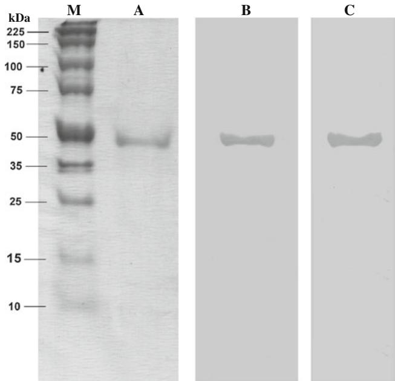
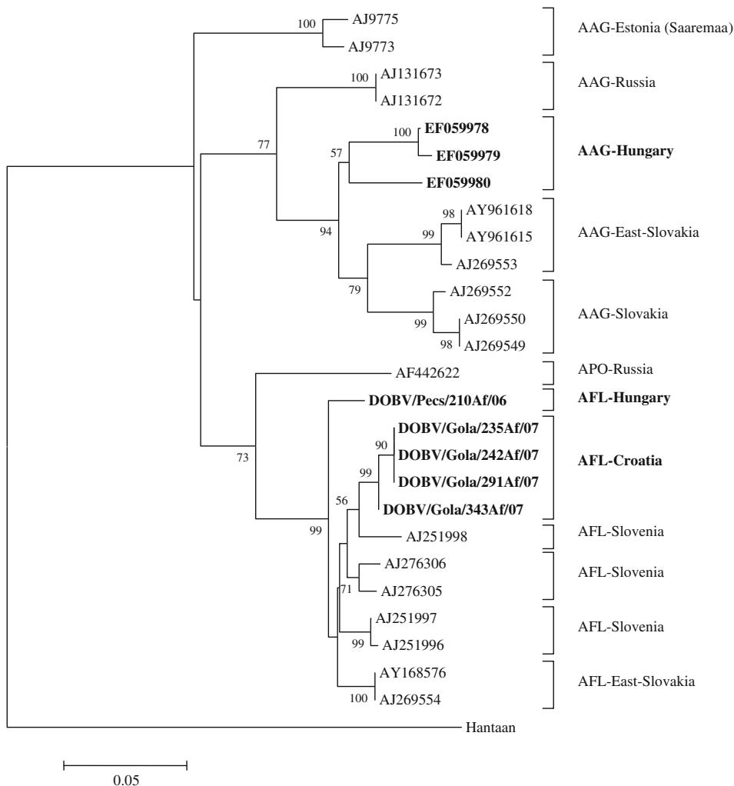
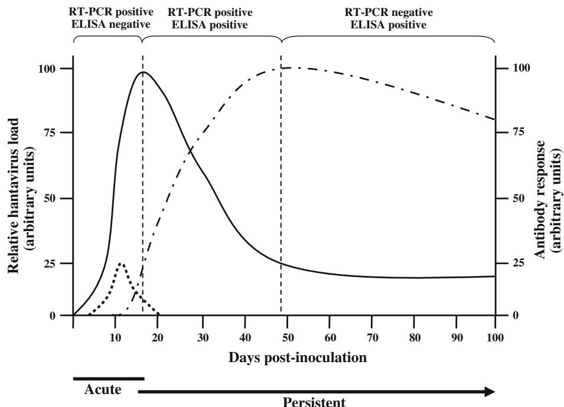

# Detection of Dobrava-Belgrade hantavirus using recombinantnucleocapsid-based enzyme-linked immunosorbent assay and SYBR Green-based real-time reverse transcriptasepolymerase chain reaction

Vikto´ria Ne´meth $\cdot$ Mo´nika Madai • Alexandra Mara´czi • Ba´lint Be´rczi $\cdot$ Gy}oz}o Horva´th $\cdot$ Miklo´ s Oldal • Pe´ter Kisfali $\cdot$ Krisztia´n Ba´nyai $\cdot$ Ferenc Jakab

Received: 18 January 2011 / Accepted: 27 April 2011 / Published online: 14 May 2011 $©$ Springer-Verlag 2011

Abstract Dobrava (DOBV) hantaviruses belong to the genus Hantavirus, family Bunyaviridae, and are carried by yellow-necked and striped field mice. The goal of this study was to detect DOBV using serological and genetic methods in Apodemus rodents in Hungary and in northern Croatia. During the study period, a total of 125 Apodemus sp. (67 A. agrarius, 58 A. flavicollis) were tested for the presence of hantaviruses, and 21 rodents $( 1 7 \% )$ were positive by rRT-PCR and/or ELISA. We conclude that the prevalence of DOBV is much higher than previously anticipated. The simultaneous use of molecular and serological techniques provides a highly reliable way to detect hantavirus infections.

V. Ne´meth - M. Madai $\cdot$ A. Mara´czi - B. Be´rczi - M. Oldal - F. Jakab $( \boxtimes )$ ) Virological Research Group, Faculty of Sciences, Institute of Biology, University of Pe´cs, Ifju´sa´g u´t 6, 7624 Pecs, Hungary e-mail: jakabf@gamma.ttk.pte.hu

F. Jakab Virological Laboratory, Department of Medical Microbiology and Immunology, Medical School, University of Pe´cs, Pecs, Hungary

G. Horva´th Department of Animal Ecology, Faculty of Sciences, Institute of Biology, University of Pe´cs, Pecs, Hungary

P. Kisfali Department of Medical Genetics, Medical School, University of Pe´cs, Pecs, Hungary

K. Ba´nyai Veterinary Medical Research Institute Hungarian Academy of Sciences, Budapest, Hungary

# Introduction

Hantaviruses (HTV, family Bunyaviridae, genus Hantavirus) are enveloped, negative-sense single-stranded RNA viruses that infect a variety of rodents. HTVs spread between rodents and humans through direct contact or by the aerosolized excreta (urine, feces and saliva) of infected animals. The clinical picture of hemorrhagic fever with renal syndrome (HFRS) and nephropathia epidemica (NE) occurs in several countries in Europe and Asia. In Europe, five major serotypes had been identified, i.e., Dobrava-Belgrade (DOBV), Puumala (PUUV), Saaremaa (SAAV), Seoul (SEOV) and Tula (TULV) viruses, with PUUV being the most common serotype, carried mainly by bank voles (Myodes glareolus). DOBV and SAAV are carried by yellow-necked (Apodemus flavicollis) and striped field (Apodemus agrarius) mice, respectively [3, 16, 18]. Previous epizootiological studies of small mammals captured in HFRS-endemic regions have suggested that shrews (order Soricomorpha, family Soricidae) and moles (family Talpidae) might also serve as reservoir hosts of HTVs [2, 6, 17]. For several years, there has been a disagreement regarding the taxonomy of DOBV hantaviruses. When SAAV was first identified [14], it was considered a genetic variant of DOBV. The International Committee on Taxonomy of Viruses (ICTV) declares that SAAV is a distinct virus species rather than a lineage of DOBV. However, it has been surmised that DOBV, which is one of the most common hantaviruses in central and southeastern Europe, has three characterized lineages according to their specific rodent hosts, Apodemus flavicollis, A. agrarius and A. ponticus. The corresponding virus lineages are proposed as DOBV-Af, DOBV-Aa, and DOBV-Ap, respectively [12, 13]. Hence, it might be assumed that not all A. agrariusassociated sequences detected in Central Europe are

necessarily closely related to SAAV. DOBV and PUUV are the two major serotypes circulating and causing human diseases in Hungary [5, 7, 8, 15]; however, Tula virus (TULV), Nova virus (NVAV) and Seewis virus (SWSV) have also been detected [9–11]. The aims of this study were to express a truncated form of DOBV nucleocapsid protein and using this recombinant antigen (in an ELISA) along with the SYBR Green-based real-time reverse transcription-polymerase chain reaction (rRT-PCR) method for detection of DOBV carried by Apodemus rodents in Hungary and northern Croatia.

# Materials and methods

Apodemus sp. were tested for the presence of hantavirus. As part of an ecological study run in parallel, animals were trapped in seven different locations of the Transdanubian region of Hungary (Somogy, Zala and Baranya Counties) and northern Croatia (near Gola and Beli Manastir villages), during the summer and autumn seasons of 2005-2007. Rodents were live-trapped; each capture trap was checked two times per day (evening and morning). Due to the ecological study, animals that perished naturally in the trap were used for the virology studies only. Animals were identified by an expert taxonomist and all data from the specimens were collected in a computer database.

Lung, kidney, spleen, liver and heart tissue samples of dissected rodents were removed and stored at ${ } _ { - 8 0 ^ { \circ } \mathrm { C } }$ . One hundred mg of lung tissues was suspended in $5 0 0 ~ \mu \mathrm { l }$ phosphate-buffered saline (PBS), and viral RNA was extracted from $1 5 0 ~ \mu \mathrm { l }$ of these supernatants using TRIzol Reagent (Invitrogen). rRT-PCR, sequencing and phylogenetic analysis were performed as described previously [7].

Based on the study previously published by Araki et al. [1], a truncated form of DOBV nucleocapsid protein (rNP50) was produced with an Escherichia coli expression system, using newly detected DOBV strain (DOB/Pe´cs/ 242Af/06). The part of the NP gene of this strain encoding amino acids 50 to 429 was amplified, and the fragment was then cloned into the $6 \times$ His-tagged prokaryotic expression vector pET28a (Novagene) following the manufacturer’s recommendations. E. coli BL21 Rosetta (DE3) pLysS competent cells were transformed with the recombinant pET28a-DOBV-rNP50 plasmid. Proteins were purified from the lysed BL21 cells using HIS Select HF Nickel Affinity Gel (Sigma). The concentration of the eluted protein was determined via spectrophotometry using the Bradford assay (Sigma) according to the manufacturer’s instructions.

In order to verify the protein activity, standard western blot (WB) analyses were performed using antibodies against $6 \times$ His-tag (Penta-His monoclonal antibody,

QIAGEN) and DOBV nucleoprotein protein collected from a DOBV-infected human patient (RG06).

Rodent blood samples were screened for the presence of antibodies against DOBV by standard indirect enzymelinked immunosorbent assay (ELISA) using rNP50 $( 0 . 5 ~ \mu \mathrm { g }$ per well) as antigen and HRP-conjugated goat anti-mouse (1:5000; Millipore) antibody as secondary antibody. Specimens were considered positive if the absorbance in the sample wells was equal to or greater than three times the mean value of that of a panel of negative control sera derived form the same species. In order to evaluate our ELISA method properly, specificity and sensitivity were determined. A commercially available DOBV- and Hantaan (HNTV)-specific ELISA (Reagena) was used as the reference detection method. Eight DOBV-IgG-positive and 42 HTV-negative serum samples collected previously from patients hospitalized with suspected HTV infection were randomly selected. All ELISAs carried out in order to calculate specificity and sensitivity were performed blinded by an independent person. The chi-squared test was used to analyze the results.

# Results

The truncated form of DOBV nucleocapsid protein (rNP50) was expressed in $E$ . coli and purified to a concentration of $0 . 5 ~ \mathrm { m g / m l }$ as described. Its molecular mass was estimated to be $4 9 \ \mathrm { k D a }$ , and in western blot tests, it reacted with the anti-6xHis monoclonal antibody as well as with polyclonal anti-DOBV antibodies (Fig. 1).

Using 50 sera, this IgG ELISA with DOBV rNP50 antigen was tested for sensitivity and specificity compared to a commercially available, licensed diagnostic ELISA test specific only for DOBV and HTNV. The commercially available ELISA test confirmed the previously positive and negative results; all eight serum samples were determined to be positive, while 42 serum samples proved to be negative. Seven out of the eight positive sera and only 1 of the 42 negative samples were found to be positive. Therefore, the specificity and sensitivity of the ELISA applying the purified nucleocapsid protein (rNP50) were determined and calculated to be $8 8 . 8 \%$ and $9 7 . 6 \%$ , respectively.

Of the 125 Apodemus mice (A. flavicollis, $\mathrm { n } = 5 8$ ; A. agrarius, $\mathrm { n } = 6 7$ ) $53 \%$ $( \boldsymbol { \mathrm { n } } = 6 6$ ) of the tested rodents were male, while $47 \%$ $( { \bf n } = 5 9 $ ) were female. Most animals $( 9 3 \% )$ were adult, but sub-adult $( 2 \% )$ and juvenile $( 5 \% )$ rodents were also captured. All animals were screened for antibodies against DOBV using recombinant nucleocapsid protein and for the presence of viral nucleic acid by rRT-PCR. The results, divided according to the country of rodent collection, are shown in Table 1. Twenty-one out of the 125 animals $1 0 A$ . agrarius and 11 A. flavicollis; $17 \%$

  
Fig. 1 PAGE and western blot analysis of DOBV rNP50 protein. rNP50 was separated by electrophoresis (Lane A) and blotted onto a nitrocellulose membrane. Blots were probed with antibodies against 6xHis-tag (Lane C), as well as with those specific for the DOBV nucleoprotein collected from a DOBV-infected human patient (Lane B).

of all) were positive by at least one of the methods used. Five animals $(4 \% )$ were positive by both rRT-PCR and ELISA; in five $(4 \% )$ , only viral nucleic acid was detected, while in 11 $( 8 . 8 \% )$ , only virus-specific antibodies were detected. Out of the 10 rRT-PCR-positive samples, eight were sequenced and subjected to phylogenetic analysis. Of the 21 positive small mammals, 13 $(62 \% )$ were male, and 8 $( 3 8 \% )$ were female, the difference between genders was significant $( \mathbf { p } < 0 . 0 1 $ ).

Although the analyzed region of the NP gene is relatively short, phylogenetic analysis (Fig. 2) showed that the Hungarian and Croatian DOBV strains were most closely related to HTVs detected in other Central European countries, especially in Slovakia and Slovenia. A. agrariusderived hantavirus detected in the southern part of the Transdanubian region (EF059980) were slightly different

from those viruses originated from the western part of the country (EF059978 and EF059979), with $94 \%$ homology and a phylogenetic distance of 0.058. Regarding the A. flavicollis-derived DOBV, the average homology and phylogenetic distance between these sequences were $96 \%$ and 0.033, respectively. DOBVs detected within Croatia were genetically closer to each other (homology: $9 9 . 5 \%$ phylogenetic distance: 0.006). In the phylogenetic tree, three separate branches could be distinguished according to their natural rodent host.

# Discussion

A truncated nucleocapsid protein, DOBV rNP50, expressed in E. coli, was used to detect antibodies against hantaviruses in rodents collected in Hungary and Croatia. A pET28a vector is a bacterial plasmid designed to enable the quick production of any protein in large quantities within a host cell. Using rNP50 in an ELISA system is not new, Araki et al. [1] previously expressed this protein in recombinant baculovirus. We only adopted their concept and optimized the expression in an E. coli system, which is more accessible for standard molecular biological or virological laboratories. They concluded that the first 49 amino acids at the N-terminal of the HTV NP contains immunodominant and linear epitopes. Truncated rNP lacking these amino acids is a useful protein for serotyping and for differentiating antibodies against DOBV, HNTV and SEOV [1]. The ELISA test we developed provided results comparable to those of a commercially available test for detecting DOBV-specific antibodies, with specificity and sensitivity as high as $8 8 . 8 \%$ and $9 7 . 6 \%$ , respectively. Based on these results, we surmise that the truncated form of the protein does not significantly decrease the sensitivity of the rNP50-based assay. Hence, the relatively high number of rRT-PCR-positive but ELISA-negative serum samples is not likely to be the result of the novel ELISA with lower sensitivity.

A total of 125 small mammals were tested using rRT-PCR and ELISA methods in order to detect DOBV in the

Table 1 Distribution of collected samples that were positive in RT-PCR and/or ELISA tests.   

<table><tr><td rowspan="3"></td><td colspan="4">Hungary</td><td colspan="4">Croatia</td></tr><tr><td colspan="2">AFL; n = 31</td><td colspan="2">AAG; n = 52</td><td colspan="2">AFL; n = 27</td><td colspan="2">AAG; n = 15</td></tr><tr><td>RT-PCR +</td><td>RT-PCR -</td><td>RT-PCR +</td><td>RT-PCR -</td><td>RT-PCR +</td><td>RT-PCR -</td><td>RT-PCR +</td><td>RT-PCR -</td></tr><tr><td>ELISA</td><td></td><td></td><td></td><td></td><td></td><td></td><td></td><td></td></tr><tr><td>+</td><td>0</td><td>1</td><td>3</td><td>6</td><td>2</td><td>3</td><td>0</td><td>1</td></tr><tr><td>-</td><td>2</td><td>28</td><td>0</td><td>43</td><td>3</td><td>19</td><td>0</td><td>14</td></tr></table>

AFL, Apodemus flavicollis; AAG, Apodemus agrarius

  
Fig. 2 Phylogenetic tree constructed with the MEGA v4 software using the neighborjoining algorithm and the maximum composite likelihood model based on a 327-bp-long nucleotide sequence of the S-segment. The number of bootstrap replications was 1000, and the analysis was performed rooted, using Hantaan virus as an outgroup. Hantavirus strains detected in Hungary and northern Croatia are marked in boldface. (Abbreviations: AFL: Apodemus flavicollis; AAG: Apodemus agrarius; APO: Apodemus ponticus)

South Transdanubian and North Croatian region. Based on these results showing discrepancies between serology and rRT-PCR, we conclude that it is necessary to use molecular and serological analyses in parallel to get a more accurate estimate of HTV incidence. In the majority of the previous studies, only serologically positive samples were further tested by molecular methods, likely causing the incidence of HTV to be underestimated. To explain the apparent discrepancies between the results of the serological and molecular approaches, we offer the following scenario: After infection, virus particles are present in the lung for about a two-week period (acute phase); i.e., a period in which PCR detection is the method to provide a reliable result (Fig. 3). It is likely, however, that immunological reactions do not produce a strong response in the acute phase, making ELISA tests frequently negative. During the first half of the persistent phase, however, antibody production increases. Although this is likely to be accompanied by a decreasing virus load in the lungs, it still might be sufficient for rRT-PCR detection. In the second half of the persistent phase, the number of virus particles can decrease below the threshold of detectability by PCR, whereas

antibody titers remain high [4]. Consequently, we surmise that there might be PCR-positive animals among the serologically negative ones in these previous studies as well.

On the other hand, the high prevalence of HTVs in the trapping area is only partly informative, since the data were collected in different seasons and locations during a threeyear period. However, it might be emphasized that a large number of HTV-infected rodents in the region may serve as important data, not only for researchers but also for physicians, due to the risk for human exposure.

With both A. agrarius and A. flavicollis being abundant species in Europe, and hence in Hungary, the higher prevalence of DOBV was expected in the area of the survey. In a recent paper, Plyusnina et al. [15] investigated the prevalence of DOBV, SAAV and PUUV in Hungary. Of the rodents, $1 0 . 5 \%$ were found to carry specific antibodies. Of the serologically positive animals, some were selected for further testing, and $1 . 6 \%$ were positive for hantavirus N-Ag and only $0 . 5 \%$ among these were positive by rRT-PCR. They estimated that the total positivity among Apodemus species is approximately $1 0 . 5 \%$ in Hungary. In contrast, all rodent specimens were tested in parallel in this

  
Fig. 3 Schematic representation of hantavirus infections in rodents. Figure adapted from Easterbrook et al. [4]. The solid line represents the kinetics of the relative hantavirus load in lung tissue, the dotted-dashed line represents the antibody (antihantavirus IgG) response during the acute and persistent phase of infection, while the dotted line represents the relative hantavirus load in the blood. Suggested detection methods in the different infection stages are indicated.

study by rRT-PCR and ELISA, and the prevalence was found to be considerably higher in the region $( 1 7 \% )$ . Furthermore, some differences between the results of the two studies might be attributed to the different detection methods, and/or the fact that rodent trapping was carried out in different locations and years (2000 vs. 2005-2007).

In the present study, we detect and estimate the prevalence of DOBV circulating among Apodemus mice in the Transdanubian region of Hungary and in northern Croatia, using serologic (ELISA) and molecular detection (rRT-PCR) methods. To our best knowledge, this is the first study in which recombinant-viral-protein-based ELISA was used to detect HTVs in rodent samples in Hungary and northern Croatia. Based on our results, we conclude that HTV infections might occur more often as expected before, and in order to survey HTV infections, it is necessary to use molecular and serological analyses in parallel.

Acknowledgment This study was supported by the Hungarian Scientific Research Fund (OTKA; PD77977) and Science, Please! Research Team on Innovation (SROP-4.2.2/08/1/2008-0011) project. The study was performed during the period of the ‘‘Bolyai Ja´nos’’ Research Fellowship of Ferenc Jakab and Krisztia´n Ba´nyai. We also would like to give special thanks to Dr. Em}oke Ferenczi and Kaposi Tama´sne´ (National Center for Epidemiology, Department of Viral Diagnostics, Reference Laboratory of Viral Zoonozes, Budapest, Hungary). We thank Tibor Pa´l for his comments and assistance in editing of the manuscript.

# References

1. Araki K, Yoshimatsu K, Ogino M, Ebihara H, Lundkvist A, Kariwa H, Takashima I, Arikawa J (2001) Truncated hantavirus

nucleokapsid proteins for serotyping Hantaan, Seoul, and Dobrava Hantavirus infections. J Clin Microbiol 39:2397–2404   
2. Clement J, McKenna P, Leirs H, Verhagen R, Lefevre A et al (1994) Hantavirus infections in rodents. In: Osterhaus A (ed) Virus infections of rodents and lagomorphs. Elsevier, Amsterdam, pp 295–316   
3. Clement J, Heyman P, Colson P, Groeneveld PH (1996) Spread of hantavirus infections in Europe. Lancet 347:771   
4. Easterbrook JD, Klein SL (2008) Immunological mechanisms mediating hantavirus persistence in rodent reservoirs. PLoS Pathog 4(11):e1000172   
5. Faludi G, Ferenczi E (1995) Serologically verified hantavirus infections in Hungary. Acta Microbiol Immunol Hung 42:419–426   
6. Gavrilovskaya IN, Apekina NS, Myasnikov YuA, Bernshtein AD, Ryltseva EV, Gorbachkova EA, Chumakov MP (1983) Features of circulation of hemorrhagic fever with renal syndrome (HFRS) virus among small mammals in the European USSR. Arch Virol 75:313–316   
7. Jakab F, Horva´th G, Ferenczi E, Seb}ok J, Varecza Z, Sz}ucs G (2007) Detection of Dobrava hantaviruses in Apodemus agrarius mice in the Transdanubian region of Hungary. Virus Res 128:149–152   
8. Jakab F, Seb}ok J, Ferenczi E, Horva´th G, Sz}ucs G (2007) First detection of Dobrava hantavirus from a patient with severe haemorrhagic fever with renal syndrome by SYBR Green-based real time RT-PCR. Scand J Infect Dis 39:902–906   
9. Jakab F, Horva´th G, Ferenczi E, Seb}ok J, Sz}ucs G (2008) First detection of Tula hantaviruses in Microtus arvalis voles in Hungary. Arch Virol 153:2093–2096   
10. Kang HJ, Arai S, Hope AG, Song JW, Cook JA, Yanagihara R (2009) Genetic diversity and phylogeography of Seewis virus in the Eurasian common shrew in Finland and Hungary. Virol J 6:208   
11. Kang HJ, Bennett SN, Sumibcay L, Arai S, Hope AG, Mocz G, Song JW, Cook JA, Yanagihara R (2009) Evolutionary insights from a genetically divergent hantavirus harbored by the European common mole (Talpa europaea). PLoS One 4(7):e6149   
12. Klempa B, Tkachenko EA, Dzagurova TK, Yunicheva YV, Morozov VG, Okulova NM, Slyusareva GP, Smirnov A, Kruger DH (2008) Hemorrhagic fever with renal syndrome caused by 2

lineages of Dobrava hantavirus, Russia. Emerg Infect Dis 14:617–625   
13. Maes P, Klempa B, Clement J, Matthijnssens J, Gajdusek DC, Kru¨ger DH, Van Ranst M (2009) A proposal for new criteria for the classification of hantaviruses, based on S and M segment protein sequences. Infect Genet Evol 9:813–820   
14. Nemirov K, Vapalathi O, Lundkvist A˚ , Vasilenco V, Golovljova I, Plyusnina A, Niemimaa J, Laakkinen J, Henttonen H, Vaheri A, Plyusnin A (1999) Isolation and characterisation of Dobrava hantavirus carried by the striped field mouse (Apodemus flavicollis) in Estonia. J Gen Virol 80:371–379   
15. Plyusnina A, Ferenczi E, Ra´cz RG, Nemirov K, Lundkvist A, Vaheri A, Vapalathi O, Plyusnin A (2009) Co-circulation of three pathogenic hantaviruses: Puumala, Dobrava, and Saaremaa in Hungary. J Med Virol 81:2045–2052

16. Sjo¨lander KB, Golovljova I, Vasilenko V, Plyusnin A, Lundkvist A (2002) Serological divergence of Dobrava and Saaremaa hantaviruses: evidence for two distinct serotypes. Epidemiol Infect 128:99–103   
17. Tkachenko EA, Ivanov AP, Donets MA, Miasnikov YA, Ryltseva EV, Gaponova LK, Bashkirtsev VN, Okulova NM, Drozdov SG, Slonova RA et al (1983) Potential reservoir and vectors of haemorrhagic fever with renal syndrome (HFRS) in the U.S.S.R. Ann Soc Belg Med Trop 63:267–269   
18. Vapalahti O, Mustonen J, Lundkvist A, Henttonen H, Plyusnin A, Vaheri A (2003) Hantavirus infections in Europe. Lancet Infect Dis 3:653–661