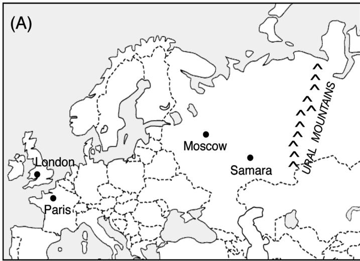
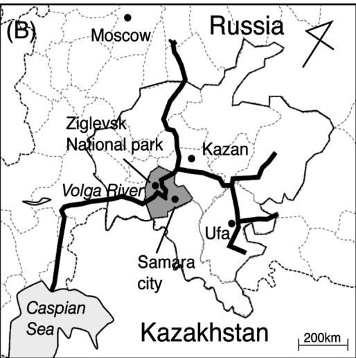
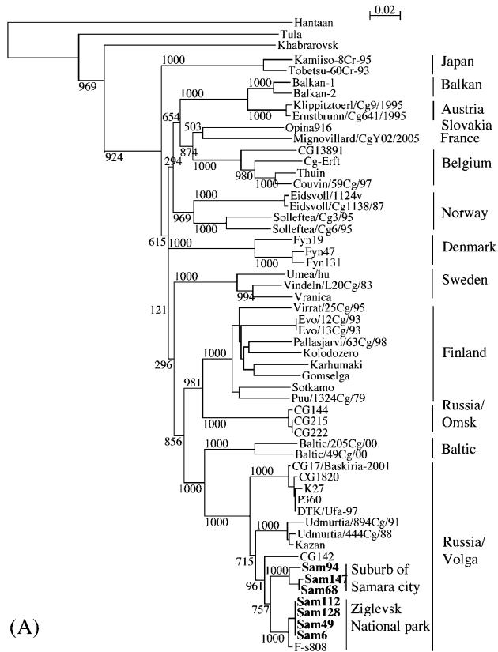
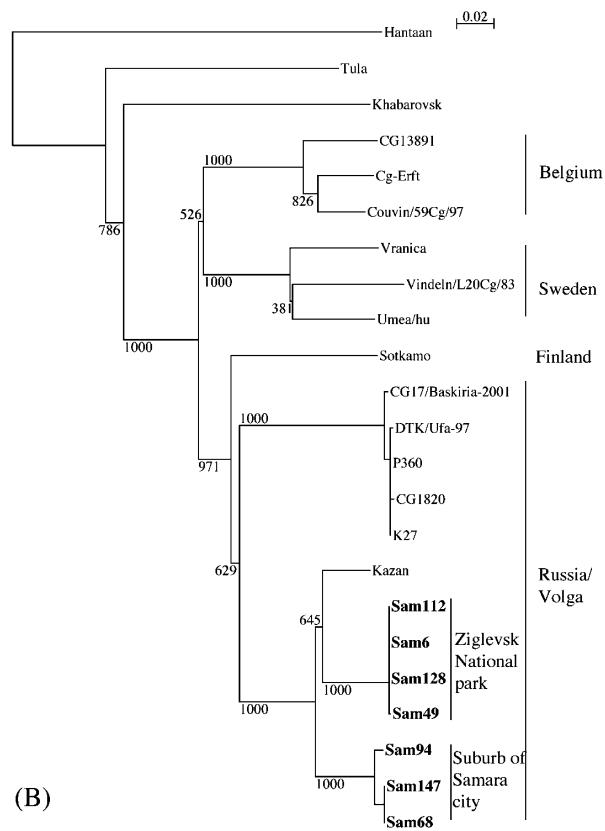
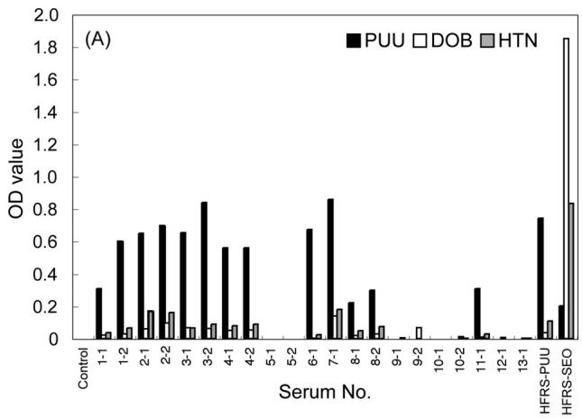
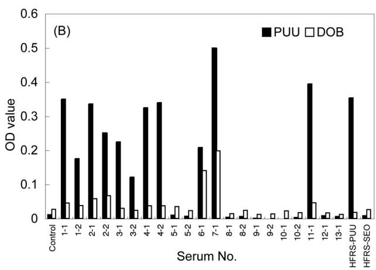

# Epidemiological Study of Hantavirus Infection in the Samara Region of European Russia

Hiroaki KARIWA1)*, Evgeniy A. TKACHENKO2), Vyacheslav G. MOROZOV3), Takahiro SETO1), Yoichi TANIKAWA1), Sergey I. KOLOMINOV3), Sergey N. BELOV3), Ichiro NAKAMURA4), Nobuo HASHIMOTO1), Alexander E. BALAKIEV2), Tamara K. DZAGURNOVA2), Nur Hardy bin Abu DAUD1), Daisuke MIYASHITA1), Olga A. MEDVEDKINA2), Mina NAKAUCHI1), Mariko ISHIZUKA1), Kentaro YOSHII1), Kumiko YOSHIMATSU5), Jiro ARIKAWA5) and Ikuo TAKASHIMA1)

1)Graduate School of Veterinary Medicine, Hokkaido University, Sapporo 060–0818, Japan, 2)Chumakov Institute of Polyomyelitis and Viral Encephalitidis, Moscow, 3)Medical Company “Hepatolog” Incorporated, Samara, Russia, 4)Research Center for Zoonosis Control and 5)Graduate School of Medicine, Hokkaido University, Sapporo 060–0818, Japan

(Received 29 May 2009/Accepted 7 August 2009)

ABSTRACT. European Russia is a highly endemic area of hemorrhagic fever with renal syndrome (HFRS), a rodent-borne zoonotic disease, caused by hantaviruses. In total, 145 small mammals of four species (Myodes glareolus, Apodemus flavicollis, A. agrarius, and A. uralensis) were trapped in the Samara region of European Russia in August 2005 and examined for the presence of hantavirus (HV). Anti-HV antibodies were found in six of 68 $( 8 . 8 \% )$ ) M. glareolus and in one of 19 $( 5 . 3 \% )$ ) A. flavicollis by indirect immunofluorescent antibody assay (IFA). The Puumala virus (PUUV), which is one of the hantavirus species, was detected in the lungs of seven M. glareolus by RT-PCR. The virus S-segment was extremely similar $9 6 . 2 \%$ to $9 9 . 3 \%$ ) to the sequence found in a fatal case of HFRS in the Samara region. Phylogenetic analyses of S and M segments showed that the Samara PUUVs form a cluster within the Russian Volga lineage and apparently differ from other European PUUVs. Anti-PUUV antibodies were found in blood sera from seven HFRS patients and from one undiagnosed patient from the Samara region, using IFA and an enzyme-linked immunosorbent assay (ELISA). These data suggest that the bank vole M. glareolus is a primary natural reservoir and vector for PUUV, which is the main causative agent of HFRS in humans in the Samara region.

KEY WORDS: epidemiology, hantavirus, hemorrhagic fever with renal syndrome, Puumala virus, rodents.

J. Vet. Med. Sci. 71(12): 1569–1578, 2009

Hantaviruses belong to the genus Hantavirus, within the family Bunyaviridae, and cause two forms of human illness. These zoonoses include hemorrhagic fever with renal syndrome (HFRS), which occurs in Asia and Europe and is caused by the Hantaan virus (HTNV), Seoul virus (SEOV), Puumala virus (PUUV), Dobrava-Belgrade virus (DOBV), and Amur virus (AMRV). The second form of illness is hantavirus (cardio) pulmonary syndrome (HPS), which occurs in the Americas and is caused by the Sin Nombre virus, Andes virus, and other hantaviruses [13, 28, 33]. Hantaviruses are transmitted by aerosolized excreta from their natural hosts, mainly rodents of the family Muridae. Particular hantavirus species are usually harbored by a single rodent species, or by a few closely related rodent species, which indicates co-evolution and co-speciation of hantaviruses with their hosts. The virus genome contains three segments of negative-stranded RNA: the large (L) segment encodes a viral RNA-dependent RNA polymerase, the medium (M) segment encodes a glycoprotein precursor, and the small (S) segment encodes a nucleocapsid protein (NP) [34].

In Russia, five viruses cause HFRS in humans: PUUV

and DOBV cause HFRS in European Russia [41], and HTNV, SEOV, and AMRV cause HFRS in Far Eastern Russia [16, 19, 38, 46]. Sporadic HFRS cases, caused by PUUV and DOBV, were recently detected in the western Siberian regions of Russia [45]. The principal hosts for HTNV, AMRV, SEOV, and PUUV are Apodemus agrarius, A. peninsulae, Rattus norvegicus, and Myodes glareolus, respectively. In Europe, detailed phylogenetic analyses show that the DOBV strains from A. flavicollis form a separate evolutionary lineage (DOBV-Af) while strains from A. agrarius show higher levels of diversity. Strains from central Europe and central European Russia form the DOBV-Aa lineage, which is distinct from the Saaremaa strains from northeastern Europe [9, 10]. In southern Russia (Sochi district), a new DOBV variant (DOBV-Ap) found in A. ponticus, a novel hantavirus natural host, was identified as the causative agent of HFRS [11, 42]. In European Russia and Europe, although the DOBV strains from different Apodemus hosts share high amino acid sequence similarity, they can be distinguished in phylogenetic analyses as distinct lineages and seem to possess different virulence in humans as well as in an animal model [12]. The novel DOBV-Ap lineage associated with A. ponticus, emerging in an area south of European Russia, confirms the reputation of DOBV as being the most virulent of the European hantaviruses [11]. Rather unusually for hantaviruses, DOBV has already been found in three different Apodemus species. In addition to DOBV,

  
Fig. 1. Map of the survey site. (A) European Russia and European countries. (B) Samara region in the Volga River area; Samara region.

other hantaviruses are also harbored by more than one host species, for example, the Tula virus, which is carried by Microtus arvalis, M. rossiaemeridionalis, and M. agrestis [29, 35, 36] and SEOV, carried by Rattus rattus and R. norvegicus [14].

In Russia, HFRS has the highest incidence and morbidity among zoonotic virus infections in humans. The disease has been recognized in Russia since 1930 and has been included in the official reporting system of the Russian Ministry of Public Health since 1978. Of HFRS cases, $9 7 \%$ have been registered in European Russia, while only $3 \%$ have been registered in Asian (Far Eastern) Russia [40]. The results of the comparative analyses of clinical data from more than 5,000 HFRS cases from seven different endemic foci, using a common scheme of criteria of severity, indicated that three hantaviruses in Far Eastern Russia (HTNV, SEOV, AMRV) and two hantaviruses in European Russia (PUUV and DOBV) can produce three clinical forms of the disease: mild, moderate, and severe [5, 15]. The rates of severe HFRS caused by HTNV and AMRV in the Far Eastern regions and the DOBV-Ap lineage in southern Russia are significantly higher than the rate of severe HFRS caused by the PUUV, SEOV, and DOB-Aa lineages (Central European Russia). Since HFRS in European Russia is caused by several hantaviruses and the severity varies a great deal, it is inappropriate to use the term “nephropathia epidemica” for the disease. The term HFRS was recommended by the World Health Organization (WHO) Working Group in 1983 to unify the different names of similar clinical diseases in Russia, Europe and Asia [44].

There are approximately 6000 to 8000 clinical cases of HFRS every year, scattered throughout European Russia, that are caused primarily by PUUV. However, the morbidity rates in different administrative regions vary considerably. The highest incidence of HFRS occurs annually in the Ural Mountains and Volga River areas, where there are nine

administrative regions with high HFRS morbidity in European Russia [40]. One of the regions in this territory is the Samara region, where we carried out an epizootiological and epidemiological survey in 2005. According to previous studies, most of the HFRS cases in this region seemed to be caused by PUUV infection. However, the characteristics of PUUVs in the region are not well documented and antibodies to HTNV were also detected in healthy blood donors in the region [1]. Therefore, the goals of this study were: (1) to investigate the epidemiological situationy of hantavirus infection both in rodents and humans in the Samara region; (2) to obtain genetic information for hantaviruses, and (3) to identify the epidemiological significance of rodent hosts and hantaviruses with respect to the morbidity of HFRS.

# MATERIALS AND METHODS

Rodent survey and human sera: For this study we conducted epizootiological survey targeting rodents. Animals were captured using snap traps that were located in forests near the Zigulevsk National Park, west of the Volga River, and in suburbs of the city of Samara in August 2005 (Fig. 1). Rodent blood samples were collected using filter paper. After complete drying, the filter paper was immersed in $1 0 \times$ the volume of phosphate-buffered saline (PBS) at $4 \mathrm { { } ^ { \circ } C }$ overnight. The eluted blood sample was heat-inactivated at $5 6 ^ { \circ } \mathrm { C }$ for $3 0 \ \mathrm { m i n }$ and centrifuged at $3 0 0 \times \mathrm { ~ g ~ }$ for 5 min. Thereafter, the supernatant was used as 1:10 diluted serum. The lungs, hearts, livers, kidneys, and spleens were collected from the captured rodents and stored at $- 8 0 ^ { \circ } \mathrm { C }$ until use. Human blood sera were obtained from clinically diagnosed HFRS patients and patients with high fever of unknown etiologies. Blood sera were stored at $- 8 0 ^ { \circ } \mathrm { C }$ until use.

Indirect immunofluorescent antibody assay (IFA): Antihantavirus antibodies in rodents and patients were detected

Table 1. Primers used for RT-PCR and sequencing of S and M genome segments of hantaviruses   

<table><tr><td>Virus</td><td>Gene</td><td>Primer name</td><td>Primer sequence</td><td>Position</td></tr><tr><td rowspan="12">Puumala</td><td rowspan="12">S</td><td>sotkamo62Fw</td><td>tccaagaggatataacccgccat</td><td>62–84</td></tr><tr><td>sotS172Fw</td><td>ctgcaagccaggcaacaaacagtgtcagca</td><td>172–201</td></tr><tr><td>sotS593Fw</td><td>ctcagtcccaccatgaag</td><td>593–609</td></tr><tr><td>ufa97S850Fw</td><td>aagccagaagttaaacct</td><td>850–867</td></tr><tr><td>samS1146Fw</td><td>atattgcgccggacacaatc</td><td>1146–1166</td></tr><tr><td>samS1286Fw</td><td>gtcactcatcgatcagaagg</td><td>1286–1305</td></tr><tr><td>samS1552Fw</td><td>caggaattactaatgacag</td><td>1552–1571</td></tr><tr><td>sotS537Rv</td><td>ctcaaatgatgtgtcatcc</td><td>537–519</td></tr><tr><td>sotS894Rv</td><td>gtctgccacatgattttgtcaagcacatc</td><td>894–865</td></tr><tr><td>samS1037Rv</td><td>aaytcagccatcccagcaac</td><td>1037–1018</td></tr><tr><td>samS1500Rv</td><td>gataataataattgtcaaaccccg</td><td>1500–1478</td></tr><tr><td>PUU1801SRv</td><td>atcagcatgttgaggttagta</td><td>1801–1782</td></tr><tr><td rowspan="11"></td><td rowspan="11">M</td><td>Ufa97M1789F</td><td>tctcaatccatctgaggcaacaac</td><td>1789–1812</td></tr><tr><td>sam94M2122f</td><td>gctatacatataggagacag</td><td>2122–2141</td></tr><tr><td>sam94M2546F</td><td>actacttcagtcaaagtgtg</td><td>2546–2565</td></tr><tr><td>sam94M2956F</td><td>gatttaagtgaacaccatgccca</td><td>2956–2978</td></tr><tr><td>sam94M3303F</td><td>tgatgatggtgcaccagag</td><td>3303–3321</td></tr><tr><td>sam94M2019R</td><td>gtctcagcactagcagcccatac</td><td>2019–1997</td></tr><tr><td>sam94M2317R</td><td>gcagtctgccaaggataagc</td><td>2317–2298</td></tr><tr><td>sam94M2478R</td><td>ctggtatatacctaaggacac</td><td>2478–2459</td></tr><tr><td>sam94M2885R</td><td>ctaatgcacttgcagatatg</td><td>2885–2866</td></tr><tr><td>sam94M3315R</td><td>tgtgtgcaccatcatcaaag</td><td>3315–3297</td></tr><tr><td>Ufa97M3654R</td><td>ccaggcataaatcgtatgggtaaa</td><td>3654–3631</td></tr><tr><td rowspan="2">Dobrava</td><td rowspan="2">S</td><td>DOBS84Fw</td><td>caattgtgtgatagccaggcagaagg</td><td>84–108</td></tr><tr><td>DOBS1012Rv</td><td>gccatgcctgcaatgaacaggcagg</td><td>1012–988</td></tr></table>

by IFA. Antigen slides were prepared using Vero E6 cells (ATCC No. CRL-1586) separately infected with the PUUV strain Sotkamo, the HTNV strain 76–118, and the SEOV strain SR-11. Serially diluted rodent blood sera (from 1:16 to 1:2048) were applied to the antigen slides which were then incubated at $3 7 ^ { \circ } \mathrm { C }$ for 1 hr. After three washes with PBS, Protein G Alexa Fluor® 488 conjugate (Invitrogen, Carlsbad, CA, U.S.A.) or Alexa Fluor® 488 Goat Anti-Mouse IgG (Invitrogen) was spotted on to the slides. After incubation at $3 7 ^ { \circ } \mathrm { C }$ for 1 hr, the slides were washed and observed by fluorescence microscopy. Scattered granular fluorescence in the cytoplasm of Vero E6 cells was considered as a positive reaction.

Enzyme-linked immunosorbent assay (ELISA): Anti-hantavirus IgG in patients was detected by ELISA [2, 20, 27]. Briefly, 96-well plates were coated with the monoclonal antibody (MAb) E5/G6 [26, 47] as a capture antibody and were treated with Block Ace (Dainippon Sumitomo Pharma Co., Ltd., Osaka, Japan) at $3 7 ^ { \circ } \mathrm { C }$ for 1 hr for blocking. The Baculovirus-expressed recombinant hantavirus NP of PUUV, DOBV, or HTNV [2, 20] was then added to the plates and incubated at room temperature for 1 hr. Sera from clinically diagnosed HFRS patients were diluted to 1:200, added to the plates, and incubated at room temperature for 1 hr. Alkaline phosphatase-conjugated anti-human IgG (Sigma-Aldrich Cooperation, St. Louis, MO) was diluted to $0 . 5 ~ \mu \mathrm { g } / \mathrm { m } l$ , added to the plates, and incubated at room temperature for 1 hr. Finally, p-nitrophenyl phosphate solution (Sigma-Aldrich) was added to the plates, which

were incubated at room temperature for $1 \ \mathrm { h r }$ , and absorbance values at $4 0 5 ~ \mathrm { n m }$ (A405) and $6 5 0 \ \mathrm { n m }$ (A650) were measured using a spectrophotometer. The IgG-ELISA value was expressed as the value of A405 minus A650. Between the steps of the ELISA assay, the plates were washed three times with PBS containing $0 . 0 5 \%$ Tween 20 (PBST).

Anti-hantavirus IgM in patient sera was detected by $\mu { }$ - capture ELISA. Briefly, 96-well plates were coated with goat-anti human IgM (MP Biomedicals United States, Solon, OH) as the capture antibody. After blocking, 1:200 diluted patient sera were added to the plates and incubated at room temperature for 1 hr. Recombinant NP proteins of PUUV, DOBV, and HTNV were then added to the plates and incubated at room temperature for 1 hr. Biotinylated E5/G6 mAb and peroxidase-conjugated streptavidin (Sigma-Aldrich) were applied consecutively and incubated at room temperature for 1 hr. Thereafter, $^ { 3 , 3 ^ { \circ } , 5 , 5 ^ { \circ } }$ -tetramethylbenzidine solution (Sigma-Aldrich) was added to the plates as a substrate. The colorimetric reaction was stopped by adding $5 0 ~ \mu l$ of 0.5 M $\mathrm { H } _ { 2 } \mathrm { S O } _ { 4 }$ . The IgM-ELISA value was calculated as described for the IgG-ELISA.

Reverse transcription-polymerase chain reaction (RT-PCR): Total RNA from the lung tissue of M. glareolus and A. flavicollis was extracted using ISOGEN (Nippon Gene Co., Ltd., Osaka, Japan). The RNA $( 5 \mu \mathrm { g } )$ was reverse-transcribed using 200 units of Superscript II RNase H-reverse transcriptase (Invitrogen Corporation) and $5 0 0 ~ n \mathbf { g }$ random primers (Invitrogen) according to the manufacturer’s

instructions. The S and M hantavirus segments were amplified by PCR using Platinum® Taq DNA polymerase High Fidelity (Invitrogen). The thermal conditions for PCR were $9 4 ^ { \circ } \mathrm { C }$ for 2 min, followed by 35 cycles of $9 4 ^ { \circ } \mathrm { C }$ for 30 sec, $5 0 \mathrm { { } ^ { \circ } C }$ to $6 0 ^ { \circ } \mathrm { C }$ (depending on the primers used) for 30 sec, and $6 8 ^ { \circ } \mathrm { C }$ for 2 min. The primers used for PCR are listed in Table 1. Primers SotS172Fw and SotS894Rv were used to detect PUUV, and DOBS84Fw and DOBS1012Rv were used to detect DOBV (Table 1).

Sequencing of hantavirus genome segments: The amplified DNA fragments were separated using the Wizard® SV Gel and PCR Clean-Up System (Promega, Madison, WI). The purified DNA fragments were sequenced using the Big Dye Terminator v1.1 Cycle Sequencing Kit (Applied Biosystems, Foster City, CA, U.S.A.) according to the manufacturer’s instructions. Primers used for amplification and sequencing are listed in Table 1.

Phylogenic analysis: The ClustalX version 1.83 (available from the URL: ftp://ftp.ebi.ac.uk/pub/software/ clustalw2) was used to generate the alignments, and phylogenetic trees were formed by the neighbor-joining method [39]. The reliability of the dendrogram was evaluated by 1,000 bootstrap replicates.

# RESULTS

Rodent survey: We carried out an epizootiological survey and captured 145 rodents in the Samara region. The rodent

species included 68 M. glareolus, 19 A. flavicollis, 21 A. agrarius, and 37 A. uralensis. Six M. glareolus $( 8 . 8 \% )$ and one A. flavicollis $( 5 . 3 \% )$ harbored anti-hantavirus antibodies (Table 2). No antibodies were detected in A. agrarius or A. uralensis. Antibody titers to PUUV, measured by IFA, in M. glareolus ranged from 1:256 to 1:1024, and showed titers more than two times higher than antibody titers to HTNV or SEOV. One A. flavicollis had antibodies to both HTNV and SEOV at 1:16 (Table 3) but was negative for PUUV. Total RNA samples extracted from the lungs of 68 M. glareolus and 19 A. flavicollis were subjected to RT-PCR. Hantavirus genes were detected in four seropositive, and three seronegative M. glareolus (Tables 2 and 3), whereas no hantavirus genes were detected in A. flavicollis.

Sequencing of hantavirus genes: Partial S- and M-segments were sequenced from RT-PCR-positive M. glareolus. The viruses carried by M. glareolus (animal numbers: 6, 49, 68, 94, 112, 128 and 147) were named Samara_6/CG/2005 (Sam6); Samara_49/CG/2005 (Sam49); Samara_68/CG/ 2 0 05 ( S a m 6 8) ; S a ma r a _ 9 4 /C G /2 0 0 5 ( Sa m 9 4 ) ; Samara_112/CG/2005 (Sam112); Samara_128/CG/2005 (Sam128) and Samara_147/CG/2005 (Sam147), respectively. The sequences determined and used in this study are listed in Table 4.

The S-segment sequences of viruses in the Samara region, which were similar to those of the PUUV strains Kazan, CG1820, and DTK/Ufa-97, identified near the Samara region within the Volga river area, demonstrated

Table 2. Detection of anti-hantavirus antibodies and virus RNA among captured rodents in the Samara region   

<table><tr><td>Rodent species</td><td>Number of rodents</td><td>Seroprevalence(%)</td><td>Detection rate of Virus RNA (%)\(^{a)}\)</td></tr><tr><td>M. glareolus</td><td>68</td><td>6/68 (8.8)</td><td>7/68 (10.1)</td></tr><tr><td>A. flavicollis</td><td>19</td><td>1/19 (5.3)</td><td>0/19 (0.0)</td></tr><tr><td>A. agrarius</td><td>21</td><td>0/21 (0)</td><td>\(\mathrm{ND}^{\text{b)}}\)</td></tr><tr><td>A. uralensis</td><td>37</td><td>0/37 (0)</td><td>ND</td></tr><tr><td>Total</td><td>145</td><td>7/145 (4.8)</td><td></td></tr></table>

a) Virus RNA was detected from rodent lungs by RT-PCR.   
b) ND: not done.

Table 3. Rodents with anti-hantavirus antibodies and virus RNA   

<table><tr><td rowspan="2">Rodent species</td><td rowspan="2">Point of capture</td><td rowspan="2">Animal No.</td><td colspan="3">IFA titer</td><td rowspan="2">Virus RNAa) RT-PCR</td></tr><tr><td>PUUV</td><td>HTNV</td><td>SEOV</td></tr><tr><td rowspan="9">M. glareolus</td><td rowspan="5">Suburb of Samara</td><td>66</td><td>256</td><td>&lt;16</td><td>&lt;16</td><td>-b)</td></tr><tr><td>137</td><td>512</td><td>256</td><td>128</td><td>-</td></tr><tr><td>68</td><td>1024</td><td>&lt;16</td><td>&lt;16</td><td>+c)</td></tr><tr><td>147</td><td>1024</td><td>64</td><td>64</td><td>+</td></tr><tr><td>94</td><td>&lt;16</td><td>&lt;16</td><td>&lt;16</td><td>+</td></tr><tr><td rowspan="4">Zigulevsk national park</td><td>6</td><td>&lt;16</td><td>&lt;16</td><td>&lt;16</td><td>+</td></tr><tr><td>49</td><td>&lt;16</td><td>&lt;16</td><td>&lt;16</td><td>+</td></tr><tr><td>112</td><td>512</td><td>64</td><td>64</td><td>+</td></tr><tr><td>128</td><td>256</td><td>&lt;16</td><td>&lt;16</td><td>+</td></tr><tr><td>A. flavicollis</td><td>Suburb of Samara</td><td>59</td><td>&lt;16</td><td>16</td><td>16</td><td>-</td></tr></table>

a) Virus RNA was detected from rodent lungs by RT-PCR. b) negative. c ) positive.

Table 4. Hantavirus sequences used in this study   

<table><tr><td rowspan="2">Virus name</td><td rowspan="2">Strain</td><td rowspan="2">Source</td><td rowspan="2">Country/ Region</td><td colspan="2">Accession No.</td></tr><tr><td>S segment</td><td>M segment</td></tr><tr><td>Hantaan</td><td>76–118</td><td>Apodemus</td><td>Korea</td><td>M14626</td><td>M14627</td></tr><tr><td>Tula</td><td>Moravia/5302v/95</td><td>Microtus arvalis</td><td>Czech Republic</td><td>Z69991</td><td>Z69993</td></tr><tr><td>Khabarovsk</td><td>Ls136V</td><td>Microtus fortis</td><td>Russia</td><td>AJ011646</td><td></td></tr><tr><td rowspan="2">Hokkaido</td><td>Kamiiso</td><td>Myodes rufocanus</td><td>Japan</td><td>AB010730</td><td></td></tr><tr><td>Tobetsu</td><td>M.rufocanus</td><td>Japan</td><td>AB010731</td><td></td></tr><tr><td rowspan="29">Puumala</td><td>Balkan-1</td><td>Myodes glareolus</td><td>Balkan</td><td>AJ314600</td><td></td></tr><tr><td>Balkan-2</td><td>M. glareolus</td><td>Balkan</td><td>AJ314601</td><td></td></tr><tr><td>Klippitztoerl</td><td>M. glareolus</td><td>Austria</td><td>AJ888751</td><td></td></tr><tr><td>Ernstbrunn</td><td>M. glareolus</td><td>Austria</td><td>AJ888752</td><td></td></tr><tr><td>Opina</td><td>M. glareolus</td><td>Slovakia</td><td>AF294652</td><td></td></tr><tr><td>Mignovillard</td><td>M. glareolus</td><td>France</td><td>AM695638</td><td></td></tr><tr><td>CG13891</td><td>M. glareolus</td><td>Belgium</td><td>U22423</td><td>U22418</td></tr><tr><td>Cg-Erft</td><td>M. glareolus</td><td>Belgium</td><td>AJ238779</td><td>AJ238778</td></tr><tr><td>Thuin</td><td>M. glareolus</td><td>Belgium</td><td>AJ277030</td><td></td></tr><tr><td>Couvin</td><td>M. glareolus</td><td>Belgium</td><td>AJ277034</td><td>AJ277040</td></tr><tr><td rowspan="2">Eidsvoll</td><td>M. glareolus</td><td>Norway</td><td>AJ223368</td><td></td></tr><tr><td>M. glareolus</td><td>Norway</td><td>AJ223369</td><td></td></tr><tr><td rowspan="2">Solleftea</td><td>M. glareolus</td><td>Norway</td><td>AJ223376</td><td></td></tr><tr><td>M. glareolus</td><td>Norway</td><td>AJ223377</td><td></td></tr><tr><td rowspan="3">Fin</td><td>M. glareolus</td><td>Denmark</td><td>AJ238791</td><td></td></tr><tr><td>M. glareolus</td><td>Denmark</td><td>AJ278092</td><td></td></tr><tr><td>M. glareolus</td><td>Denmark</td><td>AJ278093</td><td></td></tr><tr><td>Umea/hu</td><td>HFRS patient</td><td>Sweden</td><td>AY526219</td><td>AY526218</td></tr><tr><td>Vindeln</td><td>M. glareolus</td><td>Sweden</td><td>Z48586</td><td>Z49214</td></tr><tr><td>Vranica</td><td>M. glareolus</td><td>Sweden</td><td>U14137</td><td>U14136</td></tr><tr><td>Virrat</td><td>M. glareolus</td><td>Finland</td><td>Z69985</td><td></td></tr><tr><td rowspan="2">Evo</td><td>M. glareolus</td><td>Finland</td><td>Z30702</td><td></td></tr><tr><td>M. glareolus</td><td>Finland</td><td>Z30703</td><td></td></tr><tr><td>Pallasjarvi</td><td>M. glareolus</td><td>Finland</td><td>AJ314597</td><td></td></tr><tr><td>Kolodozero</td><td>M. glareolus</td><td>Finland</td><td>AJ238789</td><td></td></tr><tr><td>Karhumaki</td><td>M. glareolus</td><td>Finland</td><td>AJ238788</td><td></td></tr><tr><td>Gomselga</td><td>M. glareolus</td><td>Finland</td><td>AJ238790</td><td></td></tr><tr><td>Sotkamo</td><td>M. glareolus</td><td>Finland</td><td>X61035</td><td>X61034</td></tr><tr><td>1324Cg/79</td><td>M. glareolus</td><td>Finland</td><td>Z46942</td><td></td></tr></table>

$94 \%$ to $9 5 \%$ nucleotide similarity identity and $9 8 \%$ similarity identity in the deduced amino acid sequences (Table 5). The homology identities of the nucleotide and amino acid sequences between the viruses in the Samara and Scandinavian PUUVs (strains Sotkamo and Umea/Hu) were $8 5 \%$ and $9 6 \%$ , respectively.

In addition, comparisons of S-segments between sequences identified from the Zigulevsk National Park (Sam6, Sam49, Sam112, and Sam128) and F-s808, which was detected from a fatal case of HFRS in the Samara region, showed $9 9 . 3 \%$ and $1 0 0 . 0 \%$ homology at the nucleotide and amino acid levels, respectively (Table 5).

Phylogenetic analysis: Phylogenetic analyses of hantavirus S- and M-segments were performed (Fig. 2). The result clearly indicated that the hantaviruses detected in M. glareolus belong to the Volga River area lineage of PUUV. This lineage consists of viruses originating from the Samara region (Sam6, Sam49, Sam68, Sam94, Sam112, Sam128, Sam147, F-s808); Tatarstan (Kazan); Bashkortostan (CG17/

Bashkiria-2001, CG1820, K27, DTK/Ufa-97); Saratov (P360) and Udmurt (Udmurtia/894Cg/91, Udmurtia/444Cg/ 88). They occupied one cluster and were distant from the viruses derived from other Russian regions (such as Omsk) and European countries (Fig. 2). The virus clusters were formed according to the geographical origin of the viruses.

Serological analysis of patient sera: To examine the causative agents of HFRS, serological analyses were performed on 12 blood sera from seven patients from the Samara region who were clinically diagnosed with HFRS, as well as on nine sera from six patients with high fevers of unknown etiologies. Reactivities of sera to PUUV, SEOV, and HTNV were analyzed by IFA (Table 6). Sera from six HFRS patients (Patients 1, 2, 3, 4, 6, and 7) and from one of the unknown fever patients (Patient 11) contained anti-hantavirus antibodies. In all positive sera, IFA titers to PUUV were at least 16 times higher than titers to SEOV and HTNV. In patient numbers 1, 2 and 3, titers of convalescent sera to PUUV were higher than those of acute phase sera

Table 4. continued. Hantavirus sequences used in this study   

<table><tr><td rowspan="2">Virus name</td><td rowspan="2">Strain</td><td rowspan="2">Source</td><td rowspan="2">Country/Oblast/Region</td><td colspan="2">Accession No.</td></tr><tr><td>S segment</td><td>M segment</td></tr><tr><td rowspan="21">Puumala</td><td>CG144</td><td>M. glareolus</td><td>Russia/ Omsk</td><td>AF367064</td><td></td></tr><tr><td>CG215</td><td>M. glareolus</td><td>Russia/ Omsk</td><td>AF367066</td><td></td></tr><tr><td>CG222</td><td>M. glareolus</td><td>Russia/ Omsk</td><td>AF360067</td><td></td></tr><tr><td rowspan="2">Baltic</td><td>M. glareolus</td><td>Baltic</td><td>AJ314598</td><td></td></tr><tr><td>M. glareolus</td><td>Baltic</td><td>AJ314599</td><td></td></tr><tr><td>CG17</td><td>M. glareolus</td><td>Russia/ Bashkortostan</td><td>AF442613</td><td>AF442614</td></tr><tr><td>CG1820</td><td>M. glareolus</td><td>Russia/ Bashkortostan</td><td>M32750</td><td>M29979</td></tr><tr><td>K27</td><td></td><td>Russia/ Bashkortostan</td><td>L08804</td><td>L08754</td></tr><tr><td>P360</td><td></td><td>Russia/ Bashkortostan</td><td>L11347</td><td>L08755</td></tr><tr><td>DTK/Ufa-97</td><td>HFRS patient</td><td>Russia/ Bashkortostan</td><td>AB297665</td><td>AB297666</td></tr><tr><td rowspan="2">Udmurtia</td><td>M. glareolus</td><td>Russia/Udmurt</td><td>Z21497</td><td></td></tr><tr><td>M. glareolus</td><td>Russia/Udmurt</td><td>Z30706</td><td></td></tr><tr><td>Kazan</td><td>M. glareolus</td><td>Russia/ Tatarstan</td><td>Z84204</td><td>Z84205</td></tr><tr><td>Samara_6/ CG/2005</td><td>M. glareolus</td><td>Russia/Samara Zigulevsk</td><td>AB433842</td><td>AB433849</td></tr><tr><td>Samara_49/ CG/2005</td><td>M. glareolus</td><td>Russia/Samara Zigulevsk</td><td>AB433843</td><td>AB433850</td></tr><tr><td>Samara_112/CG/2005</td><td>M. glareolus</td><td>Russia/Samara Zigulevsk</td><td>AB433846</td><td>AB433853</td></tr><tr><td>Samara_128/CG/2005</td><td>M. glareolus</td><td>Russia/Samara Zigulevsk</td><td>AB433845</td><td>AB433852</td></tr><tr><td>Samara_68/ CG/2005</td><td>M. glareolus</td><td>Russia/Samara city</td><td>AB433844</td><td>AB433851</td></tr><tr><td>Samara_94/ CG/2005</td><td>M. glareolus</td><td>Russia/Samara city</td><td>AB433847</td><td>AB433854</td></tr><tr><td>Samara_147/CG/2005</td><td>M. glareolus</td><td>Russia/Samara city</td><td>AB433848</td><td>AB433855</td></tr><tr><td>F-s808</td><td>HFRS patient</td><td>Russia/Samara city</td><td>AF411446</td><td></td></tr></table>

Table 5. Comparison of nucleotide (nt 85 to 1238) and amino acid (aa 15 to 403) sequences of the S segment among hantaviruses   

<table><tr><td rowspan="3"></td><td colspan="12">Identities of nucleotide and amino acid (%)a)</td></tr><tr><td colspan="9">Puumala</td><td>Dobrava</td><td>Hantaan</td><td>76-118</td></tr><tr><td>Zigulevskb)</td><td>Sam68c)</td><td>Sam94d)</td><td>Sam147e)</td><td>F-s808</td><td>Kazan</td><td>CG1820</td><td>Ufa97</td><td>Sotkamo</td><td>Umea/hu</td><td></td><td></td></tr><tr><td>Zigulevsk</td><td>-</td><td>96.5</td><td>96.7</td><td>96</td><td>99.3f)</td><td>95.1</td><td>94.2</td><td>94.3</td><td>85.5</td><td>84.5</td><td>62.8</td><td>62.2</td></tr><tr><td>Sam68</td><td>99.7</td><td>-</td><td>98.7</td><td>99.5</td><td>96.7</td><td>94.8</td><td>93.5</td><td>93.6</td><td>85.5</td><td>84.6</td><td>62.6</td><td>62.8</td></tr><tr><td>Sam94</td><td>99.3</td><td>99.2</td><td>-</td><td>98.2</td><td>96.7</td><td>94.9</td><td>93.5</td><td>93.6</td><td>85.6</td><td>84.4</td><td>63.4</td><td>62.3</td></tr><tr><td>Sam147</td><td>98.7</td><td>99</td><td>98.2</td><td>-</td><td>96.2</td><td>95.2</td><td>94.1</td><td>94.2</td><td>85.2</td><td>84.2</td><td>62.6</td><td>62.9</td></tr><tr><td>F-s808</td><td>100</td><td>99.7</td><td>99.3</td><td>98.7</td><td>-</td><td>95.4</td><td>94.3</td><td>94.4</td><td>85.7</td><td>84.9</td><td>61.8</td><td>61.7</td></tr><tr><td>Kazan</td><td>99.1</td><td>98.7</td><td>98.4</td><td>97.7</td><td>99</td><td>-</td><td>94.3</td><td>94.4</td><td>85.3</td><td>84.2</td><td>63</td><td>62.4</td></tr><tr><td>CG1820</td><td>99.1</td><td>98.7</td><td>98.4</td><td>97.7</td><td>99</td><td>98.6</td><td>-</td><td>99.8</td><td>85.6</td><td>84</td><td>62.7</td><td>62.3</td></tr><tr><td>Ufa97</td><td>99.3</td><td>98.7</td><td>98.6</td><td>97.7</td><td>99.3</td><td>98.8</td><td>99.3</td><td>-</td><td>85.6</td><td>84.1</td><td>62.6</td><td>62.2</td></tr><tr><td>Sotkamo</td><td>96.8</td><td>96.7</td><td>96.1</td><td>96.4</td><td>96.8</td><td>96.8</td><td>96.3</td><td>96.5</td><td>-</td><td>85.5</td><td>63.4</td><td>62.7</td></tr><tr><td>Umea/hu</td><td>96.3</td><td>96.4</td><td>95.6</td><td>95.9</td><td>96.5</td><td>96.3</td><td>95.8</td><td>96.1</td><td>96.5</td><td>-</td><td>63.2</td><td>61.3</td></tr><tr><td>Dobrava</td><td>61</td><td>61.6</td><td>60.3</td><td>60.6</td><td>58.6</td><td>60.5</td><td>60.5</td><td>60.5</td><td>61.2</td><td>60.7</td><td>-</td><td>74</td></tr><tr><td>Hantaan</td><td>61.4</td><td>60.2</td><td>60.7</td><td>59.6</td><td>59.3</td><td>61.2</td><td>61</td><td>61</td><td>60.7</td><td>60.7</td><td>83</td><td>-</td></tr></table>

a) Values to the right above the diagonal show nucleotide identities; those to the left below the diagonal show amino acid identities.   
b) Zigulevsk; Samara_6/CG/2005, Samara_49/CG/2005, Samara_112/CG/2005 and Samara_128/CG/2005 (the same sequence).   
c) Samara_68/CG/2005.   
d) Samara_94/CG/2005.   
e) Samara_147/CG/2005.   
f) Values in bold show the identities between the F-s808 and PUUVs detected from M. glareolus in Zigulevsk National Park

(Table 6). However, no PUUV genes were detected in the sera of HFRS patients by RT-PCR (Table 6). ELISA was also used to perform serological analysis using baculovirusexpressed NPs of HTNV, DOBV, and PUUV. All IFA-positive sera had at least two times higher IgG-ELISA values to PUUV than to DOBV or HTNV (Fig. 3A). IgM-ELISA values of the patients also showed the same reactive patterns as IgG-ELISA values (Fig. 3B).

# DISCUSSION

The purpose of this study was to investigate the characteristics and ecology of hantaviruses in European Russia. There is an urgent need for clear information concerning the circulation and maintenance of hantaviruses in nature, their association with specific rodent reservoir hosts, and their contribution to HFRS morbidity. The majority of HFRS cases in European Russia are caused by PUUV, with only rare cases caused by DOBV. Human epidemics are charac-

  
Fig. 2. Hantavirus phylogenetic trees. Hantavirus sequences were aligned using Clustal X, and the phylogenetic trees were generated using the neighbor-joining method. The reliability of the dendrogram was evaluated by 1,000 bootstrap replicates. (A) Phylogenetic tree of hantavirus partial S-segments (nts 85 to 1238). (B) Phylogenetic tree of hantavirus partial M-segments (nts 2484 to 3494).

terized by outbreaks with a frequency of three to four years. The primary determinative factor that influences HFRS epidemics in humans is the periodical and massive reproduction of rodents, together with the development of epizootics in their expanding populations [40].

The results of our study show that PUUV is the major causative agent of HFRS in the Samara region and that M. glareolus plays an important role as the reservoir animal in this area. In addition, anti-hantavirus antibodies were detected in one A. flavicollis with low titers to HTNV and SEOV but not to PUUV. However, no viral genes were detected in A. flavicollis. Further investigation is needed to determine whether DOBV or DOB-related viruses circulate among the A. flavicollis population in the Samara region.

Although serum samples were limited, the serological analyses of HFRS patients suggested that PUUV is the major cause of HFRS cases in the Samara region. This observation strongly supports previous findings [21, 25, 43]. The virus sequences of Sam6, Sam49, Sam112, and Sam128 identified in M. glareolus at Zigulevsk National Park were almost identical to PUUV from a fatal case of HFRS that occurred in the Samara region. Therefore, it is highly possible that M. glareolus in Samara carries PUUV, which causes severe HFRS. Further characterization of the viruses in the

Samara region is required to elucidate the pathogenicity of PUUV.

Nucleotide sequence comparisons revealed that the viruses in the Samara region are similar to the PUUV strains Kazan, CG1820, and DTK/Ufa-97 that were isolated near the Samara region within the Volga River area. In addition, phylogenetic analysis clearly demonstrated the presence of PUUVs in the Samara region; viruses originating from the Volga River area occupied one cluster and were distant from European PUUVs. Viruses of Russian origin formed several separate lineages such as those found in Omsk and in the Volga River area. These findings provide insight towards understanding the evolution of PUUV [4, 22, 37].

PUUV is the most common cause of HFRS in Europe and is harbored by the bank vole (M. glareolus), which is found in most of Europe. Genetic analyses of strains from the Baltic countries, Austria, Slovakia, France, Belgium, Norway, Denmark, Sweden, Finland, Germany, and Russia have shown PUUV to be the most variable of the hantavirus species; genetic diversity at the nucleotide level reaches $20 \%$ and $1 7 \%$ for the coding regions of the M- and S-segments, respectively, and reaches even higher values $3 7 \%$ and $30 \%$ ) for their $_ { 3 } \cdot$ -noncoding regions [6, 8, 17, 18, 29, 32].

Interestingly, PUUV strains from the Omsk region (west-

Table 6. Detection of anti-hantavirus antibodies in HFRS patients and patients with high fever of unknown etiology   

<table><tr><td rowspan="2">Patient No.</td><td rowspan="2">Serum No.</td><td rowspan="2">Age</td><td rowspan="2">Diagnosis</td><td rowspan="2">Days after onset</td><td colspan="3">IFA titer</td><td rowspan="2">PCR</td></tr><tr><td>PUUV</td><td>SEOV</td><td>HTNV</td></tr><tr><td>1</td><td>1-1</td><td>43</td><td>HFRS</td><td>6</td><td>256</td><td>&lt;32</td><td>&lt;32</td><td>\( -^a \)</td></tr><tr><td></td><td>1-2</td><td></td><td></td><td>20</td><td>512</td><td>&lt;32</td><td>&lt;32</td><td>\( ND^b \)</td></tr><tr><td>2</td><td>2-1</td><td>58</td><td>HFRS</td><td>14</td><td>1024</td><td>&lt;32</td><td>&lt;32</td><td>-</td></tr><tr><td></td><td>2-2</td><td></td><td></td><td>19</td><td>2048≤</td><td>&lt;32</td><td>&lt;32</td><td>ND</td></tr><tr><td>3</td><td>3-1</td><td>44</td><td>HFRS</td><td>6</td><td>512</td><td>&lt;32</td><td>&lt;32</td><td>-</td></tr><tr><td></td><td>3-2</td><td></td><td></td><td>26</td><td>2048≤</td><td>&lt;32</td><td>&lt;32</td><td>ND</td></tr><tr><td>4</td><td>4-1</td><td>16</td><td>HFRS</td><td>7</td><td>256</td><td>&lt;32</td><td>&lt;32</td><td>-</td></tr><tr><td></td><td>4-2</td><td></td><td></td><td>10</td><td>256</td><td>&lt;32</td><td>&lt;32</td><td>ND</td></tr><tr><td>5</td><td>5-1</td><td>18</td><td>HFRS</td><td>1</td><td>&lt;32</td><td>&lt;32</td><td>&lt;32</td><td>-</td></tr><tr><td></td><td>5-2</td><td></td><td></td><td>6</td><td>&lt;32</td><td>&lt;32</td><td>&lt;32</td><td>ND</td></tr><tr><td>6</td><td>6-1</td><td>29</td><td>HFRS</td><td>10</td><td>1024</td><td>&lt;32</td><td>&lt;32</td><td>-</td></tr><tr><td>7</td><td>7-1</td><td>38</td><td>HFRS</td><td>8</td><td>2048≤</td><td>&lt;32</td><td>&lt;32</td><td>-</td></tr><tr><td>8</td><td>8-1</td><td>44</td><td>Unknown</td><td>4</td><td>&lt;32</td><td>&lt;32</td><td>&lt;32</td><td>-</td></tr><tr><td></td><td>8-2</td><td></td><td></td><td>12</td><td>&lt;32</td><td>&lt;32</td><td>&lt;32</td><td>ND</td></tr><tr><td>9</td><td>9-1</td><td>21</td><td>Unknown</td><td>5</td><td>&lt;32</td><td>&lt;32</td><td>&lt;32</td><td>-</td></tr><tr><td></td><td>9-2</td><td></td><td></td><td>8</td><td>&lt;32</td><td>&lt;32</td><td>&lt;32</td><td>ND</td></tr><tr><td>10</td><td>10-1</td><td>52</td><td>Unknown</td><td>8</td><td>&lt;32</td><td>&lt;32</td><td>&lt;32</td><td>-</td></tr><tr><td></td><td>10-2</td><td></td><td></td><td>11</td><td>&lt;32</td><td>&lt;32</td><td>&lt;32</td><td>ND</td></tr><tr><td>11</td><td>11-1</td><td>28</td><td>Unknown</td><td>7</td><td>256</td><td>&lt;32</td><td>&lt;32</td><td>-</td></tr><tr><td>12</td><td>12-1</td><td>28</td><td>Unknown</td><td>Unknown</td><td>&lt;32</td><td>&lt;32</td><td>&lt;32</td><td>-</td></tr><tr><td>13</td><td>13-1</td><td>35</td><td>Unknown</td><td>5</td><td>&lt;32</td><td>&lt;32</td><td>&lt;32</td><td>-</td></tr></table>

a) –: negative.   
b) ND: not done

  
Fig. 3. Detection of anti-hantavirus antibodies in HFRS patients and patients with high fevers of unknown etiologies by ELISA. Baculovirus-expressed hantavirus nucleocapsid proteins (NPs) were used as the antigens. PUU: full length NP of PUUV; DOB: full length NP of DOBV; HTN: full length NP of HTNV; Control: Normal human serum; HFRS-PUU: PUUV-infected HFRS patient serum; HFRS-SEO: SEOV-infected HFRS patient serum. (A) Detection of anti-hantavirus IgG. (B) Detection of anti-hantavirus IgM.

ern Siberia) are more closely related to Finish strains than to the Russian strains isolated from geographically closer regions (e.g., Ufa, Kazan, Udmurtia, or Samara) [4].

Closely related sublineages of PUUV were found in samples obtained from near and distant geographical locations of Russia [4, 7, 23, 24,]. According to a theory proposed by

Plyusnin et al. [30,31], the extent of hantavirus diversity is proportional to the geographic distance between the areas of their circulation. However, while the microgeographical relationships among hantaviruses might be linearly proportional, the macrogeographical relationships are likely to be more complex. The macrogeographical evolution of hantaviruses might be significantly biased by distant migrations of animals, especially ones that occurred during the several interglacial epochs [3, 4].

The results obtained in this study further characterize the public health threat caused by PUUV infection in the high HFRS epidemic area of European Russia. The information obtained in this study is quite valuable to prevent HFRS by avoiding contacts to M. glareolus and is also quite important to understand the significance of the vaccine development to PUUV infections in European Russia.

ACKNOWLEGMENTS. We thank all of the people who worked with us in the field in the Samara region for helping with rodent trapping and for supporting the survey. This study was financially supported by Grants-in Aid for Scientific Research (B)(1) from the Ministry of Education, Culture, Sports, Science, and Technology of Japan (MEXT), Special Coordination Funds for Promoting Science and Technology from MEXT, a Grant for Research on Emerging and Re-emerging Infectious Diseases from the Ministry of Health, Welfare, and Labor of Japan, and a Grant from the Program of Excellence for Zoonosis Control, 21st Century COE Program, Hokkaido University.

# REFERENCES

1. Alexeyev, O. A., Elgh, F., Zhestkov, A. V., Wadell, G. and Juto, P. 1996. Hantaan and Puumala virus antibodies in blood donors in Samara, an HFRS-endemic region in European Russia. Lancet 347: 1483.   
2. Araki, K., Yoshimatsu, K., Ogino, M., Ebihara, H., Lundkvist A., Kariwa, H., Takashima, I. and Arikawa, J. 2001. Truncated hantavirus nucleocapsid proteins for serotyping Hantaan, Seoul, and Dobrava hantavirus infections. J. Clin. Microbiol. 39: 2397–2404.   
3. Asikainen, K., Hanninen, T., Henttonen, H., Niemimaa, J.,Laakkonen, J., Andersen, H. K., Bille, N., Leirs, H., Vaheri, A. and Plyusnin, A. 2000. Molecular evolution of puumala hantavirus in Fennoscandia: Phylogenetic analysis of strains from two recolonization routes, Karelia and Denmark. J. Gen. Virol. 81: 2833–2841.   
4. Dekonenko, A., Yakimenko, V., Ivanov, A., Morozov, V., Nikitin, P., Khasanova, S., Dzagurova, T., Tkachenko, E. and Schmaljohn, C.2003. Genetic similarity of Puumala viruses found in Finland and western Siberia and of the mitochondrial DNA of their rodent hosts suggests a common evolutionary origin. Infect. Genet. Evol. 3: 245–257.   
5. Dzagurova, T. K., Tkachenko, E. A., Iunicheva, IuV., Morozov, V. G., Briukhanov, A. F., Bashkirtsev, V. N., Sedova, N. S., Klempa, B. and Kruger, D. 2008. Discovery, clinical and etiological characteristic of HFRS in subtropical zone of Krasnodar region (in Russian). Zh. Mikrobiol. Epidemiol. Immunobiol. 1: 12–16.   
6. Hörling, J., Lundkvist, A., Jaarola, M., Plyusnin, A., Tegel-

ström, H., Persson, K., Lehväslaiho, H., Hörnfeldt, B., Vaheri, A. and Niklasson, B. 1996. Distribution and genetic heterogeneity of Puumala virus in Sweden. J. Gen. Virol. 77: 2555– 2562.   
7. Ivanov, A., Dekonenko., A, Dzagurova,, T., Tkachenko, E., Ivanov, A. P., Dekonenko, A. E, Dzagurova, T. K., Malkin, A. E., Shervarli, V. I, Baranovski1V , P. M., Vardanian, N. V., Bulanov, V. E., Nikolaeva, E. I. and Tkachenko, E.A. 2000. Outbreak of HFRS in Egor’evsk district of Moscow region. (in Russian). Vopr. Virusol. 45: 33–36.   
8. Khaiboullina, S. F., St.Jeor, S. C. and Morzunov, S. P. 1997. Genetic variability and natural reassortment of the Puumala hantavirus in Bashkiria, Russia. S:210. p. 155. In: Emergence and Re-emergence of Negative Strand Viruses. 10th International Conference on Negative Strand Viruses, Dublin, Ireland.   
9. Klempa, B., Schmidt, H. A., Ulrich, R., Kaluz, S., Labuda, M., Meisel, H., Hjelle, B. and Krüger, D. H. 2003. Genetic interaction between distinct Dobrava hantavirus subtypes in Apodemus agrarius and A. flavicollis in nature. J. Virol. 77: 804–809.   
10. Klempa, B., Stanko, M., Labuda, M., Ulrich, R., Meisel, H. and Krüger, D. H. 2005. Central European Dobrava Hantavirus isolate from a striped field mouse (Apodemus agrarius). J. Clin. Microbiol. 43: 2756–2763.   
11. Klempa, B., Tkachenko, E. A., Dzagurova, T. K., Yunicheva, Y. V., Morozov, V. G., Okulova, N. M., Slyusareva, G. P., Smirnov, A. and Kruger, D. H. 2008. Hemorrhagic fever with renal syndrome caused by two distinct lineages of Dobrava hantavirus emerging in Russia. Emerg. Infect. Dis. 14: 617–625.   
12. Klingstrom, J., Hardestam, J. and Lundkvist, A. 2006. Dobrava, but not Saaremaa, hantavirus is lethal and induces nitric oxide production in suckling mice. Microbes Infect. 8: 728–737.   
13. Kruger, D. H., Ulrich, R. and Lundkvist, A. 2001. Hantavirus infections and their prevention. Microbes Infect. 3: 1129–1144.   
14. Lee, H.W., Lee, H. W., Baek, L. J. and Johnson, K. M.1982. Isolation of Hantaan virus, the etiologic agent of Korean hemorrhagic fever, from wild urban rats. J. Infect. Dis. 146: 638–644.   
15. Leshchinskaia, E. V., Tkachenko, E. A., Ryl’tseva, E. V., Petrov, V. A., Ianovski1V , S. M., Gasanova, T. A., Bystrovski1V , V. F. , Mogila, T. V., Koval’ski1V , G. S., Priven, V. Z., et al. 1990. Characteristics of endemic foci of hemorrhagic fever with renal syndrome in various regions of the USSR (in Russian). Vopr. Virusol. 35: 42–45.   
16. Lokugamage, K., Kariwa, H., Hayasaka, D., Cui, B. Z., Iwasaki, T., Lokugamage, N., Ivanov, L. I., Volkov, V. I., Demenev, V. A., Slonova, R., Kompanets, G., Kushnaryova, T., Kurata, T., Maeda, K., Araki, K., Mizutani, T., Yoshimatsu, K., Arikawa, J. and Takashima, I. 2002. Genetic characterization of hantaviruses transmitted by the Korean field mouse (Apodemus peninsulae), Far East Russia. Emerg. Infect. Dis. 8: 768–776.   
17. Lundkvist, A., Cheng, Y., Sjölander, K. B., Niklasson, B., Vaheri, A. and Plyusnin, A. 1997. Cell culture adaptation of Puumala hantavirus changes the infectivity for its natural reservoir, Clethrionomys glareolus, and leads to accumulation of mutants with altered genomic RNA S segment. J. Virol. 71: 9515–9523.   
18. Lundkvist, A., Wiger, D., Hörling, J., Sjölander, K. B., Plyusnina, A., Mehl, R., Vaheri, A. and Plyusnin, A. 1998. Isolation and characterization of Puumala hantavirus from Norway: evidence for a distinct phylogenetic sublineage. J. Gen. Virol. 78: 2603–2614.   
19. Miyamoto, H., Kariwa, H., Araki, K., Lokugamage, K.,

Hayasaka, D., Cui, B. Z., Lokugamage, N., Ivanov, L. I,, Mizutani, T., Iwasa, M. A,, Yoshimatsu, K., Arikawa, J. and Takashima, I. 2003. Serological analysis of hemorrhagic fever with renal syndrome (HFRS) patients in Far eastern Russia and identification of the causative hantavirus genotype. Arch. Virol. 148: 1543–1556.   
20. Morii, M., Yoshimatsu, K., Arikawa, J., Zhou, G., Kariwa, H. and Takashima, I. 1998. Antigenic characterization of Hantaan and Seoul virus nucleocapsid proteins expressed by recombinant baculovirus: application of a truncated protein, lacking an antigenic region common to the two viruses, as a serotyping antigen. J. Clin. Microbiol. 36: 2514–2521.   
21. Morozov, V., Korobov, G. and Tkachenko, E. 2002. Epidemiological and molecular-genetical characteristics of HFRS in Samara region. (in Russian) Kazan Med. J. v.LXXXIII; 2: 151– 155.   
22. Morozov, V., Morzunov, S., Khaiboullina, S., Dzagurova, T. et al. 2004. Genetic typing of hantaviruses in HFRS patient blood sera. (in Russian) Epidemiology and Infect. Dis. 2: 43–47.   
23. Morzunov, S. et al. 1999. p. 295. Proceedings of the Abstracts of the XI International Congress of Virology. Sydney, Australia.   
24. Nikonorov, Yu, Khasanova, S,Tkachenko, E. et al. 2001. Analysis of primaryRNA from HFRS in the Republic of Bashkortostan. (in Russian). Molecular Genetica, Microbiol. Virol. J. 1: 35–39.   
25. Nurgaleeva, R.G., Tkachenko, E.A., Stepanenko, A.G., Mustafin, I. et al. 1999. An epidemiological analysis of hemorrhagic fever with renal syndrome morbidity in the Republic of Bashkortostan in 1997. (in Russian) J. Mikrobiol. Epidemiol. Immunobiol. 12: 45–49.   
26. Okumura, M., Yoshimatsu, K., Araki, K., Lee, B. H., Asano, A., Agui, T. and Arikawa, J. 2004. Epitope analysis of monoclonal antibody E5/G6, which binds to a linear epitope in the nucleocapsid protein of hantaviruses. Arch. Virol. 149: 2427–2434.   
27. Okumura, M., Yoshimatsu, K., Kumperasart, S., Nakamura, I., Ogino, M., Taruishi, M., Sungdee, A., Pattamadilok, S., Ibrahim. I. N., Erlina, S., Agui, T., Yanagihara, R. and Arikawa, J. 2007. Development of serological assays for Thottapalayam virus, an insectivore-borne Hantavirus. Clin. Vaccine Immunol. 14: 173–181.   
28. Padula, P. J., Colavecchia, S. B., Martínez, V. P., Gonzalez Della Valle, M. O., Edelstein, A., Miguel, S. D., Russi, J., Riquelme, J. M., Colucci, N., Almirón, M. and Rabinovich, R. D. 2000. Genetic diversity, distribution, and serological features of hantavirus infection in five countries in South America. J. Clin. Microbiol. 38: 323–330.   
29. Plyusnin, A, Vapalahti, O, Lankinen, H, Lehväslaiho, H., Apekina, N., Myasnikov., Kallio-Kokko, H., Henttonen, H., Lundkvist, A., Bummer-Korvenkontio, M., Gavrilovskaya, I. and Vaheri, A. 1994. Tula virus - a newly detected hantavirus carried by European common voles. J. Virol. 68: 7833–7839.   
30. Plyusnin, A., Vapalahti, O., Lehväslaiho, H., Apekina, N., Mikhailova, T., Gavrilovskaya, I., Laakkonen, J., Niemimaa, J., Henttonen, H., Brummer-Korvenkontio, M. and Vaheri, A. 1995. Genetic variation of wild Puumala viruses within the serotype, local rodent populations and individual animal. Virus Res. 38: 25–41.   
31. Plyusnin, A., Vapalahti, O., Ulfves, K., Lehväslaiho, H., Apekina, N., Gavrilovskaya, I., Blinov, V. and Vaheri, A. 1994. Sequences of wild Puumala virus genes show a correlation of genetic variation with geographic origin of the strains. J. Gen. Virol. 75: 405–409.

32. Plyusnin, A. and Morzunov, S.P. 2000. Virus evolution and genetic diversity of hantaviruses and their rodent hosts. pp. 47– 76. In: Hantaviruses. Current Topics in Microbiology and Immunology (Nichol, S.T. and Schmaljohn, C.S. eds.), Springer-Verlag, Berlin - New York.   
33. Schmaljohn, C. and Hjelle, B.1997. Hantaviruses: a global disease problem. Emerg. Infect. Dis. 3: 95–104.   
34. Schmaljohn, C. 2001. p. 256. In: Hantaviruses. Current Topics in Microbiology and Immunology (Nichol, S.T. ed), Berlin: Springer-Verlag.   
35. Schmidt Chanasit, J., Essbauer, S.S., Petraityte, R., Yoshimatsu, K, et al. 2007. p. 38. Longitudinal study in Germany: occurrence of Tula virus in Microtus arvalis and Microtus agrestis. Abstr. VII International conference on HFRS, HPS and hantaviruses, Buenos Aires, Argentina.   
36. Sibold, C., Sparr, S., Schulz, A., Labuda, M., Kozuch, O., Lysý, J., Krüger, D. H. and Meisel, H. 1995. Genetic characterization of a new hantavirus detected in Microtus arvalis from Slovakia. Virus Genes. 10: 277–281.   
37. Sironen, T., Vaheri, A. and Plyusnin, A. 2001. Molecular evolution of Puumala hantavirus. J. Virol. 75: 11803–11810.   
38. Slonova, R. A., Tkachenko, E. A. and Astachova, T. I. 1990. Hantavirus serotypes circulating in foci of the Far East region of the USSR. (in Russian) Vopr. Virusol. 5: 391–393.   
39. Thompson, J.D., Gibson, T.J., Plewniak, F., Jeanmougin, F. and Higgins, D. G. 1997. The ClustalX windows interface: flexible strategies for multiple sequence alignment aided by quality analysis tools. Nucleic Acids Res. 24: 4876–4882.   
40. Tkachenko, E., Dekonenko, A., Ivanov, A., Dzagurova, T. et al. 1999. Hemorrhagic fever with renal syndrome and hantaviruses in Russia. pp. 63–72. In: Dodet B, ed. Emergence and Control of Rodent-borne Viral Diseases, Elsevier.   
41. Tkachenko, E., Dzagurova, T., Bashkirtsev, V., Bernshtein, A. et al. 2007. p. 17. Epidemiology of HFRS in European Russia. Abstract book. VII Intern. Conf. on HFRS, HPS and Hantaviruses. Buenos Aires, Argentina.   
42. Tkachenko, E. A., Okulova, N. M., Yunicheva, YuV., Morzunov, S. P., Kha1V bulina, S. F., Riabova, T. E., Vasilenko, L. E., Bashkirtsev, V. N., Dzagurova, T. K., Gorbachkova, E. A., Sedova, N. S., Balakirev, A. E., Dekonenko, A. E. and Drozdov, S. G.. 2005. The epizootiological and virological characteristics of a natural hantavirus infection focus in the subtropical zone of Krasnodarsk Territory. Vopr.Virusol. 50: 14–19.   
43. Vapalahti, O., Mustonen, J., Lundkvist, A., Henttonen, H., Plyusnin, A. and Vaheri, A. 2003. Hantavirus infections in Europe. Lancet Infect. Dis. 3: 653–661.   
44. World Health Organization. 1983. Haemorrhagic fever with renal syndrome. Bull. WHO. 61: 269–275.   
45. Yakimenko, V, Dekonenko, A, Malkova, M, Kuzmin, I, et al. 2001. p. 164. Natural foci of hantaviruses in West Siberia. Abstr. of 5th Intern. Conference on HFRS, HPS, and hantaviruses. France, Veyrier-du-Lac.   
46. Yashina, L. N., Patrushev, N. A., Ivanov, L. I., Slonova, R. A., Mishin, V. P., Kompanez, G. G.,Zdanovskaya, N. I., Kuzina, I. I., Safronov, P. F., Chizhikov, V. E., Schmaljohn, C. and Netesov, S. V. 2000. Genetic diversity of hantaviruses associated with HFRS in far east of Russia. Virus Res. 70: 31–44.   
47. Yoshimatsu, K., Arikawa, J., Tamura, M., Yoshida, R., Lundkvist, A., Niklasson, B., Kariwa, H. and Azuma, I. 1996. Characterization of the nucleocapsid protein of Hantaan virus strain 76–118 using monoclonal antibodies. J. Gen. Virol. 77: 695– 704.