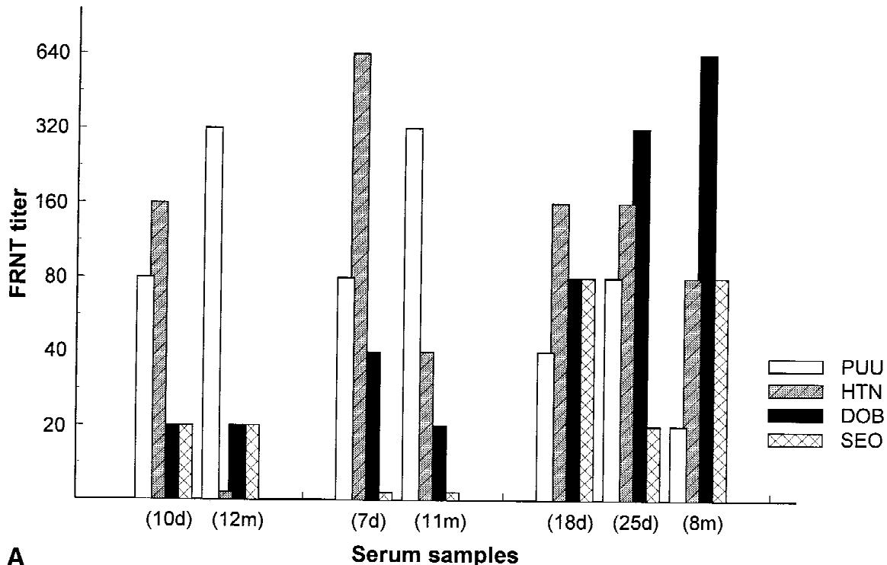
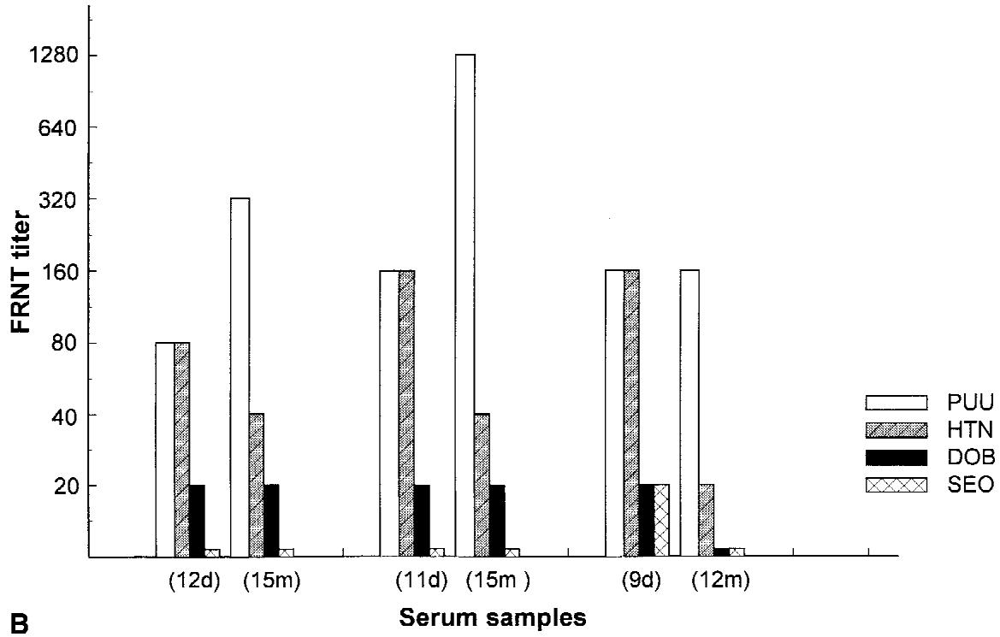
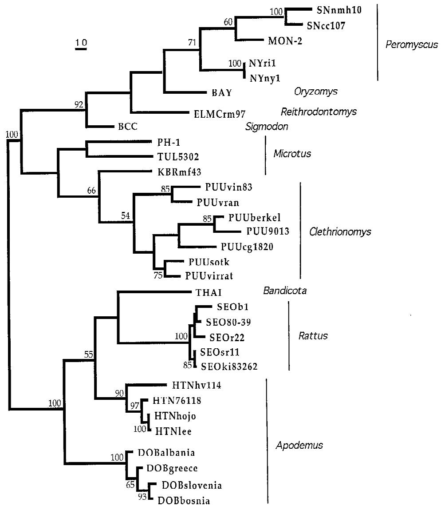

# Puumala and Dobrava Viruses Cause Hemorrhagic Fever With Renal Syndrome in Bosnia-Herzegovina: Evidence of Highly Cross-Neutralizing Antibody Responses in Early Patient Sera

Åke Lundkvist, $^{1,2*}$ Mirsada Hukic, $^{3}$ Jan Hörling, $^{1,2}$ Mari Gilljam, $^{1}$ Stuart Nichol, $^{4}$ and Bo Niklasson $^{1,5}$

$^{1}$ Swedish Institute for Infectious Disease Control, Stockholm, Sweden   
$^{2}$ Microbiology and Tumour Biology Centre, Karolinska Institute, Stockholm, Sweden   
3University Clinical Center in Tuzla, Tuzla, Bosnia and Herzegovina   
4Special Pathogens Branch, Division of Viral and Rickettsial Diseases, Centers for Disease Control and Prevention, Atlanta, Georgia   
$^{5}$ National Defense Research Establishment, Umeå, Sweden

Hantavirus infection was diagnosed serologically by $\mu$ -capture IgM and IgG ELISAs in hemorrhagic fever with renal syndrome (HFRS) patients admitted to Tuzla Hospital, Bosnia-Herzegovina. The results indicated that more than one hantavirus caused the outbreak. To address the question of which hantavirus serotypes were involved, sequentially drawn sera were analyzed by focus reduction neutralization test (FRNT) for antibodies against Puumala, Hantaan, Dobrava, and Seoul hantaviruses. The data revealed that acute- or early convalescent-phase sera, even when drawn as late as 3 weeks after the onset of disease, could not be used for typing of the causative hantavirus; a significant number of these samples showed similar reactivity of neutralizing antibodies to several different hantavirus serotypes. Moreover, although several acute-phase sera showed the highest FRNT titer to Hantaan virus, convalescent sera from these patients in all cases showed high specificity for Puumala or Dobrava viruses. This phenomenon, interpreted as a cross-neutralizing primary antibody response, makes several earlier reports concerning causative agents of HFRS questionable. Serological examination of small rodents trapped in the endemic area identified Puumala- and Dobrava-like virus infections. RT-PCR and sequencing of rodent lung samples identified Dobrava virus in one yellow-necked field mouse (Apodemus flavicollis). Cross-FRNT data, using polyclonal rabbit antibodies, clearly confirmed Dobrava virus as a unique hantavirus serotype. In conclusion, the results revealed that both Puumala- and Dobrava-like viruses caused HFRS in Bosnia-Herzegovina, whereas no signs

of Hantaan or Seoul virus involvement were found. J. Med. Virol. 53:51-59, 1997.

© 1997 Wiley-Liss, Inc.

KEY WORDS: hantavirus; hemorrhagic fever with renal syndrome; Dobrava virus; Puumala virus; neutralization test

# INTRODUCTION

Hantaviruses, members of the family Bunyaviridae, are known to cause two serious and often fatal human diseases: hemorrhagic fever with renal syndrome (HFRS) and hantavirus pulmonary syndrome (HPS). Small mammals, mainly rodents, are the natural reservoirs of hantaviruses, and transmission to humans occurs via aerosolized animal excreta [Elliott, 1990]. Hantaan (HTN), Seoul (SEO), and Puumala (PUU) viruses, carried by the striped field mouse (Apodemus agrarius), rats (Rattus norvegicus and R. rattus), and the bank vole (Clethrionomys glareolus), respectively, are known to cause HFRS, characterized by fever, renal failure, and, in severe cases, hemorrhagic manifestations [Lee and van der Groen, 1989]. The clinical manifestations of HFRS are generally more severe for infections caused by HTN virus, less severe for SEO virus, and milder for PUU virus [for review, see Lundkvist and Niklasson, 1994]. Approximately 150,000 cases of HFRS occur annually worldwide [Lee and van der Groen, 1989]. Sin Nombre (SN) virus, carried by

the deer mouse (Peromyscus maniculatus), and related viruses carried by other Sigmodontinae rodents cause HPS in the Americas [Hjelle et al., 1995; Nichol et al., 1993, 1996; Rollin et al., 1995; Schmaljohn et al., 1995]. HPS is characterized by acute respiratory dysfunction, with a mortality of approximately $50\%$ . In addition to the pathogenic hantaviruses there are at least five distinct hantaviruses at present not proven to cause human disease: Prospect Hill (PH), Thailand (THAI), Thottapalayam, Khabarovsk (KBR) and Tula (TUL) viruses [Chu et al., 1994; Horling et al., 1996; Vapalahti et al., 1996]. Several other hantaviruses have been characterized, mainly genetically, from rodent samples, but have not yet been isolated in cell culture [Hjelle et al., 1995; Nichol et al., 1996; Plyusnin et al., 1996].

Dobrava (DOB) hantavirus was isolated from Apodemus flavicollis, the yellow-necked field mouse, in Slovenia [Avsic-Zupanc et al., 1992]. Genetic and serological characterization identified DOB as a unique hantavirus [Avsic-Zupanc et al., 1995].

We reported recently an outbreak of HFRS in the Tuzla region of northeastern Bosnia-Herzegovina [Hukic et al., 1996]. To address the question of which hantaviruses were involved in the outbreak, we examined sera from these patients by focus reduction neutralization test (FRNT). Small rodents trapped in the Tuzla area were examined for hantavirus-specific antibodies/ antigen and subsequently by RT-PCR and sequencing. Our results confirmed DOB as a unique hantavirus serotype and identified PUU- and DOB-like viruses as the causative agents of HFRS in this area. The data further showed that serum samples drawn in the acute or early convalescent phase of HFRS cannot be used for typing of the infectious agent.

# MATERIALS AND METHODS Sera

Sera were collected from 190 patients with clinical symptoms compatible with HFRS (fever, back pain, and signs of kidney effects), admitted to Tuzla Hospital, Bosnia-Herzegovina, between January and August, 1995. All patient sera (drawn 5-24 days after onset of disease) were tested for the presence of PUU and HTN-specific antibodies by $\mu$ -capture IgM and IgG ELISAs. Convalescent sera (drawn 1-15 month after onset of disease) were collected from 28 serologically confirmed patients. From 13 of these 28 patients, three sequentially drawn serum samples were available. In addition, five single HFRS late convalescent sera (drawn $>3$ month after disease) were analyzed.

Antisera to hantavirus strains were produced by intranasal inoculation of New Zealand white rabbits as described previously for rabbits of chinchilla breed [Niklasson et al., 1991]. Sera were collected 2-4 months after infection. To obtain adequate neutralization titers, the rabbits intranasally inoculated with TUL, PH, and KBR viruses were boosted by subcutaneous injections of virus, partially purified by ultracentrifugation of infected cell culture supernatants.

# Virus Strains

The following hantaviruses were used in the study: HTN (strain 76-118) [Lee et al., 1978], SEO (80-39) [Lee et al., 1982], PUU (Sotkamo) [Brummer-Korvenkontio et al., 1982] and (83-L20) [Niklasson et al., 1991], PH (PH-1) [Lee et al., 1982], DOB [Avsic-Zupanc et al., 1992], KBR (MF-43) [Hörling et al., 1996a], and TUL (M02V) [Vapalahti et al., 1996]. All hantavirus strains were propagated in Vero E6 cells (CRL 1586; ATCC, Rockville, MD) cultivated in Eagle's minimal essential medium (MEM) supplemented with $2\%$ fetal calf serum (FCS), $2\mathrm{mM}$ L-glutamine, $60~\mu \mathrm{g / ml}$ penicillin, and $100~\mu \mathrm{g / ml}$ streptomycin.

# Antibody Detection

For detection of human IgM to hantavirus nucleocapsid antigen (N), $\mu$ -capture IgM ELISA was carried out as described earlier [Lundkvist et al., 1995a]. Briefly, microtiter plates were coated with goat anti-human IgM, followed by serum samples at 1:200 dilution. Native PUU and HTN virus N antigen and control antigen were added, followed by a hantavirus-specific monoclonal antibody (Mab) 1C12 [Lundkvist et al., 1991] conjugated to peroxidase. Specific antibody binding was detected by TMB substrate.

Mab antigen-capture ELISA was used for detection of hantavirus-reactive human IgG essentially as described earlier [Lundkvist et al., 1993]. Briefly, Mab 1C12 was adsorbed to plates overnight at $4^{\circ}\mathrm{C}$ . After blocking of nonsaturated binding sites, PUU or HTN virus antigens were incubated for $1\mathrm{hr}$ at $37^{\circ}\mathrm{C}$ . Serum samples at 1:400 dilution were incubated for $1\mathrm{hr}$ at $37^{\circ}\mathrm{C}$ . Specific antibody binding was detected by alkaline-phosphatase (ALP)-conjugated goat anti-human IgG, followed by p-nitrophenyl phosphate substrate.

Rodent IgG to hantavirus was detected as described previously [Hörling et al., 1996b]. Briefly, rabbit anti-hantavirus serum was adsorbed to plates overnight at $4^{\circ}\mathrm{C}$ . After blocking of nonsaturated binding sites, virus antigen was incubated for $1\mathrm{hr}$ at $37^{\circ}\mathrm{C}$ . Sera, diluted 1:200, were incubated for $1\mathrm{hr}$ at $37^{\circ}\mathrm{C}$ . Specific antibody binding was detected by ALP-conjugated goat anti-mouse IgG antibodies, followed by p-nitrophenyl phosphate substrate.

# Antigen Detection

For immunoblotting, proteins were separated by standard sodium dodecyl sulfate-polyacrylamide gel electrophoresis (4-15% SDS-PAGE) and transferred to nitrocellulose filters. Filters were preabsorbed with 2% bovine serum albumin in PBS, incubated over night at $4^{\circ}\mathrm{C}$ with $0.25\mu \mathrm{g / ml}$ of biotinylated Mabs 1C12 and 1C8 [Lundkvist et al., 1991, 1996], followed by streptavidin-peroxidase (Sigma, St. Louis, MO) for 2 hr. Specific antibody binding was detected with $0.6\mathrm{mM}$ 5-bromo-4-chloro-3-indolyl phosphate (BCIP; Sigma) and 0.5 mM nitroblue tetrazolium (NBT; Sigma) in $0.2\mathrm{M}$ TrisHCl, $10\mathrm{mM}\mathrm{MgCl}_2$ pH 9.5. Hantavirus antigen-ELISA

was carried out as described previously [Lundkvist et al., 1995b].

# Focus Reduction Neutralization Test

Endpoint titers of neutralizing antibodies were determined by FRNT as described earlier [Niklasson et al., 1991]. Briefly, sera were serially diluted and mixed with an equal volume containing 30-70 focus forming units (FFU) of virus per $100\mu \mathrm{l}$ . The mixtures were incubated for 1 hr and subsequently inoculated into wells of six-well tissue plates containing confluent Vero E6 cell monolayers. After adsorption for 1 hr, the wells were overlaid with a mixture of agarose and basal Eagle's medium. Plates were incubated for 9 days (HTN and SEO), 10 days (KBR), or 12 days (DOB, PUU, PH and TUL). Virus-infected cells were detected with hantavirus-specific polyclonal antisera, followed by peroxidase-labelled goat antibodies and substrate. An $80\%$ reduction in the number of foci was used as the criterion for virus neutralization titers.

# PCR Amplification and Nucleotide Sequencing

RNA from ground lung suspensions was extracted by the acid guanidinium thiocyanate-phenol-chloroform method [Chomczynski and Sacchi, 1987]. Amplification was carried out using two sets of nested primers, one set amplifying PUU- and PH-like viruses [PUU-PH 1 and 2, nucleotide (nt) positions +2671 and -3108] and one set amplifying HTN- and SEO-like viruses (HTN-SEO 1 and 2, nt position +2548 and -2859), essentially as described earlier [Nichol et al., 1993]. RT-PCR was performed as a "one tube reaction". Briefly, $1\mu \mathrm{M}$ of each outer primer, $5\mathrm{U}$ of Rous-associated virus 2 reverse transcriptase (Amersham Life Sciences, Buckinghamshire, U.K.), $10\mathrm{U}$ placental ribonuclease inhibitor (Gibco BRL, Gaithersburg, MD), $1\mathrm{mM}$ of each dNTP, 2 U Taq polymerase (Perkin-Elmer, Norwalk, CT), and $5\mathrm{mM}$ $\mathrm{MgCl}_2$ in $100~\mu \mathrm{l}$ of PCR buffer ( $10\mathrm{mM}$ Tris-HCl, pH 8.3, $50\mathrm{mM}$ KCl) were incubated for $42^{\circ}\mathrm{C}$ 1 hr, $95^{\circ}\mathrm{C}$ 2 min, followed by 40 cycles of $94^{\circ}\mathrm{C}$ for 40 sec, $38^{\circ}\mathrm{C}$ for 45 sec and $72^{\circ}\mathrm{C}$ for 1 min. Five microliters of this amplification mixture was added to $45~\mu \mathrm{l}$ of PCR buffer with $1\mu \mathrm{M}$ each of inner primers (PUU-PH 1 and 4, pos +2770 and -3108; or HTN-SEO 3 and 4, pos +2590 and -2751) and amplified for 35 cycles at $94^{\circ}\mathrm{C}$ for 40 sec, $43^{\circ}\mathrm{C}$ for 45 sec, and $72^{\circ}\mathrm{C}$ for 1 min. Amplified products were analyzed by electrophoresis in $2\%$ agarose gels in Tris-acetate buffer, stained with ethidium bromide, and gel purified using a kit (Jetsorb, Genomed, Oeynhausen, Germany) as described by the manufacturer. Sequence analysis was undertaken using a kit from Perkin Elmer (PRISM) for automated dyedeoxy cycle sequencing according to the manufacturer's instructions.

# Phylogenetic Analysis

DOB virus phylogeny was inferred by maximum parsimony analysis of representative hantavirus partial G2 coding M segment sequences. The sequences were edited to match the shortest length sequences,

TABLE I. IgM and IgG Reactivity of HFRS Patient Sera in ELISA ${}^{a}$   

<table><tr><td rowspan="2">Serum (days after onset of disease)</td><td colspan="4">Assay</td></tr><tr><td>PUU IgM</td><td>PUU IgG</td><td>HTN IgM</td><td>HTN IgG</td></tr><tr><td>a</td><td></td><td></td><td></td><td></td></tr><tr><td>(17)</td><td>1.152b</td><td>0.301</td><td>0.165</td><td>0.053</td></tr><tr><td>(8)</td><td>0.631</td><td>0.236</td><td>0.013</td><td>0.001</td></tr><tr><td>(10)</td><td>0.088</td><td>0.037</td><td>0.654</td><td>0.368</td></tr><tr><td>(10)</td><td>0.067</td><td>0.062</td><td>0.897</td><td>0.298</td></tr><tr><td>(5)</td><td>0.084</td><td>0.249</td><td>0.701</td><td>0.302</td></tr><tr><td>(18)</td><td>0.011</td><td>0.071</td><td>0.962</td><td>0.315</td></tr><tr><td>b</td><td></td><td></td><td></td><td></td></tr><tr><td>(8)</td><td>0.763</td><td>0.334</td><td>0.431</td><td>0.012</td></tr><tr><td>(22)</td><td>0.779</td><td>0.321</td><td>0.304</td><td>0.055</td></tr><tr><td>(9)</td><td>1.003</td><td>0.214</td><td>0.844</td><td>0.035</td></tr><tr><td>(9)</td><td>0.511</td><td>0.336</td><td>0.436</td><td>0.113</td></tr><tr><td>(9)</td><td>0.638</td><td>0.319</td><td>0.486</td><td>0.061</td></tr><tr><td>(10)</td><td>0.698</td><td>0.359</td><td>0.405</td><td>0.104</td></tr></table>

aPatient sera were analyzed by PUU and HTN IgM and IgG ELISA. A significant variation in the specificity of the IgM response in different patients was observed; some sera reacted almost exclusively with one of the viral antigens (group a); others reacted similar with both antigens (group b).   
bMean optical density of duplicate samples.

which were the partial sequences (238 bp) of the Greek and Albanian DOB viruses [Antoniadis et al., 1996]. Analysis was performed with Phylogenetic Analysis Using Parsimony (PAUP) software, version 3.1.1 [Swofford, 1991], using the branch-and-bound search option and a 3:1 weighting of transversion over transitions. Bootstrap confidence intervals were calculated by carrying out 1,000 heuristic search replicates.

# RESULTS Serological Results by ELISA

Sixty-seven percent (128/190) of the HFRS-suspected patients were confirmed as having acute hantavirus infection by the presence of hantavirus-specific IgM, whereas two patients were considered as HFRS convalescents (no detectable IgM but high levels of specific IgG). The results of a representative number of sera are displayed in Table I. A significant variation in the specificity of the IgM response in different patients was observed; some sera reacted almost exclusively with one of the viral antigens (Table I, group a); others reacted similar with both antigens (Table I, group b). Only $53\%$ (68/128) of the patient sera showed IgM reactivities of more than four times higher optical density to one of the two antigens. Twelve percent (15/128) of the sera (collected between 4 and 17 days) lacked detectable levels of specific IgG. In general, the IgG responses were directed more specifically to one of the two viral antigens.

# Serological Results by FRNT

To examine which hantavirus serotypes were involved in the HFRS outbreak, 33 convalescent sera were endpoint titrated against PUU, HTN, DOB, and SEO viruses by FRNT. The data revealed 25 PUU-like

TABLE II. Endpoint Titration of Neutralizing Antibodies in HFRS Late Convalescent Sera   

<table><tr><td rowspan="2">Ratiob</td><td colspan="4">Virus</td></tr><tr><td>PUU</td><td>HTN</td><td>DOB</td><td>SEO</td></tr><tr><td>0</td><td>0</td><td>0</td><td>0</td><td>0</td></tr><tr><td>2-fold</td><td>0</td><td>0</td><td>0</td><td>0</td></tr><tr><td>4-fold</td><td>1c</td><td>0</td><td>3</td><td>0</td></tr><tr><td>8-fold</td><td>9</td><td>0</td><td>3</td><td>0</td></tr><tr><td>16-fold</td><td>4</td><td>0</td><td>1</td><td>0</td></tr><tr><td>32-fold</td><td>9</td><td>0</td><td>1</td><td>0</td></tr><tr><td>64-fold</td><td>2</td><td>0</td><td>0</td><td>0</td></tr><tr><td>Total</td><td>25</td><td>0</td><td>8</td><td>0</td></tr></table>

aConvalescent sera (drawn 1-15 months after onset of disease) from 28 serologically confirmed HFRS patients and five single HFRS late convalescent sera (drawn $>3$ months after onset of disease) were examined by FRNT.   
bThe ratio between the highest and the second highest obtained FRNT endpoint titers in individual samples.   
Number of sera.

and eight DOB-like virus infections. No evidence for SEO or HTN virus infections was found (Table II).

The first serum from 28 of these patients and additional 10 patients were analyzed by FRNT. In general, low specificities, in the sense of reactivity to a certain single hantavirus serotype, were observed. The results of 12 representative sera are displayed in Table III. Thirty-seven percent (14/38) of the sera showed less than fourfold higher titer to one specific hantavirus serotype. Several different patterns were observed (see Table III): a) Three of the sera had equal titers to two different hantavirus serotypes; b) 11 sera showed only twofold higher titer to one of the serotypes; c) 10 sera had fourfold or higher titer to one serotype virus; d) and 14 sera had eightfold or higher titer to one specific serotype virus (PUU, HTN, DOB).

Interestingly, in five patients, the first serum sample had the highest endpoint titer of neutralizing antibodies to HTN, whereas in late convalescent sera from these patients the titers to PUU or DOB exceeded the HTN titers by at least eightfold (Fig. 1A). Moreover, the first samples from three other patients showed equal titers to PUU and HTN, whereas the convalescent samples were highly specific for PUU (Fig. 1B). The results revealed that, for almost one-third (8/28) of the patients, a diagnosis determined on the first serum sample would have been either false or inconclusive regarding the infectious hantavirus serotype, even when based on neutralizing test.

# Analysis of Rodents Trapped in the HFRS Endemic Region

Fifty-six small rodents were trapped in the Tuzla area, Bosnia-Herzegovina. Sera were analyzed by ELISA for the presence of PUU- and HTN-reactive IgG. One bank vole (Clethrionomys glareolus, No. 41) and one yellow-necked field mouse (Apodemus flavicollis, No. 43) were found to be antibody positive to both viral antigens. Only the field mouse was found to be positive for hantavirus antigen and RNA when examined by

TABLE III. Endpoint Titers of Neutralizing Antibodies in HFRS Patient Sera   

<table><tr><td rowspan="2">Serum (days after onset of disease)</td><td colspan="4">Virus</td></tr><tr><td>PUU</td><td>HTN</td><td>DOB</td><td>SEO</td></tr><tr><td>a</td><td></td><td></td><td></td><td></td></tr><tr><td>(12)</td><td>80b</td><td>80</td><td>20</td><td>&lt;20</td></tr><tr><td>(11)</td><td>160</td><td>160</td><td>20</td><td>&lt;20</td></tr><tr><td>(9)</td><td>160</td><td>160</td><td>20</td><td>20</td></tr><tr><td>b</td><td></td><td></td><td></td><td></td></tr><tr><td>(17)</td><td>160</td><td>80</td><td>&lt;20</td><td>&lt;20</td></tr><tr><td>(18)</td><td>40</td><td>160</td><td>80</td><td>80</td></tr><tr><td>(8)</td><td>20</td><td>40</td><td>80</td><td>20</td></tr><tr><td>c</td><td></td><td></td><td></td><td></td></tr><tr><td>(8)</td><td>320</td><td>80</td><td>40</td><td>&lt;20</td></tr><tr><td>(9)</td><td>80</td><td>320</td><td>20</td><td>20</td></tr><tr><td>(14)</td><td>80</td><td>80</td><td>320</td><td>20</td></tr><tr><td>d</td><td></td><td></td><td></td><td></td></tr><tr><td>(16)</td><td>320</td><td>40</td><td>&lt;20</td><td>&lt;20</td></tr><tr><td>(7)</td><td>80</td><td>640</td><td>40</td><td>&lt;20</td></tr><tr><td>(5)</td><td>20</td><td>80</td><td>640</td><td>&lt;20</td></tr></table>

aThirty-eight HFRS patient sera were analyzed by FRNT against PUU, HTN, DOB, and SEO viruses. The results of 12 representative sera from different patients are displayed. a: Three of the 38 sera had equal titers to two different hantavirus serotypes. b: Eleven sera showed only twofold higher titer to one of the serotypes. c: Ten sera had fourfold or higher titer to one serotype virus. d: Fourteen sera had eightfold or higher titer to one specific serotype virus (PUU, HTN, DOB).   
bReciprocal endpoint titers as determined by FRNT.

ELISA, immunoblotting, and RT-PCR. The endpoint titers of neutralizing antibodies indicated PUU-like and DOB-like viruses as the infectious agents in the bank vole and the field mouse, respectively. Although the serum from the field mouse showed a significant titer to HTN (320), the titer to DOB was at least 16-fold higher (data summarized in Table IV). Attempts to isolate virus from the field mouse in Vero E6 cells were not successful.

# Sequence Analysis

The two rodents positive for hantavirus-specific antibodies, Nos. 41 and 43, were analyzed by RT-PCR. Several unsuccessful attempts to amplify hantavirus genomes from the serologically PUU-positive No. 41 were made, whereas No. 43 scored as positive by the HTN-SEO PCR. Two separate amplicons were generated, and nucleotide sequencing was carried out in both directions. The 346 bp nucleotide sequence determined from the amplified fragment was found to be closely related to the published sequences of DOB virus [Avsic-Zupanc et al., 1995], with a nucleotide homology of $96.8\%$ and an amino-acid homology of $99.1\%$ .

Analysis of the 238 nucleotide region that has now been determined for four different DOB viruses indicated that these viruses differ from other hantaviruses by almost $25\%$ at the nucleotide level. The DOB viruses are diverse genetically across their geographic range, with the Bosnian DOB virus, designated DOB-Tuzla43, being more closely related to the original DOB virus

  
Fig. 1. Endpoint titers of neutralizing antibodies to PUU, HTN, DOB, and SEO viruses in sequentially drawn sera of HFRS patients. A: Results from three of five patients who showed the highest titer to HTN in the first sera; in late convalescent sera, the titers to PUU or DOB exceeded the HTN titers at least eightfold. B: Results from three patients from whom the first sample showed equal titers to PUU and HTN but the late convalescent samples were highly specific for PUU. Days (d) or months (m) after onset of disease for each serum sample are indicated in parentheses.

isolated from Apodemus flavicollis in Slovenia (3.8% nucleotide difference) than to the Greek or Albanian DOB viruses (5.9 and 8.4% nucleotide differences, respectively). Phylogenetic analysis of nucleotide differ

ences (Fig. 2) showed that the DOB virus strains form a well-supported (100% bootstrap value) monophyletic clade separate from other hantaviruses associated with Murinae subfamily rodents (HTN, SEO, THAI). The

TABLE IV. Analysis of Small Rodents for Hantavirus-Specific Antibodies, Antigen, and RNA   

<table><tr><td rowspan="2">Animal No.</td><td colspan="2">IgG ELISA</td><td colspan="3">Neutralizing antibodies FRNT</td><td colspan="2">N antigen</td><td>RNA</td></tr><tr><td>PUU</td><td>HTN</td><td>PUU</td><td>HTN</td><td>DOB</td><td>ELISA</td><td>WB</td><td>RT-PCR</td></tr><tr><td>41 (bank vole)</td><td>+</td><td>+</td><td>320a</td><td>&lt;40</td><td>&lt;40</td><td>-</td><td>-</td><td>-</td></tr><tr><td>43 (yellow-necked field mouse)</td><td>+</td><td>+</td><td>&lt;40</td><td>320</td><td>≥5,120</td><td>+</td><td>+</td><td>+</td></tr></table>

aReciprocal FRNT endpoint titers.

most closely related hantaviruses are the HTN viruses found in Apodemus agrarius in Asia.

# Antigenic Comparison of Dobrava Virus to Other Hantaviruses by Cross-FRNT

DOB has been reported previously as serologically distinct from other hantaviruses [Avsic-Zupanc et al., 1995], but complete cross-neutralization data have not been presented. One rabbit that was immunized intranasally with DOB developed homologous FRNT titers of 160 after 2 months. A cross-FRNT comparison with similarly produced hantavirus antisera showed fourfold or higher titer differences between homologous and heterologous antisera for DOB, HTN, SEO, PUU, KBR, PH, and TUL viruses, demonstrating that DOB forms a distinct hantavirus serotype (Table V).

# DISCUSSION

During 1995, several hundred patients with symptoms of HFRS were admitted to Tuzla Hospital, northeast Bosnia-Herzegovina [Hukic et al., 1996]. Only sporadic cases had previously been reported from this area. In the present study, the clinical diagnosis of HFRS in 128 patients was confirmed serologically by the demonstration of hantavirus-specific IgM. Although there is little information on rodent population density fluctuations in Bosnia over past years, it appeared that this year small rodents were more abundant than usual. Several factors such as the presence of military camps with large amounts of food stored under primitive conditions, inadequate garbage disposal, or the general breakdown of hygiene with water and power shortages may have caused a higher density of rodents. In addition, the large number of military personnel stationed in this region increased the potential rodent-man contact.

HFRS is endemic in the Balkan Peninsula, and epidemic outbreaks as well as isolated cases have been recorded during the last 2 decades. The epidemiology of HFRS in this region is likely to be complex owing to the existence of several rodent species known to be potential carriers of different hantaviruses, and the clinical picture ranges from severe cases, usually attributable to HTN-like infections, to milder cases more typical of PUU-like infections. Because of the significant serological cross-reactivity between hantaviruses, it has been unclear which viruses have been associated with HFRS and which rodent hosts serve as primary reservoirs. The yellow-necked field mouse is widely distrib

uted throughout regions in the Balkans where severe HFRS cases have been recorded. Serologic analysis of small mammals captured in the endemic areas suggests that this species is likely to be the principal maintenance host for DOB virus [Avsic-Zupanc et al., 1990, 1995; Gligic et al., 1988; LeDuc et al., 1986]. Recently, Antoniadis et al. [1996] provided the first direct genetic evidence for the association of DOB virus with HFRS in two patients from Greece and Albania.

Although it is not possible to identify the infecting virus definitively without isolation, or by identification of its genomic sequence in patient samples, previous studies on hantaviruses have revealed a close correlation between the specificity of the neutralizing antibody response and the infecting hantavirus serotype [Schmaljohn et al., 1985; Niklasson et al., 1991; Chu et al., 1995]. Furthermore, there are no reports on multiple or sequential hantavirus infections. Therefore, our results strongly indicated both PUU- and DOB-like viruses as the cause of HFRS in Bosnia-Herzegovina; highly PUU- and DOB-specific responses were detected by FRNT in late convalescent sera as well as in sera from local rodents trapped in the HFRS-endemic region. In addition, DOB virus was detected by PCR in one yellow-necked field mouse, which also showed a highly specific antibody response to DOB as measured by FRNT. Data from HFRS patients in Albania and Greece [Antoniadis et al., 1996] and our preliminary clinical data indicate that DOB virus causes a more severe form of HFRS, similar to HTN virus infection (Hukic et al., unpublished observations). It should be noted that there was no indication of HFRS caused by HTN- or SEO-like viruses. This might have been anticipated, insofar as HTN virus is circulating in a geographical region distant from central Europe and SEO virus as the cause of HFRS in Europe has not been convincingly demonstrated, except for several laboratory outbreaks.

Serology based on IgM ELISA has been proved most efficient for rapid diagnosis of HFRS. In this study, only $88\%$ of the patients had detectable levels of hantavirus-specific IgG in their first sera, which further emphasizes the diagnostic value of IgM detection. However, the significant serological cross-reactivity e.g., within the PUU-PH-TUL-KBR group as well as the within the HTN-SEO-DOB-THAI group, makes specific serotyping of the exact etiologic agent difficult [Chu et al., 1994; Horling et al., 1996a; Lundkvist et al., 1996; Schmaljohn et al., 1985]. In the present

  
Fig. 2. Nucleotide sequence differences based on a 238-base-pair region of a PCR fragment of the M segment of the Bosnian Dobrava virus (DOB-Tuzla43) and of previously characterized hantaviruses were analyzed by the weighted maximum parsimony method using the PAUP software package. Using a transversion: transition weighting ratio of 3:1, two equally parsimonious trees were obtained, which differed only in minor variation of the branch length separating the THAI and HTN viruses. Horizontal lengths are proportional to nucleotide step differences (indicated above lines). Bootstrap confidence limits were calculated by 1,000 heuristic search repetitions of the analysis, and limits in excess of $50\%$ are indicated adjacent to branch points. Included were hantaviruses associated with rodents of the Sigmoidontinae (Peromyscus, Oryzomys, Reithrodontomys, and Sigmodon sp.), Arvicolinae (Microtus and Clethrionomys sp.), and Murinae (Bandicota, Rattus, and Apodemus sp.) subfamilies. Virus sequences were from the following sources: SNnmH10 (Genbank accession number L25783), SNcc107 (L33474), Monongahela (MON) virus 2 (U32653), New York (NY) viruses RI-1 and NY1 (U36801 and U36802), Bayou (BAY) virus (L36930), El Moro Canyon (ELMC) Virus Rm97 (U26828), Black Creek Canal (BCC) virus fl397 (L39950), PH-1 (X55129), TUL Moravia/5302v/95 (Z69993), KBRmf43 (U35254), PUU Vindeln/L20Cg/83 (Z49214), PUU Vranica (U14136), PUU Berkel (L36944), PUU 90-13 (U22418), PUU Cg18-20 (M29979), PUU Sotkamo (X61034), PUU Virrat/25Cg/95 (Z70201), THAI Thai749 (L08756), SEOb-1 (X53861), SEO 80-39 (S47716), SEO R22 (S68035), SEO SR-11 (M34882), SEO KI-83-262 (D17592), HTN HV114 (L08753), HTN 76118 (M14627), HTN Hojo (D00376), HTN Lee (D00377), DOB Slovenia (L33685), DOB Pindos-1 (Albania), and Nevrokopi-B (Greece) [Antoniadis et al., 1996].

study, only $53\%$ of the patient sera showed IgM reactivities of more than four times higher optical density to one of the antigens, although two distantly related antigens (PUU and HTN) were used. Our study as well as several previous studies have shown that the neutralization test (FRNT or PRNT) is to date the only reliable assay available for typing of human hantavirus antibody responses [Hörlin et al., 1996a; Vapalahti et al., 1996; Chu et al., 1995]. Although short hantavirus recombinant antigens or synthetic peptides might be

useful for diagnostic serotyping, they often lack sensitivity and have not been comprehensively evaluated [Hjelle et al., 1994; Jenison et al., 1994; Lundkvist et al., 1995a, 1996]. In spite of this, there are several recent reports concerning typing of HFRS agents based on ELISA or IFA data only, e.g., SEO and HTN viruses in central and northern Europe. The present results on DOB and HTN and previously published data on PUU, TUL, and KBR [Hörling et al., 1996a,b; Vapalahti et al., 1996] clearly showed that it is not possible to distin

TABLE V. Cross-Neutralization of Hantaviruses   

<table><tr><td rowspan="2">Virus</td><td colspan="7">Sera</td></tr><tr><td>DOB</td><td>HTN 76-118</td><td>SEO 80-39</td><td>PUU 83-L20</td><td>KBR MF-43</td><td>PH PH-1</td><td>TUL M02V</td></tr><tr><td>DOB</td><td>\(160^a\)</td><td>80</td><td>80</td><td>&lt;20</td><td>&lt;20</td><td>&lt;20</td><td>&lt;20</td></tr><tr><td>HTN</td><td></td><td></td><td></td><td></td><td></td><td></td><td></td></tr><tr><td>76-118</td><td>&lt;20</td><td>320</td><td>&lt;20</td><td>&lt;20</td><td>&lt;20</td><td>&lt;20</td><td>&lt;20</td></tr><tr><td>SEO</td><td></td><td></td><td></td><td></td><td></td><td></td><td></td></tr><tr><td>80-39</td><td>20</td><td>40</td><td>320</td><td>&lt;20</td><td>&lt;20</td><td>&lt;20</td><td>&lt;20</td></tr><tr><td>PUU</td><td></td><td></td><td></td><td></td><td></td><td></td><td></td></tr><tr><td>83-L20</td><td>&lt;20</td><td>&lt;20</td><td>&lt;20</td><td>1,280</td><td>&lt;20</td><td>80</td><td>20</td></tr><tr><td>KBR</td><td></td><td></td><td></td><td></td><td></td><td></td><td></td></tr><tr><td>MF-43</td><td>&lt;20</td><td>&lt;20</td><td>&lt;20</td><td>160</td><td>1,280</td><td>80</td><td>80</td></tr><tr><td>PH</td><td></td><td></td><td></td><td></td><td></td><td></td><td></td></tr><tr><td>PH-1</td><td>&lt;20</td><td>&lt;20</td><td>&lt;20</td><td>&lt;20</td><td>&lt;20</td><td>1,280</td><td>160</td></tr><tr><td>TUL</td><td></td><td></td><td></td><td></td><td></td><td></td><td></td></tr><tr><td>M02V</td><td>&lt;20</td><td>80</td><td>&lt;20</td><td>20</td><td>20</td><td>160</td><td>5,120</td></tr></table>

aReciprocal FRNT endpoint titers.

guish between hantavirus antibody responses by ELISA or IFA.

Our results concerning small rodents are in line with the strict association of the different hantavirus serotypes to certain rodent species. One bank vole, the rodent species that constitutes the main reservoir of PUU in Finland and Scandinavia [Brummer-Korvenkontio et al., 1980; Niklasson and LeDuc, 1987], was serologically confirmed for PUU-like infection. Unfortunately, we were not able to amplify any viral RNA from this animal, which might have clarified the confusion regarding PUU strains from this region. One yellow-necked field mouse, the species from which prototype DOB was isolated in Slovenia [Avsic-Zupanc et al., 1992], was found to be infected by DOB. Phylogenetic analysis placed DOB-Tuzla43 in the same clade (with $93\%$ bootstrap support) as the closely related Slovenian DOB, which likely reflects the shorter geographical distance to Slovenia than to the location of the other DOB strains (i.e., Albania and Greece). This is similar to genetic relationships seen among other hantaviruses, in which the extent of genetic diversity observed among viruses of the same serotype increases with increasing geographic distance separating their location of detection [see, e.g., Plyusnin et al., 1996; Horling et al., 1996b; Spiropoulou et al., 1994].

Previous studies have shown that hantavirus-infected small rodents often develop high levels of neutralizing antibodies; this was also found to be the case with the two animals examined in this study. It is noteworthy that the DOB-positive A. flavicollis serum had an FRNT titer to HTN of 320, a titer that could mistakenly be regarded as HTN-specific if not compared to the DOB titer $(\geq 5120)$ . Thus, the need for careful interpretation of serological data, even when based on neutralization tests, must be emphasized, as must be the importance of confirming genetic data, preferably obtained directly from the rodent tissue.

Although DOB has been characterized extensively and the S and M genome segment sequenced [Avsic-Zupanc et al., 1995], complete cross-neutralization data have not been published. Our results are in accord

dance with the reported close serological relationship of DOB to HTN and SEO viruses and confirm DOB as a distinct hantavirus serotype. The data correlate well with the genetic relationships among the hantaviruses [Nichol et al., 1996; Plyusnin et al., 1996].

One important outcome of the present study was the highly cross-reactive characteristics also of the neutralizing antibody responses in acute-phase or early convalescent-phase sera. Several patients showed the highest titers of neutralizing antibodies to HTN in their first sample, although the antibody responses were clearly specific for PUU or DOB in their late convalescent sera. Some of these first samples were drawn as late as 2-3 weeks after onset of disease. We therefore conclude that late convalescent samples, drawn at least 1 month after onset of the disease, are required for reliable typing of antibody responses to closely related hantaviruses, even if neutralization tests are used.

# ACKNOWLEDGMENTS

We thank Dr. Karl Fredga for the assistance in determination of rodent species and to Katarina Brus Sjolander and Catarina Persson for excellent technical support.

# REFERENCES

Antoniadis A, Stylianakis A, Papa A, Alexiou-Daniel S, Lampropoulos A, Nichol ST, Peters CJ, Spiropoulou CF (1996): Direct genetic detection of Dobrava virus in Greek and Albanian haemorrhagic fever with renal syndrome (HFRS) patients. Journal of Infectious Diseases 174:407-410.   
Avsic-Zupanc T, Likar M, Novakovic S, Cizman B, Kraigher A, van der Groen G, Stojanovic R, Obradovic M, Gligic A, LeDuc J (1990): Evidence of the presence of two hantaviruses in Slovenia, Yugoslavia. Archives of Virology Suppl 1, pp 87-94.   
Avsic-Zupanc T, Xiao S-Y, Stojanovic R, Glicic A, van der Groen G, LeDuc JW (1992): Characterization of Dobrava virus: A hantavirus from Slovenia, Yugoslavia. Journal of Medical Virology 38: 132-137.   
Avsic-Zupanc T, Toney A, Anderson K, Chu Y-K, Schmaljohn C (1995): Genetic and antigenic properties of Dobrava virus: A unique member of the Hantavirus genus, family Bunyaviridae. Journal of General Virology 76:2801-2808.   
Brummer-Korvenkontio M, Vaheri A, Hovi T, von Bonsdorff C-H, Vurorimies J, Manni T, Penttinen K, Oker-Blom N, Lahdevirta J

(1980): Nephropathia epidemiica: Detection of antigen in bank voles and serologic diagnosis of human infection. Journal of Infectious Diseases 141:131-134.   
Brummer-Korvenkontio M, Henttonen H, Vaheri A (1982): Hemorrhagic fever with renal syndrome in Finland: Ecology and virology of nephropathia epidemiica. Scandinavian Journal of Infectious Diseases Suppl 36, pp 88-91.   
Chomczynski P, Sacchi N (1987): Single-step of RNA isolation by acid guanidinium thiocyanate-phenol-chloroform extraction. Annals of Biochemistry 162:156-159.   
Chu Y-K, Rossi C, LeDuc JW, Lee HW, Schmaljohn CS, Dalrymple JM (1994): Serological relationships among viruses in the Hantavirus genus, family Bunyaviridae. Virology 198:196-204.   
Chu Y-K, Jennings G, Schmaljohn A, Elgh F, Hjelle B, Lee HW, Jenison S, Ksiazek T, Peters CJ, Rollin P, Schmaljohn C (1995): Cross-neutralization of hantaviruses with immune sera from experimentally infected animals and from hemorrhagic fever with renal syndrome and hantavirus pulmonary syndrome patients. Journal of Infectious Diseases 172:1581-1584.   
Elliott RM (1990): Molecular biology of Bunyaviridae. Journal of General Virology 71:501-522.   
Glicic A, Obradovic M, Stojanovic R, Hlaca D, Antonijevic B, Arnautovic A, Gaon J, Frusic M, Lee P, Goldgaber D, Yanagihara R, Gibbs CJ, Gajdusek DC, Svedmyr A (1988): Hemorrhagic fever with renal syndrome in Yugoslavia: Detection of hantavirus antigen and antibody in wild rodents and serological diagnosis of human disease. Scandinavian Journal of Infectious Diseases 20:261-266.   
Hjelle B, Chavez-Giles F, Torrez-Martinez N, Yamada T, Sarisky J, Ascher M, Jenison S (1994): Dominant glycoprotein epitope of four corners hantavirus is conserved across a wide geographical area. Journal of General Virology 75:2881-2888.   
Hjelle B, Jenison SA, Goade DE, Green WB, Feddersen RM, Scott AA (1995): Hantaviruses: Clinical, microbiologic, and epidemiologic aspects. Critical Reviews in Clinical Laboratory Science 32:469-508.   
Hörling J, Chizhikov V, Lundkvist Å, Jonsson M, Ivanov L, Dekonenko A, Niklasson B, Dzagurova T, Peters CJ, Tkachenko E, Nichol S (1996a): Khabarovsk, a phylogenetically and serologically distinct Hantavirus isolated from Microtus fortis in Far East Russia. Journal of General Virology 77:687-694.   
Hörling J, Lundkvist Å, Plyusnin A, Jaarola M, Tegelström H, Persson K, Lehväslahio H, Hörnfeldt B, Vaheri A, Niklasson B (1996b) Distribution and genetic heterogeneity of Puumala virus in Sweden. Journal of General Virology 77:2555-2562.   
Hukic M, Kurt A, Torstensson S, Lundkvist Å, Wiger D, Niklasson B (1996): Haemorrhagic fever with renal syndrome in north-east Bosnia. Lancet 347:56-57.   
Jenison S, Yamada T, Morris C, Andersson B, Torrez-Martinez N, Keller N, Hjelle B (1994): Characterization of human antibody responses to Four Corners Hantavirus infections among patients with Hantavirus pulmonary syndrome. Journal of Virology 68: 3000-3006.   
LeDuc JW, Antoniadis A, Siampoulus K (1986): Epidemiological investigations following an outbreak of hemorrhagic fever with renal syndrome in Greece. American Journal of Tropical Medicine and Hygiene 35:654-659.   
Lee HW, van der Groen G (1989): Hemorrhagic fever with renal syndrome. Progress in Medical Virology 36:62-102.   
Lee HW, Lee PW, Johnson KM (1978): Isolation of the etiologic agent of Korean hemorrhagic fever. Journal of Infectious Diseases 137: 298-308.   
Lee HW, Baek LJ, Johnson KM (1982): Isolation of Hantaan virus, the etiologic agent of Korean hemorrhagic fever, from wild urban rats. Journal of Infectious Diseases 146:638-644.   
Lee PW, Amyx HL, Gajdusek DC, Yanagihara RT, Goldgaber D, Gibbs CJ Jr (1982): New haemorrhagic fever with renal syndrome

related virus in indigenous wild rodents in the United States. Lancet ii:1405.   
Lundkvist Å, Niklasson B (1994): Hemorrhagic fever with renal syndrome and other hantavirus infections. Reviews in Medical Virology 4:177-184.   
Lundkvist Å, Fatouros A, Niklasson B (1991): Antigenic variation of European haemorrhagic fever with renal syndrome virus strains characterized using bank vole monoclonal antibodies. Journal of General Virology 72:2097-2103.   
Lundkvist Å, Hörling J, Niklasson B (1993): The humoral response to Puumala virus infection (nephropathia epidemiica) investigated by viral protein specific immunoassays. Archives of Virology 130: 121-130.   
Lundkvist Å, Björsten S, Niklasson B, Ahlborg N (1995a): Mapping of B-cell determinants in the nucleocapsid protein of Puumala virus; definition of epitopes specific for acute IgG recognition in humans. Clinical and Diagnostic Laboratory Immunology 2:82-86.   
Lundkvist Å, Hörling J, Björsten S, Niklasson B (1995b) Sensitive detection of hantaviruses by biotin-streptavidin enhanced immunoassays based on bank vole monoclonal antibodies. Journal of Virological Methods 52:75-86.   
Lundkvist Å, Vapalahti O, Plyusnin A, Brus Sjolander K, Niklasson B, Vaheri A (1996): Characterization of Tula virus antigenic determinants defined by monoclonal antibodies raised against baculovirus-expressed nucleocapsid protein. Virus Research 45:29-44.   
Nichol ST, Spiropoulou CF, Morzunov S, Rollin PE, Ksiazek TG, Feldmann H, Sanchez A, Childs J, Zaki S, Peters CJ (1993): Genetic identification of a hantavirus associated with an outbreak of acute respiratory illness. Science 262:914-917.   
Nichol ST, Ksiazek TG, Rollin PE, Peters CJ (1996): Hantavirus pulmonary syndrome and newly described hantaviruses in the United States. In Eliott RM (ed): "The Bunyaviridae." New York: Plenum Press, pp 269-280.   
Niklasson B, LeDuc JW (1987): Epidemiology of the nephropathia epidemiica agent in Sweden. Journal of Infectious Diseases 155: 269-276.   
Niklasson B, Jonsson M, Lundkvist Å, Hörling J, Tkachenko E (1991): European isolates of viruses causing hemorrhagic fever with renal syndrome compared by neutralization test. American Journal of Tropical Medicine and Hygiene 45:660-665.   
Plyusnin A, Vapalahti O, Vaheri A (1996): Hantaviruses: Genome structure, expression and evolution. Journal of General Virology 77:2677-2687.   
Rollin PE, Ksiazek TG, Elliott LH, Ravkov EV, Martin ML, Morzunov S, Livingstone W, Monroe M, Glass G, Ruo S, Khan AS, Childs JE, Nichol ST, Peters CJ (1995): Isolation of Black Creek Canal virus, a new hantavirus from Sigmoidon hispidus in Florida. Journal of Medical Virology 46:35-39.   
Schmaljohn AL, Li D, Negley DL, Bressler DS, Turell MJ, Korch GW, Ascher MS, Schmaljohn CS (1995): Isolation and initial characterization of a newfound hantavirus from California. Virology 206: 963-972.   
Schmaljohn CS, Hasty SE, Dalrymple JM, LeDuc JW, Lee HW, von Bonsdorff C-H, Brummer-Korvenkontio M, Vaheri A, Tsai TF, Regnery HL, Goldgaber D, Lee PW (1985): Antigenic and genetic properties of viruses linked to hemorrhagic fever with renal syndrome. Science 227:1041-1044.   
Spiropoulou CF, Morzunov S, Feldmann H, Sanchez A, Peters CJ, Nichol ST (1994): Genome structure and variability of a virus causing hantavirus pulmonary syndrome. Virology 200:715-723.   
Swofford D (1991): PAUP: Phylogenetic Analysis Using Parsimony, Version 3.1.1. Champaign, IL: Illinois Natural History Survey.   
Vapalahti O, Lundkvist Å, Kukkonen SKJ, Cheng Y, Gilljam M, Kanerva M, Manni T, Pejcoch M, von Bonsdorff C-H, Niemiaa J, Kaikusalo A, Henttonen H, Vaheri A, Plyusnin A (1996): Isolation and characterization of Tula virus, a distinct serotype in genus Hantavirus, family Bunyaviridae. Journal of General Virology 77: 3063-3067.