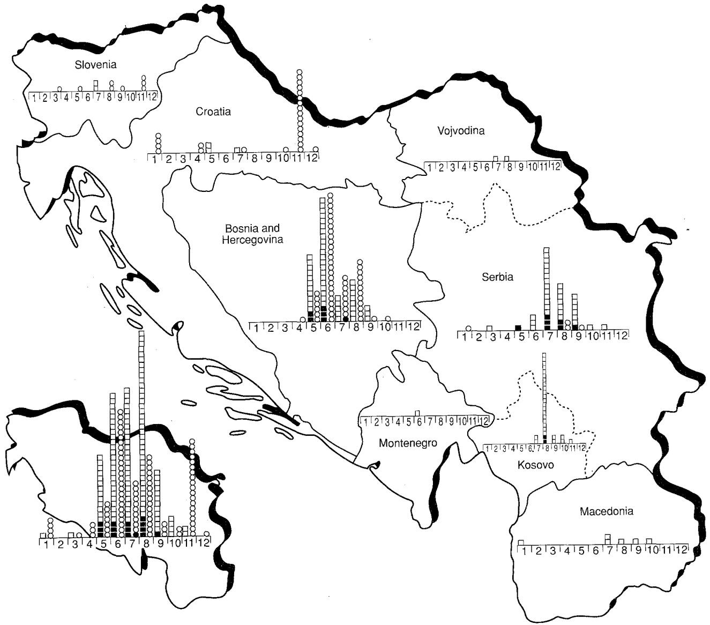
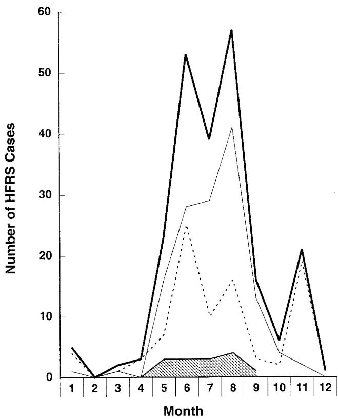

# HEMORRHAGIC FEVER WITH RENAL SYNDROME IN YUGOSLAVIA: EPIDEMIOLOGIC AND EPIZootIOLOGIC FEATURES OF A NATIONWIDE OUTBREAK IN 1989

A. GLIGIC\*, R. STOJANOVIC\*, M. OBRADOVIC\*, D. HLACA\*\*, N. DIMKOVIC\*\*\*, G. DIGLISIC\*, V. LUKAC\*\*, Z. LER\*\*, R. BOGDANOVIC\*\*\*, B. ANTONIJEVIC†, D. ROPAC††, T. AVSIC-ZUPANC†††, J.W. LEDUC††††, T. KSIAZEK††††, R. YANAGIHARA††††† and D.C. GAJDUSEK†††††

*Institute of Immunology and Virology - Vojvod Stepe 458 - 11000 Belgrade - Yugoslavia.  
**Military Medical Academy - 11000 Belgrade - Yugoslavia.

***Medical University - Sarajevo.

\*\*\*\*Institute for Renal Diseases and \*\*\*\*Institute for Mother and Child - 11000 Belgrade - Yugoslavia. †Institute for Infectious and Tropical Diseases - 11000 Belgrade - Yugoslavia.

††Military Hospital for Infectious Diseases - Zegreb.

Medical University - Ljubljana - Yugoslavia.

$\dagger \dagger \dagger \dagger$ Disease Assessment Division - U.S. Army Medical Research Institute of Infectious Diseases Ft. Detrick - Frederick - Maryland.

$\dagger \dagger \dagger \dagger \dagger$ Laboratory of Central Nervous System Studies - National Institute of Neurological Disorders and Stroke - National Institutes of Health - Bethesda - Maryland.

Key words: Hemorrhagic fever - Hantavirus - Bunyaviridae - Rodents

A nationwide epidemic of hemorrhagic fever with renal syndrome (HFRS) occurred in Yugoslavia in 1989. Sera from 609 hospitalized patients, from all six Republics (Bosnia and Herzegovina, Croatia, Macedonia, Montenegro Serbia, Slovenia) and two Provinces (Kosovo and Vojvodina), who had signs and symptoms suggestive of HFRS, and sera and lung tissues from 544 small mammals belonging to 13 species were studied for evidence of hantavirus infection. Of the 226 patients with serologically confirmed HFRS, 182 resided in Bosnia and Herzegovina or in Serbia. The severity of disease differed from region to region, with an overall fatality of $6.6\%$ (15/226). Patients from southern Yugoslavia tended to have more severe disease and exhibited two types of antibody patterns, while approximately equal numbers of clinically severe and mild cases of HFRS were registered in central Yugoslavia, where four types of antibody patterns were found. Two of these antibody patterns suggested the existence of hantaviruses which are antigenically distinct from those reported to date. Two seasonal peaks of disease, one during the summer and the other in late autumn, were found. Hantaviral antibodies and/or antigens were detected most often in the yellow-necked mouse (Apodemus flavicollis) (88/189), the wood mouse (Apodemus sylvaticus) (28/146), the striped field mouse (Apodemus agrarius) (10/64), the bank vole (Clethrionomys glareolus) (36/63), the house mouse (Mus musculus) (14/29), and the Norway rat (Rattus norvegicus) (14/21). Five other species of rodents and insectivores were infrequently infected.

# INTRODUCTION

Research on hemorrhagic fever with renal syndrome (HFRS), an acute viral-induced nephropathy, was

languishing in 1978 when Hantaan virus was identified as the etiologic agent of Korean hemorrhagic fever (12). This discovery resulted in a dramatic resurgence in laboratory research and field studies and enabled the definitive serodiagnosis of infection in humans, as

well as the identification of animal reservoirs and secondary hosts (29). At least six antigenically related but distinct viruses, belonging to the newly defined Hantavirus genus of the family Bunyaviridae, have now been recognized (4, 13, 14, 16, 21).

Since 1952 when the first case of HFRS was reported in Bosnia and Herzegovina and Slovenia (22), epidemics and sporadic cases of clinically mild and severe HFRS have been recorded annually throughout Yugoslavia (2, 5, 6, 10, 11, 18, 26). Cases were first recognized in Montenegro in 1967 (18) and in the Cacak region of Serbia in 1979 (2, 6). In 1961 the first recognized epidemic of HFRS occurred in a military camp in the forest Fruska Gora in Vojvodina province, $50~\mathrm{km}$ west of Belgrade. A total of 46 soldiers were taken ill (13 with severe and 33 with mild disease) with one fatality (11). A second epidemic in 1967, affecting more than 200 individuals with 5 fatalities, centered in Bosnia and Herzegovina (Fojnica), Croatia (Plitvice Lakes) and Montenegro (5, 26). Nineteen years later, in 1986, an outbreak of HFRS occurred in all six republics and two provinces of Yugoslavia (10). Studies conducted two years prior to this last outbreak resulted in the isolation of two antigenically and biologically distinct hantaviruses, named Fojnica and Vranica, from the yellow-necked mouse (Apodemus flavicollis) and the bank vole (Clethrionomys glareolus), respectively (9). The demonstration of these viruses, which closely resemble Hantaan and Puumala viruses, was consistent with the serologic data reported previously (8, 15, 17) and with the clinical observations of both severe and mild forms of HFRS in Yugoslavia (2, 5, 6, 10, 11, 18, 22, 26). However, some patients with HFRS exhibited atypical serological responses to prototype hantavirus strains, as well as to virus strains Fojnica and Vranica, suggesting the existence of other hantavirus variants in Yugoslavia (3, 9).

A major outbreak of HFRS occurring in 1989 in Yugoslavia, which centered in Bosnia and Herzegovina (near Sarajevo) and in Croatia and Serbia, offered us an excellent opportunity to investigate various aspects of this important disease. We report on the lessons learned about the epizootiology and epidemiology of HFRS from this nationwide outbreak.

# MATERIALS AND METHODS

# Patient population

A nationwide epidemic of HFRS occurred in Yugoslavia from January to December 1989. Eighthundred seventy-two sera from 609 hospitalized patients suspected of having HFRS were referred to us for testing at the National Reference Laboratory for Viral Hemorrhagic Fevers in Belgrade. Signs and symptoms included sudden onset of high fever, abdominal or back pain, retro-orbital headache, vomiting, hemorrhagic manifestations (such as scleral

hemorrhages, epistaxis, hemoptysis, ecchymoses), prolonged clotting time, proteinuria and/or oliguria. Patients from hospitals in all six Republics (Bosnia and Herzegovina, Croatia, Macedonia, Montenegro, Serbia, Slovenia) and two Provinces (Kosovo and Vojvodina) were studied.

# Trapping and testing of small mammals

Small mammals were captured using live traps between October 1988 and October 1989 in foci known to be endemic for HFRS, including Ivanjica, Cacak and Pozarevac and surrounding regions in Serbia, Nova Mesto in Slovenia, and Karlovac and Plitvice Lakes in Croatia. In addition, animals were trapped in newly recognized HFRS foci, namely Hadzici and Olovo in Bosnia and Herzegovina (which formed the center of the epidemic in 1989). The 544 small mammals were trapped around houses and fields and forests near the homes of HFRS patients, except in the Plitvice Lakes region, where animals were trapped only in the forest. Animals were speciated in the field laboratory. Sera, collected from 516 small mammals, were diluted 1:16 in phosphate buffered saline (PBS, pH 7.2) and stored at $-20^{\circ}\mathrm{C}$ until testing for anti-hantavirus antibodies. Lung tissues were removed aseptically from 541 animals and stored in liquid nitrogen, prior to being examined for hantavirus antigen by the indirect immunofluorescent antibody (IFA) technique (9), using convalescent-phase sera from a Korean patient with serologically confirmed Korean hemorrhagic fever, a Swedish patient with serologically confirmed nephropathia epidemiica, and two Yugoslavian HFRS patients (one with mild disease and the other with severe disease), and 8 antiglobulin units of fluorescein isothiocyanate-conjugated goat antibodies to human immunoglobulins (INEP Laboratory, Belgrade). Sera from seronegative individuals served as negative controls.

# Serological methods

Sera from 609 patients with suspected HFRS and from 516 small mammals (predominantly rodents) were tested for antibodies against Hantaan virus strain 76-118 (12) and Puumala virus strain Hällnäs (27) by the IFA method, using fluorescein isothiocyanatelabeled goat antibodies to human and mouse immunoglobulins. Human sera were also tested for antibodies against Fojnica (9), Vranica (9), Seoul (13, 17) and Prospect Hill viruses (16). Sera were initially tested at a 1:32 dilution using spot slides of Vero E6 cells infected with hantaviruses as described previously (9, 17). Sera showing characteristic intracytoplasmic, virus-specific fluorescence were considered positive and were diluted further in twofold increments. IFA titers were expressed as the reciprocal of the highest dilution of serum giving typical fluorescence. Human and mouse sera lacking antibodies to hantaviruses and uninfected Vero E6 cells were included as negative controls.

Human sera were also tested for IgM antibodies to Hantaan and Puumala viruses by ELISA (19). Briefly, two-fold dilution (beginning at 1:100) of each serum were added to wells coated with affinity purified goat anti-human IgM $(\mu$ chain-specific) for $1\textrm{h}$ at $37^{\circ}C.$ AntiHantaan or anti-Puumala virus-specific IgM antibodies were then detected by adding virus or control antigen and antivirus-specific rabbit antibodies, which were detected by peroxidase-labeled anti-rabbit IgG.

# RESULTS

# Human survey

Of the 609 patients with signs and symptoms suggestive of HFRS, 226 were found to have

serological evidence of acute hantavirus infection (Table 1). The majority of HFRS patients were from Bosnia and Herzegovina (108 patients) or from Serbia (including Kosovo and Vojvodina Provinces) (74 patients) (Fig. 1 and Table 1). Hemorrhagic fever and hemorrhagic fever with acute renal insufficiency were the tentative diagnoses in 66 and 46, respectively, of the 226 serologically confirmed cases at the time their sera were referred to the National Reference Laboratory in Belgrade. Notably, serological confirmation was most common in patients from Bosnia and Herzegovina and from Croatia (Table 1). Among the 383 patients in whom anti-hantaviral antibodies were not detected, fever of unknown origin, acute renal disease and suspected hemorrhagic fever were the most frequent diagnoses.

  
Figure 1. - Distribution of hemorrhagic fever with renal syndrome cases in the six republics and two provinces of Yugoslavia during a nationwide epidemic in 1989. Each serologically confirmed case was serotyped (□, Hantaan serotype; ■, fatal case with Hantaan serotype; ○, Puumala serotype; ●, fatal case with Puumala serotype) and displayed according to the month of occurrence.

TABLE 1. - Study population for nationwide survey of hemorrhagic fever with renal syndrome in Yugoslavia in ${1989}^{ * }$ .   

<table><tr><td>Republics and Provinces</td><td>No. of clinically suspected cases</td><td>No. of serologically confirmed cases</td><td>Percent confirmation</td><td>No. of fatal cases</td><td>Percent mortality</td></tr><tr><td>Bosnia and Herzegovina</td><td>226</td><td>108</td><td>48</td><td>6</td><td>5.5</td></tr><tr><td>Croatia</td><td>47</td><td>27</td><td>57</td><td>0</td><td>0</td></tr><tr><td>Macedonia</td><td>15</td><td>6</td><td>40</td><td>0</td><td>0</td></tr><tr><td>Montenegro</td><td>4</td><td>1</td><td>25</td><td>0</td><td>0</td></tr><tr><td>Slovenia</td><td>40</td><td>10</td><td>25</td><td>0</td><td>0</td></tr><tr><td>Serbia</td><td>179</td><td>43</td><td>24</td><td>7</td><td>16.3</td></tr><tr><td>Kosovo</td><td>83</td><td>29</td><td>35</td><td>2</td><td>6.9</td></tr><tr><td>Vojvodina</td><td>15</td><td>2</td><td>13</td><td>0</td><td>0</td></tr><tr><td>Nationwide</td><td>609</td><td>226</td><td>37</td><td>15</td><td>6.6</td></tr></table>

* = Sera were tested for antibodies against Hantaan and Puumala viruses by the indirect immunofluorescent antibody technique and by enzyme immunoassay.

Clinical disease among the serologically confirmed cases of HFRS varied from mild to severe, and the severity of disease differed from foci to foci. In Croatia and Slovenia, the mild form of disease predominated. By contrast, patients from Macedonia and Serbia (including Kosovo and Vojvodina) had more severe HFRS (fatality, $16.3\%$ ), while in central Yugoslavia (Bosnia and Herzegovina), approximately equal numbers of clinically severe and mild disease were registered, with a fatality of $5.5\%$ (Table 1).

Patients with serologically confirmed HFRS were classified into four groups based upon their seroreactivity to hantaviruses by IFA and ELISA. Of the 226 HFRS patients, 135 reacted primarily to Hantaan or Hantaan-like viruses (groups I and II), while 91 reacted principally to Puumala of Puumalalike viruses (groups III and IV). Like HFRS patients in Korea and the People's Republic of China, patients in group I possessed high antibody titers to Hantaan and Seoul viruses with much lower reactivities to Puumala and Prospect Hill viruses by IFA and ELISA (patients 1 and 2 in Table 2). Patients in group II had high antibody titers to Hantaan, Seoul and Puumala viruses by IFA with high IgM antibody titers to Hantaan virus by ELISA and without IgM reactivity to Puumala virus by ELISA (patients 3 to 5 in Table 2). Clinical disease among patients in these groups tended to be severe. Of the 15 fatal cases, 14 belonged to groups I and II, for an overall mortality of $10.4\%$ .

Patients in group III, like Scandinavian patients with nephropathia epidemica, had high antibody titers to Puumala virus by IFA and ELISA and lower antibody titers to Hantaan, Seoul and Prospect Hill viruses by IFA and ELISA (patients 6 and 7 in Table 2). Finally, patients in group IV appeared to be infected with a virus which was antigenically distinct from Puumala virus, as evidenced by their striking reactivity to Puumala virus by IFA and ELISA in the absence of reactivity to Hantaan virus by either IFA or

ELISA (patients 8 to 10 in Table 2). Disease among patients in these groups tended to be clinically mild, resembling a flu-like illness, but some patients had more severe disease, with one ending in death (mortality, $1\%$ ).

All four types of antibody responses were found in patients from Bosnia and Herzegovina and from Serbia (Ivanjica, Cacak), while patients from southeast Serbia, Kosovo, Vojvodina and Macedonia exhibited group II-type responses, indicating infection with a new hantavirus serotype. Group III-type responses were found primarily in patients from Croatia and Slovenia, indicating infection with the Puumala serotype.

Of the 138 HFRS patients (108 males and 30 females) whose occupations were known, 31 were farmers, 21 were soldiers, 18 were forestry workers, 20 were students and 18 were homemakers. The remaining 30 had a variety of other vocations (Table 3). Overall, five of the 15 fatal cases were women, all of whom were homemakers. Ages were available for 177 of the 226 HFRS patients, and of these, 112 $(63\%)$ were between the ages of 21 and 50 years. Four patients $(2\%)$ were younger than 10 years, 14 $(8\%)$ were between 11 and 15 years, 18 $(10\%)$ were between 16 and 20 years and 29 $(16\%)$ were 51 years or older (Table 4).

The seasonal occurrence of HFRS indicated two peaks, one during the summer and the other in late autumn (Fig. 2). The peak in autumn was associated with disease due to the Puumala serotype, while the late summer peak was due primarily to the Hantaan serotype.

# Small mammals survey

Of the 544 small mammals captured in the different foci, 525 were wild rodents belonging to 9 species and 19 were insectivores belonging to 4 species (Table 5). Anti-hantavirus antibodies were detected by IFA in 129 of the 516 animals from whom sera were

TABLE 2. - Seroreactivity of representative patients with hemorrhagic fever with renal syndrome to Hantaan and Puumala viruses by the indirect immunofluorescence antibody (IFA) test and by enzyme immunoassay (ELISA)*.   

<table><tr><td rowspan="2">Group</td><td rowspan="2">Patient</td><td colspan="4">IFA</td><td colspan="2">ELISA IgM</td></tr><tr><td>Hantaan</td><td>Seoul</td><td>Puumala</td><td>Prospect Hill</td><td>Hantaan</td><td>Puumala</td></tr><tr><td rowspan="2">I</td><td>1</td><td>&gt;2048</td><td>2048</td><td>128</td><td>&lt;16</td><td>3200</td><td>800</td></tr><tr><td>2</td><td>&gt;2048</td><td>2048</td><td>256</td><td>16</td><td>12800</td><td>400</td></tr><tr><td rowspan="3">II</td><td>3</td><td>1024</td><td>1024</td><td>1024</td><td>16</td><td>3200</td><td>&lt;100</td></tr><tr><td>4</td><td>1024</td><td>1024</td><td>1024</td><td>16</td><td>6400</td><td>&lt;100</td></tr><tr><td>5</td><td>&gt;2048</td><td>1024</td><td>&gt;2048</td><td>128</td><td>&gt;12800</td><td>&lt;100</td></tr><tr><td rowspan="2">III</td><td>6</td><td>256</td><td>1024</td><td>1024</td><td>32</td><td>1600</td><td>&gt;12800</td></tr><tr><td>7</td><td>128</td><td>64</td><td>512</td><td>64</td><td>400</td><td>3200</td></tr><tr><td rowspan="3">IV</td><td>8</td><td>&lt;16</td><td>&lt;16</td><td>2048</td><td>64</td><td>&lt;100</td><td>&gt;12800</td></tr><tr><td>9</td><td>16</td><td>16</td><td>&gt;2048</td><td>256</td><td>&lt;100</td><td>&gt;12800</td></tr><tr><td>10</td><td>&lt;16</td><td>&lt;16</td><td>2048</td><td>64</td><td>&lt;100</td><td>&gt;12800</td></tr></table>

$^{*} =$ Antibody titers were determined against hantaviruses on serum samples obtained between 7 and 10 days after onset of illness. Antibody titers against Fojnica and Vranica viruses were similar to those against Hantaan and Puumula viruses, respectively.

TABLE 3. - Occupation of patients with serologically proven HFRS in Yugoslavia in 1989*.   

<table><tr><td>Occupation</td><td>Bosnia and Herzegovina</td><td>Croatia</td><td>Macedonia</td><td>Serbia</td><td>Kosovo</td><td>Vojvodina</td></tr><tr><td>Pupil</td><td>1</td><td>0</td><td>0</td><td>1</td><td>1</td><td>0</td></tr><tr><td>Scholar</td><td>2</td><td>0</td><td>0</td><td>8</td><td>7 (1)</td><td>0</td></tr><tr><td>Soldier</td><td>2</td><td>19</td><td>0</td><td>0</td><td>0</td><td>0</td></tr><tr><td>Farmer</td><td>7</td><td>0</td><td>5</td><td>11 (2)</td><td>7</td><td>1</td></tr><tr><td>Forest worker</td><td>15 (3)</td><td>0</td><td>0</td><td>3 (1)</td><td>0</td><td>0</td></tr><tr><td>Housewife</td><td>5 (2)</td><td>2</td><td>1</td><td>5 (2)</td><td>5 (1)</td><td>0</td></tr><tr><td>Other</td><td>13</td><td>1</td><td>0</td><td>14 (2)</td><td>1</td><td>1</td></tr></table>

* = Of the 226 serologically proven cases of HFRS occurring during 1989, vocations were known for 138. The occupations for the single HFRS case from Montenegro and for the 10 cases from Slovenia were not known. The number of fatal cases are shown in parenthesis.

available, and hantaviral antigen was found in lung tissues from 139 of the 541 small mammals, belonging to 11 species (Table 5). The yellow-necked mouse (Apodemus flavicollis) was the most frequently infected rodent species in Serbia (Ivanjica) and in Bosnia and Herzegovina (Olovo and Hadzici), which formed the center of the epidemic in 1989. In Olovo and Hadzici in central Yugoslavia, where more than 100 cases of HFRS occurred, four of five rodent species captured during the peak of the epidemic in July 1989 were infected with hantaviruses (Table 5). In Cacak, Ivanjica, Pozarevac (Serbia) and in Olovo (Bosnia and Herzegovina), the wood mouse (Apodemus sylvaticus) was commonly infected, while

virus-infected striped field mice (Apodemus agrarius) were found only in Cacak and Pozarevac (Serbia) (Table 5). In the Plitvice Lakes region (Croatia), numerous infected populations of the bank vole (Clethrionomys glareolus) and $A$ . flavicollis were captured, but only one HFRS case was registered in 1989. Of significance was the conspicuous absence of $A$ . sylvaticus. Interestingly, a high percentage of virus-infected house mice (Mus musculus) were captured in Pozarevac and Ivanjica (Serbia), and infected Norway rats (Rattus norvegicus) were found in Pozarevac where serologically confirmed urban cases of HFRS have been reported.

Hantavirus infection in small mammals, according

TABLE 4. - Age distribution of patients with serologically confirmed HFRS during the nationwide epidemic in 1989*.   

<table><tr><td>Age range</td><td>Bosnia and Herzegovina</td><td>Croatia</td><td>Macedonia</td><td>Serbia</td><td>Kosovo</td><td>Vojvodina</td></tr><tr><td>0 - 10</td><td>0</td><td>0</td><td>0</td><td>2</td><td>2</td><td>0</td></tr><tr><td>11 - 15</td><td>3</td><td>0</td><td>0</td><td>7</td><td>4 (1)</td><td>0</td></tr><tr><td>16 - 20</td><td>3</td><td>10</td><td>0</td><td>1</td><td>4</td><td>0</td></tr><tr><td>21 - 30</td><td>24</td><td>10</td><td>1</td><td>6 (2)</td><td>5</td><td>1</td></tr><tr><td>31 - 40</td><td>24 (2)</td><td>2</td><td>3</td><td>17 (2)</td><td>1</td><td>1</td></tr><tr><td>41 - 50</td><td>9 (1)</td><td>0</td><td>1</td><td>3 (1)</td><td>4 (1)</td><td>0</td></tr><tr><td>51 - 60</td><td>16 (2)</td><td>1</td><td>0</td><td>2 (1)</td><td>1</td><td>0</td></tr><tr><td>61 - 70</td><td>1 (1)</td><td>0</td><td>0</td><td>0</td><td>4</td><td>0</td></tr><tr><td>71 - 80</td><td>2</td><td>0</td><td>0</td><td>2</td><td>0</td><td>0</td></tr></table>

* = Of the 226 serologically confirmed HFRS patients, ages were available for 177. Ages were unavailable for the single HFRS patient from Montenegro and for the 10 patients from Slovenia. The number of fatal cases is shown in parenthesis.

  
Figure 2. - Seasonal distribution of hemorrhagic fever with renal syndrome (HFRS) cases in Yugoslavia during a nationwide epidemic in 1989. Total number of cases (bold solid line), cases with Hantaan serotype (solid line), cases with Puumala serotype (broken line) and fatal cases (shaded area) are shown.

to age and gender, indicated a disparity from region to region prior to and during the epidemic. Female animals were overrepresented before the epidemic and juvenile and subadult forms were underrepresented during the epidemic (Table 6).

# DISCUSSION

Using four hantavirus serotypes (Hantaan, Seoul, Puumala and Prospect Hill) and two serological methods (IFA and ELISA), we gained important insights into the epidemiology and epizootiology of HFRS in Yugoslavia. Unlike the HFRS epidemic in 1986 in which most patients originated in Montenegro, the outbreak in 1989 centered primarily in Bosnia and Herzegovina and in Serbia, with only one confirmed case in Montenegro. Earlier serologic studies indicated the existence of at least two hantavirus serotypes in Yugoslavia (15, 17). The subsequent isolation of Fojinica and Vranica viruses, which were antigenically indistinguishable from Hantaan and Puumala viruses, respectively, was consistent with the serologic data and clinical observations (9). However, some HFRS patients from Yugoslavia exhibited seroreactivities which were distinct from individuals infected with Hantaan (or Fojinica) and Puumala (or Vranica) viruses (9). Similarly, in the present study, the immune response of some HFRS patients to Hantaan, Seoul, Puumala and Prospect Hill viruses indicate that other, as yet identified serotypes or variants of hantaviruses may circulate in Yugoslavia. On the basis of serological results, Hantaan and Hantaan-like viruses

TABLE 5. - Prevalence of hantavirus infection among small mammals captured in regions endemic for hemorrhagic fever with renal syndrome*.   

<table><tr><td>Location</td><td>Species</td><td>Number Trapped</td><td>Ag Positive</td><td>Ab Positive</td><td>Ag and Ab Positive</td></tr><tr><td rowspan="6">Cacak</td><td>Apodemus flavicollis</td><td>1</td><td>1</td><td>0</td><td>0</td></tr><tr><td>Apodemus sylvaticus</td><td>90</td><td>14</td><td>4</td><td>3</td></tr><tr><td>Apodemus agrarius</td><td>44</td><td>6</td><td>2</td><td>2</td></tr><tr><td>Apodemus microps</td><td>5</td><td>1</td><td>1</td><td>1</td></tr><tr><td>Sorex araneus</td><td>1</td><td>NT</td><td>0</td><td>0</td></tr><tr><td>Crocidura subalveolens</td><td>8</td><td>2</td><td>0</td><td>0</td></tr><tr><td rowspan="7">Ivanjica</td><td>Apodemus flavicollis</td><td>12</td><td>3</td><td>2</td><td>1</td></tr><tr><td>Apodemus sylvaticus</td><td>17</td><td>4</td><td>0</td><td>0</td></tr><tr><td>Clethrinomys glareolus</td><td>1</td><td>1</td><td>1</td><td>1</td></tr><tr><td>Pitimys subterraneus</td><td>1</td><td>1</td><td>0</td><td>0</td></tr><tr><td>Mus musculus</td><td>7</td><td>3</td><td>0</td><td>0</td></tr><tr><td>Sorex araneus</td><td>2</td><td>1</td><td>NT</td><td>0</td></tr><tr><td>Neomys fodiens</td><td>2</td><td>2</td><td>NT</td><td>0</td></tr><tr><td rowspan="9">Pozarevac</td><td>Apodemus flavicollis</td><td>11</td><td>1</td><td>1</td><td>1</td></tr><tr><td>Apodemus sylvaticus</td><td>24</td><td>5</td><td>2</td><td>1</td></tr><tr><td>Apodemus agrarius</td><td>20</td><td>4</td><td>2</td><td>2</td></tr><tr><td>Apodemus microps</td><td>1</td><td>0</td><td>NT</td><td>0</td></tr><tr><td>Pitimys subterraneus</td><td>2</td><td>0</td><td>NT</td><td>0</td></tr><tr><td>Microtus arvalis</td><td>2</td><td>0</td><td>0</td><td>0</td></tr><tr><td>Mus musculus</td><td>21</td><td>8</td><td>6</td><td>4</td></tr><tr><td>Rattus norvegicus</td><td>5</td><td>5</td><td>4</td><td>4</td></tr><tr><td>Crocidura subalveolens</td><td>5</td><td>1</td><td>NT</td><td>0</td></tr><tr><td rowspan="3">Novo Mesto</td><td>Apodemus flavicollis</td><td>3</td><td>2</td><td>0</td><td>0</td></tr><tr><td>Apodemus sylvaticus</td><td>6</td><td>1</td><td>0</td><td>0</td></tr><tr><td>Pitimys subterraneus</td><td>1</td><td>0</td><td>0</td><td>0</td></tr><tr><td rowspan="3">Karlovac and Ostarije</td><td>Apodemus flavicollis</td><td>1</td><td>1</td><td>0</td><td>0</td></tr><tr><td>Apodemus sylvaticus</td><td>1</td><td>1</td><td>0</td><td>0</td></tr><tr><td>Rattus norvegicus</td><td>16</td><td>4</td><td>7</td><td>2</td></tr><tr><td rowspan="3">Plitvice Lakes</td><td>Apodemus flavicollis</td><td>84</td><td>17</td><td>27</td><td>9</td></tr><tr><td>Clethrionomys glareolus</td><td>60</td><td>18</td><td>30</td><td>14</td></tr><tr><td>Sorex alpinus</td><td>1</td><td>1</td><td>0</td><td>0</td></tr><tr><td rowspan="3">Olovo</td><td>Apodemus flavicollis</td><td>28</td><td>7</td><td>12</td><td>5</td></tr><tr><td>Apodemus sylvaticus</td><td>6</td><td>1</td><td>3</td><td>1</td></tr><tr><td>Mus musculus</td><td>1</td><td>1</td><td>1</td><td>1</td></tr><tr><td rowspan="4">Hadzici</td><td>Apodemus flavicollis</td><td>49</td><td>21</td><td>24</td><td>15</td></tr><tr><td>Apodemus sylvaticus</td><td>2</td><td>0</td><td>0</td><td>0</td></tr><tr><td>Clethrionomys glareolus</td><td>2</td><td>1</td><td>0</td><td>0</td></tr><tr><td>Microtus species</td><td>1</td><td>0</td><td>0</td><td>0</td></tr><tr><td>TOTAL</td><td></td><td>544</td><td>139</td><td>129</td><td>67</td></tr></table>

NOTE: Animals were tested for hantavirus antigen (Ag) and antibody (Ab) by the indirect immunofluorescent antibody test. NT - not tested.

TABLE 6. - Age and gender distribution of small mammals in regions endemic for hemorrhagic fever with renal syndrome*.   

<table><tr><td rowspan="2">Age and 
Sex Group</td><td colspan="3">Serbia</td><td colspan="2">Croatia</td><td>Slovenia</td><td colspan="2">Bosnia/Hercegovina</td><td rowspan="2">Total</td></tr><tr><td>Cacak</td><td>Ivanjica</td><td>Pozarevac</td><td>Karlovac</td><td>Plitvice</td><td>Novo Mesto</td><td>Olovo</td><td>Hadzici</td></tr><tr><td>Juvenile</td><td>2</td><td>0</td><td>6.6</td><td>33.3</td><td>1.4</td><td>10</td><td>0</td><td>1.8</td><td>3.5</td></tr><tr><td>Subadult</td><td>40.2</td><td>4.7</td><td>22</td><td>0</td><td>13.8</td><td>10</td><td>5.7</td><td>1.9</td><td>19.5</td></tr><tr><td>Adult</td><td>57.8</td><td>95.3</td><td>71.4</td><td>66.7</td><td>84.8</td><td>80</td><td>94.3</td><td>96.3</td><td>77</td></tr><tr><td>Male</td><td>63.7</td><td>33.3</td><td>46.2</td><td>44.4</td><td>44.8</td><td>60</td><td>71.4</td><td>66.7</td><td>53.7</td></tr><tr><td>Female</td><td>36.3</td><td>66.7</td><td>52.8</td><td>55.6</td><td>55.2</td><td>40</td><td>28.6</td><td>33.3</td><td>46.3</td></tr></table>

* = As determined by antigen detection in lung tissues, prevalence of hantavirus infection among small mammals was 16.2% in Cacak, 35.7% in Ivanjica, 26.6% in Pozarevac, 33.3% in Karlovac, 24.8% in Plitvice, 30% in Novo Mesto, 25.7% in Olovo and 40.7% in Hadzici. The overall prevalence was 25.7%.

circulate primarily in south and central Yugoslavia, while Puumala and Puumala-like viruses abound principally in the northern and central sectors. The characterization of antigenically distinct hantaviruses, newly isolated from blood and urine of HFRS patients, now in progress, may clarify the spectrum of disease-causing hantaviruses in Yugoslavia.

The seasonal distribution of HFRS in Yugoslavia, with culmination in July and August, is similar to that in Hungary and Bulgaria (25) and in Greece (1). By contrast, in Scandinavia and Far East Asia, HFRS occurs most often during the spring and late autumn (20, 24). The summer peak can be accounted for by infection among children, who were exposed to excreta of virus-infected rodents during their summer holidays spent in special mountain houses (bacije) or while caring for cattle or picking wild berries or mushrooms in the forests.

Since the first outbreak of HFRS in Yugoslavia in 1961, rodents have been known to play an important role in the enzootic cycle of the disease. Multiple species of rodents and other small mammals in Yugoslavia have been previously identified to be naturally infected with hantaviruses (8, 10). In addition to these species, the present study found evidence of hantavirus infection in two other rodent species. However, it is not known whether all of these species serve as reservoirs for human infections, or which species merely serve as accessory hosts, participating only in the maintenance of the enzootic cycle. Also, the presence of infection in multiple species of rodents and insectivores makes problematic precise identification of the species responsible for any given epidemic. The more widespread geographic distribution of hantaviruses among rodents than the distribution of HFRS in Yugoslavia may be due to the existence of less pathogenic hantaviruses, such as Prospect Hill virus (16, 28), or the absence of contact between particular rodent species and humans.

It is evident from age-specific prevalences of hantavirus infection among small mammals that the high populations of adult rather than subadult or

juvenile animals are associated with epidemic disease. At the same time, the greater proportion of male animals in Hadzici $(66.7\%)$ and Olovo $(71.4\%)$ would predict a decline in population and subsequent decrease in HFRS cases. This has been confirmed in 1990, when only a few sporadic cases of HFRS have been reported in Bosnia and Herzegovina.

To what extent hantavirus infection directly or indirectly influence the population cycles of rodents and other small mammals in HFRS-endemic foci is unknown. In addition, the complex interactions between climate, rodent and insectivore populations and human activities involved in the genesis of HFRS epidemics in the exact same regions (for example in 1967 and 1986 in Montenegro and in 1967 and 1989 in Bosnia and Herzegovina) are not well understood. However, some insights were gained from the study of the Plitvice Lakes region in Croatia, which appears to fulfill the epizootiologic conditions for the appearance of an epidemic. Specifically, the high population density of rodents of adult age and the high percentage of hantavirus-infected Apodemus flavicollis and Clethrionomys glareolus are in keeping with features found during epidemic years. However, epidemic disease did not occur in the Plitvice Lakes region in 1989. The possible explanations for this include the following: Plitvice Lakes has been proclaimed a National Park; the local population, which enjoys a high standard of living, is primarily occupied with tourism; movement through the park area is restricted to asphalt paths; the collection of forest fruits and flowers is strictly prohibited. So while the potential exists for epidemic disease, various circumstances and preventive measures have reduced the risk of infection.

High prevalence of hantavirus infection among peridomestic rodents (Mus musculus and Rattus norvegicus) indicate their possible role in maintenance of the enzootic cycle, as well as their importance as reservoirs for infection in humans (7, 23). Since murid, cricetid and arvicolid rodent species are sympatric and synchronistic in some habitats, the possibility exists

for genetic reassortment among hantaviruses, but definitive data are lacking.

HFRS has become an emergent problem of immense public health concern in several geographic regions, where invasion of rodent habitats for the purpose of agricultural or industrial development, or as a consequence of recreational activities, has produced potential for epidemic disease. The apparent circulation of more than two major disease-causing hantavirus serotypes in Yugoslavia, and the multiple infected animal species, makes for an extraordinary challenge for prevention and control. Further investigations are necessary to delineate the myriad ecologic, zoologic, sociologic, clinicopathologic and virologic aspects of HFRS in Yugoslavia.

# Acknowledgements

The authors express their sincere gratitude to the physicians of hospitals throughout Yugoslavia for their cooperation. We also thank Cynthia A. Rossi, Radmila Milutinovic and Ljubivoje Todorovic for excellent technical assistance.

This research was supported in part by contract no. DAMD 17-89-z-9009 from the U.S.. Army Medical Research and Development Command, Fort Detrick, Frederick, Maryland. Part of this work was conducted while the senior author was a Visiting Scientist of the Fogarty International Center, National Institutes of Health, Bethesda, Maryland.

# REFERENCES

1. Antoniadis A., LeDuc J.W. and Daniel-Alexiou S. (1987): Clinical and epidemiological aspects of hemorrhagic fever with renal syndrome (HFRS) in Greece - European Journal of Epidemiology 3: 295-301.   
2. Antonijevic B. and Gligic A. (1982): Hemorrhagic fever with renal syndrome. First report of virologically proven disease in Yugoslavia - Vojnosanit Pregled 39: 205-208.   
3. Avsic-Zupanc T., Likar M., Novakovic S. Cizman B., Krajger A., van der Groen G., Stojanovic R., Obradovic M., Gligic A. and LeDuc J.W. (1990): Evidence for the presence of two hantaviruses in Slovenia, Yugoslavia - Archives of Virology Suppl. 1: 87-94.   
4. Baek L.J., Yanagihara R., Gibbs C.J. Jr., Miyazaki M. and Gajdusek D.C. (1988): Leakey virus: a new hantavirus isolated from Mus musculus in the United States - Journal of General Virology 69: 3129-3132.   
5. Gaon J., Karlovac M., Gresikova M., Hlaca D., Rukavina J., Knezevic V., Saratlic-Savic D. and Vampotic A. (1968): Hemoragicna groznica sa renalnim sindromon na podrucju regiona Sarajevo (Bosna, Yugoslavia 1967). Epidemioloske karakteristike - Folia Medica Facultatis Medicinae, Universitatis Saraeviensis (Sarajevo) 3: 23-41.

6. Gligic A., Obradovic M., Stojanovic R., Antonijevic B., Ovcaric A., Knezevic R., Otasevic M., Lukovic S. and Nastic D. (1986): Virological and serological investigation of natural foci of hemorrhagic fever with renal syndrome in location Cacak (Serbia) - Giornale di Malattie Infettive e Parassitarie 38: 690-692.   
7. Gligic A., Obradovic M., Stojanovic R., Diglisic G., Lukac V., Antonijevic B. and Velimirovic D. (1988a): Karakteristike serotipova agensa hemoragicne groznice s bubreznim sindromo u Yugoslavia. Naucni sastanak virusologa Yugoslavia (Scientific meeting virologist of Yugoslavia) - Zbornik radova, VMA, pp. 111-116.   
8. Gligic A., Obradovic M., Stojanovic R., Hlaca D., Antonijevic B., Arnautovic A., Gaon J., Frusic M., Lee P.W., Goldgaber D., Yanagihara R., Gibbs C.J. Jr., Gajdusek D.C. and Svedmyr A. (1988b): Hemorrhagic fever with renal syndrome in Yugoslavia: detection of hantavirus antigen and antibody in wild rodents and serological diagnosis of human disease - Scandinavian Journal of Infectious Diseases 20: 261-266.   
9. Gligic A., Frusic M., Obradovic M., Stojanovic R., Hlaca D., Gibbs C.J. Jr., Yanagihara R., Calisher C.H. and Gajdusek D.C. (1989a): Hemorrhagic fever with renal syndrome in Yugoslavia. Antigenic characterization of hantaviruses isolated from Apodemus flavicollis and Clethrionomys glareolus - American Journal of Tropical Medicine and Hygiene 41: 109-115.   
10. Gligic A., Obradovic M., Stojanovic R., Vujosevic N., Ovaric A., Frusic M., Gibbs C.J. Jr., Calisher C.H. and Gajdusek D.C. (1989b): Epidemic hemorrhagic fever with renal syndrome in Yugoslavia, 1986 - American Journal of Tropical Medicine and Hygiene 41: 102-108.   
11. Heneberg D., Vuksic L.J. and Morelj M. (1961): Prethodno saopstenje o epidemiji hemoragicne groznice u jegnom vojnom kolektivu. Izvestaj jeder istrazivacke grupe Vojno-Medicinske Akademije JNA - Higijena (Beograd) 4: 297-303.   
12. Lee H.W., Lee P.-W. and Johnson K.M. (1978): Isolation of the etiological agent of Korean hemorrhagic fever - Journal of Infectious Diseases 137: 298-308.   
13. Lee H.W., Baek L.J. and Johnson K.M. (1982): Isolation of Hantaan virus, the etiologic agent of Korean hemorrhagic fever, from wild urban rats - Journal of Infectious Diseases 146: 638-644.   
14. Lee H.W., Lee P.-W., Baek L.J. and Chu Y.K. (1990): Geographical distribution of hemorrhagic fever with renal syndrome and hantaviruses. Archives of Virology Suppl. 1: 5-18.

15. Lee P.-W., Goldgaber D., Gibbs C.J. Jr., Gajdusek D.C., Yanagihara R.T., Svedmyr A., Hlaca D., Vesenjak-Hirjan J. and Gligic A. (1982): Other serotypes of hemorrhagic fever with renal syndrome viruses in Europe - Lancet 2: 1405-1406.   
16. Lee P.-W., Amyx H.L., Yanagihara R., Gajdusek D.C., Goldgaber D. and Gibbs C.J. Jr. (1985): Partial characterization of Prospect Hill virus isolated from meadow voles in the United States - Journal of Infectious Diseases 152: 826-829.   
17. Lee P.-W., Gibbs C.J. Jr., Gajdusek D.C. and Yanagihara R. (1985): Serotypic classification of hantaviruses by indirect immunofluorescent antibody and plaque reduction neutralization tests - Journal of Clinical Microbiology 22: 940-944.   
18. Mandic D. (1969): Epidemijska hemoragija ska groznica. Pri put otkrivena u Crnoj Gori - Medicinski glasnik (Beograd) 23: 155-158.   
19. Meegan J.M. and Le Duc J.W. (1989): Enzyme immunoassay. In Lee H.W., Dalrymple J.M. (eds): "Manual of Hemorrhagic Fever with Renal Syndrome". WHO Collaborating Center for Virus Reference and Research (HFRS) - Institute for Viral Diseases - Korea University - Seoul pp. 83-87.   
20. Niklasson B. and LeDuc J.W. (1987): Epidemiology of nephropathia epidemiica in Sweden - Journal of Infectious Diseases 155: 269-276.   
21. Schmaljohn C.S., Hasty S.E., Dalrymple J.M., LeDuc J.W., Lee H.W., von Bonsdorff C.H., Brummer-Korvenkontio M., Vaheri A., Tsai T.F., Regnery H.L., Goldgaber D. and Lee P.-W. (1985): Antigenic and genetic properties of virus linked to hemorrhagic fever with renal syndrome - Science 227: 1041-1044.   
22. Simic M. and Miric V. (1952): Uspela primena peritonealne dijalize kod jegnog slucaja bubrezne insufucijencieje - Vojnosanit Pregl. 9: 285-290.

23. Stojanovic R., Gligic A., Obradovic M., Knezevic R., Antonijevic B., Gaon J., Hlaca D. and Arnautovic A. (1987): Glodari i njihovi paraziti u zaristima hemoragicne groznice s bubreznim sindromom u Yugoslavia. Presented at the International Symposium of Hemorrhagic Fever with Renal Syndrome - Serbian Academy of Science.   
24. Tkachenko E.A. and Drozdov S.G. (1989): The study of HFRS in the Soviet Union. Presented at the First International Conference on Hemorrhagic Fever with Renal Syndrome - Seoul - Korea.   
25. Trencseni T. and Keleti B. (1971): Clinical Aspects and Epidemiology of Haemorrhagic Fever with Renal Syndrome - Analysis of Clinical and Epidemiological Experiences in Hungary - Akademiai Kiado - Budapest.   
26. Vesenjak-Hirjan J., Hrabar A., Vince-Ribaric V., Borcic B. and Brudjak Z. (1971): An outbreak of hemorrhagic fever with renal syndrome in the Plitvice Lakes area (preliminary report). Folia Parasitol. 18: 275-279.   
27. Yanagihara R., Goldfaber D., Lee P.-W., Amyx H.L., Gajdusek D.C., Gibbs C.J. Jr. and Svedmyr A. (1984): Propagation of Nephropathia epidemica virus in cell culture - Lancet I: 1013.   
28. Yanagihara R., Daum C.A., Lee P.-W., Baek L.J., Amyx H.L., Gajdusek D.C. and Gibbs C.J. Jr. (1987): Serological survey of Prospect Hill virus infection in indigenous wild rodents in the USA - Transactions of the Royal Society of Tropical Medicine and Hygiene 81: 42-45.   
29. Yanagihara R. and Gajdusek D.C. (1988): Hemorrhagic fever with renal syndrome: a historical perspective and review of recent advances - In Gear JHS (ed): "CRC Handbook of Viral and Rickettsial Hemorrhagic Fever" - Boca Raton - Fla: CRC Press pp. 151-188.