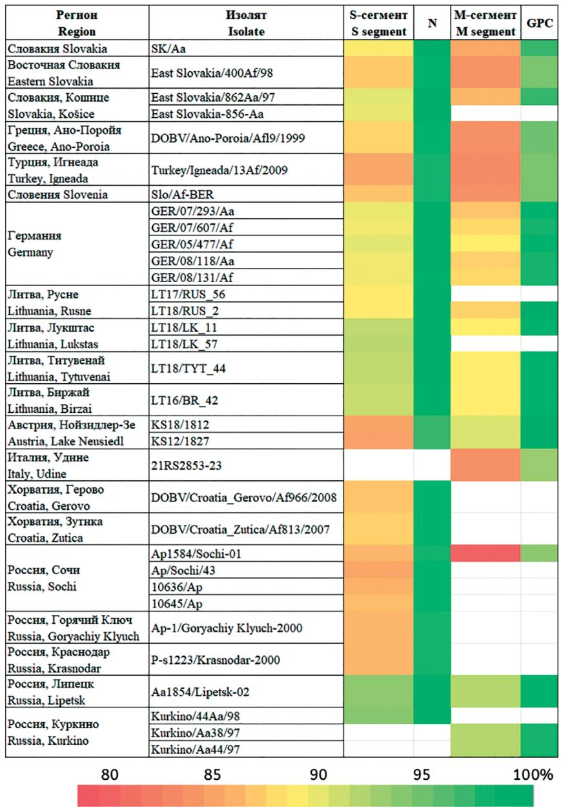
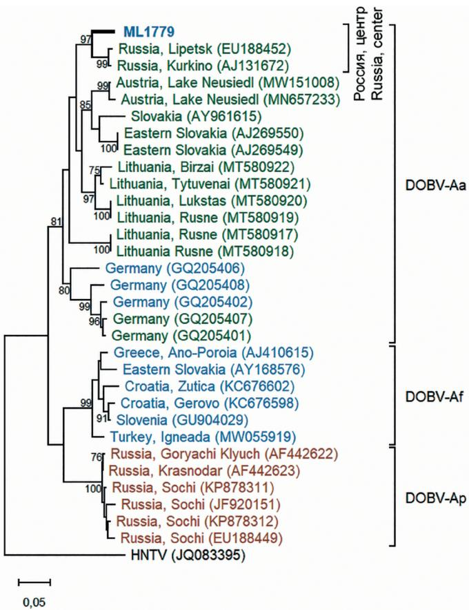
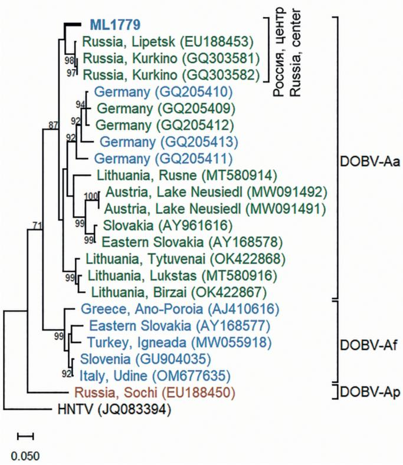
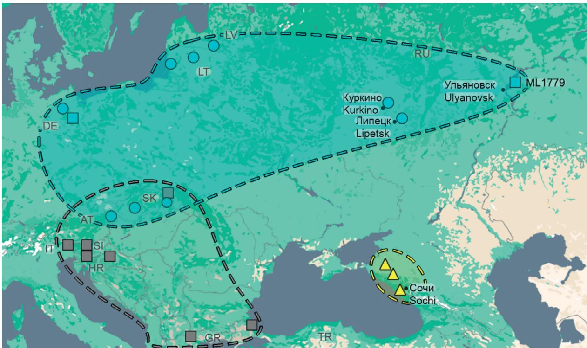

# Первый случай идентификации Orthohantavirus dobravaense, вирус Куркино (Hantaviridae: Orthohantavirus) на территории Приволжского федерального округа

Насыров Т.Р.1 , Елбоева П.И.1 , Мартынова Е.В.1 , Охлопкова О.В.2 , Тюрин Ю.А.3 , Кабве Э.1 , Давидюк Ю.Н.1

1 Институт фундаментальной медицины и биологии ФГАОУ ВО «Казанский (Приволжский) федеральный университет», 420008, г. Казань, Россия;   
2 НИИ вирусологии ФГБНУ «Федеральный исследовательский центр фундаментальной и трансляционной медицины», 630060, г. Новосибирск, Россия;   
3 ФГБОУ ВО «Казанский государственный медицинский университет» Минздрава России, 420012, г. Казань, Россия

# Резюме

Введение. Вирусы Куркино и Сочи – Orthohantavirus dobravaense (ODOB), являются одними из возбудите- лей геморрагической лихорадки с почечным синдромом на европейской части территории России. Однако в настоящее время в литературе приводятся только ограниченные данные о распространении в России генетических вариантов ODOB.

Цель – выявление ODOB на территориях ряда регионов Приволжского (ПФО), Центрального и Уральского федеральных округов $\mathsf { P } \Phi$ и проведение анализа их генома.

Материалы и методы. Общую РНК выделяли из образцов легочной ткани полевых мышей (Apodemus agrarius) и желтогорлых мышей (A. flavicollis), отловленных в ряде субъектов ПФО и соседних регионах в 2015–2023 гг. Выявление ортохантавирусной РНК проводили методом полимеразной цепной реакции (ПЦР) с обратной транскрипцией с использованием видоспецифичных праймеров для ODOB. Про- дукты ПЦР-амплификации разделяли в агарозном геле, очищали и секвенировали по Сэнгеру. Для секве- нированных участков генома проводили сравнительный и филогенетический анализ.

Результаты. В одном образце A. flavicollis из Ульяновской области была выявлена ортохантавирусная РНК. По результатам анализа нуклеотидных последовательностей секвенированных ПЦР-продуктов было установлено, что наиболее высокие значения идентичности были получены при сравнении выявленного нуклеотидной последовательности РНК-изолята с референсным штаммом ODOB (вирус Куркино из Туль- ской области). Данные филогенетического анализа секвенированных участков S- и M-сегментов позволили установить, что наиболее близкородственным выявленному РНК-изоляту оказался вирус Куркино, найден- ный ранее у A. agrarius в Тульской области. Таким образом, выявленный изолят был идентифицирован как вариант вируса Куркино, ранее выявленного в центральных областях России и в Западной Сибири, близко- родственные которому геноварианты распространены в странах центральной Европы.

Выводы. Впервые доказано, что: 1) ареал Orthohantavirus dobravaense (вирус Куркино) распространяется на часть территории ПФО; 2) в Ульяновской области коциркулируют Orthohantavirus dobravaense (вирус Куркино) и Orthohantavirus puumalaense (вирус Пуумала).

Ключевые слова: Orthohantavirus dobravaense; вирус Куркино; ГЛПС; Apodemus flavicollis; филогенетиче- ский анализ; коциркуляция; природный резервуар

Для цитирования: Насыров Т.Р., Елбоева П.И., Мартынова Е.В., Охлопкова О.В., Тюрин Ю.А., Кабве Э., Давидюк Ю.Н. Первый случай идентификации Orthohantavirus dobravaense, вирус Куркино (Hantaviridae: Orthohantavirus) на территории Приволжского федерального округа. Вопросы вирусологии. 2025; 70(6): 570–580. DOI: https://doi.org/10.36233/0507-4088-350 EDN: https://elibrary.ru/vwfdos

Финансирование. Исследование выполнено за счет гранта РНФ № 25-24-00186.

Конфликт интересов. Авторы подтверждают отсутствие конфликта финансовых/нефинансовых интересов, свя- занных с публикацией статьи.

Этическое утверждение. Авторы подтверждают соблюдение институциональных и национальных стандартов по использованию лабораторных животных в соответствии с Consensus author guidelines for animal use (IAVES 23.07.2010). Протокол исследования с использованием животных одобрен Комитетом по биомедицинской этике КФУ (Протокол № 23 от 30.06.2020).

ORIGINAL STUDY ARTICLE DOI: https://doi.org/10.36233/0507-4088-350

# The first identification of Orthohantavirus dobravaense, Kurkino virus (Hantaviridae: Orthohantavirus) in the Volga Federal District

Timur R. Nasyrov1 , Polina I. Elboeva1 , Ekaterina V. Martynova1 , Olesia V. Ohlopkova2 , Yuriy A. Tyurin3 , Emmanuel Kabwe1 , Yuriy N. Davidyuk1

1 Institute of Fundamental Medicine and Biology Federal State Autonomous Educational Institution of Higher Education «Kazan (Volga Region) Federal University», 420008, Kazan, Russia;

2 Research Institute of Virology, Federal Research Center for Fundamental and Translational Medicine, 630060, Novosibirsk, Russia;

3 Kazan State Medical University of the Ministry of Health of the Russian Federation, 420012, Kazan, Russia

# Abstract

Introduction. The Kurkino and Sochi viruses of species Orthohantavirus dobravaense (ODOB) are among the pathogens that cause hemorrhagic fever with renal syndrome in the European part of Russia. However, the current literature provides limited data on the distribution of genetic variants of the ODOB in Russia.

The aim is to identify ODOB in several regions of Volga, Central and Ural Federal districts of the Russian Federation and analyze their genome.

Materials and methods. Total RNA was isolated from lung tissue samples of striped field mouse (Apodemus agrarius) and yellow-necked mouse (A. flavicollis) captured in a number of areas of the Volga Federal District and neighboring regions in 2015–2023. Orthohantavirus RNA was detected by RT-PCR using specific primers to ODOB. The PCR amplification products were separated in agarose gel, purified, and subjected to Sanger sequencing. Comparative and phylogenetic analyses were performed for the sequenced genome fragments.

Results. Orthohantavirus RNA was detected in one sample of A. flavicollis from the Ulyanovsk region. Based on the analysis of the nucleotide sequences of the sequenced PCR products, it was found that the highest values of similarity were obtained when comparing the identified strain with the reference Kurkino virus from the Tula region. The data from the phylogenetic analysis of the sequenced fragment of the S and M segments allowed us to establish that the identified isolate is closely related to the Kurkino virus found earlier in A. agrarius in the Tula region. Thus, the detected isolate was identified as variant of Kurkino virus, which is also widespread in the central regions of Russia, Wetern Siberia and close related to genome variants that are distributed in Central Europian countries.

Conclusions. It is proved for the first time that: 1) the range of Orthohantavirus dobravaense (Kurkino virus) extends to a part of the territory of the Volga Federal District; 2) Orthohantavirus dobravaense (Kurkino virus) and Orthohantavirus puumalaense (Puumala virus) are co-circulating in the Ulyanovsk region.

Keywords: Orthohantavirus dobravaense; Kurkino virus; HFRS; Apodemus flavicollis; phylogenetic analysis; co-circulation; natural reservior

For citation: Nasyrov T.R., Elboeva P.I., Martynova E.V., Ohlopkova O.V., Tyurin Yu.A., Kabwe E., Davidyuk Yu.N. The first identification of Orthohantavirus dobravaense, Kurkino virus (Hantaviridae: Orthohantavirus) in the Volga Federal District. Problems of Virology (Voprosy Virusologii). 2025; 70(6): 570–580.

DOI: https://doi.org/10.36233/0507-4088-350 EDN: https://elibrary.ru/vwfdos

Funding. The research was funded by RNF grant № 25-24-00186.

Conflict of interest. The authors confirm that there is no conflict of financial/non-financial interests related to the publication of the article.

Ethics approval. Authors confirm compliance with institutional and national standards for the use of laboratory animals in accordance with «Consensus Author Guidelines for Animal Use» (IAVES, July 23, 2010). The research protocol was approved by the Ethics Committee of the institution (Protocol No 23 dated June 30, 2020).

# Введение

Ортохантавирусы представители семейства Hantaviridae, рода Orthohantavirus, – широко распро- странены на территориях всех континентов, за исклю- чением Антарктиды. Патогенные ортохантавирусы являются возбудителями таких заболеваний человека, как геморрагическая лихорадка с почечным синдро- мом (ГЛПС) и хантавирусный кардиопульмональный синдром, регистрируемых в Старом и Новом Свете соответственно [1].

ГЛПС – это острая зоонозная инфекция, широко распространенная в Евразии. Клиническая картина заболевания характеризуется интоксикацией, лихо- радкой и поражением почек, однако степень тяжести, выраженность симптомов и наличие патогномонич- ных признаков могут существенно различаться в за- висимости от вида и генотипа вируса-возбудителя [2].

Представители разных видов и геновариантов ор- тохантавирусов ассоциированы со специфическими природными резервуарами, которыми являются мел-

кие млекопитающие, преимущественно грызуны. Ос- новной путь инфицирования человека – аэрогенный: попадание вирусных частиц в дыхательные пути про- исходит при вдыхании аэрозоля, содержащего части- цы экскрементов, высохшей мочи или слюны инфи- цированного животного [3].

В России ГЛПС занимает одно из первых мест по заболеваемости среди всех природно-очаговых ин- фекций: за 10-летний период (с 2015 по 2024 г.) в РФ было зарегистрировано 64 954 случая заболевания, более $82 \%$ из которых – в Приволжском федеральном округе (ПФО)1 . В азиатской части РФ основными воз- будителями ГЛПС являются Orthohantavirus hantanense (ранее Hantaan orthohantavirus – HNTV) и O. seoulense (ранее Seoul orthohantavirus – SEOV), в европейской – O. puumalaense (ранее Puumala orthohantavirus – PUUV), вызывающий подавляющее большинство слу- чаев заболевания в стране, и O. dobravaense (ODOB, ранее Dobrava-Belgrade orthohantavirus – DOBV) – ви- русы Куркино и Сочи [2].

Геном ортохантавирусов представлен тремя сег- ментами одноцепочечной РНК отрицательной поляр- ности: малым (S), средним (M) и большим (L), коди- рующими, соответственно, нуклеокапсидный белок (N), прекурсор мембранных гликопротеинов Gn и Gc (GPC) и РНК-зависимую РНК-полимеразу (RdRp) [4].

Среди циркулирующих в Европе ортохантавирусов наибольшую угрозу для жизни человека представляет ODOB, характеризующийся особенно тяжелым тече- нием заболевания и сравнительно высокой летально- стью, достигающей $12 \%$ [5]. В настоящее время выде- ляют ряд генетических групп ODOB, ассоциирован- ных с определенными видами мышей рода Apodemus, являющимися их природными резервуарами. Однако были также выявлены случаи возможного перехода вирусов из одной генетической группы на вид мы- шей, ассоциированный с другой группой [6].

Генетическая группа вируса Добрава (обозначав- шаяся также как DOBV-Af) ассоциирована с жел- тогорлой мышью (A. flavicollis) и циркулирует пре- имущественно на территориях Юго-Восточной и Центральной Европы [7, 8]. Представители дан- ной генетической группы ассоциируются с тяжелым клиническим течением вызываемого заболевания, а также характеризуются наибольшими вирулент- ностью и летальностью среди всех геновариантов ODOB. Основным естественным резервуаром груп- пы вируса Куркино (DOBV-Aa) является полевая мышь (A. agrarius), обитающая преимущественно в Центральной Европе, в европейской части России (ЕЧР) и западной Сибири, ассоциированная форма ГЛПС, как правило, проходит в легкой и умеренно тяжелой форме [9–13]. Генетическая группа виру- са Сочи (DOBV-Ap) ассоциирована с кавказской мышью (A. ponticus) и характеризуется клиниче- ским течением ГЛПС средней и тяжелой степени тяжести. Исследованные на сегодняшний день изо-

ляты данной группы были выявлены в грызунах, отловленных на юге ЕЧР [11, 14].

Основным возбудителем ГЛПС в РФ является PUUV, однако в ряде регионов также регистрируются случаи и вспышки заболевания ГЛПС, ассоциирован- ные с ODOB, которые представляют значительную угрозу общественному здоровью [11, 13, 15]. Поиск ODOB в неисследованных регионах страны представ- ляется необходимым для выявления новых потенци- альных очагов ГЛПС. Изучение генома обнаружен- ных изолятов может быть полезным для определения закономерностей распространения ODOB в популя- циях их природных резервуаров. При этом значитель- ная часть территории России, включая ПФО, до на- стоящего времени оставалась неисследованной в от- ношении циркулирующих геновариантов ODOB.

Цель исследования – выявление ODOB на терри- ториях ряда регионов РФ и проведение анализа их генома.

# Материалы и методы

В качестве биоматериала для исследования были использованы замороженные образцы легочной ткани грызунов (естественных резервуаров ODOB), отлов- ленных на протяжении 2015–2023 гг. (предоставлены ФБУЗ «Центр гигиены и эпидемиологии в Республи- ке Татарстан (Татарстан)»). Образцы биоматериала хранили при $- 7 0 { } ^ { \circ } \mathrm { C }$ .

Выделение общей РНК из тканей грызунов осу- ществляли с использованием набора реагентов ExtractRNA («Евроген», Россия) в соответствии с про- токолом, рекомендованным производителем. Препа- раты выделенной РНК хранили при $- 7 0 ~ ^ { \circ } \mathrm { C }$ . Первич- ный скрининг образцов для обнаружения вирусной РНК проводили методом полимеразной цепной реак- ции (ПЦР) с обратной транскрипцией (ОТ-ПЦР), для этого использовали набор «БиоМастер ОТ-ПЦР-Пре- миум $( 2 \times ) \gg$ («Биолабмикс», Россия) и специфичные праймеры собственной разработки, комплементар- ные различным участкам генома ODOB. Синтез ком- плементарной ДНК (кДНК) осуществляли при помо- щи обратной транскриптазы RNAscribe RT («Биолаб- микс», Россия) согласно инструкции производителя. Синтезированные кДНК хранили при $- 7 0 ~ ^ { \circ } \mathrm { C }$ . От- дельные участки вирусного генома амплифицирова- ли с использованием реакционной смеси $5 \times$ Screen Mix («Евроген», Россия) и набора специфических праймеров. Полученные ПЦР-продукты разделяли в агарозном геле и очищали с использованием набора Cleanup S-Cap («Евроген», Россия) согласно методи- ке производителя и секвенировали по Сэнгеру с ис- пользованием ABI PRISM 310 Big Dye Terminator 3.1 Sequencing Kit (ABI, США). Выравнивание нукле- отидных последовательностей выполняли методом ClustalW с использованием программы MegAlign (DNASTAR, США). Сравнительный анализ нукле- отидных и аминокислотных последовательностей также проводили при помощи программы MegAlign (DNASTAR, США), в качестве референсных исполь- зовали последовательности отдельных сегментов

Таблица 1. Список референсных последовательностей из базы данных GenBank, использованных для проведения сравнительного и филогенетического анализа   
Table 1. List of reference sequences from the GenBank database used for comparative and phylogenetic analysis   

<table><tr><td rowspan="2">Perinon
Region</td><td rowspan="2">Истор
Isolate</td><td colspan="2">№ в GenBank
GenBank accession number</td></tr><tr><td>S-сер盟
S segment</td><td>M-сер盟
M segment</td></tr><tr><td>Словak细а / Slovakia</td><td>SK/Aa</td><td>AY961615</td><td>AY961616</td></tr><tr><td>Восточая Словak细a / Eastern Slovakia</td><td>East Slovakia/400Af/98</td><td>AY168576</td><td>AY168577</td></tr><tr><td rowspan="2">Словak细a, Кшице / Slovakia, Košice</td><td>East Slovakia/862Aa/97</td><td>AJ269550</td><td>AY168578</td></tr><tr><td>East Slovakia-856-Aa</td><td>AJ269549</td><td></td></tr><tr><td>Тгеля, Ано-Порói / Greece, Ano-Poroiia</td><td>DOBV/Ano-Poroiia/Afl9/1999</td><td>AJ410615</td><td>AJ410616</td></tr><tr><td>Туши, Игнеда / Turkey, Igneada</td><td>Turkey/Igneada/13Af/2009</td><td>MW055919</td><td>MW055918</td></tr><tr><td>Словени / Slovenia</td><td>Slo/Af-BER</td><td>GU904029</td><td>GU904035</td></tr><tr><td rowspan="5">Германь / Germany</td><td>GER/07/293/Aa</td><td>GQ205401</td><td>GQ205409</td></tr><tr><td>GER/07/607/Af</td><td>GQ205402</td><td>GQ205410</td></tr><tr><td>GER/05/477/Af</td><td>GQ205406</td><td>GQ205411</td></tr><tr><td>GER/08/118/Aa</td><td>GQ205407</td><td>GQ205412</td></tr><tr><td>GER/08/131/Af</td><td>GQ205408</td><td>GQ205413</td></tr><tr><td rowspan="2">Линва, Руче / Lithuania, Rusne</td><td>LT17/RUS_56</td><td>MT580917</td><td></td></tr><tr><td>LT18/RUS_2</td><td>MT580918</td><td>MT580914</td></tr><tr><td rowspan="2">Линва, Лужштac / Lithuania, Lukstas</td><td>LT18/LK_11</td><td>MT580919</td><td>MT580916</td></tr><tr><td>LT18/LK_57</td><td>MT580920</td><td></td></tr><tr><td>Линва, Тигуневай / Lithuania, Tutyvenai</td><td>LT18/TYT_44</td><td>MT580921</td><td>OK422868</td></tr><tr><td>Линва, Биржай / Lithuania, Birzai</td><td>LT16/BR_42</td><td>MT580922</td><td>OK422867</td></tr><tr><td rowspan="2">Астрии, Н�идем-Зe / Austria, Lake Neusiedl</td><td>KS18/1812</td><td>MN657233</td><td>MW091492</td></tr><tr><td>KS12/1827</td><td>MW151008</td><td>MW091491</td></tr><tr><td>Итalia, Уд范围内 / Italy, Udine</td><td>21RS2853-23</td><td></td><td>OM677635</td></tr><tr><td>Хорbatnia, Геро / Croatia, Gerovo</td><td>DOBV/Croatia_Gerovo/Af966/2008</td><td>KC676598</td><td></td></tr><tr><td>Хорbatnia, Зтука / Croatia, Zutica</td><td>DOBV/Croatia_Zutica/Af813/2007</td><td>KC676602</td><td></td></tr><tr><td rowspan="4">Россий, Сочи / Russia, Sochi</td><td>Ap1584/Sochi-01</td><td>EU188449</td><td>EU188450</td></tr><tr><td>Ap/Sochi/43</td><td>JF920151</td><td></td></tr><tr><td>10636/AP</td><td>KP878311</td><td></td></tr><tr><td>10645/AP</td><td>KP878312</td><td></td></tr><tr><td>Россий, Горайский / Russia, Goryachiy Klyuch</td><td>Ap-1/Goryachiy Klyuch-2000</td><td>AF442622</td><td></td></tr><tr><td>Россий, Касnodar / Russia, Krasnodar</td><td>P-s1223/Krasnodar-2000</td><td>AF442623</td><td></td></tr><tr><td>Россий, Линец / Russia, Lipetsk</td><td>Aa1854/Lipetsk-02</td><td>EU188452</td><td>EU188453</td></tr><tr><td rowspan="3">Россий, Курkinho / Russia, Kurkino</td><td>Kurkino/44Aa/98</td><td>AJ131672</td><td></td></tr><tr><td>Kurkino/Aa38/97</td><td></td><td>GQ303581</td></tr><tr><td>Kurkino/Aa44/97</td><td></td><td>GQ303582</td></tr><tr><td>Китай, Хбэй / China, Hubei</td><td>HV004</td><td>JQ083395</td><td>JQ083394</td></tr></table>

Таблица 2. Регионы отлова и видовой состав грызунов   
Table 2. Trapping regions and rodent species   

<table><tr><td>Фелераловский
Volga</td><td>Релегон / Region</td><td>КолочECTBO Гльизунов / Rodents number</td><td>A. agrarius</td><td>A. flavicollis</td></tr><tr><td rowspan="7">Приноveal                        Volga</td><td>Респubesкая Татарстан
Republic of Tatarstan</td><td>131</td><td>29</td><td>102</td></tr><tr><td>Респubesкая Башкоportостан
Republic of Bashkortostan</td><td>12</td><td>2</td><td>10</td></tr><tr><td>УдмYPТСКая Респubesкая
Udmurt Republic</td><td>18</td><td>18</td><td>0</td></tr><tr><td>Чужшская Респubesкая
Chuvash Republic</td><td>13</td><td>0</td><td>13</td></tr><tr><td>Кирoveckая облacrь
Kirov Oblast</td><td>3</td><td>3</td><td>0</td></tr><tr><td>Ножегорodская облacrь
Nizhny Novgorod Oblast</td><td>5</td><td>0</td><td>5</td></tr><tr><td>Улбовская облacrь
Ulyanovsk Oblast</td><td>18</td><td>7</td><td>11</td></tr><tr><td rowspan="2">Пентральный
Central</td><td>Коссторская облacrь
Kostoma Oblast</td><td>4</td><td>4</td><td>0</td></tr><tr><td>Тульская облacrь
Tula Oblast</td><td>53</td><td>53</td><td>0</td></tr><tr><td>Уральский
Ural</td><td>Чeled�нская облacrь
Chelyabinsk Oblast</td><td>18</td><td>0</td><td>18</td></tr><tr><td>В薪水
In total</td><td></td><td>275</td><td>116</td><td>159</td></tr></table>

ODOB (табл. 1), размещенные в базе данных Gen-Bank2 . Для филогенетического анализа использовали программу MEGA11 [16], метод Maximum Likelihood, модель Tamura-Nei [17]. В качестве внешней группы использовали последовательности S- и M-сегментов штамма O. hantanense HV004.

Авторы подтверждают соблюдение институциональ- ных и национальных стандартов по использованию лабораторных животных в соответствии с Consensus author guidelines for animal use (IAVES 23.07.2010). Протокол исследования с использованием животных одобрен Комитетом по биомедицинской этике КФУ (Протокол № 23 от 30.06.2020)

# Результаты

Всего было исследовано 275 образцов легочной ткани A. agrarius и A. flavicollis, отловленных в пери- од с 2016 по 2023 год на территориях ряда субъектов Приволжского, Центрального и Уральского федераль- ных округов (табл. 2).

В результате исследования ортохантавирусная РНК была выявлена только в одном образце, полученном от A. flavicollis, отловленного поблизости от СНТ «Со- зидатель» Чердаклинского района Ульяновской обла- сти ПФО в 2019 г. Выявленному РНК-изоляту было

присвоено обозначение ML1779. У A. agrarius орто- хантавирусной РНК выявлено не было. Таким обра- зом, средняя инфицированность образцов A. flavicollis была очень низкой и составляла всего лишь $0 { , } 6 3 \%$ . Полученные результаты согласуются с данными определения ODOB в Польше, где из 194 исследован- ных образцов вирус был выявлен только в одном [8], и в Германии, где 7 штаммов вируса были выделены из 366 образцов [6].

Для выявленного РНК-изолята были получе- ны нуклеотидные последовательности участков Sи M‑сегментов генома. Длина последовательностей и их локализация внутри сегмента составили 629 ну- клеотидов (позиции 36–664) и 441 нуклеотида (1718– 2158) для сегментов S и M соответственно (здесь и далее локализация нуклеотидных последовательно- стей внутри сегментов генома указана относительно S- и M-сегментов генома изолята Aa1854/Lipetsk-02 из России, номера в GenBank EU188452 и EU188453 соответственно). На основании полученных нуклео- тидных последовательностей были рассчитаны ами- нокислотные последовательности участков белков N и GPC длиной $1 4 7 \textbf { \em u } 2 0 9$ аминокислотных остатков соответственно.

В результате сравнительного анализа установлено, что значения идентичности нуклеотидных последова- тельностей участков S- и M-сегментов РНК-изолята ML1779 и референсных изолятов ODOB варьируют в диапазонах $\hat { 8 } 5 , 1 - 9 4 , 0 \mathrm { ~ u ~ } 7 9 , 8 - 9 2 , 1 \%$ соответственно,

что позволяет идентифицировать его как ODOB (рис. 1).

Наиболее схожими с ML1779 являются участки S-сегментов штаммов из России: AJ131672 (Куркино) и EU188452 (Липецк), значения идентичности по- следовательностей составили $9 4 , 0 \mathrm { ~ u ~ } 9 3 , 8 \%$ соответ- ственно. Для участка M-сегмента ML1779 наиболее высокие значения $( 9 2 , 1 \% )$ также наблюдали при срав- нении со штаммами из России: EU188453 (Липецк), GQ303581 и GQ303582 (Куркино).

Значения идентичности аминокислотных последо- вательностей участков белков N и GPC ML1779 и ре- ференсных изолятов варьировали в диапазонах 98,1– $1 0 0 , 0 \mathrm { ~ u ~ } 9 3 , 2 { \mathrm { - } } 9 9 , 3 \%$ соответственно (рис. 1). При этом наиболее высокие значения идентичности последо-

вательностей выявлены при сравнении со штамма- ми из России (Липецк и Куркино), Литвы, Австрии и Словакии (рис. 1).

Подавляющее большинство референсных штам- мов ODOB, значения идентичности нуклеотидных и аминокислотных последовательностей которых имели наивысшие значения при сравнении с изоля- том ML1779, было выделено из A. agrarius, за исклю- чением трех штаммов из Германии, которые были вы- делены из A. flavicollis. В то же время референсные штаммы ODOB, выделенные из A. flavicollis, которые были отловлены в Словении, Хорватии, Греции и Тур- ции, характеризовались более низкими значениями идентичности нуклеотидных и аминокислотных по-

  
Рис. 1. Значения идентичности, полученные при сравнении последовательностей участков S- и M-сегментов, белков N и GPC выявленного (ML1779) и референсных изолятов/штаммов ODOB.   
Fig. 1. The similarity values obtained by comparing the sequences of S and M segment fragments, N and GPC proteins of the identified (ML1779) and reference ODOB isolates/strains.

  
Рис. 2. Филогенетическое древо, построенное для нуклеотидных последовательностей участка S-сегмента (позиция 36–664).

Изолят, выявленный в ПФО, обозначен как ML1779. Изоляты, полу- ченные от A. flavicollis, обозначены синим, от A. agrarius – зеленым, от A. ponticus – коричневым цветом. Значения бутстрепов ниже 70 не показаны.

Fig. 2. A phylogenetic tree constructed for the nucleotide sequences of the partial S segment (pos. 36–664).

The isolate identified in the Volga Federal District is designated as ML1779. Isolates obtained from A. flavicollis are indicated in blue, from A. agrarius – in green, from A. ponticus – in brown. Bootstrap values below 70 are not shown.

следовательностей при сравнении с исследованным изолятом.

По результатам филогенетического анализа нуклео- тидных последовательностей секвенированных участ- ков S- и M-сегментов все референсные штаммы были сгруппированы в три большие клады (рис. 2, 3). Клада DOBV-Ap объединяет штаммы вируса генетической группы вируса Сочи, циркулирующие в Южном феде- ральном округе, носителями которых является A. ponticus, а в состав клады DOBV-Af вошли штаммы генети- ческой группы вируса Добрава, выявленные в A. flavicollis, которые были отловлены на территории Турции, Греции, Хорватии, Словении и восточной Словакии. В то же время клада DOBV-Aa включает штаммы ге- нетической группы вируса Куркино из Германии, Ав- стрии, Словакии, Литвы и центра ЕЧР – из Липецкой и Тульской областей (Липецк и Куркино), а также ис- следованный изолят из Ульяновской области, причем выявленный изолят ML1779 входит в субкладу «Рос-

  
Рис. 3. Филогенетическое древо, построенное для нуклеотидных последовательностей участка M-сегмента (позиции 1718–2158).

Изолят, выявленный в ПФО, обозначен как ML1779. Изоляты, полу- ченные от A. flavicollis, обозначены синим, от A. agrarius – зеленым, от A. ponticus – коричневым цветом. Значения бутстрепов ниже 70 не показаны.

Fig. 3. A phylogenetic tree constructed for the nucleotide sequences of the partial M segment (pos. 1718–2158).

The isolate identified in the Volga Federal District is designated as ML1779. Isolates obtained from A. flavicollis are indicated in blue, from A. agrarius – in green, from A. ponticus – in brown. Bootstrap values below 70 are not shown.

сия, центр» вместе с референсными штаммами из Ли- пецкой и Тульской областей.

Таким образом, результаты сравнительного и фи- логенетического анализа свидетельствуют о принад- лежности изолята ML1779 к генетической группе ви- руса Куркино. Следует отметить, что в состав клады DOBV-Aa входят штаммы ODOB, выявленные как в A. flavicollis (ML1779 и три штамма из Германии), так и в A. agrarius (остальные штаммы).

# Обсуждение

Основным возбудителем ГЛПС в ЕЧР является PUUV, однако в ряде регионов были зарегистри- рованы отдельные случаи и вспышки заболевания, вызванные ODOB [18]. Как правило, ГЛПС, вызван- ный ODOB, в средней и тяжелой форме протекает чаще, чем вызванный PUUV, в связи с чем изучение распространенности различных генетических вари- антов ODOB является необходимым для повыше-

Fig. 4. The location of the studied (ML1779) and reference ODOB strains.   
  
Представители генетической группы вируса Добрава обозначены серым, вируса Куркино – голубым, вируса Сочи – желтым цветом. Изоляты, полу- ченные от A. flavicollis, обозначены квадратами, от A. agrarius – кругами, от A. ponticus – треугольниками. Измененная карта с сайта https://snazzymaps. com/style/253658/only-borders, дата доступа 23.09.2025.

Рис. 4. Локация исследованного (ML1779) и референсных штаммов ODOB.

Representatives of the Dobrava virus genetic group are indicated in gray, Kurkino virus in blue, and Sochi virus in yellow. Isolates obtained from A. flavicollis are indicated by squares, isolates from A. agrarius – by circles, isolates from A. ponticus – by triangles. The map was modified from https://snazzymaps.com/ style/253658/only-borders, accessed on September 23, 2025.

ния эпидемиологической безопасности населения в потенциально опасных регионах. Несмотря на то что ODOB был выявлен более 30 лет назад [19], в настоящее время в доступной литературе име- ется только ограниченная информация о районах циркуляции штаммов разных генетических вариан- тов вируса. Так, в России ODOB (вирусы Куркино и Сочи) был найден только в ряде локаций централь- ной ЕЧР, Астраханской области, западной Сибири [13] и Краснодарском крае [11]. Выявленный нами в Ульяновской области изолят ML1779 является пер- вым случаем обнаружения ODOB в ПФО, что позво- ляет сделать вывод о более широкой распространен- ности генетических вариантов вируса Куркино на территории ЕЧР (рис. 4).

Локализация изолята ML1779 дает основания для расширения предполагаемого ареала циркуляции вируса на левый берег реки Волга. Нуклеотидные и аминокислотные последовательности участков ге- нома изолята ML1779 продемонстрировали высокие значения идентичности с патогенными референсны- ми штаммами вируса Куркино из Липецкой и Туль- ской областей, что позволяет сделать вывод о суще- ствовании реальной угрозы появления случаев ГЛПС вследствие инфицирования человека этим вирусом как минимум на части территории ПФО.

Важным представляется также то, что референс- ные штаммы вируса Куркино из Липецка и Куркино были выделены из A. agrarius, большинство иденти- фицированных штаммов группы вируса Куркино, ну- клеотидные последовательности которых доступны в GenBank, также были выявлены у A. agrarius. Од- нако штаммы этой генетической группы были найде- ны также у A. flavicollis из Германии [6]. Выявленный в данном исследовании изолят ML1779 обнаружен у A. flavicollis, что, вероятнее всего, является случаем спилловера, как ранее описано M. Schlegel и соавт. [6] (множественный спилловер DOBV-Aa в A. flavicollis). В настоящее время данных недостаточно для вывода, является ли желтогорлая мышь природным резервуа- ром для какого-нибудь из генетических вариантов ви- руса Куркино. Возможно также, что явление переноса генетической группы вируса Куркино способствует увеличению его генетического разнообразия. Поэто- му представляется целесообразным проведение даль- нейших исследований по выявлению генетических вариантов ODOB в популяциях как A. agrarius, так и A. flavicollis на территории ЕЧР.

Необходимо отметить, что ранее в Ульяновской области в образцах биоматериала особей рыжей по- левки, отловленных в 2019 г. вблизи поселков Кур- лан и Мулловка, которые расположены на рассто-

янии $4 0 { - } 6 0 \ \mathrm { \ K M }$ от локации изолята ML1779, были выявлены изоляты PUUV [20]. Таким образом, на относительно небольшой территории Ульяновской области зарегистрирована коциркуляция двух видов ортохантавирусов – ODOB и PUUV. Ранее подобный случай коциркуляции двух видов ортохантавирусов (PUUV и ODOB) был обнаружен в Белоруссии [9], а в Республике Башкортостан была выявлена ко- циркуляция трех видов ортохантавирусов: PUUV, O. tulaense и O. seewisense [21]. Таким образом, ко- циркуляция двух и более ортохантавирусов на одной территории представляется достаточно распростра- ненным явлением, в том числе в ПФО. Таким обра- зом, важным представляется изучение возможности обмена генетическим материалом между коцирку- лирющими видами ортохантавирусов и возникнове- ния гибридных генетических вариантов, что требует дальнейших исследований.

# Выводы

В данном исследовании осуществлен первый мас- штабный поиск ODOB в популяциях A. agrarius и A. flavicollis на территории ряда субъектов ПФО и со- седних регионов. Установлено, что инфицированность исследованных мелких грызунов ортохантавирусами была близка к нулю. Только один изолят ортохантави- руса, идентифицированный как относящийся к генети- ческой группе вируса Куркино, был выявлен у A. flavicollis из Ульяновской области. Наиболее близкород- ственными выявленному штамму оказались штаммы вируса Куркино, найденные ранее у A. agrarius в Ли- пецкой и Тульской областях. Таким образом, впервые доказано, что: 1) ареал Orthohantavirus dobravaense (вирус Куркино) распространяется на часть террито- рии ПФО; 2) в Ульяновской области коциркулируют Orthohantavirus dobravaense (вирус Куркино) и Orthohantavirus puumalaense (вирус Пуумала).

# Л И Т Е РАТ У РА

1. Савицкая Т.А., Иванова А.В., Зубова А.А., Решетникова И.Д., Исаева Г.Ш., Трифонов В.А. и др. Хантавирусные болезни: об- зор эпидемиологической ситуации в мире. Анализ эпидемиоло- гической ситуации по геморрагической лихорадке с почечным синдромом в Российской Федерации в 2023 г. и прогноз на 2024 г. Проблемы особо опасных инфекций. 2024; (1): 113–24. https:// doi.org/10.21055/0370-1069-2024-1-113-124 https://elibrary.ru/ wvtews   
2. Tkachenko E., Dzagurova T., Galieva G., Ivanis V., Kurashova S., Tkachenko P., et al. Clinical manifestations of hemorrhagic fever with renal syndrome, various nosologic forms and issues of hantavirus infections terminology. Viruses. 2025; 17(4): 578. https://doi. org/10.3390/v17040578   
3. Морозов В.Г., Ишмухаметов А.А., Дзагурова Т.К., Ткачен- ко Е.А. Клинические особенности геморрагической лихорадки с почечным синдромом в России. Медицинский совет. 2017; (5): 156–61. https://doi.org/10.21518/2079-701X-2017-5-156-161 https://elibrary.ru/yorunb   
4. Plyusnin A., Vapalahti O., Vaheri A. Hantaviruses: genome structure, expression and evolution. J. Gen. Virol. 1996; 77 (Pt. 11): 2677–87. https://doi.org/10.1099/0022-1317-77-11-2677   
5. Papa A. Dobrava-Belgrade virus: phylogeny, epidemiology, disease. Antiviral. Res. 2012; 95(2): 104–17. https://doi.org/10.1016/j. antiviral.2012.05.011   
6. Schlegel M., Klempa B., Auste B., Bemmann M., Schmidt-Chanasit J., Büchner T., et al. Dobrava-Belgrade virus spillover infections,

Germany. Emerg. Infect. Dis. 2009; 15(12): 2017–20. https://doi. org/10.3201/eid1512.090923   
7. Papa A., Nemirov K., Henttonen H., Niemimaa J., Antoniadis A., Vaheri A., et al. Isolation of Dobrava virus from Apodemus flavicollis in Greece. J. Clin. Microbiol. 2001; 39(6): 2291–3. https://doi. org/10.1128/JCM.39.6.2291-2293.2001   
8. Kolodziej M., Melgies A., Joniec-Wiechetek J., Michalski A., Nowakowska A., Pitucha G., et al. First molecular characterization of Dobrava-Belgrade virus found in Apodemus flavicollis in Poland. Ann. Agric. Environ. Med. 2018; 25(2): 368–73. https://doi. org/10.26444/aaem/90535   
9. Семижон П.А., Счесленок Е.П., Дубков Н.А., Сухоцкая Е.А., Столбунова К.А., Попов И.В. и др. Идентификация ортохан- тавирусов, впервые выявленных на территории Республики Беларусь. Вопросы вирусологии. 2025; 70(1): 87–98. https://doi. org/10.36233/0507-4088-292 https://elibrary.ru/rzopww   
10. Klempa B., Stanko M., Labuda M., Ulrich R., Meisel H., Krüger D.H. Central European Dobrava hantavirus isolate from a striped field mouse (Apodemus agrarius). J. Clin. Microbiol. 2005; 43(6): 2756–63. https://doi.org/10.1128/JCM.43.6.2756-2763.2005   
11. Klempa B., Tkachenko E.A., Dzagurova T.K., Yunicheva Y.V., Morozov V.G., Okulova N.M., et al. Hemorrhagic fever with renal syndrome caused by 2 lineages of Dobrava hantavirus, Russia. Emerg. Infect. Dis. 2008; 14(4): 617–25. https://doi.org/10.3201/eid1404.071310   
12. Klempa B., Radosa L., Kruger D.H. The broad spectrum of hantaviruses and their hosts in Central Europe. Acta Virol. 2013; 57(2): 130–7. https://doi.org/10.4149/av_2013_02_130   
13. Garanina S.B., Platonov A.E., Zhuravlev V.I., Murashkina A.N., Yakimenko V.V., Korneev A.G., et al. Genetic diversity and geographic distribution of hantaviruses in Russia. Zoonoses Public Health. 2009; 56(6-7): 297–309. https://doi.org/10.1111/j.1863- 2378.2008.01210.x   
14. Klempa B., Avsic-Zupanc T., Clement J., Dzagurova T.K., Henttonen H., Heyman P., et al. Complex evolution and epidemiology of Dobrava-Belgrade hantavirus: definition of genotypes and their characteristics. Arch. Virol. 2013; 158(3): 521–9. https://doi. org/10.1007/s00705-012-1514-5   
15. Dzagurova T.K., Klempa B., Tkachenko E.A., Slyusareva G.P., Morozov V.G, Auste B., et al. Molecular diagnostics of hemorrhagic fever with renal syndrome during a Dobrava virus infection outbreak in the European part of Russia. J. Clin. Microbiol. 2009; 47(12): 4029–36. https://doi.org/10.1128/JCM.01225-09   
16. Tamura K., Stecher G., Kumar S. MEGA11: Molecular Evolutionary Genetics Analysis version 11. Mol. Biol. Evol. 2021; 38(7): 3022–7. https://doi.org/10.1093/molbev/msab120   
17. Tamura K., Nei M. Estimation of the number of nucleotide substitutions in the control region of mitochondrial DNA in humans and chimpanzees. Mol. Biol. Evol. 1993; 10(3): 512–26. https://doi. org/10.1093/oxfordjournals.molbev.a040023   
18. Tkachenko E., Kurashova S., Balkina A., Ivanov A., Egorova M., Leonovich O., et al. Cases of hemorrhagic fever with renal syndrome in Russia during 2000–2022. Viruses. 2023; 15(7): 1537. https://doi.org/10.3390/v15071537   
19. Avsic-Zupanc T., Xiao S.Y., Stojanovic R., Gligic A., van der Groen G., LeDuc J.W. Characterization of Dobrava virus: a Hantavirus from Slovenia, Yugoslavia. J. Med. Virol. 1992; 38(2): 132–7. https://doi.org/10.1002/jmv.1890380211   
20. Kabwe E., Al Sheikh W., Shamsutdinov A.F., Ismagilova R.K., Martynova E.V., Okhlopkova O.V., et al. Analysis of Puumala orthohantavirus genome variants identified in the territories of Volga Federal District. Trop. Med. Infect. Dis. 2022; 7(3): 46. https://doi. org/10.3390/tropicalmed7030046   
21. Мочалкин П.А., Акимкин В.Г., Углева С.В., Морозкин Е.С., Блинова Е.А., Сычева К.А. и др. Сочетанная циркуляция хан- тавирусов Пуумала, Тула, Сивис на территории Республи- ки Башкортостан. Проблемы особо опасных инфекций. 2024; (2): 140–7. https://doi.org/10.21055/0370-1069-2024-2-140-147 https://elibrary.ru/iukfus

# R E F E R E N C E S

1. Savitskaya T.A., Ivanova A.V., Zubova A.A., Reshetnikova I.D., Isaeva G.Sh., Trifonov V.A., et al. Hantavirus infections: review of the epidemiological situation around the world. Analysis of the epidemiological situation on hemorrhagic fever with renal syndrome

in the Russian Federation in 2023 and forecast of its development for 2024. Problemy osobo opasnykh infektsii. 2024; (1): 113–24. https://doi.org/10.21055/0370-1069-2024-1-113-124 https://elibrary.ru/wvtews (in Russian)   
2. Tkachenko E., Dzagurova T., Galieva G., Ivanis V., Kurashova S., Tkachenko P., et al. Clinical manifestations of hemorrhagic fever with renal syndrome, various nosologic forms and issues of hantavirus infections terminology. Viruses. 2025; 17(4): 578. https://doi. org/10.3390/v17040578   
3. Morozov V.G., Ishmukhametov A.A., Dzagurova T.K., Tkachenko E.A. Clinical manifestations of hemorrhagic fever with renal syndrome in Russia. Meditsinskii sovet. 2017; (5): 156–61. https:// doi.org/10.21518/2079-701X-2017-5-156-161 https://elibrary.ru/ yorunb (in Russian)   
4. Plyusnin A., Vapalahti O., Vaheri A. Hantaviruses: genome structure, expression and evolution. J. Gen. Virol. 1996; 77 (Pt. 11): 2677–87. https://doi.org/10.1099/0022-1317-77-11-2677   
5. Papa A. Dobrava-Belgrade virus: phylogeny, epidemiology, disease. Antiviral. Res. 2012; 95(2): 104–17. https://doi.org/10.1016/j. antiviral.2012.05.011   
6. Schlegel M., Klempa B., Auste B., Bemmann M., Schmidt-Chanasit J., Büchner T., et al. Dobrava-Belgrade virus spillover infections, Germany. Emerg. Infect. Dis. 2009; 15(12): 2017–20. https://doi. org/10.3201/eid1512.090923   
7. Papa A., Nemirov K., Henttonen H., Niemimaa J., Antoniadis A., Vaheri A., et al. Isolation of Dobrava virus from Apodemus flavicollis in Greece. J. Clin. Microbiol. 2001; 39(6): 2291–3. https://doi. org/10.1128/JCM.39.6.2291-2293.2001   
8. Kolodziej M., Melgies A., Joniec-Wiechetek J., Michalski A., Nowakowska A., Pitucha G., et al. First molecular characterization of Dobrava-Belgrade virus found in Apodemus flavicollis in Poland. Ann. Agric. Environ. Med. 2018; 25(2): 368–73. https://doi. org/10.26444/aaem/90535   
9. Semizhon P.A., Scheslenok E.P., Dubkov N.A., Sukhotskaya E.A., Stolbunova K.A., Popov I.V., et al. Identification of orthohantaviruses detected for the first time in the Republic of Belarus. Voprosy virusologii. 2025; 70(1): 87–98. https://doi.org/10.36233/0507- 4088-292 https://elibrary.ru/rzopww (in Russian)   
10. Klempa B., Stanko M., Labuda M., Ulrich R., Meisel H., Krüger D.H. Central European Dobrava hantavirus isolate from a striped field mouse (Apodemus agrarius). J. Clin. Microbiol. 2005; 43(6): 2756–63. https://doi.org/10.1128/JCM.43.6.2756- 2763.2005   
11. Klempa B., Tkachenko E.A., Dzagurova T.K., Yunicheva Y.V., Morozov V.G., Okulova N.M., et al. Hemorrhagic fever with re-

nal syndrome caused by 2 lineages of Dobrava hantavirus, Russia. Emerg. Infect. Dis. 2008; 14(4): 617–25. https://doi.org/10.3201/ eid1404.071310   
12. Klempa B., Radosa L., Kruger D.H. The broad spectrum of hantaviruses and their hosts in Central Europe. Acta Virol. 2013; 57(2): 130–7. https://doi.org/10.4149/av_2013_02_130   
13. Garanina S.B., Platonov A.E., Zhuravlev V.I., Murashkina A.N., Yakimenko V.V., Korneev A.G., et al. Genetic diversity and geographic distribution of hantaviruses in Russia. Zoonoses Public Health. 2009; 56(6-7): 297–309. https://doi.org/10.1111/j.1863-2378.2008.01210.x   
14. Klempa B., Avsic-Zupanc T., Clement J., Dzagurova T.K., Henttonen H., Heyman P., et al. Complex evolution and epidemiology of Dobrava-Belgrade hantavirus: definition of genotypes and their characteristics. Arch. Virol. 2013; 158(3): 521–9. https://doi.org/10.1007/s00705-012-1514-5   
15. Dzagurova T.K., Klempa B., Tkachenko E.A., Slyusareva G.P., Morozov V.G, Auste B., et al. Molecular diagnostics of hemorrhagic fever with renal syndrome during a Dobrava virus infection outbreak in the European part of Russia. J. Clin. Microbiol. 2009; 47(12): 4029–36. https://doi.org/10.1128/JCM.01225-09   
16. Tamura K., Stecher G., Kumar S. MEGA11: Molecular Evolutionary Genetics Analysis version 11. Mol. Biol. Evol. 2021; 38(7): 3022–7. https://doi.org/10.1093/molbev/msab120   
17. Tamura K., Nei M. Estimation of the number of nucleotide substitutions in the control region of mitochondrial DNA in humans and chimpanzees. Mol. Biol. Evol. 1993; 10(3): 512–26. https://doi. org/10.1093/oxfordjournals.molbev.a040023   
18. Tkachenko E., Kurashova S., Balkina A., Ivanov A., Egorova M., Leonovich O., et al. Cases of hemorrhagic fever with renal syndrome in Russia during 2000–2022. Viruses. 2023; 15(7): 1537. https://doi.org/10.3390/v15071537   
19. Avsic-Zupanc T., Xiao S.Y., Stojanovic R., Gligic A., van der Groen G., LeDuc J.W. Characterization of Dobrava virus: a Hantavirus from Slovenia, Yugoslavia. J. Med. Virol. 1992; 38(2): 132–7. https://doi.org/10.1002/jmv.1890380211   
20. Kabwe E., Al Sheikh W., Shamsutdinov A.F., Ismagilova R.K., Martynova E.V., Okhlopkova O.V., et al. Analysis of Puumala orthohantavirus genome variants identified in the territories of Volga Federal District. Trop. Med. Infect. Dis. 2022; 7(3): 46. https://doi. org/10.3390/tropicalmed7030046   
21. Mochalkin P.A., Akimkin V.G., Ugleva S.V., Morozkin E.S., Blinova E.A., Sycheva K.A., et al. Combined circulation of Puumala, Tula, Seewis hantaviruses in the territory of the republic of Bashkortostan. Problemy osobo opasnykh infektsii. 2024; (2): 140–7. https://doi.org/10.21055/0370-1069-2024-2-140-147 https://elibrary.ru/iukfus (in Russian)

# Информация об авторах

Насыров Тимур Радикович – лаборант-исследователь НИЛ «OpenLab Генные и клеточные технологии» Института фундаментальной меди- цины и биологии Казанского федерального университета, Казань, Россия. E-mail: nasyrovtimur1@mail.ru; https://orcid.org/0009-0000-4116-0471

Елбоева Полина Игоревна – младший научный сотрудник НИЛ «OpenLab Генные и клеточные технологии» Института фун- даментальной медицины и биологии Казанского федерального университета, Казань, Россия. E-mail: polinaelboeva@mail.ru; https://orcid.org/0009-0001-2949-3289

Мартынова Екатерина Владимировна – канд. мед. наук, ведущий научный сотрудник НИЛ «OpenLab Генные и клеточные технологии» Института фундаментальной медицины и биологии Казанского федерального университета, Казань, Россия. E-mail: ignietferro.venivedivici@gmail.com, https://orcid.org/0000-0003-1537-3099

Охлопкова Олеся Викторовна – канд. биол. наук, старший научный сотрудник НИИ вирусологии ФГБНУ «Федеральный исследователь- ский центр фундаментальной и трансляционной медицины», Новосибирск, Россия. E-mail: ohlopkova.lesia@yandex.ru; https://orcid.org/0000-0002-8214-7828

Тюрин Юрий Александрович – д-р мед. наук, доцент, доцент кафедры биохимии и клинической лабораторной диагностики Казанского государственного медицинского университета, Казань, Россия. E-mail: tyurin.yurii@yandex.ru; https://orcid.org/0000-0002-2536-3604

Кабве Эммануэль – канд. биол. наук, старший научный сотрудник НИЛ «OpenLab Генные и клеточные технологии» Института фун- даментальной медицины и биологии Казанского федерального университета, Казань, Россия. E-mail: emmanuelkabwe@ymail.com; https://orcid.org/0000-0003-4328-8190

Давидюк Юрий Николаевич – канд. биол. наук, доцент, старший научный сотрудник НИЛ «OpenLab Генные и клеточные технологии» Института фундаментальной медицины и биологии Казанского федерального университета, Казань, Россия. E-mail: davi.djuk@mail.ru; https://orcid.org/0000-0002-4409-2942

Участие авторов: Насыров Т.Р. – проведение исследований, анализ данных, подготовка иллюстраций, подготовка чернового текста; Елбоева П.И. – проведение исследований, анализ данных; Мартынова Е.В. – анализ данных, научное редактирование рукописи; Охлоп- кова О.В. – анализ данных, научное редактирование рукописи; Тюрин Ю.А. – научное редактирование рукописи; Кабве Э. – организация исследовательской работы, научное редактирование рукописи; Давидюк Ю.Н. – методология и дизайн исследования, анализ данных, научное редактирование рукописи.

# Information about the authors:

Timur R. Nasyrov – laborant researcher, OpenLab ‘Gene and Cell Technologies’ Institute of Fundamental Medicine and Biology Kazan (Volga) Federal University, Kazan, Russia. E-mail: nasyrovtimur1 $@$ mail.ru; https://orcid.org/0009-0000-4116-0471   
Polina I. Elboeva – junior researcher, OpenLab ‘Gene and Cell Technologies’ Institute of Fundamental Medicine and Biology Kazan (Volga) Federal University, Kazan, Russia. E-mail: polinaelboeva@mail.ru; https://orcid.org/0009-0001-2949-3289   
Ekaterina V. Martynova – Cand. Sci. (Med.), leading researcher, OpenLab ‘Gene and Cell Technologies’ Institute of Fundamental Medicine and Biology Kazan (Volga) Federal University, Kazan, Russia. E-mail: ignietferro.venivedivici@gmail.com; https://orcid.org/0000-0003-1537-3099   
Olesia V. Ohlopkova – Cand. Sci. (Biol.), senior researcher, Research Institute of Virology, Federal Research Center for Fundamental and Translational Medicine, Novosibirsk, Russia. E-mail: ohlopkova.lesia@yandex.ru; https://orcid.org/0000-0002-8214-7828   
Yuriy A. Tyurin – D. Sci. (Med.), assistant professor, assistant professor of Department of Biochemistry and Clinical Laboratory Diagnostics, Kazan State Medical University, Kazan, Russia. E-mail: tyurin.yurii@yandex.ru; https://orcid.org/0000-0002-2536-3604   
Emmanuel Kabwe – Cand. Sci. (Biol.), senior researcher, OpenLab ‘Gene and Cell Technologies’ Institute of Fundamental Medicine and Biology Kazan (Volga) Federal University, Kazan, Russia. E-mail: emmanuelkabwe@ymail.com; https://orcid.org/0000-0003-4328-8190   
Yuriy N. Davidyuk – Cand. Sci. (Biol.), assistant professor, senior researcher, OpenLab ‘Gene and Cell Technologies’ Institute of Fundamental Medicine and Biology Kazan (Volga) Federal University, Kazan, Russia. E-mail: davi.djuk@mail.ru; https://orcid.org/0000-0002-4409-2942   
Contribution: Nasyrov T.R. – conducting the study, data analysis, illustrating, writing the text drift; Elboeva P.I. – conducting the study, data analysis; Martynova E.V. – data analysis, scientific editing of the manuscript; Ohlopkova O.V. – data analysis, scientific editing of the manuscript; Tyurin Yu.A. – scientific editing of the manuscript; Kabwe E. – financial sourcing and organization of research work, scientific editing of the manuscript; Davidyuk Yu.N. – methodology and design of the research, data analysis, scientific editing of the manuscript.

Received 30 September 2025

Accepted 20 November 2025

Published 28 December 2025