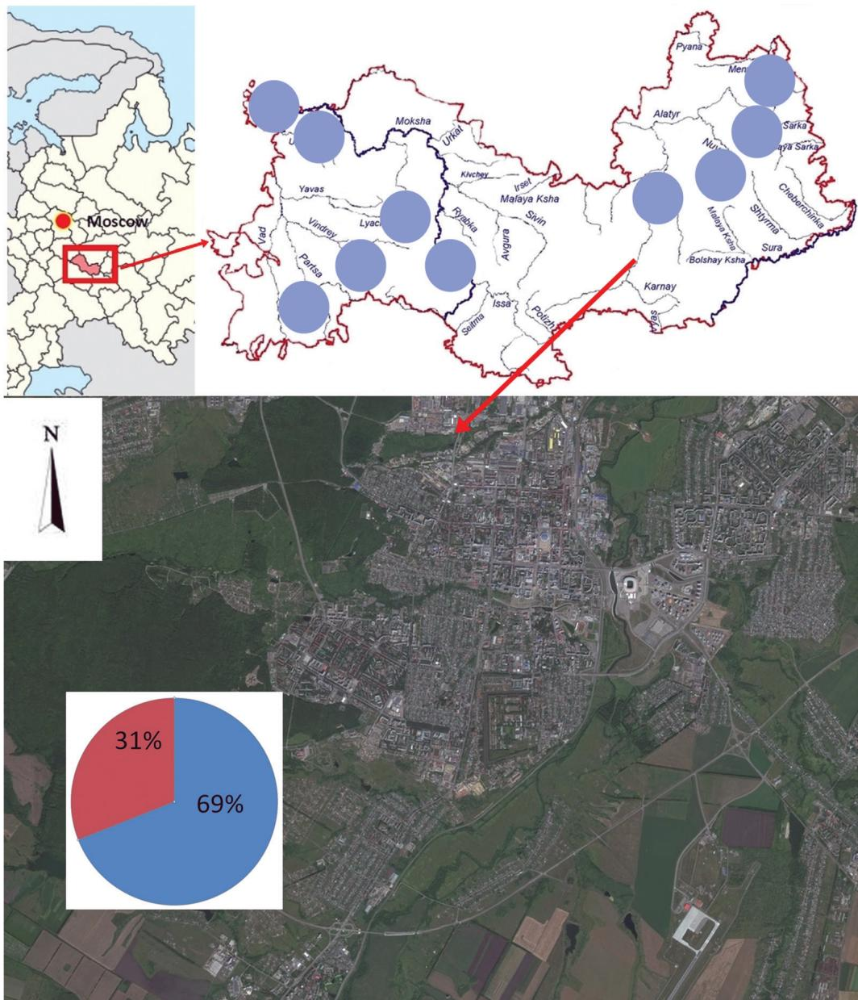

# SMALL MAMMALS AS RESERVOIRS OF TULAREMIAAND HFRS IN THE FOREST ZONE OF SARANSK

Maxim Maydanov1 , Alexey Andreychev1*, Ekaterina Boyarova2 , Vyacheslav Kuznetsov1 , and Ekaterina Ilykaeva1

1 Department of Zoology, National Research Mordovia State University, Saransk 430005, Russia.

* E-mail: andreychev1@rambler.ru

2 Center for Hygiene and Epidemiology in the Republic of Mordovia, Saransk 430030, 1a Dal’naya Str., Russia.

Received: 03 March 2021

Accepted: 14 May 2021

# Abstract

Small mammals are important reservoirs for zoonotic pathogens that cause significant morbidity in humans. Of these, tularemia and hemorrhagic fever with renal syndrome (HFRS) are among of the most widespread zoonotic diseases worldwide. Despite the fact that both pathogens have great epidemiological significance in Russia, epizootological data for urbanized areas are still scarce. This study was conducted to investigate the occurrence and prevalence of tularemia and hantaviruses in small mammals living in close proximity to humans. Altogether, 425 small mammals (278 from urban environment and 147 from natural environment) representing nine species (Myodes glareolus, Microtus arvalis, Cricetus cricetus, Apodemus flavicollis, Apodemus agrarius, Apodemus uralensis, Mus musculus, Sorex araneus and Neomys fodiens) were captured in the Russian Republic of Mordovia and screened for pathogens using different serological and bacteriological methods. Red bank vole (M. glareolus) and yellow-necked wood mouse (A. flavicollis) are among species in the forest zone of the city of Saransk and are the source of a number of zoonotic diseases. In the non-urban environment, the main role as carriers of zoonotic diseases was played by house (M. musculus) and striped field (A. agrarius) mice. A total of $23 \%$ of the small mammals sampled in Saransk were positive for tularemia, whereas $9 . 7 \%$ were positive for HFRS. Furthermore, dual infections with both tularemia and hantaviruses were shown in $1 . 4 \ \%$ of animals, suggesting that the same small mammal host can be infected with several pathogens at the same time, therefore representing a serious threat to public health. Small mammal ecology is a primary determinant of zoonotic pathogens dynamics in rodent populations and the risk of pathogen transmission to people.

Key words: epidemiology, hantavirus, Mordovia, rodents, urbanization.

# Introduction

It is known that epidemics coincide with urbanization, geographic expansion, and migrant movement over time (Taylor et al. 2008, Kang et al. 2012, Halliday et al. 2015, Houéménou et al. 2019). Research

results in China revealed the interrelatedness of urbanization, migration, and hantavirus epidemiology, potentially explaining why urbanizing cities with high economic growth exhibit extended epidemics (Tian et al. 2018). However, different types of animals can act as carri-

ers in different cities. For example, Urban Norway (Rattus norvegicus (Berkenhout, 1769)) and black (Rattus rattus) rats are reservoirs for a variety of zoonotic pathogens (Himsworth et al. 2015).

Republic of Mordovia in Russia is a historical focus for HFRS, tularemia and rabies (Boyarova et al. 2020). Among the small rodents in the wild natural environment, the red bank vole Myodes glareolus (Schreber, 1780), the common vole Microtus arvalis (Pallas, 1779) and the house mouse Mus musculus Linnaeus, 1758 play an important role as carriers of zoonotic diseases (Andreychev et al. 2019). One of our latest studies concluded that the forest dormouse Dryomys nitedulla (Pallas, 1779) in Mordovia was identified as a pathogen reservoir causing infectious diseases in humans (Andreychev and Boyarova 2020). However, this type of small mammal is found only in wild natural environment (Andreychev and Kiyaykina 2020, Andreychev and Kuznetsov 2020).

Most researchers of zoonotic diseases choose rats (Himsworth et al. 2013, 2014, 2015; Firth et al. 2014; Wang et al. 2017; Murray et al. 2020; Su et al. 2020; Yashina et al. 2021). This is of course logical, as there are quite a lot of rats. This is not the case in Saransk, so we assumed that the main vectors may be other small mammals (mice, voles, shrews). We set out to study these to determine their possible role in the transfer of zoonotic diseases in Saransk.

The purpose of this article is to highlight the role of small mammals as carriers or reservoirs of zoonotic diseases in the city forest zone. In addition to the main carriers in the natural environment, there is a high probability that other small mammals account for the circulation of zoonotic disease pathogens in urban environments.

# Material and Methods

The work was carried out in the forest zone of Saransk and some districts of Mordovia (Fig. 1). The Republic of Mordovia is located in the centre of the European part of Russia. Its extreme points are defined by geographical coordinates $4 2 ^ { \circ } 1 1 ^ { \circ } - 4 6 ^ { \circ } 4 5 ^ { \circ } \mathsf { E }$ and $5 3 ^ { \circ } 3 8 ^ { \prime } - 5 5 ^ { \circ } 1 1 ^ { \prime } \textsf { N }$ The maximum distance from west to east is 298 km and the distance from north to south is 57 to $1 4 0 ~ \mathsf { k m }$ . The area of the republic is $2 6 , 2 0 0 ~ \mathsf { k m } ^ { 2 }$ . Features of the geological structure are determined by its location in the central part of Russian Platform and north-western slopes of Volga Upland. In the western part, Volga Upland reaches Oka-Don Lowlands (Yamashkin 1998, Andreychev 2017).

The work is based on the materials of our own surveys of rodents and insectivorous mammals conducted in the urban environments and natural environments of Mordovia, using traditional methods of trap lines and trap grooves (Karaseva and Telicina 1996). Field work was carried out during the snow-free period (May to November). The snap traps were set in the typical habitats of the small mammals for several days and then transferred to the next site. Their number in each line was 25. Traps were checked for material every morning. Bread soaked in sunflower oil was used as bait.

During the research period of 2020, a total of 425 specimens (278 from urban environments and 147 from natural environments) of the following rodents were trapped: red bank vole M. glareolus – $5 5 . 2 ~ \%$ , common vole M. arvalis – $6 . 4 \%$ , common hamster Cricetus cricetus (Linnaeus, $1 7 5 8 ) - 0 . 5 \ \%$ , yellow-necked mouse Apodemus flavicollis (Melchior, $1 8 3 4 )  { - } 9 . 9 \ \%$ , Ural field mouse Apodemus uralensis (Pallas, 1811) – 3.8 %,

  
Fig. 1. Geographical position of Saransk.

Note: for the region, blue circles – collection points of the material, for the satellite image of city the red sector is the percentage of all infected (tularemia $^ +$ HFRS) small mammals, the blue sector is the percentage of uninfected small mammals.

striped field mouse Apodemus agrarius (Pallas, 1771) – 11.8 %, house mouse M. musculus – $7 . 5 \ \%$ , Eurasian common

shrew Sorex araneus Linnaeus, 1758 – $4 . 7 \%$ , and Eurasian water shrew Neomys fodiens (Pennant, 1771) – 0.2 %. The

captured mammals were transported to the laboratory of the Center for Hygiene and Epidemiology of Republic of Mordovia. ELISA, using ‘Huntagnost’ test system for pathogen presence, was the main method used to detect HFRS antibodies in homogenized rodent organs (lung). Tests for tularemia were performed using a serological method.

# Results and Discussion

A total of $23 \%$ of small mammal samples in Saransk were positive for tularemia while a total of $9 . 7 \ \%$ were positive for HFRS. Furthermore, dual infections with both tularemia and hantaviruses were detected in $1 . 4 \ \%$ of animals, suggesting that the same small mammal host can be infected with several pathogens at the same time, therefore representing a serious threat to public health. In the natural (non-urban) habitat, only house mouse and striped field mouse were infected with HFRS (Table 1).

Comparing the range of mouse rodent

species infected with tularemia in urban environments with data obtained for natural environments in previous years (Andreychev and Boyarova 2020), a similar pattern was noted insofar as red bank vole played a primary role as carrier of this disease $7 5 \%$ in urban environments compared to $42 \%$ in natural ones). Yellow-necked mouse, ranked second in urban environment for presence of tularemia bacteria $( 2 5 ~ \% )$ . In natural environment of Mordovia, Ural field mouse was found positive for the same bacteria $( 2 5 \% )$ .

Comparing results obtained in urban environments for mouse rodent species infected with HFRS (Table 1) with data obtained for natural environments in previous years (Andreychev and Boyarova 2020), it should be noted that while red bank vole was primary in urban environments $- 8 5 \ \%$ , house mouse was primary in natural environment – $- 4 1 \ \%$ . A. flavicollis ranked second in urban environments for presence of HFRS $( 1 5 \% )$ ; and red bank vole $( 2 3 \ \% )$ and common vole $( 2 3 \ \% )$ , were found positive for HFRS in natural environment.

Table 1. Small mammal population structure involved as reservoirs of tularemia and HFRS in urban and non-urban environments in 2020.   

<table><tr><td rowspan="2">Species</td><td colspan="4">City of Saransk</td><td colspan="4">Other districts</td></tr><tr><td>\(n_{urban}\)</td><td>TUL</td><td>HFRS</td><td>TUL + HFRS</td><td>\(n_{non-urban}\)</td><td>TUL</td><td>HFRS</td><td>TUL + HFRS</td></tr><tr><td>Myodes glareolus</td><td>219</td><td>48</td><td>23</td><td>4</td><td>16</td><td>0</td><td>0</td><td>0</td></tr><tr><td>Microtus arvalis</td><td>2</td><td>0</td><td>0</td><td>0</td><td>25</td><td>0</td><td>0</td><td>0</td></tr><tr><td>Cricetus cricetus</td><td>1</td><td>0</td><td>0</td><td>0</td><td>1</td><td>0</td><td>0</td><td>0</td></tr><tr><td>Apodemus flavicollis</td><td>30</td><td>16</td><td>4</td><td>1</td><td>12</td><td>0</td><td>0</td><td>0</td></tr><tr><td>Apodemus uralensis</td><td>2</td><td>0</td><td>0</td><td>0</td><td>14</td><td>0</td><td>0</td><td>0</td></tr><tr><td>Apodemus agrarius</td><td>10</td><td>0</td><td>0</td><td>0</td><td>40</td><td>0</td><td>1</td><td>0</td></tr><tr><td>Mus musculus</td><td>1</td><td>0</td><td>0</td><td>0</td><td>31</td><td>0</td><td>3</td><td>0</td></tr><tr><td>Sorex araneus</td><td>12</td><td>0</td><td>0</td><td>0</td><td>8</td><td>0</td><td>0</td><td>0</td></tr><tr><td>Neomys fodiens</td><td>1</td><td>0</td><td>0</td><td>0</td><td>-</td><td>-</td><td>-</td><td>-</td></tr></table>

Note: $n _ { \mathsf { u r b a n } }$ – number of specimens from Saransk, $\mathsf { n } _ { \mathsf { n o n - u r b a n } }$ – number of specimens from natural environments, TUL – number of positive tests for tularemia, HFRS – the number of positive tests for HFRS, TUL+HFRS – simultaneous detection of positive tests for tularemia and HFRS.

Our study also showed that in 2020, some striped field mice in natural environment were infected with HFRS, which confirmed that this species may be active in the epizootic process in Mordovia (Trankvilevsky et al. 2007, 2011).

Suburban forest zone of Saransk in 2020 was potentially dangerous in relation to zoonotic diseases. It is known that HFRS and tularemia are widespread in many other Russian cities as well. The increase in the incidence of HFRS in Voronezh Region took place in 2007 when 154 people were infected. More than $50 \%$ of cases involved people who were infected in the city (Gaponov 2017).

We also compared our results with the infection rates of small mammals in urban environments of Switzerland (Adler et al. 2002), where there is also a significant proportion of infected small mammals from the genera Apodemus and Myodes.

The large proportion of yellow-necked mice testing positive for zoonotic diseases in urban environments of Mordovia is understandable, since scientists have previously noted their role as carriers in other countries. Dobrava–Belgrade virus strain (DOBV) which causes HFRS in humans has been found in A. flavicollis (Weidmann et al. 2005). A previous study in Greece showed that approximately $10 \%$ of A. flavicollis carried DOBV (Papa et al. 2000). In Albania, it was identified as primary reservoir causing HFRS in humans (Rogozi et al. 2013, Papa et al. 2016). In Slovenia, the yellow-necked mouse, the striped field mouse (A. agrarius), and the red bank vole (M. glareolus) were all found to play an important role in zoonotic circulation of HFRS (Stanko et al. 2004). Positive results for tularemia in the Republic of Moldova were recorded in species M. glareolus, A. flavicollis and A. uralensis (Chicu et

al. 2010). Thus, the yellow-necked mouse may be one of the most important carriers of zoonotic diseases. However, in Mordovia, it is in urban environments that its role has become more pronounced. This may be due to the smaller distribution across the region of other mouse species (A. uralensis, A. agrarius) (Andreychev 2020).

Our data on the higher incidence of double infections in small mammals in urban environments of Saransk are consistent with the results from Hungary. Dual infections with both Leptospira spp. and hantaviruses were shown in $2 . 6 \%$ of mammals (Kurucz et al. 2018).

# Conclusions

There are clear differences in the role played by different small mammal species as reservoirs for zoonotic pathogens in the forest zones of urban environments versus the non-urban environments of Mordovia. The importance of red bank vole and of yellow-necked mouse in urban environments and of house mouse and striped field mouse in non-urban environments in relation to zoonotic diseases was confirmed. In addition, evidence of dual infection by tularemia and hantavirus was found, suggesting that the same small mammal host can be infected with several pathogens at the same time, therefore representing a serious threat to public health.

# Acknowledgement

We are grateful to A. V. Salaeva, E. O. Levtcova, S. A. Yutukova, M. N. Suharnikova for support in carrying out of field studies.

# References

Adler H., Vonstein S., Depla zes P., Stieger C., Frei R. 2002. Prevalence of Leptospira spp. in various species of small mammals caught in an inner-city area in Switzerland. Epidemiology & Infection 128(1): 107–109. DOI: 10.1017}S0950268801006380   
Andreych ev A. 2017. Population density of the Eurasian beaver (Castor fiber L.) (Castoridae, Rodentia) in the Middle Volga of Russia. Forestry Studies 67(1): 109–115. DOI: 10.1515/fsmu-2017-0016   
Andreych ev A. 2020. Proportion faunal assemblage of rodents in geoecological districts of Mordovia, Russia. Biodiversitas 21(9): 3961–3968. DOI: 10.13057/biodiv/ d210906   
Andreych ev A., Boya rova E. 2020. Forest dormouse (Dryomys nitedula, Rodentia, Gliridae) – a highly contagious rodent in relation to zoonotic diseases. Forestry Ideas 26(1): 262–269.   
Andreych ev A., Boya rova E., La psh in A., Kuznetsov V. 2019. Detection of foci of tularemia using enzyme immunoassay for the predatory bird pellets. Periodico Tche Quimica16(31): 632–641.   
Andreych ev A.V., Kiya yk ina O.S. 2020. Homing of the forest dormouse (Dryomys nitedula, Rodentia, Gliridae). Zoologicheskii Zhurnal 99(6): 240–250 (in Russian with English summary). DOI: 10.31857/ S0044513420060033   
Andreych ev A.V., Kuznetsov V.A. 2020. Checklist of rodents and insectivores of the Mordovia, Russia. ZooKeys 1004(1): 129–139. DOI: 10.3897/zookeys.1004.57359   
Boya rova E., Andreych ev A., Kozlova I., Kuznetsov V. 2020. Red fox (Vulpes vulpes) as the main vector of animal’s rabies in the forest-steppe zone of Republic of Mordovia. Forestry Ideas 26(2): 355–365.   
Ch ic u V., Gh eorgh ita S., Burlac u V., Gutu A., Soh otch i V., Culibac ina ia E., Melnic V., Ca - rama n N., Benes O. 2010. Tularemia – particularitati actuale ce asigura persistenta focarelor in Republica Moldova. Buletinul Academiei de Stiinte a Republicii Moldova: 51–58 (in Moldovan).

Firth C., Bha t M., Firth M.A., William s S.H., Frye M.J., Simm onds P., Conte J.M., Ng J., Ga rc ia J., Bh uva N.P., Lee B., Ch e X., Qua n P.-L., Lipk in W.I. 2014. Detection of zoonotic pathogens and characterization of novel viruses carried by commensal Rattus norvegicus in New York City. MBio 5(5), e01933-14. DOI: 10.1128/mBio.01933-14   
Ga ponov S.P. 2017. Epidemiological survey of mammals and hard ticks in urban and peri-urban areas of Voronezh in 2001– 2016. Bulletin of the Voronezh state university 2: 48–58.   
Ha llida y J.E., Knob el D.L., Agwa nda B., Ba i Y., Breima n R.F., Cleav ela nd S., Nj enga M.K., Kosoy M. 2015. Prevalence and diversity of small mammal-associated Bartonella species in rural and urban Kenya. PLoS Negl Trop Dis 9(3), e0003608. DOI: 10.1371/ journal.pntd.0003608   
Him sw orth C.G., Ba i Y., Kosoy M.Y., Wood H., DiBerna rdo A., Lindsa y R., Bidulka J., Ta ng P., Ja rdine C., Pa trick D. 2015. An investigation of Bartonella spp., Rickettsia typhi, and Seoul hantavirus in rats (Rattus spp.) from an inner-city neighborhood of Vancouver, Canada: is pathogen presence a reflection of global and local rat population structure? Vector-Borne and Zoonotic Diseases 15(1): 21–26. DOI: 10.1089/ vbz.2014.1657   
Him sw orth C.G., Ja rdine C.M., Pa rsons K.L., Feng A.Y., Pa trick D.M. 2014. The characteristics of wild rat (Rattus spp.) populations from an inner-city neighborhood with a focus on factors critical to the understanding of rat-associated zoonoses. PLoS One 9(3), e91654. DOI: 10.1371/journal. pone.0091654   
Him sw orth C.G., Pa rsons K.L., Ja rdine C., Pa trick D.M. 2013. Rats, cities, people, and pathogens: a systematic review and narrative synthesis of literature regarding the ecology of rat-associated zoonoses in urban centers. Vector-Borne and Zoonotic Diseases 13(6): 349–359. DOI: 10.1089/ vbz.2012.1195   
Houém énou G., Ga uth ier P., Etougb étch é J., Ba dou S., Dossou H.J., Agossou D., Pica rdea u M., Dob igny G. 2019. Pathogenic Lep-

tospira in commensal small mammals from the extensively urbanized coastal Benin. Urban Science 99(3): 1–14. DOI: 10.3390/ urbansci3030099   
Ka ng Y.J., Zh ou D.J., Tia n J.H., Yu B., Guo W.P., Wa ng W., Li M.H., Wu T.P., Peng J.S., Plyusnin A., Zha ng Y.Z. 2012. Dynamics of hantavirus infections in humans and animals in Wuhan city, Hubei, China. Infection, genetics and evolution 12(8): 1614–1621. DOI: 10.1016/j.meegid.2012.07.017   
Karaseva Е.V., Telicina А.Y. 1996. Methods for studying rodents in the field. Moscow. 227 p. (in Russian).   
Kuruc z K., Ma da i M., Ba li D., Hederic s D., Horv áth G., Kem enesi G., Jakab F. 2018. Parallel survey of two widespread renal syndrome-causing zoonoses: Leptospira spp. and Hantavirus in urban environment, Hungary. Vector-borne and zoonotic diseases 18(4): 200–205. DOI: 10.1089/ vbz.2017.2204   
Murra y M.H., Fidino M., Fyff e R., Byers K.A., Pettengill, J.B., Sondgeroth , K.S., Killion H., Ma gle S.B., Rios M.J., Ortina u N., Sa ntym ire R.M. 2020. City sanitation and socioeconomics predict rat zoonotic infection across diverse neighbourhoods. Zoonoses and Public Health 67(6): 673–683. DOI: 10.1111/zph.12748   
Pa pa A., Mills J.N., Kouidou S., Ma B., Pa pa dim itriou E., Antonia dis A. 2000. Preliminary characterization and natural history of hantaviruses in rodents in northern Greece. Emerging Infectious Diseases 6(6): 654– 655.   
Pa pa A., Rogozi E., Velo E., Pa pa dim itriou E., Bino S. 2016. Genetic detection of hantaviruses in rodents, Albania. Journal of Medical Virology 88: 1309–1313. DOI: 10.1002/jmv.24486.   
Rogozi E., Bego F., Pa pa A., Mersini K., Bino S. 2013. Distribution and ecology of small mammals in Albania. International Journal of Environmental Health Research 23(3): 258–268. DOI: 10.1080/09603123.2012.717917   
Sta nk o M., Fric ova J., Sch niererova E., Mosa nsk y L., Ma rdzinova S. 2004. Fauna drobnych cicavcov (Insectivora, Rodentia,

Carnivora) okolia rozhanoviec (Kosickakotlina). Natura Carpatica 45: 107–116.   
Su Q., Ch en Y., Wa ng B., Hua ng C., Ha n S., Yua n G., Zha ng Q., He H. 2020. Epidemiology and genetic diversity of zoonotic pathogens in urban rats (Rattus spp.) from a subtropical city, Guangzhou, southern China. Zoonoses and public health 67(5): 534–545. DOI: 10.1111/zph.12717   
Ta ylor P.J., Arntzen L., Ha yter M., Iles M., Frea n J., Belma in S. 2008. Understanding and managing sanitary risks due to rodent zoonoses in an African city: beyond the Boston Model. Integrative Zoology 3(1): 38–50. DOI: 10.1111/j.1749-4877.2008.00072.x   
Tia n H., Hu S., Ca zelles B., Ch ow ell G., Ga o L., La ine M., Li Y., Ya ng H., Li Y., Ya ng Q., Tong X, Hua ng R., Bj ornsta d O.N., Xia o H., Stenseth N.C. 2018. Urbanization prolongs hantavirus epidemics in cities. Proceedings of the National Academy of Sciences 115(18): 4707–4712. DOI: 10.1073/ pnas.1712767115/-/DCSupplemental   
Tra nkv ilev sk y D.V., Pla tunina T.N., Dza gurova T.K., Bakhm etyeva Yu.O., Korotina N.A., Ga ponov S.P., Sedova N.S., Schk il N.N., Sa pelnik ov S.F., Ma rch enk o N.F., Mamch ick N.P., C M.I., T E.A. 2007. Outbreak of HFRS during the winter 2006– 2007 in Voronezh Region. Medical Virology 24: 145–156 (in Russian with English summary).   
Tra nkv ilev sk y D.V., Strygina S.O., Kutuzov A.V., Bakhm etyeva Yu.O., Tregub ov O.V., Rodina I.V., Bernstein A.D., Korotina N.A., Dza gurova T.K., Stepk in Yu.I., Ch ub irk o M.I., Tkach enk o E.A. 2011. Many years dynamic of quantity and species composition of small-sized mammals in open pasture lands of Voronezh region and change of epizootic and epidemic situation in locations of zoonosis. Disinfection Affairs 1: 48–57 (in Russian).   
Wa ng B., Ca i C.L., Li B., Zha ng W., Zh u Y., Ch en W.H., Zh uo F., Sh i Z.-L., Ya ng X.L. 2017. Detection and characterization of three zoonotic viruses in wild rodents and shrews from Shenzhen city, China. Virologica Sinica 32(4): 290–297. DOI: 10.1007/ s12250-017-3973-z

Weidma nn M., Schm idt P., Vack ova M., Kriva nec K., Munc linger P., Huf ert F.T. 2005. Identification of genetic evidence for dobrava virus spillover in rodents by nested reverse transcription (RT)-PCR and TaqMan RT-PCR. Journal of Clinical Microbiology 43(2): 808–812.   
Yama shk in A.A. 1998. Physico-geographical conditions and landscapes of Mordovia.

Yamashkin A.A. (Ed.). Saransk: Publisher of Mordovia State University. 156 p. (in Russian).   
Ya sh ina L.N., Ha y J., Sm eta nnik ova N.A., Kush na reva T.V., Iunikh ina O.V., Kom pa nets G.G. 2021. Hemorrhagic fever with renal syndrome in Vladivostok city, Russia. Frontiers in Public Health 9, 620279. DOI: 10.3389/fpubh.2021.620279