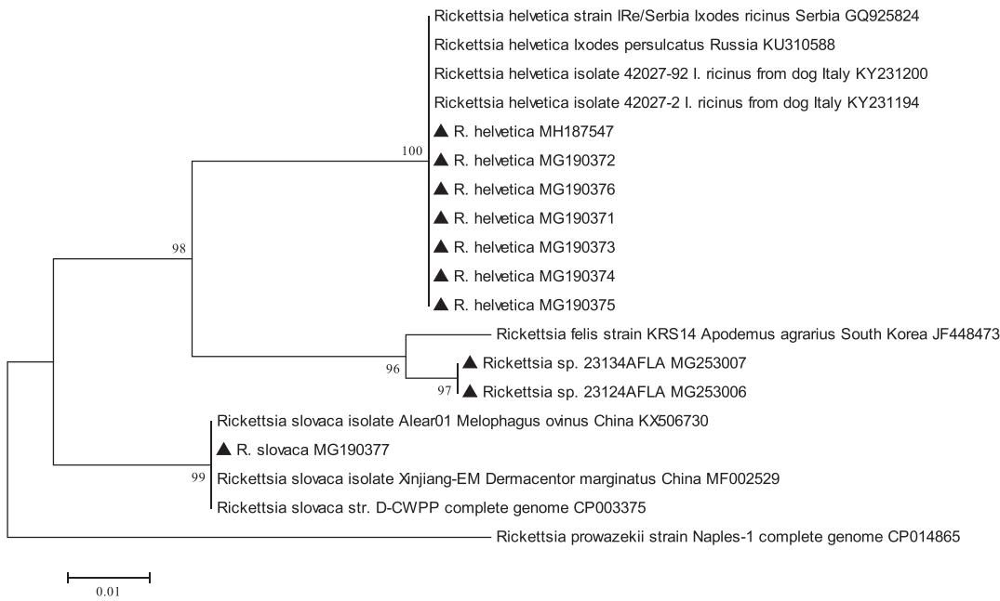

Original article

# Molecular evidence and diversity of the spotted-fever group Rickettsia spp. in small mammals from natural, suburban and urban areas of Eastern Slovakia

Ivana Heglasováa,b,⁎ , Bronislava Víchováa , Jasna Kraljika,c , Ladislav Mošanskýa , Dana Miklisováa , Michal Stankoa,c

a Institute of Parasitology, Slovak Academy of Sciences, Hlinkova 3, 040 01 Košice, Slovakia   
b Department of Zoology, Faculty of Natural Sciences, Comenius University, Mlynská dolina B-1, 842 15 Bratislava, Slovakia   
c Institute of Zoology, Slovak Academy of Sciences, Dúbravská cesta 9, 845 06 Bratislava, Slovakia

# A R T I C L E I N F O

Keywords:

Rickettsia spp.

Small mammals

Rodents

Slovakia

gltA

# A B S T R A C T

Rickettsiae of the spotted fever group are considered as emerging pathogens; ticks, fleas and mites are known to be their vectors. However, the prevalence and species diversity of rickettsiae in small mammals and the role of these hosts in the circulation of bacteria are much less studied. During 2014–2016, a total of 250 small mammals (Apodemus agrarius, Apodemus flavicollis, Apodemus uralensis, Myodes glareolus, Crocidura leucodon, Crocidura suaveolens, Micromys minutus, Microtus arvalis, Microtus subterraneus, Neomys fodiens and Sorex minutus) were captured in natural, suburban and urban habitats of eastern Slovakia. Ear biopsies of 245 individuals were examined for the presence of SFG rickettsiae by molecular methods. The overall prevalence of Rickettsia spp. in small mammals was $1 1 \%$ . The predominant species, Rickettsia helvetica was confirmed in the striped field mouse (A. agrarius), the yellow-necked mouse (A. flavicollis), the bank vole (M. glareolus) and the common vole (M. arvalis) in natural and suburban habitats, followed by Rickettsia sp. closely related to R. felis identified in A. flavicollis captured in a suburban habitat. Finally, R. slovaca was found in only one yellow-necked mouse (A. flavicollis) captured in a natural habitat, with the sympatric occurrence of Dermacentor marginatus and Dermacentor reticulatus ticks. We assume the presence of R. slovaca especially in sites with the occurrence of Dermacentor spp. All small mammals captured in the urban habitat tested were negative for the presence of rickettsiae. This study brings the first molecular evidence of R. slovaca in a rodent captured in Slovakia. Rickettsia sp. closely related to R. felis was first time detected in A. flavicollis in suburban site of Slovakia.

The highest species diversity of rickettsiae was observed in A. flavicollis, and the highest prevalence of bacteria was recorded in M. glareolus. The highest occurrence of rickettsiae-positive small mammals was recorded during the spring and autumn months, May, June and September, respectively. This may be related with the seasonal activity of the tick vectors. This study confirms the long-term persistence of Rickettsia spp. in small mammals in natural and suburban habitats of Slovakia.

Some rodent species that have a wider ecological valency may contribute to the maintenance, circulation and dissemination of rickettsiae within and out the natural foci more significantly than those species that have narrower relation to the certain type of habitat.

# 1. Introduction

The genus Rickettsia (Rickettsiaceae, Rickettsiales) includes Gramnegative obligate, intracellular, aerobic $\alpha$ -Proteobacteria invading hosts’ eukaryotic cells. Species of the genus Rickettsia are divided into two groups: the spotted fever group (SFG) and the typhus group (TG) (Raoult et al., 2005). The main vectors of rickettsiae are blood-sucking arthropods, mainly ticks, but also fleas, mites and human body lice. The

highest occurrence of rickettsiae in ticks was detected in early spring and autumn (Řeháček et al., 1972). Řeháček et al. (1972) suggested that rickettsiae are able to hibernate in ticks. The most important vectors and probably also the main reservoirs of rickettsiae in Southern, Western and Central Europe are Dermacentor marginatus and Dermacentor reticulatus ticks (Řeháček et al., 1972, 1977; Raoult et al., 2002).

Small rodents, hosting a wide spectrum of ectoparasites and arthropod vectors, are the most significant reservoirs of rickettsiae, many

of which are responsible for serious zoonotic diseases (rickettsioses) of humans and animals (Řeháček et al., 1992; Burri et al., 2014; Han et al., 2015; Imhoff et al., 2015). Rickettsioses belong among the most frequent vector-borne infections in Europe (Fournier et al., 2012).

In Slovakia, six rickettsial species/strains of the SFG have thus far been identified by serological examination and/or different molecular methods. Among the identified species are Rickettsia helvetica, Rickettsia slovaca, Rickettsia raoultii, Rickettsia monacensis strain IRS3 and IRS4, Rickettsia conorii and Rickettsia africae (Brezina et al., 1969; Řehácek et al., 1975; Boldiš et al., 2008; Špitalská et al., 2012, 2014; Sekeyová et al., 2013). Recently, Rickettsia sp., closely related to Rickettsia felis, was detected in Slovakia (Špitalská et al., 2015). These species of rickettsiae are usually transmitted by the ticks, but R. africae and R. felis have also been identified in fleas (Sekeyová et al., 2013; Špitalská et al., 2015).

R. slovaca was isolated for the first time in 1968 from D. marginatus ticks in Central Slovakia (Brezina et al., 1969). After the first evidence of this agent in vector ticks, several patients with clinical signs similar to those associated with R. slovaca infection, confirmed in a French patient in 2003, have been reported (Parola et al., 2009; Cascio et al., 2013). Based on the most significant clinical symptoms in affected patients, such as eschar and cervical lymphadenopathies, several names have been proposed for diseases resulting from human infections, e.g. tick-borne lymphadenopathy (TIBOLA), Dermacentor-borne necrosiserythrema-lymphadenopathy (DEBONEL) and/or scalp eschar and neck lymphadenopathy (SENLAT) (Lakos, 1997, 1999; Oteo et al., 2003; Angelakis et al., 2010). The peak incidence of human rickettsioses usually occurs from March to May and during September and November, except the dry summer season, and this is clearly connected with the seasonal activity of Dermacentor ticks (Estrada-Peña et al., 2004; Parola et al., 2009).

In Slovakia, the Ixodes ricinus tick is considered the main vector and natural reservoir of R. helvetica (Špitalská et al., 2008, 2014; Sekeyová et al., 2013).

Rickettsia felis is primarily associated with an arthropod reservoir and vector, the cat flea Ctenocephalides felis. It causes infection in humans, known as flea-borne spotted fever or cat-flea typhus (Abdad et al., 2011). In Slovakia, Rickettsia sp. closely related to R. felis was detected for the first time in a Ctenophthalmus solutus flea removed from a striped field mouse (A. agrarius) (Špitalská et al., 2015).

In Slovakia, research on rickettsiae has a long tradition (Sekeyová et al., 2013), but the role of rodents in their circulation has been much less studied by molecular methods so far. Recently, only a few studies referring to the presence of R. helvetica and R. monacensis in Apodemus flavicollis and/or M. arvalis (Minichová et al., 2017), and Rickettsia spp. in M. arvalis (Smetanová et al., 2006) have been published.

In the works of Jablonskaja (1978), R. slovaca was found in three dominant rodent species, A. agrarius, A. flavicollis and M. arvalis, in Eastern Slovakia; however, these results were only based on serological analysis and cross-immunity studies, without further molecular evidence. Řeháček et al. (1972), have also confirmed the presence of antibodies against R. slovaca by serological analysis in small mammals from Slovakia.

Until now, mostly experimental studies of rickettsial infection of A. flavicollis, Clethrionomys glareolus, M. arvalis and Mus musculus, susceptibility and antibody formation were conducted in Slovakia (Řehácek et al., 1976, 1992).

In order to update information on the occurrence and diversity of rickettsiae, in the present study we focused on investigation of SFG Rickettsia spp. in the wild small mammals from natural, suburban and rural environments in eastern part of the country.

# 2. Material and methods

# 2.1. Sampling sites

Rodents and rodent-attached ticks were collected at three study sites in Eastern Slovakia during the years 2014–2016. The first study site, a Botanical garden with deciduous forest vegetation is located in the city of Košice (208 m a.s.l.; $4 8 ^ { \circ } 4 4 6 { \cdot } 8 4 ^ { \prime } \mathrm { N }$ ; $2 1 ^ { \circ } 1 4 ^ { \prime } 1 6 { \cdot } 1 4 ^ { \prime \prime } \mathrm { \Delta E }$ ).

It represents an urban habitat with a significant anthropogenic impact. The second site, Čermeľ, is characterized by the presence of mixed forest vegetation, with a predominance of

beech, hornbeam and spruce (208–600 m a.s.l.; $4 8 ^ { \circ } 4 5 ^ { \prime } 4 6 { \cdot } 6 7 ^ { \prime \prime } \mathrm { N } _ { \cdot }$ ; $2 1 ^ { \circ } 8 ^ { \prime } 8 ^ { . } 1 7 ^ { \prime \prime } \mathrm { E } )$ ), and it represents a suburban habitat. The third site, with mixed forest vegetation and a predominance of beech, oak and hornbeam, is located in the Slovak Karst National Park, near the Hrhov village (200–220 m a.s.l., $4 8 ^ { \circ } 3 4 . 8 9 9 \mathrm { N }$ , $2 0 ^ { \circ } 4 6 . 7 4 3 \mathrm { E }$ ), and it represents a natural habitat.

# 2.2. Rodents sampling

In total, 100 Swedish bridge metal traps filled with sunflower seeds were set at each site, 5 m away from each other, for one night, and these were checked next morning. Captured small mammals were transported to the laboratory and euthanized in accordance with the licences of the Ministry of Environment of the Slovak Republic No. 4874/2011–2.2 and 4559/2015–2.3. Subsequently, they were examined for the presence of ectoparasites, which were removed, collected and stored in $7 0 \%$ ethanol.

Each individual was identified into species, weighed with an accuracy of $\pm \ 0 . 5 g .$ , measured, euthanized and dissected and the sexual condition of each animal was ascertained. Classification of mammals into categories subadults (immature) and adults (mature) was used according to Pelikán (1965) with respect to the sexual condition of individuals. The removed ticks and other ectoparasites were determined with the use of an identification key (Filippova, 1977), by light microscopy. An ear biopsy was obtained from 245 animals and stored at $- 2 0 ^ { \circ } \mathrm { C }$ until further molecular analysis.

# 2.3. Molecular analysis

Genomic DNA was extracted from each ear-tissue sample after incubation with a Proteinase K solution at $5 6 ^ { \circ } \mathrm { C }$ overnight, using the NucleoSpin Tissue kit (Macherey-Nagel, Düren, Germany) according to the manufacturer's instructions.

The presence of Rickettsia spp. in the genomic DNA samples was evaluated by PCR (Polymerase Chain Reaction) amplification of the 381-bp long fragment of the citrate synthase gene (gltA), using the genus-specific primers $\mathrm { R p C S . 8 7 7 p }$ and RpCS.1258n (Regnery et al., 1991).

PCR amplifications were performed in a total of $2 5 \mu \mathrm { l }$ of reaction mixture containing $1 4 . 9 \mu \mathrm { l }$ of nuclease-free water, $2 . 5 \mu \mathrm { l }$ of $1 0 \times \mathrm { P C R }$ buffer, $1 \mu \mathrm { l }$ of 25 mM $\mathbf { M g C l } _ { 2 }$ , 0.125 U of Taq DNA polymerase (Qiagen), $0 . 5 \mu \mathrm { l }$ of $1 0 \mathrm { m M }$ dNTP Mix, $0 . 5 \mu \mathrm { l }$ of $1 0 \mu \mathrm { M }$ primers and $5 \mu \mathrm { l }$ of DNA template. Previously sequenced DNA of Rickettsia spp. isolated from infected rodents was used as a positive control and sterile water as a negative control in each reaction.

PCR products were analysed by electrophoresis in a $1 . 5 \%$ agarose gels stained with GoldView Nucleic Acid Stain (Beijing SBS Genetech, Beijing, China) and visualized with a UV transilluminator. After PCR analyses, several positive samples with amplified gltA gene fragments were purified for the sequencing. The aim was to choose the representatives from each location, and from different rodent species and sex. The PCR products selected for further phylogenetic analyses were purified using Isolate II PCR and Gel Kit (Bioline) and sequenced (at the University of Veterinary Medicine and Pharmacy in Košice, Slovakia) in both directions using the same primers as for the PCR amplification.

  
Fig. 1. Phylogenetic analysis of Rickettsia species.

The analysis involved 19 nucleotide sequences of Rickettsia spp. gltA gene fragment, ten obtained in this study and the representatives from GenBank database. The evolutionary history was inferred by using the Maximum Likelihood method based on the Tamura 3-parameter model (Tamura, 1992). The tree with the highest log likelihood is shown. The percentage of trees in which the associated taxa clustered together is shown next to the branches. Initial tree(s) for the heuristic search were obtained automatically by applying Neighbor-Join and BioNJ algorithms to a matrix of pairwise distances estimated using the Maximum Composite Likelihood (MCL) approach, and then selecting the topology with superior log likelihood value. The tree is drawn to scale, with branch lengths measured in the number of substitutions per site. The analysis

involved 19 nucleotide sequences. R. prowazekii (CP014865) was used as an outgroup. All positions containing gaps and missing data were eliminated. There were a total of 271 positions in the final dataset. Evolutionary analyses were conducted in MEGA6 software (Tamura et al., 2013).

Nucleotide sequences obtained in this study are marked with black triangles

# 2.4. Phylogenetic analysis

The obtained nucleotide sequences of Rickettsia spp. gltA gene fragment were manually edited in MEGA 6 and compared with GenBank entries by BLAST (Basic Local Alignment Search Tool) (Tamura et al., 2013). Homologous sequences were aligned by the ClustalW program.

The evolutionary history of the sequences was inferred by using the Maximum Likelihood method based on the Tamura 3-parameter model (Tamura, 1992). The best DNA substitution model was chosen by Model Selection (ML) analysis. The tree with the highest log likelihood is shown (Fig. 1).

# 2.5. Statistical analysis

The associations between the prevalences of rickettsiae in males and females of the most abundant rodent species and the variation of seasonal rickettsial occurrence in rodents were evaluated by the Fisher's exact test using Past version 2.17b software (Hammer et al., 2001). A p value $< 0 . 0 5$ was considered to be statistically significant.

# 3. Results

A total of 250 rodents and shrews, belonging to eleven species (Apodemus agrarius, Apodemus flavicollis, Apodemus uralensis, Myodes glareolus, Crocidura leucodon, Crocidura suaveolens, Micromys minutus, Microtus arvalis, Microtus subterraneus, Neomys fodiens and Sorex minutus), were captured during the study. The majority of rodents was captured in the Čermeľ locality in a suburban environment $( 5 0 . 4 \% )$ ; ${ \bf n } = 1 2 6 )$ ), followed by the natural habitat near the village Hrhov in the Slovak Karst National Park $4 6 . 4 \%$ ; $\mathtt { n } = 1 1 6$ ). The lowest number of small mammals was captured in the urban landscape in the Botanical Garden within Košice $( 3 . 2 \%$ ; ${ \mathfrak { n } } = { \mathfrak { 8 } }$ ). Two species, A. agrarius and A. flavicollis, prevailed at all sampling sites. M. glareolus was absent only in the rural habitat. Species composition and the number of captured individuals at the individual sampling sites are shown in Table 1.

In total, 1102 ixodid ticks were collected (920 larvae and 182 nymphs) from captured rodents. Based on morphological characteristics, at least five tick species belonging to genera Ixodes, Dermacentor

and Haemaphysalis were identified.

The dominant tick species, Dermacentor sp. $( 5 2 . 1 \%$ , 427 larvae, 174 nymphs), was followed by I. ricinus $( 4 4 . 6 \%$ , 474 larvae, 18 nymphs), and I. trianguliceps $( 2 . 8 \%$ , 15 larvae, 16 nymphs). Moreover, four H. concina larvae and one H. inermis nymph were collected. In our investigation, larvae prevailed over nymphs. The highest diversity of tick species was recorded in the natural habitat near Hrhov village, followed by suburban area in Čermeľ, with two species, and the urban site, the botanical garden, with one recorded tick species. In total, 124 out of 250 captured hosts did not carry any tick.

Ear biopsies of 245 rodents, belonging to eight species, were analysed by PCR for the presence of rickettsiae. In total, $1 1 \%$ (27/245) of rodents tested positive for Rickettsia spp. In the Čermeľ locality the presence of Rickettsia spp. was confirmed in $1 6 . 0 \%$ (20/125) of rodents. In the natural habitat near Hrhov the prevalence of Rickettsia spp. reached $6 . 2 \%$ (7/113). In the urban area of the botanical garden, none of the seven examined species of rodents tested positive for rickettsiae.

We did not observe a significant difference in infection rates between males and females of small mammals $( \mathbf { p } = 0 . 8 3 8 )$ ). Similarly, a sexual dimorphism was not confirmed in any of three dominant rodent species; A. agrarius $( \mathbf { p } = 0 . 3 7 7 )$ , A. flavicollis $( \mathbf { p } = 0 . 3 2 0 )$ ), M. glareolus $( \mathbf { p } = 0 . 3 5 2 )$ (Table 2).

Regarding the seasonal dynamics of rickettsial infection, the highest number of positive rodents was observed during the spring months, when the infection rate reached $1 5 . 3 \%$ and $2 1 . 1 \%$ in May and June, respectively; lower prevalence was recorded in September $( 6 . 1 \% )$ and the lowest prevalence rate was found in October $( 4 . 2 \% )$ . By comparing the “spring-summer” months (May, June, July) with the autumn (September, October), a significant difference in infection rates of small mammals between seasons was confirmed $( \mathbf { p } = 0 . 0 2 3 )$ . On the contrary, seasonal differences were not confirmed for most abundant rodent species such as A. agrarius $( \mathbf { p } = 1 . 0 0 )$ , A. flavicollis $( \mathbf { p } = 0 . 4 4 )$ and M. glareolus $( \mathbf { p } = 1 . 0 0 )$ . The detailed results on the seasonal dynamics of rickettsial infection in tested small mammals are presented in Table 3.

# 3.1. Phylogenetic analysis

Out of 27 Rickettsia spp. gltA-PCR- positive samples, 18 were chosen

Table 1 Small mammals captured in eastern Slovakia during.2014–2016   

<table><tr><td rowspan="3"></td><td rowspan="2" colspan="3">2014</td><td colspan="8">Sampling season Location</td><td rowspan="2">Total</td></tr><tr><td colspan="4">2015</td><td colspan="4">2016</td></tr><tr><td>BG</td><td>Č</td><td>H</td><td>Σ</td><td>BG</td><td>Č</td><td>H</td><td>Σ</td><td>BG</td><td>Č</td><td>H</td><td>Σ</td></tr><tr><td colspan="13">Rodent species</td></tr><tr><td>Apodemus agrarius</td><td>-</td><td>8</td><td>-</td><td>8</td><td>3</td><td>1</td><td>26</td><td>30</td><td>1</td><td>6</td><td>24</td><td>31</td></tr><tr><td>Apodemus flavicollis</td><td>-</td><td>47</td><td>-</td><td>47</td><td>1</td><td>-</td><td>14</td><td>15</td><td>2</td><td>8</td><td>27</td><td>37</td></tr><tr><td>Apodemus uralensis</td><td>-</td><td>-</td><td>-</td><td>-</td><td>-</td><td>-</td><td>-</td><td>-</td><td>-</td><td>-</td><td>1</td><td>1</td></tr><tr><td>Myodes glareolus</td><td>-</td><td>46</td><td>-</td><td>46</td><td>-</td><td>-</td><td>4</td><td>4</td><td>-</td><td>4</td><td>4</td><td>8</td></tr><tr><td>Crocidura leucodon</td><td>-</td><td>-</td><td>-</td><td>-</td><td>-</td><td>-</td><td>1</td><td>1</td><td>-</td><td>-</td><td>2</td><td>2</td></tr><tr><td>Crocidura suaveolens</td><td>-</td><td>-</td><td>-</td><td>-</td><td>-</td><td>-</td><td>-</td><td>-</td><td>1</td><td>-</td><td>-</td><td>1</td></tr><tr><td>Micromys minutus</td><td>-</td><td>-</td><td>-</td><td>-</td><td>-</td><td>-</td><td>-</td><td>-</td><td>-</td><td>4</td><td>-</td><td>4</td></tr><tr><td>Microtus arvalis</td><td>-</td><td>-</td><td>-</td><td>-</td><td>-</td><td>-</td><td>10</td><td>10</td><td>-</td><td>-</td><td>1</td><td>1</td></tr><tr><td>Microtus subterraneus</td><td>-</td><td>1</td><td>-</td><td>1</td><td>-</td><td>-</td><td>-</td><td>-</td><td>-</td><td>-</td><td>-</td><td>1</td></tr><tr><td>Neomys fodiens</td><td>-</td><td>1</td><td>-</td><td>1</td><td>-</td><td>-</td><td>-</td><td>-</td><td>-</td><td>-</td><td>-</td><td>1</td></tr><tr><td>Sorex minutus</td><td>-</td><td>-</td><td>-</td><td>-</td><td>-</td><td>-</td><td>-</td><td>-</td><td>-</td><td>-</td><td>2</td><td>2</td></tr><tr><td>Total</td><td>-</td><td>103</td><td>-</td><td>103</td><td>4</td><td>1</td><td>55</td><td>60</td><td>4</td><td>22</td><td>61</td><td>87</td></tr></table>

- rodent species not captured. BG – Botanical garden; Č – Čermeľ; H - Hrhov.

Table 2 Presence of rickettsiae in tested small mammals captured in eastern Slovakia.   

<table><tr><td>Species</td><td>No. of Rickettsia-positive (No. of sequenced) samples / No. of tested small mammals (males)</td><td>No. of Rickettsia-positive (no. of sequenced) samples / No. of tested small mammals (females)</td></tr><tr><td>Apodemus agrarius</td><td>0/43</td><td>1 (1)/26</td></tr><tr><td>Apodemus flavicollis</td><td>7 (4)/51</td><td>3 (3)/48</td></tr><tr><td>Apodemus uralensis</td><td>1 (1)/1</td><td>0</td></tr><tr><td>Myodes glareolus</td><td>5 (2)/30</td><td>8 (4)/28</td></tr><tr><td>Crocidura leucodon</td><td>0/2</td><td>1 (1)/1</td></tr><tr><td>Micromys minutus</td><td>0/3</td><td>0/1</td></tr><tr><td>Microtus arvalis</td><td>1 (1)/5</td><td>0/5</td></tr><tr><td>Microtus subterraneus</td><td>0</td><td>0/1</td></tr><tr><td>Total</td><td>14 (8)/135</td><td>13 (9)/110</td></tr></table>

for further sequencing. In total, 11 DNA amplicons were successfully sequenced. Rickettsia helvetica was the predominant species, with 7 out of 27 PCR- positive samples. It was confirmed in A. agrarius (1♀), A. flavicollis (1♀), M. glareolus (2♀, 2♂) and M. arvalis $( 1 \mathcal { Q } )$ . Rickettsia sp., closely related to R. felis, was identified in A. flavicollis (2♀, 1♂) (3/27), and R. slovaca was found in only one A. flavicollis male (1/27). Sequencing of the remaining seven gltA positive samples failed, probably due to the low concentration of DNA.

BLAST (Basic Local Alignment Search Tool - NCBI) analysis of the gltA gene fragments confirmed the presence of R. helvetica in seven samples. Seven nucleotide sequences of R. helvetica were identical within the overlapping region and were submitted to GenBank. BLAST confirmed their $1 0 0 \%$ identity with at least $5 0 R .$ . helvetica isolates from distinct vectors and/or hosts from all over the Europe (e.g. KY231194- KY231200; GQ925824; KJ40389, and others).

The nucleotide sequences of the gltA gene of Rickettsia sp. (23664AFLA, 23124AFLA, 23134AFLA) obtained in this study were $1 0 0 \%$ identical with isolate from the hedgehog flea (Archaeopsylla erinacei) removed from red fox in southern Slovakia (Víchová, unpublished data). Additionally, these sequences showed $9 9 \%$ identity with R. felis strain KRS14 (JF448473) isolated from A. agrarius in South Korea.

Similar results were published by Špitalská et al. (2015). Phylogenetic analysis based on the fragment of gltA gene nucleotide sequences showed that Rickettsia sp. detected in C. solutus flea collected from A. agrarius in Eastern Slovakia clustered together with the same R. felis Korean isolate. Unfortunately, the authors did not insert the mentioned sequences in the GenBank database; thus, it was impossible to compare them with our Rickettsia sp. sequences.

The nucleotide sequence of the gltA gene of R. slovaca obtained in this study was $9 8 \%$ identical with the R. slovaca isolate from the sheep ked (Melophagus ovinus) from China (KX506730). Altogether, 18 nucleotide sequences of Rickettsia spp. gltA gene fragment with a length of 271 bp, including sequences obtained in this study as well as those retrieved from the GenBank, were used for a subsequent phylogenetic

Table 3 Seasonal occurrence of Rickettsia-infected rodents in eastern Slovakia during 2014–2016.   

<table><tr><td rowspan="3">Rodent species</td><td colspan="6">Season</td></tr><tr><td colspan="6">Prevalence (%) of Rickettsia spp. (No. of Rickettsia-positive rodents/No. of tested rodents)</td></tr><tr><td>May</td><td>June</td><td>July</td><td>September</td><td>October</td><td>Total</td></tr><tr><td>Apodemus agrarius</td><td>0 (0/9)</td><td>0/1</td><td>-</td><td>2.1 (1/48)</td><td>0 (0/11)</td><td>(1/69)</td></tr><tr><td>Apodemus flavicollis</td><td>9.4 (5/53)</td><td>25 (4/16)</td><td>0/5</td><td>5.5 (1/18)</td><td>0 (0/7)</td><td>(10/99)</td></tr><tr><td>Apodemus uralensis</td><td>-</td><td>-</td><td>-</td><td>0 (1/1)</td><td>-</td><td>(1/1)</td></tr><tr><td>Myodes glareolus</td><td>24.5 (12/49)</td><td>0 (0/2)</td><td>0/3</td><td>25 (1/4)</td><td>-</td><td>(13/58)</td></tr><tr><td>Crocidura leucodon</td><td>-</td><td>-</td><td>-</td><td>33.3 (1/3)</td><td>-</td><td>(1/3)</td></tr><tr><td>Micromys minutus</td><td>-</td><td>-</td><td>-</td><td>0 (0/4)</td><td>-</td><td>(0/4)</td></tr><tr><td>Microtus arvalis</td><td>-</td><td>-</td><td>-</td><td>0 (0/4)</td><td>16.6 (1/6)</td><td>(1/10)</td></tr><tr><td>Microtus subterraneus</td><td>0 (0/1)</td><td>-</td><td>-</td><td>-</td><td>-</td><td>(0/1)</td></tr><tr><td>Total</td><td>15.3 (17/111)</td><td>21.1 (4/19)</td><td>(0/8)</td><td>6.1 (5/82)</td><td>4.2 (1/24)</td><td>11 (27/245)</td></tr></table>

- rodent species not captured.

analysis.

All R. helvetica sequences (MG190371-376, MH187547) obtained in the present study are placed in a single, well-supported cluster with other R. helvetica isolates from Ixodes spp. ticks (e.g. from Italy, Serbia and/or Russia) (Fig. 1).

The second clade consists of R. slovaca gltA nucleotide sequences and comprises isolate (MG190377) from the yellow-necked mouse from eastern Slovakia as well as sequences isolated from the sheep ked (Melophagus ovinus) (KX506730), from Dermacentor marginatus (MF002529) from China and/or the R. slovaca type strain D-CWPP (CP003375) (Fig. 1).

Two nucleotide sequences, designated here as Rickettsia sp. 23134AFLA (MG253007) and 23124AFLA (MG253006) from the yellow-necked mice, are closely related $( 9 8 . 5 \%$ identity) with the R. felis strain isolated from the striped field mouse (A. agrarius) in South Korea and are identical with the isolate from the hedgehog flea (A. erinacei) removed from red fox in Southern Slovakia (data not shown). These nucleotide sequences created a separate cluster in the phylogenetic tree (Fig. 1).

# 3.2. Nucleotide sequences accession numbers

Nucleotide sequences of the fragments of gltA genes obtained in this study were submitted to the GenBank database under the following accession numbers: R. helvetica MG190371, MG190372, MG190373, MG190374, MG190375, MG190376, MH187547, R. slovaca MG190377, Rickettsia sp. 23124AFLA (MG253006), and Rickettsia sp. 23134AFLA (MG253007).

# 4. Discussion

Small mammals are associated with several pathogenic microorganisms and host a wide spectrum of ectoparasites. Some species of rodents (e.g. A. flavicollis) in particular are more heavily infested with Ixodes spp. ticks than others (Stanko and Miklisová, 2000). In general, a different composition of rodent species was found in individual habitats, suggesting that the character of the environment and the structure of habitat considerably influence the composition of the hosts and their ectoparasites. In total, 250 individuals of 11 species were captured, with A. agrarius and A. flavicollis being the most prevalent species at all three sampling sites during a three-year study.

Similarly, as it has been observed in the present study, the two above-mentioned Apodemus species prevailed in the lowland habitats of eastern Slovakia even in the past (Stanko and Miklisová, 2000). M. glareolus was absent only in the urban environment, in the botanical garden. The highest diversity of murid species as well as the highest diversity of tick species feeding on rodents was observed in the natural habitat, in the Slovak Karst National Park region. In addition, M. arvalis occurred solely at this natural site, preferring pastures with shrubs.

In this study, the wild small mammals were screened for the presence of Rickettsia spp. in three different types of habitat in eastern Slovakia. The highest prevalence of Rickettsia spp. was observed in rodents captured in the suburban habitat. Rickettsial DNA was detected in ear samples of small mammals belonging to six species, namely A. agrarius, A. flavicollis, A. uralensis, M. glareolus, M. arvalis, and C. leucodon. Rickettsia sp. closely related to R. felis and two pathogenic species, R. helvetica and R. slovaca, were identified in A. agrarius, A. flavicollis, M. glareolus and M. arvalis.

The highest prevalence of rickettsiae was recorded in M. glareolus (13/58), followed by A. flavicollis (10/99). Only one rodent species, specifically A. flavicollis captured in the suburban and rural areas, carried DNA of different Rickettsia species (R. helvetica, R. slovaca, and Rickettsia sp. closely related to R. felis), suggesting that some species of rodents might play a more important role as hosts for different rickettsiae. The data indicate that bank voles and yellow-necked mice are probably more often infected with rickettsiae than other species of

rodents.

Rickettsiae are considered to be emerging or re-emerging pathogens, and there are limited data on their presence and prevalence in many regions of Europe (Sprong et al., 2009). Up to now, several cases of human rickettsioses have been recorded in Hungary (Lakos, 1997), France (Raoult and Roux, 1997; Raoult et al., 2002), Sweden (Nilsson et al., 1999, 2010), Switzerland (Baumann et al., 2003), Bulgaria (Komitova et al., 2003), Portugal (de Sousa et al., 2006, 2008), Italy (Selmi et al., 2008), Spain (Aguirrebengoa et al., 2008), Poland (Świtaj et al., 2012) and Slovakia (Sekeyová et al., 2012).

In the present study, the overall prevalence of Rickettsia spp. in wild small mammals reached $1 1 \%$ , without a significant difference in infection rates between males and females $( \mathbf { p } = 0 . 8 3 8 )$ ).

The highest occurrence of Rickettsia-infected rodents in this study was observed during the spring in May–June $( 1 5 . 3 \mathrm { - } 2 1 . 1 \% )$ and during the fall in September $( 6 . 1 \% )$ , followed by a decreasing number of infected rodents to a minimum of $4 . 2 \%$ in October (Table 3). Similarly, the study of Špitalská et al. (2016) mentioned that the seasonal dynamics of Rickettsia-infected

I. ricinus in Slovakia showed two major peaks, in spring (April–June $\left. 6 . 8 \% - 9 . 2 \% \right.$ ) and autumn (October $7 . 8 \% ]$ ). The seasonal dynamics and the rates of Rickettsia-infection in small mammals is related to the activity of their tick vectors.

Among the successfully genotyped samples, R. helvetica was the most prevalent species recorded in small mammals at two sampling sites, followed by Rickettsia sp. closely related to R. fellis. R. slovaca was confirmed in one of successfully sequenced samples.

In study from Poland (Biernat et al., 2016) none of the examined A. flavicollis and M. glareolus blood samples tested were positive for Rickettsia spp., but rickettsial DNA was identified in rodent-attached I. ricinus ticks. The authors suggested a very short-lasting rickettsiemia in small mammals or the possibility of vertical transmission of infection.

The presence of R. slovaca was originally confirmed in vector ticks D. marginatus and D. reticulatus (Brezina et al., 1969; Špitalská et al., 2012; Minichová et al., 2017). As mentioned in the introduction, R. slovaca was identified in ticks and small mammals by serological or microscopic methods in the past, but our study represents the first molecular evidence of R. slovaca in wild small mammals in Slovakia. In our study, R. slovaca was detected in A. flavicollis captured in the Slovak Karst region, where the sympatric occurrence of D. marginatus and D. reticulatus ticks, the main vectors of R. slovaca, is quite common. A previous examination of a smaller sample of D. reticulatus ticks from the same area, Slovak Karst (Hrhov village) region, confirmed $8 . 1 \%$ (6/74) prevalence of rickettsiae in adult ticks. Among other species of rickettsiae, the presence of R. slovaca was recorded too (Radzijevskaja et al., 2015). We assume a higher occurrence of R. slovaca in small mammals (and other potential vertebrate hosts), especially in areas with the presence of D. marginatus and D. reticulatus ticks. Species composition of vectors and their hosts influence the occurrence and distribution of pathogens in the studied area.

To analyze the tick species composition and the dominance of individual tick species on small mammals in detail was not the aim of this study. However, the presence of several tick species, e.g. Ixodes spp., Dermacentor spp. and Haemaphysalis spp. on small mammals in the Slovak Karst region, reflects the sympatric occurrence of distinct tick species at the sampling site. This fact has already been published in the past (e.g., Nosek, 1971, 1972; Hubálek, 1986, and others).

The investigation of small-mammal populations for the presence of parasites and pathogens can help to improve knowledge about the occurrence, circulation and spreading of infectious agents in a specific area. The data obtained in this study suggest that small mammals, mainly some predominant species (e.g. Apodemus spp., Myodes spp.), might play a more important role in the maintenance, circulation and dissemination of rickettsiae within and outside the natural foci. The prevalence of rickettsiae in small mammals depends on the type of habitat, species composition and seasonal activity of vectors and

vertebrate hosts, as well as on the fluctuations of small-mammal populations.

The herein presented results suggest a higher risk of infection with zoonotic pathogens, R. helvetica and R. slovaca in natural and suburban habitats of Eastern Slovakia, especially during the spring and autumn season.

# 5. Conclusion

The presence of R. helvetica, R. slovaca and Rickettsia sp. closely related to R. felis was confirmed in small mammals in Eastern Slovakia. R. helvetica was found to be the predominantly occuring species in the two investigated sites from several host species. R. slovaca was detected in A. flavicollis captured in the Slovak Karst region, where the sympatric occurrence of D. marginatus and D. reticulatus ticks is confirmed. We assume the presence of R. slovaca especially in sites with the occurrence of Dermacentor spp. In this study, Rickettsia sp. closely related to R. felis was first time detected in A. flavicollis in suburban site of Slovakia. Some rodent species that have a wider ecological valency may contribute to the maintenance, circulation and dissemination of rickettsiae within and out the natural foci more significantly than those species that have narrower relation to the certain type of habitat.

The yellow-necked mouse (A. flavicollis) might be an important reservoir host of different Rickettsia spp., not only in Slovakia.

# Conflict of interest statement

The authors declare no conflict of interest.

# Acknowledgements

We thank Monika Onderová for help with examination and DNA isolation from ear tissues of rodents. The study was supported by the projects VEGA 1/0084/18, VEGA 2/0126/16, APVV-15-0134 and APVV-14-0274.

# References

Abdad, M.Y., Stenos, J., Graves, S., 2011. Rickettsia felis, an emerging flea-transmitted human pathogen. Emerg. Health Threats J. 4, 7168.   
Aguirrebengoa, K., Portillo, A., Santibáñez, S., Marín, J.J., Montejo, M., Oteo, J.A., 2008. Human Rickettsia sibirica mongolitimonae infection. Spain. Emerg. Infect. Dis. 14, 528–529.   
Angelakis, E., Pulcini, C., Waton, J., Imbert, P., Socolovschi, C., Edouard, S., Dellamonica, P., Raoult, D., 2010. Scalp eschar and neck lymphadenopathy caused by Bartonella henselae after tick bite. Clin. Infect. Dis. 50, 549–551.   
Baumann, D., Pusterla, N., Péter, O., Grimm, F., Fournier, P.E., Schär, G., Bossart, W., Lutz, H., Weber, R., 2003. Fever after a tick bite: clinical manifestation and diagnosis of acute tick-borne infections in north-eastern Switzerland. Dtsch. Med. Wochenschr. 128, 1042–1047.   
Biernat, B., Stanczak, J., Michalik, J., Sikora, B., Wierzbicka, A., 2016. Prevalence of infection with Rickettsia helvetica in Ixodes ricinus ticks feeding on nonrickettsiemic rodent hosts in sylvatic habitats of west-central Poland. Tick.s Tick.-Borne Dis. 7, 135–141.   
Boldiš, V., Kocianová, E., Štrus, J., Tušek-Žnidarič, M., Sparagano, O.A., Štefanidesová, K., Špitalská, E., 2008. Rickettsial agents in Slovakian ticks (Acarina, Ixodidae) and their ability to grow in Vero and L929 cell lines. Ann. N. Y. Acad. Sci. 1149, 281–285.   
Brezina, R., Řeháček, J., Áč, P., Majerská, M., 1969. Two strains of rickettsiae of Rocky Mountain spotted fever group recovered from Dermacentor marginatus ticks in Czechoslovakia. Results of preliminary serological identification. Acta Virol. 13, 142–145.   
Burri, C., Schumann, O., Schumann, C., Gern, L., 2014. Are Apodemus spp. mice and Myodes glareolus reservoirs for Borrelia miyamotoi, Candidatus Neoehrlichia mikurensis, Rickettsia helvetica, R. monacensis and Anaplasma phagocytophilum? Tick.s Tick.- Borne Dis. 5, 245 251.   
Cascio, A., Torina, A., Valenzise, M., Blanda, V., Camarda, N., Bombaci, S., Iaria, C., De Luca, F., Wasniewska, M., 2013. Scalp eschar and neck lymphadenopathy caused by Rickettsia massiliae. Emerg. Infect. Dis. 19, 836 837.   
De Sousa, R., Edouard-Fournier, P., Santos-Silva, M., Amaro, F., Bacellar, F., Raoult, D., 2006. Molecular detection of Rickettsia felis, Rickettsia typhi and two genotypes closely related to Bartonella elizabethae. Am. J. Trop. Med. Hyg. 75, 727–731.   
De Sousa, R., Duque, L., Anes, M., Poças, J., Torgal, J., Bacellar, F., et al., 2008. Lymphangitis in a Portuguese patient infected with Rickettsia sibirica [letter]. Emerg. Infect. Dis. 14, 529–530.

Estrada-Peña, A., Bouattour, A., Camicas, J.L., Walker, A.R., 2004. Ticks of Domestic Animals in the Mediterranean Region. University of Zaragoza, Zaragoza, Spain.   
Filippova, N.A., (1977). Ixodid Ticks of the Subfamily Ixodinae. Fauna SSSR, New Ser.   
Fournier, P.E., El Karkouri, K., Robert, C., Médigue, C., Raoult, D., 2012. Complete genome sequence of Rickettsia slovaca, the agent of tick-borne lymphadenitis. J. Bacteriol. 1612.   
Hammer, O., Harper, D.A.T., Ryan, P.D., 2001. PAST: paleontological statistics software package for education and data analysis. Palaeontol. Electron. 4, 9.   
Han, B.A., Schmidt, J.P., Bowden, S.E., Drake, J.M., 2015. Rodent reservoirs of future zoonotic diseases. Proc. Natl. Acad. Sci. U. S. A. 112, 7039–7044.   
Hubálek, Z., 1986. Comparative biogeography of Bhanja virus in Europe. Acta Sc. Nat. Brno. 20, 1–50.   
Imhoff, M., Hagedorn, P., Schulze, Y., Hellenbrand, W., Pfeffer, M., Niedrig, M., 2015. Review: sentinels of tick-borne encephalitis risk. Tick.s Tick.-Borne Dis. 6, 592–600.   
Jablonskaja, V.A., 1978. Identification of rickettsiae isolated from the brain of rodents trapped in the endemic areas in Czechoslovakia. In: Proceeding of the 2nd International Symposium on Rickettsiae and Rickettsial Diseases. Smolenice, June 21–25 1976. pp. 281–291.   
Komitova, R., Lakos, A., Aleksandrov, A., Christova, I., Murdjeva, M., 2003. A case of ticktransmitted lymphadenopathy in Bulagria associated with Rickettsia slovaca. Scand. J. Infect. Dis. 35, 213.   
Lakos, A., 1997. Tick-borne lymphadenopathy–a new rickettsial disease? Lancet 350, 1006.   
Lakos, A., 1999. Tick-borne lymphadenopathy (TIBOLA) – a new, probably rickettsial infection. Rev. Infect. Dis. 1, 114–116.   
Minichová, L., Hamšíková, Z., Mahríková, L., Slovák, M., Kocianová, E., Kazimírová, M., Škultéty, Ľ., Katarína Štefanidesová, K., Špitalská, E., 2017. Molecular evidence of Rickettsia spp. in ixodid ticks and rodents in suburban, natural and rural habitats in Slovakia. Parasit. Vectors 10, 1–12.   
Nilsson, K., Lindquist, O., Páhlson, C., 1999. Association of Rickettsia helvetica with chronic perimyocarditis in sudden cardiac death. Lancet 354, 1169–1173.   
Nilsson, K., Elfving, K., Páhlson, C., 2010. Rickettsia helvetica in patient with meningitis, Sweden 2006. Emerg. Infect. Dis. 16, 490–492.   
Nosek, J., 1971. The ecology, bionomics and behaviour of Haemaphysalis (Aboimisalis) punctata tick. Z Parasitenkd 37, 198–210.   
Nosek, J., 1972. The ecology and public health importance of Dermacentor marginatus and D. reticulatus ticks in Central Europe. Folia Parasitol. (Praha). 19, 93–102.   
Oteo, J.A., Ibarra, V., Blanco, J.R., Metola, L., Vallejo, M., De Artola, V.M., 2003. Epidemiological and clinical differences among DEBONEL-TIBOLA and other tickborne diseases in Spain. Ann. N. Y. Acad. Sci. 990, 391–392.   
Parola, P., Rovery, C., Rolain, J.M., Brouqui, P., Davoust, B., Raoult, D., 2009. Rickettsia slovaca and R. raoultii in tick-borne rickettsioses. Emerg. Infect. Dis. 15, 1105–1108.   
Pelikán, J., 1965. Reproduction, population structure and elimination of males in Apodemus agrarius (Pall.). Folia Zool. 14, 317–332.   
Radzijevskaja, J., Paulauskas, A., Aleksandraviciene, A., Jonauskaite, I., Stanko, M., Karbowiak, G., Peťko, B., 2015. New records of spotted fever group rickettsiae in Baltic region. Microbes Infect. 17, 874–878.   
Raoult, D., Roux, V., 1997. Rickettsioses as paradigms of new or emerging infectious diseases. Clin. Microbiol. Rev. 10, 694–719.   
Raoult, D., Lakos, A., Fenollar, F., Beytout, J., Brouqui, P., Fournier, P.E., 2002. Spotless rickettsiosis caused by Rickettsia slovaca and associated with Dermacentor ticks. Clin. Infect. Dis. 34, 1331–1336.   
Raoult, D., Fournier, P.-E., Eremeeva, M., Graves, S., Kelly, P.J., Otteo, J.A., Sekeyová, Z., Tamura, A., Tarasevich, I., Zhang, L., 2005. Naming of rickettsiae and rickettsial diseases. Ann. N.Y. Acad. Sci. 1063, 1–12.   
Regnery, R.L., Spruill, C.L., Plikaytis, B.D., 1991. Genotypic identification of rickettsiae and estimation of intraspecies sequence divergence for portions of two rickettsial genes. J. Bacteriol. 173, 1576–1589.   
Řeháček, J., Brezina, R., Župančičová, M., Kováčová, E., 1972. Contribution to the natural focality of rickettsiae belonging to the Rocky Mountain spotted fever (RMSF) group in Slovakia. Folia Parasitol. (Praha) 19, 41–52.   
Řehácek, J., Župancicová, M., Kováčová, E., Urvölgyi, J., Brezina, R., 1975. Study of rickettsioses in Slovakia. II. Infestation of fleas and mites in mole nests in some localities in Central Slovakia with C. burneti and Rickettsiae belonging to the spotted fever (SF) group. J. Hyg. Epidemiol. Microbiol. Immunol. 19, 329–339.   
Řehácek, J., Župancicová, M., Kováčová, E., Urvölgyi, J., Brezina, R., 1976. Study of rickettsioses in Slovakia. III. Experimental infection of Apodemus flavicollis Melch. by rickettsiae of the spotted fever (SF) group isolated in Slovakia. J. Hyg. Epidemiol. Microbiol. Immunol. 21, 306–313.   
Řeháček, J., Župančičová, M., Kováčová, E., Brezina, R., 1977. Rickettsiae of the spotted fever group in Slovakia. Wiad Parazytol 23, 27–30.   
Řeháček, J., Urvölgyi, J., Kocianová, E., Jedlička, L., 1992. Susceptibility of some species of rodents to rickettsiae. Folia Parasitol. (Praha). 39, 265–284.   
Sekeyová, Z., Mediannikov, O., Subramanian, G., Kowalczewska, M., QuevedoDiaz, M., Kocianova, E., Raoult, D., 2012. Isolation of Rickettsia helvetica from ticks in Slovakia. Acta Virol. 56, 247–252.   
Sekeyová, Z., Socolovschi, C., Špitalská, E., Kocianová, E., Boldiš, V., Diaz, M.Q., Berthová, L., Bohacsová, M., Valáriková, J., Fournier, P.E., Raoult, D., 2013. Update on rickettsioses in Slovakia. Acta Virol. 57, 180–199.   
Selmi, M., Bertolotti, L., Tomassone, L., Mannelli, A., 2008. Rickettsia slovaca in Dermacentor marginatus and tick-borne lymphadenopathy, Tuscany, Italy. Emerg. Infect. Dis. 14, 817 820.   
Smetanová, K., Schwarzová, K., Kocianová, E., 2006. Detection of Anaplasma phagocytophilum, Coxiella burnetii, Rickettsia spp., and Borrelia burgdorferi s.l. in ticks, and wildliving animals in western and middle Slovakia. Ann. N. Y. Acad. Sci. 1078, 312–315.   
Špitalská, E., Boldiš, V., Košťanová, Z., Kocianová, E., Štefanidesová, K., 2008. Incidence

of various tick-borne microorganisms in rodents and ticks of central Slovakia. Acta Virol. 52, 175–179.   
Špitalská, E., Štefanidesová, K., Kocianová, E., Boldiš, V., 2012. Rickettsia slovaca and Rickettsia raoultii in Dermacentor marginatus and Dermacentor reticulatus ticks from Slovak Republic. Exp. Appl. Acarol. 189–197.   
Špitalská, E., Boldiš, V., Derdáková, M., Selyemová, D., Rusňáková Tarageľová, V., 2014. Rickettsial infection in Ixodes ricinus ticks in urban and natural habitats of Slovakia. Tick.s Tick.-Borne Dis. 5, 161–165.   
Špitalská, E., Boldiš, V., Mošanský, L., Sparagano, O., Stanko, M., 2015. Rickettsia species in fleas collected from small mammals in Slovakia. Parasitol. Res. 114, 4333–4339.   
Špitalská, E., Stanko, M., Mošanský, L., Kraljik, J., Miklisová, D., Mahríková, L., Bona, M., Kazimírová, M., 2016. Seasonal analysis of Rickettsia species in ticks in an agricultural site of Slovakia. Exp. Appl. Acarol. 68, 315–324.   
Sprong, H., Wielinga, P.R., Fonville, M., Reusken, C., Brandenburg, A.H., Borgsteede, F., Gaasenbeek, C., van der Giessen, J.W.B., 2009. Ixodes ricinus ticks are reservoir hosts

for Rickettsia helvetica and potentially carry flea-borne Rickettsia species. Parasit. Vectors 2, 41.   
Stanko, M., Miklisová, D., 2000. Tick infestation patterns of two rodent species in a lowland ecosystem. In: Kazimírová, M., Labuda, M., Nuttall, P.A. (Eds.), Proceedings of the 3rd International Conference “Ticks and Tick-Borne Pathogens: Into the 21st Century”, pp. 185–188.   
Świtaj, K., Chmielewsk, T., Borkowski, P., Tylewska-Wierzbanowska, S., Olszynska-Krowicka, M., 2012. Spotted fever rickettsiosis caused by Rickettsia raoultii-case report. Przegl. Epidemiol. 66, 347–350.   
Tamura, K., 1992. Estimation of the number of nucleotide substitutions when there are strong transition-transversion and ${ \sf G } + { \sf C }$ content biases. Mol. Biol. Evol. 9 (4), 678–687.   
Tamura, K., Stecher, G., Peterson, D., Filipski, A., Kumar, S., 2013. MEGA6: molecular evolutionary genetics analysis version 6.0. Mol. Biol. Evol. 30, 2725–2729.