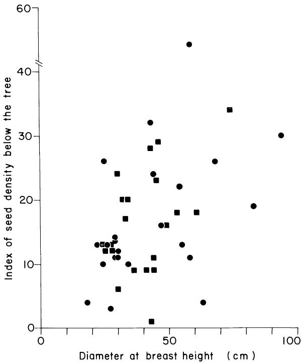
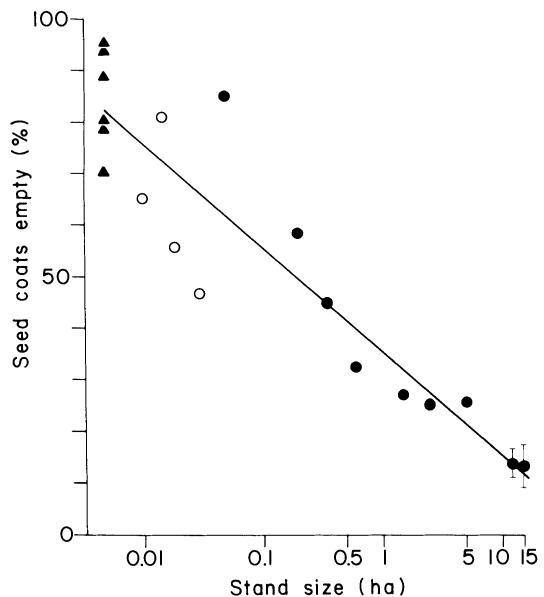
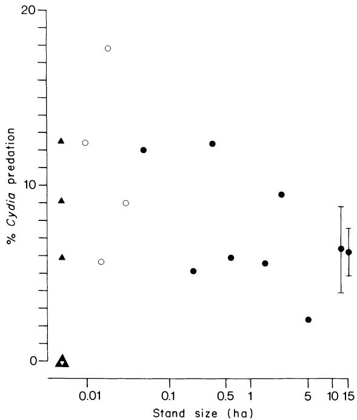
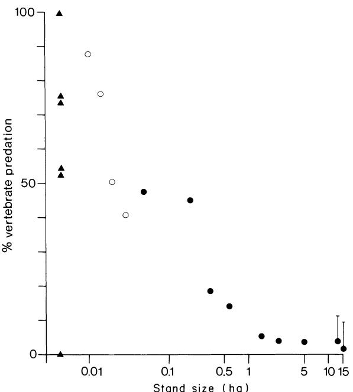
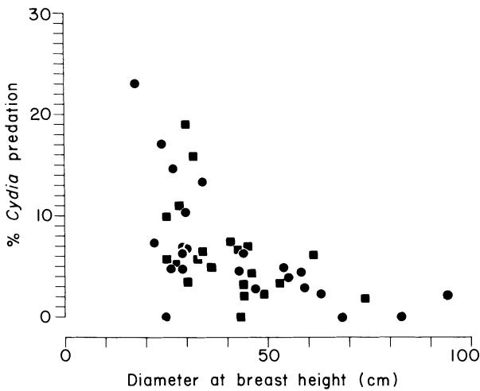
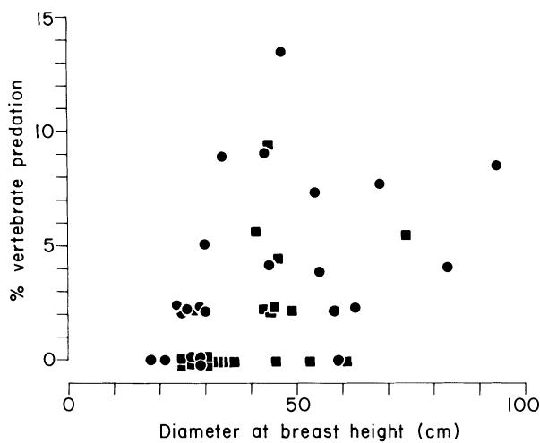

Seed Predation and Cross-Pollination in Mast-Seeding Beech (Fagus Sylvaniaica) Patches

Author(s): Sven G. Nilsson and Urban Wästljung

Source: Ecology, Vol. 68, No. 2 (Apr., 1987), pp. 260-265

Published by: Ecological Society of America

Stable URL: http://www.jstor.org/stable/1939256

Accessed: 24/03/2013 05:11

Your use of the JSTOR archive indicates your acceptance of the Terms & Conditions of Use, available at http://www.jstor.org/page/info/about/policies/terms.jsp

JSTOR is a not-for-profit service that helps scholars, researchers, and students discover, use, and build upon a wide range of content in a trusted digital archive. We use information technology and tools to increase productivity and facilitate new forms of scholarship. For more information about JSTOR, please contact support@jstor.org.

http://www.jstor.org

Ecological Society of America is collaborating with JSTOR to digitize, preserve and extend access to Ecology.

# SEED PREDATION AND CROSS-POLLINATION IN MAST-SEEDING BEECH (FAGUS SYLVATICA) PATCHES1

SVEN G. NILSSON AND URBAN WASTLJUNG

Department of Zoology, Uppsala University, Box 561, S-751 22 Uppsala, Sweden

Abstract. In this study we examined cross-pollination and levels of insect and vertebrate predation on the seeds of beech as a function of stand size and tree size. Cross-pollination in this wind-pollinated species is positively correlated with stand size and flower density. In two mast years, $6 - 14\%$ of seeds contained no kernels, and in a nonmast year the figure was $24\%$ . Predispersal destruction of seeds by a moth (Cydia fagiglandana) was $3.1\%$ in a mast year and $38\%$ in a nonmast year. The variation in seed destruction by vertebrates was much less between mast $(5.7\%)$ and nonmast $(12\%)$ years. Destruction by the moth was negatively correlated with tree size, while that by vertebrates was positively correlated with tree size. Vertebrate seed predation was negatively correlated with stand size. In a large stand, $< 10\%$ of the seeds were consumed by vertebrates by April in two mast years. Both cross-pollination and seed predation may have been important factors in the evolution of mast seeding in beech.

Key words: beech; Cydia; Fagus; forest fragmentation; germination; granivory; mast seeding; patch size; pollination; predation; seed; tree size.

# INTRODUCTION

Reproduction in plants is influenced by many factors whose selective effects can be opposing, unrelated, or synergistic (Harper 1977, Smith and Balda 1979, Heithaus et al. 1982). Therefore, to understand the reproductive characteristics of a species we must study factors that influence different life history stages, e.g., flowering, seed production, and seedling establishment.

Mast seeding is the periodic synchronous production of large seed crops. It has been suggested that masting is an antipredator adaptation that satiates predators with more seeds than they can consume in mast years (see review in Janzen 1971), while others have argued that it limits seed predator populations by starving them in nonmast years (Silvertown 1980). However, some animals, generally seed-caching birds and mammals, act both as predators and dispersers. The selective effect of that vertebrate behavior is different from the purely destructive impact of most insects. Over evolutionary time, plant species whose seeds are subject to both insect and vertebrate predation and dispersed only by vertebrates could be expected to adjust mast intervals and seed production to reduce seed loss to the strict predators and satiate the dispersal agents (Nilsson 1985). Here we examine that hypothesis with European beech (Fagus sylvatica L.), which has large nontoxic nuts and never produces large quantities of fruits in successive years (Lindquist 1931). The seeds are eaten and dispersed by a suite of vertebrates (Nils

son 1985), and destroyed by a seed-eating moth, Cydia fagiglandana Z. (Tortricidae).

Because fruit and seed coats develop if pollination occurs and self-pollinated fruits lack a seed (kernel) (Nielsen and de Muckadeli 1954), one can obtain relatively accurate estimates of cross-pollination. We examine cross-pollination and levels of insect and vertebrate predation on the seeds of beech as a function of stand size and of tree size.

# METHODS

# Study area

The study was conducted at Stenbrohult, South Sweden (about $56^{\circ}38'$ N, $14^{\circ}10'$ E), where different types of forest grow near each other, generally on podzols. The most common forest type is dominated by spruce (Picea abies [L.] Karst.), pine (Pinus sylvestris L.), and birch (Betula spp.). Sometimes these species grow in mixed stands with oaks (Quercus robur L. and Q. petraea Mattuschka), aspen (Populus tremula L.), and beech. Arable land occupies $\approx 10\%$ of the area.

Within these forests most of the beeches occur in well-defined stands in which $\approx 70\%$ of the canopy trees are beech. A 12-ha (140 m above sea level) stand at Taxas, bordering Lake Mockeln (45 km²), was selected for special study because data from previous years on seed production, seedling establishment, and seed predation were available (Nilsson 1979, 1985). The stand probably regenerated naturally from large beeches, now 100–150 yr old, growing on formerly grazed land. Based on basal area at 1.3 m height (square metres per hectare) the dominant species are beech (70%), oak (21%), and pine (5%). The ground is covered with beech litter

and almost devoid of a herbaceous layer. There is no other beech stand within $1\mathrm{km}$ . The largest stand, at Dio, is 15 ha bordering Lake Mückeln and is about 4 km from Taxas.

Most other beech stands (separated from other beeches by at least $100\mathrm{m}$ ) within an area of about 50 $\mathrm{km}^2$ to the east of Lake Mockeln were also studied. Topography (flat), ground vegetation (often lacking), and age of most canopy trees were about the same in all the stands examined.

Annual precipitation averages $\approx 700\mathrm{mm}$ . The mean monthly temperature in January and February is $\approx -2^{\circ}\mathrm{C}$ . Normally the ground is covered with snow for $\approx 2$ mo of the year. Prevailing winds are westerly throughout the year.

# Field procedures

To examine seed density and levels of seed predation in relation to stand size, we sampled six single beeches, four stands with two to three beeches, and nine stands with at least five beeches, including the two largest stands in the area (12 and 15 ha). In stands with five or fewer trees, all mature (seed-producing) beeches were examined. In the larger stands we randomly selected five mature trees, and in the two largest stands, 21 and 23 trees were sampled. Trees whose branches intermingled with those of trees to the east were excluded and in those few cases the next nearest tree was studied. To examine predation on the seed crops of individual trees, the litter and the upper soil in a circular plot of $184~\mathrm{cm}^2 \approx 2\mathrm{m}$ to the east of each trunk was carefully examined once between 26 October and 2 November 1983 to find all fallen beechnuts. If $< 50$ nuts were found, we examined the litter and upper soil adjacent to the plot until at least 50 (usually 50-60) seed coats had been found. Each coat was examined for its content and evidence of predation. Seeds killed by Cydia were filled with dark frass and had a round exit hole in the seed coat. Seeds killed by vertebrates had parts of their seed coats removed and all or most of the embryo was lacking, giving a minimum estimate of vertebrate predation. Seeds with intact coats were either filled with the embryo or empty. Seed predation was calculated as the number of killed embryos divided by the total number of seed coats that contained or had contained an embryo.

To assess the average seed density on the ground and vertebrate predation in winter in the beech stand at Taxas, we counted on 27 October 1983 and 11 April 1984 the number of seeds using the method just described in 20 randomly selected $184\mathrm{-cm}^2$ circular plots unrelated to the sampled trees. The mean density in these plots was equivalent to the mean density below the sampled trees, indicating that a distance of $2\mathrm{m}$ from the trunk was adequate to get representative samples.

Tree size was based on the diameter at breast height (1.3 m; dbh).

  
FIG. 1. Relation between tree size and seed density (seeds/ $184~\mathrm{cm}^2$ ) beneath the tree in the two largest stands at $\bullet$ Taxas and $\blacksquare$ Dio in a mast year (1983).

# RESULTS

# Seed production and cross-pollination

The density of new seed coats (two in each fruit) on the ground in the stand at Taxas was 764 seed coats/ $\mathrm{m}^2$ $(\mathrm{SD} = 428, n = 20)$ in autumn 1983 in the random sample plots. The number of old seed coats, probably produced the previous year since there were very few seeds in 1981, was only $10.2\%$ of the number produced in 1983. Seed density beneath beeches in the two largest stands increased with tree size, but the variability was large (Fig. 1; Spearman rank correlation corrected for ties $r_s = 0.40$ , $P < .01$ ).

The proportion of empty seed coats, indicating lack of cross-pollination, was negatively correlated with stand size (Fig. 2; $r_s = -0.87$ , $P < .01$ ). Below isolated trees (at least $100\mathrm{m}$ from other beeches), $84\%$ ( $\mathrm{SD} = 9.8$ , $n = 6$ ) of the seed coats were empty and without any sign of predation, and in the two largest stands, $\approx 15\%$ of the seed coats were empty. In the two largest stands the proportion of empty coats was not correlated with tree size or seed density ( $r_s = -0.13$ , $P > .4$ ; $r_s = -0.26$ , $1 > P > .05$ , $n = 44$ ).

# Seed predation in autumn

The rate of seed predation, especially that by Cydia, was considerably lower in the mast year 1983 than in the nonmast year 1982 (Table 1). About the same number of seeds seem to have been destroyed by Cydia

  
FIG. 2. Percent empty seed coats per tree in relation to stand size. Means and $95\%$ confidence intervals are indicated for the largest stands. The means for smaller stands are based on $\bullet 5$ trees and $\bigcirc 2-3$ trees. Single trees are indicated by triangles.

within the stand in both years, while many more seeds were taken by vertebrates in the mast year compared with the nonmast year.

The proportion of seeds attacked by Cydia was not related to stand size (Fig. 3, $r_s = 0.09$ ). In contrast, the rate of vertebrate predation was negatively correlated with stand size up to $\approx 2$ ha (Fig. 4, $r_s = -0.68$ , $P < .01$ ). The cumulative effect of pollination success and seed predation up to November 1983 was that the proportion of seed coats that still contained intact embryos increased with stand size from $\approx 6\%$ at single beeches to $79\%$ in the largest stands.

In the two largest stands the proportion of seeds killed by the moth decreased with tree size and seed density (Table 2; Fig. 5, $r_s = -0.62$ , $P < .01$ ). In contrast, vertebrate seed predation may not be closely related to seed density (Table 2) but did increase with tree size (Fig. 6, $r_s = 0.48$ , $P < .01$ ).

TABLE 1. Percent of the seeds taken from beneath large trees by predators as of early November in a nonmast year (1982) and a mast year (1983). Data are means with one standard deviation in parentheses.   

<table><tr><td></td><td>1982(5 trees)</td><td>1983(11 trees)</td></tr><tr><td>Seed density (no./m2)†</td><td>138</td><td>1240</td></tr><tr><td>Vertebrate predation</td><td>12.2 (4.08)*</td><td>5.7 (3.89)</td></tr><tr><td>Cydia predation</td><td>38.3 (7.70)*</td><td>3.1 (1.97)</td></tr></table>

* Calculated from data in Nilsson (1985). † The seed density is that recorded beneath large trees (dbh > 40 cm) in 1983 (old and new coats, respectively).

  
FIG. 3. Percent seed predation by the moth Cydia in relation to stand size. For explanation of symbols, see Fig. 2.

# Vertebrate seed predation over winter

In the beech stand at Taxas, total seed predation by all vertebrates was estimated at $< 10\%$ in the autumn and winter following the mast year 1974 (Nilsson 1979). A similar level of vertebrate seed predation appears to have occurred after the mast year 1983. From autumn

  
FIG. 4. Percent seed predation by vertebrates in relation to stand size. For explanation of symbols see Fig. 2.

TABLE 2. Seed predation per tree (percent of seeds that contain or have contained embryos) in relation to tree size (dbh) and seed density beneath the tree. Data are means, with one standard deviation in parentheses.   

<table><tr><td rowspan="2">Forest</td><td colspan="3">Taxáss</td><td colspan="3">Diö</td></tr><tr><td>No. trees*</td><td>Cydia predation</td><td>Vertebrate predation</td><td>No. trees*</td><td>Cydia predation</td><td>Vertebrate predation</td></tr><tr><td>Large trees (&gt;40 cm)</td><td>11</td><td>3.1 (1.97)</td><td>5.7 (3.89)</td><td>11</td><td>4.0 (2.45)</td><td>3.1 (2.92)</td></tr><tr><td>Small trees (≤40 cm)</td><td>12</td><td>9.6 (6.40)</td><td>2.1 (2.65)</td><td>10</td><td>8.6 (5.19)</td><td>0.2 (0.66)</td></tr><tr><td>High seed density (&gt;750 seeds/m2)</td><td>11</td><td>3.2 (2.48)</td><td>5.3 (4.24)</td><td>11</td><td>5.1 (4.14)</td><td>1.5 (1.97)</td></tr><tr><td>Low seed density (≤750 seeds/m2)</td><td>12</td><td>9.5 (6.32)</td><td>2.4 (2.61)</td><td>10</td><td>7.4 (4.87)</td><td>1.9 (3.19)</td></tr></table>

* About 50 seeds per tree were examined, since seeds without developed embryos are excluded when calculating percent predation.

to spring, the proportion of seeds taken by vertebrates increased $(P < .05$ , one-tailed Kruskal-Wallis test, $\mathrm{df} = 1$ ), the combined proportion of intact seeds and those killed by fungus decreased $(P < .05)$ , while other differences were nonsignificant $(P > .15)$ (Table 3). Seeds removed from the forest and cached seeds (many of which presumably were eaten) should be added to the proportion of seeds "killed by vertebrates" in Table 3. However, that would not increase the proportion very much, because few seeds were removed from this forest (Nilsson 1985) and no cached seeds were found in the soil down to $10\mathrm{cm}$ depth in the random sample plots in spring 1984. There was no evidence that large mammals that could destroy the remains of the seed coats were eating significant numbers of seeds. Also, the density of seed coats on the forest floor decreased by only $28\%$ from autumn to spring (Table 3), a difference that was not statistically significant (one-tailed Mann-Whitney $U = 145$ , $n_1 = n_2 = 20$ , $P > .05$ ). Furthermore, the proportion of the seed coats lacking embryos and the proportion of seed coats with exit holes from Cydia remained essentially constant from autumn to spring (Table 3). Since vertebrate seed predators generally take only filled seeds (e.g., Bossema 1979) there is evidence that vertebrate seed predation has not been underestimated very much.

  
FIG. 5. Percent seed predation by Cydia in relation to tree size at $\bullet$ Taxas and $\blacksquare$ Dio.

# DISCUSSION

# Pollination and evolution of mast seeding

In the self-incompatible beech, selfing gives $\approx 92\%$ barren fruits (Nielsen and de Muckadeli 1954). The negative correlation between stand size and the proportion of empty seed coats is consistent with reduced cross-pollination in small stands. From this we conclude that successful pollination and fruit-set are functions of the density of flowering plants. Moreover, the proportion of empty seeds decreases at least up to a stand size of $10\mathrm{ha}$ , which indicates that pollination success is not merely a function of the nearest neighbors. Increasing pollination success with the number of neighbors has been found also for insect-pollinated (Platt et al. 1974) and bat-pollinated (Heithaus et al. 1982) plants.

Pollination success also varied between mast and nonmast years. In the two mast years at Taxas the proportion of fruits with a kernel was $94\%$ (1976) and $86\%$ (1983), but only $76\%$ in the nonmast year 1982 (Nilsson 1979, 1985, this study). The observed differences in cross-pollination between years were consistent with flower density-dependent pollination and fruitset. Furthermore, flower production and seed crop sizes are correlated in other species in the family Fagaceae

  
FIG. 6. Percent seed predation by vertebrates in relation to tree size at $\bullet$ Taxas and $\blacksquare$ Dio.

TABLE 3. Condition of the seeds found in the 20 randomly selected ${184} - {\mathrm{{cm}}}^{2}$ sample plots in autumn 1983 and spring 1984 at Taxas. These samples in autumn and spring were taken independently of each other and also were unrelated to the selected trees in this forest.   

<table><tr><td rowspan="4">Condition of seed</td><td>Autumn</td><td>Spring</td></tr><tr><td>1983</td><td>1984</td></tr><tr><td>(281</td><td>(202</td></tr><tr><td>seeds)</td><td>seeds)</td></tr><tr><td></td><td colspan="2">Percent of all seeds</td></tr><tr><td>Intact</td><td>68.7</td><td>2.5*</td></tr><tr><td>Embryo killed by fungus</td><td>···</td><td>58.4</td></tr><tr><td>Embryo killed by Cydia</td><td>7.5</td><td>7.9</td></tr><tr><td>Embryo killed by vertebrates</td><td>3.9</td><td>6.4</td></tr><tr><td>Embryo lacking,† coat normal</td><td>18.9</td><td>21.8</td></tr><tr><td>Embryo lacking,† coat small</td><td>1.1</td><td>3.0</td></tr></table>

* Germinating in the surface litter.   
† There was no evidence of predation on these seeds.

(Gysel 1958, Feret et al. 1982). Since resources spent on empty fruits seem to be wasted, it ought to be advantageous to individual trees to produce their flowers in years when other trees also have many flowers. Thus, in self-incompatible trees, synchronous flowering, which favors pollination success, may be an important factor in the evolution of mast seeding (cf. Smith and Balda 1979).

# Effects of tree size and stand size on seed predation

At the level of individual trees, insect seed predation decreased with tree size and seed density in the two largest stands (Table 2, Fig. 5), and Cydia was evidently satiated as individual crop size increased. Vertebrate seed predation, on the other hand, increased with tree size (Fig. 6). Vertebrate seed predators probably prefer to eat and harvest seeds in the most profitable patches, and thus satiation by individual crops is less likely.

Seed predation by vertebrates decreased with increasing stand size. The reduction was negligible above $\approx 2$ ha (Fig. 4), possibly because the territories or home ranges of important vertebrate seed predators are between one and a few hectares in size (e.g., Jensen 1975, Enoksson and Nilsson 1983, S. G. Nilsson, personal observation). In small beech stands that fall completely within the home range of such resident seed predators, the animals can concentrate foraging on the patch with beech seeds. If so, a greater percentage of seeds will be eaten in small stands relative to large stands. Within a forest, seed-eating birds usually concentrate their activity in patches with the highest seed densities (Nilsson 1979). In addition, the impact of transient seed predators may be less in larger stands, as Boucher (1981) suggested for a neotropical oak.

# Seed predation and evolution of mast seeding

In mast years vertebrate seed predators are satiated in large stands since $< 10\%$ of the seeds are consumed over winter (Nilsson 1979, this study). Several large

vertebrate seed consumers were recently exterminated by humans in the study area (cf. Janzen and Martin 1982), including wild boar (Sus scrofa L.) and red deer (Cervus elaphus L.). These large mammals probably increased the proportion of the seed crops destroyed. However, we can see no reason why mast seeding should be more effective in reducing the relative level of seed predation by those locally extinct mammals than by the smaller mammals still present.

In contrast to Cydia and mammals, seed-eating birds have the potential to scan very large areas and concentrate their food searching in beech stands with large crops. For example, the winter distribution of some abundant seed-eating birds is determined by the beech crop size (Nilsson 1984). That can explain the lower relative variation in seed predation by vertebrates between mast and nonmast years.

That a variable seed crop size is more effective in reducing relative insect seed predation than in reducing vertebrate seed predation (Table 1) is consistent with previous work (Nilsson 1985). Seed crop sizes and the percent of the seeds destroyed by insects are negatively correlated in beech (Silvertown 1980). In a mast year in a Danish forest only $7\%$ of the seeds were killed by Cydia, while $24 - 55\%$ were killed in five nonmast years when crop sizes were $4 - 8\%$ of mast year (Nielsen 1977). These values are similar to those in our study site, although seed production in the mast year 1983 was twice that in the Danish forest.

We do not agree with Silvertown (1980) that a reduction in population size of seed-eating animals is necessary to a predator-satiation explanation of mast seeding. It is essential to the tree that a higher proportion of seeds escape predators in mast years. Our data indicate that the Cydia population was of about the same size in 1982 and 1983, but that the proportion of the seed crop destroyed dramatically in the mast year (Table 1). Thus, in beech, reproductive success through masting reflects increased pollination success, which leads to large seed crops and the eventual escape from predators of a significant portion of the seed crop. In addition, the nonmast years provide the opportunity for the trees to store resources for the next year.

# ACKNOWLEDGMENTS

We thank Robert W. Cruden, Lars Ericson, Torbjörn Fagerström, and Daniel Janzen for constructive comments on this paper. Research in 1983-1984 was supported by a grant to S. G. Nilsson from the Swedish Natural Science Research Council.

# LITERATURE CITED

Bossema, I. 1979. Jays and oaks: an eco-ethological study of a symbiosis. Behaviour 70:1-118.   
Boucher, D. H. 1981. Seed predation by mammals and forest dominance by Quercus oleoides, a tropical lowland oak. Oecologia (Berlin) 49:409-414.   
Enoksson, B., and S. G. Nilsson. 1983. Territory size and population density in relation to food supply in the nuthatch

Sitta eruopaea (Aves). Journal of Animal Ecology 52:927-935.   
Feret, P. P., R. E. Kreh, S. A. Merkle, and R. G. Oderwald. 1982. Flower abundance, premature acorn abscission and acorn production in Quercus alba L. Botanical Gazette 143: 216-218.   
Gysel, L. W. 1958. Prediction of acorn crops. Forest Science 4:239-245.   
Harper, J. L. 1977. Population biology of plants. Academic Press, London, England.   
Heithaus, E. R., E. Stashko, and P. K. Anderson. 1982. Cumulative effects of plant-animal interactions on seed production in Bauhinia ungulata, a neotropical legume. Ecology 63:1294-1302.   
Janzen, D. H. 1971. Seed predation by animals. Annual Review of Ecology and Systematics 2:465-492.   
Janzen, D. H., and P. S. Martin. 1982. Neotropical anachronisms: the fruits the gomphotheres ate. Science 215:19-27.   
Jensen, T. S. 1975. Population estimation and population dynamics of two Danish forest rodent species. Videnskabelige Meddelelser fra Dansk Naturhistorisk Forening 138: 65-86.   
Lindquist, B. 1931. The ecology of the Scandinavian beechwoods. (In Swedish with English summary.) Svenska Skogsvardsföreningens Tidskrift 29:179-532.

Nielsen, B. O. 1977. Beech seeds as an ecosystem component. Oikos 29:268-274.   
Nielsen, P. C., and M. S. de Muckadeli. 1954. Flower observations and controlled pollinations in *Fagus*. Silvae Genetica 3:6-17.   
Nilsson, S. G. 1979. Seed density, cover, predation and the distribution of birds in a beech wood in southern Sweden. Ibis 121:177-185.   
1984. The relation between the beech mast crop and the wintering of Brambling, Fringilla montifringilla, and Woodpigeon, *Columbia palumbus*, in South Sweden. Vár Fagelvarld 43:135-136.   
1985. Ecological and evolutionary interactions between reproduction of beech *Fagus sylvatica* and seed eating animals. Oikos 44:157-164.   
Platt, W. J., G. R. Hill, and S. Clark. 1974. Seed production in a prairie legume (Astragalus canadensis L.). Oecologia (Berlin) 17:55-63.   
Silvertown, J. W. 1980. The evolutionary ecology of mast seeding in trees. Biological Journal of the Linnean Society 14:235-250.   
Smith, C. C., and R. P. Balda. 1979. Competition among insects, birds and mammals for conifer seeds. American Zoologist 19:1065-1083.