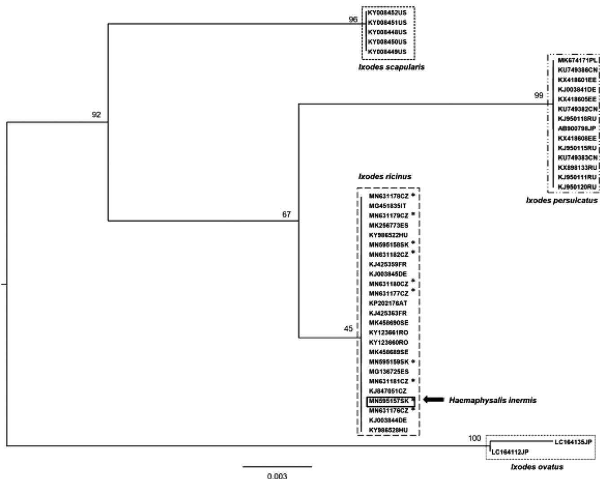

Original article

# Ticks, fleas and rodent-hosts analyzed for the presence of Borrelia miyamotoi in Slovakia: the first record of Borrelia miyamotoi in a Haemaphysalis inermis tick

Ivana Heglasováa,b, *, Natalie Rudenkoc , Maryna Golovchenkoc , Dana Zubrikováa , Dana Miklisováa , Michal Stankoa,d

a Institute of Parasitology, Slovak Academy of Sciences, Hlinkova 3, 040 01 Košice, Slovakia   
b Department of Zoology, Faculty of Natural Sciences, Comenius University, Mlynská dolina B-1, 842 15 Bratislava, Slovakia   
c Biology Centre, Czech Academy of Sciences, Institute of Parasitology, Branisovska 31, 37005 Ceske Budejovice, Czech Republic   
d Institute of Zoology, Slovak Academy of Sciences, Dúbravská cesta 9, 845 06 Bratislava, Slovakia

# A R T I C L E I N F O

Keywords:

Borrelia miyamotoi

Ticks

Rodents

Slovakia

# A B S T R A C T

In Slovakia, little knowledge is available on the occurrence, hosts and vectors of Borrelia miyamotoi of the relapsing fever group. In the current study, 2160 questing and rodent-attached ticks of six species (Ixodes ricinus, Ixodes trianguliceps, Dermacentor marginatus, Dermacentor reticulatus, Haemaphysalis concinna and Haemaphysalis inermis), 279 fleas belonging to 9 species (Ctenophthalmus agyrtes, Ctenophthalmus solutus, Ctenophthalmus assimilis, Megabothris turbidus, Amalareus penicilliger, Hystrichopsylla orientalis, Ctenophthalmus uncinatus, Doratopsylla dasycnema and Nosopsyllus fasciatus) and skin biopsies from 245 small mammals belonging to eight species (Apodemus agrarius, Apodemus flavicollis, Apodemus uralensis, Myodes glareolus, Crocidura leucodon, Micromys minutus, Microtus arvalis, Microtus subterraneus) were screened for the presence of B. miyamotoi DNA. The overall prevalence of B. miyamotoi found in questing and rodent-attached ticks was $1 . 8 \%$ (23 positive/1260 examined) and $3 . 4 \%$ (31 positive/900 examined), respectively. Borrelia miyamotoi was detected in questing I. ricinus, rodent-attached I. ricinus and H. inermis ticks, and in one male of the common vole (M. arvalis) in different habitats (mainly rural) in eastern Slovakia. However, B. miyamotoi was not found in any of the tested fleas. Our findings indicate that rural habitats with different species of tick vectors and hosts are appropriate for the occurrence of B. miyamotoi.

# 1. Introduction

Borrelia miyamotoi, a member of the relapsing fever group in the genus Borrelia, was first described in 1994 in Ixodes persulcatus ticks in Japan (Fukunaga et al., 1995). The majority of relapsing fever (RF) spirochete infections occur through soft ticks (e.g. Ornithodoros spp.). However, a few RF spirochete species, such as Borrelia theileri, Borrelia lonestari or B. miyamotoi, are transmitted by hard ticks (Rhipicephalus spp., Amblyomma spp., Ixodes spp.) (Talagrand-Reboul et al., 2018). Borrelia miyamotoi relies on transovarial and transstadial survival in ticks and may coexist with Borrelia burgdorferi sensu lato (s.l.) (Scoles et al., 2001; Barbour et al., 2009). Small mammals have been indicated as the reservoir hosts of B. miyamotoi in Europe (Burri et al., 2014; Cosson et al., 2014; Szekeres et al., 2015; Hamšíková et al., 2017),

Japan (Taylor et al., 2013) and North America (Barbour et al., 2009). Human cases of infection with B. miyamotoi have been reported from Europe (Hovius et al., 2013; Boden et al., 2016), Russia (Platonov et al., 2011), the USA (Krause et al., 2013) and Japan (Sato et al., 2014).

Borrelia miyamotoi has a global distribution and is represented by three geographically separated clades/genotypes. The European genotype is associated with Ixodes ricinus ticks (Fraenkel et al., 2002; Richter et al., 2003; Subramanian et al., 2012; Burri et al., 2014; Cochez et al., 2015; Nunes et al., 2015; Szekeres et al., 2015; Kalmár et al., 2016; Potkonjak et al., 2016; Venczel et al., 2016; Wagemakers et al., 2017; Vaculová et al., 2019; and others). The American genotype is associated with the ticks Ixodes scapularis, Ixodes pacificus and Ixodes dentatus (Scoles et al., 2001; Mun et al., 2006; Hamer et al., 2012; Crowder et al., 2014). And the Siberian (or Asian) genotype is associated with

the ticks Ixodes persulcatus, Ixodes ovatus and Ixodes pavlovskyi (Fukunaga et al., 1995; Korotkov et al., 2008; Fomenko et al., 2011; Borgoyakov et al., 2011; Geller et al., 2012; Takano et al., 2014; Khasnatinov et al., 2016; Rar et al., 2017).

The presence of B. miyamotoi in Slovakia was confirmed in questing I. ricinus ticks in 2012 by Subramanian et al. (2012) and subsequently by Venczel et al. (2016). Co-infections of B. miyamotoi and B. burgdorferi s. l. found in questing ticks and rodents suggested that they share amplifying hosts (Hamšíková et al., 2017). In Slovakia, no clinical cases of tick-borne relapsing fever have been reported (Public Health Authority of the Slovak Republic, http://www.uvzsr.sk/en/). However, the finding of B. miyamotoi in questing ticks and ticks collected from humans suggest a possible risk of this infection in Slovakia (Derdáková et al., 2016). Of the 20 known tick species inhabiting Slovakia, six belong to epidemiologically significant exophilic ticks (Ixodes ricinus, Dermacentor marginatus, Dermacentor reticulatus, Haemaphysalis concinna, Haemaphysalis punctata and Haemaphysalis inermis) (Černý, 1972; Řeháček et al., 1991). The most common and epidemiologically the most important tick species in Slovakia and Europe is I. ricinus.

In the present study, we aimed to determine the prevalence of B. miyamotoi in several species of questing and rodent-attached ticks, fleas and small mammals collected in urban, suburban and rural sites in eastern Slovakia, as well as to provide a molecular and phylogenetic characterization of the B. miyamotoi samples detected.

# 2. Material and methods

# 2.1. Small mammals, ticks and fleas sampling

Small mammals, questing ticks and rodent-attached ticks and fleas were collected at three sampling sites in eastern Slovakia during the years 2014–2016. The first study site, a Botanical Garden with deciduous forest vegetation, is located in the center of the Košice, the secondlargest city in Slovakia $2 0 8 \mathrm { m }$ a.s.l.; $4 8 ^ { \circ } 4 4 6 { \cdot } 8 4 ^ { \prime \prime } \mathrm { N }$ ; $2 1 ^ { \circ } 1 4 ^ { \prime } 1 6 { \cdot } 1 4 ^ { \prime \prime } \mathrm { ~ E ~ }$ ). It represents an urban habitat with a significant anthropogenic impact. The second site, Čermeľ, is characterized by the presence of mixed forest vegetation with a predominance of beech, hornbeam and spruce (220–410 m a.s.l.; $4 8 ^ { \circ } 4 5 ^ { \prime } 4 6 { \cdot } 6 7 ^ { \prime \prime } \mathrm { N }$ ; $2 1 ^ { \circ } 8 ^ { \prime } 8 ^ { . } 1 7 ^ { \prime \prime } \mathrm { E } )$ ) and represents a suburban habitat. The third site, the Slovak Karst National Park near the village of Hrhov, has mixed forest vegetation with predominance of beech, oak, and hornbeam $( 2 0 0 - 2 2 0 \mathrm { m }$ a.s.l., $4 8 ^ { \circ } 3 4 . 8 9 9 \mathrm { N }$ , $2 0 ^ { \circ } 4 6 . 7 4 3 \mathrm { E } )$ ; it represents a rural habitat.

The live-trapping of small mammals was carried out twice each year, in May/June and September/October, from 2014 to 2016, respectively. Small mammals were trapped alive using Swedish bridge metal traps following the protocol of Stanko (1995). Small mammals trapping were carried out using 100 live-traps/per one night the same for all studied localities. The captured rodents and insectivores were euthanized in accordance with licenses from the Ministry of Environment of the Slovak Republic, No. 4874/2011–2.2 and 4559/2015–2.3. The rodents and insectivores were identified to species according to morphological features (size of body, tail, ears, legs, etc.), sex and age classes (juvenile, subadult, adult) using the identification keys by Pelikán et al. (1979); Sládek and Mošanský (1985); and Anděra and Horáček (2005). An ear biopsy was obtained from each of 245 small mammals and stored at $- 2 0 ^ { \circ } \mathrm { C }$ until further molecular analysis.

Each rodent individual was checked for the presence of ectoparasites. All ticks and fleas collected were stored in $7 0 \%$ ethanol until identification. The species and developmental stage of the ectoparasites were determined based on morphological characteristics under a light microscope using the identification keys by Rosický (1957); Filippova (1977); Slovák (2014); and Estrada-Peña et al. (2017). Questing ticks were collected around mammal-trapping transects by dragging with a $1 { \cdot } \mathbf { m } ^ { 2 }$ white wool blanket over the vegetation for one hour twice each year, in May/July and September/October, from 2014 to 2016, respectively.

# 2.2. DNA isolation and molecular analyses

Genomic DNA from rodent skin (ear tissue) and rodent-attached ticks was extracted individually with the NucleoSpin Tissue kit (Macherey-Nagel, Düren, Germany) and the DNeasy Blood & Tissue Kit (Qiagen®, Germany), respectively, according to the manufacturers’ instructions. Genomic DNA from each questing Ixodes tick and flea was extracted individually using the alkaline hydrolysis method (Rijpkema et al., 1996). All DNA samples were stored at ${ \bf - 2 0 } ^ { \circ } \mathrm { C }$ until further processing.

DNA samples derived from individual ticks, fleas and rodent-tissues $( 5 \mu \mathrm { l }$ each) were pooled. In total, 445 pooled samples from questing ticks (198 pools), rodent-attached ticks (169), ear tissues of small mammals (50) and fleas (28) (pool size 4–5 individuals for ticks; pool size 10 individuals for fleas; pool size 4–5 individuals for small mammals) were examined for B. miyamotoi by a real-time polymerase chain reaction (qPCR) using B. miyamotoi–specific forward and reverse primers at 360 nmol/L, respectively, Brm1 ${ } ^ { 5 ^ { \prime } }$ -CGCTGTAAACGATGCACA CTTGGTGTTAATC- ${ } ^ { 3 ^ { \prime } }$ and Brm2 5′-CGGCAGTCTCGTCTGAGTCCCCA TCT-3′. The corresponding dye-labeled probe (final concentration 100 nmol/L) was R6G−CCTGGGGAGTATGTTCGCAAGAATGAAACTC-BQH1 according to a published protocol (Platonov et al., 2011). Subsequently, all individual DNA lysates of all positive pools were individually examined using qPCR (Platonov et al., 2011).

All qPCR-positive samples were examined by conventional PCR and sequencing. We targeted the 920-bp long fragment of the glycerophosphodiester phosphodiesterase gene (glpQ) of B. miyamotoi with the forward primer glpQ-BM-F2 (5' ATGGGTTCAAACAAAAAGTCACC 3′) and the reverse primer glpQ-BM-R1 (5'CCAGGGTCCAATTCCATCAGA ATATTGTG CAAC 3′) (Hovius et al., 2013).

PCR products were purified using Isolate II PCR and Gel Kit (Bioline) and then sequenced. Nucleotide sequences were aligned, compared and analyzed using the MEGA6 program (www. megasoftware.net). Nucleotide sequences were compared with GenBank entries using the Basic Local Alignment Search Tool (BLAST) (Altschul et al., 1990). Three newly obtained sequences from the present study were submitted to the GenBank database.

# 2.3. Accession numbers of obtained nucleotide sequences

Nucleotide sequences of the fragments of the glpQ gene obtained in this study from two I. ricinus and one H. inermis rodent-attached ticks were submitted to the GenBank database and were assigned the following accession numbers: B. miyamotoi MN595157, MN595158 and MN595159.

# 2.4. Phylogenetic analysis

Multiple sequence alignment was generated in MAFFT v. 7.222 (Katoh and Standley, 2013). Gaps were eliminated and the length of the glpQ sequences was adjusted to 367 bp. The analysis consisted of 46 non-duplicating sequences in total: 3 were obtained in the present study, 7 were obtained in 2019 in an independent study in the Czech Republic, and 36 were downloaded from GenBank. A phylogenetic tree was constructed using a maximum likelihood algorithm in RAxML with 100 bootstraps (Stamatakis, 2006).

# 2.5. Statistical analysis

Statistical analysis of B. miyamotoi prevalence in both questing ticks and rodent-attached ticks was performed using log-linear analysis of contingency tables of data with the factors Borrelia infection, habitat, host species (if relevant) and tick stadium, with consequent optimal model selection in the Statistica software (StatSoft and Inc, 2013). Fisher’s exact test and the $\chi ^ { 2 }$ test was performed using GraphPad Prism version 8.3.1 for Windows, 2020 (GraphPad Software, San Diego,

Table 1 Prevalence of Borrelia miyamotoi in questing ticks in three habitat types in Slovakia.   

<table><tr><td>Habitat /tick stage</td><td colspan="2">Ixodes ricinus</td><td colspan="2">Dermacentor reticulatus</td><td colspan="2">Dermacentor marginatus</td><td colspan="2">Haemaphysalis concinna</td><td colspan="2">Haemaphysalis inermis</td></tr><tr><td rowspan="4">Slovak Karst (rural)</td><td>M</td><td>4/67a</td><td>M</td><td>0/7</td><td>M</td><td>0/4</td><td>M</td><td>0/3</td><td>M</td><td>0/10</td></tr><tr><td>F</td><td>2/44</td><td>F</td><td>0/5</td><td>F</td><td>0/8</td><td>F</td><td>0/2</td><td>F</td><td>0/17</td></tr><tr><td>N</td><td>11/245</td><td>N</td><td>-</td><td>N</td><td>-</td><td>N</td><td>0/10</td><td>N</td><td>-</td></tr><tr><td>L</td><td>0/67</td><td>L</td><td>-</td><td>L</td><td>-</td><td>L</td><td>0/30</td><td>L</td><td>-</td></tr><tr><td rowspan="4">Čermel (suburban)</td><td>M</td><td>0/62</td><td>-</td><td></td><td>-</td><td></td><td>-</td><td></td><td>-</td><td></td></tr><tr><td>F</td><td>1/92</td><td></td><td></td><td></td><td></td><td></td><td></td><td></td><td></td></tr><tr><td>N</td><td>1/383</td><td></td><td></td><td></td><td></td><td></td><td></td><td></td><td></td></tr><tr><td>L</td><td>0/9</td><td></td><td></td><td></td><td></td><td></td><td></td><td></td><td></td></tr><tr><td rowspan="4">Botanical garden (urban)</td><td>M</td><td>0/22</td><td>-</td><td></td><td>-</td><td></td><td>-</td><td></td><td>-</td><td></td></tr><tr><td>F</td><td>0/13</td><td></td><td></td><td></td><td></td><td></td><td></td><td></td><td></td></tr><tr><td>N</td><td>2/106</td><td></td><td></td><td></td><td></td><td></td><td></td><td></td><td></td></tr><tr><td>L</td><td>2/54</td><td></td><td></td><td></td><td></td><td></td><td></td><td></td><td></td></tr><tr><td>Total</td><td colspan="2">23/1164 (1.9%)</td><td>0/12</td><td></td><td>0/12</td><td></td><td>0/45</td><td></td><td>0/27</td><td></td></tr></table>

a No. of Borrelia miyamotoi-positive/no. of tested tick; M–males, F–females, N–nymphs, L–larvae.

Table 2 Prevalence of Borrelia miyamotoi in developmental stages of rodent-attached tick in three habitat types in Slovakia.   

<table><tr><td>Habitat</td><td>Hosts (No.)</td><td colspan="2">Ixodes ricinus</td><td colspan="2">Ixodes trianguliceps</td><td colspan="2">Dermacentor reticulatus</td><td colspan="2">Dermacentor marginatus</td><td colspan="2">Haemaphysalis concinna</td><td colspan="2">Haemaphysalis inermis</td></tr><tr><td rowspan="10">Slovak Karst (rural)</td><td rowspan="2">Apodemusflavicollis(37)</td><td>N</td><td>0/12a</td><td>N</td><td>0/1</td><td>N</td><td>-</td><td>N</td><td>-</td><td>N</td><td>-</td><td>N</td><td>1/1</td></tr><tr><td>L</td><td>5/237</td><td>L</td><td>0/1</td><td>L</td><td>0/65</td><td>L</td><td>0/100</td><td>L</td><td>0/35</td><td>L</td><td>-</td></tr><tr><td rowspan="2">Apodemusagrarius(43)</td><td>N</td><td>1/6</td><td>N</td><td>-</td><td>N</td><td>-</td><td>N</td><td>-</td><td>N</td><td>-</td><td>N</td><td>-</td></tr><tr><td>L</td><td>17/152</td><td>L</td><td>0/15</td><td>L</td><td>0/6</td><td>L</td><td></td><td>L</td><td>0/4</td><td>L</td><td>0/1</td></tr><tr><td rowspan="2">Crociduraleucodon(4)</td><td>N</td><td>0/1</td><td>N</td><td>-</td><td>N</td><td>-</td><td>N</td><td>-</td><td>N</td><td>-</td><td>N</td><td>-</td></tr><tr><td>L</td><td>1/4</td><td>L</td><td></td><td>L</td><td>0/2</td><td>L</td><td></td><td>L</td><td></td><td>L</td><td></td></tr><tr><td rowspan="2">Microtus arvalis(4)</td><td>N</td><td>0/1</td><td>N</td><td>-</td><td>N</td><td>-</td><td>N</td><td>-</td><td>N</td><td>-</td><td>N</td><td>-</td></tr><tr><td>L</td><td>2/5</td><td>L</td><td></td><td>L</td><td></td><td>L</td><td></td><td>L</td><td>0/1</td><td>L</td><td></td></tr><tr><td rowspan="2">Myodes glareolus(9)</td><td>N</td><td>-</td><td>N</td><td>0/1</td><td>N</td><td>-</td><td>N</td><td>-</td><td>N</td><td>-</td><td>N</td><td>-</td></tr><tr><td>L</td><td>0/43</td><td>L</td><td>-</td><td>L</td><td>0/14</td><td>L</td><td>0/19</td><td>L</td><td>0/8</td><td>L</td><td>0/1</td></tr><tr><td rowspan="8">Čermel (suburban)</td><td rowspan="2">Apodemusflavicollis(26)</td><td>N</td><td>-</td><td>N</td><td>0/2</td><td>-</td><td></td><td>-</td><td></td><td>-</td><td></td><td>-</td><td></td></tr><tr><td>L</td><td>0/69</td><td>L</td><td>0/1</td><td></td><td></td><td></td><td></td><td></td><td></td><td></td><td></td></tr><tr><td rowspan="2">Apodemusagrarius(7)</td><td>N</td><td>0/2</td><td>N</td><td>-</td><td>-</td><td></td><td>-</td><td></td><td>-</td><td></td><td>-</td><td></td></tr><tr><td>L</td><td>4/34</td><td>L</td><td>0/1</td><td></td><td></td><td></td><td></td><td></td><td></td><td></td><td></td></tr><tr><td rowspan="2">Micromysminutus(4)</td><td>N</td><td>0/1</td><td>N</td><td>-</td><td>-</td><td></td><td>-</td><td></td><td>-</td><td></td><td>-</td><td></td></tr><tr><td>L</td><td>0/7</td><td>L</td><td></td><td></td><td></td><td></td><td></td><td></td><td></td><td></td><td></td></tr><tr><td rowspan="2">Myodes glareolus(10)</td><td>N</td><td>0/2</td><td>N</td><td>0/2</td><td>-</td><td></td><td>-</td><td></td><td>-</td><td></td><td>-</td><td></td></tr><tr><td>L</td><td>0/21</td><td>L</td><td>-</td><td></td><td></td><td></td><td></td><td></td><td></td><td></td><td></td></tr><tr><td rowspan="6">Botanical garden(urban)</td><td rowspan="2">Apodemusflavicollis(1)</td><td>N</td><td>-</td><td>-</td><td></td><td>-</td><td></td><td>-</td><td></td><td>-</td><td></td><td>-</td><td></td></tr><tr><td>L</td><td>0/12</td><td></td><td></td><td></td><td></td><td></td><td></td><td></td><td></td><td></td><td></td></tr><tr><td rowspan="2">Apodemusagrarius(2)</td><td>N</td><td>-</td><td>-</td><td></td><td>-</td><td></td><td>-</td><td></td><td>-</td><td></td><td>-</td><td></td></tr><tr><td>L</td><td>0/8</td><td></td><td></td><td></td><td></td><td></td><td></td><td></td><td></td><td></td><td></td></tr><tr><td rowspan="2">Crocidurasaugeolens(1)</td><td>N</td><td>-</td><td>-</td><td></td><td>-</td><td></td><td>-</td><td></td><td>-</td><td></td><td>-</td><td></td></tr><tr><td>L</td><td>0/2</td><td></td><td></td><td></td><td></td><td></td><td></td><td></td><td></td><td></td><td></td></tr><tr><td>Total</td><td></td><td colspan="2">30/619(4.8%)</td><td colspan="2">0/24</td><td colspan="2">0/87</td><td colspan="2">0/119</td><td colspan="2">0/48</td><td colspan="2">1/3</td></tr></table>

a No. of Borrelia miyamotoi-positive/no. of tested rodent-attached tick; M–males, F–females, N–nymphs, L–larvae.

California USA www.graphpad.com).

# 3. Results

# 3.1. Borrelia miyamotoi in questing ticks

In total, 1260 questing ticks of five species (1164 I. ricinus, $1 2 \ D$ . marginatus, $1 2 \ D$ . reticulatus, 45 H. concinna and 27 H. inermis) were collected by flagging the vegetation at the three collection sites (Table 1). Borrelia miyamotoi was detected in 23 of 1260 tested questing ticks (all positive ticks were I. ricinus: 2 larvae, 14 nymphs, 3 females, 4 males) with a total prevalence of $1 . 8 \%$ . Ticks infected with B. miyamotoi were found in all studied habitats with an overall prevalence of $3 . 3 \%$ in the rural habitat Slovak Karst, $2 . 1 \%$ in the urban habitat Botanical Garden and $0 . 4 \%$ in the suburban habitat Čermeľ (Table 1).

For questing ticks, the highest infection prevalence was detected for I. ricinus males with $2 . 3 \%$ (4 positive/175 examined), followed by nymphs at $1 . 9 \%$ (14 positive/744 examined), females at $1 . 6 \%$ (3

positive/181 examined) and finally larvae with $1 . 2 \%$ (2 positive/160 examined) with non-significant differences $( \chi ^ { 2 } = 0 . 5 4 4$ , $P = 0 . 9 1$ , $\mathrm { D } . \mathrm { F } . = 3 .$ ). The prevalence of infection in questing ticks was in spring (May–July) $1 . 6 \%$ (15/927) and $2 . 4 \%$ (8/333) in autumn (September–October) without significant difference (Fisher exact test, $P < 0 . 0 5$ , D.F. $^ { \textrm { \scriptsize = 1 } }$ ).

The optimal model selection (factors B. miyamotoi infection on questing ticks, habitat and tick stadium) resulted in the best model which includes two-way interactions: infection $\times$ habitat and tick stadium $\times$ habitat (Maximum likelihood $\chi 2 = 8 . 3 8$ , D.F. = 9, $P = 0 . 4 9 6 \mathrm { \mathrm { ~ } }$ ). Habitat showed a significant influence on B. miyamotoi prevalence, with the rural habitat infected more frequently than the urban and suburban (3.3 vs 2.1 and $0 . 4 \%$ , respectively; $\chi 2 = 1 2 . 6 3$ , $P = 0 . 0 0 1 8$ , D.F. $= 2$ ).

# 3.2. Borrelia miyamotoi in small mammals and their ectoparasites

In total, 245 out of 250 captured small mammals belonging to eight species (A. agrarius, A. flavicollis, A. uralensis, M. glareolus, C. leucodon,

Fig. 1. Phylogenetic analysis of Borrelia miyamotoi isolates based on comparison of partial glpQ gene.   
  
The analysis involved 46 partial sequences of B. miyamotoi glpQ gene and the final dataset contained a total of 367 positions. Out of 46 sequences, 10 were obtained in this study: 3 from Slovakia and 7 from the Czech Republic (marked by asterisks). The remaining 36 representative sequences were obtained from the GenBank database. Multiple sequence alignment was generated in MAFFT v. 7.222 (Katoh and Stadley, 2013). The phylogenetic tree was constructed by using a maximum likelihood algorithm in RAxML with 100 bootstraps (Stamatakis, 2006). Borrelia miyamotoi isolates are represented by their glpQ GenBank accession numbers followed by Aplha-2 country code of their origin: AT-Austria, CN-China, CZ-Czech Republic, EE-Estonia, ES-Spain, FR-France, DE-Germany, HU-Hungary, IT-Italy, JP-Japan, PL-Poland, RO-Romania, RU-Russian Federation, SE-Sweden, SK-Slovakia, US- United States of America. Arrow indicates a framed accession number of the B. miyamotoi glpQ sequence detected in Haemaphysalis inermis.

M. minutus, M. arvalis, M. subterraneus) were examined. Five individuals could not be tested due to an insufficient amount of ear tissue. Borrelia miyamotoi was detected by qPCR in only one M. arvalis male collected in the rural habitat Slovak Karst $( 0 . 4 \%$ , 1/245).

A representative sample of 900 rodent-attached ixodid ticks (868 larvae and 32 nymphs) of six species $\left( I . \right.$ ricinus, I. trianguliceps, D. marginatus, D. reticulatus, H. concinna and H. inermis) were determined to species, developmental stage and in the next step were examined for the presence of B. miyamotoi. Borrelia miyamotoi was detected in 31 of the 900 tested rodent-attached ticks (1 I. ricinus nymph, 1 H. inermis nymph, 29 I. ricinus larvae) corresponding to a total prevalence of $3 . 4 \%$ . Ticks infected with B. miyamotoi were found in the rural Slovak Karst $( 3 . 7 \% )$ and suburban habitat Čermeľ $( 2 . 8 \% )$ with a non-significant difference (Fisher’s exact test, $P = 0 . 8 0 5$ , D.F. = 1) (Table 2). The prevalence of infection in rodent-attached ticks was higher in autumn $( 8 . 8 8 \%$ ; 23/259) than in spring $( 1 . 2 5 \%$ ; 8/641) with significant difference (Fisher exact test, $P = 0 . 0 0 1$ , D.F. = 1).

The optimal model with the factors B. miyamotoi infection on rodent-attached ticks, habitat and tick stadium was not confirmed, so

rodent species was added to the modeling process as a factor. Only the most abundant host species (A. agrarius and A. flavicollis) with the total dominance of $7 9 \%$ were tested. Analysis of intrinsic factors influencing B. miyamotoi prevalence was conducted using a model with a four-way interaction of categorical factors (B. miyamotoi infection $\times$ habitat $\times$ host species $\times$ tick stadium). The optimal model selection resulted in the best model which includes two-way interaction B. miyamotoi infection $\times$ host species, habitat and tick stadium (Maximum likelihood $\chi 2 = 1 3 . 1 1$ , D.F. = 17, $P = 0 . 7 3$ ). Rodent species had a significant influence on B. miyamotoi prevalence, with A. agrarius infected more frequently than A. flavicollis (10.4 vs. $1 . 5 \%$ , respectively; Fisher’s exact test, $P = 0 . 0 0 0 1$ , D.F. $^ { \textrm { \scriptsize = 1 } }$ ).

A higher significant prevalence was found in rodent-attached ticks $( 3 . 4 \% )$ ; 31 positive/examined 900) than in questing ticks $( 1 . 8 \%$ ; 23 positive/1260 examined) (Fisher’s exact test, $P = 0 . 0 0 2$ , D.F. ${ \bf \Phi } = 1 { \bf \Phi } .$ ). The highest prevalence of B. miyamotoi in questing $( 3 . 3 \% )$ and rodent-attached ticks $( 3 . 6 \% )$ with a non-significant difference (Fisher’s exact test, $P = 0 . 8 7 6$ , D.F. $^ { \textrm { \scriptsize = 1 } }$ ) was confirmed in the rural habitat, Slovak Karst.

Table 3 Number of Borrelia miyamotoi in rodent-attached ticks.   

<table><tr><td>Host species</td><td>N of hosts</td><td>N of hosts with B. miyamotoi-positive ticks</td><td>Sum of positive total ticks</td><td>Total ticks</td></tr><tr><td>Apodemus agrarius</td><td>52</td><td>8</td><td>22</td><td>229</td></tr><tr><td>Apodemus flavicollis</td><td>64</td><td>3</td><td>6</td><td>536</td></tr><tr><td>Myodes glareolus</td><td>19</td><td>0</td><td>0</td><td>111</td></tr><tr><td>Crocidura leucodon</td><td>4</td><td>1</td><td>1</td><td>7</td></tr><tr><td>Crocidura suaveolens</td><td>1</td><td>0</td><td>0</td><td>2</td></tr><tr><td>Microtus arvalis</td><td>4</td><td>1</td><td>2</td><td>7</td></tr><tr><td>Micromys minutus</td><td>4</td><td>0</td><td>0</td><td>8</td></tr><tr><td>Sum</td><td>150</td><td>13</td><td>31</td><td>900</td></tr></table>

A total of 279 tested fleas were collected from small mammals in three habitats of eastern Slovakia. In the rural habitat Slovak Karst 8 species were identified: Ctenophthalmus agyrtes (49 ex.), Ctenophthalmus assimilis (49), Ctenophthalmus solutus (35), Ctenophthalmus uncinatus (1), Doratopsylla dasycnema (2), Hystrichopsylla orientalis (15), Megabothris turbidus (17) and Nosopsyllus fasciatus (1); in suburban habitat Čermeľ 4 specimens: Amalareus penicilliger (15), C. agyrtes (54), C. solutus (17) and C. uncinatus (11); and in the urban habitat Botanical Garden 2 specimens: C. agyrtes (2) and C. solutus (11). None of the 279 tested fleas belonging to 9 species was qPCR-positive for B. miyamotoi.

# 3.3. Genotyping of B. Miyamotoi from ticks based on BLAST analysis of partial nucleotide sequences of the glpQ gene

Analysis of the glpQ sequences confirmed the presence of B. miyamotoi in ticks. In total, 24 out of 31 qPCR-positive samples were glpQ-PCR-positive in rodent-attached ticks, and 21 DNA amplicons were successfully sequenced from them. Twenty of these 21 sequences were $1 0 0 \%$ identical. The sequence (acc. no. MN595158) carried a single nucleotide polymorphism, and the identity between this sequence and the subset of the remaining 20 identical sequences was $9 8 . 2 \%$ .

The partial sequences of the glpQ gene of B. miyamotoi from 19 rodent-attached I. ricinus larvae collected in eastern Slovakia were $1 0 0 \%$ identical with B. miyamotoi isolates (MF678600, MF678599, MF576179, MF678597 and others). The partial sequence of the glpQ gene of B. miyamotoi from one H. inermis nymph from this study (acc. no. MN595157) was $1 0 0 \%$ identical with B. miyamotoi isolates (MG451835, MG136725, MF678600, MF678599, KJ003844, KY986528, MF678598 and others) identified in I. ricinus in Italy, Spain and Hungary. The sequence of the B. miyamotoi glpQ gene from an I. ricinus larva collected in Slovakia (acc. no. MN595158), which carried a single nucleotide polymorphism, was $1 0 0 \%$ identical to B. miyamotoi (MF678598) from I. ricinus from Hungary.

In total, 17 of 23 qPCR-positive samples were glpQ-PCR-positive in questing ticks. The partial nucleotide sequences of the glpQ gene of B. miyamotoi from I. ricinus (2 female, 3 male, 10 nymphs, 2 larvae) were $1 0 0 \%$ identical with each other and $1 0 0 \%$ identical with B. miyamotoi (MG451835) from I. ricinus collected in Italy.

# 3.4. Phylogenetic analysis

Phylogenetic analysis of partial glpQ sequences of 46 representative samples of B. miyamotoi with wide geographic distribution revealed the clear clustering of them into 3 well-defined clades – European, American and Asian – as described earlier (Fig. 1). While the wellsupported sub-clade consists mainly of B. miyamotoi sequences originating from China, Japan, the far eastern and eastern parts of Russia, Estonia, Germany and Poland, the second sub-clade consists the sequences from the vast majority of states in Central Europe, Western Europe and Southern Europe (Austria, Czech Republic, Germany, Hungary, Romania, Slovakia, France, Sweden, Spain, Italy).

Borrelia miyamotoi sequences detected in the presented study cluster together with the sequences from the second sub-clade. The separation

of sequences into two subclades is most likely linked to the distribution of specific hosts or tick vectors.

# 4. Discussion

In this study, DNA of B. miyamotoi spirochetes was detected in questing, rodent-attached ticks and one male M. arvalis captured in the eastern part of Slovakia. The overall prevalence of B. miyamotoi found in questing and rodent-attached ticks was $1 . 8 \%$ (23 positive/1260 examined) and $3 . 4 \%$ (31 positive/900 examined), respectively. The low infection rates in questing I. ricinus ticks ranged from $0 . 4 \%$ to $3 . 5 \%$ , which is typical in Europe, although a lot of studies have reported a range between 1 and $2 \%$ (Geller et al., 2012; Crowder et al., 2014; Hamšíková et al., 2017; Szekeres et al., 2017; Wagemakers et al., 2017; Kubiak et al., 2019; Vaculová et al., 2019). The more frequent detection of B. miyamotoi in host-attached ticks in comparison to questing ticks could be caused by faster reproduction of spirochetes in blood-sucking ticks, which increases the possibility of their molecular detection. It might also be connected to the fact that the hosts were highly infected with B. miyamotoi and blood-sucking ticks caught infection when bloodfeeding (Han et al., 2016).

In the current study, ticks infected with B. miyamotoi were found in the urban habitat Botanical Garden, the suburban habitat Čermeľ and the rural habitat Slovak Karst. In the rural habitat Slovak Karst the sympatric occurrence of I. ricinus, I. trianguliceps, D. marginatus, D. reticulatus, H. concinna and H. inermis was confirmed (e.g., Nosek, 1971, 1972; Hubálek, 1986; Heglasová et al., 2018). The absence of B. miyamotoi-positive rodent-attached ticks in the urban habitat was probably due to the low number of small mammals trapped and ticks collected at this site. In the Slovak Karst, B. miyamotoi was found in all developmental stages of I. ricinus collected from vegetation and small mammals. The majority of the infected ticks were found on tested A. agrarius and A. flavicollis (Table 3). Borrelia miyamotoi was also confirmed in one H. inermis nymph collected from a B. miyamotoi-negative A. flavicollis. To our knowledge, this is the first report of the detection of B. miyamotoi in the winter tick H. inermis.

Asian and American strains of B. miyamotoi detected in at least seven species of ticks from the genus Ixodes (Hamer et al., 2012; Mukhacheva et al., 2015; Cook et al., 2016; Siński et al., 2016), while the European strains have been found only in I. ricinus (Geller et al., 2012). On the other hand, Asian clade representatives of B. miyamotoi were also confirmed in other species of ticks, such as H. concinna (Jiang et al., 2018) and Haemaphysalis longicornis (Yang et al., 2018). Whether these tick species play some role in B. miyamotoi survival or maintaining in hosts still remains unclear (Cutler et al., 2019).

In total, only one of the 245 small mammals tested (ear tissue), a common vole (M. arvalis) captured in the rural habitat Slovak Karst, was B. miyamotoi-positive. This specimen did not carry any tick at the time of capture. Due to the retrospective design of study, the skin biopsy was used for the search of B. burgdorferi s.l. However, our results demonstrated that this material is not suitable for the detection of B. miyamotoi infection in mammals. Other authors recommended using blood or blood-filled organs (spleen, lung, etc.) of rodents (Barbour

et al., 2009; Szekeres et al., 2015). In several European countries, small mammals (Apodemus spp., M. glareolus) were found to be positive for B. miyamotoi with infection prevalences up to $5 . 5 \%$ (Burri et al., 2014; Cosson et al., 2014; Cerar et al., 2015; Szekeres et al., 2015). On the other hand, Hamšíková et al. (2017) detected a high prevalence of infection (up to $9 . 3 \%$ ) in the skin of A. flavicollis in Slovakia.

We analyzed 279 fleas belonging to 9 species for the presence of B. miyamotoi, since fleas parasitize the same hosts as B. miyamotoi-positive ticks. We did not detect any B. miyamotoi in fleas collected from small mammals in the eastern part of Slovakia. To our knowledge, B. miyamotoi has not yet been identified in fleas, which indicates that fleas are not important for its survival or maintenance.

Phylogenetic analysis confirmed the already known pattern of separation of existing genotypes of B. miyamotoi. All samples analyzed in the present study formed well-supported clades, the clustering of Asian, North American and European genotypes of B. miyamotoi. However, the presence of two sub-clades among the European genotype was also evident. While the sub-clade that included, along with others, the samples from Slovakia formed the group connected to the main European tick I. ricinus, the samples from the second sub-clade were strictly connected to I. persulcatus, a tick distributed from the eastern part of Europe to central and northern Asia, China and Japan. The phylogenetic tree reveals a strong correlation between the genotype/ sub-type of B. miyamotoi and the species of ticks that transmit the pathogen regardless of the geographic region: Asian genotype – I. ovatus; North American – I. scapularis, West/Central European – I. ricinus, Eurasian – I. persulcatus. As an example, the clustering of multiple samples from Japan was defined by the species of their tick vector, either I. ovatus or I. persulcatus (Fig. 1).

# 5. Conclusion

The presence of B. miyamotoi has been recorded in questing I. ricinus, rodent-attached I. ricinus and H. inermis ticks, and in one common vole male (M. arvalis) in different habitats in eastern Slovakia. To our knowledge, this is the first report of evidence of B. miyamotoi in H. inermis, and a tick species other than Ixodes from Europe, which may indicate a wider spectrum of tick species for B. miyamotoi. The low prevalence of B. miyamotoi in small mammals may be due to the type of tested tissue. Borrelia miyamotoi was not identified in the tested fleas belonging to 9 species collected from small mammals, which may suggest that fleas are not important vectors for its survival and/or maintenance in hosts. Our findings indicate that rural habitats with different species of tick vectors and hosts are appropriate for the establishment of a local population of B. miyamotoi and its further spread. We confirmed the strong association of tick vector species with the genotype of B. miyamotoi that these species transmit.

# Authorship statement

All persons who meet authorship criteria are listed as authors, and all authors certify that they have participated sufficiently in the work to take public responsibility for the content, including participation in the concept, design, analysis, writing, or revision of the manuscript. Furthermore, each author certifies that this material or similar material has not been and will not be submitted to or published in any other publication before its appearance in the Hong Kong Journal of Occupational Therapy.

# CRediT authorship contribution statement

Ivana Heglasová: Conceptualization, Data curation, Writing - original draft, Writing - review & editing. Natalie Rudenko: Writing - review & editing. Maryna Golovchenko: Data curation, Writing - review & editing. Dana Zubriková: Conceptualization, Data curation, Writing - review & editing. Dana Miklisová: Data curation, Writing -

review & editing. Michal Stanko: Conceptualization, Data curation, Writing - review & editing.

# Declaration of Competing Interest

The authors declare no conflict of interest.

# Acknowledgement

The study was financially supported by the project VEGA1/0084/18 and by the project Environmental protection against parasitozoonoses under the influence of global climate and social changes (code IMTS: 26220220116), supported by the Research & Development Operational Programme funded by the ERDF (0.5). This work was partially supported by grant QK1920258 from the Ministry of Agriculture of the Czech Republic to MG and NR.

# References

Altschul, S.F., Gish, W., Miller, W., Myers, E.W., Lipman, D.J., 1990. Basic local alignment search tool. J. Mol. Biol. 215, 403–410.   
Anděra, M., Horáček, I., 2005. Poznávame Naše Savce. 2. Přepracované vydání, Sobotáles, Praha.   
Barbour, A.G., Bunikis, J., Travinsky, B., Hoen, A.G., Diuk-Wasser, M.A., Fish, D., Tsao, J.I., 2009. Niche partitioning of Borrelia burgdorferi and Borrelia miyamotoi in the same tick vector and mammalian reservoir species. Am. J. Trop. Med. Hyg. 81, 1120–1131.   
Boden, K., Lobenstein, S., Hermann, B., Margos, G., Fingerle, V., 2016. Borrelia miyamotoiassociated neuroborreliosis in immunocompromised person. Emerg. Infect. Dis. 22, 1617–1620.   
Borgoyakov, V.Y., Fomenko, N.V., Panov, V.V., Chikova, E.D., 2011. Infestation of taiga ticks with borrelias in the territory of Novosibirsk Scientific Center (Siberian Branch, Russian Academy of Sciences). Entomol. Rev. 91, 396–404.   
Burri, C., Schumann, O., Schumann, C., Gern, L., 2014. Are Apodemus spp. mice and Myodes glareolus reservoirs for Borrelia miyamotoi, Candidatus Neoehrlichia mikurensis, Rickettsia helvetica, R. monacensis and Anaplasma phagocytophilum? Ticks Tick. Dis. 5, 245–251.   
Cerar, T., Korva, M., Avšič-Županc, T., Ružić-Sabljić, E., 2015. Detection, identification and genotyping of Borrelia spp. in rodents in Slovenia by PCR and culture. BMC Vet. Res. 11, 188.   
Černý, V., 1972. The tick fauna of Czechoslovakia. Folia Parasitol. 19, 87–92.   
Cochez, C., Heyman, P., Heylen, D., Fonville, M., Hengeveld, P., Takken, W., Simons, L., Sprong, H., 2015. The presence of Borrelia miyamotoi, a relapsing fever spirochaete, in questing Ixodes ricinus in Belgium and in the Netherlands. Zoonoses Public Health 62, 331–333.   
Cook, V.J., Fedorova, N., Macdonald, W.P., Lane, R.S., Barbour, A.G., 2016. Unique strain of Borrelia miyamotoi in Ixodes pacificus ticks, California, USA. Emerg. Infect. Dis. 22, 2205–2207.   
Cosson, J.F., Michelet, L., Chotte, J., Le Naour, E., Cote, M., Devillers, E., Poulle, M.L., Huet, D., Galan, M., Geller, J., Moutailler, S., Vayssier-Taussat, M., 2014. Genetic characterization of the human relapsing fever spirochete Borrelia miyamotoi in vectors and animal reservoirs of Lyme disease spirochetes in France. Parasit. Vectors 7, 233.   
Crowder, C.D., Carolan, H.E., Rounds, M.A., Honig, V., Mothes, B., Haag, H., Nolte, O., Luft, B.J., Grubhoffer, L., Ecker, D.J., Schutzer, S.E., Eshoo, M.W., 2014. Prevalence of Borrelia miyamotoi in Ixodes ticks in Europe and the United States. Emerg. Infect. Dis. 20, 1678–1682.   
Cutler, S., Vayssler-Taussat, M., Estrada-Peña, A., Potkonjak, A., Mihalca, A.D., Zeller, H., 2019. A new Borrelia on the block: Borrelia miyamotoi – a human health risk? Euro Surveill. 24, 1800170.   
Derdáková, M., Chvostáč, M., Vaculová, T., Václav, R., Ďurovská, J., Pancák, J., Rusňáková Tarageľová, V., 2016. Molecular eco-epidemiology of borreliosis in Slovakia. Proceedings of the 5th Scientific Congress Zoonoses – Protection of Public and Animal Health 41–44.   
Estrada-Peña, A., Mihalca, A.D., Petney, T.N., 2017. Ticks of Europe and North Africa: a Guide to Species Identification. Springer, Switzerland.   
Filippova, N.A., 1977. Ixodid Ticks of the Subfamily Ixodinae. Fauna SSSR, New Ser.   
Fomenko, N.V., Borgoyakov, V.Yu., Panov, V.V., 2011. Genetic Features of DNA of Borrelia miyamotoi transmitted by Ixodes persulcatus. Mol. Gen. Microbiol. Virol. 26, 60–65.   
Fraenkel, C.J., Garpmo, U., Berglund, J., 2002. Determination of novel Borrelia genospecies in Swedish Ixodes ricinus ticks. J. Clin. Microbiol. 40, 3308–3312.   
Fukunaga, M., Takahashi, Y., Tsuruta, Y., Matsushita, O., Ralph, D., McClelland, M., Nakao, M., 1995. Genetic and phenotypic analysis of Borrelia miyamotoi sp. nov., isolated from the ixodid tick Ixodes persulcatus, the vector for Lyme disease in Japan. Int. J. Syst. Bacteriol. 45, 804–810.   
Geller, J., Nazarova, L., Katargina, O., Järvekülg, L., Fomenko, N., Golovljova, I., 2012. Detection and genetic characterization of relapsing fever spirochete Borrelia miyamotoi in Estonian ticks. PLoS One 7, e51914. https://doi.org/10.1371/journal.pone. 0051914.   
GraphPad Prism version 8.3.1 for Windows, 2020. GraphPad Software, San Diego,

California USA. www.graphpad.com.   
Hamer, S.A., Hickling, G.J., Keith, R., Sidge, J.L., Walker, E.D., Tsao, J.I., 2012. Associations of passerine birds, rabbits, and ticks with Borrelia miyamotoi and Borrelia andersonii in Michigan, U.S.A. Parasit. Vectors 5, 231.   
Hamšíková, Z., Coipan, C., Mahríková, L., Minichová, L., Sprong, H., Kazimírová, M., 2017. Borrelia miyamotoi and co-infection with Borrelia afzelii in Ixodes ricinus ticks and rodents from Slovakia. Microb. Ecol. 73, 1000–1008.   
Han, S., Hickling, G.J., Tsao, J.I., 2016. High prevalence of Borrelia miyamotoi among adult blacklegged ticks from white-tailed deer. Emerg. Infect. Dis. 22, 316–318.   
Heglasová, I., Víchová, B., Kraljik, J., Mošanský, L., Miklisová, D., Stanko, M., 2018. Molecular evidence and diversity of the spotted-fever group Rickettsia spp. in small mammals from natural, suburban and urban areas of Eastern Slovakia. Ticks Tick. Dis. 9, 1400–1406.   
Hovius, J.W.R., de Wever, B., Sohne, M., Brouwer, M.C., Coumou, J., Wagemakers, A., Oei, A., Knol, H., Narasimhan, S., Hodiamont, C.J., Jahfari, S., Pals, S.T., Horlings, H.M., Fikrig, E., Sprong, H., van Oers, M.H., 2013. A case of meningoencephalitis by the relapsing fever spirochaete Borrelia miyamotoi in Europe. Lancet 382, 658.   
Hubálek, Z., 1986. Comparative biogeography of Bhanja virus in Europe. Acta Sc. Nat. Brno. 20, 1–50.   
Jiang, B.G., Jia, N., Jiang, J.F., Zheng, Y.Ch., Chu, Y.L., Jiang, R.R., Wang, Y.W., Liu, H.B., Wei, R., Zhang, W.H., Li, Y., Xu, X.W., Ye, J.L., Yao, N.N., Liu, X.J., Huo, Q.B., Sun, Y., Song, J.L., Liu, W., Cao, W.Ch, 2018. Borrelia miyamotoi infections in humans and ticks, Northeastern China. Emerg. Infect. Dis. 24, 236–241.   
Kalmár, Z., Sprong, H., Mihalca, A.D., Gherman, C.M., Dumitrache, M.O., Coipan, E.C., Fonville, M., Cozma, V., 2016. Borrelia miyamotoi and Candidatus Neoehrlichia mikurensis in Ixodes ricinus ticks. Romania. Emerg. Infect. Dis. 22, 550–551.   
Katoh, K., Standley, D.M., 2013. MAFFT multiple sequence alignment software version 7: improvements in performance and usability. Mol. Biol. Evol. 30, 772–780.   
Khasnatinov, M.A., Danchinova, G.A., Takano, A., Kawabata, H., Ohashi, N., Masuzawa, T., 2016. Prevalence of Borrelia miyamotoi in Ixodes persulcatus in Irkutsk city and its neighboring territories. Russia. Ticks Tick Borne Dis. 7, 394–397.   
Korotkov, Y.S., Kislenko, G.S., Burenkova, L.A., Rudnikova, N.A., Karan, L.S., 2008. Spatial and temporal variability of Ixodes ricinus and Ixodes persulcatus infection with the Lyme disease agent in Moscow Region. Parazitologia. 42, 441–451.   
Krause, P.J., Narasimhan, S., Wormser, G.P., Rollend, L., Fikrig, E., Lepore, T., Barbour, A., Fish, D., 2013. Human Borrelia miyamotoi infection in the United States. N. Engl. J. Med. 368, 291–293.   
Kubiak, K., Dziekońska‑Rynko, J., ·Szymańska, H., Kubiak, D., ·Dmitryjuk, M., Dzika, E., 2019. Questing Ixodes ricinus ticks (Acari, Ixodidae) as a vector of Borrelia burgdorferi sensu lato and Borrelia miyamotoi in an urban area of north-eastern Poland. Exp. Appl. Acarol. 78, 113–126.   
Mukhacheva, T.A., Salikhova, I.I., Kovalev, S.Y., 2015. Multilocus spacer analysis revealed highly homogeneous genetic background of Asian type of Borrelia miyamtmoi. Infect. Genet. Evol. 31, 257–262.   
Mun, J., Eisen, R.J., Eisen, L., Lane, R.S., 2006. Detection of a Borrelia miyamotoi sensu lato relapsing-fever group spirochete from Ixodes pacificus in California. J. Med. Entomol. 43, 120 123.   
Nosek, J., 1971. The ecology, bionomics and behaviour of Haemaphysalis (Aboimisalis) punctata tick in central Europe. Z. Parasitenkd. 37, 198–210.   
Nosek, J., 1972. The ecology and public health importance of Dermacentor marginatus and D. reticulatus ticks in central Europe. Folia Parasitol. 19, 93–102.   
Nunes, M., Parreira, R., Lopes, N., Maria, C., Carreira, T., Sousa, C., Faira, S., Campino, L., Vieira, M.L., 2015. Molecular identification of Borrelia miyamotoi in Ixodes ricinus from Portugal. Vector Borne Zoonotic Dis. 15, 515–517.   
Pelikán, J., Gaisler, J., Rődl, P., 1979. Naši Savci. Academia, Praha.   
Platonov, A.E., Karan, L.S., Kolyasnikova, N.M., Makhneva, N.A., Toporkova, M.G., Maleev, V.V., Fish, D., Krause, P.J., 2011. Humans infected with relapsing fever spirochete Borrelia miyamotoi. Russia. Emerg. Infect. Dis. 17, 1816–1823.   
Potkonjak, A., Kleinerman, G., Gutiérrez, R., Savić, S., Vračar, V., Nachum-Biala, Y., Jurišić, A., Rojas, A., Petrović, A., Ivanović, I., Harrus, S., Baneth, G., 2016. Occurrence of Borrelia burgdorferi sensu lato in Ixodes ricinus ticks with first identification of Borrelia miyamotoi in Vojvodina, Serbia. Vector Borne Zoonotic Dis. 16, 631–635.   
Rar, V., Livanova, N., Tkachev, S., Kaverina, G., Tikunov, A., Sabitova, Y., Igolkina, Y.,

Panov, V., Livanov, S., Fomenko, N., Babkin, I., Tikunova, N., 2017. Detection and genetic characterization of a wide range of infectious agents in Ixodes pavlovskyi ticks in Western Siberia, Russia. Parasit. Vectors 10, 258.   
Řeháček, J., Úrvolgyi, J., Kocianová, E., Sekeyová, Z., Vavreková, M., Kováčová, E., 1991. Extensive examination of different tick species for infestation with Coxiella burnetii in Slovakia. Eur. J. Epidemiol. 7, 299–303.   
Richter, D., Schlee, D.B., Matuschka, F.R., 2003. Relapsing fever-like spirochetes infecting European vector tick of Lyme disease agent. Emerg. Infect. Dis. 9, 697–701.   
Rijpkema, S., Golubic, D., Moelkenboer, M., Verbeek-De Kruif, N., Schellekens, J., 1996. Identification off our genomic groups of Borrelia burgdorferi sensu lato in Ixodes ricinus ticks collected in a Lyme borreliosis endemic region of northern Croatia. Exp. Appl. Acarol. 20, 23–30.   
Rosický, B., 1957. Blechy – Aphaniptera. Fauna ČSR. Nakladatelství Československé akademie věd, Praha.   
Sato, K., Takano, A., Konnai, S., Nakao, M., Ito, T., Koyama, K., Kaneko, M., Ohnishi, M., Kawabata, H., 2014. Human infections with Borrelia miyamtmoi. Jpn. Emerg. Infect. Dis. 20, 1391–1393.   
Scoles, G.A., Papero, M., Beati, L., Fish, D., 2001. A relapsing fever group spirochete transmitted by Ixodes scapularis ticks. Vector Borne Zoonotic Dis. 1, 21–34.   
Siński, E., Welc-Falęciak, R., Zajkowska, J., 2016. Borrelia miyamotoi: a human tick-borne relapsing fever spirochete in Europe and its potential impact on public health. Adv. Med. Sci. 61, 255–260.   
Sládek, J., Mošanský, A., 1985. Cicavce Okolo Nás. Osveta, Martin.   
Slovák, M., 2014. Obrázkový kľúč lariev a nýmf kliešťov (Acari: ixodida) fauny Slovenska. Entomofauna Carpathica 26, 12–18.   
Stamatakis, A., 2006. Raxml-vi-hpc: maximum likelihood-based phylogenetic analyses with thousands of taxa and mixed models. Bioinformatics 22, 2688–2690.   
Stanko, M., 1995. Ecology of Ixodes ricinus immature on Apodemus agrarius (Muridae) in the lowland ecosystems conditions. Wiad. Parazytol. 41, 329–336.   
StatSoft, Inc, 2013. Statistica (data Analysis Software System), Version 12. www.statsoft. com.   
Subramanian, G., Sekeyová, Z., Raoult, D., Mediannikov, O., 2012. Multiple tick-associated bacteria in Ixodes ricinus from Slovakia. Ticks Tick. Dis. 3, 406–410.   
Szekeres, S., Coipan, E.C., Rigó, K., Majoros, G., Jahfari, S., Sprong, H., Földvári, G., 2015. Eco-epidemiology of Borrelia miyamotoi and Lyme borreliosis spirochetes in a popular hunting and recreational forest area in Hungary. Parasit. Vectors 8, 309.   
Szekeres, S., Lügner, J., Fingerle, V., Margos, G., Földvári, G., 2017. Prevalence of Borrelia miyamotoi and Borrelia burgdorferi sensu lato in questing ticks from a recreational coniferous forest of East Saxony, Germany. Ticks Tick. Dis. 8, 922–927.   
Takano, A., Toyomane, K., Konnai, S., Ohashi, K., Nakao, M., Ito, T., Andoh, M., Maeda, K., Watarai, M., Sato, K., Kawabata, H., 2014. Tick surveillance for relapsing fever spirochete Borrelia miyamotoi in Hokkaido, Japan. PLoS One 9, e104532. https://doi. org/10.1371/journal.pone.0104532.   
Talagrand-Reboul, E., Boyer, P.H., Bergström, S., Vial, L., Boulanger, N., 2018. Relapsing fevers: neglected tick-borne diseases. Front. Cell. Infect. Microbiol. 8, 98.   
Taylor, K.R., Takano, A., Konnai, S., Shimozuru, M., Kawabata, H., Tsubota, T., 2013. Borrelia miyamotoi infections among wild rodents show age and month independence and correlation with Ixodes persulcatus larval attachment in Hokkaido, Japan. Vector Borne Zoonotic Dis. 13, 92 97.   
Vaculová, T., Derdáková, M., Špitalská, E., Václav, R., Chvostáč, M., Rusňáková Tarageľová, V., 2019. Simultaneous occurrence of Borrelia miyamotoi, Borrelia burgdorferi sensu lato, Anaplasma phagocytophilum and Rickettsia helvetica in Ixodes ricinus ticks in urban foci in Bratislava, Slovakia. Acta Parasitol. 64, 19–30.   
Venczel, R., Knoke, L., Pavlovic, M., Dzaferovic, E., Vaculová, T., Silaghi, C., Overzier, E., Konrad, R., Kolenčík, S., Derdáková, M., Sing, A., Schaub, G.A., Margos, G., Fingerle, V., 2016. A novel duplex real-time PCR permits simultaneous detection and differentiation of Borrelia miyamotoi and Borrelia burgdorferi sensu lato. Infection 44, 47–55.   
Wagemakers, A., Jahfari, S., de Wever, B., Spanjaard, L., Starink, M.V., de Vries, H.J.C., Sprong, H., Hovius, J.W., 2017. Borrelia miyamotoi in vectors and hosts in the Netherlands. Ticks Tick. Dis. 8, 370–374.   
Yang, Y., Yang, Z., Kelly, P., Li, J., Ren, Y., Wang, C., 2018. Borrelia miyamotoi sensu lato in Père David deer and Haemaphysalis longicornis ticks. Emerg. Infect. Dis. 24, 928–931.