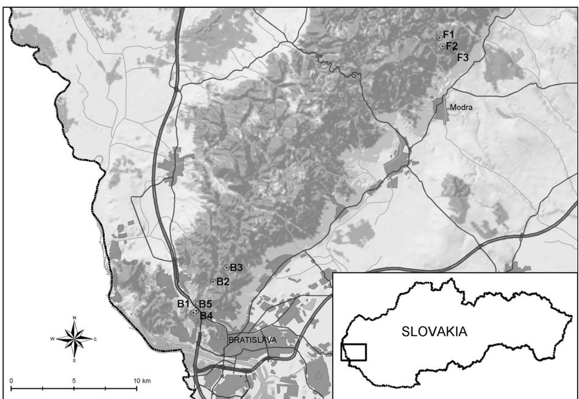

# R E S EAR CH

# Open Access

# prevalence in ticks Anaplasma phagocytophilumand rodents in an urban and natural habitat in South-Western Slovakia

Zuzana Svitálková1 , Danka Haruštiaková2 , Lenka Mahríková1 , Lenka Berthová3 , Mirko Slovák1 , Elena Kocianová3 and Mária Kazimírová1*

# Abstract

Background: Ixodes ricinus is the principal vector of Anaplasma phagocytophilum, the ethiological agent of granulocytic anaplasmosis in Europe. Anaplasmosis is an emerging zoonotic disease with a natural enzootic cycle. The reservoir competence of rodents is unclear. Monitoring of A. phagocytophilum prevalence in I. ricinus and rodents in various habitat types of Slovakia may contribute to the knowledge about the epidemiology of anaplasmosis in Central Europe.

Methods: Over 4400 questing ixodid ticks, 1000 rodent-attached ticks and tissue samples of 606 rodents were screened for A. phagocytophilum DNA by real-time PCR targeting the msp2 gene. Ticks and rodents were captured along six transects in an urban/suburban and natural habitat in south-western Slovakia during 2011–2014. Estimates of wildlife (roe deer, red deer, fallow deer, mouflon, wild boar) densities in the study area were taken from hunter’s yearly reports. Spatial and temporal differences in A. phagocytophilum prevalence in questing I. ricinus and relationships with relative abundance of ticks and wildlife were analysed.

Results: Overall prevalence of A. phagocytophilum in questing I. ricinus was significantly higher in the urban/suburban habitat $( 7 . 2 \% )$ 95 % CI: $6 . 1 - 8 . 3 \%$ ) compared to the natural habitat (3.1 %; 95 % CI: $2 . 5 \substack { - 3 . 9 \% } )$ $\scriptstyle ( \chi ^ { 2 } = 3 7 . 4 5 1$ ; $P < 0 . 0 0 1 ,$ ). Significant local differences in prevalence of infected questing ticks were found among transects within each habitat as well as among years and between seasons. The trapped rodents belonged to six species. Apodemus flavicollis and Myodes glareolus prevailed in both habitats, Microtus arvalis was present only in the natural habitat. I. ricinus comprised $9 6 . 3 ~ \%$ of the rodent-attached ticks, the rest were Haemaphysalis concinna, Ixodes trianguliceps and Dermacentor reticulatus. Only $0 . 5 ~ \%$ of rodent skin and $0 . 6 \%$ of rodent-attached ticks (only I. ricinus) were infected with A. phagocytophilum. Prevalence of A. phagocytophilum in questing I. ricinus did not correlate significantly with relative abundance of ticks or with abundance of wildlife in the area.

Conclusion: The study confirms that urban I. ricinus populations are infected with A. phagocytophilum at a higher rate than in a natural habitat of south-western Slovakia and suggests that rodents are not the main reservoirs of the bacterium in the investigated area.

Keywords: Anaplasma phagocytophilum, Ixodes ricinus, Rodents, Tick-borne pathogen

# Background

Anaplasma phagocytophilum is a medically and veterinary important emerging tick-borne pathogen in Europe. It is a gram-negative intracytoplasmic bacterium localized in the blood cells (primarily granulocytes) or endothelial cells of blood vessels [1] and causes febrile disease in humans (human granulocytic anaplasmosis—HGA) and animals (pasture fever, equine and canine granulocytic anaplasmosis) in areas of the northern hemisphere with endemic occurrence of Ixodes spp. ticks [1, 2]. The epidemiology of HGA and its risk to public health in Europe is still unclear as epidemiological data on the disease are scarce and most human infections probably result in minimal or no clinical manifestations [3, 4]. In Slovakia, only one clinical HGA case has been confirmed [5].

Anaplasma phagocytophilum has been detected in a broad range of vertebrate species including rodents, however, reservoir competence has been confirmed for a few species only [3, 6–15]. In Europe, A. phagocytophilum is primarily transmitted by Ixodes ricinus, the vector of a number of zoonotic microbial pathogens [16, 17]. Transovarial transmission in ixodid ticks has not been confirmed, therefore, the dependence on reservoir vertebrate hosts for maintenance of the infection in nature seems crucial.

Prevalence of A. phagocytophilum in ticks and vertebrate hosts and maintenance of transmission cycles depend on a wide range of abiotic and biotic factors of the environment [3, 12, 18]. Anthropogenic impact is very important as it results in changing landscape and land use patterns, affecting alterations in abundance of tick populations as well as changes in abundance and diversity of tick maintenance and reservoir vertebrate hosts [3, 4]. As a consequence, different A. phagocytophilum prevalences in questing ticks were found in urban, rural and natural habitats of Central European countries, with relatively high infection rates in green urban areas [4, 18–20].

In the USA, two A. phagocytophilum strains were reported. The Ap-ha variant can infect humans and its ecology is associated with rodents as reservoirs, whereas the Ap-1 variant circulates between Ixodes scapularis ticks and free-living ungulates, but not rodents [21, 22]. In contrast, the genetic variability and ecology of A. phagocytophilum in Europe is more complex [3] and rodents do not display high zoonotic potential [7, 14, 23]. In England, a distinct A. phagocytophilum strain not pathogenic for humans was found to be associated with rodents and transmitted by the endophilic Ixodes trianguliceps tick, whereas another non-rodent associated strain is transmitted by I. ricinus [24]. Recent studies supported the theory of two enzootic co-existing cycles for different A. phagocytophilum strains circulating in Central Europe

[13, 25]. In general, a high degree of genetic diversity of $A$ . phagocytophilum strains associated with I. ricinus and different vertebrate host species has been described [3, 13, 24, 26–29]. To assess the acarological risk of exposure of humans and domestic animals to potentially pathogenic strains, further investigations on prevalence and distribution of various A. phagocytophilum ecotypes in different habitat types of Europe are needed.

The objectives of the present study were: (1) Comparison of infection rates of A. phagocytophilum in questing I. ricinus ticks from habitats in south-western Slovakia that are differently affected by human intervention; (2) Assessment of the role of rodents in the transmission cycle of A. phagocytophilum; (3) Evaluation of the effect of wildlife density in the study area on prevalence of A. phagocytophilum in questing ticks.

# Methods

# Study area

The study area is located in the Small Carpathian Mountains (south-western Slovakia) and comprises two different sites: Bratislava $4 8 . 1 7 \mathrm { - } 4 8 . 2 0 ^ { \circ } \mathrm { N } _ { \mathrm { \scriptscriptstyle i } }$ , $1 7 . 0 7 \mathrm { - } 1 7 . 1 0 ^ { \circ } \mathrm { E }$ , altitude $2 0 2 { - } 3 3 4 \mathrm { ~ m ~ }$ a.s.l.) and Fúgelka $4 8 . 3 7 { - } 4 8 . 3 8 ^ { \circ } \mathrm { N }$ , 17.30– $1 7 . 3 2 ^ { \circ } \mathrm { E }$ , altitude $3 3 6 { - } 4 3 6 \mathrm { ~ m ~ }$ a.s.l.). In each site three $1 0 0 \mathrm { ~ m ~ }$ long transects were selected for questing tick collections and rodent trapping (Fig. 1).

Site Bratislava is part of an urban/suburban area and includes the campus of the Slovak Academy of Sciences (SAS) and a recreational forest park (Železná studnička). It is located at the southern foothills of the Small Carpathian Mountains in the northern part of Bratislava town, i.e. in an area with significant anthropogenic impact and high frequency of visitors. The SAS campus (comprising transect B1) is an enclosed urban site with built-up plots. Transect B1 is located in a patch of forest close to the fence separating the SAS campus from the Bratislava Zoo. The main representatives of the fauna are small mammals, squirrels, hedgehogs, bats, feral cats, roe deer, lizards and birds. Red fox occasionally enter the location. The estimated roe deer density in the SAS campus is 30 ind./100 ha. Železná studnička (comprising transects B2 and B3) is part of Bratislava Forest Park located at the south-western foothills of the Small Carpathian Mountains and serves as a recreational and dog walking area. The overall airline distance of B2 and B3 from B1 is about 3 and 5 km, respectively. A variety of wildlife lives in the park. The estimated densities of hunted wildlife, based on annual censuses data in hunter’s yearly reports provided by the Ministry of Agriculture and Rural Development of the Slovak Republic, in the Forest Park are as follows (number of ind./100 ha): roe deer (Capreolus capreolus; 4.5), red deer (Cervus elaphus; 0.7), fallow deer (Dama dama; 0.7), mouflon (Ovis musimon; 0.9), wild boar (Sus scrofa; 1.7).

  
Figure 1 Map of the sampling locations in south-western Slovakia. Legend: B1-B5: transects in the urban/suburban site Bratislava; F1-F3: transects in the natural site Fúgelka

In addition to transects B1–B3, two transects (B4 and B5) were selected for random tick collections in Bratislava. B4 is a $1 5 0 ~ \mathrm { m }$ long transect located along the border of the SAS campus and a road, with ruderal vegetation, solitary deciduous trees and patches of mown grass. It is located $3 5 0 \mathrm { ~ m ~ }$ apart from transect B1. Roe deer living in the SAS campus and their resting places were frequently encountered there. B5 is a $2 0 0 \mathrm { ~ m ~ }$ long transect along fences of gardens and cottages outside the SAS campus. The fauna at this location is represented mainly by lizards, birds, small mammals and feral cats. The presence of wild ruminants or wild boar was not observed there. The airline distance of transect B5 from B4 is ca. $4 2 0 \mathrm { ~ m ~ }$ and from transect $\mathrm { B } 2 \ 2 . 2 \ \mathrm { k m }$ (see Fig. 1).

Fúgelka is a natural site located in a non-fragmented deciduous forest, at a distance of about $4 0 ~ \mathrm { k m }$ from Bratislava. Transects at Fúgelka are spaced approximately at the same distance $\mathbf { c a } 2 \mathrm { k m }$ ). Transect F1 is situated at the south-western foothills of the Small Carpathian Mountains, on the edge of a meadow and the forest, where wildlife are fed. Transects F2 and F3 are located in the forest along footpaths at the southeastern foothills of the Small Carpathian Mountains. Fúgelka is affected by human activities to a lower degree than Bratislava, the frequency of visitors is relatively low, limited to tourists, rangers, foresters and hunters. The estimated densities of hunted wildlife (number of ind./ $1 0 0 \ \mathrm { h a } )$ is as follows: roe deer (3.6), red deer (1.6), fallow deer (1.3), mouflon (4.2), wild boar (2.2).

# Questing ticks

Questing ticks were dragged with a $1 ~ \mathrm { m } ^ { 2 }$ sized blanket along the six transects in monthly intervals during the periods of highest activity of I. ricinus: April—June and September—October 2011–2013. The periods were chosen according to tick questing activity data which were obtained for SW Slovakia in the frame of the EDEN 6FP project during 2006–2008 (unpublished). At low tick densities in transects, random collections were carried out in the vicinity of transects to increase numbers of ticks for molecular screenings. In transects B4 and B5, random collections were carried out in April—June 2011. Collected ticks were stored in $7 0 \ \%$ ethanol and identified to species level in the laboratory by using the identification key by Siuda [30]. Larvae were sampled, but only adults and nymphs of I. ricinus were included in the statistical analyses. Specimens of the other tick species collected were included in molecular screenings.

# Rodents and rodent-attached ticks

Rodents were live-trapped using Swedish bridge metal traps following the protocol of Stanko [31] in lines along the tick collection transects during spring (April—June) and autumn (September – October) of 2012, 2013 and 2014. The traps, baited with oat flakes, were placed $5 \textrm { m }$ apart, and each line was exposed during two consecutive nights, in total for 1800 trap nights in the urban/suburban habitat and 1900 trap nights in the natural habitat. Traps were checked regularly every morning. Captured rodents were transported to the laboratory, anaesthetized and

sacrificed humanely. Rodent trapping and handling comply with current laws of the Slovak Republic and were approved by the Ministry of Environment of the Slovak Republic, Regional Environmental Office in Bratislava (licence ZPO-594/2012-SAB). Rodents were examined for ectoparasites, which were stored in $7 0 \ \%$ ethanol and identified. At higher tick infestation rates, from each rodent individual at least five ticks per developmental stage and per species were selected for molecular screening. Rodent organs/tissues were dissected. Spleen was stored in $7 0 \%$ ethanol and ear skin at $- 8 0 ~ ^ { \circ } \mathrm { C }$ .

# DNA extraction

Macherey-Nagel NucleoSpin® Tissue kit (Düren, Germany) was used for DNA extraction. Rodent tissues (spleen, skin), questing and engorged ticks were disrupted by sterile pipette tips in separate tubes containing $1 8 0 ~ \mu \mathrm { l }$ lysis buffer. After addition of $2 5 ~ \mu \mathrm { l }$ proteinase K to each sample, ticks and rodent samples were incubated overnight at $5 6 ~ ^ { \circ } \mathrm { C }$ in a thermoshaker TS 100c (Biosan, Riga, Latvia). The next day DNA was extracted according to the manufacturer’s instructions. Quantity and quality of the extracted DNA samples were determined with a spectrophotometer Nanodrop $2 0 0 0 \mathrm { c }$ (Thermo Scientific, Wilmington, USA). DNA lysates were stored at $- 2 0 ~ ^ { \circ } \mathrm { C }$ prior to use.

# PCR amplification

The samples were screened for the presence of A. phagocytophilum DNA with a real-time polymerase chain reaction (PCR) targeting a 77-bp long fragment of the msp2 (major surface protein) gene according to Courtney et al. [32]. The primers used were ApMSP2f (5′-ATGGAAGG TAGTGTTGGTTATGGTATT-3′) and ApMSP2r (5′-TT GGTCTTGAAGCGCTCGTA-3′) and the complementary probe was ApMSP2p TaqMan probe (5′-TGGTGCCAGG GTTGAGCTTGAGATTG-3′) labelled with $5 ^ { \prime }$ -HEX— TAMRA-3′. The PCR reaction was carried out in a reaction volume of $2 5 ~ \mu \mathrm { l }$ using a real-time PCR machine CFX96 Real-Time PCR System (Bio-Rad, Hercules, CA, USA) and a HotStarTaq PCR kit (Qiagen, Hilden, Germany). The PCR was set at the following parameters: denaturation at $9 5 ~ ^ { \circ } \mathrm { C }$ for 5 min, 40 cycles of a denaturation period at $9 5 ~ ^ { \circ } \mathrm { C }$ for 15 s and a 1 min annealing period at $6 0 ~ ^ { \circ } \mathrm { C }$ . Negative and positive controls were included in each run.

Samples were considered positive with an exponential rise of the curve and a ct-value (threshold cycle) $< 3 7 . 5$ .

# Statistical analysis

Differences in A. phagocytophilum prevalence in questing ticks between sites, among years and between spring and autumn were computed by the Pearson $\chi ^ { 2 }$ goodness-of-fit or Fisher’s exact test in cases when the conditions for the Pearson $\chi ^ { 2 }$ goodness-of-fit test were not fulfilled. $P < 0 . 0 5$

was regarded as significant. The $9 5 \ \%$ confidence intervals for prevalences in questing ticks were computed using a bootstrap technique. Logistic regression was used to estimate the effect of site, year, season and tick developmental stage on the probability of tick infection. Backward stepwise method was used to find the set of variables significantly affecting the probability of tick infection. Tests for the significance of the effects in the model were performed via the Wald statistic. Spearman rank correlation coefficient was calculated to estimate the relationship between prevalence of A. phagocytophilum and relative abundance of questing ticks and abundance of wildlife. Statistical analyses were performed with IBM SPSS Statistics, version 22 and Statistica software, version 12.

# Results

# Questing ticks

A total of 7984 questing ticks (nymphs and adults) were collected during the study: 4265 in Bratislava (4204 I. ricinus and $6 1 H .$ concinna) and 3719 in Fúgelka (3655 I. ricinus, $6 4 H .$ concinna). Among them, 5767 I. ricinus were collected in transects: 3224 (2676 nymphs, 548 adults) in Bratislava (transects B1, B2, B3) and 2543 (2119 nymphs, 424 adults) in Fúgelka (transects F1, F2, F3). The relative tick density varied among transects as well as among years and during the season. In Bratislava, the highest average density of nymphs was registered in transect B1, the lowest in transect B2, whereas the density of adults was lowest in transect B1 and highest in transect B2. In Fúgelka, the highest average density of nymphs was registered in transect F2 and the lowest in transect F1. However, the density of adults was highest in transect F2 and lowest in transect F3 (Table 1).

# Real-time PCR analysis of   in questing ticks

Out of the 4374 screened questing I. ricinus collected along six transects and their close vicinity, the presence of A. phagocytophilum DNA was detected in 224 ticks $( 5 . 1 ~ \% )$ ). Infected ticks were found in all locations. Overall prevalence of $A$ . phagocytophilum was significantly higher in Bratislava $7 . 2 \ \%$ ; $9 5 \ \%$ CI: $6 . 1 - 8 . 3 \ \%$ ) compared to Fúgelka $( 3 . 1 \ \ \%$ ; $9 5 \ \mathrm { ~ \% ~ }$ CI: $2 . 5 \substack { - 3 . 9 } \%$ ) $\left( \chi ^ { 2 } = \right.$ 37.451; $P < 0 . 0 0 1$ ). Significant differences in infection rates in questing ticks were also found among years at both sites (Table 2). In Bratislava, the lowest prevalence was observed in 2013 $( 4 . 3 \ \%$ ; $9 5 \ \%$ CI: $2 . 9 \mathrm { - } 5 . 7 \ \%$ ) and the highest in 2012 $9 . 3 \ \%$ ; $9 5 \ \%$ CI: 6.2–12.7 %). Differences in prevalences among years were significant for all ticks $\scriptstyle ( \chi ^ { 2 } = 1 5 . 9 4 0$ ; $P < 0 . 0 0 1 $ ), females $( \chi ^ { 2 } = 8 . 4 4 4$ ; $P = 0 . 0 1 5 )$ and nymphs $\textstyle { \bigl ( } \chi ^ { 2 } = 1 4 . 4 0 9$ ; $P = 0 . 0 0 1$ ), but not for males $\left( \chi ^ { 2 } = 0 . 7 8 5 \right.$ ; $P = 0 . 6 7 5 )$ ). At Fúgelka, the lowest $A$ . phagocytophilum prevalence was found in 2011 $2 . 4 \ \%$ ; $9 5 \ \%$ CI: $1 . 7 { - } 3 . 2 \ \%$ ) and the highest in 2013 ( $4 . 8 \ \%$ ; $9 5 \ \%$ CI:

Table 1 Questing I. ricinus average relative density (number/100 m2 ) per transect in Bratislava and Fúgelka   

<table><tr><td rowspan="2">Transect</td><td colspan="4">Nymphs</td><td colspan="4">Females</td><td colspan="4">Males</td></tr><tr><td>2011</td><td>2012</td><td>2013</td><td>AVG</td><td>2011</td><td>2012</td><td>2013</td><td>AVG</td><td>2011</td><td>2012</td><td>2013</td><td>AVG</td></tr><tr><td>B1</td><td>159.5</td><td>69.7</td><td>119.4</td><td>116.9</td><td>1.5</td><td>1.0</td><td>4.1</td><td>2.6</td><td>3.8</td><td>3.0</td><td>5.1</td><td>4.2</td></tr><tr><td>B2</td><td>8.2</td><td>2.0</td><td>16.1</td><td>10.3</td><td>22.8</td><td>4.0</td><td>5.1</td><td>9.5</td><td>14.0</td><td>6.3</td><td>6.1</td><td>8.3</td></tr><tr><td>B3</td><td>57.2</td><td>24.5</td><td>63.5</td><td>51.4</td><td>5.8</td><td>7.3</td><td>5.4</td><td>6.0</td><td>9.8</td><td>7.8</td><td>2.7</td><td>5.9</td></tr><tr><td>F1</td><td>15.7</td><td>10.0</td><td>23.4</td><td>16.4</td><td>7.5</td><td>2.8</td><td>3.0</td><td>4.2</td><td>5.8</td><td>1.8</td><td>4.0</td><td>3.7</td></tr><tr><td>F2</td><td>112.0</td><td>74.2</td><td>45.4</td><td>74.8</td><td>9.3</td><td>6.6</td><td>4.6</td><td>6.6</td><td>14.3</td><td>8.8</td><td>4.2</td><td>8.7</td></tr><tr><td>F3</td><td>86.5</td><td>38.2</td><td>60.4</td><td>59.9</td><td>4.5</td><td>1.2</td><td>2.6</td><td>2.6</td><td>4.5</td><td>4.2</td><td>4.4</td><td>4.4</td></tr></table>

B1 − B3, transects in Bratislava; F1 − F3, transects in Fúgelka; AVG, average (2011–2013)

$2 . 7 \substack { - 6 . 8 } \% $ ). Significant differences among years were found in the total prevalence $\left( \chi ^ { 2 } = 7 . 2 2 7 \right.$ ; $P = 0 . 0 2 7 _ { \cdot }$ ) and prevalence for nymphs $\textstyle ( \chi ^ { 2 } = 1 5 . 7 7 7$ ; $P < 0 . 0 0 1 \rangle$ ), but not for prevalence in adults (females: Fisher’s exact test: $P = 0 . 7 9 0$ ; males: $\chi ^ { 2 } = 3 . 9 3 9$ ; $P = 0 . 1 4 0 ^ { \cdot }$ ) (Table 2).

Overall $A$ . phagocytophilum infection rate in questing adult ticks ( $9 . 0 ~ \%$ ; $9 5 \ \%$ CI: $7 . 6 \mathrm { - } 1 0 . 6 \ \%$ ) was significantly higher than in nymphs ( $3 . 3 ~ \%$ ; 95 % CI: $2 . 6 { - } 3 . 9 \ \%$ ) $\left( \chi ^ { 2 } = \right.$ 64.231; $P < 0 . 0 0 1$ ). The same trend was observed in both habitats (Table 3).

By comparing seasonal differences in overall prevalence of A. phagocytophilum in questing I. ricinus collected in the urban/suburban and natural habitat, significant differences were found between sites in the period from April to the end of June (spring-early summer) $\textstyle ( \chi ^ { 2 } = 4 4 . 4 7 0$ ; $P < 0 . 0 0 1 )$ ), but not in the period from the end of July to October (late summer-autumn) $\left( \chi ^ { 2 } = \right.$ 0.012; $P = 0 . 9 1 3$ ). Considering tick developmental stage and sex, in Bratislava, the highest prevalence of A. phagocytophilum was found in females and the lowest in nymphs collected in spring-early summer as well as in late summer-autumn (Table 4). In Fúgelka, the situation was different. In spring-early summer, the highest infection rate was found in males and the lowest in nymphs, whereas in late summer-autumn, the highest prevalence was found in females and the lowest in males. Comparing A. phagocytophilum infection rates in ticks collected

in spring-early summer and late summer-autumn, significant differences were detected in nymphs at both sites (Bratislava: $\chi ^ { 2 } = 4 . 6 6 2$ , $P = 0 . 0 3 1$ , Fúgelka: Fisher’s exact test, $P = 0 . 0 3 7 _ { \cdot }$ ).

Simultaneous effect of site, year, season and tick developmental stage on the probability of infection was examined by logistic regression, resulting in significant effect of developmental stage (adults/nymphs; $P <$ 0.001) and interaction of year and site $( P < 0 . 0 0 1 )$ o n the prevalence of A. phagocytophilum in questing ticks (Table 5).

Except for differences in A. phagoctytophilum infection rates in ticks originating from different habitat types, overall prevalence differed significantly among transects within each habitat (Table 6). In Bratislava, the highest overall prevalence was detected in transect B2, in Fúgelka in transect F3 (Table 6).

Considering local differences in A. phagocytophilum infection rates, the results were separately evaluated for the urban/suburban habitat. Ixodes ricinus ticks were collected, in addition to the three transects sampled for three consecutive years, in two other transects in Bratislava (B4 and B5) in 2011. Comparison of infection rates between the five transects revealed significant differences for nymphs as well as adults. The highest overall prevalence of A. phagocytophilum was observed in transect B4 $( 3 5 . 4 ~ \% )$ ) (Table 7).

Table 2 Prevalence of A. phagocytophilum in I. ricinus per site in 2011–2013   

<table><tr><td rowspan="2">Site</td><td></td><td colspan="2">2011</td><td colspan="2">2012</td><td colspan="4">2013</td><td>Total</td></tr><tr><td></td><td>% (pos/ex)</td><td>95 % CI</td><td>% (pos/ex)</td><td>95 % CI</td><td>% (pos/ex)</td><td>95 % CI</td><td>χ²</td><td>P</td><td>% (pos/ex)</td></tr><tr><td rowspan="4">Bratislava</td><td>Nymphs</td><td>7.0 (48/686)</td><td>5.2–9.1</td><td>5.6 (11/195)</td><td>2.6–9.2</td><td>2.0 (9/455)</td><td>0.9–3.3</td><td>14.409</td><td>0.001</td><td>5.1 (68/1336)</td></tr><tr><td>Females</td><td>15.6 (22/141)</td><td>9.7–22.1</td><td>18.0 (11/61)</td><td>8.2–27.9</td><td>6.4 (10/156)</td><td>2.6–10.3</td><td>8.444</td><td>0.015</td><td>12.0 (43/358)</td></tr><tr><td>Males</td><td>10.7 (19/178)</td><td>6.4–15.5</td><td>11.8 (8/68)</td><td>4.4–19.1</td><td>8.5 (15/177)</td><td>4.5–12.4</td><td>0.785</td><td>0.675</td><td>9.9 (42/423)</td></tr><tr><td>Total</td><td>8.9 (89/1005)</td><td>7.2–10.6</td><td>9.3 (30/324)</td><td>6.2–12.7</td><td>4.3 (34/788)</td><td>2.9–5.7</td><td>15.940</td><td>&lt;0.001</td><td>7.2 (153/2117)</td></tr><tr><td rowspan="4">Fúgelka</td><td>Nymphs</td><td>0.8 (9/1067)</td><td>0.4–1.4</td><td>3.7 (11/295)</td><td>1.7–5.8</td><td>3.4 (9/263)</td><td>1.5–5.7</td><td>15.777</td><td>&lt;0.001</td><td>1.8 (29/1625)</td></tr><tr><td>Females</td><td>6.0 (9/150)</td><td>2.7–10.0</td><td>6.8 (4/59)</td><td>1.7–13.6</td><td>4.0 (3/75)</td><td>0.0–9.3</td><td></td><td>0.790a</td><td>5.6 (16/284)</td></tr><tr><td>Males</td><td>9.1 (15/164)</td><td>4.9–14.0</td><td>2.4 (2/82)</td><td>0.0–6.1</td><td>8.8 (9/102)</td><td>3.9–14.7</td><td>3.939</td><td>0.140</td><td>7.5 (26/348)</td></tr><tr><td>Total</td><td>2.4 (33/1381)</td><td>1.7–3.2</td><td>3.9 (17/436)</td><td>2.1–5.7</td><td>4.8 (21/440)</td><td>2.7–6.8</td><td>7.227</td><td>0.027</td><td>3.1 (71/2257)</td></tr></table>

(pos/ex), number of positive/number of examined; $9 5 ~ \%$ CI, confidence interval; $\chi ^ { 2 }$ , goodness-of-fit test; significance level a Fisher’s exact test was used to compare prevalence in females among years because the condition of $\chi ^ { 2 }$ ,goodness-of-fit test was not fulfilled

Table 3 Overall prevalence of A. phagocytophilum in I. ricinus nymphs and adults per site   

<table><tr><td rowspan="2">Site</td><td colspan="2">Nymphs</td><td colspan="4">Adults</td></tr><tr><td>% (pos/ex)</td><td>95 % CI</td><td>% (pos/ex)</td><td>95 % CI</td><td>x²</td><td>P</td></tr><tr><td>Bratislava</td><td>5.1 (68/1336)</td><td>3.9–6.2</td><td>10.9 (85/781)</td><td>8.9–12.9</td><td>24.675</td><td>&lt;0.001</td></tr><tr><td>Fúgelka</td><td>1.8 (29/1625)</td><td>1.2–2.5</td><td>6.6 (42/632)</td><td>4.7–8.5</td><td>35.289</td><td>&lt;0.001</td></tr><tr><td>Total</td><td>3.3 (97/2961)</td><td>2.6–3.9</td><td>9.0 (127/1413)</td><td>7.6–10.6</td><td>64.231</td><td>&lt;0.001</td></tr></table>

(pos/ex), number of positive/number of examined; 95 % CI, confidence interval; χ 2 , goodness-of-fit test; , significance level

Although the relative density of I. ricinus differed in individual transects within each habitat (see Table 1), infection rates of A. phagocytophilum did not correlate significantly with relative abundance of questing ticks $( \mathbf { r _ { s } } =$ 0.201, $P = 0 . 0 6 3$ ). In the study area, positive but not significant correlation of A. phagocytophilum prevalence with abundance of roe deer was found $( \mathrm { r _ { s } } = 0 . 5 7 6$ , $P =$ 0.104). Negative non-significant correlations were found between prevalence and density of the other selected tick maintenance and potential reservoir hosts (red deer: $\mathbf { r } _ { \mathrm { s } } = - 0 . 6 1 0$ , $P = 0 . 0 8 1$ ; fallow deer: $\mathrm { r _ { s } } = - 0 . 1 3 6$ , $P = 0 . 7 2 8$ ; mouflon: $\mathbf { r _ { s } } = - 0 . 4 9 2$ , $P = 0 . 1 7 9 ,$ ), whereas significant negative correlation was found for the density of wild boar $\mathrm { \Delta r } _ { \mathrm { s } } = - 0 . 6 9 5$ , $P = 0 . 0 3 8$ ).

# Rodents and rodent-attached ticks

Altogether 300 rodents (138 females, 162 males) were caught in Bratislava, with dominance of the yellownecked mouse (Apodemus flavicollis) (180 ind.: 83 females, 97 males), followed by bank vole (Myodes glareolus) (119 ind.: 54 females, 65 males) and one wood mouse (Apodemus sylvaticus: female). The majority of rodents were captured along transect B2 (153 ind.) and B3 (144 ind.). Only three rodent individuals were captured along transect B1. Altogether 306 rodents (147 females, 159 males) were caught at Fúgelka. The dominant species was A. flavicollis (176 ind.: 80 females, 96 males), followed by M. glareolus (108 ind.: 55 females, 53 males), common vole (Microtus arvalis) (19 ind.: 11 females, 8 males) and

only one individual of harvest mouse (Micromys minutus: male), A. sylvaticus (female) and common pine vole (Microtus subterraneus: female). The majority of rodents were captured along transect F1 (166 ind.), whereas along transects F2 and F3, the number of captured rodents was 71 and 69 individuals, respectively. Comparing all three years, a substantial decline in rodent populations was observed in both sites in 2013. A total of 407 and 191 rodents were caught in 2012 and 2014, respectively, whereas only 8 individuals were caught in 2013.

In 2012, 764 ixodid ticks were collected from rodents: Ixodes ricinus (94.1 %) and Haemaphysalis concinna $( 5 . 9 ~ \% )$ . In 2013, among the 207 rodent-attached ticks I. ricinus prevailed $( 9 9 . 5 ~ \% )$ and $H .$ concinna represented only $0 . 5 ~ \%$ . In 2014, altogether 1031 ticks were collected from rodents: I. ricinus $( 9 7 . 2 ~ \% )$ ), H. concinna $( 2 . 3 \ \% )$ , Ixodes trianguliceps $0 . 4 \ \% ;$ ; found only in Bratislava Forest Park, transect B3) and Dermacentor reticulatus $0 . 1 \ \%$ ; found only in Fúgelka, transect F1).

# Real-time PCR analysis of   in rodents and rodent-attached ticks

Spleen and skin samples from rodents as well as rodent-attached ticks were tested for the presence of A. phagocytophilum. The bacterium was detected in skin of three rodents (0.5 %; 3/606) and only in one spleen sample (0.2 %; 1/606). All positive samples came from bank voles trapped in Bratislava Forest Park (transect B3). In one of the above mentioned specimens, A.

Table 4 Seasonal differences in prevalence of A. phagocytophilum in I. ricinus   

<table><tr><td rowspan="2">Site</td><td></td><td colspan="2">Spring-early summer</td><td colspan="4">Late summer-autumn</td></tr><tr><td></td><td>% (pos/ex)</td><td>95 % CI</td><td>% (pos/ex)</td><td>95 % CI</td><td>x²</td><td>P</td></tr><tr><td rowspan="4">Bratislava</td><td>Nymphs</td><td>5.7 (62/1085)</td><td>4.3–7.1</td><td>2.4 (6/251)</td><td>0.8–4.4</td><td>4.662</td><td>0.031</td></tr><tr><td>Females</td><td>12.7 (38/300)</td><td>8.7–17.0</td><td>8.6 (5/58)</td><td>1.7–15.5</td><td>0.753</td><td>0.386</td></tr><tr><td>Males</td><td>10.4 (39/376)</td><td>7.2–13.6</td><td>6.4 (3/47)</td><td>0.0–14.9</td><td></td><td>0.603a</td></tr><tr><td>Total</td><td>7.9 (139/1761)</td><td>6.7–9.1</td><td>3.9 (14/356)</td><td>2.0–5.9</td><td>6.928</td><td>0.008</td></tr><tr><td rowspan="4">Fúgelka</td><td>Nymphs</td><td>1.6 (23/1481)</td><td>0.9–2.2</td><td>4.2 (6/144)</td><td>1.4–7.6</td><td></td><td>0.037a</td></tr><tr><td>Females</td><td>5.4 (14/257)</td><td>3.1–8.6</td><td>7.4 (2/27)</td><td>0.0–18.5</td><td></td><td>0.655a</td></tr><tr><td>Males</td><td>8.0 (26/325)</td><td>5.2–11.1</td><td>0.0 (0/23)</td><td>-</td><td></td><td>0.239a</td></tr><tr><td>Total</td><td>3.1 (63/2063)</td><td>2.3–3.8</td><td>4.1 (8/194)</td><td>1.5–7.2</td><td>0.666</td><td>0.414</td></tr></table>

Spring-early summer, April-end of June; Late summer-autumn, end of July-October; (pos/ex), number of positive/number of examined; 95 % CI, confidence interval; $\chi ^ { 2 }$ goodness-of-fit test; $P ,$ significance level   
Pa Fisher’s exact test was used to compare prevalence between spring and autumn because the condition of $\chi ^ { 2 }$ goodness-of-fit test was not fulfilled

Table 5 Weight and significance of variables remaining in the best selected model for A. phagocytophilum prevalence in I. ricinus   

<table><tr><td>Variable</td><td>B</td><td>S.E.</td><td>Wald</td><td>df</td><td>P</td><td>Exp(B)</td></tr><tr><td>Tick developmental stage (1 = Adults)</td><td>1.065</td><td>0.140</td><td>57.700</td><td>1</td><td>&lt;0.001</td><td>2.901</td></tr><tr><td>Site*Year</td><td></td><td></td><td>52.132</td><td>2</td><td>&lt;0.001</td><td></td></tr><tr><td>Site1*Year 1</td><td>1.017</td><td>0.150</td><td>45.709</td><td>1</td><td>&lt;0.001</td><td>2.764</td></tr><tr><td>Site1*Year 2</td><td>0.974</td><td>0.218</td><td>19.896</td><td>1</td><td>&lt;0.001</td><td>2.648</td></tr><tr><td>Constant</td><td>-3.793</td><td>0.126</td><td>900.062</td><td>1</td><td>&lt;0.001</td><td>0.023</td></tr></table>

Categorical variables codings: Site1, Bratislava; Year 1, 2011; Year 2, 2012; variables removed by backward method were year, site and season; B, parameter estimate; Wald, Wald statistic $=$ test of significance of the regression coefficient; $P ,$ significance level

phagocytophilum was detected in both skin and spleen simultaneously.

In total, $0 . 9 \ \%$ (5/553) and $0 . 2 \ \%$ (1/445) of tested engorged ticks were positive for $A$ . phagocytophilum from rodents captured in Bratislava and Fúgelka, respectively (Table 8). Analysing the tested rodentattached ticks, only I. ricinus carried the bacterium, H. concinna, I. trianguliceps and D. reticulatus were negative. One positive tick larva was removed from the bank vole specimen with A. phagocytophilum-positive skin and spleen (trapped in Bratislava, B3). All four positive nymphs were removed from the same yellow-necked mouse specimen trapped in Bratislava (transect B2) and one positive larva was removed from a yellow-necked mouse trapped in Fúgelka. However, skin and spleen of both yellow-necked mice were negative.

# Discussion

# in questing ticks

Anaplasma phagocytophilumIn the present study the prevalence of A. phagocytophilum was examined in questing ticks and rodents in two ecologically contrasting habitat types in south-western Slovakia. Infected questing I. ricinus ticks were found in all tick collection locations within each habitat. The total prevalence was $5 . 1 \ \mathrm { ~ \% ~ }$ , which is higher than recently reported for other sites in south-western Slovakia (1.0– $4 . 1 \ \%$ ) [33]. Infection rates between $0 . 7 \mathrm { - } 1 3 . 3 \ \%$ were determined in I. ricinus from different regions of Slovakia [13, 15, 27, 33–40]. In Europe, A. phagocytophilum prevalence in questing I. ricinus was found to vary from $0 \%$ to $34 \%$ [3, 16]. Recent studies revealed overall

prevalences that varied from $0 . 4 \ \%$ in Hungary [41], $0 . 6 \ \%$ in Slovenia [42], $0 . 8 \ \%$ in the Netherlands [43], $1 . 5 \ \%$ in Switzerland [44], $1 . 9 \ \%$ in Luxembourg [45], $3 . 6 ~ \%$ in Ukraine [46], $5 . 3 ~ \%$ in Germany [18] and up to $8 . 5 \ \%$ in Poland [47, 48]. Generally, prevalence data based on molecular detection of A. phagocytophilum in questing ticks have been found to vary considerably not only between countries, but also among habitat types and sites within each country.

In this study, I. ricinus relative abundance varied among locations in each habitat, but overall abundance was higher in the urban/suburban habitat. The overall A. phagocytophilum prevalence was also significantly higher in the urban/suburban habitat $( 7 . 2 ~ \% )$ compared to the natural habitat $( 3 . 1 ~ \% )$ ). Our results are in contrast, e.g., to findings from Poland, where tick abundance was higher in natural habitats [48], but are in agreement with findings from Germany or eastern Slovakia, where abundant tick populations are present in urban parks and suburban forests [18, 40]. Our findings are also in accordance with observations from Central European urban, suburban and natural sites and support the theory that prevalence of A. phagocytophilum depends on the habitat type and the diversity and population density of potential reservoir hosts [4, 19, 49]. Relatively high percentage of urban/suburban I. ricinus populations were found to be infected by A. phagocytophilum throughout Europe, e.g., $2 . 9 \ \%$ to $9 . 5 ~ \%$ in urban/suburban parks in Germany [18, 19, 23, 49], $5 . 8 ~ \%$ to $9 . 4 ~ \%$ in the Czech Republic [20, 33], $8 . 8 \ \%$ in Hungary [50], up to $1 4 . 5 ~ \%$ in Poland [47, 48], $4 . 4 \ \%$ to $7 . 5 \ \%$ in urban parks in Bratislava and Malacky (south-western Slovakia) [38, 51], but only $1 . 0 ~ \%$ in Austria [52] and $0 . 8 \ \%$ in Luxembourg [45]. In contrast, prevalence of A. phagocytophilum was generally lower in natural woodland habitats, e.g., $1 . 0 ~ \%$ to $5 . 8 ~ \%$ in Germany [12, 19, 53–55], $1 . 9 \ \%$ in the Czech Republic [20], $0 \%$ to $2 . 2 \ \%$ in western Slovakia [38] and $0 . 4 \ \%$ in Hungary [41], whereas it was higher $( 1 . 3 \% )$ than in urban sites in Luxembourg [45].

In addition to the variation in A. phagocytophilum prevalence between the two habitat types, local differences among sampling locations within each habitat were revealed in this study. Our findings corroborate local variations, e.g. in Bavarian cities [19, 49], Hannover [56] and Leipzig [23], or in Budapest [50], and are

Table 6 Overall prevalence of A. phagocytophilum in I. ricinus per transect in Bratislava and Fúgelka   

<table><tr><td></td><td>% (pos/ex)</td><td>95 % CI</td><td>% (pos/ex)</td><td>95 % CI</td><td>% (pos/ex)</td><td>95 % CI</td><td>x²</td><td>P</td></tr><tr><td rowspan="2">Bratislava/transect</td><td>B1</td><td></td><td>B2</td><td></td><td>B3</td><td></td><td></td><td></td></tr><tr><td>6.3 (53/836)</td><td>4.8–8.1</td><td>10.6 (57/539)</td><td>8.2–13.4</td><td>5.8 (43/742)</td><td>4.2–7.5</td><td>12.262</td><td>0.002</td></tr><tr><td rowspan="2">Fúgelka/transect</td><td>F1</td><td></td><td>F2</td><td></td><td>F3</td><td></td><td></td><td></td></tr><tr><td>3.1 (15/491)</td><td>1.6–4.7</td><td>1.9 (19/1018)</td><td>1.1–2.8</td><td>4.9 (37/748)</td><td>3.5–6.5</td><td>13.443</td><td>0.001</td></tr></table>

(pos/ex), number of positive/number of examined; 95 % CI, confidence interval; $\chi ^ { 2 }$ , goodness-of-fit test; , significance level

Table 7 Prevalence of A. phagocytophilum in I. ricinus per transect B1-B5 in Bratislava in 2011   

<table><tr><td></td><td colspan="2">B1</td><td colspan="2">B2</td><td colspan="2">B3</td><td colspan="2">B4</td><td colspan="2">B5</td><td></td><td></td></tr><tr><td></td><td>% (pos/ex)</td><td>95 % CI</td><td>% (pos/ex)</td><td>95 % CI</td><td>% (pos/ex)</td><td>95 % CI</td><td>% (pos/ex)</td><td>95 % CI</td><td>% (pos/ex)</td><td>95 % CI</td><td>\( \chi^2 \)</td><td>P</td></tr><tr><td>Nymphs</td><td>4.7(18/380)</td><td>2.6–7.1</td><td>26.0(19/73)</td><td>16.2–36.7</td><td>4.7(11/233)</td><td>2.2–8.0</td><td>23.2(43/185)</td><td>17.3–29.7</td><td>0.0(0/13)</td><td></td><td>75.198</td><td>&lt;0.001</td></tr><tr><td>Females</td><td>14.8(4/27)</td><td>3.3–29.6</td><td>15.6(14/90)</td><td>8.5–23.4</td><td>16.7(4/24)</td><td>3.4–35.0</td><td>45.5(60/132)</td><td>37.1–53.8</td><td>14.7(14/95)</td><td>8.4–22.1</td><td>40.087</td><td>&lt;0.001</td></tr><tr><td>Males</td><td>13.1(8/61)</td><td>5.9–21.7</td><td>9.2(7/76)</td><td>3.0–15.8</td><td>9.8(4/41)</td><td>2.2–20.9</td><td>41.0(66/161)</td><td>33.6–48.4</td><td>9.2(9/98)</td><td>4.1–15.3</td><td>57.731</td><td>&lt;0.001</td></tr><tr><td>Total</td><td>6.4(30/468)</td><td>4.2–8.8</td><td>16.7(40/239)</td><td>12.2–21.5</td><td>6.4(19/298)</td><td>3.5–9.5</td><td>35.4(169/478)</td><td>30.8–39.5</td><td>11.2(23/206)</td><td>6.8–15.5</td><td>183.125</td><td>&lt;0.001</td></tr></table>

(pos/ex), number of positive/number of examined; 95 % CI, confidence interval; $\chi ^ { 2 }$ , goodness-of-fit test; , significance level

probably connected with the specific structure of the biotope in each individual location. The high number of positive ticks in transect B4 in Bratislava $( 3 5 . 4 ~ \%$ overall infection rate with more than $4 0 . 0 ~ \%$ of adult ticks infected in 2011) deserves particular attention and could be due to the presence of roe deer in the enclosed area of the SAS campus.

Generally, wild ruminants, mainly roe deer, have shown high infection rates with A. phagocytophilum and have been suggested as reservoir hosts [12, 57–62]. Based on the high relative abundance of I. ricinus in the SAS campus (transect B1, see Table 1), we assume that roe deer support an abundant tick population and may contribute to the maintenance of A. phagocytophilum at this location. In addition, our results show that even within a small enclosed area significant local variations in distribution of infected ticks can occur: in transect B4 a prevalence of $3 5 . 4 ~ \%$ was determined in 2011, whereas in transect B1 (the distance between B1 and B4 is about $3 5 0 \mathrm { ~ m } )$ only $6 . 4 \ \%$ of ticks were infected. Even lower prevalence $( 5 . 8 ~ \% )$ was found in another location in the SAS campus during 2011–2012 [63]. Nevertheless, the high proportion of infected ticks is not direct evidence for maintenance of A. phagocytophilum by roe deer in the SAS campus. Examination of blood or xenodiagnostic

ticks has not been possible due to legislative and ethical constraints. However, our results support previous findings on city parks being focal points for A. phagocytophilum [19]. Furthermore, our results are in agreement with higher infection rates in questing ticks found in sites with high densities of roe deer [64]. The non-significant relationships between prevalence rates and abundance of other cervids in our research area seem to support findings in a study [65], where no clear association between density of red deer, another potential reservoir host, and prevalence of A. phagocytophilum could be confirmed. Wild boars are abundant game animals that can feed on all three life stages of I. ricinus and might be involved in the enzootic cycle of A. phagocytophilum [66]. Although wild boar is susceptible to A. phagocytophilum, it can control the infection and thus its role as reservoir for the bacterium and source of infection for ticks is probably not as significant as suggested by some studies [67]. The negative correlation between wild boar abundance and prevalence of infected ticks in our study area seems to support the latter assumption. However, further studies involving molecular screenings of wild boar samples and attached ticks are required.

Generally, reduced vertebrate biodiversity was found to affect transmission of infectious diseases of humans and

Table 8 Prevalence of A. phagocytophilum in rodent-attached ticks captured per site in 2012–2014   

<table><tr><td rowspan="2">Site</td><td rowspan="2">Year</td><td colspan="3">I. ricinuspos/ex</td><td colspan="2">H. concinna pos/ex</td><td colspan="2">I. triangulicepspos/ex</td><td>D. reticulatuspos/ex</td><td rowspan="2">Total % (pos/ex)</td></tr><tr><td>L</td><td>N</td><td>A</td><td>L</td><td>A</td><td>L</td><td>N</td><td>L</td></tr><tr><td rowspan="4">Bratislava</td><td>2012</td><td>1/213</td><td></td><td></td><td>0/17</td><td></td><td></td><td></td><td></td><td>0.4 (1/230)</td></tr><tr><td>2013</td><td>0/30</td><td>4/21</td><td></td><td></td><td>0/1</td><td></td><td></td><td></td><td>7.7 (4/52)</td></tr><tr><td>2014</td><td>0/262</td><td></td><td></td><td>0/5</td><td></td><td>0/2</td><td>0/2</td><td></td><td>0.0 (0/271)</td></tr><tr><td>Total</td><td>1/505</td><td>4/21</td><td></td><td>0/22</td><td>0/1</td><td>0/2</td><td>0/2</td><td></td><td>0.9 (5/553)</td></tr><tr><td rowspan="4">Fúgelka</td><td>2012</td><td>1/169</td><td>0/1</td><td>0/1</td><td>0/16</td><td>0/3</td><td></td><td></td><td></td><td>0.5 (1/190)</td></tr><tr><td>2013</td><td>0/5</td><td></td><td></td><td></td><td></td><td></td><td></td><td></td><td>0.0 (0/5)</td></tr><tr><td>2014</td><td>0/226</td><td>0/5</td><td></td><td>0/18</td><td></td><td></td><td></td><td>0/1</td><td>0.0 (0/250)</td></tr><tr><td>Total</td><td>1/400</td><td>0/6</td><td>0/1</td><td>0/34</td><td>0/3</td><td></td><td></td><td>0/1</td><td>0.2 (1/445)</td></tr><tr><td>Total</td><td></td><td>2/905</td><td>4/27</td><td>0/1</td><td>0/56</td><td>0/4</td><td>0/2</td><td>0/2</td><td>0/1</td><td>0.6 (6/998)</td></tr></table>

pos/ex, number of positive/number of examined; L, larva; N, nymph; A, adult

animals, frequently leading to increased disease transmission in urban areas. The urban (closed) habitat comprises fewer host species which usually occur in higher densities and in case they are competent reservoirs, they can support pathogen transmission [4, 68]. We assume that the higher prevalence of A. phagocytophilum-infected ticks in Bratislava Forest Park, compared to the natural habitat in Fúgelka, could be partly affected by higher population densities of roe deer and hedgehogs which are known to carry the pathogen in urban parks [4]. The presence of a large number of dog owners who use Bratislava Forest Park for their daily walks with dogs may be important as well. Seroprevalences of up to $5 0 . 1 ~ \%$ detected in dogs from different European countries suggest that they could play a role in the epidemiology of A. phagocytophilum [69]. In contrast, due to higher diversity of vertebrate species in the woodland area at Fúgelka ticks can feed on a broader range of host species, among which a lower proportion may support circulation of A. phagocytophilum.

Along with spatial variations, pathogen prevalence in questing ticks was found to vary in time, i.e. between developmental stages of ticks, during the season and among years at the same study sites [18, 41, 43, 45, 49, 56, 70]. In the present study infection rates were higher in adult ticks $( 5 . 6 \mathrm { - } 1 2 . 0 ~ \% )$ than in nymphs $( 1 . 8 { - } 5 . 1 ~ \% )$ ). The results confirm findings of previous studies [16, 18, 19, 48, 49, 71] and could be explained by the feeding strategy of three-host ticks enabling them to acquire infected blood meals in larval as well as nymphal stage and transmit pathogens transstadially. Our study also revealed significant seasonal and year-to-year variations in individual tick collection locations, mainly for prevalence of infected nymphs. However, temporal variations in pathogen prevalences are difficult to explain, especially for I. ricinus, having a complex life history lasting for several years. Variations of this kind may depend on global factors affecting all study sites, such as weather conditions during the years and seasons. In individual locations temporal variations can be determined by microclimatic conditions, phenology of the tick and the availability of feeding and reservoir hosts [12, 18, 43, 45, 56].

In addition to I. ricinus, the main vector of A. phagocytophilum in Europe [3], we detected the bacterium in one questing $H .$ concinna male. Single detections of A. phagocytophilum in questing H. concinna have already been reported from Slovakia [34] and Serbia [72], but not from Hungary [73, 74]. Such sporadic data, however, do now allow conclusions to be drawn about the vector status of this tick species.

# in rodents and rodent-attached Anapticks

Apart from wild ruminants A. phagocytophilum has been detected in rodents as the major feeding hosts of

subadult stages of I. ricinus [3, 4]. Although several studies have reported the role of rodents in transmission of A. phagocytophilum in Europe, some consider rodents as reservoirs of the pathogen [7, 9–11, 75], in this study we found that only $0 . 5 \ \%$ of rodents were infected. The positive samples originated from bank voles trapped in Bratislava Forest Park. In other regions of Slovakia, the prevalence of A. phagocytophilum in rodents varied from 0 to $9 . 3 ~ \%$ [11, 13, 15, 36, 76]. Prevalence rates between 0 and $6 . 6 \ \%$ have recently been reported for rodents from Hungary, Germany and Italy [14, 23, 25, 73, 74]. In contrast, the prevalence of infected rodents, especially bank voles, was higher in Switzerland and Germany (over 19.0 and $1 3 . 0 \ \%$ , respectively) [7, 75].

In our study sites, the low overall prevalence of A. phagocytophilum in rodents is in contrast to the relatively high prevalence in questing ticks and could be explained by the specific host tropism of A. phagocytophilum strains circulating in the study area. Constant detection of the bacterium in questing ticks throughout the study in contrast to low rodent density in the SAS campus (J. Krištof ík, personal communication) and a sharp decline in rodent abundance in all locations in 2013 seem to support this assumption.

Despite the fact that questing I. ricinus larvae are considered A. phagocytophilum-free, because no transovarial transmission occurs [17], we have detected two positive rodent-attached larvae $( 0 . 1 \ \% )$ . One larva was collected from an infected bank vole with positive skin and spleen which was captured in transect B3. The other one was gained from an uninfected yellow-necked mouse captured in the natural site. Moreover, four I. ricinus nymphs from an uninfected yellow-necked mouse captured in transect B2 were pathogen-positive. According to recent studies, the prevalence of A. phagocytophilum in engorged I. ricinus ticks varies from 0 to $6 . 1 \ \%$ in Europe [14, 25, 73, 74, 77], however,in field-captured tick-infested rodents no transmission of the bacterium to xenodiagnostic I. ricinus larvae was confirmed [77, 78]. Rodents were found to be infected with a distinct nonpathogenic strain of A. phagocytophilum in areas where the endophilic I. trianguliceps ticks are present [10, 13, 79]. We found only a few non-infected I. trianguliceps specimens infesting rodents, suggesting that small populations of the species are present in the Small Carpathian Mountains and may be involved in the circulation of a rodent-specific A. phagocytophilum strain in the area. However, due to low level of infection in the positive bank vole and attached tick larvae (ct-values ${ > } 3 0$ in real-time PCR detections) we were not able to confirm this assumption by analysing the A. phagocytophilum DNA for strain specificity. We assume that the few positive rodentattached I. ricinus nymphs acquired infection by feeding on infected hosts in the larval stage and the single larva

feeding on an uninfected yellow-necked mouse gained infection via feeding on an infected host and after interruption continued feeding on the rodent.

# Conclusions

During a three-year study in south-western Slovakia, constant presence of A. phagocytophilum in questing I. ricinus was confirmed with infection rates depending on habitat type, location, year, season and availability of tick hosts and pathogen reservoirs. The study confirmed that urban I. ricinus populations are infected with the bacterium at a significantly higher rate than in a woodland habitat. Moreover, the results indicate that urban/suburban sites and parks can be focal points for A. phagocytophilum circulation in south-western Slovakia. In contrast to the relatively high prevalence of A. phagocytophilum in questing ticks, infection rates in both rodents and rodentattached ticks were low $( < 1 \ \% )$ , suggesting that rodents are not the main reservoirs of the bacterium in the investigated area. To assess the risk of infection of humans and domestic animals with pathogenic strains of A. phagocytophilum, further follow-up studies are required to analyse bacterial strains circulating in south-western Slovakia and their associations with reservoir hosts.

# Competing interests

The authors declare that they have no competing interests.

# Authors’ contributions

MK, EK and ZS designed the study. ZS, LM, LB, EK, MS and MK participated in field work. EK and MK identified ticks and rodents. ZS, LM and LB processed the samples. ZS performed PCR. DH carried out the statistical analyses. ZS and MK analysed the data and wrote the manuscript. DH, EK and LB revised the manuscript. All authors read and approved the final version of the manuscript.

# Acknowledgments

The study was funded by EU grant FP7-261504 EDENext and is catalogued by the EDENext Steering Committee as EDENext336 (http://www.edenext.eu). The contents of this publication are the sole responsibility of the authors and do not necessarily reflect the views of the European Commission. Financial support by grant APVV DO7RP–0014–11 is also acknowledged. The work of ZS, MK and LB was supported by German Academic Exchange Service. The advice and help of Dr. Cornelia Silaghi in the methodology is highly acknowledged. The authors thank Renáta Szalayová and students (Michala Mojšová, Monika Bednáriková, Katarína Miťková, Lenka Burdová and Erika Vrbová) for help with tick collections, rodent trapping and technical assistance.

# Declaration

We declare that the conducted study complies with current laws of the Slovak Republic. There is no conflict of interest with species conservation guidelines. Rodent trapping and handling were approved by the Ministry of Environment of the Slovak Republic, Regional Environmental Office in Bratislava (licence ZPO-594/2012-SAB).

# Author details

1 Institute of Zoology, Slovak Academy of Sciences, Dúbravská cesta 9, 845 06 Bratislava, Slovakia. 2 Institute of Biostatistics and Analyses, Faculty of Medicine and Faculty of Science, Masaryk University, Kamenice 3, 625 00 Brno, Czech Republic. 3 Institute of Virology, Slovak Academy of Sciences, Dúbravská cesta 9, 845 05 Bratislava, Slovakia.

Received: 5 March 2015 Accepted: 1 May 2015

Published online: 17 May 2015

# References

1. Rikihisa Y. The tribe Ehrlichieae and ehrlichial diseases. Clin Microbiol Rev. 1991;4:286–308.   
2. Dumler JS, Barbet AF, Bekker CP, Dasch GA, Palmer GH, Ray SC, et al. Reorganization of genera in the families Rickettsiaceae and Anaplasmataceae in the order Rickettsiales: unification of some species of Ehrlichia with Anaplasma, Cowdria with Ehrlichia and Ehrlichia with Neorickettsia, descriptions of six new species combinations and designation of Ehrlichia equi and ‘HGE agent’ as subjective synonyms of Ehrlichia phagocytophila. Int J Syst Evol Microbiol. 2001;51:2145–65.   
3. Stuen S, Granquist EG, Silaghi C. Anaplasma phagocytophilum - a widespread multihost pathogen with highly adaptive strategies. Front Cell Infect Microbiol. 2013;3:31.   
4. Rizzoli A, Silaghi C, Obiegala A, Rudolf I, Hubálek Z, Földvári G, et al. Ixodes ricinus and its transmitted pathogens in urban and peri-urban areas in Europe: new hazards and relevance for public health. Front Public Health. 2014;2:251.   
5. Nováková M, Víchová B, Majláthová V, Lesňáková A, Pochybová M, Peťko B. First case of human granulocytic anaplasmosis from Slovakia. Ann Agric Environ Med. 2010;17:173–5.   
6. Ogden NH, Bown K, Horrocks BK, Woldehiwet Z, Bennett M. Granulocytic Ehrlichia infection in ixodid ticks and mammals in woodlands and uplands of the UK. Med Vet Entomol. 1998;12:423–9.   
7. Liz JS, Anderes L, Sumner JW, Massung RF, Gern L, Rutti B, et al. PCR detection of granulocytic ehrlichiae in Ixodes ricinus ticks and wild small mammals in western Switzerland. J Clin Microbiol. 2000;38:1002–7.   
8. Petrovec M, Sixl W, Schweiger R, Mikulasek S, Elke L, Wüst G, et al. Infections of wild animals with Anaplasma phagocytophila in Austria and the Czech Republic. Ann N Y Acad Sci. 2003;990:103–6.   
9. Bown KJ, Begon M, Bennett M, Birtles RJ, Burthe S, Lambin X, et al. Sympatric Ixodes trianguliceps and Ixodes ricinus ticks feeding on field voles (Microtus agrestis): potential for increased risk of Anaplasma phagocytophilum in the United Kingdom. Vector Borne Zoonotic Dis. 2006;6:404–10.   
10. Bown KJ, Lambin X, Telford GR, Ogden NH, Telfer S, Woldehiwet Z, et al. Relative importance of Ixodes ricinus and Ixodes trianguliceps as vectors for Anaplasma phagocytophilum and Babesia microti in field vole (Microtus agrestis) populations. Appl Environ Microbiol. 2008;74:7118–25.   
11. Štefančíková A, Derdáková M, Lenčáková D, Ivanová R, Stanko M, Čisláková L, et al. Serological and molecular detection of Borrelia burgdorferi sensu lato and Anaplasmataceae in rodents. Folia Microbiol. 2008;53:493–9.   
12. Overzier E, Pfister K, Herb I, Mahling M, Böck Jr G, Silaghi C. Detection of tick-borne pathogens in roe deer (Capreolus capreolus), questing ticks (Ixodes ricinus) and ticks infesting roe deer in southern Germany. Ticks Tick Borne Dis. 2013;4:320–8.   
13. Blaňarová L, Stanko M, Carpi G, Miklisová D, Víchová B, Mošanský L, et al. Distinct Anaplasma phagocytophilum genotypes associated with Ixodes trianguliceps ticks and rodents in Central Europe. Ticks Tick Borne Dis. 2014;5:928–38.   
14. Obiegala A, Pfeffer M, Pfister K, Tiedemann T, Thiel C, Balling A, et al. Candidatus Neoehrlichia mikurensis and Anaplasma phagocytophilum: prevalences and investigations on a new transmission path in small mammals and ixodid ticks. Parasit Vectors. 2014;7:563.   
15. Víchová B, Majláthová V, Nováková M, Stanko M, Hviščová I, Pangrácová L, et al. Anaplasma infections in ticks and reservoir host in Slovakia. Infect Genet Evol. 2014;22:265–72.   
16. Strle F. Human granulocytic ehrlichiosis in Europe. Int J Med Microbiol. 2004;293:27–35.   
17. Woldehiwet Z. The natural history of Anaplasma phagocytophilum. Vet Parasitol. 2010;167:108–22.   
18. Overzier E, Pfister K, Thiel C, Herb I, Mahling M, Silaghi C. Anaplasma phagocytophilum in questing Ixodes ricinus ticks: Comparison of prevalences and partial 16S rRNA gene variants in urban, pasture, and natural habitats. Appl Environ Microbiol. 2013;79:1730–4.   
19. Silaghi C, Gilles J, Höhle M, Fingerle V, Just FT, Pfister K. Anaplasma phagocytophilum infection in Ixodes ricinus, Bavaria, Germany. Emerg Infect Dis. 2008;14:972–4.

20. Venclikova K, Rudolf I, Mendel J, Betasova L, Hubalek Z. Rickettsiae in questing Ixodes ricinus ticks in the Czech Republic. Ticks Tick Borne Dis. 2014;5:135–8.   
21. Massung RF, Lee K, Mauel M, Gusa A. Characterization of the rRNA genes of Ehrlichia chaffeensis and Anaplasma phagocytophila. DNA Cell Biol. 2002;21:587–96.   
22. Massung RF, Priestley RA, Levin ML. Route of transmission alters the infectivity of Anaplasma phagocytophila in mice. Ann N Y Acad Sci. 2003;990:494–5.   
23. Silaghi C, Woll D, Hamel D, Pfister K, Mahling M, Pfeffer M. Babesia spp. and Anaplasma phagocytophilum in questing ticks, ticks parasitizing rodents and the parasitized rodents – Analyzing the host pathogen-vector interface in a metropolitan area. Parasit Vectors. 2012;5:191.   
24. Bown KJ, Lambin X, Ogden NH, Begon M, Telford G, Woldehiwet Z, et al. Delineating Anaplasma phagocytophilum ecotypes in coexisting, discrete enzootic cycles. Emerg Infect Dis. 2009;15:1948–54.   
25. Baráková I, Derdáková M, Carpi G, Rosso F, Collini M, Tagliapietra V, et al. Genetic and ecologic variability among Anaplasma phagocytophilum strains in Northern Italy. Emerg Infect Dis. 2014;20:1082–4.   
26. de la Fuente J, Massung RF, Wong SJ, Chu FK, Lutz H, Meli M, et al. Sequence analysis of the msp4 gene of Anaplasma phagocytophilum strains. J Clin Microbiol. 2005;43:1309–17.   
27. Derdáková M, Štefančíková A, Špitálska E, Tarageľová V, Košťálová T, Hrkľová G, et al. Emergence and genetic variability of Anaplasma species in small ruminants and ticks from Central Europe. Vet Microbiol. 2011;153:293–8.   
28. Scharf W, Schauer S, Freyburger F, Petrovec M, Schaarschmidt-Kiener D, Liebisch G, et al. Distinct host species correlate with Anaplasma phagocytophilum ankA gene clusters. J Clin Microbiol. 2011;49:790–6.   
29. Jahfari S, Coipan C, Fonville M, van Leeuwen AD, Hengeveld P, Heylen D, et al. Circulation of four Anaplasma phagocytophilum ecotypes in Europe. Parasit Vectors. 2014;7:365.   
30. Siuda K. Kleszcze Polski (Acari: Ixodida). Systematyka i rozmieszczenie. Polskie Towarzystwo Parazytologiczne: Warszawa; 1993.   
31. Stanko M. Small mammal communities of windbreaks and adjacent fields in the eastern Slovakian lowlands. Folia Zool. 1994;43:135–43.   
32. Courtney JW, Kostelnik LM, Zeidner NS, Massung RF. Multiplex real-time PCR for detection of Anaplasma phagocytophilum and Borrelia burgdorferi. J Clin Microbiol. 2004;42:3164–8.   
33. Derdáková M, Václav R, Pangrácova-Blaňarová L, Selyemová D, Koči J, Walder G, et al. Candidatus Neoehrlichia mikurensis and its co-circulation with Anaplasma phagocytophilum in Ixodes ricinus ticks across ecologically different habitats of Central Europe. Parasit Vectors. 2014;7:160.   
34. Špitalská E, Kocianová E. Agents of Ehrlichia phagocytophila group and other microorganisms co-infecting ticks in southwestern Slovakia. Acta Virol. 2002;46:49–50.   
35. Derdáková M, Halánová M, Stanko M, Štefančíková A, Čisláková L, Peťko B. Molecular evidence for Anaplasma phagocytophilum and Borrelia burgdorferi sensu lato in Ixodes ricinus ticks from eastern Slovakia. Ann Agric Environ Med. 2003;10:269–71.   
36. Smetanová K, Schwarzová K, Kocianová E. Detection of Anaplasma phagocytophilum, Coxiella burnetii, Rickettsia spp. and Borrelia burgdorferi s. l. in ticks, and wild-living animals in western and middle Slovakia. Ann N Y Acad Sci. 2006;1078:312–5.   
37. Špitalská E, Boldiš V, Košťanová Z, Kocianová E, Štefanidesová K. Incidence of various tick-borne microorganisms in rodents and ticks of central Slovakia. Acta Virol. 2008;52:175–9.   
38. Koči J, Tarageľová V, Derdáková M, Selyemová D, Cíglerová I, Lenčáková D, et al. Tick seasonal dynamics and prevalence of tick-borne pathogens in Slovakia. In: Špitalská E, Kazimírová M, Kocianová E, Šustek Z, editors. Zborník z Konferencie “Labudove dni”. Bratislava: Virologický ústav SAV; 2009. p. 45–7.   
39. Subramanian G, Sekeyova Z, Raoult D, Mediannikov O. Multiple tickassociated bacteria in Ixodes ricinus from Slovakia. Ticks Tick Borne Dis. 2012;3:406–10.   
40. Pangrácová L, Derdáková M, Pekárik L, Hviščová I, Víchová B, Stanko M, et al. Ixodes ricinus abundance and its infection with the tick-borne pathogens in urban and suburban areas of Eastern Slovakia. Parasit Vectors. 2013;6:238.   
41. Egyed L, Elo P, Sreter-Lancz Z, Szell Z, Balogh Z, Sreter T. Seasonal activity and tick-borne pathogen infection rates of Ixodes ricinus ticks in Hungary. Ticks Tick Borne Dis. 2012;3:90–4.   
42. Strašek Smrdel K, Serdt M, Duh D, Knap N, Avšič ŽT. Anaplasma phagocytophilum in ticks in Slovenia. Parasit Vectors. 2010;3:102.

43. Coipan EC, Jahfari S, Fonville M, Maassen CB, Giessen J, Takken W, et al. Spatiotemporal dynamics of emerging pathogens in questing Ixodes ricinus. Front Cell Infect Microbiol. 2013;3:36.   
44. Lommano E, Bertaiola L, Dupasquier C, Gern L. Infections and coinfections of questing Ixodes ricinus ticks by emerging zoonotic pathogens in western Switzerland. Appl Environ Microbiol. 2012;78:4606–12.   
45. Reye AL, Hübschen JM, Sausy A, Muller CP. Prevalence and seasonality of tick-borne pathogens in questing Ixodes ricinus ticks from Luxembourg. Appl Environ Microbiol. 2010;76:2923–31.   
46. Movila A, Rolain JM, Podavalenko A, Toderas I, Tkachenco L, Naglov V, et al. Detection of spotted fever group rickettsiae and family Anaplasmataceae in Ixodes ricinus ticks from Republic of Moldova and Eastern Ukraine. Clin Microbiol Infect. 2009;15:32–3.   
47. Sytykiewicz H, Karbowiak G, Hapunik J, Szpechcinski A, Supergan-Marwicz M, Golawska S, et al. Molecular evidence of Anaplasma phagocytophilum and Babesia microti co-infections in Ixodes ricinus ticks in central-eastern region of Poland. Ann Agri Environ Med. 2012;19:45–9.   
48. Welc-Falęciak R, Kowalec M, Karbowiak G, Bajer A, Behnke JM, Siński E. Rickettsiaceae and Anaplasmataceae infections in Ixodes ricinus ticks from urban and natural forested areas of Poland. Parasit Vectors. 2014;7:121.   
49. Schorn S, Pfister K, Reulen H, Mahling M, Manitz J, Thiel C, et al. Prevalence of Anaplasma phagocytophilum in Ixodes ricinus in Bavarian public parks, Germany. Ticks Tick Borne Dis. 2011;2:196–203.   
50. Hornok S, Meli ML, Gönczi E, Halász E, Takács N, Farkas R, et al. Occurrence of ticks and prevalence of Anaplasma phagocytophilum and Borrelia burgdorferi s.l. in three types of urban biotopes: forests, parks and cemeteries. Ticks Tick Borne Dis. 2014;5:785–9.   
51. Vaculová T, Tarageľová V. V. Seasonal dynamics of Ixodes ricinus ticks and prevalence of Borrelia burgdorferi sensu lato and Anaplasma phagocytophilum in urban parks in Bratislava. In: Oros M, Vasilková Z, editors. V4 Parasitological Meeting. Parasites in the Heart of Europe. Book of Abstracts. Košice: Slovak Society for Parasitology at SAS. 2014. p. 129.   
52. Glatz M, Müllegger RR, Maurer F, Fingerle V, Achermann Y, Wilske B, et al. Detection of Candidatus Neoehrlichia mikurensis, Borrelia burgdorferi sensu lato genospecies and Anaplasma phagocytophilum in a tick population from Austria. Ticks Tick Borne Dis. 2014;5:139–44.   
53. Hartelt K, Oehme R, Frank H, Brockmann SO, Hassler D, Kimmig P. Pathogens and symbionts in ticks: prevalence of Anaplasma phagocytophilum (Ehrlichia sp.), Wolbachia sp., Rickettsia sp., and Babesia sp. in Southern Germany. Int J Med Microbiol. 2004;293(37):86–92.   
54. Hildebrandt A, Franke J, Meier F, Sachse S, Dorn W, Straube E. The potential role of migratory birds in transmission cycles of Babesia spp., Anaplasma phagocytophilum, and Rickettsia spp. Ticks Tick Borne Dis. 2010;1:105–7.   
55. Oehme R, Hartelt K, Backe H, Brockmann S, Kimmig P. Foci of tick-borne diseases in southwest Germany. Int J Med Microbiol. 2002;291 Suppl 33:22–9.   
56. Tappe J, Strube C. Anaplasma phagocytophilum and Rickettsia spp. infections in hard ticks (Ixodes ricinus) in the city of Hanover (Germany): Revisited. Ticks Tick Borne Dis. 2013;4:432–8.   
57. Liz JS, Sumner JW, Pfister K, Brossard M. PCR detection and serological evidence of granulocytic ehrlichial infection in roe deer (Capreolus capreolus) and chamois (Rupicapra rupicapra). J Clin Microbiol. 2002;40:892–7.   
58. Oporto B, Gil H, Barral M, Hurtado A, Juste RA, García-Pérez AL. A survey on Anaplasma phagocytophila in wild small mammals and roe deer (Capreolus capreolus) in Northern Spain. Ann N Y Acad Sci. 2003;990:98–102.   
59. Polin H, Hufnagl P, Haunschmid R, Gruber F, Ladurner G. Molecular evidence of Anaplasma phagocytophilum in Ixodes ricinus ticks and wild animals in Austria. J Clin Microbiol. 2004;42:2285–6.   
60. Skarphedinsson S, Jensen PM, Kristiansen K. Survey of tick borne infections in Denmark. Emerg Infect Dis. 2005;11:1055–61.   
61. Štefanidesová K, Kocianová E, Boldiš V, Košťanová Z, Kanka P, Némethová D, et al. Evidence of Anaplasma phagocytophilum and Rickettsia helvetica infection in free-ranging ungulates in central Slovakia. Eur J Wildl Res. 2008;54:519–24.   
62. Silaghi C, Hamel D, Pfister K, Rehbein S. Babesia species and co-infection with Anaplasma phagocytophilum in free-ranging ungulates from Tyrol (Austria). Tierärztliche Mschr Vet Med Austria. 2011;98:268–74.   
63. Chvostáč M, Berthová L, Derdáková M. Influence of local biodiversity on the ecology of Borrelia burgdorferi sensu lato and Anaplasma phagocytophilum. In: Oros M, Vasilková Z, editors. V4 Parasitological Meeting. Parasites in the Heart of Europe. Book of Abstracts. Košice: Slovak Society for Parasitology at SAS. 2014. p. 79.

64. Rosef O, Paulauskas A, Radzijevskaja J. Prevalence of Borrelia burgdorferi sensu lato and Anaplasma phagocytophilum in questing Ixodes ricinus ticks in relation to the density of wild cervids. Acta Vet Scand. 2009;51:47.   
65. Mysterud A, Easterday WR, Qviller L, Viljugrein H, Ytrehus B. Spatial and seasonal variation in the prevalence of Anaplasma phagocytophilum and Borrelia burgdorferi sensu lato in questing Ixodes ricinus ticks in Norway. Parasit Vectors. 2013;6:187.   
66. Michalik J, Stańczak J, Cieniuch S, Racewicz M, Sikora B, Dabert M. Wild boars as hosts of human-pathogenic Anaplasma phagocytophilum variants. Emerg Infect Dis. 2012;18:2094–5.   
67. Galindo RC, Ayllón N, Strašek Smrdel K, Boadella M, Beltrán-Beck B, Mazariegos M, et al. Gene expression profile suggests that pigs (Sus scrofa) are susceptible to Anaplasma phagocytophilum but control infection. Parasit Vectors. 2012;5:181.   
68. Keesing F, Belden LK, Daszak P, Dobson AP, Harvell CD, Holt RD, et al. Impacts of biodiversity on the emergence and transmission of infectious diseases. Nature. 2010;468:647–52.   
69. Carrade DD, Foley JE, Borjesson DL, Sykes JE. Canine granulocytic anaplasmosis: a review. J Vet Intern Med. 2009;23:1129–41.   
70. Wielinga PR, Gaasenbeek C, Fonville M, de Boer A, de Vries A, Dimmers W, et al. Longitudinal analysis of tick densities and Borrelia, Anaplasma, and Ehrlichia infections of Ixodes ricinus ticks in different habitat areas in the Netherlands. Appl Environ Microbiol. 2006;72:7594–601.   
71. Hildebrandt A, Schmidt KH, Fingerle V, Wilske B, Straube E. Prevalence of granulocytic Ehrlichiae in Ixodes ricinus ticks in Middle Germany (Thuringia) detected by PCR and sequencing of a16S ribosomal DNA fragment. FEMS Microbiol Lett. 2002;211:225–30.   
72. Tomanovic S, Chochlakis D, Radulovic Z, Milutinovic M, Cakic S, Mihaljica D, et al. Analysis of pathogen co-occurrence in host-seeking adult hard ticks from Serbia. Exp Appl Acarol. 2013;59:367–76.   
73. Rigó K, Gyuranecz M, Tóth AG, Földvári G. Detection of Borrelia burgdorferi sensu lato and Anaplasma phagocytophilum in small mammals and ectoparasites in Hungary. Vector Borne Zoonotic Dis. 2011;11:1499–501.   
74. Szekeres S, Coipan EC, Rigó K, Majorosa G, Jahfari S, Sprong H, et al. Candidatus Neoehrlichia mikurensis and Anaplasma phagocytophilum in natural rodent and tick communities in Southern Hungary. Ticks Tick Borne Dis. 2014;6:111–6.   
75. Hartelt K, Pluta S, Oehme R, Kimmig P. Spread of ticks and tick-borne diseases in Germany due to global warming. Parasitol Res. 2008;103 Suppl 1:109–16.   
76. Špitalská E, Kocianová E. Tick-Borne microorganisms in southwestern Slovakia. Ann N Y Acad Sci. 2003;990:196–200.   
77. Burri C, Schumann O, Schumann C, Gern L. Are Apodemus spp. mice and Myodes glareolus reservoirs for Borrelia miyamotoi, Candidatus Neoehrlichia mikurensis, Rickettsia helvetica, R. monacensis and Anaplasma phagocytophilum? Ticks Tick Borne Dis. 2014;5:245–51.   
78. Burri C, Dupasquier C, Bastic V, Gern L. Pathogens of emerging tick-borne diseases, Anaplasma phagocytophilum, Rickettsia spp., and Babesia spp., in Ixodes ticks collected from rodents at four sites in Switzerland (Canton of Bern). Vector Borne Zoonotic Dis. 2011;11:939–44.   
79. Bown KJ, Negon M, Bennett M, Woldehiwet Z, Odgen NH. Seasonal dynamics of Anaplasma phagocytophila in a rodent-tick (I. trianguliceps) system, United Kingdom. Emerg Infect Dis. 2003;9:63–70.

# Submit your next manuscript to BioMed Central and take full advantage of:

• Convenient online submission   
• Thorough peer review   
• No space constraints or color figure charges   
• Immediate publication on acceptance   
• Inclusion in PubMed, CAS, Scopus and Google Scholar   
• Research which is freely available for redistribution