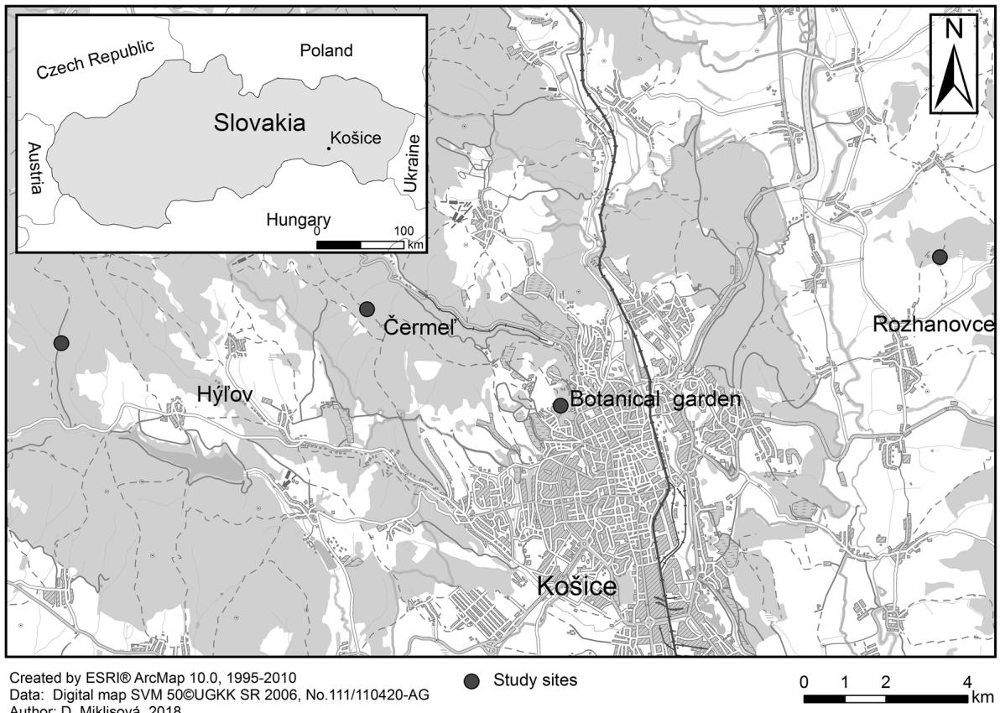

ARTHROPODS AND MEDICAL ENTOMOLOGY - ORIGINAL PAPER

# Circulation of Rickettsia species and rickettsial endosymbionts among small mammals and their ectoparasites in Eastern Slovakia

Eva Špitalská1 & Jasna Kraljik2 & Dana Miklisová3 & Eva Boldišová1 & Olivier A. E. Sparagano4 & Michal Stanko2,3

Received: 2 December 2019 /Accepted: 28 April 2020

$©$ Springer-Verlag GmbH Germany, part of Springer Nature 2020

# Abstract

Bacteria belonging to the genus Rickettsia are known as causative agents of vector-borne zoonotic diseases, such as spotted fevers, epidemic typhus and endemic typhus. Different species of ticks, mites and fleas could act as reservoirs and arthropod vectors of different pathogenic Rickettsia species. The aim of this work was to establish active surveillance of Rickettsia spp. in mites, ticks and fleas collected from small mammals (rodents and shrews) in Eastern Slovakia. A total of 964 animal ear biopsies, 871 mites, 667 ticks and 743 fleas were collected from small mammals in the Košice region, Eastern Slovakia. All specimens were identified using specialized taxonomic keys, and were conserved in ethanol until DNA extraction was performed. After DNA extraction, identification of Rickettsia species was performed by PCR-based methods. The total prevalence of rickettsiae from ear biopsies was $4 . 6 \%$ $9 5 \%$ CI, 3.2–5.9), in tested mites $9 . 3 \%$ $9 5 \%$ CI, 7.4–11.2), $1 7 . 2 \%$ $9 5 \%$ CI, 14.3–20.1) in I. ricinus ticks and $3 . 5 \%$ $9 5 \%$ CI, 2.2–4.8) in fleas. Sequence analysis of the partial gltA gene and Rickettsia helvetica-, Rickettsia slovaca-, Rickettsia raoultii- species specific real-time PCR tests revealed the presence of R. helvetica, R. slovaca, unidentified Rickettsia and rickettsial endosymbionts. These pathogenic and symbiotic species were confirmed in the following ectoparasite species—Laelaps jettmari, Haemogamasus nidi, Laelaps agilis and Eulaelaps stabularis mites, Ixodes ricinus ticks, Ctenophthalmus solutus, C. assimilis and Megabothris turbidus fleas infesting host—Apodemus agrarius, A. flavicollis, Microtus arvalis and Myodes glareolus small mammals. These results confirm the circulation of R. helvetica, R. slovaca, unidentified Rickettsia and rickettsial endosymbionts in mites, ticks and fleas collected on small mammals in the Košice region, Eastern Slovakia.

Keywords Rickettsia $\cdot$ Small mammals $\cdot$ Ticks $\cdot$ Fleas $\cdot$ Mites $\cdot$ Eastern Slovakia

Section Editor: Charlotte Oskam

Electronic supplementary material The online version of this article (https://doi.org/10.1007/s00436-020-06701-8) contains supplementary material, which is available to authorized users.

* Eva Špitalská

eva.spitalska@savba.sk

Institute of Virology, Biomedical Research Center, Slovak Academy of Sciences, Dúbravská cesta 9, 845 05 Bratislava, Slovak Republic   
2 Institute of Zoology Slovak Academy of Sciences, Dúbravská cesta 9, 845 06 Bratislava, Slovak Republic   
3 Institute of Parasitology Slovak Academy of Sciences, Hlinkova 3, 040 01 Košice, Slovak Republic   
4 Department of Infectious Diseases and Public Health, Jockey Club College of Veterinary Medicine and Life Sciences, Kowloon, Hong Kong SAR

# Introduction

A wide range of mammals, including rodents, act as reservoir hosts and can participates in the natural cycle of several zoonotic agents. They play an important role in the circulation of hantaviruses (Klempa et al. 2005), agents of larval toxocarosis (Antolová et al. 2004; Reiterová et al. 2013), leptospirosis (Stanko et al. 1996), chlamydiosis (Čisláková et al. 2004), borreliosis (Hanincová et al. 2003), anaplasmosis (Blaňarová et al. 2014), bartonellosis (Kraljik et al. 2016), babesiosis (Blaňarová et al. 2016) and other zoonosis (Čondlová et al. 2018; Danišová et al. 2017; Mácová et al. 2018). Small mammals are hosts to different ectoparasites such as ticks (Nosek et al. 1972; Labuda et al. 1989; Krasnov et al. 2007, 2010), mites (Kocianová 1980; Stanko 1989), fleas (Rosický 1957; Stanko et al. 2002; Krasnov et al. 2006, 2010) and lice (Stanko et al. 2015). Several small mammals such as Apodemus flavicollis (Melchior, 1834), Apodemus agrarius (Pallas,

1771), Myodes glareolus (Schreber, 1780), Microtus arvalis (Pallas, 1778), Microtus subterraneus (de Sélys-Longchamps, 1836), Micromys minutus (Pallas, 1771) and Sorex araneus (Linnaeus, 1758) have a relevant epidemiological role as hosts to a broad spectrum of ectoparasites mentioned above in Slovakia (Meerburg et al. 2009; Špitalská et al. 2015, 2017; Minichová et al. 2017).

Ticks are obligate ectoparasites that feed on a wide range of mammalian, avian and reptilian hosts. In Europe, changes in tick occurrence are observed as a result of climatic changes, economic and socio-economic conditions. Such changes results in the establishment of new foci and the spread of vectorborne diseases (Bullová et al. 2009; Lukáň et al. 2010). Five genera and 21 species of soft and hard ticks were recognized in different fauna of Slovakia (Slovák 2010) from which epidemiologically important species belonging to Ixodes ricinus Linnaeus 1758; Haemaphysalis concinna Koch 1844; Haemaphysalis punctata Canestrini & Fanzago, 1878; Haemaphysalis inermis Birula, 1895; Dermacentor reticulatus Fabricius, 179; and Dermacentor marginatus Sulzer, 1776. Ixodes ricinus collected from vegetation and animals in different locations of Slovakia were previously found to be infected with Rickettsia helvetica and Rickettsia monacensis (Minichová et al. 2017; Radzijevskaja et al. 2015; Špitalská et al. 2014, 2016, 2018; Švehlová et al. 2014), and Dermacentor species with Rickettsia slovaca and Rickettsia raoultii (Švehlová et al. 2014; Špitalská et al. 2012, 2018). The genus Rickettsia includes obligate intracellular Gramnegative bacteria that are responsible for mild to severe diseases in humans, with worldwide distribution (Raoult and Roux 1997). The Rickettsia species (Proteobacteria: Rickettsiales) found in Slovakia are pathogenic to humans (Uchiyama 2012; Oteo and Portillo 2012) with mild clinical manifestations such as fever, rash and eschar with different severities (Faccini-Martínez et al. 2014).

About 75 species of fleas (Siphonaptera) have been recorded in Slovakia, while more than 30 species were reported from small mammals (Cyprich et al. 2002; Dudich 1993; Rosický 1957; Stanko et al. 2002). Fleas play a role in maintaining and transferring several pathogenic agents such as Bartonella henselae causing cat scratch disease and other Bartonella species (Brinkerhoff et al. 2010; Marie et al. 2006; Morick et al. 2009, 2010). The oriental rat flea (Xenopsylla cheopis) is primarily the vector of Rickettsia typhi and transmits murine typhus to humans. Interestingly, some other species of fleas, including the cat flea (Ctenocephalides felis), have been found to be naturally infected with R. typhi (Azad and Beard 1998). In Slovakia, the role of fleas in the circulation of rickettsiae is still not well understood. To this day, Rickettsia felis and Rickettsia africae were detected in Slovakia (Sekeyová et al. 2012; Špitalská et al. 2015). Rickettsia felis was identified in Ctenophthalmus solutus collected from A. agrarius. The cat flea, Ctenocephalides felis, is known as the primary vector of

R. felis, which is the etiological agent of the flea-borne spotted fever with clinical symptoms similar to malaria and dengue in humans. However, it appears to be milder than other rickettsioses (Raoult and Parola 2007). R. africae was identified in Ceratophyllus garei fleas collected from reed warblers (Acrocephalus scirpaceus) migrating from Africa (Sekeyová et al. 2012), However, R. africae is usually transmitted by ticks.

Mites have a broad range of eating habits. In fact, they occupy every feeding niche-from predators, phytophagous, decomposers and fungivores (e.g. oribatid mites, or some mesostigmatic mites) to scavengers or parasites of other animals (Badiertakis et al. 2014). Mites of the family Laelapidae (Acari: Mesostigmata) are distributed worldwide and are the most common ectoparasites of small rodents (Guo et al. 2013; Karg 1971, 1993; Kocianová 1989; Mašán and Fenďa 2010; Miťková et al. 2015; Rynkiewicz et al. 2013). Mesostigmatic mites are probably involved in the circulation of some pathogens such as the human pathogenic tick-borne encephalitis virus or various rickettsial agents (Kocianová et al. 1993; Miťková et al. 2015; Radzijevskaja et al. 2018; Reeves et al. 2006). The mites of the genus Allodermanyssus may act as a vector and reservoir of Rickettsia akari, which produced urban outbreaks, with the house mouse Mus musculus as the main host for this mite species (Raoult and Roux 1997).

Ectoparasitic mites, fleas and ticks share the body of the mammalian host, and by co-feeding, some uninfected parasites can become infected. In this study, we aimed to investigate the presence and prevalence of Rickettsia species and rickettsial endosymbionts in ectoparasites parasitizing small mammals in Slovakia. We predicted (i) the presence of Rickettsia species in all studied ectoparasites with the highest prevalence in ticks, (ii) a higher prevalence in the most abundant small mammals species carrying such ectoparasites and (iii) the identification of several rickettsial species.

# Materials and methods

# Origin of the samples

Study sites were located in sylvatic mixed forests (Hýľov; 500– $7 5 0 \mathrm { m }$ above sea level (asl); $4 8 ^ { \circ } 4 4 ^ { \prime } \mathrm { N }$ , $2 1 ^ { \circ } 4 \mathrm { { T } }$ and Čermeľ; 208– $4 2 0 \ \mathrm { m }$ asl; $4 8 ^ { \circ } ~ 4 5 ^ { \prime } \mathrm { N }$ , $2 1 ^ { \circ } ~ 8 \mathrm { ^ \prime E }$ ), in suburban deciduous forests (Botanical garden, Košice; $2 0 8 \mathrm { m }$ asl; $4 8 ^ { \circ } 4 4 ^ { \prime } \mathrm { N }$ , $2 1 ^ { \circ } 1 4 ^ { \prime } \mathrm { E }$ ), as well as in an agricultural site comprising of patches of oak-hornbeam forests and a few cultivated fields and meadows (Rozhanovce $2 1 5 \mathrm { m }$ asl; $4 8 ^ { \circ } 4 5 ^ { \prime } \mathrm { N }$ , $2 1 ^ { \circ } 2 1 \mathrm { ^ { \prime } E }$ ) in Eastern Slovakia (Fig. 1).

In total, 7194 ectoparasites (2635 ticks, 1664 fleas and 2895 mites) were removed from 991 trapped small mammals. Hosts were trapped and ectoparasites were collected between 2011 and 2013. Rodents were trapped alive using Swedish bridge metal traps following the protocol of Stanko (1994),

  
Fig. 1 Map of collection sites in Eastern Slovakia

and Stanko and Miklisova (1995). Rodent trapping was carried out using 100–150 traps per site for a two-night trapping period. Captured rodents were transported to the laboratory, anaesthetized and sacrificed humanely according to current laws of the Slovak Republic. The rodents were identified at species, sex and age class (subadult, adult) levels. Ectoparasites were collected from infested animals using forceps and stored in $70 \%$ ethanol until identification. The species and sex of ectoparasites were determined by microscopic examination according to Rosický (1957), Filippova (1977) and Mašán and Fenďa (2010) and stored in $70 \%$ ethanol until molecular analysis. Ear skin punch biopsies were stored at − $8 0 ~ ^ { \circ } \mathrm { C }$ .

# DNA extraction and molecular analysis

Ectoparasites were washed with sterile water, dried, transferred to individual tubes and crushed with a sterile carbon steel surgical scalpel blade (Surgeon, JAI Surgicals Ltd., India). Total DNA of fleas and mites was isolated by boiling individual specimen in $0 . 7 \textbf { M }$ ammonium hydroxide (Rijpkema et al. 1996). Genomic DNA from fed ticks and rodent tissues were extracted using DNeasy Blood and Tissue Kit (Qiagen) following the manufacturer’s recommendations. The quantity and quality of DNA were assessed with a NanoPhotometer Pearl (Implen, Germany). DNA samples

were stored at $- 2 0 { } ^ { \circ } \mathrm { C }$ and later used as templates for the PCR amplifications. Ectoparasite and tissue samples were screened by PCR-based methods for the presence of Rickettsia spp. Identification of Rickettsia spp. was performed using a nested PCR based on the genus-specific variable regions of the gltA gene using the primer sets $\mathrm { R p C S . 8 7 7 p - R p C S . 1 2 5 8 n }$ and RpCS.896p–RpCS.1233n (Choi et al. 2005; Regnery et al. 1991). The DNAs from Rickettsia-free ticks and nucleasefree water were used as negative controls for each reaction set. DNAs of R. slovaca and R. helvetica originated from the sample bank of the Institute of Virology BMC SAS Bratislava were used as positive controls. PCR amplifications were conducted using SuperHot Master Mix (Bioron, Germany) as recommended by the manufacturer using a thermocycler Labcycler (SensoQuest, Germany). PCR products were analyzed by electrophoresis in a $1 . 5 \%$ agarose gel, stained with GelRed™ (Biotium, Hayward, California) and visualized with a UV transilluminator. Some Rickettsia-positive samples were screened for the presence of R. helvetica, R. slovaca and R. raoultii species using a TaqMan PCR assay targeting a fragment of the 23S rRNA and ompB genes, respectively, as previously described (Boretti et al. 2009; Jiang et al. 2012). Randomly selected amplicons of gltA gene were purified and analyzed by sequencing both DNA strands. The sequencing was performed by Macrogen (http://www.macrogen.com). Obtained DNA sequences were compared with available

sequences in the GenBank database using the basic local alignment search tool (BLAST) on http://blast.ncbi.nlm.nih. gov/. A phylogenetic analysis was further performed using the MEGA5 software (Tamura et al. 2011).

# Statistical analysis

Chi-square and Fisher’s tests were used to analyze the prevalence levels for significant independence (http://www. socscistatistics.com). The significance threshold was set at $P = 0 . 0 5$ . Ninety-five percent confidence intervals (CI) were calculated using an online calculator (http://epitools.ausvet. com.au).

# Results

A total of 964 ear biopsies, 871 mites, 667 ticks and 743 fleas were analyzed individually for the presence of rickettsial species. Ear samples originated from the following rodents species: A. agrarius, A. flavicollis, My. glareolus, M. arvalis, M. subterraneus and Mi. minutus, and following insectivores: Crocidura suaveolens Pallas, 1811; Neomys fodiens Pennant, 1771; and Sorex minutus Linnaeus, 1776 and S. araneus. From the trapped small mammals, we identified the following mite species: Laelaps agilis, Koch, 1836; Laelaps jettmari, Vitzthum, 1930; Laelaps hilaris, Koch, 1836; Androlaelaps fahrenholzi (Berlese, 1911); Hyperlaelaps microti, Ewing, 1933; Myonyssus gigas Oudemans, 1912; Haemogamasus nidi, Michael, 1892; Haemogamasus hirsutosimilis, Willmann, 1952; Haemogamasus hirsutus, Berlese, 1889; Eulaelaps stabularis, Koch, 1836; Euryparasitus marginatus, Koch, 1939; Eviphis ostrinus (Koch, 1836); and two tick species—I. ricinus and Ixodes trianguliceps, Birula, 1895; and the following species of fleas: Atyphloceras nuperus (Jordan, 1931); A m a l a r a e u s p e n i c i l l i g e r ( G r u b e , 1 8 5 1 ) ; Ctenophthalmus agyrtes, Heller, 1986; Ctenophthalmus assimilis (Tasc henbe rg, 1880); Cte nophthalmus bisoctodentatus, Kolenati, 1863; Ctenophthalmus solutus, Jordan et Rothschild, 1920; Ctenophthalmus uncinatus (Wagner, 1898); Hystrichopsylla orientalis (Smit, 1956); Megabothris turbidus, Rothschild, 1909; Nosopsyllus fasciatus (Bosc, 1801); Peromyscopsylla bidentata (Kolenati, 1860); and Rhadinopsylla integella, Jordan et Rothschild, 1921.

DNA of Rickettsia spp. was found in $4 . 6 \%$ ( $9 5 \%$ CI, 3.2– 5.9) ear biopsies (Table 1) with the highest prevalence in A. agrarius ( $5 . 9 \%$ ; $9 5 \%$ CI, 3.4–8.4), followed by My. glareolus $( 4 . 1 \%$ ; $9 5 \%$ CI, 1.7–6.5) and the lowest prevalence was recorded in A. flavicollis $( 3 . 9 \%$ ; $9 5 \%$ CI, 1.7–6.0) (see Table 1). Statistics were not performed when less than 20 individuals from the same species were collected. The prevalence of Rickettsia did not differ significantly among rodent

species in Čermeľ $\langle x 2 = 2 . 6$ ; $P = 0 . 2 6 7 7$ ; ${ \mathrm { d f } } = 2$ ) and Rozhanovce $\cdot x 2 = 3 . 4$ ; $P = 0 . 1 8 5$ ; ${ \mathrm { d f } } = 3$ ) . T he to t a l Rickettsia prevalence in small mammals did not differ significantly among localities $\cdot { \boldsymbol { x } } { \boldsymbol { 2 } } = 4 . 2$ ; $P = 0 . 2 3 7$ ; ${ \mathrm { d f } } = 3$ ) . Sequencing and/or R. helvetica specific real-time PCR showed the presence of R. helvetica in five samples from A. agrarius, three from A. flavicollis, one from M. arvalis and three My. glareolus (Acc No. KX051333). Furthermore, four sequences from A. agrarius (Acc. No. KX051329) and four from A. flavicollis showed $9 9 . 3 \substack { - 1 0 0 \% }$ similarity with an uncultured Rickettsia sp. clone MG116–4 (Acc. No. DQ792806), (Choi et al. 2007). Two sequences obtained from A. agrarius (Acc. No. KX051330) were $9 9 \%$ similar with a Rickettsia endosymbiont of the Dolichopus nubilus strain 180 (Acc. No. JQ925593; Martin et al. 2013). Two sequences obtained from My. glareolus and two from A. agrarius (Acc. No. KX051331 and KX051332, respectively) were $8 7 - 9 0 \%$ similar with the Rickettsia endosymbiont Chrysotus neglectus (Wiedemann, 1817) (Acc. No. JQ925605, Martin et al. 2013). One ear sample from My. glareolus was amplified by R. slovaca specific real-time PCR and sequencing (21,958, Fig. S1) showed $100 \%$ iden tity with the Rickettsia aeschlimannii isolate Raeschlimannii_Tick15 identified in Hyalomma marginatum collected in China (Acc. No. MH267736), the uncultured Rickettsia sp. isolate Altai2– 20,156-7 identified in Dermacentor nuttalli in the Altai (Acc. No. MF981014), and the R. raoultii isolate 109 identified in D. reticulatus in West Siberia (Acc. No. MH373353), but R. raoultii was not confirmed in any ear samples.

The total prevalence of rickettsiae in tested mites was $9 . 3 \%$ ( $9 5 \%$ CI, 7.4–11.2), (Table 2). The highest prevalence $( 5 1 . 9 \%$ ; $9 5 \%$ CI, 33.0–70.7) was recorded in L. jettmari, followed by $H .$ nidi $( 1 2 . 9 \%$ ; $9 5 \%$ CI, 5.0–20.7), L. agilis ( $7 . 3 \%$ ; $9 5 \%$ CI, 5.4–9.2) and L. hilaris $( 6 . 9 \%$ ; $9 5 \%$ CI, 0– 16.7) except species with low number of tested mites below 20. Laelaps agilis was the only Rickettsia-positive species in all study localities with significantly different occurrence among localities $( \chi 2 = 2 5 . 0$ ; $P { = } 0 . 0 0 0$ ; $\mathrm { d f } = 3$ ). The prevalence of Rickettsia differed significantly between mites species in Rozhanovce $( \chi 2 = 1 1 . 3$ ; $P { = } 0 . 0 0 4$ ; $\mathrm { d f } = 3$ ). Species specific real-time PCRs and sequencing showed the presence of R. helvetica in two L. jettmari, seven $H .$ nidi and five L. agilis. Moreover, sequencing two $L$ . agilis samples (Fig. S1) showed that sequences of Lagi461 and Lagi567 were $100 \%$ and $9 9 \%$ identical with R. helvetica (Acc. Nos. MG190375, MG190376, MF6473863) previously identified in Slovakia (Heglasová et al. 2018; Chvostáč et al., 2018), respectively. The presence of R. slovaca was confirmed in sixteen L. agilis, four L. jettmari, and one E. stabularis. Furthermore, sequences from L. agilis (Lagi388, Lagi392, Fig. S1) were $100 \%$ identical with Rickettsia slovaca isolate 2352AFLA (Acc. No. MG190377) previously identified in ear biopsy of A. flavicollis trapped in Eastern Slovakia

Table 1 Presence of Rickettsia spp. in skin biopsies of small mammals trapped in Eastern Slovakia between 2011 and 2013   

<table><tr><td>Lokality Species</td><td>Botanical garden</td><td>Čermel&#x27;</td><td>Hýlov</td><td>Rozhanovce</td><td>Total</td></tr><tr><td colspan="6">Rodents</td></tr><tr><td>AA</td><td>0/51/0</td><td>2/22/9.1 [0–21.1]</td><td>2/8/25 [0–55.0]</td><td>16/259/6.2 [3.3–9.1]</td><td>20/340/5.9 [3.4–8.4]</td></tr><tr><td>AF</td><td>1/22/4.6 [0–13.3]</td><td>1/65/1.5 [0–4.5]</td><td>6/55/10.9 [2.7–19.2]</td><td>4/170/2.4 [0.1–4.6]</td><td>12/312/3.9 [1.7–6.0]</td></tr><tr><td>MyG</td><td></td><td>5/115/4.4 [0.6–8.1]</td><td>0/39/0</td><td>6/113/5.3 [1.2–9.4]</td><td>11/267/4.1 [1.7–6.5]</td></tr><tr><td>MA</td><td></td><td>0/1/0</td><td></td><td>1/13/7.7 [0–22.2]</td><td>1/14/7.1 [0–20.6]</td></tr><tr><td>MS</td><td>0/1/0</td><td>0/2/0</td><td>0/2/0</td><td>0/2/0</td><td>0/7/0</td></tr><tr><td>MiM</td><td>0/1/0</td><td></td><td></td><td>0/2/0</td><td>0/3/0</td></tr><tr><td colspan="6">Insectivores</td></tr><tr><td>CS</td><td></td><td></td><td></td><td>0/2/0</td><td>0/2/0</td></tr><tr><td>NF</td><td></td><td>0/2/0</td><td></td><td></td><td>0/2/0</td></tr><tr><td>SA</td><td>0/1/0</td><td>0/6/0</td><td>0/4/0</td><td>0/4/0</td><td>0/15/0</td></tr><tr><td>SM</td><td></td><td>0/1/0</td><td></td><td>0/1/0</td><td>0/2/0</td></tr><tr><td>Total</td><td>1/76/1.3 [0–3.9]</td><td>8/214/3.7 [1.2–6.3]</td><td>8/108/7.4 [2.5–12.4]</td><td>27/566/4.8 [3.0–6.5]</td><td>44/964/4.6 [3.2–5.9]</td></tr></table>

No. of Rickettsia-positive/No. of tested samples/ Prevalence of Rickettsia in tissue samples of small mammals (%) $[ 9 5 \%$ CI]   
AA Apodemus agrarius; AFApodemus flavicollis; MyG Myodes glareolus, MA Microtus arvalis; MS Microtus subterraneus; MiM Micromys minutus; CS Crocidura suaveolens; NF Neomys fodiens; SA Sorex araneus; and SM Sorex minutus

(Heglasová et al. 2018). Finally, sequences Lagi506 (Fig. S1) and R. slovaca isolate 2352AFLA (Acc. No. MG190377) were $9 8 . 2 \%$ similar. In these three sequenced samples, the presence of R. slovaca was confirmed by R. slovaca-specific real-time PCR. Rickettsia species were not identified in L. agilis, one E. stabularis, two L. hilaris, two H. nidi and three L. jettmari. Sequences from L. agilis (Lagi590) and L. hilaris (Lhil382) were $9 9 . 7 \%$ identical with the Israeli tick typhus rickettsia strain PoHu8122 (Acc. No. DQ821859) (Fig.

S1). Sequences from L. jettmari (Ljett612) were $100 \%$ identical with the uncultured Rickettsia sp. isolate Altai2–2016-3 (MF981013) identified in Dermacentor nuttalli ticks from Russia. Sequences from L. jettmari (Ljeff378, Ljeff512) and Ljeff379 samples were $100 \%$ and $9 9 . 7 \%$ identical with sequences of the uncultured Rickettsia sp. clone MG116–4 (Acc. No. DQ795806) previously identified in mites (Trombiculidae) from Korea (Choi et al. 2007), respectively. Rickettsia-positive mites were collected from Rickettsia-

Table 2 Presence of Rickettsia spp. in mites (Mesostigmata) collected from small mammals trapped in Eastern Slovakia between 2011 and 2013   

<table><tr><td>Locality Species</td><td>Botanical garden</td><td>Čermel&#x27;</td><td>Hýlov</td><td>Rozhanovce</td><td>Total</td></tr><tr><td>LA</td><td>13/90/14.4 [7.2–21.7]</td><td>12/62/19.4 [9.5–29.2]</td><td>3/56/5.4 [0–11.3]</td><td>24/502/4.8 [2.9–6.7]</td><td>52/710/7.3 [5.4–9.2]</td></tr><tr><td>LJ</td><td>6/6/100</td><td>0/4/0</td><td></td><td>8/17/47.1 [23.3–70.8]</td><td>14/27/51.9 [33.0–70.7]</td></tr><tr><td>LH</td><td></td><td></td><td>0/1/0</td><td>2/28/7.1 [0–17.3]</td><td>2/29/6.9 [0–16.7]</td></tr><tr><td>AF</td><td></td><td></td><td></td><td>0/1/0</td><td>0/1/0</td></tr><tr><td>HM</td><td></td><td></td><td>0/5/0</td><td></td><td>0/5/0</td></tr><tr><td>MG</td><td>0/4/0</td><td>0/2/0</td><td>0/4/0</td><td>0/4/0</td><td>0/14/0</td></tr><tr><td>HN</td><td>1/16/6.3 [0–18.1]</td><td>0/4/0</td><td>0/2/0</td><td>8/48/16/7 [6.1–27.2]</td><td>9/70/12.9 [5.0–20.7]</td></tr><tr><td>HHs</td><td></td><td></td><td>0/2/0</td><td>0/1/0</td><td>0/3/0</td></tr><tr><td>HH</td><td></td><td></td><td></td><td>0/2/0</td><td>0/2/0</td></tr><tr><td>ES</td><td>4/6/66.7 [29–104.4]</td><td>0/1/0</td><td></td><td></td><td>4/7/57.1 [20.5–93.8]</td></tr><tr><td>EM</td><td>0/1/0</td><td></td><td></td><td>0/1/0</td><td>0/2/0</td></tr><tr><td>EO</td><td>0/1/0</td><td></td><td></td><td></td><td>0/1/0</td></tr><tr><td>Total</td><td>24/124/19.4 [12.4–26.3]</td><td>12/73/16.4 [7.9–24.9]</td><td>3/70/4.3 [0–9.0]</td><td>42/604/7.0 [4.9–9.0]</td><td>81/871/9.3 [7.4–11.2]</td></tr></table>

No. of Rickettsia-positive/No. of tested samples/ Prevalence of Rickettsia in mites from small mammals (%) $[ 9 5 \%$ CI]   
LA Laelaps agilis; LJ Laelaps jettmari; LH Laelaps hilaris; AF Androlaelaps fahrenholzi; HM Hyperlaelaps microti; MG Myonyssus gigas; HN Haemogamasus nidi; HHs Haemogamasus hirsutosimilis, HH Haemogamasus hirsutus; ES Eulaelaps stabularis; EM Euryparasitus marginatus; EO Eviphis ostrinus

Table 3
Presence of Rickettsia spp. in immature I. ricinus ticks from small mammals trapped in Eastern Slovakia between 2011 and 2013   

<table><tr><td>Locality Host Species</td><td>Botanical garden</td><td>Čermel&#x27;</td><td>Hýrov</td><td>Rozhanovce</td><td>Total</td></tr><tr><td>AA</td><td>29(24 + 5)/205/14.1 [9.4–18.9]</td><td>0/1/0.0</td><td></td><td>12(11 + 1)/96/12.5 [5.9–19.1]</td><td>41/302/13.6 [9.7–17.4]</td></tr><tr><td>AF</td><td>16(14 + 2)/108/14.8 [8.1–21.5]</td><td>2(2 + 0)/10/20.0 [0–44.8]</td><td>5(5 + 0)/30/16.7 [3.3–30.0]</td><td>17(17 + 0)/90/18.9 [10.8–27.0]</td><td>40/238/16.8 [12.1–21.6]</td></tr><tr><td>MyG</td><td></td><td>4(4 + 0)/8/50.0 [15.4–84.7]</td><td>10(10 + 0)/19/52.6 [30.2–75.1]</td><td>1(1 + 0)/23/4.3 [0–12.7]</td><td>15/50/30.0 [17.3–42.7]</td></tr><tr><td>MS</td><td>10(10 + 0)/35/28.6 [13.6–43.5]</td><td>1(1 + 0)/1/100.0</td><td>0/1/0.0</td><td>0/1/0.0</td><td>11/38/28.9 [14.5–43.4]</td></tr><tr><td>NF</td><td></td><td>1(1 + 0)/1/100.0</td><td></td><td></td><td>1/1/100.0</td></tr><tr><td>SA</td><td>1(1 + 0)/2/50.0</td><td>0/2/0.0</td><td>0/1/0.0</td><td></td><td>1/5/20.0</td></tr><tr><td>Total</td><td>56/350/16.0 [12.2–19.8]</td><td>8/23/34.8 [15.3–54.3]</td><td>15/51/29.4 [16.9–41.9]</td><td>30/210/14.3 [9.6–19.1]</td><td>109/634/17.2 [14.3–20.1]</td></tr></table>

No. of Rickettsia-positive (No. of positive larvae + No. of positive nymphs)/No. of tested I. ricinus ticks/ Prevalence of Rickettsia in I. ricinus from small mammals (%) [95% CI]   
AA Apodemus agrarius; AF Apodemus flavicollis; MyG Myodes glareolus; MS Microtus subterraneus; NF Neomys fodiens; SA Sorex araneus

negative rodents, except in one instance with one Rickettsia sp.-positive L. hilaris fed on one Rickettsia sp.-positive $M \ u \ y .$ glareolus .

In total, $6 3 4 ~ I .$ ricinus and $3 3 \ I .$ trianguliceps ticks were analyzed for the presence of Rickettsia species. The overall prevalence of rickettsial infection in I. ricinus ticks was $1 7 . 2 \%$ $9 5 \%$ CI, 14.3–20.1), $9 3 . 5 \%$ positive ticks were larvae and $6 . 5 \%$ were nymphs (Table 3). The prevalence of Rickettsia positive I. ricinus ticks differed significantly between localities $( \chi 2 = 1 1 . 9$ ; $P { = } 0 . 0 0 7$ ; ${ \mathrm { d f } } = 3$ ). The differences between Rickettsia positive ticks from the most abundant A. agrarius and A. flavicollis species were not statistically significant $( \chi 2 = 1 . 4 4$ ; $P = 0 . 2 2 9$ ; df = 1). The sequencing of 10 randomly selected ticks showed the presence of R. helvetica (Acc. No. KX051333). Two R. helvetica-positive ticks were collected from hosts, which were rickettsia negative, while all the others were from Rickettsia-positive hosts. In one sample, the sequencing showed $100 \%$ identity with Candidatus Rickettsia mendelii (Acc. No. KJ882305) identified in I. ricinus ticks c o l l e c t e d f r o m L u s c i n i a m e g a r h y n c h o s i n t h e Czech Republic (Hajduskova et al. 2016). In one sample, I. ricinus, sequences were identical with sequences from $M \ u \ y .$ . glareolus (21,958, Fig. S1) described above. In I. trianguliceps ticks, no rickettsial DNA was found.

DNA of Rickettsia spp. was found in 26 fleas, with a prevalence of $3 . 5 \%$ b $9 5 \%$ CI, 2.2–4.8), (Table 4). In males C. solutus (Acc. No. KX179466) and M. turbidus, we found sequences $9 9 . 7 \%$ identical with $R$ . helvetica (Acc. Nos. MG190375, MG190376, MF6473863). The respective hosts (A. flavicollis and My. glareolus) of these fleas were rickettsia negative. Rickettsia sp. originating from C. assimilis (Acc. No. KX179465) was $9 9 . 7 \%$ similar with the Rickettsia endosymbiont of Hyalomma marginatum (Acc. No. KC689908) identified in H. marginatus infested humans from Turkey. Its host, M. arvalis was Rickettsia negative. Three sequences of Rickettsia (Acc No. KX179467) from two females and one male of M. turbidus from rickettsia-negative A. agrarius , A. flavicollis and My. glareolus were $9 5 \%$ similar to Rickettsia endosymbiont of Nesidiocoris tenuis (Acc. No. KF646706) originated from the mirid bug N. tenuis identified in Israel (Caspi-Fluger et al. 2014). Rickettsia spp. originated from C. assimilis fleas were also identical with sequences from My. glareolus (21,958, Fig. S1) described above.

# Discussion

Small mammals are important hosts for immature stages of ticks and are considered reservoir hosts for some tick-borne pathogens, such as tick-borne encephalitis virus, Borrelia afzelii, Borrelia garinii, Borrelia miyamotoi, Babesia microti and Anaplasma phagocytophilum (Randolph et al. 1999; Humair et al. 1999; Huegli et al. 2002; Burri et al. 2014;

Obiegala et al. 2015). Evaluating the role of rodents in rickettsia life cycles has been the subject of many studies (Sprong et al. 2009; Svoboda et al. 2014; Miťková et al. 2015; Špitalská et al. 2015; Obiegala et al. 2016; Minichová et al. 2017). In this study, we showed the presence and the molecular characterization of the following rickettsial species: R. helvetica, R. slovaca, unidentified Rickettsia and rickettsial endosymbionts in eight species of ectoparasites, tick, fleas or mites, (L. jettmari, H. nidi, L. agilis, E. stabularis, I. ricinus, C. solutus, C. assimilis and M. turbidus) infesting four species of small mammals (A. agrarius, A. flavicollis, M. arvalis and My. glareolus) circulating in the Košice region, Eastern Slovakia. Considering the trophic relationships related to small mammals, two mite species, L. jettmari and L. agilis, are considered obligatory parasites living all their cycle on the body of rodents. The next two species, H. nidi and E. stabularis, represent facultative hematophagous parasites, in their life cycle with alternately living conditions in nests and on the host bodies (Mašán and Fenďa 2010). For fleas, only C. assimilis has stronger trophic relationships to M. arvalis or other microtid rodents. The next two rickettsia positive flea species, C. solutus and M. turbidus, infest a broader host spectrum of rodents including the Apodemus, Myodes, Microtus and Micromys genera (Rosický 1957). Similarly broad host parasitism is common in I. ricinus ticks (Fillipova, 1977). We reported the highest rickettsial infection in I. ricinus ticks followed by mites, and the lowest was recorded in fleas. A similar study was conducted in Lithuania by Radzijevskaja et al. (2018); ectoparasites collected from rodents were investigated for the presence of Rickettsia spp. They found the

highest infection in fleas, followed by I. ricinus ticks and then mites. Results suggest that different vectors share small mammals as reservoir hosts and rickettsia-positive ectoparasites could be infected by the acquisition of bacteria via blood meals from rickettsiemic hosts, or by co-feeding of ectoparasites through infected blood meals. They could be also infected during previous feedings on another host. Furthermore, positive larvae could be the result of transovarial transmission from infected females or through transstadial transmission passed onto the next developmental stages.

Rickettsial species in ticks in Slovakia have been studied during the last decade, and the presence of R. helvetica and R. slovaca in I. ricinus and Dermacentor spp. was previously confirmed (Špitalská et al. 2018) and thus expected in ticks from this study. R. helvetica was confirmed not only in I. ricinus ticks but also in L. jettmari, H. nidi and L. agilis mite species and C. solutus and M. turbidus flea species. Previously, R. helvetica was identified in C. agyrtes males collected from A. agrarius, which was for the first time, it was identified in fleas from Slovakia in 2015 (Špitalská et al. 2015). Similarly, Sprong et al. (2009) identified R. helvetica in fleas isolated from My. glareolus and Apodemus sylvaticus from the Netherlands. R. helvetica was also identified in Archaeopsylla erinacei collected from hedgehogs and in Nycteridopsylla eusarca bat fleas from Hungary (Hornok et al. 2012, 2014). The presence of R. helvetica in pooled samples of L. agilis, H. nidi (Laelapidae), Hirsutiella zachvatkini and Kepkatrombicula štorkáni (Trombiculidae) mites collected from small terrestrial mammals captured in south-western Slovakia was confirmed

Table 4 Presence of Rickettsia spp. in fleas (Siphonaptera) from small mammals trapped in Eastern Slovakia between 2011 and 2013   

<table><tr><td>Locality Flea Species</td><td>Botanical garden</td><td>Čermel&#x27;</td><td>Hýlov</td><td>Rozhanovce</td><td>Total</td></tr><tr><td>AN</td><td></td><td></td><td>0/2/0.0</td><td></td><td>0/2/0.0</td></tr><tr><td>AmP</td><td>0/1/0.0</td><td>0/2/0.0</td><td>0/1/0.0</td><td></td><td>0/4/0.0</td></tr><tr><td>CA</td><td></td><td>0/7/0.0</td><td>0/19/0.0</td><td>2/227/0.9 [0-2.1]</td><td>2/253/0.8 [0-1.9]</td></tr><tr><td>CAs</td><td></td><td></td><td></td><td>4/97/4.1 [0-8.1]</td><td>4/97/4.1 [0-8.1]</td></tr><tr><td>CB</td><td></td><td></td><td></td><td>0/1/0.0</td><td>0/1/0.0</td></tr><tr><td>CS</td><td></td><td>0/1/0.0</td><td>1/24/4.2</td><td>4/182/2.2 [0-4.3]</td><td>5/207/2.4 [0.3-4.5]</td></tr><tr><td>CU</td><td></td><td>0/5/0.0</td><td>0/7/0.0</td><td></td><td>0/12/0.0</td></tr><tr><td>HO</td><td></td><td></td><td></td><td>0/1/0.0</td><td>0/1/0.0</td></tr><tr><td>MT</td><td>0/3/0.0</td><td></td><td>1/1/100.0</td><td>14/117/12.0 [6.1-17.9]</td><td>15/121/12.4 [6.5-18.3]</td></tr><tr><td>NF</td><td></td><td>0/1/0.0</td><td></td><td>0/5/0.0</td><td>0/6/0.0</td></tr><tr><td>PB</td><td></td><td>0/8/0.0</td><td>0/19/0.0</td><td></td><td>0/27/0.0</td></tr><tr><td>RI</td><td></td><td>0/9/0.0</td><td>0/3/0.0</td><td></td><td>0/12/0.0</td></tr><tr><td>Total</td><td>0/4/0.0</td><td>0/33/0.0</td><td>2/76/2.6 [0-6.2]</td><td>24/630/3.8 [2.3-5.3]</td><td>26/743/3.5 [2.2-4.8]</td></tr></table>

No. of Rickettsia-positive/No. of tested fleas/Prevalence of Rickettsia in fleas from small mammals (%) $[ 9 5 \%$ CI]   
AN Atyphloceras nuperus; AmP Amalaraeus penicilliger; CA Ctenophthalmus agyrtes; CAS Ctenophthalmus assimilis; CB Ctenophthalmus bisoctodentatus; CS Ctenophthalmus solutus; CU Ctenophthalmus uncinatus; HO Hystrichopsylla orientalis; MT Megabothris turbidus; NF Nosopsyllus fasciatus; PB Peromyscopsylla bidentate; RI Rhadinopsylla integella

by Miťková et al. (2015). Radzijevskaja et al. (2018) mentioned the presence of R. helvetica in I. ricinus ticks, in L. agilis and M. gigas mites and in C. agyrtes, M. turbidus and M. walkeri fleas.

The natural known vectors of R. slovaca are Dermacentor species ticks, and in this study, such pathogen was confirmed in L. agilis, L. jettmari and E. stabularis, which shows that it can be acquired from other hosts. Previously, R. slovaca was identified in I. ricinus in Austria (Schőtta et al. 2017) and in Melophagus ovinus, the sheep ked in China (Liu et al. 2016). The presence of unidentified Rickettsia species or rickettsial endosymbiont in different species of ectoparasites has been recorded in many studies (Blair et al. 2004; Khrouf et al. 2014; Segura et al. 2014; Song et al. 2018), and it could be result of mis-identity with multiple Rickettsia species, unsuccessful amplification of other genes, low DNA quantity used for other amplifications, low quality of DNA, as usually the isolate is not obtained by culture, thus the characterization is not complete and the amount of DNA based on what is collected and extracted.

The low prevalence of Rickettsia in skin biopsies was expected, as suggested by the previous study of Minichová et al. (2017). The presence of different rickettsial species was expected. However, we expected also the presence of R. monacensis because this species has been identified in previous studies from Slovakia, Lithuania and Italy (Špitalská et al. 2014, Špitalská et al. 2016, Minichová et al. 2017, Radzijevska et al. 2018, Mori et al. 2018). We assumed that no identification of R. monacensis could be caused by not all positive samples were sequenced and partially due to the competition with the most prevalent R. helvetica in Slovakia (Švehlová et al. 2014; Špitalská et al. 2014; Špitalská et al. 2016).

Finally, the present data extend the knowledge on the distribution of Rickettsia spp. and their association with different arthropod vectors and indicate the presence of phylogenetically distinct rickettsiae in multiple ectoparasite species feeding on different rodent hosts. Results confirmed the high circulation of bacteria from the genus Rickettsia in mites, ticks and fleas collected from small mammals in Košice region, Eastern Slovakia, with related clinical cases of rickettsiosis. Some mite, flea and tick species infesting wild rodents might carry Rickettsia species, and small mammals can serve as carriers of Rickettsia infected ectoparasites.

# Conclusions

We are reporting here the occurrence and molecular characterization of Rickettsia spp. in eight species of ectoparasites found on four species of small rodents in Eastern Slovakia. The data presented in this paper extend the knowledge on the

distribution of Rickettsia species, their association with different arthropod vectors and rodent-parasites interactions.

Acknowledgements We are grateful to Ladislav Mošanský and Monika Onderová for help in the field and laboratory work.

Funding information This study was financially supported by the VEGA No. 2/0068/17 and VEGA 1/0084/18 projects from the Scientific Grant Agency of Ministry of Education and Slovak Academy of Sciences.

# Compliance with ethical standards

Conflict of interest The authors declare that they have no conflict of interest.

Ethical approval All applicable international, national, and/or institutional guidelines for the care and use of animals were followed.

All procedures performed in studies involving animals were in accordance with the ethical standards of the institution or practice at which the studies were conducted.

Small mammals were euthanized according to the laws of the Slovak Republic under the licences of the Ministry of Environment of the Slovak Republic No. 297/108/06–3.1 and No. 6743/2008–2.1.

This article does not contain any studies with human participants performed by any of the authors.

# References

Antolová D, Reiterová K, Miterpáková M, Stanko M, Dubinský P (2004) Circulation of Toxocara spp. in suburban and rural ecosystems in the Slovak Republic. Vet Parasitol 126(3):317–324   
Azad AF, Beard CB (1998) Rickettsial pathogens and their arthropods vectors. Emerg Infect Dis 4:179–186   
Badiertakis EG, Fantinou AA, Emmanouel NG (2014) A qualitative and quantitative study of mite in similar alfalfa fields in Greece. Exp Appl Acarol 62:195–214   
Blair PJ, Jiang J, Schoeler GB, Moron C, Anaya E, Cespedes M, Cruz C, Felices V, Guevara C, Mendoza L, Villaseca P, Sumner JW, Richards AL, Olson JG (2004) Characterization of spotted fever group Rickettsiae in flea and tick specimens from North Peru. J Clin Microbiol 42:4961–4967   
Blaňarová L, Stanko M, Carpi G, Miklisová D, Víchová B, Mošanský L, B o n a M , D e r d á k o v á M ( 2 0 1 4 ) D i s t i n c t A n a p l a s m a phagocytophilum genotypes associated with Ixodes trianguliceps ticks and rodents in Central Europe. Ticks Tick-Borne Dis 5(6): 928–938   
Blaňarová L, Stanko M, Miklisová D, Víchová B, Mošanský L, Kraljik J, Bona M, Derdáková M (2016) Presence of Candidatus Neoehrlichia mikurensis and Babesia microti in rodents and two tick species (Ixodes ricinus and Ixodes trianguliceps) in Slovakia. Ticks Tick-Borne Dis 7(2):319–326   
Boretti FS, Perreten A, Meli MM, Cattori V, Willi B, Wengi N et al (2009) Molecular investigation of Rickettsia helvetica infection in dogs, foxes, humans, and Ixodes ticks. Appl Environ Microbiol 75: 3230–3237   
Brinkerhoff RJ, Kabeya H, Inoue K, Bai Y, Maruyama S (2010) Detection of multiple Bartonella species in digestive and reproductive tissues of fleas collected from sympatric mammals. Multidisciplinary J Microbial Ecol 4(7):955–958   
Bullová E, Lukáň M, Stanko M, Peťko B (2009) Spatial distribution of Dermacentor reticulatus tick in Slovakia in the beginning of the 21st century. Vet Parasitol 165:357–360

Burri C, Schumann O, Schumann C, Gern L (2014) Are Apodemus spp. mice and Myodes glareolus reservoirs for Borrelia miyamotoi, “Candidatus Neoehrlichia mikurensis”, Rickettsia helvetica, R. monacensis and Anaplasma phagocytophilum? Ticks Tick Borne Dis 5:245–251   
Caspi-Fluger A, Inbar M, Steinberg S, Friedmann Y, Freund M, Mozes-Daube N, Zchori-Fein E (2014) Characterization of the symbiont Rickettsia in the mirid bug Nesidiocoris tenuis (Reuter) (Heteroptera: Miridae). Bull Entomol Res 104:681–688   
Choi YJ, Jang WJ, Ryu JS, Lee SH, Park KH, Paik HS, Koh YS, Choi MS, Kim IS (2005) Spotted fever group and typhus group rickettsioses in humans, South Korea. Emerg Infect Dis 11(2): 237–244   
Choi YJ, Lee EM, Park JM, Lee KM, Han SH, Kim JK, Lee SH, Song HJ, Choi MS, Kim IS, Park KH, Jang WJ (2007) Molecular detection of various rickettsiae in mites (Acari: Trombiculidae) in southern Jeolla province, Korea. Microbiol Immunol 51:307–312   
Čisláková L, Stanko M, Fričová J, Mošanský L, Trávniček M, Halánová M, Mardzinová S, Štefančíková A (2004) Small mammals (Insectivora, Rodentia) as a potential source of chlamydial infection in East Slovakia. Ann Agricult Environ Med 11:139–143   
Čondlová Š, Horčičková M, Sak B, Květonová D, Hlásková L, Konečný R, Stanko M, McEvoy J, Kváč M (2018) Cryptosporidium apodemi sp. n. and Cryptosporidium ditrichi sp. n. (Apicomplexa: Cryptosporidiidae) in Apodemus spp. Eur J Protistol 63:1–12   
Cyprich D, Rolníková T, Krumpál M (2002) Výskyt cicavčích druhov bĺch (Siphonaptera) na vtákoch a v ich hniezdach. Folia Faunistica Slovaca 7:61–68   
Danišová O, Valenčáková A, Stanko M, Luptáková L, Hatalová E, Čanády A (2017) Rodents as a reservoir of infection caused by multiple zoonotic species/genotypes of C. parvum, C. hominis, C. suis, C. scrofarum, and the first evidence of C. muskrat genotypes I and II of rodents in Europe. Acta Trop 172:29–35   
Dudich A (1993) The knowledge of small mammals and their ectoparasites in Ponitie region. 3. Fleas (Siphonaptera) of mammals (Mammalia) living in Nitra district. Rosalia (Nitra) 9:241–227   
Faccini-Martínez ÁA, García-Álvarez L, Hidalgo M, Oteo JA (2014) Syndromic classification of rickettsioses: an approach for clinical practice. Int J Infect Dis 28:126–139   
Filippova NA (1977) Ixodid ticks of the subfamily Ixodinae. Fauna of the USSR, Nauka, Leningrad   
Guo XG, Speakman JR, Dong WG, Men XY, Qian TJ, Wu D, Qin F, Song WY (2013) Ectoparasitic insects and mites on Yunnan redbacked voles (Eothenomys miletus) from a localized area in southwest China. Parasitol Res 112:3543–3549   
Hajduskova E, Literak I, Papousek I, Costa FB, Novakova M, Labruna MB, Zdrazilova-Dubska L (2016) ‘Candidatus Rickettsia mendelii’, a novel basal group rickettsia detected in Ixodes ricinus ticks in the Czech Republic. Ticks Tick-Borne Dis 7:482–486   
Hanincová K, Schäfer SM, Etti S, Sewell HS, Tarageľová V, Žiak D, Labuda M, Kurtenbach K (2003) Association of Borrelia afzelii with rodents in Europe. Parasitology 126(Pt 1):11–20   
Heglasová I, Vichova B, Kraljik J, Mosansky L, Miklisova D, Stanko M (2018) Molecular evidence and diversity of the spotted-fever group Rickettsia spp. in small mammals from natural, suburban and urban areas of Eastern Slovakia. Ticks Tick Borne Dis 9:1400–1406   
Hornok S, Kovács R, Meli ML, Kontschán J, Gyuranecz M, Dán Á, Molnár V (2012) First detection of bartonellae in a broad range of bat ectoparasites. Vet Microbiol 159:541–543   
Hornok S, Foldvári G, Rigó K, Meli ML, Tóth M, Molnár V, Gonczi E, Farkas R, Hofmann-Lehmann R (2014) Vector-borne agents detected in fleas of the northern white-breasted hedgehog. Vector Borne Zoonot Dis 14:1–3   
Huegli D, Hu CM, Humair PF, Wilske B, Gern L (2002) Apodemus species mice are reservoir hosts of Borrelia garinii OspA serotype 4 in Switzerland. J Clin Microbiol 40:4735–4737

Humair PF, Rais O, Gern L (1999) Transmission of Borrelia afzelii from Apodemus mice and Clethrionomys voles to Ixodes ricinus ticks: differential transmission pattern and overwintering maintenance. Parasitology 118:33–42   
Jiang J, You BJ, Liu E, Apte A, Yarina TR, Myers TE, Lee JS, Francesconi SC, O’Guinn ML, Tsertsvadze N, Vephkhvadze N, Babuadze G, Sidamonidze K, Kokhreidze M, Donduashvili M, Onashvili T, Ismayilov A, Agayev N, Aliyev M, Muttalibov N, Richards AL (2012) Development of three quantitative real-time PCR assays for the detection of Rickettsia raoultii, Rickettsia slovaca, and Rickettsia aeschlimannii and their validation with ticks from the country of Georgia and the Republic of Azerbaijan. Ticks Tick Borne Dis 3:327–331   
Karg W (1971) Die freilebenden Gamasina (Gamasides), Raubmilben. In: Die Tierwelt Deutschlands und angrenzende Meeresteile, Teil 59, Fischer Verlag, Jena   
Karg W (1993) Acari (Acarina), Milben Parasitiformes (Anactinochaeta) Cohors Gamasina Leach Raubmilben. In: Die Tierwelt Deutschlands, Teil 59, Gustav Fischer Verlag, Jena, Stuttgart, New York   
Khrouf F, M’ Ghirbi Y, Znazen A, Jemaa MB, Hammami A, Bouttour A (2014) Detection of Rickettsia in Rhipicephalus sanguineus ticks and Ctenophalides felis fleas from Southeastern Tunisia by reverse line blot assays. J Clin Microbiol 52:268–274   
Klempa B, Stanko M, Labuda M, Ulrich R, Meisel H, Kruger DH (2005) Central European Dobrava hantavirus isolate from a striped field mouse (Apodemus agrarius). J Clin Microbiol 43:2756–2763   
Kocianová E (1980) Akarofauna drobných zemných cicavcov Západných Tatier – Roháčov. I Biológia (Bratislava) 35:97–108   
Kocianová E (1989) Gnezdovye ektoparasity (gamazovye kleshchi) kak perenoschiky rikketsij v eksperimente. Rikketsiozy. Sbornik Nauchnykh Trudov, Leningrad 66:89–94   
Kocianová E, Kožuch O, Bakoss P, Řeháček J, Kováčová E (1993) The prevalence of small terrestrial mammals infected with tick- borne encephalitis virus and leptospirae in the foothills of the southern Bavarian forest, Germany. Appl Parasitol 34:283–290   
Kraljik J, Paziewska-Harris A, Miklisová D, Blaňarová L, Mošanský L, Bona M, Stanko M (2016) Genetic diversity of Bartonella genotypes found in the striped field mouse (Apodemus agrarius) in Central Europe. Parasitology 143(11):1437–1442   
Krasnov BR, Stanko M, Miklisová D, Morand S (2006) Habitat variation in species composition of flea assemblages on small mammals in Central Europe. Ecol Res 21:460–469   
Krasnov BR, Stanko M, Morand S (2007) Host community structure and infestation by ixodid ticks: repeability, dilution effect and ecological specialization. Oecologia 154:185–194   
Krasnov B, Stanko M, Morand S (2010) Competition, facilitation or mediation via host? Patterns of infestation of small European mammals by two taxa of hematophagous arthropods. Ecologic Entomol 35:37–44   
Labuda M, Lysý J, Krippel E (1989) Ixodes ricinus, Haemaphysalis concinna and Dermacentor reticulatus ticks (Acarina, Ixodidae) on terrestrial micromammals in selected localities in western Slovakia. Biológia (Bratislava) 44(10):897–909   
Liu D, Wang YZ, Zhang H, Liu ZQ, Wureli H, Wang SW, Tu CC, Chen CF (2016) First report of Rickettsia raoultii and R. slovaca in Melophagus ovinus, the sheep ked. Parasite vector 9:600   
Lukáň M, Bullová E, Peťko B (2010) Climate warming and tick-borne encephalitis, Slovakia. Emerg Infect Dis 16(3):524–526   
Mácová A, Hoblíková A, Hypša V, Stanko M, Martinů J, Kvičerová J (2018) Mysteries of host switching: diversification and host specificity in rodent-coccidia associations. Mol Phylogenet Evol 127: 179–189   
Marie JL, Fournier PE, Rolain JM, Briolant S, Davoust B, Raoult D (2006) Molecular detection of Bartonella quintana, B. elizabethae, B. koehlerae, B. doshiae, B. taylorii, and Rickettsia felis in rodent

fleas collected in Kabul, Afghanistan. Am J Trop Med Hyg 74(3): 436–439   
Martin OY, Puniamoorthy N, Gubler A, Wimmer C, Bernasconi MV (2013) Infections with Wolbachia, Spiroplasma, and Rickettsia in the Dolichopodidae and other Empidoidea. Infect Genet Evol 13: 317–330   
Mašán P, Fenďa P (2010) A review of the laelapid mites associated with terrestrial mammals in Slovakia, with a key to the European species (Acari: Mesostigmata: Dermanyssoidea). Slovak Academy of Sciences, NOI Press, Bratislava, Institue of Zoology 187 pp   
Meerburg BG, Singleton GR, Kijlstra A (2009) Rodent-borne diseases and their risks for public health. Crit Rev Microbiol 35:221–270   
Minichová L, Hamšíková Z, Mahríková L, Slovák M, Kocianová E, Kazimírová M, Škultéty Ľ, Štefanidesová K, Špitalská E (2017) Molecular evidence of Rickettsia spp. in ixodid ticks and rodents in suburban, natural and rural habitats in Slovakia. Parasit Vectors 10:158   
Miťková K, Berthová L, Kalúz S, Kazimírová M, Burdová L, Kocianová E (2015) First detections of Rickettsia helvetica and R. monacensis in ectoparasitic mites (Laelapidae and Trombiculidae) infesting rodents in south-western Slovakia. Parasitol Res 114:2465–2472   
Mori E, Pisanu B, Zozzoli R, Solano E, Olivieri E, Sassera D, Montagna M (2018) Arthropods and associated pathogens from native and introduced rodents in Northeastern Italy. Parasitol Res 117:3237– 3243   
Morick D, Baneth G, Avidor B, Kosoy MY, Mumcuoglu KY, Mintz D, Eyal O, Goethe R, Mietze A, Shpigel N, Harrus S (2009) Detection of Bartonella spp. in wild rodents in Israel using HRM real-time PCR. Vet Microbiol 139(3–4):293–297   
Morick D, Krasnov BR, Khokhlova IS, Shenbrot GI, Kosoy MY, Harrus S (2010) Bartonella genotypes in fleas (Insecta: Siphonaptera) collected from rodents in the Negev desert, Israel. Appl Environ Microbiol 76(20):6864–6869   
Nosek J, Sixl W, Kvíčala P, Waltinger H (1972) Central Europaean ticks (Ixodoidea), keys for determination. Mitteilungen der Abteilung fűr Zoologie am Landesmuseum, Joanneum in Graz 1:61–92   
Obiegala A, Pfeffer M, Pfister K, Karnath C, Silaghi C (2015) Molecular examinations of Babesia microti in rodents and rodent-attached ticks from urban and sylvatic habitats in Germany. Ticks Tick Borne Dis 6:445–449   
Obiegala A, Oltersdorf C, Silaghi C, Kiefer D, Kiefer M, Woll D, Pfeffera M (2016) Rickettsia spp. in small mammals and their parasitizing ectoparasites from Saxony, Germany. Vet Parasitol 5:19–24   
Oteo JA, Portillo A (2012) Tick-borne rickettsioses in Europe. Ticks Tick Borne Dis 3:271–278   
Radzijevskaja J, Paulauskas A, Aleksandraviciene A, Jonauskaite I, Stanko M, Karbowiak G, Peťko B (2015) New records of spotted fever group rickettsiae in Baltic region. Microbes Infect 17:874–878   
Radzijevskaja J, Kaminskiene E, Lipatova I, Mardosaite-Busaitiene D, Balčiauskas L, Stanko M, Paulauskas A (2018) Prevalence and diversity of Rickettsia species in ectoparasites collected from small rodents in Lithuania. Parasite Vector 11:375   
Randolph SE, Miklisová D, Lysy J, Rogers DJ, Labuda M (1999) Incidence from coincidence: patterns of tick infestations on rodents facilitate transmission of tick-borne encephalitis virus. Parasitology 118:177186   
Raoult D, Parola P (2007) Rickettsial diseases. CRC Press   
Raoult D, Roux V (1997) Rickettsioses as paradigms of new or emerging infectious diseases. Clin Microbiol Rev 10:694–719   
Reeves WK, Dowling APG, Dasch AGA (2006) Rickettsial agents from parasitic Dermanyssoidea (Acari: Mesostigmata). Exp Appl Acarol 38:181–188   
Regnery RL, Spruill CL, Plikaytis BD (1991) Genotypic identification of rickettsiae and estimation of intraspecies sequence divergence for portions of two rickettsial genes. J Bacteriol 173:1576–1589

Reiterová K, Antolová D, Zaleśny G, Stanko M, Špilovská S, Mošanský L (2013) Small rodents –permanent reservoirs of toxocarosis in different habitats of Slovakia. Helminthologia 50(1):20–26   
Rijpkema S, Golubić D, Molkenboer M, Verbeek-De Kruif N, Schellekens J (1996) Identification of four genomic groups of Borrelia burgdorferi sensu lato in Ixodes ricinus ticks collected in a Lyme borreliosis endemic region of northern Croatia. Exp Appl Acarol 20:23–30   
Rosický B (1957) Blechy – Aphaniptera. Fauna ČSR 10, NČSAV, Praha   
Rynkiewicz EC, Hawlena H, Durden LA, Hastriter MW, Demas GE, Clay K (2013) Associations between innate immune function and ectoparasites in wild rodent hosts. Parasitol Res 112:1763–1770   
Sekeyová Z, Mediannikov O, Roux V, Subramanian G, Špitalská E, Kristofík J, Darolová A, Raoult D (2012) Identification of Rickettsia africae and Wolbachia sp. in Ceratophyllus garei fleas from Passerine birds migrated from Africa. Vector Borne Zoonot Dis 12(7):539-543   
Schőtta AM, Wijnveld M, Stockinger H, Stanek G (2017) Approaches for reverse line blot-based detection of microbial pathogens in Ixodes ricinus ticks collected in Austria and impact of the chosen method. Appl Environ Microbiol 83:e00489–e00417   
Segura F, Pons I, Miret J, Pla J, Ortuno A, Nogueras MM (2014) The role of cats in the eco-epidemiology of spotted fever group diseases. Parasite Vector 7:353   
Slovák M (2010) Pictorial key to the adults of ticks (Acari: Ixodida) of the Slovakia fauna. Entomofauna carpathica 22:8–13   
Song S, Chen C, Yang M, Zhao S, Wang B, Hornok S, Makhatov B, Rizabek K, Wang Y (2018) Diversity of Rickettsia species in border regions of northwestern China. Parasite Vector 11:634   
Špitalská E, Štefanidesová K, Kocianová E, Boldiš V (2012) Rickettsia slovaca and Rickettsia raoultii in Dermacentor marginatus and Dermacentor reticulatus ticks from Slovak Republic. Exp Appl Acarol 57:189–197   
Špitalská E, Boldiš V, Derdáková M, Selyemová D, Rusňáková Tarageľová V (2014) Rickettsial infection in Ixodes ricinus ticks in urban and natural habitats of Slovakia. Ticks Tick Borne Dis 5(2): 161–165   
Špitalská E, Boldiš V, Mošanský L, Sparagano O, Stanko M (2015) Rickettsia species in fleas collected from small mammals in Slovakia. Parasitol Res 114:4333–4339   
Špitalská E, Stanko M, Mošanský L, Kraljik J, Miklisová D, Mahriková L, Bona M, Kazimírová M (2016) Seasonal analysis of Rickettsia species in ticks in an agricultural site of Slovakia. Exp Appl Acarol 68:315–324   
Špitalská E, Minichová L, Kocianová E, Škultéty Ľ, Mahríková L, Hamšíková Z, Slovák M, Kazimírová M (2017) Diversity and prevalence of Bartonella species in small mammals from Slovakia, Central Slovakia. Parasitol Res 116:3087–3095   
Špitalská E, Sparagano O, Stanko M, Schwarzova K, Špitalský Z, Škultéty Ľ, Fumačová Havlíková S (2018) Diversity of Coxiellalike and Francisella-like endosymbionts, and Rickettsia spp., Coxiella burnetii as pathogens in the tick populations of Slovakia, Central Europe. Ticks Tick-borne Dis 9:1207–1211   
Sprong H, Wielinga PR, Fonville M, Reusken C, Brandenburg AH, Borgsteede F, Gaasenbeek C, van der Giessen JWB (2009) Ixodes ricinus ticks are reservoir hosts for Rickettsia helvetica and potentially carry flea-borne Rickettsia species. Parasite Vector 2:41   
Stanko M (1989) Roztoče (Acarina, Mesostigmata) drobných cicavcov dvoch územných celkov Západných Karpát. Biológia (Bratislava) 44:449–512   
Stanko M (1994) Small mammal communities of windbreaks and adjacent fields in the Eastern Slovakian lowlands. Folia Zool 43:135– 143   
Stanko M, Miklisova D (1995) Interactions of small mammal communities of wind-breaks and adjacent fields with respect to epidemiological aspects. Ekologia CSSR 14:3–16

Stanko M, Prokopčaková H, Fričová J, Peťko B (1996) Occurrence of antibodies to leptospira in small mammals in Eastern Slovakia. Veterinární Medicína Czech 41:373–377   
Stanko M, Miklisová D, de Bellocq G, Morand S (2002) Mammal density and patterns of ectoparasite species richness and abundance. Oecologia 131:289–295   
Stanko M, Fričová J, Miklisová D, Khokhlová IS, Krasnov BR (2015) Environment-related and host-related factors affecting the occurrence of lice on rodents in Central Europe. Parasitology 142:932– 947   
Švehlová A, Berthová L, Sallay B, Boldiš V, Sparagano OAE, Špitalská E (2014) Sympatric occurrence of Ixodes ricinus, Dermacentor reticulatus and Haemaphysalis concinna ticks and Rickettsia and Babesia species in Slovakia. Ticks Tick Borne Dis 5:600–605

Svoboda P, Dobler G, Markotić A, Kurolt IC, Speck S, Habuš J, Vucelja M, Krajinović LC, Tadin A, Margaletić J, Essbauer S (2014) Survey for hantaviruses, tick-borne encephalitis virus, and Rickettsia spp. in small rodents in Croatia. Vector Borne Zoonotic Dis 14:523–530   
Tamura K, Peterson D, Peterson N, Stecher G, Nie M, Kumar S (2011) MEGA5: molecular evolutionary genetics analysis using maximum likelihood, evolutionary distance, and maximum parsimony methods. Mol Biol Evol 28:2731–2739   
Uchiyama T (2012) Tropism and pathogenicity of Rickettsiae. Front Microbiol 3:230

Publisher’s note Springer Nature remains neutral with regard to jurisdictional claims in published maps and institutional affiliations.