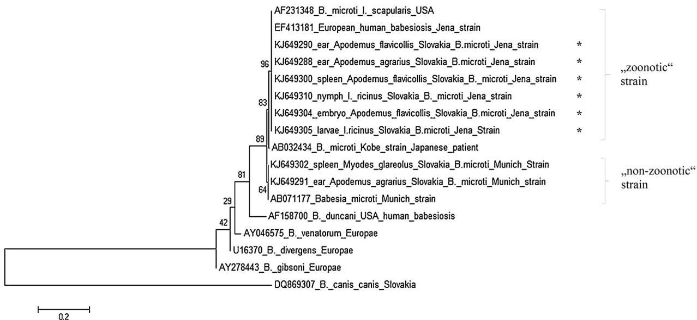

# Presence of Candidatus Neoehrlichia mikurensis and Babesia microti in rodents and two tick species (Ixodes ricinus and Ixodes trianguliceps) in Slovakia

Lucia Blanarovᡠa,∗, Michal Stankoa,b, Dana Miklisováa, Bronislava Víchováa, Ladislav Mosansk ˇ y´ a, Jasna Kraljik a,c, Martin Bona d, Markéta Derdáková b

a Institute of Parasitology SAS, Hlinkova 3, Kosiceˇ 040 01, Slovakia   
b Institute of Zoology SAS, Dúbravská cesta 9, Bratislava 845 06, Slovakia   
c Department of Zoology, Faculty of Natural Sciences, Comenius University, Mlynská dolina B-1, Bratislava 842 15, Slovakia   
d Department of Anatomy, Faculty of Medicine, Pavol Jozef Safárik ˇ University, Kosice, ˇ Slovakia

# a r t i c l e i n f o

Article history:

Received 3 March 2015

Received in revised form 31 October 2015

Accepted 24 November 2015

Available online xxx

Keywords:

Candidatus Neoehrlichia mikurensis

Babesia microti

Ixodes trianguliceps

Ixodes ricinus

Rodents

Slovakia

# a b s t r a c t

Rodents are important reservoir hosts of many tick-borne pathogens. Their importance in the circulation of the emerging bacterial agent, Candidatus Neoehrlichia mikurensis and the intraerythrocytic protozoan parasite, Babesia microti has been recently proposed. The aim of the present study was to identify the presence and genetic diversity of Candidatus N. mikurensis and B. microti circulating in the natural foci among rodents and two species of ixodid ticks (Ixodes ricinus and Ixodes trianguliceps). In 2011–2013, rodents were captured at sampling sites in Eastern Slovakia. A total of 997 rodents (324 Apodemus agrarius, 350 Apodemus flavicollis, 271 Myodes glareolus, and 52 other rodent species), 788 feeding ticks from rodents, and 1375 questing ticks were investigated for the presence of pathogens by molecular methods followed by DNA sequencing. Candidatus N. mikurensis was detected in $2 . 4 \%$ of questing I. ricinus nymphs and $2 . 6 \%$ of questing adult I. ricinus ticks, spleens of rodents $( 1 . 6 \% )$ , as well as in feeding larval I. ricinus $( 0 . 3 \% )$ and feeding larval I. trianguliceps ticks $( 3 . 3 \% )$ . The 16S rRNA and gltA gene sequences of Candidatus N. mikurensis obtained in this study confirmed a high degree of genetic identity of this bacterium in Europe. DNA of B. microti was found in ear $( 0 . 6 \% )$ and spleen biopsies of rodents $( 1 . 9 \% )$ , in rodent foetus $( 3 . 8 \% )$ and feeding larval $( 5 . 2 \% )$ and nymphal (8.7%) I. ricinus, in questing nymphal I. ricinus $( 0 . 5 \% )$ and questing adult I. ricinus ticks $( 0 . 3 \% )$ . None of the 112 I. trianguliceps ticks were infected. B. microti was represented by two different genotypes: $9 2 \%$ of the positive samples belonged to the zoonotic type strain from Jena (Germany). The results of this study underline the importance of rodents in the circulation of both emerging pathogens in natural foci.

$^ { © }$ 2015 Elsevier GmbH. All rights reserved.

# Introduction

In Europe, Candidatus N. mikurensis represents a newly emerging tick-borne zoonotic bacterium from the family Anaplasmataceae (Kawahara et al., 2004). It is an obligate intracellular Gram-negative organism, transmitted by Ixodes ticks in temperate regions of the Northern hemisphere (Schouls et al., 1999;

Vichova et al., 2014; Derdakova et al., 2014). Recently, Burri et al. (2014) confirmed the reservoir competence of rodents for this bacterium in xenodiagnostic experiments. Moreover, it was detected in the blood and endothelial cells of rodent spleens and livers proving systemic infection (Jahfari et al., 2012; Burri et al., 2014). Candidatus N. mikurensis could not be cultivated in vitro so far, therefore, the status “Candidatus” is still preserved. Since 2007 in Europe, only eight human cases of disease were reported, mainly from immunocompromised patients (Welc-Faleciak et al., 2014).

Babesia spp. represent widespread protozoan hemoparasites from the family Babesiidae. Ixodes ricinus plays an important role in the transmission of several protozoan species of the genus Babesia. Babesia divergens, Babesia venatorum, and Babesia microti occur in Europe and are proven aetiological agents of human

babesiosis (Meer-Scherrer et al., 2004; Hildebrandt et al., 2007; Gray et al., 2010; Holler et al., 2013). Usually, the course of babesiosis caused by B. microti is asymptomatic or mild, but it may occur as a severe infection in splenectomized patients. Circulation of B. microti in European natural foci is primarily associated with small rodents. Microtine rodents and probably shrews are the most important reservoir hosts (Bown et al., 2008; Silaghi et al., 2012; Nefedova et al., 2013). Phylogenetic analyses confirmed that B. microti is a complex species, consisting of genetically diverse isolates that form different clades based on the analysed genes (Goethert and Telford, 2003; Nakajima et al., 2009). Within these clades, rodent isolates are subdivided into the zoonotic“Jena” type (GenBank accession number EF413181) (Hildebrandt et al., 2007) and the non-zoonotic “Munich” type (GenBank accession number AB071177) strains (reviewed in Gray et al., 2010). Different B. microti strains may circulate in a given natural focus in different rodent species at the same time. There are assumptions that in the circulation of human pathogenic ecotypes, the yellow-necked mouse (Apodemus flavicollis), which is very frequent in natural foci of Slovakia, might be predominantly involved (Stanko, 1989, 1995).

The main aims of our study were to monitor the infection prevalence and genetic diversity of Candidatus N. mikurensis and B. microti in order to elucidate their ecological associations with rodents, questing I. ricinus, and feeding ticks (I. ricinus and Ixodes trianguliceps) collected from rodents at four selected sites of Slovakia.

# Materials and methods

Study area

The study was conducted at four sampling sites in Eastern Slovakia (Cermel’,ˇ Hyl’ov,´ Botanical garden Kosice,ˇ and Rozhanovce). Two sites, Cermel’ˇ $( 2 0 8 - 6 0 0 \mathrm { m }$ above sea level (asl); $4 8 ^ { \circ } 4 5 ^ { \prime } 4 6 . 6 7 ^ { \prime \prime } \mathrm { N }$ ; $2 1 ^ { \circ } 8 ^ { \prime } 8 . 1 7 ^ { \prime \prime } \mathrm { E } _ { . } ^ { \prime }$ and Hyl’ov´ $5 0 0 { - } 7 5 0 \mathrm { m }$ asl; $4 8 ^ { \circ } 4 4 ^ { \prime } 2 2 . 8 0 ^ { \prime \prime } \mathrm { N }$ ; $2 1 ^ { \circ } 4 ^ { \prime } 1 8 . 9 0 ^ { \prime \prime } \mathrm { E }$ ) were characterized by the presence of two ixodid tick species, I. ricinus and I. trianguliceps; whereas the two other sites, Botanical garden Kosiceˇ $^ { 2 0 8 \mathrm { m } }$ asl; $4 8 ^ { \circ } 4 4 ^ { \prime } 6 . 8 4 ^ { \prime \prime } \mathrm { N }$ ; $2 1 ^ { \circ } 1 4 ^ { \prime } 1 6 . 1 4 ^ { \prime \prime } \mathrm { E } )$ and Rozhanovce $2 1 5 \mathrm { m }$ asl; $4 8 ^ { \circ } 4 5 ^ { \prime } 0 0 ^ { \prime \prime } \mathrm { N }$ ; $2 1 ^ { \circ } 2 1 ^ { \prime } 0 0 ^ { \prime \prime } \mathrm { E }$ ), were characterized by the exclusive presence of I. ricinus and absence of I. trianguliceps ticks. For the landscape in Cermel’,ˇ the presence of sylvatic deciduous forest is typical, and Hyl’ov ´ is characterized by sylvatic mixed forest. The locality Botanical garden is a typical suburban mixed forest. Rozhanovce is a game reserve in a deciduous forest with the presence of mouflon (Ovis musimon) and fallow deer (Dama dama) herds (Blanarovᡠet al., 2014).

# Sample collection

Questing I. ricinus nymphs and adults were collected twice a year (June and September) during two consecutive years 2011–2012 at four selected sites in Eastern Slovakia. Ticks were collected at each study site by flagging with a $1 { - } \mathbf { m } ^ { 2 }$ white corduroy cloth for one hour to cover various types of forest/shrubland and edge vegetation. Immediately after the collection, ticks were identified to species and sex according to morphological key (Filippova, 1977; Estrada-Penaˇ et al., 2004) and preserved in $7 0 \%$ ethanol until the DNA was extracted.

Trapping of rodents and removal of rodent-fed ticks were performed during 2011–2013 at four sampling sites in Eastern Slovakia. Rodents were trapped alive using Swedish bridge metal traps following the protocol of Stanko (1995). Rodent trappings were carried out using 100–150 live-traps/per site for two

consecutive nights. Small mammals, rodents and insectivores, were euthanized in a humane manner in accordance with the laws of the Slovak Republic under the licenses of the Ministry of Environment of the Slovak Republic No. 297/108/06-3.1 and No. 6743/2008-2.1. Rodent-fed ticks were removed with sterile forceps, counted, and identified to life stage and species using previously published taxonomic keys (Filippova, 1977; Estrada-Penaˇ et al., 2004) and preserved in $7 0 \%$ ethanol until DNA extraction. A maximum of 20 feeding and visibly engorged I. ricinus ticks per captured rodent and all feeding I. trianguliceps ticks were analysed. Moreover, spleen and ear biopsies were obtained from each rodent and rodent foetuses from gravid females during necroscopy were stored at $- 2 0 ^ { \circ } \mathsf C$ prior to use. Age of rodent foetuses was estimated using the study of Pelikán (1966), assuming the pregnancy of A. flavicollis and Apodemus agrarius takes approximately 23–24 days.

# DNA extraction

Questing ticks and ticks removed from rodents were further analysed by DNA based methods. Genomic DNA was isolated from individual ticks by alcaline-hydrolysis according to Guy and Stanek (1991). DNA from rodent tissues was extracted using a commercial DNA extraction kit (NucleoSpin Blood kit, NucleoSpin Tissue kit, Machery Nagel, Germany) according to the manufacturer’s protocol. Lysates were stored at $- 2 0 ^ { \circ } C$ .

# Molecular detection of pathogens

Polymerase chain reaction (PCR) amplification of the tick mitochondrial cytochrome b gene and 12S rRNA gene of vertebrates was performed for each sample as a quality control for extracted tick and tissue DNA, respectively (Black and Roehrdanz, 1998; Derdakova et al., 2003; Humair et al., 2007).

Only positive samples were further screened for the presence of Candidatus N. mikurensis by real-time PCR using the primers NMGroELF, NMGroELR and the NMikGroEL-P2a TaqMan-Probe labelled with Texas Red, which targeted a 99-bp long fragment of the groEL gene (Jahfari et al., 2012). This assay was run on a CFX96 Real-Time PCR System (Bio-Rad, Hercules, CA, USA). To further characterize Candidatus N. mikurensis-positive samples, two molecular loci, 16S rRNA and gltA were amplified and sequenced. Single PCRs were performed to amplify a 560-bp fragment of the 16S rRNA gene using the primers IS58-594r and IS58-62f as previously described (Kawahara et al., 2004) and a 233-bp fragment of the gltA gene with the primers NMikfogltA, NMikregltA (Jahfari et al., 2012).

For the molecular detection of Babesia spp., PCR amplification of a 450-bp fragment of the small 18S subunit of ribosomal RNA with primers BJ1 and BN2 was performed (Casati et al., 2006).

The PCR reactions were performed in a total volume of $2 5 \mu \mathrm { l }$ of reaction mixture with 12.5 -l 1 Mix, 2.6 -l 2.5 mM $\mathsf { M g C l } _ { 2 }$ , $2 . 3 \mu \mathrm { l }$ $9 2 0 \mathrm { n M }$ of each primers, and $0 . 3 \mu \mathrm { l } 0 . 1 2 \mathrm { n M }$ of probe using $5 \mu \mathrm { l }$ as DNA template. Kit Bioron SuperHot Master Mix (Bioron, Germany) was used for real-time PCR and kit HotStarTaq Plus DNA Polymerase (Qiagen) for PCR analyses. In each PCR, previously sequenced DNA samples of Candidatus N. mikurensis and/or B. microti were used as positive controls. Nuclease-free water was added in PCR mix instead of tested DNA as negative control. The PCR products were visualized by electrophoresis on $2 \%$ agarose gels stained with Gold-View Nucleic Acid Stain (Beijing SBS Genetech, Beijing, China). All positive PCR products were purified by QIAquick PCR purification kit (Qiagen) and bidirectionally Sanger-sequenced with the same primers as for the PCR amplifications.

# Sequence analysis

Nucleotide sequences were manually edited in MEGA 5 (Tamura et al., 2011) and compared with GenBank entries by BLAST (Altschul et al., 1997).

The nucleotide sequence data reported in this paper are available in GenBank database under the following accession numbers: Candidatus N. mikurensis 16S rRNA (KJ649314–KJ649316, KJ649323), Candidatus N. mikurensis gltA (KJ649317–KJ322) and B. microti 18S rRNA (KJ649287–KJ649312).

# Statistical analysis

A $9 5 \%$ confidence intervals (CI) and differences in Candidatus N. mikurensis and B. microti infection prevalences among sites were tested by Fisher’s exact test and calculated by the Quantitative Parasitology on the Web (Reiczigel et al., 2005) [http://www.univet.hu/ qpweb/qp10/index.php].

# Results

# Candidatus N. mikurensis in rodents

Candidatus N. mikurensis was not detected in any of 790 tested ear biopsies of rodents, but it was confirmed in ten out of 621 tested spleens $( 1 . 6 \% )$ . Five positive spleen biopsies were obtained from rodents trapped in Cermel’ ˇ (5/193, $2 . 6 \%$ ; CI: 0.84–5.95), and five spleens were found at the sampling site Hyl’ov ´ (5/81, $6 . 2 \%$ ; CI: 2.03–13.83) (Table 1). Candidatus N. mikurensis was detected in the spleens of A. flavicollis (6/350; $1 . 7 \%$ ; CI: 0.63–3.7), in Myodes glareolus (3/271; $1 . 1 \%$ ; CI: 0.22–3.21), and A. agrarius (1/324; $0 . 3 \%$ ; CI: 0.00–1.71) (Table 2).

These three rodent species were also the most commonly trapped rodents during our study. Positive samples from rodents came only from two control sites, Cermel’ˇ and Hyl’ov,´ where I. trianguliceps and I. ricinus ticks co-occur. We found no significant differences between the rates of infection in spleen samples among the four sites $F$ -value 0.167, $p { > } 0 . 0 5$ ).

Moreover, Candidatus N. mikurensis was detected in a foetus of a negative pregnant A. flavicollis female (overall prevalence: $1 . 9 \%$ ; 1/53) (Table 1).

# Candidatus N. mikurensis in rodent-fed ticks

A total of 788 feeding ticks (112 I. trianguliceps and 676 I. ricinus) were tested. Three larval I. trianguliceps (3/112; 2.7%) and two larval I. ricinus (2/676; $0 . 3 \%$ ) ticks were positive for the presence of Candidatus N. mikurensis with an overall prevalence of $0 . 6 \%$ (Table 1). Positive/infected feeding I. trianguliceps larvae (3/54; $5 . 6 \%$ , CI: 1.16–15.39) were collected from M. glareolus and A. agrarius from the site Cermel’, ˇ and positive I. ricinus larvae (2/348; $0 . 6 \%$ , CI: 0.06–2.07) from A. agrarius from Botanical garden in Kosice ˇ (Tables 2 and 3). We found no significant difference in Candidatus N. mikurensis prevalence in rodent-fed ticks among the four study sites (F-value 0.051, $p { > } 0 . 0 5$ ). In two I. ricinus larvae a co-infection of Candidatus N. mikurensis and B. microti was detected.

# Candidatus N. mikurensis in questing I. ricinus ticks

In total, 1375 I. ricinus ticks from vegetation were tested for the presence of Candidatus N. mikurensis by real-time PCR targeting the groEL gene resulting in an overall Candidatus N. mikurensis infection prevalence of $2 . 5 \%$ (34/1375; CI: 1.71–3.44). Candidatus N. mikurensis was detected in $2 . 4 \%$ of questing nymphal I. ricinus and $2 . 6 \%$ of questing adult I. ricinus ticks. We found no significant

able 1   
Number of positive and tested questing, feeding ticks and rodent biopsies (ear, spleen, foetus) positive for Candidatus N. mikurensis by PCR, and prevalences of infection (%).   

<table><tr><td rowspan="2">Site</td><td colspan="2">questing ticks</td><td colspan="5">Feeding ticks</td><td colspan="3">Biopsies</td></tr><tr><td>No. of positive nymphal IR/n (prevalence in %)</td><td>No. of positive adult IR/n (prevalence in %)</td><td>No. of positive larval IR ticks/no. of larval IR ticks; prevalence (%)</td><td>No. of positive nymphal IR ticks/no. of nymphal IR ticks; prevalence (%)</td><td>No. of positive larval IT ticks/no. of larval IT ticks; prevalence (%)</td><td>No. of positive nymphal IT ticks/no. of nymphal IT ticks; prevalence (%)</td><td>No. of positive female IT ticks/no. of female IT ticks; prevalence (%)</td><td>No. of positive ear/no. of ear; prevalence (%)</td><td>No. of positive spleen/no. of spleen; prevalence (%)</td><td>No. of positive rodent foetus/no. of foetus; prevalence (%)</td></tr><tr><td>Čermel&#x27;</td><td>1/123 (0.8)</td><td>0/96</td><td>0/25</td><td>0/1</td><td>3/54 (5.6)</td><td>0/6</td><td>0/3</td><td>0/173</td><td>5/193 (2.6)</td><td>1/34 (2.9)</td></tr><tr><td>Hýl&#x27;ov</td><td>5/188 (2.7)</td><td>6/78 (7.7)</td><td>0/104</td><td>0/4</td><td>0/33</td><td>0/6</td><td>0/3</td><td>0/85</td><td>5/81 (6.2)</td><td>0</td></tr><tr><td>B. garden Košice Košice</td><td>2/137 (1.5)</td><td>1/39 (2.6)</td><td>2/348 (0.6)</td><td>0/27</td><td>0</td><td>0</td><td>0</td><td>0/45</td><td>0/33</td><td>0/8</td></tr><tr><td>Rozhanovce</td><td>17/583 (2.9)</td><td>2/131 (1.5)</td><td>0/153</td><td>0/14</td><td>0/4</td><td>0/3</td><td>0</td><td>0/487</td><td>0/314</td><td></td></tr><tr><td>Total</td><td>25/1031 (2.4)</td><td>9/344 (2.6)</td><td>2/630 (0.3)</td><td>0/46</td><td>3/91 (3.3)</td><td>0/15</td><td>0/6</td><td>0/790</td><td>10/621 (1.6)</td><td>1/53 (1.9)</td></tr></table>

IR—I. ricinus, IT—I. trianguliceps.

Table 2 Number of rodents positive for Candidatus N. mikurensis by PCR and number of trapped rodents used for molecular analysis at selected sites in 2011–2013.   

<table><tr><td rowspan="2">Species of rodents</td><td colspan="5">No. of positive rodents/no. of total trapped rodents/prevalence (%)</td></tr><tr><td>Čermel&#x27;</td><td>Hýl&#x27;ov</td><td>B. garden Košice</td><td>Rozhanovce</td><td>Total</td></tr><tr><td>Apodemus agrarius</td><td>0/31</td><td>1/8 (12.5)</td><td>0/54</td><td>0/231</td><td>1/324 (0.3)</td></tr><tr><td>Apodemus flavicollis</td><td>2/88 (2.3)</td><td>4/55 (7.3)</td><td>0/26</td><td>0/181</td><td>6/350 (1.7)</td></tr><tr><td>Myodes glareolus</td><td>3/127 (2.4)</td><td>0/39</td><td>0</td><td>0/105</td><td>3/271 (1.1)</td></tr><tr><td>Crocidura suaveolens</td><td>0</td><td>0</td><td>0</td><td>0/2</td><td>0/2</td></tr><tr><td>Micromys minutus</td><td>0</td><td>0</td><td>0/1</td><td>0</td><td>0/1</td></tr><tr><td>Microtus arvalis</td><td>0/1</td><td>0</td><td>0</td><td>0/10</td><td>0/11</td></tr><tr><td>Microtus subterraneus</td><td>0/1</td><td>0/3</td><td>0/1</td><td>0/2</td><td>0/7</td></tr><tr><td>Neomys fodiens</td><td>0/2</td><td>0</td><td>0</td><td>0</td><td>0/2</td></tr><tr><td>Rattus norvegicus</td><td>0</td><td>0</td><td>0</td><td>0/10</td><td>0/10</td></tr><tr><td>Sorex araneus</td><td>0/8</td><td>0/3</td><td>0/1</td><td>0/4</td><td>0/16</td></tr><tr><td>Sorex minutus</td><td>0/1</td><td>0</td><td>0</td><td>0/2</td><td>0/3</td></tr><tr><td>Total</td><td>5/259 (1,9)</td><td>5/108 (4.6)</td><td>0/83</td><td>0/547</td><td>10/997 (1.0)</td></tr></table>

differences between the infection rates from different sites (F-value 0.052, $p { > } 0 . 0 5$ ) (Table 1).

Sequence analysis: 16S rRNA and gltA gene sequences of Candidatus N. mikurensis

In samples which tested positive for Candidatus N. mikurensis groEL gene, we further amplified and sequenced two other genetic loci, 16S rRNA and gltA. Four Candidatus N. mikurensis 16S rRNA (KJ649314–KJ649316, KJ649323) and six Candidatus N. mikurensis gltA (KJ649317–KJ322) sequences were deposited in GenBank database (Table 3).

The obtained Candidatus N. mikurensis 16S rRNA sequences from rodent spleen biopsies, from feeding ticks removed from rodents, and from I. ricinus ticks from vegetation showed $1 0 0 \%$ identity with the various Candidatus N. mikurensis isolates deposited in GenBank, e.g. an isolate from an I. persulcatus tick from Russia (FJ966360), nucleotide sequences from rodents from China (JQ359052) and Japan (AB196305), that were also identical with a human isolate from China (JQ359045).

The nucleotide sequences of Candidatus N. mikurensis gltA gene from rodent spleen biopsies, from ticks feeding on rodents and from I. ricinus ticks from vegetation showed $1 0 0 \%$ homology with the Candidatus N. mikurensis isolate taken from an I. ricinus tick from Italy (AY098729).

# B. microti in rodents

B. microti was detected in five out of 784 tested ear biopsies $\left( 0 . 6 \% \right)$ and in twelve out of 625 tested spleens $( 1 . 9 \% )$ of rodents (Table 4). One positive spleen (1/190, $0 . 5 \%$ ; CI: 0.01–2.90) and one positive ear (1/161, $0 . 6 \%$ ; CI: 0.01–3.42) came from rodents trapped in Cermel’, ˇ one positive ear sample was obtained in Hyl’ov ´ (1/89,

Table 3 Accession numbers (GenBank database) of Candidatus N. mikurensis sequences for the 16S rRNA and gltA genes generated in this study.   

<table><tr><td>Host, vector</td><td>Sequences of 16S rRNA gene</td><td>Sequences of gltA gene</td></tr><tr><td>Rodent foetus from A. flavicollis</td><td>KJ649314</td><td>a</td></tr><tr><td>Feeding I. ricinus larva, A. agrarius</td><td>a</td><td>KJ649321</td></tr><tr><td>Feeding I. ricinus larva, A. agrarius</td><td>a</td><td>KJ649322</td></tr><tr><td>Feeding I. trianguliceps larva, A. agrarius</td><td>KJ649315</td><td>a</td></tr><tr><td>questing I. ricinus male</td><td>KJ649316</td><td>KJ649319</td></tr><tr><td>questing I. ricinus nymps</td><td>a</td><td>KJ649320</td></tr><tr><td>Spleen of A. agrarius</td><td>a</td><td>KJ649317</td></tr><tr><td>Spleen of A. flavicollis</td><td>KJ649323</td><td>KJ649318</td></tr></table>

a Were not sequenced.

$1 . 1 \%$ ; CI: 0.02–6.11), two positive spleens (2/44, $5 \%$ ; CI: 0.55–15.48) and eight ear samples (8/37, $2 2 \%$ ; CI: 9.82–38.22) originated from Botanical garden, and three spleens $3 / 3 2 0 , 0 . 9 \%$ ; CI: 0.19–2.72) and one ear sample $1 / 4 9 0 , 0 . 2 \%$ ; CI: 0.00–1.14) came from Rozhanovce (Table 4). Overall, the pathogen was detected in twelve biopsies from A. agrarius (12/324; $3 . 7 \%$ ; CI: 1.92–6.39), in four biopsies from A. flavicollis (4/350; $1 . 1 \%$ ; CI: 0.31–2.91), and in three biopsies from M. glareolus (3/271; $1 . 1 \%$ ; CI: 0.22–3.21) (Table 5). These three rodent species were also the most commonly trapped rodents during the study. We found significant differences between the infection rates in ear biopsies (F-value 0.016, $p { < } 0 . 0 5$ ) and spleens (F-value $p { < } 0 . 0 0 1$ ) from different sites.

B. microti was also detected in two rodent foetuses from the site Botanical garden with an overall prevalence of $4 \%$ (2/53). One positive foetus (6.0 mm, 12 days old) was detected in uninfected A. flavicollis female. Second positive foetus $1 5 . 0 \mathrm { m m }$ , 17 days old) was detected in one out of four infected A. agrarius female (Table 4).

# B. microti in rodent-feeding ticks

A total of 788 feeding ticks were tested, and 37 I. ricinus ticks $( 5 . 5 \% )$ tested positive for B. microti (Table 4). B. microti-positive I. ricinus ticks (32 larvae and 3 nymphs) were collected from A. agrarius and one larva and nymph were removed from A. flavicollis from the site Botanical garden in Kosiceˇ (Tables 5 and 6).

# B. microti in questing I. ricinus ticks

Altogether 1368 questing I. ricinus ticks were tested for the presence of B. microti by PCR targeting the 18S rRNA gene resulting in an overall B. microti infection prevalence of $0 . 4 \%$ (6/1368; CI: 0.16–0.96). DNA of B. microti was found in questing nymphal I. ricinus $( 0 . 5 \% )$ and questing adult I. ricinus ticks $( 0 . 3 \% )$ . The statistical analysis revealed significant differences among the tick infection rates from different sites (F-value 0.036, $p { < } 0 . 0 5$ ).

# Sequence analysis: 18S rRNA gene sequences of Babesia spp.

All Babesia-positive PCR products were further sequenced and identified as B. microti. In total, 26 obtained 18S rRNA sequences were deposited in GenBank database (KJ649287–KJ649312). A BLAST analysis confirmed the genotype of the “zoonotic strain” (GenBank accession number EF413181) in 24 B. microtipositive samples $9 2 \%$ ; KJ649287–KJ649290, KJ649292–KJ649301, KJ649303–KJ649312) and the “non-zoonotic” strain (GenBank accession number AB071177) in two B. microti isolates $8 \%$ ; KJ649291, KJ649302) (Table 6). The zoonotic strain nucleotide sequences were $1 0 0 \%$ identical with human isolates from Poland

Number of positive and tested questing, feeding ticks and rodent biopsies (ear, spleen, foetus) positive for Babesia microti by PCR, and prevalences of infection (%). Table 4   

<table><tr><td rowspan="2">Site</td><td colspan="2">questing ticks</td><td colspan="5">Feeding ticks</td><td colspan="3">Biopsies</td></tr><tr><td>No. of positive nymphal IR/n (prevalence in %)</td><td>No. of positive adult IR/n (prevalence in %)</td><td>No. of positive larval IR ticks/no. of larval IR ticks; prevalence (%)</td><td>No. of positive nymphal IR ticks/no. of nymphal IR ticks; prevalence (%)</td><td>No. of positive larval IT ticks/no. of larval IT ticks; prevalence (%)</td><td>No. of positive nymphal IT ticks/no. of nymphal IT ticks; prevalence (%)</td><td>No. of positive female IT ticks/no. female IT ticks; prevalence (%)</td><td>No. of positive ear/no. of ear; prevalence (%)</td><td>No. of positive spleen/no. of spleen; prevalence (%)</td><td>No. of positive rodent foetus/no. of foetus; prevalence (%)</td></tr><tr><td>Čermel&#x27;</td><td>0/123</td><td>0/89</td><td>0/25</td><td>0/1</td><td>0/54</td><td>0/6</td><td>0/3</td><td>1/161 (0.6)</td><td>1/190 (0.5)</td><td>0/34 (2.9)</td></tr><tr><td>Hýl&#x27;ov</td><td>3/188 (1.6)</td><td>0/78</td><td>0/104</td><td>0/4</td><td>0/33</td><td>0/6</td><td>0/3</td><td>1/89 (1.1)</td><td>0/78</td><td>0</td></tr><tr><td>B. garden Košice</td><td>1/137 (0.7)</td><td>1/39 (2.6)</td><td>33/348 (9.5)</td><td>4/27 (14.8)</td><td>0</td><td>0</td><td>0</td><td>2/44 (4.6)</td><td>8/37 (21.6)</td><td>2/8 (25.0)</td></tr><tr><td>Rozhanovce</td><td>1/583 (0.2)</td><td>0/131</td><td>0/153</td><td>0/14</td><td>0/4</td><td>0/3</td><td>0</td><td>1/490 (0.2)</td><td>3/320 (0.9)</td><td>0/11</td></tr><tr><td>Total</td><td>5/1031 (0.5)</td><td>1/337 (0.3)</td><td>33/630 (5.2)</td><td>4/46 (8.7)</td><td>0/91</td><td>0/15</td><td>0/6</td><td>5/784 (0.6)</td><td>12/625 (1.9)</td><td>2/53 (3.8)</td></tr></table>

IR—I. ricinus, IT—I. trianguliceps.

(KC470047), Germany (EF413181), or with a sequence from I. ricinus collected in Germany (JX679169). The “non-zoonotic“strain showed $1 0 0 \%$ identity with a rodent isolate from Japan (AB071177) or $9 9 \%$ identity with an I. ricinus tick sequence from Poland (AY789075).

B. microti isolates from Slovakia clustered with genotypes from North America and Europe (Fig. 1).

# Discussion

In the present study, we investigated the prevalence of infection and diversity of Candidatus N. mikurensis and B. microti in rodents, in questing and in feeding ticks (I. ricinus and I. trianguliceps) collected from rodents. We conducted a comparative study in two sites known for the occurrence of I. ricinus only (Botanical garden Kosice, ˇ Rozhanovce) and two sites at a higher altitude (600–750 m asl) (Cermel’ ˇ and Hyl’ov) ´ where both tick species (I. ricinus and I. trianguliceps) occur (Petko et al., 1991). In this study, we did not find significant differences among the infection prevalence of Candidatus N. mikurensis in spleen samples and questing I. ricinus ticks from different sites. In contrast, we found significant differences among the prevalence of B. microti in ear and spleen biopsies and questing I. ricinus ticks from different sites. The highest prevalence of B. microti in rodent biopsies was observed in urban park Botanical garden that might indicate the presence of suitable reservoir hosts in urban areas.

The overall prevalence of Candidatus N. mikurensis infection in rodent spleen biopsies (M. glareolus and Apodemus spp.) in our study was $1 . 6 \%$ . Other authors from Europe reported the rate of infection in different rodent organs (kidney, liver, skin, and brain) varies from $1 . 0 \%$ up to $5 2 . 7 \%$ (Jahfari et al., 2012; Silaghi et al., 2012; Burri et al., 2014). Candidatus N. mikurensis was detected at selected sites where I. trianguliceps ticks were present. None of the 790 rodent ear biopsies tested positive. In eco-epidemiological studies of Silaghi et al. (2012), different animal organs were used as the source of genomic DNA extraction and further detection of Candidatus N. mikurensis DNA. After experimental infection of rats, no infection was observed after 15 days in blood, spleen or liver, a weak infection was detected in the spleen after 30 days, and in all three organs 60 days after initial infection. This is in accordance with our results that that spleen and kidneys are the most appropriate organs for detection of Candidatus N. mikurensis in rodents. As confirmed in present study, skin biopsies are not suitable for molecular identification of Candidatus N. mikurensis.

A recent study conducted by Burri et al. (2014) using xenodiagnosis, found that M. glareolus and A. flavicollis are reservoirs of Candidatus N. mikurensis. Similarly as in our study, the bacterium was most commonly found in the spleens of A. flavicollis $( 6 0 \% )$ , followed by M. glareolus $( 3 0 \% )$ and A. agrarius $( 1 0 \% )$ . Similar results were obtained by Vichova et al. (2014). Insectivores in Germany were found to be negative for the presence of Candidatus N. mikurensis (Silaghi et al., 2012), however urban hedgehogs (E. roumanicus) in Hungary were found to be carriers of Candidatus N. mikurensis. It still remains to be determined whether the hedgehog, a non-rodent species, is a reservoir of Candidatus N. mikurensis. Moreover, we detected Candidatus N. mikurensis in a foetus of A. flavicollis. The pregnant female was in the third week, i.e. in the last week of gravidity. Similar results were reported also by Obiegala et al. (2014).

Candidatus N. mikurensis was detected only in two larvae of I. ricinus fed on rodents $( 0 . 3 \% )$ , not in unfed I. ricinus larvae. In Europe, Candidatus N. mikurensis was detected in partially fed larvae, nymphs and adult I. ricinus ticks in Germany and Switzerland with the prevalence ranging from $2 . 6 \%$ to $6 . 4 \%$ , respectively (Silaghi et al., 2012; Jahfari et al., 2012; Burri et al., 2014). In our study,

Table 5 Number of rodents positive for B. microti by PCR and number of trapped rodents used for molecular analysis at selected sites in 2011–2013.   

<table><tr><td rowspan="2">Species of rodents</td><td colspan="5">No. of positive rodents/no. of total trapped rodents/prevalence (%)</td></tr><tr><td>Čermel&#x27;</td><td>Hýl&#x27;ov</td><td>B. garden Košice</td><td>Rozhanovce</td><td>Total</td></tr><tr><td>Apodemus agrarius</td><td>0/31</td><td>1/8 (12.5)</td><td>11/54 (20.4)</td><td>0/231</td><td>12/324 (3.7)</td></tr><tr><td>Apodemus flavicollis</td><td>0/88</td><td>0/55</td><td>1/26 (3.8)</td><td>3/181 (1.7)</td><td>4/350 (1.1)</td></tr><tr><td>Myodes glareolus</td><td>2/127 (1.6)</td><td>0/39</td><td>0</td><td>1/105 (1.0)</td><td>3/271 (1.1)</td></tr><tr><td>Crocidura suaveolens</td><td>0</td><td>0</td><td>0</td><td>0/2</td><td>0/2</td></tr><tr><td>Micromys minutus</td><td>0</td><td>0</td><td>0/1</td><td>0</td><td>0/1</td></tr><tr><td>Microtus arvalis</td><td>0/1</td><td>0</td><td>0</td><td>0/10</td><td>0/11</td></tr><tr><td>Microtus subterraneus</td><td>0/1</td><td>0/3</td><td>0/1</td><td>0/2</td><td>0/7</td></tr><tr><td>Neomys fodiens</td><td>0/2</td><td>0</td><td>0</td><td>0</td><td>0/2</td></tr><tr><td>Rattus norvegicus</td><td>0</td><td>0</td><td>0</td><td>0/10</td><td>0/10</td></tr><tr><td>Sorex araneus</td><td>0/8</td><td>0/3</td><td>0/1</td><td>0/4</td><td>0/16</td></tr><tr><td>Sorex minutus</td><td>0/1</td><td>0</td><td>0</td><td>0/2</td><td>0/3</td></tr><tr><td>Total</td><td>2/259 (0.8)</td><td>1/108 (0.9)</td><td>12/83 (14.5)</td><td>4/547 (0.7)</td><td>19/997 (1.9)</td></tr></table>

co-feeding I. ricinus and I. trianguliceps ticks were observed on 17 rodents. Sixty-four rodents were infested only with I. trianguliceps ticks, however this does not exclude the possibility of previous infestations with I. ricinus. Interestingly, we detected the presence of Candidatus N. mikurensis DNA in three out of 112 feeding larval I. trianguliceps (prevalence of $2 . 7 \%$ ). This is the first detection of Candidatus N. mikurensis in partially feeding larval I. trianguliceps in Europe.

The overall prevalence of Candidatus N. mikurensis in questing I. ricinus nymphs and adults recorded in our study was $2 . 5 \%$ which is within the range $1 - 2 6 . 6 \%$ reported by other authors across Europe (Spitalska et al., 2008; Rar and Golovljova, 2011; Jahfari et al., 2012; Silaghi et al., 2012). The presence of Candidatus N. mikurensis was detected at all sampling sites involved in this study.

Genetic variability of Candidatus N. mikurensis isolates from questing ticks, from feeding ticks and rodents was studied by DNA amplification and sequencing of two variable gene loci (16S rRNA, gltA). In this study, we did not observe any intraspecific variability. Our nucleotide sequences were identical with Candidatus N. mikurensis isolates from questing ticks, rodents, and from human patients from Europe and Asia (Brouqui et al., 2003; Rar et al., 2010; Jahfari et al., 2012; Silaghi et al., 2012).

B. microti was detected in A. agrarius $( 3 . 7 \% )$ , A. flavicollis $( 1 . 1 \% )$ and M. glareolus $( 1 . 1 \% )$ with an overall prevalence of $1 . 9 \%$ . Our results are similar to the results from other European countries

with prevalences varying from $1 \%$ up to $4 5 . 2 \%$ in rodents (Duh et al., 2003; Sinski et al., 2006; Hartelt et al., 2008; Bown et al., 2008; Nefedova et al., 2013). B. microti was detected in ear biopsies of rodents at all sampling sites $\left( 0 . 6 \% \right)$ and in rodent spleens at three sites except Hyl’ov´ $( 1 . 9 \% )$ . Silaghi et al. (2012) reported the presence of B. microti in one case, only in the liver of A. agrarius (1/90).

In the present study, we identified B. microti in two foetuses of A. agrarius and A. flavicollis females, and in the spleen sample of A. agrarius female. These females were in the second and in the third week of gravidity, respectively.

B. microti was also found in I. ricinus larvae $( 5 . 2 \% )$ and nymphs $( 8 . 7 \% )$ fed on rodents with an overall prevalence of $4 . 7 \%$ . Surprisingly, in our study none of 112 tested feeding I. trianguliceps ticks was B. microti-positive, while Nefedova et al. (2013) observed a high prevalence of this pathogen in this tick species. B. microti reported in I. ricinus ticks from Europe was associated with human disease (Hildebrandt et al., 2007), whereas the strain circulating in British rodents has been previously demonstrated to be transmitted only by I. trianguliceps thus, this is also of questionable zoonotic or veterinary importance. Similarly, in two rodent-fed I. ricinus larvae we observed a coinfection of B. microti with Candidatus N. mikurensis.

In Europe, infection rates of B. microti in questing ticks are rather low, ranging from $0 . 9 \%$ up to $5 . 4 \%$ (Rudolf et al., 2005; Sreter et al., 2005; Wojcik-Fatla et al., 2006; Reye et al., 2010, 2013). In our study, babesiae were present in questing I. ricinus nymphs and adult ticks

  
Fig. 1. The distance tree inferred by Neighbor-Joining analysis using the Kimura 2-parameter model of 445 bp long 18S rRNA gene sequences of B. microti isolates, Babesia duncani, Babesia venatorum, Babesia divergens, Babesia gibsoni and Babesia canis canis (outgroup). The numbers at the nodes are bootstrap values expressed as percentages of 1000 bootstrap replicates; the bar (0.2) represents the number of mutations per site. Samples of this study are indicated in mark *.

Table 6 Accession numbers (GenBank database) of B. microti and Hepatozoon spp. sequences of the 18S rRNA gene generated in this study.   

<table><tr><td>Host, vector</td><td>Sequences of 18S rRNA gene (Babesia species)</td><td>Sequences of 18S rRNA (Hepatozoon species)</td></tr><tr><td>questing I. ricinus nymph</td><td>KJ649287</td><td>a</td></tr><tr><td>Ear biopsy from A. agrarius</td><td>KJ649288</td><td>a</td></tr><tr><td>Ear biopsy from A. agrarius</td><td>KJ649289</td><td>a</td></tr><tr><td>Ear biopsy from A. flavicollis</td><td>KJ649290</td><td>a</td></tr><tr><td>Ear biopsy from A. agrarius</td><td>KJ649291</td><td>a</td></tr><tr><td>Spleen from A. agrarius</td><td>KJ649292</td><td>a</td></tr><tr><td>Spleen from A. agrarius</td><td>KJ649293</td><td>a</td></tr><tr><td>Spleen from A. agrarius</td><td>KJ649294</td><td>a</td></tr><tr><td>Spleen from A. agrarius</td><td>KJ649295</td><td>a</td></tr><tr><td>Spleen from M. glareolus</td><td>KJ649296</td><td>a</td></tr><tr><td>Spleen from A. flavicollis</td><td>KJ649297</td><td>a</td></tr><tr><td>Spleen from A. agrarius</td><td>KJ649298</td><td>a</td></tr><tr><td>Spleen from A. flavicollis</td><td>KJ649299</td><td>a</td></tr><tr><td>Spleen from A. flavicollis</td><td>KJ649300</td><td>a</td></tr><tr><td>Spleen from A. agrarius</td><td>KJ649301</td><td>a</td></tr><tr><td>Spleen from M. glareolus</td><td>KJ649302</td><td>a</td></tr><tr><td>Ear biopsy from A. flavicollis</td><td>KJ649303</td><td>a</td></tr><tr><td>Ear biopsy from A. agrarius</td><td>KJ649304</td><td>a</td></tr><tr><td>Feeding I. ricinus larva, A. agrarius</td><td>KJ649305</td><td>a</td></tr><tr><td>Feeding I. ricinus larva, A. agrarius</td><td>KJ649306</td><td>a</td></tr><tr><td>Feeding I. ricinus larva, A. agrarius</td><td>KJ649307</td><td>a</td></tr><tr><td>Feeding I. ricinus larva, A. agrarius</td><td>KJ649308</td><td>a</td></tr><tr><td>Feeding I. ricinus larva, A. agrarius</td><td>KJ649309</td><td>a</td></tr><tr><td>Feeding I. ricinus nymph, A. agrarius</td><td>KJ649310</td><td>a</td></tr><tr><td>Feeding I. ricinus nymph, A. agrarius</td><td>KJ649311</td><td>a</td></tr><tr><td>Feeding I. ricinus larva, A. agrarius</td><td>KJ649312</td><td>a</td></tr></table>

a Were not sequenced.

with a prevalence of $0 . 4 \%$ . The presence of zoonotic strains was confirmed in $9 2 \%$ of the positive samples.

# Conclusion

The results of this study confirmed that in natural foci of Slovakia, rodents are infected with Candidatus N. mikurensis and B. microti and might act as reservoir hosts of both pathogens by infecting the feeding ticks. Both, questing nymphal and adult I. ricinus and feeding larval and nymphal I. ricinus ticks as well as feeding larval I. trianguliceps ticks were found to be infected. To our knowledge, the presence of Candidatus N. mikurensis in the rodent-feeding larval I. trianguliceps was demonstrated for the first time in Europe. Molecular evidence of B. microti in rodent foetuses suggests the possibility of transplacental transmission as an alternative route for the spread of infection among rodents.

# Conflict of interest statement

The authors declare no conflict of interest.

# Acknowledgments

We thank Monika Onderová and Jana Fricovᡠfor help with tick collections, rodent trapping and examination and DNA isolation. We thank Olaf Kahl for critical reading of the manuscript and Slavka Barláková for the English proofreading of the manuscript. The study was supported by the projects VEGA 2/0113/12, VEGA 2/0059/15, VEGA 2/0060/14 and 7RP EDENext391. This contribution is partially the result of the project implementation: Environmental protection against parasitozoonoses under the influence of global climate and social changes (code ITMS: 26220220116), supported by the Research & Development Operational Programme funded by the ERDF (0.2) and by a project “Development of diagnostic methods for the detection of tick-borne pathogens and techniques for the preparation of vaccine development” (code ITMS: 26240220044),

supported by the Research & Development Operational Programme funded by the ERDF (0.2).

# References

Altschul, S.F., Madden, T.L., Schaffer, A.A., Zhang, J.H., Zhang, Z., Miller, W., Lipman, D.J., 1997. Gapped BLAST and PSI-BLAST: a new generation of protein database search programs. Nucleic Acids Res. 25, 3389–3402.   
Black, W.C., Roehrdanz, R.L., 1998. Mitochondrial gene order is not conserved in arthropods: prostriate and metastriate tick mitochondrial genomes. Mol. Biol. Evol. 15, 1772–1785.   
Blanarová, ˇ L., Stanko, M., Carpi, G., Miklisová, D., Víchová, B., Mosansk ˇ y, ´ L., Bona, M., Derdáková, M., 2014. Distinct Anaplasma phagocytophilum genotypes associated with Ixodes trianguliceps ticks and rodents in Central Europe. Ticks Tick Borne Dis. 5, 928–938.   
Bown, K.J., Lambin, X., Telford, G.R., Ogden, N.H., Telfer, S., Woldehiwet, Z., Birtles, R.J., 2008. Relative importance of Ixodes ricinus and Ixodes trianguliceps as vectors for Anaplasma phagocytophilum and Babesia microti in field vole (Microtus agrestis) populations. Appl. Environ. Microbiol. 74, 7118– 7125.   
Brouqui, P., Sanogo, Y.O., Caruso, G., Merola, F., Raoult, D., 2003. Candidatus Ehrlichia walkerii: a new Ehrlichia detected in Ixodes ricinus ticks collected from asymptomatic humans in Northern Italy. Ann. N.Y. Acad. Sci. 990, 134–140.   
Burri, C., Schumann, O., Schumann, C., Gern, L., 2014. Are Apodemus spp. mice and Myodes glareolus reservoirs for Borrelia miyamotoi, Candidatus Neoehrlichia mikurensis, Rickettsia helvetica R. monacensis and Anaplasma phagocytophilum? Ticks Tick Borne Dis. 5, 245–251.   
Casati, S., Sager, H., Gern, L., Piffaretti, J.C., 2006. Presence of potentially pathogenic Babesia sp. for human in Ixodes ricinus in Switzerland. Ann. Agric. Environ. Med. 13, 65–70.   
Derdakova, M., Beati, L., Pet’ko, B., Stanko, M., Fish, D., 2003. Genetic variability within Borrelia burgdorferi sensu lato genospecies established by PCR-single-strand conformation polymorphism analysis of the rrfA–rrlB intergenic spacer in Ixodes ricinus ticks from the Czech Republic. Appl. Environ. Microbiol. 69, 509–516.   
Derdakova, M., Vaclav, R., Pangracova-Blanarova, L., Selyemova, D., Koci, J., Walder, G., Spitalska, E., 2014. Candidatus Neoehrlichia mikurensis and its co-circulation with Anaplasma phagocytophilum in Ixodes ricinus ticks across ecologically different habitats of Central Europe. Parasites Vectors 7, 160.   
Duh, D., Petrovec, M., Trilar, T., Avsic-Zupanc, T., 2003. The molecular evidence of Babesia microti infection in small mammals collected in Slovenia. Parasitology 126, 113–117.   
Estrada-Pena,ˇ A., Bouattour, A., Camicas, J.L., Walker, A.R., 2004. Ticks of Domestic Animals in the Mediterranean Region. A Guide to Identification of Species., ISBN 84-96214-18-4, pp. 50–110.   
Filippova, N.A., 1977. Ixodid Ticks of the Subfamily Ixodinae. Fauna SSSR New Ser.   
Goethert, H.K., Telford, S.R., 2003. What is Babesia microti? Parasitology 127, 301–309.   
Gray, J., Zintl, A., Hildebrandt, A., Hunfeld, K.-P., Weiss, L., 2010. Zoonotic babesiosis: overview of the disease and novel aspects of pathogen identity. Ticks Tick Borne Dis. 1, 3–10.   
Guy, E.C., Stanek, G., 1991. Detection of Borrelia burgdorferi in patients with Lyme disease by the polymerase chain reaction. J. Clin. Pathol. 44, 610–621.   
Hartelt, K., Pluta, S., Oehme, R., Kimmig, P., 2008. Spread of ticks and tick-borne diseases in Germany due to global warming. Parasitol. Res. 103 (Suppl 1), S109–S116.   
Hildebrandt, A., Hunfeld, K.-P., Baier, M., Krumbholz, A., Sachse, S., Lorenzen, T., Kiehntopf, M., Fricke, H.J., Straube, E., 2007. First confirmed autochthonous case of human Babesia microti infection in Europe. Eur. J. Clin. Microbiol. Infect. Dis. 26, 595–601.   
Holler, J.G., Roser, D., Nielsen, H.V., Eickhardt, S., Chen, M., Lester, A., Bang, D., Frandsen, C., David, K.P., 2013. A case of human babesiosis in Denmark. Travel Med. Infect. Dis. 11, 324–328.   
Humair, P.F., Douet, V., Moran Cadenas, F., Schouls, L.M., Van De Pol, I., Gern, L., 2007. Molecular identification of bloodmeal source in Ixodes ricinus ticks using 12S rDNA as a genetic marker. J. Med. Entomol. 44, 869–880.   
Jahfari, S., Fonville, M., Hengeveld, P., Reusken, C., Scholte, E.J., Takken, W., Heyman, P., Medlock, J., Heylen, D., Kleve, J., Sprong, H., 2012. Prevalence of Neoehrlichia mikurensis in ticks and rodents from North-west Europe. Parasites Vectors 5, 74.   
Kawahara, M., Rikihisa, Y., Isogai, E., Takahashi, M., Misumi, H., Suto, C., Shibata, S., Zhang, C., Tsuji, M., 2004. Ultrastructure and phylogenetic analysis of ‘Candidatus Neoehrlichia mikurensis’ in the family Anaplasmataceae, isolated from wild rats and found in Ixodes ovatus ticks. Int. J. Syst. Evol. Microbiol. 54, 1837–1843.   
Meer-Scherrer, L., Adelson, M., Mordechai, E., Lottaz, B., Tilton, R., 2004. Babesia microti infection in Europe. Curr. Microbiol. 48, 435–437.   
Nakajima, R., Tsuji, M., Oda, K., Zamoto-Niikura, A., Wei, Q., Kawabuchi-Kurata, T., Nishida, A., Ishihara, C.H., 2009. Babesia microti-group parasites compared phylogenetically by complete sequencing of the cct gene in 36 isolates. J. Vet. Med. Sci. 71, 55–68.   
Nefedova, V.V., Korenberg, E.I., Kovalevskii, Y.V., Samokhvalov, M.V., Gorelova, N.B., 2013. The role of Ixodes trianguliceps tick larvae in the circulation of Babesia microti in the Middle Urals. Zool. Zh. 91, 1034–1042.

Obiegala, A., Pfeffer, M., Pfister, K., Tiedemann, T., Thiel, C., Balling, A., Karnath, C., Woll, D., Silaghi, C., 2014. Candidatus Neoehrlichia mikurensis and Anaplasma phagocytophilum: prevalences and investigations on a new transmission path in small mammals and ixodid ticks. Parasites Vectors 7, 563.   
Pelikán, J., 1966. Comparison of the birth rates in four Apodemus species. Zool. Listy 15, 125–130.   
Petko, B., Cerny, V., Jurasek, V., 1991. Parasite-host relationships of the tick Ixodes trianguliceps Bir. and coincidence of its ecological niches with those of Ixodes ricinus (L). Mod. Acarol. 1 and 2, B455–B460.   
Rar, V., Golovljova, I., 2011. Anaplasma Ehrlichia, and “Candidatus Neoehrlichia” bacteria: pathogenicity, biodiversity, and molecular genetic characteristics, a review. Infect. Genet. Evol. 11, 1842–1861.   
Rar, V.A., Livanova, N.N., Panov, V.V., Doroschenko, E.K., Pukhovskaya, N.M., Vysochina, N.P., Ivanov, L.I., 2010. Genetic diversity of Anaplasma and Ehrlichia in the Asian part of Russia. Ticks Tick Borne Dis. 1, 57–65.   
Reiczigel, J., Lang, Z., Rozsa, L., Tothmeresz, B., 2005. Properties of crowding indices and statistical tools to analyze parasite crowding data. J. Parasitol. 91, 245–252.   
Reye, A.L., Hubschen, J.M., Sausy, A., Muller, C.P., 2010. Prevalence and seasonality of tick-borne pathogens in questing Ixodes ricinus ticks from Luxembourg. Appl. Environ. Microbiol. 76, 2923–2931.   
Reye, A.L., Stegniy, V., Mishaeva, N.P., Velhin, S., Hubschen, J.M., Ignatyev, G., Muller, C.P., 2013. Prevalence of tick-borne pathogens in Ixodes ricinus and Dermacentor reticulatus ticks from different geographical locations in Belarus. PLoS ONE 8, 1–24.   
Rudolf, I., Golovchenko, M., Sikutova, S., Rudenko, N., Grubhoffer, L., Hubalek, Z., 2005. Babesia microti (Piroplasmida: Babesiidae) in nymphal Ixodes ricinus (Acari: Ixodidae) in the Czech Republic. Folia Parasitol. 52, 274–276.   
Schouls, L.M., Van De Pol, I., Rijpkema, S.G., Schot, C.S., 1999. Detection and identification of Ehrlichia Borrelia burgdorferi sensu lato, and Bartonella species in Dutch Ixodes ricinus ticks. J. Clin. Microbiol. 37, 2215–2222.

Silaghi, C., Woll, D., Hamel, D., Pfister, K., Mahling, M., Pfeffer, M., 2012. Babesia spp. and Anaplasma phagocytophilum in questing ticks, ticks parasitizing rodents and the parasitized rodents-analyzing the host-pathogen-vector interface in a metropolitan area. Parasites Vectors 5, 191.   
Sinski, E., Bajer, A., Welc, R., Pawelczyk, A., Ogrzewalska, M., Behnke, J.M., 2006. Babesia microti: prevalence in wild rodents and Ixodes ricinus ticks from the Mazury Lakes District of North-Eastern Poland. Int. J. Med. Microbiol. 296 (Suppl 40), 137–143.   
Spitalska, E., Boldis, V., Kostanova, Z., Kocianova, E., Stefanidesova, K., 2008. Incidence of various tick-borne microorganisms in rodents and ticks of Central Slovakia. Acta Virol. 52, 175–179.   
Sreter, T., Szell, Z., Varga, I., 2005. Spatial distribution of Dermacentor reticulatus and Ixodes ricinus in Hungary: evidence for change? Vet. Parasitol. 128, 347–351.   
Stanko, M., 1989. Mites (Acarina, Mesostigmata) of small mammals in 2 West Carpathian regions. Biologia 44, 499–512.   
Stanko, M., 1995. Ecology of Ixodes ricinus immatures on Apodemus agrarius (Muridae) in the lowland ecosystems conditions. Wiad. Parazytol. 41, 329–336.   
Tamura, K., Peterson, D., Peterson, N., Stecher, G., Nei, M., Kumar, S., 2011. MEGA5: molecular evolutionary genetics analysis using maximum likelihood evolutionary distance, and maximum parsimony methods. Mol. Biol. Evol. 28, 2731–2739.   
Vichova, B., Majlathova, V., Novakova, M., Stanko, M., Hviscova, I., Pangracova, L., Chrudimsky, T., Curlik, J., Petko, B., 2014. Anaplasma infections in ticks and reservoir host from Slovakia. Infect. Genet. Evol. 22, 265–272.   
Welc-Faleciak, R., Sinski, E., Kowalec, M., Zajkowska, J., Pancewicz, S.A., 2014. Asymptomatic “Candidatus Neoehrlichia mikurensis” infections in immunocompetent humans. J. Clin. Microbiol. 52, 3072–3074.   
Wojcik-Fatla, A., Cisak, E., Chmielewska-Badora, J., Zwolinski, J., Buczek, A., Dutkiewicz, J., 2006. Prevalence of Babesia microti in Ixodes ricinus ticks from Lublin region (eastern Poland). Ann. Agric. Environ. Med. 13, 319–322.