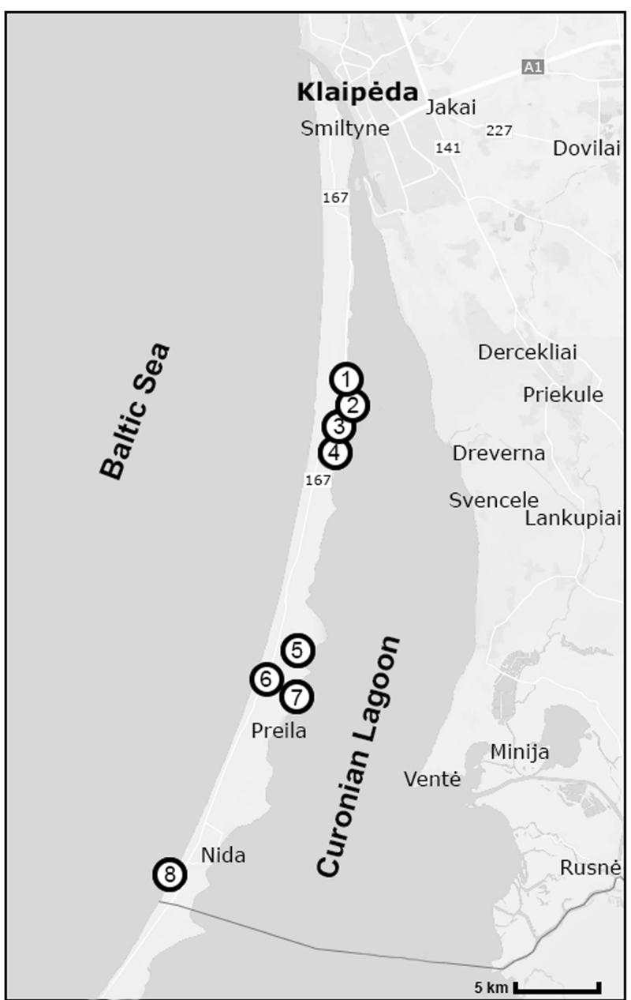
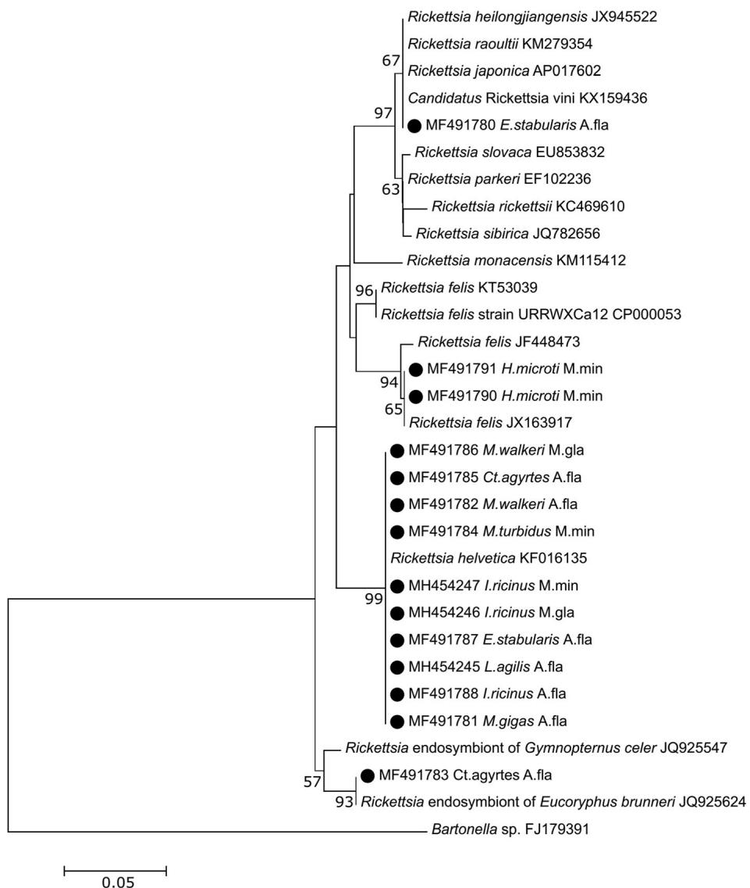
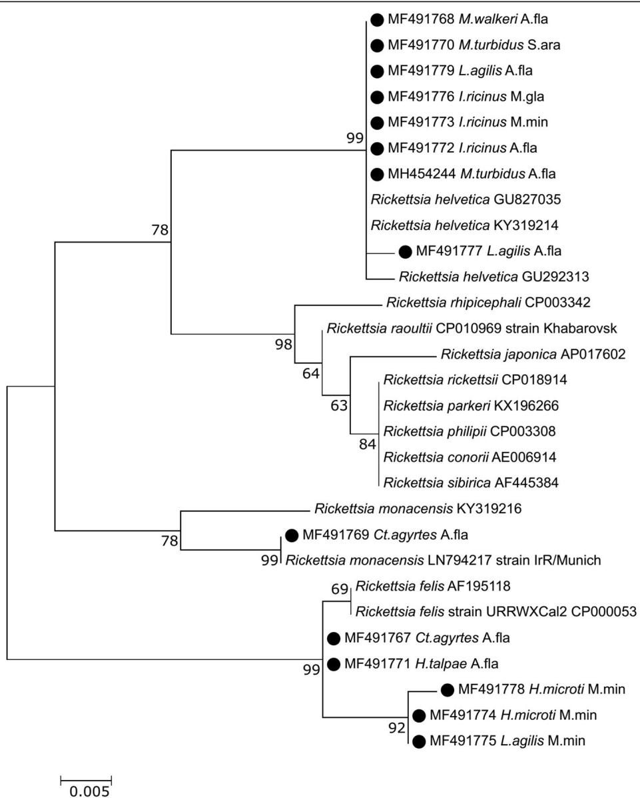

# RESEARCH

# Open Access

# Prevalence and diversity of Rickettsia species in ectoparasites collected from small rodents in Lithuania

CrossMark

Jana Radzijevskaja1 , Evelina Kaminskienė1 , Indrė Lipatova1 , Dalytė Mardosaitė-Busaitienė1 , Linas Balčiauskas2 , Michal Stanko3 and Algimantas Paulauskas1

# Abstract

Background: Rickettsiae are emerging pathogens causing public health problems in many countries around the world. Rickettsia spp. are found in association with a wide range of arthropods which feed on different species of animals. However, the distribution and natural cycle of Rickettsia species and their association with different arthropod vectors are not fully established. The aim of this study was to investigate the presence and prevalence of Rickettsia spp. in ticks, mites and fleas parasitizing different species of small mammals in Lithuania and to molecularly characterize the Rickettsia spp. obtained from different ectoparasites.

Results: A total of 1261 ectoparasites (596 Ixodes ricinus ticks, 550 mites of five species and 115 fleas of eight species) collected from 238 rodents in Lithuania during 2013–2014 were investigated for the presence of Rickettsia pathogens. Infection rates were calculated as the maximum likelihood estimation (MLE) with $9 5 \%$ confidence intervals (CI). The infection rate varied among ectoparasites and was found highest in fleas $4 3 . 5 \% ,$ followed by I. ricinus ticks $( N L \mathsf { E } = 2 6 . 5 \% )$ $9 5 \%$ CI: $2 2 . 2 \substack { - 3 1 . 3 \% } )$ ) and then mites (M $\mathsf { L E } = 9 . 3 \% \cdot$ $9 5 \%$ CI: $7 . 0 { - } 1 2 . 2 \%$ ). Sequence analysis of partial gltA and 17kDa genes revealed the presence of Rickettsia helvetica, R. felis, R. monacensis, Rickettsia sp. and rickettsial endosymbionts. Four Rickettsia spp. were identified in fleas, while three Rickettsia spp. were identified in Laelapidae mites and only one (R. helvetica) in I. ricinus ticks.

Conclusions: To our knowledge, this is the first report of the occurrence and molecular characterization of Rickettsia spp. in 11 species of ectoparasites of small rodents in Lithuania. The present data extend the knowledge on the distribution of Rickettsia spp. and their association with different arthropod vectors. Prior to our study, R. felis had never been identified in Lithuania. To our knowledge, this is also the first report of R. felis in L. agilis and H. microti mites and in Ct. agyrtes and H. talpae fleas, as well as the first detection of R. monacensis in Ct. agyrtes fleas.

Keywords: Rickettsiae, Ixodes ricinus, Laelapidae mites, Siphonaptera fleas, Rodents, Lithuania

# Background

Rickettsiae are obligate intracellular Gram-negative bacteria from the order Rickettsiales that are characterised by complex life-cycles and a diversity of hosts and transmission strategies. Hosts of Rickettsia spp. are found in freshwater, marine and terrestrial habitats, and include protozoans, arthropods, vertebrates, photosynthetic algae and plants [1–3].

Rickettsia spp. are best known as human pathogens vectored mainly by hematophagous arthropods and causing public health problems in many countries around the world. Some species can cause diseases in other mammals and birds. Rickettsia species are horizontally transmitted to vertebrates by a variety of arthropod vectors which feed on different species of animals. To date, ticks (Ixodidae), lice (Phtiraptera) and fleas (Siphonaptera) are known to be competent vectors of rickettsial agents. However, most Rickettsia spp. have been found exclusively in non-hematophagous arthropods with no known secondary host [3].

Currently, the genus Rickettsia comprises 31 recognized species and numerous uncharacterized strains causing diseases in both humans and domestic and wild animals [4–6]. Rickettsia species and associated human clinical diseases vary depending on the geographical location [1, 4]. The genus Rickettsia was traditionally classified into three groups based on phenotypic characters: the spotted fever group (SFG), the typhus group (TG) and the scrub typhus group (STG). The development of molecular tools over recent decades has resulted in reorganizations in the rickettsiae taxonomy. Phylogenomic studies have shown that the genus could be divided into four different phylogenetic groups: (i) the SFG associated mainly with ticks and, less frequently, with fleas and mites, consisting of 23 validated species (using a whole genome approach, Rickettsia helvetica was characterized as separate group from SFG); (ii) the typhus group which includes the agents of epidemic typhus and murine typhus associated with lice and fleas; (iii) an ancestral group (consisting of $R .$ . bellii and R. canadensis); and (iv) a transitional group whose members are R. akari and R. felis [7].

In Europe, rickettsioses are caused mainly by tick-borne SFG Rickettsia [1, 2, 4]. Ticks play important roles as vectors and sometimes as reservoirs in the ecology of these pathogens. The tick Ixodes ricinus is the main vector of R. helvetica and R. monacensis, while R. massiliae, R. raoultii, R. vini and other rickettsial species that have yet to be fully characterized have also been detected in this tick species [1, 8–11].

Mites of the family Laelapidae (Acari: Mesostigmata) are distributed worldwide and are the most common ectoparasites of small rodents. Parasitic species from this family are frequently found on the bodies of rodents or in their nests [12–15]. The role of mesostigmatid mites in the circulation of some disease agents has been previously confirmed and recent studies have also demonstrated that mesostigmatid mites may be reservoirs as well as vectors of some pathogenic rickettsiae (reviewed by Merhej et al. [4], Miťková et al. [12]). Fleas from the order Siphonaptera are another group of blood-sucking ectoparasites found on rodents [16]. Fleas are important vectors for various pathogens including viruses, bacteria and tapeworms. Different Rickettsia species have been detected in more than 15 flea species [4]. In Europe, fleas infesting small rodents have been found to be infected with R. felis, R. helvetica and rickettsial endosymbionts [17, 18].

Information on the circulation of rickettsiae in the territories of the Baltic countries is scarce. In Lithuania, the presence and prevalence of two SFG rickettsiae has been previously reported in questing ixodid ticks [19]: R. helvetica has been identified in I. ricinus (with a prevalence of $1 7 \%$ ) and R. raoultii in Dermacentor reticulatus $( 4 . 9 \% )$ . So far, no reported human clinical cases due to infection by Rickettsia species have been registered in

Lithuania. Detection of R. helvetica, R. monacensis and “Candidatus R. tarasevichiae” have been reported in questing I. ricinus and I. persulcatus ticks in Estonia [20]. In Latvia, R. helvetica has been identified in I. ricinus ticks from birds [21]. There are currently no published reports of the presence of Rickettsia spp. in mites and fleas in Lithuania, nor in other Baltic states.

The distribution and natural cycle of Rickettsia spp. and their association with different arthropod vectors are not fully established. In order to extend knowledge on the relationships between arthropod vectors, hosts and Rickettsia pathogens, we aimed to investigate the presence and prevalence of Rickettsia spp. in ticks, mites and fleas parasitizing different species of small rodents in Lithuania and to molecularly characterize the Rickettsia spp. obtained from different ectoparasites.

# Methods

# Sample collection

Trapping of rodents was conducted on the Curonian Spit of Lithuania during 2013–2014. The Curonian Spit is a narrow sand peninsula $2 ~ \mathrm { k m }$ wide and $9 8 ~ \mathrm { k m }$ long, with half of the length in Lithuania) in the southeastern part of the Baltic Sea separating the Curonian Lagoon from the Baltic Sea [22]. The climate of the Curonian Spit is intermediate between marine and continental and is characterized by frequent and intense variability of weather, relatively mild winters and temperately warm summers. According to the phytogeographical classification, the territory of the Curonian Spit is considered to be within the zone of mixed coniferous-broad-leaved forest. The territory of the Curonian Spit is characterized by considerable flora species diversity [22]. Small rodents were captured at eight sampling sites (Fig. 1) located in different habitats (coastal meadow, mixed forest and forest-meadow ecotone). The names and coordinates of the sampling sites are provided in Additional file 1: Table S1.

Rodents were captured with live-traps and/or snap traps. All trapped rodents were marked and identified by species and sex. Altogether, 238 small rodents representing six species were collected: Apodemus flavicollis $( n =$ 167), Myodes glareolus $\left( n = 2 3 \right)$ ), Micromys minutus $( n =$ 37), Microtus oeconomus $( n = 7$ ), M. agrestis $( n = 2$ ) and M. arvalis $\left( n = 2 \right)$ ).

Ectoparasites were collected from hosts using tweezers and placed into $1 . 5 ~ \mathrm { m l }$ tubes with $7 0 \%$ ethanol. The collected ticks, mites and fleas were identified by the use of taxonomic keys [13, 16, 23–25].

# DNA extraction

DNA from ticks, mites and fleas was extracted by using $2 . 5 \%$ ammonium hydroxide solution [26]. DNA from engorged ticks was extracted using a Genomic DNA

  
Fig. 1 Small rodents trapping sites in Curonian Spit, Lithuania: 1, Amber Gulf; 2, Juodkrante; 3, Grobstas Cape; 4, Great Cormorant and Grey Heron colony; 5, Pervalka Gulf; 6, Nida Dump; 7, Karvaiciai Gulf; 8, Lybis Cape

Purification Kit (Thermo Fisher Scientific, Vilnius, Lithuania) according to the protocol suggested by the manufacturer. Ectoparasites were processed individually or pooled (2–10 specimens) in groups from each host by species, life stage, sex and location.

# PCR amplification and DNA sequencing

Rickettsia DNA in ectoparasites was detected using a nested PCR that targeted partial gltA gene (encoding rickettsial citrate synthase of Rickettsia spp.) and two primer sets $\mathrm { R p C S . 8 7 7 p / R p C S . 1 2 5 8 n }$ (external primers) and RpCS.896p/RpCS.1233n (internal primers) as

previously described [12]. The obtained specific products of 338 base pairs were considered as a positive result.

All gltA-positive samples for Rickettsia were further examined using a semi-nested PCR which amplifies the 450 bp fragment of the 17-kDa gene (encoding rickettsiae genus-specific 17-kDa outer membrane antigen) using the primers Rr17k.1p/Rr17k.539n and Rr17k.90p as described [27]. A negative control (double-distilled water) and a positive control (DNA of Rickettsia-infected ticks, confirmed by sequencing) were included in every PCR run. PCR products were subjected to electrophoresis on $1 . 5 \%$ agarose gel and analyzed by UV transilluminator.

To prevent cross-contamination, separate rooms were used for DNA isolation, PCR-mix preparation, the PCR and nested-PCR reactions. Negative controls, which consisted of sterile, double-distilled water added to the first PCR mix rather than DNA, were included after every five experimental samples.

A selected number of Rickettsia-positive samples for both genes were purified using the GeneJET™ Gel Extraction Kit (Thermo Fisher Scientific) and sequenced (Macrogen, Amsterdam, the Netherlands). Obtained DNA sequences were edited using the MEGA 6.05 software package [28] and aligned to available data in GenBank with BLASTn. The gltA and 17kDa protein-coding gene based phylogenetic trees were constructed using the maximum-likelihood (ML) and neighbor-joining (NJ) methods. The most appropriate model of nucleotide substitution was determined according to the Bayesian information criterion (BIC) using the program jModelTest2 [29, 30].

Partial 17kDa and gltA gene sequences for representative samples were submitted to the GenBank database under the accession numbers MF491767-MF491779, MH454244 and MF491780-MF491791, MH454245- MH454247 respectively.

# Statistical analysis

Infection rates for pooled ticks and mites were calculated using maximum likelihood estimation (MLE) method with $9 5 \%$ confidence intervals (CI) for unequal pool sizes and expressed as the MLE of infection rate per 100 ticks/mites. MLE calculations are based on the number of pools, pool sizes (number of individuals per pool), and the number of positive pools [31]. We used the PooledInfRate estimation software (version 4.0) add-on with Microsoft Excel (http:// www.cdc.gov/westnile/resourcepages/mosqSurvSoft.html).

Differences of prevalence of Rickettsia spp. in ectoparasites were analysed using a Chi-square test with Statistica for Windows, version 7.0.

# Results

From 238 trapped rodents, 181 $( 7 6 . 1 \% )$ were infested with ectoparasites. A total of 1261 ectoparasites of 18 different species were collected from 136 individuals of A. flavicollis, 23 of M. minutus, 15 of M. glareolus, 5 of M. oeconomus, one of M. arvalis and one of M. agrestis. The majority of ectoparasites $\dot { \boldsymbol { n } } = 1 1 3 5$ ; $9 0 . 0 \%$ ) were removed from A. flavicollis.

The infested rodents were parasitized by I. ricinus ticks, five species of mites of the family Laelapidae (Laelaps agilis, Hyperlaelaps microti, Haemogamassus nidi, Eulaelaps stabularis and Myonyssus gigas) and eight species of fleas (Ctenophthalmus agyrtes, Ct. assimilis, Hystrichopsylla talpae, H. orientalis, Megabothris turbidus, M. walkeri, Palaeopsylla soricis and Nosopsyllus fasciatus).

Altogether, 596 immature I. ricinus (8 nymphs, 588 larvae), 550 mites and 115 fleas were collected. All nymphs and 62 larvae of I. ricinus, all fleas and 82 mites were examined individually (Tables 1, 2). The remaining 526 I. ricinus larvae and 468 mites (L. agilis) were grouped into pools of 2 to 10 individuals $( 2 9 \times 2$ , $1 4 \times 3$ , $2 4 \times 4$ , $2 4 \times 5$ , $2 3 \times 6$ , $1 \times 7$ , $7 \times 8$ and $1 \times 9$ for the $I .$ ricinus larvae; $3 1 \times 2$ , $1 7 \times 3$ , $8 \times 4$ , $1 1 \times 5$ , $8 \times 6$ , $7 \times 7$ , $1 1 \times 8 .$ , $7 \times 9$ and $2 \times 1 0$ for the mites) (Table 2). Larvae of ticks and mites from different rodents were not mixed in the same pools. A total of 259 individual ectoparasites (ticks, mites, fleas) and 225 pools, representing 526 I. ricinus ticks and 468 mites, were screened for the presence of rickettsial DNA by PCR targeting the gltA gene (Tables 1, 2).

Combined data including both PCR-positive ectoparasites tested individually and in pools showed that at least $2 0 . 4 \%$ $9 5 \%$ CI: $1 8 . 0 \mathrm { - } 2 3 . 0 \% )$ ) of ectoparasites harbored rickettsiae. DNA of Rickettsia spp. was identified in $2 2 . 6 \%$ (14 of 62) of individually tested I. ricinus larvae, in 5 out of 8 nymphs and in $7 0 . 7 \%$ of 123 larvae pools. In the case of mites, $1 1 . 0 \%$ (9 out of 82) of single specimens and $3 4 . 3 \%$ of 102 pools (L. agilis) tested positive (Table 2).

Table 1 Presence of Rickettsia spp. in fleas collected from different species of small rodents on the Curonian Split, Lithuania   

<table><tr><td rowspan="3">Rodent species</td><td colspan="11">Fleas infected by Rickettsia spp., n/N</td><td>Total</td></tr><tr><td colspan="2">Ct. ag</td><td>Ct. as</td><td colspan="2">H. t</td><td>H. o</td><td colspan="2">M. t</td><td colspan="2">M. w</td><td>P. s</td><td>N. f</td></tr><tr><td>♀</td><td>♂</td><td>♂</td><td>♀</td><td>♂</td><td>♂</td><td>♀</td><td>♂</td><td>♀</td><td>♂</td><td>♀</td><td>♂</td></tr><tr><td>A. fla</td><td>14/30</td><td>10/25</td><td>1/1</td><td>0/2</td><td>1/1</td><td>-</td><td>5/16</td><td>2/8</td><td>3/3</td><td>2/2</td><td>-</td><td>0/1</td></tr><tr><td>M. min</td><td>0/4</td><td>0/2</td><td>-</td><td>-</td><td>1/2</td><td>0/1</td><td>1/1</td><td>1/1</td><td>-</td><td>-</td><td>-</td><td>-</td></tr><tr><td>M. gla</td><td>-</td><td>-</td><td>-</td><td>0/1</td><td>-</td><td>-</td><td>1/3</td><td>1/1</td><td>-</td><td>1/1</td><td>-</td><td>-</td></tr><tr><td>M. agr</td><td>-</td><td>-</td><td>-</td><td>-</td><td>-</td><td>-</td><td>-</td><td>-</td><td>1/1</td><td>-</td><td>-</td><td>1/1</td></tr><tr><td>M. oec</td><td>2/3</td><td>-</td><td>-</td><td>-</td><td>-</td><td>-</td><td>-</td><td>1/1</td><td>1/2</td><td>0/1</td><td>1/1</td><td>-</td></tr><tr><td>Total</td><td>16/37</td><td>10/27</td><td>1/1</td><td>0/3</td><td>2/3</td><td>0/1</td><td>7/20</td><td>5/11</td><td>5/6</td><td>3/4</td><td>1/1</td><td>0/1</td></tr></table>

Abbreviations: N, number of tested fleas; n, number of infected fleas; ♀, female; ♂, male; Ct. ag, Ctenophthalmus agyrtes; Ct. as, Ctenophthalmus assimilis; H. t, Hystrichopsylla talpae; H. o, Hystrichopsylla orientalis; M. t, Megabothris turbidus; M. w, Megabothris walkeri; P. s, Palaeopsylla soricis; N. f, Nosopsyllus fasciatus; A. fla, Apodemus flavicollis; M. min, Micromys minutus; M. gla, Myodes glareolus; M. arv, Microtus arvalis; M. agr, Microtus agrestis; M. oec, Microtus oeconomus

Table 2 Presence of Rickettsia spp. in Ixodes ricinus ticks and Laelapidae mites collected from different species of small rodents on the Curonian Spit, Lithuania   

<table><tr><td rowspan="2">Rodent species</td><td colspan="2">I. r</td><td colspan="2">L. a</td><td>H. m</td><td colspan="2">M. g</td><td>E. s</td><td>Hg. n</td></tr><tr><td>Larvae no. positive pools/No. pools (no. ticks in pools); single n/ N; (total pools/total ticks tested); % MLE (95% CI)</td><td>Nymphs n/ N</td><td>no. positive pools /No. pools (no. mites in pools); single n/N; (total pools /total mites tested); % MLE ♀♂</td><td>n/ N</td><td>♀</td><td>♀♂</td><td>♀</td><td>♀</td><td>♀</td></tr><tr><td>A. fla</td><td>87/ 115 (502); 12/56; (171/558)</td><td>1/3</td><td>31/88 (428); 1/20; (108/448)</td><td>0/21</td><td>0/5</td><td>1/2</td><td>0/1</td><td>2/5</td><td>0/3</td></tr><tr><td>M. min</td><td>1/ 2(5); 2/6; (8/11)</td><td>1/2</td><td>4/8 (19); 2/5; (13/24)</td><td>0/1</td><td>3/3</td><td>0/0</td><td>0/0</td><td>0/4</td><td>0/0</td></tr><tr><td>M. gla</td><td>2/3(8)</td><td>2/2</td><td>0/5 (19); 0/2; (7/21)</td><td>0/1</td><td>0/3</td><td>0/0</td><td>0/0</td><td>0/1</td><td>0/0</td></tr><tr><td>M. arv</td><td>1/1(6)</td><td>0/0</td><td>0/0</td><td>0/0</td><td>0/0</td><td>0/0</td><td>0/0</td><td>0/0</td><td>0/0</td></tr><tr><td>M. oec</td><td>1/2(5)</td><td>1/1</td><td>0/1(2); 0/1; (2/3)</td><td>0/2</td><td>0/0</td><td>0/0</td><td>0/0</td><td>0/0</td><td>0/0</td></tr><tr><td>M. agr</td><td>0/0</td><td>0/0</td><td>0/0</td><td>0/0</td><td>0/2</td><td>0/0</td><td>0/0</td><td>0/0</td><td>0/0</td></tr><tr><td>Total</td><td>87/123 (526); 14/62; (185/588); 25.7% (21.4–30.5)</td><td>5/8</td><td>35/102 (468); 3/28; (130/496); 9.0% (6.6–12.1)</td><td>0/25</td><td>3/13</td><td>1/2</td><td>0/1</td><td>2/10</td><td>0/3</td></tr></table>

Abbreviations: N, number of ticks/mites tested; n, number infected; MLE, maximum likelihood estimates; $\mathcal { Q } ,$ , female; $\hat { \mathcal { S } } ,$ , male; I. r, Ixodes ricinus; L. a, Laelaps agilis; H. $m ,$ Hyperlaelaps microti; M. g, Myonyssus gigas; E. s, Eulaelaps stabularis; Hg. n, Haemogamasus nidi; A. fla, Apodemus flavicollis; M. min, Micromys minutus; M. gla, Myodes glareolus; M. arv, Microtus arvalis; M. oec, Microtus oeconomus; M. agr, Microtus agrestis

Among the examined ectoparasites, the highest infection rate was found in fleas $( 4 3 . 5 \%$ ; $\chi ^ { 2 } ~ = ~ \overline { { 1 7 . 6 2 } }$ , $P ~ <$ 0.0001; $\chi ^ { 2 } ~ = ~ 6 3 . 1 9$ ; $P \ < \ 0 . 0 0 0 1$ ), followed by I. ricinus ticks $( \mathrm { M L E } = 2 6 . 5 \%$ , $9 5 \%$ CI: $2 2 . 2 \substack { - 3 1 . 3 \% }$ ) and then mites $( \mathrm { M L E } = 9 . 3 \%$ , $9 5 \%$ CI: $7 . 0 { - } 1 2 . 2 \%$ ).

Rickettsia DNA was detected in eleven species of ectoparasites. Rickettsia-infected fleas were found parasitizing five rodent species, while infected I. ricinus ticks and mites were found only on two species of rodents (Table 1, 2).

Rickettsia spp. were detected in six flea species collected from A. flavicollis, M. glareolus, M. minutus, M. oeconomus and M. agrestis rodents (Table 1). The most prevalent species was Ct. agyrtes $( 5 5 . 7 \%$ , $\begin{array} { r l r } { n } & { { } = } & { 6 4 , } \end{array}$ ), followed by M. turbidus $2 7 \%$ , $n = 3 1$ ), and the prevalence of Rickettsia spp. in these ectoparasites was $4 0 . 6 3 \%$ (26/64) and $3 8 . 7 \%$ (12/31), respectively (Table 1). A total of $4 2 . 7 \%$ of fleas collected from A. flavicollis and $2 7 . 3 \%$ from M. minutus harboured Rickettsia pathogens.

Rickettsia-positive I. ricinus ticks were found on A. flavicollis, M. glareolus, M. minutus, M. oeconomus and M. arvalis rodents. Nearly $9 4 . 1 \%$ of I. ricinus ticks analyzed were collected from A. flavicollis, and the MLE of Rickettsia infection in I. ricinus parasitizing these mice was $2 6 . 9 \%$ $9 5 \%$ CI: $2 2 . 4 { - } 3 1 . 9 \%$ ). The overall MLE of the infection rate in I. ricinus larvae was $2 5 . 7 \%$ ( $9 5 \%$ CI: $2 1 . 4 \substack { - 3 0 . 5 \% } )$ (Table 2).

Rickettsia DNA was detected in four mite species collected from A. flavicollis and M. minutus rodents. Rickettsia spp. were detected only in females of mites (Table 2). The dominant species of mite found on small rodents was L. agilis (521/550). The overall MLE of Rickettsia for L. agilis was $8 . 5 \%$ $9 5 \%$ CI: $6 . 2 \substack { - 1 1 . 4 \% }$ ), with the MLE in L. agilis females being $9 . 0 \%$ $9 5 \%$ CI: $6 . 6 \substack { - 1 2 . 1 \% }$ ) (Table 2). Rickettsia DNA was also detected in $H .$ microti (3/13, $2 3 . 0 8 \%$ ) from M. minutus and in E. stabularis (2/10, $2 0 . 0 \%$ and M. gigas (1/3) from A. flavicollis (Table 2).

Rickettsia-positive PCR products of good-quality were subjected to sequence analysis. A total of 44 sequences of gltA $( n \ = \ 2 2 )$ ) and 17kDa $( n \ = \ 2 2 )$ ) genes were analyzed, derived from I. ricinus ticks, four species of mites and four species of fleas collected from A. flavicollis, M. minutus and M. glareolus rodents. Sequence analysis of the partial gltA gene revealed the presence of four different species of Rickettsia in the analysed samples: (i) R. helvetica: sequences derived from the tick I. ricinus, mites L. agilis, E. stabularis and M. gigas and fleas Ct. agyrtes, M. turbidus and M. walkeri were $1 0 0 \%$ identical to each other and to the R. helvetica sequences deposited in GenBank (KF016135); (ii) R. felis: sequences derived from two H. microti mites were $9 7 \%$ similar (nucleotide sequences differed at 9 positions) to a validated bacterium R. felis (CP000053), $9 9 \%$ similar to R. felis detected in A. agrarius from South Korea (Gen-Bank: JF448473) and shared $1 0 0 \%$ identify with R. felis which was detected in $E _ { \ast }$ . stabularis mites from China (GenBank: JX163917); (iii) Rickettsia sp.: the sequence isolated from E. stabularis was $1 0 0 \%$ identical to the closely phylogenetically related sequences deposited in GenBank for Rickettsia vini (GenBank: KX159436), R. japonica (GenBank: AP017602), R. heilongjiangensis (Gen-Bank: JX945522) and R. raoultii (GenBank: KM279354); (iv) the gltA sequence isolated from the Ct. agyrtes flea was $9 9 - 1 0 0 \%$ identical to the Rickettsia endosymbiont of Eucoryphus brunneri (family Dolichopodidae, order Diptera; GenBank: JQ925624) and the Rickettsia endosymbiont of Gymnopternus celer (family Dolichopodidae, order Diptera; GenBank: JQ925547) (Fig. 2).

PCR and sequence analysis of the partial 17kDa gene revealed the presence of three Rickettsia species: (i) R. helvetica: isolates derived from I. ricinus ticks, L. agilis mites and two species of fleas M. walkeri and M. turbidus were $9 9 - 1 0 0 \%$ identical (with one nucleotide

  
Fig. 2 Neighbour-joining phylogenetic tree for the partial gltA gene of Rickettsia spp. The phylogenetic tree was created using the Kimura 2- parameter model with a discrete Gamma-distribution $( + \mathsf { G } )$ and bootstrap analysis of 1000 replicates. Identification source (host) is given after the names of species. Samples sequenced in the present study are marked. Sequence MF491788 is representative of six other samples sequenced in this study (all derived from I. ricinus obtained on A. flavicolis); Sequence MH454245 is representative of two other samples sequenced in this study (derived from L. agilis obtained on A. flavicolis). Abbreviations: A. fla, Apodemus flavicollis; M. min, Micromys minutus; M. gla, Myodes glareolus

difference) to the R. helvetica isolates deposited in Gen-Bank (GU827035, KY319214, GU292313); (ii) R. felis was detected in four species of ectoparasites: H. microti and L. agilis mites and Ct. agyrtes and H. talpae fleas. The amplified fragments of the 17kDa gene of rickettsiae in the Ct. agyrtes and H. talpae samples were $1 0 0 \%$ identical to each other and $9 9 \%$ similar (differed in one nucleotide) to a validated bacterium R. felis (GenBank: CP000053), while sequences isolated from $H .$ microti and L. agilis were $9 9 \%$ identical to each other and differed in four to five nucleotide positions from R. felis (GenBank: CP000053); (iii) R. monacensis: the 17kDa gene sequence derived from the Ct. agyrtes flea was $9 9 \mathrm { - } 1 0 0 \%$ identical to

the R. monacensis sequences deposited in GenBank (GU292312, LN794217) (Fig. 3).

# Discussion

In this study, we report the occurrence and the molecular characterization of Rickettsia spp. in eleven species of ectoparasites parasitizing small rodents on the Curonian Spit, West Lithuania. The frequency of Rickettsia spp. infections in rodent-derived ectoparasites varied among species and was found highest in fleas, followed by I. ricinus ticks and then mites.

Small rodents are important hosts for the immature stages of ixodid ticks and are considered carriers and

  
Fig. 3 Maximum-likelihood phylogenetic tree for the partial 17kDa gene of Rickettsia spp. The phylogenetic tree was created using the Tamura-Nei model with a discrete Gamma-distribution $( + \mathsf { G } )$ and bootstrap analysis of 1000 replicates. Identification source (host) and is given after the names of species. Samples sequenced in the present study are marked. Sequence MF491772 is representative of six other samples sequenced in this study (all derived from I. ricinus of A. flavicolis). Sequence MF491779 is representative of two other samples sequenced in this study (derived from L. agilis of A. flavicolis). Abbreviations: A. fla – Apodemus flavicollis; M. min – Micromys minutus; M. gla – Myodes glareolus

reservoir hosts of tick-borne pathogens such as tick-borne encephalitis virus [32], Borrelia burdorferi (s.l.) [33], Borrelia miyamotoi [34], Babesia microti [35], Anaplasma phagocytophilum and “Candidatus Neoehrlichia mikurensis” [36]. The reservoir role of wild rodents in rickettsiae life-cycles is still unclear and there are a lack of studies focusing on the investigation of rickettsial pathogens in rodents and their ectoparasites across Europe [12, 17, 37, 38]. Several molecular studies conducted in the Netherlands, Germany, Slovakia, Poland and Austria have showed the presence of rickettsial DNA in European rodents with a prevalence ranging from 2.7 to $2 9 \%$ . Infected

rodents more frequently harbored R. helvetica than other rickettsiae species [12, 18, 37, 39, 40].

The presence of rickettsiae in ectoparasites may result from the acquisition of bacteria via blood meals from rickettsiemic rodents. Some SFG rickettsiae are thought to circulate in enzootic or epizootic cycles between wild vertebrates and arthropod vectors [41]. The high prevalence of R. helvetica previously obtained in small rodents suggests that they may play an important role as potential natural reservoir hosts for this pathogen [37, 39, 42]. In the present study, the most frequently captured rodent species in all habitats was A. flavicollis, followed by

M. minutus and M. glareolus (captured in grasslands). Rickettsia spp. harboured only rodents of three species A. flavicollis $3 2 . 8 \%$ , M. minutus $4 5 . 9 \%$ and M. glareolus $1 4 . 3 \%$ , while other rodent species were found to be non-rickettsiemic (data not shown) [42]. All infected rodents harboured R. helvetica [42]. Our data showed that $6 6 . 6 \%$ of Rickettsia-infected I. ricinus ticks, $5 9 \%$ of Laelapidae mites and $5 5 \%$ of fleas were derived from rodents which had been previously proved to be non-rickettsiemic, while $3 3 . 4 ~ \%$ of Rickettsia-infected I. ricinus ticks, $4 1 \%$ of Laelapidae mites and $4 5 \%$ of fleas were collected from infected rodents [42]. This could have potentially influenced the detection rates estimated in our study for ectoparasites that harboured R. helvetica. It seems that PCR-positive ticks, mites and fleas feeding on non-infected rodents, as well as ectoparasites which harboured other Rickettsia species, did not acquire these pathogens through blood meals on rodents. Mites and fleas in these cases could be infected during previously feedings on another hosts (e.g. in common nests). Occurrence of PCR-positive I. ricinus larvae on non-infected rodents probably show transovarial transmission from engorged females.

To our knowledge, the present study is the first report on the presence of Rickettsia spp. in fleas and mites from the Baltic countries. Fleas and mites feeding on rodents harboured multiple Rickettsia species, including R. helvetica, R. felis, R. monacensis, rickettsial endosymbiont and Rickettsia sp. Four Rickettsia spp. were identified in fleas, while three Rickettsia spp. were identified in Laelapidae mites. In Rickettsia-positive I. ricinus samples subjected for sequence analysis, only R. helvetica species was detected.

Rickettsia helvetica is a human pathogenic Rickettsia species which was first discovered in I. ricinus from Switzerland in 1979 [43]. Human cases have been reported from Sweden, France, Switzerland, Italy, Denmark, Austria and Slovakia (reviewed by Parola et al. [1]). Ixodes ricinus is considered to be the main vector and a natural reservoir of R. helvetica [44] due to the ability of rickettsiae to survive perpetually in ticks and to be transmitted transstadially and transovarially [1]. To date, R. helvetica has been detected in I. ricinus in many European countries with a highly variable prevalence. This species has been previously detected in questing I. ricinus ticks in Lithuania with a prevalence ranging in different locations between $0 { - } 3 1 . 3 \%$ [19].

Rickettsia helvetica has also been isolated from other tick species such as D. reticulatus, I. hexagonus and I. arboricola, as well as from mites and fleas [1]. This species has been detected in Ct. agyrtes males collected from A. agrarius in Slovakia [17] and in two out of 24 fleas isolated from M. glareolus and A. sylvaticus in the Netherlands [39]. Miťková et al. [12] reported for the

first time the detection of R. helvetica in L. agilis and Hg. nidi mites infesting small rodents in Slovakia.

In our study, R. helvetica was detected in I. ricinus ticks, L. agilis and M. gigas mites and Ct. agyrtes, M. turbidus and M. walkeri fleas from A. flavicollis; I. ricinus ticks and M. walkeri fleas from M. glareolus, and M. turbidus fleas from M. minutus. To our knowledge, this is the first detection of R. helvetica in M. gigas mites and M. turbidus and M. walkeri fleas. The presence of R. helvetica in the immature ticks may result from acquisition pathogens through a blood meal from rickettsiemic rodents or through a vertical (transovarial and transstadial) transmission. Mites and fleas infesting rodents could acquire R. helvetica infection while taking a blood meal on a R. helvetica-infected rodent or, possibly, by co-feeding with infected I. ricinus ticks. Recently, horizontal transmission through a shared blood meal was demonstrated for some rickettsial pathogens [45].

This study is the first report of R. felis infection in Ct. agyrtes and H. talpae fleas collected from A. flavicollis, and in $H .$ microti and L. agilis mites collected from M. minutus in Lithuania. Rickettsia felis is the causative agent of flea-borne spotted fever in humans [46]. This species has worldwide distribution and infections of R. felis have been reported in over 25 countries spanning five continents [47]. The cat flea, Ctenocephalides felis, is a main vector and a reservoir of this pathogen [48]. However, more than 24 species of ectoparasites, such as fleas, ticks, mites, lice and mosquitoes, have been demonstrated as vectors for R. felis all over the world [4, 13, 17, 27, 49]. Recently, both intra- and interspecific transmission of R. felis between co-feeding arthropods on a vertebrate host has been demonstrated [44]. The finding of R. felis in naturally infected mites is not unexpected because it has been previously reported in other Mesostigmata mite species collected from rodents in Asia [50, 51]. Sequence analyses of R. felis strains isolated from different arthropods revealed genomic heterogeneity and provides evidence for host-specific strain variation [52]. Additionally, increasing numbers of identified R. felis-like organisms (RFLOs) in different arthropods have been reported within the last decade.

To our knowledge, this study provides the first evidence of the presence of R. monacensis in Ct. agyrtes fleas collected from A. flavicollis (Fig. 2). Rickettsia monacensis is an etiological agent of human rickettsioses distributed throughout Europe. Ixodes ricinus is recognized as the main vector of this pathogen [4, 13, 53]. However, not all possible vector species are currently known [53]. Rickettsia monacensis has been detected in questing I. ricinus ticks in many European countries [1] and has also been detected in immature I. ricinus ticks collected from migratory birds in the Russian part of the Curonian Spit [54]. In Lithuania, R. monacensis has been previously detected in

I. ricinus ticks removed from raccoon dogs (GenBank: KT033401). The first occurrence of mites infected with R. monacensis has recently been reported in Slovakia [12].

Based on sequence analysis of the gltA gene, the Rickettsia sp. detected in our study in the mite E. stabularis was not identified to the species level. The obtained 268 bp gltA sequence showed $1 0 0 \%$ identity to the corresponding sequences of R. vini, R. japonica, R. heilongjiangensis and R. raoultii deposited in the GenBank database. Unfortunately, the fragment of the 17kDa gene of this sample was not successfully amplified. R. vini was first detected in the ticks I. arboricola and I. ricinus collected from birds in Spain and named “Candidatus R. vini” [8, 55]. This bacterium has since been detected in ticks feeding on birds in other European counties and Turkey [56]. The pathogenicity for humans and animals of this Rickettsia remains unknown [57]. Rickettsia vini has been confirmed in Lithuania in I. lividus ticks from sand martin (Riparia riparia) nests (GenBank: MH454248).

The present study indicates the presence of phylogenetically distinct rickettsiae in multiple ectoparasites feeding on different rodent hosts. Future studies should be performed to determine the specific roles of different species of mites and fleas parasitizing small rodents in the acquisition and transmission of different Rickettsia species.

# Conclusions

To our knowledge, this is the first report of the occurrence and molecular characterization of Rickettsia spp. in 11 species of ectoparasites of small rodents in Lithuania. The data presented in this paper extend the knowledge on the distribution of Rickettsia species, their association with different arthropod vectors and rodent-parasites interactions. Prior to our study, R. felis had never been identified in Lithuania. To our knowledge, this is also the first report of R. felis in L. agilis and H. microti mites and in Ct. agyrtes and H. talpae fleas, as well as the first detection of $R .$ . monacensis in Ct. agyrtes fleas.

# Additional file

Additional file 1: Table S1. Characteristics of sampling sites of rodents in Curonian Spit, Lithuania. (DOCX 14 kb)

# Abbreviations

SFG: Spotted fever group; TG: Typhus group; STG: Scrub typhus group; ML: Maximum-likelihood method; NJ: Neighbor-joining method; BIC: Bayesian information criterion; MIR: Minimum infection rate

# Acknowledgments

The authors thank Vaclovas Gedminas from Tadas Ivanauskas museum, Kaunas (Lithuania) for help in collecting small mammals.

# Funding

This study was partly supported by a Grant of the Scientific Agency of the Ministry of Education and Slovak Academy of Sciences (VEGA 2/0059/15 to MS).

# Availability of data and materials

The datasets used and/or analysed during the current study are available from the corresponding author upon reasonable request. Representative sequences were submitted to the GenBank database under the accession numbers MF491767-MF491791, MH454244- MH454247.

# Authors’ contributions

AP and JR designed the study data, participated in manuscript preparation/ review, data collection and analysis. JR, EK, IL and DMB conducted the experiments and the data analysis. EK, IL and DMB drafted the manuscript. LB and MS contributed to data collection, analysis and the revision of the manuscript. All authors read and approved the final manuscript.

# Ethics approval and consent to participate

Permission to trap wild small mammals was provided according to Regulation No. 1 (2013-04-10) and No. 15 (2014-03-31) of the Ministry of the Environment of the Republic of Lithuania.

# Competing interests

The authors declare that they have no competing interests.

# Publisher’s Note

Springer Nature remains neutral with regard to jurisdictional claims in published maps and institutional affiliations.

# Author details

1 Faculty of Natural Sciences, Vytautas Magnus University, Vileikos 8, LT-44404 Kaunas, Lithuania. 2 Laboratory of Mammalian Ecology, Nature Research Centre, Akademijos st. 2, LT-08412 Vilnius, Lithuania. 3 Institute of Parasitology and Institute of Zoology, Slovak Academy of Sciences, Hlinkova 3, 04000 Košice, Slovakia.

Received: 4 April 2018 Accepted: 8 June 2018

Published online: 28 June 2018

# References

1. Parola P, Paddock CD, Socolovschi C, Labruna MB, Mediannikov O, Kernif T, et al. Update on rickettsioses around the world: a geographic approach. Clin Microbiol Rev. 2013;26:657–702.   
2. Eremeeva ME, Dasch GA. Challenges posed by tick-borne rickettsiae: ecoepidemiology and public health implications. Front Public Health. 2015;3:1–17.   
3. Weinert LA, Werren JH, Aebi A, Stone GN, Jiggins FM. Evolution and diversity of Rickettsia bacteria. BMC Biol. 2009;7:6.   
4. Merhej V, Angelakis E, Socolovschi C, Raoult D. Genotyping, evolution and epidemiological findings of Rickettsia species. Infect Genet Evol. 2014;25: 122–37.   
5. Chisu V, Leulmi H, Masala G, Piredda M, Foxi C, Parila P. Detection of Rickettsia hoogstraalii, Rickettsia helvetica, Rickettsia massiliae, Rickettsia slovaca and Rickettsia aeschlimannii in ticks from Sardinia, Italy. Ticks Tick Borne Dis. 2017;8:347–52.   
6. LPSN. List of prokaryotic names with standing in nomenclature. 2014. http:// www.bacterio.net/rickettsia.html. Accessed 20 June 2017.   
7. Murray GGR, Weinert LA, Rhule EL, Welch JJ. The phylogeny of Rickettsia using different evolutionary signatures: how tree-like is bacterial evolution? Syst Biol. 2016;65:265–79.   
8. Palomar AM, Portillo A, Santibáñez P, Santibáñez S, García-Álvarez L, Oteo JA. Genetic characterization of “Candidatus Rickettsia vini”, a new rickettsia amplified in ticks from La Rioja, Spain. Ticks Tick Borne Dis. 2012;3:318–20.   
9. Luciano T, Mancini F, Di Luca M, Cecere JG, Bianchi R, Khoury C, et al. Detection of microbial agents in ticks collected from migratory birds in central Italy. Vector Borne Zoonotic Dis. 2014;14:199–205.   
10. Mărcuţan ID, Kalmár Z, Ionică AM, D'Amico G, Mihalca AD, Vasile C, Sándor AD. Spotted fever group rickettsiae in ticks of migratory birds in Romania. Parasit Vectors. 2016;9:294.   
11. Rizzoli A, Silaghi C, Obiegala A, Rudolf I, Hubálek Z, Földvári G, Kazimírová M. Ixodes ricinus and its transmitted pathogens in urban and peri-urban

areas in Europe: new hazards and relevance for public health. Front Public Health. 2014;2:251.   
12. Miťková K, Berthová L, Kalúz S, Kazimírová M, Burdová L, Kocianová E. First detections of Rickettsia helvetica and R. monacensis in ectoparasitic mites (Laelapidae and Trombiculidae) infesting rodents in south-western Slovakia. Parasitol Res. 2015;114:2465–72.   
13. Mašán P, Fenda P. A review of the laelapid mites associated with terrestrial mammals in Slovakia, with a key to the European species. Bratislava: Institute of Zoology, Slovak Academy of Sciences; 2010.   
14. Guo XG, Speakman JR, Dong WG, Men XY, Qian TJ, Wu D, et al. Ectoparasitic insects and mites on Yunnan red-backed voles (Eothenomys miletus) from a localized area in southwest China. Parasitol Res. 2013;112:3543–9.   
15. Rynkiewicz EC, Hawlena H, Durden LA, Hastriter MW, Demas GE, Clay K. Associations between innate immune function and ectoparasites in wild rodent hosts. Parasitol Res. 2013;112:1763–70.   
16. Rosicky B. Fauna ČSR Blechy - Aphaniptera. In: Praha: Československa Akademie; 1957 (In Czech).   
17. Špitalská E, Boldiš V, Mošanský L, Sparagano O, Stanko M. Rickettsia species in fleas collected from small mammals in Slovakia. Parasitol Res. 2015;114: 4333–9.   
18. Hornok S, Földvári G, Rigó K, Meli ML, Gönczi E, Répási A, et al. Synanthropic rodents and their ectoparasites as carriers of a novel haemoplasma and vector-borne, zoonotic pathogens indoors. Parasit Vectors. 2015;8:27.   
19. Radzijevskaja J, Paulauskas A, Aleksandraviciene A, Jonauskaite I, Stanko M, Karbowiak G, Petko B. New records of spotted fever group rickettsiae in Baltic region. Microbes Infect. 2015;17:874–8.   
20. Katargina O, Geller J, Ivanova A, Varv K, Tefanova V, Vene S, et al. Detection and identification of Rickettsia species in Ixodes tick populations from Estonia. Ticks Tick Borne Dis. 2015;6:689–94.   
21. Capligina V, Salmane I, Keišs O, Vilks K, Japina K, Baumanis V, Ranka R. Prevalence of tick-borne pathogens in ticks collected from migratory birds in Latvia. Ticks Tick Borne Dis. 2014;5:75–81.   
22. Svazas S, Drobelis E, Balciauskas L, Raudonikis L. Important wetlands in Lithuania. In: Vilnius: Ompo Vilnius; 1999.   
23. Bregetova NG. Gamasid mites (Gamasoidea). Short key. Moscow - Leningrad: Academy of Sciences of the USSR; 1956 (In Russian).   
24. Hillyard PD. Ticks of North-West Europe. In: Barns RSK, Crothers HJH, editors. Synopsis of the British Fauna (New Series). London: The Natural Historical Museum; 1996.   
25. Baker AS. Mites and ticks of domestic animals. An identification guide and information source. London: The Stationery Office; 1999.   
26. Rijpkema S, Golubic D, Molkenboer M, Verbeek-De Kruif N, Schellekens J. Identification of four genomic groups of Borrelia burgdorferi sensu lato in Ixodes ricinus ticks collected in a Lyme borreliosis endemic region of Northern Croatia. Exp Appl Acarol. 1996;20:23–30.   
27. Ishikura M, Ando S, Shinagawa Y, Matsuura K, Hasegawa S, Nakayama T, et al. Phylogenetic analysis of spotted fever group rickettsiae based on gltA, 17-kDa, and rOmpA genes amplified by nested PCR from ticks in Japan. Microbiol Immunol. 2003;47:823–32.   
28. Tamura K, Stecher G, Peterson D, Filipski A, Kumar S. MEGA6: Molecular Evolutionary Genetics Analysis version 6.0. Mol Biol Evol. 2013;30:2725–9.   
29. Guindon S, Gascuel O. A simple, fast and accurate method to estimate large phylogenies by maximum-likelihood. Syst Biol. 2003;52:696–704.   
30. Darriba D, Taboada GL, Doallo R, Posada D. jModelTest 2: more models, new heuristics and parallel computing. Nat Methods. 2012;9:772.   
31. Biggerstaff B. PooledInfRate software. Vector Borne Zoonotic Dis. 2005;5: 420–1.   
32. Randolph SE, Miklisová D, Lysy J, Rogers DJ, Labuda M. Incidence from coincidence: patterns of tick infestations on rodents facilitate transmission of tick-borne encephalitis virus. Parasitology. 1999;118:177–86.   
33. Gern L. Borrelia burgdorferi sensu lato, the agent of Lyme borreliosis: life in the wilds. Parasite. 2008;15:244–7.   
34. Burri C, Schumann O, Schumann C, Gern L. Are Apodemus spp. mice and Myodes glareolus reservoirs for Borrelia miyamotoi, “Candidatus Neoehrlichia mikurensis”, Rickettsia helvetica, R. monacensis and Anaplasma phagocytophilum? Ticks Tick Borne Dis. 2014;5:245–51.   
35. Obiegala A, Pfeffer M, Pfister K, Karnath C, Silaghi C. Molecular examinations of Babesia microti in rodents and rodent-attached ticks from urban and sylvatic habitats in Germany. Ticks Tick Borne Dis. 2015;6:445–9.   
36. Obiegala A, Pfeffer M, Pfister K, Tiedemann T, Thiel C, Balling A, et al. “Candidatus Neoehrlichia mikurensis” and Anaplasma phagocytophilum:

prevalences and investigations on a new transmission path in small mammals and ixodid ticks. Parasit Vectors. 2014;7:563.   
37. Obiegala A, Oltersdorf C, Silaghi C, Kiefer D, Kiefer M, Woll D, Pfeffera M. Rickettsia spp. in small mammals and their parasitizing ectoparasites from Saxony, Germany. Vet Parasitol. 2016;5:19–24.   
38. Burri C, Dupasquier C, Bastic V, Gern L. Pathogens of emerging tick-borne diseases, Anaplasma phagocytophilum, Rickettsia spp., and Babesia spp., in Ixodes ticks collected from rodents at four sites in Switzerland (Canton of Bern). Vector Borne Zoonotic Dis. 2011;11:939–44.   
39. Sprong H, Wielinga PR, Fonville M, Reusken C, Brandenburg AH, Borgsteede F, et al. Ixodes ricinus ticks are reservoir hosts for Rickettsia helvetica and potentially carry flea-borne Rickettsia species. Parasit Vectors. 2009;2:41.   
40. Svoboda P, Dobler G, Markotić A, Kurolt IC, Speck S, Habuš J, et al. Survey for hantaviruses, tick-borne encephalitis virus, and Rickettsia spp. in small rodents in Croatia. Vector Borne Zoonotic Dis. 2014;14:523–30.   
41. Socolovschi C, Mediannikov O, Raoult D, Parola P. The relationship between spotted fever group Rickettsiae and ixodid ticks. Vet Res. 2009;40:34.   
42. Mardosaitė-Busaitienė D, Radzijevskaja J, Balčiauskas L, Paulauskas A. First detection of Rickettsia helvetica in small mammals in Lithuania. New Microbes New Infect. 2018;22:19–23.   
43. Burgdorfer W, Aeschlimann A, Peter O, Hayes SF, Philip RN. Ixodes ricinus: vector of a hitherto undescribed spotted fever group agent in Switzerland. Acta Trop. 1979;36:357–67.   
44. Parola P, Paddock CD, Raoult D. Tick-borne rickettsioses around the world: emerging diseases challenging old concepts. Clin Microbiol Rev. 2005;18: 719–56.   
45. Brown LD, Christofferson RC, Banajee KH, Del Piero F, Foil LD, Macaluso KR. Cofeeding intra- and interspecific transmission of an emerging insect-borne rickettsial pathogen. Mol Ecol. 2015;24:5475–89.   
46. Brown LD, Macaluso KR. Rickettsia felis, an emerging flea-borne rickettsiosis. Curr Trop Med Rep. 2016;3:27–39.   
47. Portillo A, Santibanez S, Garcia-Alvarez L, Palomar AM, Oteo JA. Rickettsioses in Europe. Microbes Infect. 2015;17:834–8.   
48. Gilles J, Just FT, Silaghi C, Pradel I, Passos LMF, Lengauer H, et al. Rickettsia felis in fleas, Germany. Emerg Infect Dis. 2008;14:1294–6.   
49. Abdad MY, Stenos J, Graves S. Rickettsia felis, an emerging flea-transmitted human pathogen. Emerg Health Threats J. 2011;4:7168.   
50. Tsui PY, Tsai KH, Weng YW, Hung YT, Liu YT, Hu KY, et al. Molecular detection and characterization of spotted fever group rickettsiae in Taiwan. Am J Trop Med Hyg. 2007;77:883–90.   
51. Fang W, Yao L, Cao X, Sun Y, Zhang Y, Shao L, Shen T. First molecular detection of Rickettsia felis-like organism in Eulaelaps stabularis from the Changbai mountain area of China. J Parasitol. 2015;101:514–9.   
52. Gillespie JJ, Driscoll TP, Verhoeve VI, Utsuki T, Husseneder C, Chouljenko VN, et al. Genomic diversification in strains of R. felis isolated from different arthropods. Genome Biol Evol. 2015;7:35–56.   
53. Minichová L, Hamšíková L, Slovák M, Kocianová E, Kazimírová M, Škultéty L, et al. Molecular evidence of Rickettsia spp. in ixodid ticks and rodents in suburban, natural and rural habitats in Slovakia. Parasit Vectors. 2017;10:158.   
54. Movila A, Reye AL, Dubinina HV, Tolstenkov OO, Toderas I, Hübschen JM, et al. Detection of Babesia sp. EU1 and members of Spotted Fever Group Rickettsiae in ticks collected from migratory birds at Curonian Spit, North-Western Russia. Vector Borne Zoonotic Dis. 2011;11:89–91.   
55. Palomar AM, Santibáñez P, Mazuelas D, Roncero L, Santibáñez S, Portillo A, Oteo JA. Role of birds in dispersal of etiologic agents of tick-borne zoonoses, Spain, 2009. Emerg Infect Dis. 2012;18:1188–91.   
56. Novakova M, Costa FB, Krause F, Literak I, Labruna MB. Rickettsia vini n. sp. (Rickettsiaceae) infecting the tick Ixodes arboricola (Acari: Ixodidae). Parasit Vectors. 2016;9:469.   
57. Palomar AM, Portillo A, Crespo A, Santibáñez S, Mazuelas D, Oteo JA. Prevalence of “Candidatus Rickettsia vini” in Ixodes arboricola ticks in the North of Spain, 2011–2013. Parasit Vectors. 2015;8:110.