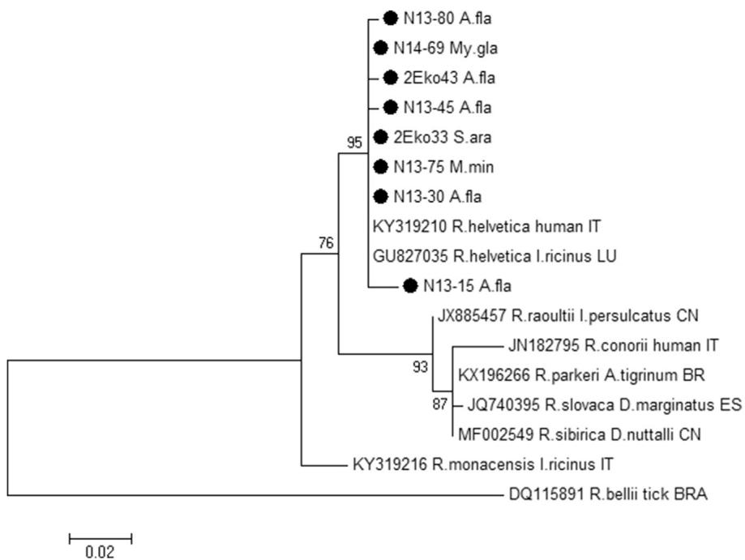

# First detection of Rickettsia helvetica in small mammals in Lithuania

D. Mardosaite-Busaitien _ e_ 1 , J. Radzijevskaja1 , L. Bal-ciauskas2 and A. Paulauskas1

1) Vytautas Magnus University, Department of Biology, Kaunas and 2) Nature Research Centre, Laboratory of Mammalian Ecology, Vilnius, Lithuania

# Abstract

A total of 489 small mammals belonging to seven species captured in Lithuania during 2013–2014 were investigated for Rickettsia pathogens. The overall prevalence of Rickettsia spp. was $2 7 . 6 \%$ , with a higher prevalence detected in Micromys minutus $( 4 5 . 9 \% )$ , followed by Apodemus flavicollis $( 2 9 . 4 \% )$ , Sorex araneus $( 2 5 \% )$ and Myodes glareolus $( 2 3 . 7 \% )$ . Sequence analysis of the gltA gene and the $1 7 \ \mathsf { k D a }$ protein coding gene revealed the presence Rickettsia helvetica. This study demonstrates not only the first reported presence of R. helvetica in small mammals in Lithuania but also the first report of R. helvetica in M. minutus more generally.

$\circledcirc$ 2018 Published by Elsevier Ltd.

Keywords: 17 kDa, gltA, Lithuania, Rickettsia helvetica, rodents, shrews

Original Submission: 24 October 2017; Revised Submission: 6 December 2017; Accepted: 20 December 2017

Article published online: 6 January 2018

Corresponding author: A. Paulauskas, Vytautas Magnus University, Vileikos 8, 44404 Kaunas, Lithuania E-mail: algimantas.paulauskas@vdu.lt

# Introduction

Rickettsiae are intracellular vector-borne bacteria with complex life cycles that are transmitted to vertebrates, including humans, by a variety of haematophagous arthropod vectors such as ticks, fleas and mites [1]. Members of the genus Rickettsia are divided into the spotted fever group rickettsioses, typhus group rickettsioses and an ancestral group (including Rickettsia bellii and Rickettsia canadensis) [2]. There are currently 30 Rickettsia species with standing in nomenclature and a growing number of ‘Candidatus’ species, whose taxonomic position is still unclear. In Europe, rickettsioses are mainly caused by spotted fever group Rickettsia, which is transmitted by hard ticks (such as Ixodes ricinus, Dermacentor reticulatus and Rhipicephalus spp.). At least eight Rickettsia species that are transmitted by ticks (including Rickettsia aeschlimannii, Rickettsia conorii, Rickettsia massiliae, Rickettsia helvetica, Rickettsia monacensis, Rickettsia sibirica, Rickettsia slovaca and Rickettsia raoultii) are characterized as human pathogens in Europe [2,3]. In Lithuania,

four Rickettsia species (R. sibirica, R. slovaca, R. raoultii and R. helvetica) have been reported. The presence of R. sibirica and R. slovaca has been confirmed in human and cattle serum samples [4]. With prevalences of $1 7 \%$ and $4 . 9 \%$ , respectively, R. helvetica has recently been detected in I. ricinus ticks and R. raoultii in D. reticulatus ticks [5].

In Europe, investigations on the prevalence of Rickettsia have mainly focused on arthropod vectors, and several studies (conducted in the Netherlands, Germany, Slovakia, Hungary, Italy, Poland, Austria and Croatia) have investigated the presence of Rickettsia spp. in wild-living small mammals [6–8]. As reviewed by Cull et al. [9], small mammals are important hosts for the immature stages of ixodid ticks and are considered reservoir hosts of the tick-borne encephalitis virus, Borrelia burdorferi (sensu lato), Borrelia miyamotoi, Babesia microti, Anaplasma phagocytophilum and ‘Candidatus Neoehrlichia mikurensis.’ However, there is still a lack of data on the prevalence of rickettsioses in different species of small mammals, and the role of these small mammals in the maintenance of these pathogens is poorly understood.

The aims of the present study were to investigate the presence of Rickettsia spp. in different species of small mammals in Lithuania, to characterize the detected rickettsioses using partial sequencing of the gltA gene and 17 kDa protein coding gene and to determine the prevalence of Rickettsia spp. in small mammals from different locations in two regions of the country.

# Materials and methods

# Small mammal trapping

Small mammals were captured by live traps or snap traps in 11 locations situated in the coastal area (Curonian Spit; sites 1–8) and central part (sites 9–11) of Lithuania during 2013–2014 (Table 1). Permission to trap wild small mammals was provided according to regulations 1 (2013-04-10) and 15 (2014-03-31) of the Ministry of the Environment of the Republic of Lithuania. All trapped animals were marked and identified to species level, and age and sex were recorded.

In total, 489 small mammals representing seven species— Apodemus flavicollis, Micromys minutus, Myodes glareolus, Microtus oeconomus, Microtus agrestis, Microtus arvalis and Sorex araneus—were collected (Table 1). In 2013, a total of 256 animals were trapped: 101 A. flavicollis, 10 M. minutus, 131 M. glareolus, five M. oeconomus and nine S. araneus. In 2014, 233 small mammals were trapped: 130 A. flavicollis, 27 M. minutus, 67 M. glareolus, three M. oeconomus, three S. araneus, two M. agrestis and two M. arvalis. The dominant small mammal species trapped in the Curonian Spit was A. flavicollis, while in the central part of country, it was M. glareolus (Table 1).

# PCR and sequencing

In the present study, we used the spleens of small mammals for the molecular detection of Rickettsia pathogens. DNA from the spleen samples was extracted by using a genomic DNA purification kit (Thermo Fisher Scientific Baltics, Vilnius, Lithuania), according to the manufacturer’s instructions. Screenings for the presence of rickettsiae were conducted through the amplification of the 338 bp fragment of the gltA gene in nested PCR using two primer sets, $\mathsf { R p C S . 8 7 7 p . R p C S . 1 2 5 8 n }$ and $R _ { \mathsf { P } } { \mathsf { C S } } . 8 9 6 _ { \mathsf { P } } .$ ${ \mathsf { R P C S } } . { \mathsf { I 2 3 3 n } }$ [10]. All gltA-positive samples for Rickettsia were additionally examined by seminested PCR methods using primer sets Rr17k.1p-Rr17k.539n and Rr17k.90p-Rr17k.539n by

amplification of a 450 bp fragment of the 17 kDa protein coding gene [11]. A selected number of Rickettsia-positive samples for both genes were subjected to sequence analysis and were extracted from agarose gel and purified using the GenJET PCR purification kit (Thermo Fisher Scientific Baltics) according to the manufacturer’s instructions. PCR products were sequenced (Macrogen, Amsterdam, The Netherlands). The obtained sequences were analysed by the MEGA 6.05 software package and compared with the sequence data available from the GenBank using the BLAST program. A phylogenetic tree was constructed using the maximum-likelihood method. The most appropriate model of nucleotide substitution was determined according to the Bayesian information criterion using the program jModelTest2 [12,13].

Partial sequences for representative samples were submitted to GenBank under accession numbers MF491763 to MF491766 for gltA and MF491753 to MF491760 for the $1 7 \ \mathsf { k D a }$ protein coding gene.

# Statistical analysis

Differences in the prevalence of Rickettsia spp. between different species of small mammals, sampling locations, regions and years were assessed by Fisher’s exact test, supplemented with the Mantel-Haenszel common odds ratio estimate and $9 5 \%$ confidence intervals using SPSS software version 22 (IBM SPSS, Chicago, IL, USA). $\mathsf { p } < 0 . 0 5$ was considered significant.

# Results

# Prevalence of Rickettsia spp. in small mammals

Rickettsia pathogens in small mammals were detected in seven of 11 sampling locations, with an overall prevalence of $2 7 . 6 \%$ (135/489) (Table 1). The prevalence of Rickettsia in different locations ranged from $1 7 . 6 \%$ (15/85) to $4 2 . 5 \%$ (17/40).

TABLE 1. The prevalence of Rickettsia spp. in small mammals in different locations in Lithuania, 2013–2014   

<table><tr><td rowspan="2">No.</td><td rowspan="2" colspan="2">Location</td><td rowspan="2" colspan="2">Coordinates</td><td colspan="8">Detection of Rickettsia spp. in different small mammal species</td></tr><tr><td>Apodemus flavicollis</td><td>Micromys minutus</td><td>Myodes glareolus</td><td>Microtus oeconomus</td><td>Microtus agrestis</td><td>Microtus arvalis</td><td>Sorex araneus</td><td>Total</td></tr><tr><td>1</td><td>Curonian</td><td>Amber Gulf</td><td>55°33&#x27;06.0&#x27;&#x27;N</td><td>21°07&#x27;31.5&#x27;&#x27;E</td><td>13/44 (29.5%)</td><td>12/30 (40%)</td><td>1/7</td><td>0/3</td><td></td><td></td><td>0/1</td><td>15/85 (17.6)</td></tr><tr><td>2</td><td>Spit</td><td>Lybis Cape</td><td>55°16&#x27;57.1&#x27;&#x27;N</td><td>20°57&#x27;30.8&#x27;&#x27;E</td><td>6/20 (30%)</td><td>1/3</td><td>1/6</td><td></td><td></td><td>0/1</td><td>0/2</td><td>8/32 (25)</td></tr><tr><td>3</td><td></td><td>Juodkrante</td><td>55°32&#x27;30.9&#x27;&#x27;N</td><td>21°07&#x27;02.4&#x27;&#x27;E</td><td>14/69 (20.1%)</td><td>2/2</td><td></td><td></td><td></td><td></td><td></td><td>16/71 (22.5)</td></tr><tr><td>4</td><td></td><td>Pervalkos Gulf</td><td>55°24&#x27;37.7&#x27;&#x27;N</td><td>21°05&#x27;08.4&#x27;&#x27;E</td><td>4/10</td><td></td><td>1/4</td><td></td><td></td><td></td><td>0/1</td><td>5/15 (33.3)</td></tr><tr><td>5</td><td></td><td>Nida Dump</td><td>55°23&#x27;33.5&#x27;&#x27;N</td><td>21°02&#x27;58.4&#x27;&#x27;E</td><td>0/5</td><td></td><td>0/1</td><td></td><td></td><td></td><td></td><td>0/6</td></tr><tr><td>6</td><td></td><td>Karvaicai Gulf</td><td>55°23&#x27;15.4&#x27;&#x27;N</td><td>21°04&#x27;19.4&#x27;&#x27;E</td><td>15/29 (51.7%)</td><td>2/2</td><td>0/3</td><td>0/5</td><td></td><td></td><td>0/1</td><td>17/40 (42.5)</td></tr><tr><td>7</td><td></td><td>Grobstas Cape</td><td>55°32&#x27;33.6&#x27;&#x27;N</td><td>21°07&#x27;13.1&#x27;&#x27;E</td><td></td><td></td><td></td><td></td><td>0/2</td><td></td><td></td><td>0/2</td></tr><tr><td>8</td><td></td><td>Cormorant colony</td><td>55°31&#x27;08.4&#x27;&#x27;N</td><td>21°06&#x27;42.7&#x27;&#x27;E</td><td>12/29 (41.4%)</td><td></td><td></td><td></td><td></td><td></td><td></td><td>12/29 (41.4)</td></tr><tr><td>9</td><td>Central</td><td>Elektrenai</td><td>54°43&#x27;42.4&#x27;&#x27;N</td><td>24°38&#x27;35.4&#x27;&#x27;E</td><td></td><td></td><td>0/18</td><td></td><td></td><td></td><td></td><td>0/18</td></tr><tr><td>10</td><td>Lithuania</td><td>Giedraicai</td><td>55°02&#x27;49.8&#x27;&#x27;N</td><td>25°20&#x27;17.4&#x27;&#x27;E</td><td>4/20 (20%)</td><td></td><td>44/127 (34.6%)</td><td></td><td></td><td></td><td>3/7</td><td>51/154 (33.1)</td></tr><tr><td>11</td><td></td><td>Lukstas</td><td>55°43&#x27;40.6&#x27;&#x27;N</td><td>22°20&#x27;41.1&#x27;&#x27;E</td><td>0/5</td><td></td><td>0/32</td><td></td><td></td><td></td><td></td><td>0/37</td></tr><tr><td>Total</td><td></td><td></td><td></td><td></td><td>68/231 (29.4)</td><td>17/37 (45.9)</td><td>47/198 (23.7)</td><td>0/8</td><td>0/2</td><td>0/1</td><td>3/12 (25%)</td><td>135/489 (27.6%)</td></tr></table>

Rickettsial DNA was found in three rodent species, A. flavicollis, M. minutus and M. glareolus, as well as in the common shrew, S. araneus. Rickettsia spp. were found in 68 $( 2 9 . 4 \% )$ of the 231 A. flavicollis, 17 $( 4 5 . 9 \% )$ of the 37 M. minutus, 47 $( 2 3 . 7 \% )$ of the 198 M. glareolus and three $( 2 5 \% )$ of the 12 S. araneus. Thus, significantly higher overall infection rates were detected in M. minutus (odds ratio, 2.3; $9 5 \%$ confidence interval, 1.198–4.665; p 0.013). Rickettsia-infected M. minutus were found in all locations where these rodents were captured (Table 1). The prevalence of Rickettsia pathogens in A. flavicollis and M. glareolus ranged in different locations from 0 to $5 1 . 7 \%$ and from 0 to $34 . 6 \%$ , respectively. Three Rickettsia-infected S. araneus specimens were found in one of the five sampling locations (site 10) (Table 1).

There were no significant differences between the prevalence of Rickettsia between sampling locations, regions and years.

# Molecular characterization of Rickettsia isolates derived from small mammals

Fifty PCR products of gltA gene $( \mathsf { n } = 2 5 )$ ) and $1 7 ~ \mathsf { k D a }$ protein coding gene $( \mathsf { n } \ = \ 2 5 )$ ) of Rickettsia isolates derived from 50 distinct positive specimens of A. flavicollis, M. minutus, M. glareolus and S. araneus were sequenced. The sequence analysis of the partial gltA gene showed that the Rickettsia isolates derived from A. flavicollis, M. minutus, M. glareolus and S. araneus specimens were $100 \%$ identical to each other and to the R. helvetica sequences deposited in GenBank. The $1 7 \ \mathsf { k D a }$ protein coding gene sequences derived from Rickettsia-positive small mammals

were $9 9 \%$ to $100 \%$ identical to R. helvetica isolates from ticks and humans. Five genotypes of the $1 7 \ \mathsf { k D a }$ protein coding gene of R. helvetica with one to three nucleotide differences were detected in A. flavicollis (Fig. 1).

# Discussion

Our study is to our knowledge the first investigation on the prevalence and molecular characterization of R. helvetica in A. flavicollis, M. minutus, M. glareolus and S. araneus in Lithuania. To our knowledge, this is the first detection of R. helvetica in M. minutus.

In Europe, six rickettsial pathogens—R. helvetica, R. raoultii, R. slovaca, R. conorii and R. felis—have been detected in rodents using molecular methods: R. helvetica in A. flavicollis, Apodemus sylvaticus, Apodemus agrarius, M. glareolus and Mus musculus [8], R. raoultii in A. flavicollis and M. glareolus [14,15], R. slovaca in Apodemus spp. [16], R. conorii in A. sylvaticus and M. glareolus [1] and R. felis in A. flavicollis [15]. S. araneus has been found (based on serologic investigation) to be susceptible to R. helvetica infection [17].

The most common spotted fever group rickettsial pathogen, R. helvetica, was first isolated in 1979 from I. ricinus ticks in Switzerland [18]. Since then, R. helvetica has been reported in I. ricinus ticks throughout Europe [2], including the Baltic countries [5,19,20]. Cases of human infection related to R. helvetica have been reported in France, Italy, Switzerland, Sweden, Denmark, Austria and Slovakia [2]. Lithuania has not

  
FIG. 1. Phylogenetic analysis of Rickettsia spp. in small mammals. Maximum likelihood tree for partial $1 7 \ \mathsf { k D a }$ gene sequences of Rickettsia genus was generated with HKY model by using discrete gamma distribution $( + G )$ and bootstrap analysis of 1000 replicates. Sequences with accession numbers were obtained from GenBank for comparison. Identification source (host) and country codes are provided after species names. Samples sequenced in present study are marked with solid circle. Rickettsia bellii was used as outgroup.

developed surveillance systems for rickettsioses, and so far no reported human clinical cases due to Rickettsia species infection have been registered in Lithuania.

Rickettsia species have been identified by molecular detection from the ears, blood and spleen of small rodents. Rodent ears are the zone where ticks mostly feed; primary infection is thus localized near the tick-bite sites. After inoculation of the rickettsiae into the host, the bacteria proliferate in endothelial cells close to the inoculation site. The bacteria may be disseminated via lymph and blood to various organs, including lungs, liver, spleen, kidney and heart [21], and can be detected in blood and different internal organs of the host. In the present study, the overall prevalence of Rickettsia spp. in the spleen samples of the small mammals was high $( 2 7 . 7 \% )$ , particularly in M. minutus $( 4 5 . 9 \% )$ . A similar prevalence of Rickettsia spp. was detected in skin samples taken from the ears of small rodents in Germany $( 2 8 . 6 \% )$ by using real-time PCR, with R. helvetica identified in A. flavicollis, M. glareolus and A. agrarius, while M. glareolus also harboured R. raoultii [14]. R. helvetica was also detected in $2 9 \%$ of the blood samples obtained from A. sylvaticus and M. glareolus in the Netherlands [1]. However, a lower infection rate was reported in southwestern Slovakia where rickettsial DNR was detected in only $9 . 4 \%$ of blood samples of Apodemus spp. and M. glareolus [22]. In Croatia, Rickettsia spp. was found in $3 . 2 \%$ of heart samples of A. flavicollis and M. glareolus [7], while a $2 \times$ lower infection rate was reported in Hungary, where R. helvetica was found in $1 . 9 \%$ of spleen samples of M. musculus [23]. In a study in Poland, none of the blood samples from A. flavicollis (142) and M. glareolus (46) was found to be PCR positive for Rickettsia spp. [24].

In the present study, examined A. flavicollis, M. glareolus and M. minutus rodents were infested with I. ricinus ticks, the main vector for R. helvetica. In previous studies conducted in Lithuania, it has been shown that A. flavicollis mice and M. glareolus voles are frequently infested with immature I. ricinus ticks, with a higher prevalence of infestation detected in A. flavicollis [25].

The high prevalence of R. helvetica in A. flavicollis, M. minutus and M. glareolus detected in the present study suggests that these rodents may play an important role as potential reservoir hosts and thus in the maintenance of this pathogen in nature.

# Acknowledgements

The authors thank A. Ulevi-cius, Vilnius University; L. Bal-ciauskiene and M. Jasiulionis, Nature Research Centre; and_ V. Gedminas, Tadas Ivanauskas Museum, for help in trapping small mammals.

# Conflict of interest

None declared.

# References

[1] Sprong H, Wielinga PR, Fonville M, Reusken C, Brandenburg AH, Borgsteede F, et al. Ixodes ricinus ticks are reservoir hosts for Rickettsia helvetica and potentially carry flea-borne Rickettsia species. Parasit Vectors 2009;2:41.   
[2] Parola P, Paddock CD, Socolovschi C, Labruna MB, Mediannikov O, Kernif T, et al. Update on tick-borne rickettsioses around the world: a geographic approach. Clin Microbiol Rev 2013;26:657–702.   
[3] Eremeeva ME, Dasch GA. Challenges posed by tick-borne rickettsiae: eco-epidemiology and public health implications. Front Public Health 2015;3:1–17.   
[4] Tarasevich I, Moteyunas L, Rehacek J, Yablonskaya V, Plotnikova L, Fetisova N, et al. Occurrence of rickettsioses in the Lithuanian Soviet Socialist Republic. Folia Parasitol (Praha) 1981;28:169–77.   
[5] Radzijevskaja J, Paulauskas A, Aleksandraviciene A, Jonauskaite I, Stanko M, Karbowiak G, et al. New records of spotted fever group rickettsiae in Baltic region. Microbes Infect 2015;17:874–8.   
[6] Schmit S, Essbauer SS, Mayer-Scholl A, Poppert S, Schmidt-Chanasit J, Klempa B, et al. Multiple infections of rodents with zoonotic pathogens in Austria. Vector Borne Zoonotic Dis 2014;14:467–75.   
[7] Svoboda P, Dobler G, Markotic A, Kurolt IC, Speck S, Habu-s J, et al. Survey for hantaviruses, tick-borne encephalitis virus, and Rickettsia spp. in small rodents in Croatia. Vector Borne Zoonotic Dis 2014;14: 523–30.   
[8] Minichová L, Ham-síková Z, Mahríková L, Slovák M, Kocianová E, Kazimírová M, et al. Molecular evidence of Rickettsia spp. in ixodid ticks and rodents in suburban, natural and rural habitats in Slovakia. Parasit Vectors 2017;10:158.   
[9] Cull B, Vaux AGC, Ottowell LJ, Gillingham EL, Medlock JM. Tick infestation of small mammals in an English woodland. J Vector Ecol 2017;42:74–83.   
[10] Regnery R, Spruill C, Plikaytis B. Genotypic identification of rickettsiae and estimation of intraspecies sequence divergence for portions of two rickettsial genes. J Bacteriol 1991;173:1576–89.   
[11] Ishikura M, Ando S, Shinagawa Y, Matsuura K, Hasegawa S, Nakayama T, et al. Phylogenetic analysis of spotted fever group rickettsiae based on gltA, 17-kDa, and rOmpA genes amplified by nested PCR from ticks in Japan. Microbiol Immunol 2003;47:823–32.   
[12] Guindon S, Gascuel O. A simple, fast and accurate method to estimate large phylogenies by maximum-likelihood. Syst Biol 2003;52:696–704.   
[13] Darriba D, Taboada GL, Doallo R, Posada D. jModelTest 2: more models, new heuristics and parallel computing. Nat Methods 2012;9: 772.   
[14] Obiegala A, Oltersdorf C, Silaghi C, Kiefer D, Kiefer M, Woll D, et al. Rickettsia spp. in small mammals and their parasitizing ectoparasites from Saxony, Germany. Vet Parasitol 2016;5:19–24.   
[15] Obiegala A, Krol N, Oltersdorf C, Nader J, Pfeffer M. The enzootic life-cycle of Borrelia burgdorferi (sensu lato) and tick-borne rickettsiae: an epidemiological study on wild-living small mammals and their ticks from Saxony, Germany. Parasit Vectors 2017;10:115.   
[16] Martello E, Selmi M, Ragagli C, Ambrogi C, Stella MC, Mannelli A, et al. Rickettsia slovaca in immature Dermacentor marginatus and tissues from Apodemus spp. in the northern Apennines, Italy. Ticks Tick Borne Dis 2013;4:518–21.

[17] Peter O, Burgdorfer W, Aeschlimann A. Epidemiological survey in a natural focus of Rickettsia transmitted by Ixodes ricinus in Switzerland. Ann Parasitol Hum Comp 1981;56:1–8.   
[18] Burgdorfer W, Aeschlimann A, Pbter O, Hayes SF, Philip RN. Ixodes ricinus vector of a hitherto undescribed spotted fever group agent in Switzerland. Acta Trop 1979;36:357–67.   
[19] Capligina V, Salmane I, Kei-ss O, Vilks K, Japina K, Baumanis V, et al. Prevalence of tick-borne pathogens in ticks collected from migratory birds in Latvia. Ticks Tick Borne Dis 2014;5:75–81.   
[20] Katargina O, Geller J, Ivanova A, Värv K, Tefanova V, Vene S, et al. Detection and identification of Rickettsia species in Ixodes tick populations from Estonia. Ticks Tick Borne Dis 2015;6:689–94.   
[21] Martinez JJ, Cossart P. Early signaling events involved in the entry of Rickettsia conorii into mammalian cells. J Cell Sci 2004;117: 5097–106.

[22] Mi-tková K, Berthová L, Kalúz S, Kazimírová M, Burdová L, Kocianová E. First detections of Rickettsia helvetica and R. monacensis in ectoparasitic mites (Laelapidae and Trombiculidae) infesting rodents in south-western Slovakia. Parasitol Res 2015;114:2465–72.   
[23] Hornok S, Földvári G, Rigó K, Meli ML, Gönczi E, Répási A, et al. Synanthropic rodents and their ectoparasites as carriers of a novel haemoplasma and vector-borne, zoonotic pathogens indoors. Parasit Vectors 2015;8:27.   
[24] Biernat B, Stanczak J, Michalik J, Sikora B, Wierzbicka A. Prevalence of infection with Rickettsia helvetica in Ixodes ricinus ticks feeding on nonrickettsiemic rodent hosts in sylvatic habitats of west-central Poland. Ticks Tick Borne Dis 2016;7:135–41.   
[25] Paulauskas A, Radzijevskaja J, Rosef O, Turcinaviciene J, Ambrasiene D. Infestation of mice and voles with Ixodes ricinus ticks in Lithuania and Norway. Eston J Ecol 2009;58:112–25.