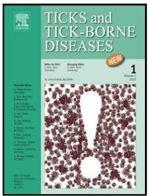
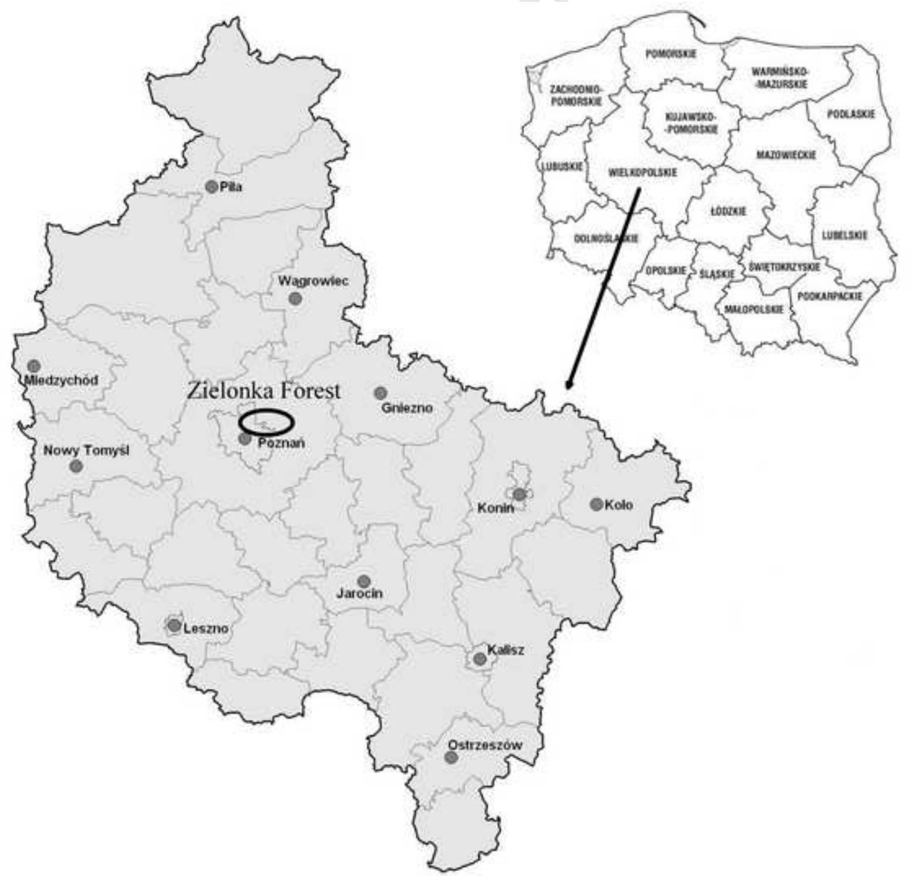

# Accepted Manuscript

Title: Prevalence of infection with Rickettsia helvetica in Ixodes ricinus ticks feeding on non-rickettsiemic rodent hosts in sylvatic habitats of west-central Poland

Author: Beata Biernat Joanna Stanczak Jerzy Michalik Bożena Sikora Anna Wierzbicka

PII: S1877-959X(15)30015-7

DOI: http://dx.doi.org/doi:10.1016/j.ttbdis.2015.10.001

Reference: TTBDIS 545

To appear in:

Received date: 4-3-2015

Revised date: 21-9-2015

Accepted date: 2-10-2015

Please cite this article as: Biernat, B., Stanczak, J., Michalik, J., Sikora, B., Wierzbicka, A., Prevalence of infection with Rickettsia helvetica in Ixodes ricinus ticks feeding on non-rickettsiemic rodent hosts in sylvatic habitats of west-central Poland, Ticks and Tick-borne Diseases (2015), http://dx.doi.org/10.1016/j.ttbdis.2015.10.001

This is a PDF file of an unedited manuscript that has been accepted for publication. As a service to our customers we are providing this early version of the manuscript. The manuscript will undergo copyediting, typesetting, and review of the resulting proof before it is published in its final form. Please note that during the production process errors may be discovered which could affect the content, and all legal disclaimers that apply to the journal pertain.

Prevalence of infection with Rickettsia helvetica in Ixodes ricinus ticks feeding on non-rickettsiemic rodent hosts in sylvatic habitats of west-central Poland

Beata Biernat $^{a*}$ , Joanna Stanczak $^{a}$ , Jerzy Michalik $^{b}$ , Bożena Sikora $^{b}$ , Anna Wierzbicka $^{c}$

$^{a}$ Department of Tropical Parasitology, Institute of Maritime and Tropical Medicine, Medical University of Gdańsk, 9B Powstania Styczniowej str., 81-519 Gdynia, Poland, bebe@gumed.edu.pl

$^{b}$ Department of Animal Morphology, Faculty of Biology, Adam Mickiewicz University, 89 Umultowska str., 61-701 Poznań, Poland

$^{c}$ Department of Game Management and Forest Protection, Faculty of Forestry, Poznan University of Life Sciences, 71d Wojska Polskiego str., 60-637 Poznan, Poland, wierzba@au.poznan.pl

* Corresponding author

Beata Biernat; Department of Tropical Parasitology, Institute of Maritime and Tropical Medicine, Medical University of Gdańsk, 9B Powstania Styczniowego str., 81-519 Gdynia, Poland, bebe@gumed.edu.pl

1 Abstract

2 Ixodes ricinus is the most prevalent and widely distributed tick species in European countries

3 and plays a principal role in transmission of a wide range of microbial pathogens. It is also a

4 main vector and reservoir of Rickettsia spp. of the spotted fever group with the infection level

5 ranging in Poland from 1.3 to $11.4\%$ . Nevertheless, little research has been conducted so far

6 to identify reservoir hosts for these pathogens. A survey was undertaken to investigate the

7 presence of Rickettsia spp. in wild small rodents and detached I. ricinus.

Rodents, Apodemus flavicollis mice and Myodes glareolus voles, were captured in typically

9 sylvatic habitats of west-central Poland. Blood samples and collected ticks were analyzed by

10 conventional, semi-nested and nested PCRs. Rickettsial species were determined by sequence

11 analysis of obtained fragments of gltA and 16S rRNA genes.

12 A total of 2339 immature I. ricinus (mostly larvae) were collected from 158 animals.

13 Proportion of hosts carrying ticks was $84\%$ , being higher for A. flavicollis than for M.

14 glareolus. R. helvetica, the only species identified, was detected in $8\%$ of 12 nymphs and in at

least $10.7\%$ (MIR) of 804 larvae investigated. Prevalence of infected ticks on both rodent

16 species was comparable (10.8 vs 9%). None of blood samples tested was positive for

17 Rickettsia spp.

18 The results showed that in sylvatic habitats the level of infestation with larval $I.$ ricinus was

19 higher in A. flavicollis mice in comparison with M. glareolus voles. They show that R.

helvetica frequently occurred in ticks feeding on rodents. Positive immature ticks were

21 collected from non-rickettsiemic hosts what might suggest a vertical route of their infection

22 (transovarial and/or transstadial) or a very short-lasting rickettsiemia in rodents. A natural

23 vertebrate reservoir host for $R$ . helvetica remains to be determined.

Key words: Ixodes ricinus, Rickettsia helvetica, Apodemus flavicollis, Myodes glareolus, rodents, spotted fever group rickettsiae

# Introduction

Ticks are known worldwide to be vectors of different pathogenic microorganisms including viruses, bacteria and protozoa. Among blood-sucking arthropods only mosquitoes transmit more infectious diseases to humans. In Poland, Ixodes ricinus, a common and widely distributed tick species, is the principal vector of Borrelia burgdorferi sensu lato (s.l.) (Kiewra et al., 2014; Stanczak et al., 1999; Wodecka, 2003), the etiologic agent of Lyme borreliosis, which is the most frequently diagnosed tick-borne disease in Poland with over 13,000 human cases reported in 2013

http://www.pzh.gov.pl/oldpage/epimeld/2014/INF_14_12B.pdf).

This tick species has been found to be infected also with Anaplasma phagocytophilum, the agent of human granulocytic anaplasmosis (HGA) (Stańczak et al., 2002; Sytykiewicz et al., 2012; Welc-Fałęciak et al., 2014) and some species of the genus Babesia (B. divergens, B. venatorum, B. microti), which may cause human babesiosis (Cieniuch et al., 2009; Skotarczak and Cichocka, 2001; Sytykiewicz et al., 2012). Moreover, I. ricinus was found to harbor Rickettsia spp. of the spotted fever group (SFG) - obligatory intracellular bacteria - responsible for a wide range of emerging zoonotic rickettsioses in humans. Of them, the species the most frequently noted in questing ticks in Poland is R. helvetica, with the infection level ranging from 1.3 to $11.4\%$ (Chmielewski et al., 2009; Stańczak et al., 2008; Welc-Fałęciak et al., 2014). An exceptionally high prevalence of this bacterium ( $\sim70\%$ ) was found in Western Pomerania (Wodecka et al. 2014). Furthermore, I. ricinus infections with R. monacensis, R. slovaca and R. raoultii were occasionally reported (Chmielewski et al., 2009; Rymaszewska and Piotrowski, 2013; Welc-Fałęciak et al., 2014 Wodecka et al.; 2014),

although the latter species is predominantly associated with Dermacentor reticulatus, with the infection range between $20\%$ and $57\%$ (Chmielewski et al., 2009; Stańczak, 2006; Wojcik-Fatla et al., 2013). Hard ticks (Ixodidae) are considered to be both the vector and reservoir of the SFG rickettsiae, therefore these bacteria may circulate vertically within a tick population being transmitted transstadially and transovarially (Reháček, 1984). It was also demonstrated for R. helvetica under laboratory conditions that the transovarial transmission rate (TOT), i.e. proportion of infected females giving rise to at least one positive egg or larva, may reach $100\%$ (Socolovschi et al., 2009). Non-infected tick larvae can also acquire the initial infection during feeding on rickettsiemic hosts (horizontal transmission). However, this transmission mode of SFG rickettsiae to the vector is limited by short-lasting rickettsiemia (Socolovschi et al., 2009). It may explain why Rickettsia DNA could not be detected in blood samples of animals parasitized by infected ticks (Barandika et al., 2007; Boretti et al., 2009; Skarphédinsson et al., 2005; Stańczak et al., 2009). On the other hand, there is also evidence of Rickettsia sp. infection in small mammals (Schex et al., 2011), large game animals (Hornok et al., 2014;; Stefanidesova et al., 2008) and birds examined in European studies (Sprong et al., 2009)

As it was experimentally proved that Apodemus flavicollis, Microtus arvalis, Myodes (Clethrionomys) glareolus and Mus musculus might acquire infection with R. slovaca. R. sibirica, R. conori and R. acari (Reháček et al., 1976, 1992), the aim of the present research was (i) to evaluate infestation of small rodent species with Ixodes spp. (ii) to screen ticks and rodent blood samples for the presence of the SFG rickettsiae and assess the potential role of these small mammals in the maintenance of Rickettsia spp. in sylvatic ecosystems.

1 Material and methods

2 Study site

3 The study was conducted in sylvatic habitats situated within the middle of 10.000-ha

4 Landscape Park “Zielonka Forest” – a large forest complex about $30\mathrm{km}$ away from the city

5 of Poznań, in west-central Poland (52°17'N; 16°50'E) (Figure 1). Sampling was performed in

6 the reserve "Mixed forest in Lopuchówko Forest Division" covering an area of 10.83 ha. The

7 reserve consists of a natural oak and pine forest stand (up to 200 years old) including also

8 younger hornbeams and beeches.

9 Trapping of rodents

10 Animals were trapped alive for three consecutive nights once per month from May to

11 September 2006 using 80 wooden traps baited with oat flakes. Traps were placed along six

12 transects (each $50\mathrm{m}$ long) spaced 10 to $20\mathrm{m}$ apart, depending on location. Captured animals

were anesthetized with Narkotan, approximately aged and sexed by weighting, and examined

14 carefully for ticks in a field laboratory using a head-mounted magnifying glass. Attached ticks

were removed with forceps, identified to species level by using the appropriate taxonomic key

16 (Siuda 1993) and preserved in $70\%$ ethanol until examination. Whenever possible, a drop of

17 whole blood $(\approx 2 - 4\mu \mathrm{L})$ was collected from the tail of animal using a 28-gauge needle and a

18 pipette. EDTA-blood samples were stored at $-20^{\circ}\mathrm{C}$ until extraction. In case of 26 animals, we

failed to draw blood samples. Rodents were marked with numbered ear tags (World Precision

20 Instruments Inc., Sarasota FL, USA) and released at the place of capture. Animals recaptured

21 within the same trapping session were released immediately. Trapping and handling

22 procedures of rodents were approved by the respective authorities (permission no. DOPog-

23 4201-03-158/03/al). The majority of the blood samples $(n = 149)$ had been examined for

24 Rickettsia DNA previously (Stanczak et al., 2009).

# DNA extraction and PCR amplification

Only undamaged, partially or fully engorged ticks were tested by PCR. Therefore, each tick was examined under a stereomicroscope in order to check the level of engorgement. Larvae without any visible blood remnants in the midgut were excluded from PCR analysis. Total DNA from remaining 13 blood samples as well as from fully engorged larvae and nymphs was extracted using two commercial kits: Genomic Mini AX Blood and Sherlock AX, respectively (A&A Biotechnology, Gdynia, Poland). Extraction of nucleic acids from partially-engorged specimens was done by boiling in $\mathrm{NH_4OH}$ (Guy and Stanek, 1991; Rijpkema et al. 1996). Altogether, 816 immature $I.$ ricinus including 12 nymphs and 804 larvae were selected and tested for the presence of rickettsial DNA. Minimum one and maximum 47 ticks per animal were tested. All nymphs and 18 larvae were examined individually. The remaining 786 larvae were tested in 212 pools consisting of two to five individuals (20x2; 88x3; 46x4 and 58x5, respectively). All larvae in a pool were from the same host.

A conventional PCR was carried out using the primer pair RpCS.877p and RpCS.1258n amplifying a fragment of the citrate synthase encoding gene (gltA), which has conserved regions shared by all known Rickettsia species (Regnery et al., 1991). DNA products of 380 bp were considered to be positive results. Then, all positive samples were rerun using semi-nested and nested PCR assays amplifying parts of the 16S rRNA gene and the $rOmpA$ -encoding gene, respectively. Seminested PCR was conducted with three primers of which Ric and Ric U8 yielded a 1,385-bp fragment encompassing almost the complete gene, while a combination of Ric and Ric Rt were amplifying a 757 bp fragment (Raoult et al., 2002). In the nested PCR primers SLO1F/SLO1R were used as the outer pair, while SLO2F/SLO2R as the inner one (Nilsson et al., 1997). As a results amplicons of 355 bp were expected. All reactions were conducted in the 20-μL PCR mixtures contained 0.5U of RUN Taq polymerase, 2 μL of

10x PCR reaction buffer with 1.5 mM of $\mathrm{MgCl_2}$ (A&A Biotechnology, Gdynia, Poland), 2 μL of 10 mM dNTPs mixture (2.5 mM each) (FERMENTAS, Lithuania), 0.4 μL of each of the primers used (10 μM), 12.7 μL of double-distilled water (DDW) and 2 μL of DNA templates. Nested and semi-nested amplifications used 1 μL of the primary PCR products and 13.7 μL of DDW. DNAs of R. helvetica and R. raoultii from the positive reactions obtained in our previous investigations (Stanczak, 2006; Stanczak et al., 2009) and confirmed by the sequence analysis of the PCR products were used as positive controls while DDW as a negative control. The thermal cycling conditions of the conventional and semi-nested PCR were as described earlier (Nilsson et al., 1997; Regnery et al., 1991).

All PCR reactions were carried out in a GeneAmp® PCR System 9700 (Applied Biosystems 850, Foster City, CA, USA).

PCR products were separated on $2\%$ agarose gels stained with Midori Green DNA Stain (Nippon Genetics Europe GmbH) and visualized under UV light using GelDoc-It, Imagine Systems $\mathrm{UV}^{\mathrm{TM}}$ Transluminator (Upland CA 91786, USA).

Randomly chosen samples that produced a positive result were selected for sequencing. The PCR products were purified using the Clean-Up purification kit (A&A Biotechnology, Gdynia, Poland), sequenced bidirectionally with a sets of primers identical to those used in the PCR and nested PCR by using ABI Prism® Big Dye™ Terminator v.3.1 Cycle Sequencing Kit and then analyzed with ABI Prism 3130xL Genetic Analyser (Applied Biosystem®) according to the manufacturer's protocol. Finally, sequences were edited and compared with each other and with corresponding sequences registered in the GenBank database using the NCBI BLAST program (U. S. National Institutes of Health, Bethesda, Maryland) [http://blast.ncbi.nlm.nih.gov/Blast.cgi]. Than consensus sequences were submitted to GenBank.

1 Results   
2 Rodents and their tick infestation   
3 In total, 188 animals consisting of 142 (75.5%) yellow-necked mice (A. flavicollis) and 46   
(24.5%) bank voles (M. glareolus) were examined for ticks. One hundred fifty-eight (84%)   
5 animals hosted 2324 (99.4%) larval and 15 (0.6%) nymphal I. ricinus in different   
6 engorgement level (Table 1). A detailed seasonal analysis of infestation indices for both   
rodent species was published previously (Michalik et al., 2007). On average, one trapped   
8 mouse hosted 12 times more larvae than bank voles (15.9 vs 1.3 per host, respectively; Mann-  
9 Whitney U-Test, p<0.001). The prevalence of larval infestation was almost twofold higher for   
10 A. flavicollis (94.4%) in comparison to M. glareolus (52.2%). Thirteen (9.7%) of 134 yellow-  
11 necked mice carrying larvae, were concurrently infested with nymphs. No nymphs were   
12 found on bank voles. Male mice and voles carried considerably more larval ticks than did   
13 females.   
14 Detection of rickettsiae in ticks and rodent blood samples   
In total, 816 I. ricinus derived from 120 infested animals, including 30 individual ticks (12   
16 nymphs and 18 larvae) and 212 pools of larvae $(n = 786)$ were tested by the conventional PCR,   
17 targeting a fragment of the gltA gene. Rickettsial DNA was identified in two of 12 (11.1%)   
18 individually tested larvae, and in 84 larval pools (39.6%). Among 12 nymphs tested, one   
19 (8.3%) was PCR positive. Assuming that only one tick in each positive pool carried the   
20 pathogen (minimum infection rate - MIR), at least $10.7\%$ larvae were found to be infected   
21 (Table 2).   
Sixty-two (51.7%) of the 120 infested rodents hosted PCR-positive ticks. They were collected   
23 from 59 A. flavicollis (represented by 18 females, 38 males and 3 juvenile mice) and from   
24 three M. glareolus (one female and two male voles). MIR calculated for I. ricinus larvae was   
25 comparable for both A. flavicollis (10.8%) and M. glareolus (9.4%). In case of female bank

voles, MIR (16.8%) was two times higher than in male animals (8.0%). None of two nymphs collected from a juvenile vole harbored the bacterium. In case of yellow-necked mice, MIR was comparable in males and females (10.1 vs 10.4%) (Table 2). None of the blood samples collected from rodents was found to be PCR positive for Rickettsia spp.

# DNA sequencing

To determine species of detected rickettsiae, all gltA-positive samples were rerun using semi-nested and nested PCR assays amplifying parts of the 16S rRNA gene and the ompA-gene, respectively. All results from the regular PCR were confirmed by the semi-nested PCR. On the other hand no positive results were obtained in the nested PCR. As the ompA-gene, that is very divergent among SFG rickettsiae, seems to be not amplified for R. helvetica (Roux et al., 1996), negative results suggested that ticks were infected only with this species. To confirm this suggestion 20 randomly chosen products of RpCS.877-RpCS.1258 (n=10) and Ric-RicRt (n=10) positive samples were sequenced and compared with Rickettsia spp. sequences deposited at GenBank.

The obtained 374-375 bp sequences of the gltA gene showed their $100\%$ homology to each other and revealed $100\%$ identity to the corresponding fragments of R. helvetica isolates obtained from I. ricinus in Poland (GenBank acc. no: EU779822), Slovakia (KF016135), Germany (KC0071266) and France (KF447530). Moreover, all 16 sequences of the 16S RNA gene were $100\%$ identical to the corresponding sequence R. helvetica strain C9P9 (L36212) from ticks and to R. helvetica clone CsFC (GQ413963) isolated from human cerebrospinal fluid in Sweden.

Consensus sequences of amplified fragments of 16S rRNA and gltA genes were submitted to GenBank under acc. no. KJ740388 and KJ740389, respectively.

# Discussion

Small rodents are important hosts for the immature stages of Ixodidae ticks (Mihalca and

Sándor, 2013) and are considered as reservoirs of different tick-borne pathogens, like TBE

virus (Donoso-Mantke et al., 2011; Estrada-Pena and de la Fuente, 2014; Imhoff et al., 2015),

B. burgdorferi s.l. (Gern et al., 1998; Richter et al. 2004, 2011), A. phagocytophilum (Liz et

al., 2000; Keesing et al. 2012) or Neoehrlichia mikurensis (Burri et al. 2014; Obiegala et al.

2014). However, despite the high rate of infection of questing I. ricinus ticks with R. helvetica

that has been reported e.g. in Germany (Silaghi et al., 2011), Sweden (Severinsson et al.,

2010), The Netherlands (Sprong et al., 2009) and Poland (Stanczak et al., 2008), the studies

on its occurrence in populations of wild mammals and ticks feeding on them are still lacking.

Therefore, to evaluate the role of small rodents as reservoir hosts for tick-borne SF

rickettsioses in Poland, A. flavicollis and M. glareolus were sampled in sylvatic habitats in

west-central Poland. Both rodent species belong to the most ubiquitous in central European

woodlands, and are known to be hosts for subadult I. ricinus (Matuschka et al., 1990, 1991).

In our study site, $84\%$ of the animals carried at least one attached tick, however, the relative

contribution of both species as hosts for $I.$ ricinus differed considerably demonstrating strong

host-preferences. The yellow-necked mice that comprised more than two-third of all rodents,

hosted on average twelve times more larvae than did bank voles. Differences in prevalence

and abundance of larval infestation assessed for A. flavicollis and M. glareolus during our

survey are in line with most European studies (Humair et al., 1993; Kifner et al., 2010;

Kurtenbach et al., 1995; Matuschka et al., 1992; Michalik et al., 2005; Nilsson, 1988;

Täleklint and Jaenson, 1997). The observed in field usually low abundance of I. ricinus

larvae on $M.$ glareolus could be attributed to immune resistance exhibited by bank voles after

repeated larval infestations confirmed in laboratory conditions (Dizij et al., 1995). It seems

that Apodemus mice do not acquire resistance to ticks. On the other hand, there are also data

showing that $M$ glareolus voles may occasionally act as important hosts for larval I. ricinus

(Humair et al., 1993). In the current study, feeding larvae clearly prevailed over nymphs that were found only on mice. This very low number of nymphs per rodent in our study area (0.08 per animal) demonstrates that in sylvatic habitats small rodents serve as very poor hosts for this developmental stage. Such extremely low loads of nymphs on small rodents was reported previously in European studies. Gray et al., (1999) collected 755 larvae and scarcely one nymphal I. ricinus from 417 woodland rodents studied in Ireland. In Slovakia, Stanko and Miklisová (2000) obtained 260 nymphs (0.14 per animal) from 1.826 A. flavicollis mice, whereas in a survey conducted by Matuschka et al., (1991) in Germany, the mean abundance of nymphs on A. flavicollis reached 0.19.

Here, we report the occurrence of spotted fever group rickettsiae in rodent-feeding $I.$ ricinus ticks. Sequencing analysis of gltA and 16S rRNA genes confirmed that ticks were infected with the only one species - $R.$ helvetica. The sequences were identical or almost identical ( $>99\%$ ) to published sequences of $R.$ helvetica detected throughout Europe.

Rickettsial DNA was detected in $8.3\%$ out of 12 nymphs and in at least $10.7\%$ out of 804 larvae tested in pools (MIR). Assuming that MIR parameter tends to underestimate the real infection rate, the actual value may be higher. In a German study, SFG rickettsiae were found in only $1.8\%$ of $I.$ ricinus derived from $A.$ flavicollis and $M.$ glareolus (Franke et al., 2010). Similarly, ticks were almost exclusively infected with $R.$ helvetica and no significant differences in the prevalence of this agent was observed between ticks from both rodent species. In Switzerland, Rickettsia spp. were detected in $6.8\%$ of the immature ticks attached to yellow-necked mice and bank voles (Burri et al., 2014).

Infection with SFG rickettsiae has also been described in ticks parasitizing European hedgehogs, Erinaceus europaeus sampled in Germany and Great Britain. Both $I$ . hexagonus and $I$ . ricinus ticks collected from these mammals proved to yield $R$ . helvetica DNA and calculated MIR was $11.7\%$ . There was no significant difference in infection rates between the

two Ixodes species, but the pathogen prevalence increased with the tick developmental stage, with the highest values in adults (26.7% vs 35.9%). Rickettsia DNA was also found in tissue samples from 2 hedgehogs (Speck et al., 2013). Also medium and large-sized animal hosts, both wild (carnivores, deer, Iberian ibex, wild boars) (Márquez, 2009; Márquez and Millán, 2009; Stańczak et al., 2009) and domestic (cats, dogs, horses) (Borretti et al., 2009; Claerebout et al., 2013) are found to be frequently parasitized by Rickettsia-infected Ixodes spp. with the prevalence even up to $50\%$ . Recently, $51.4\%$ of bird ticks tested in Hungary have been found to be positive for rickettsiae and the first evidence of bacteremia with $R$ . helvetica in European robin (Erithacus rubecula) and dunnocks (Prunella modularis) has been reported (Hornok et al., 2014). Thus, birds also might be considered as a potential source of infection for $I$ . ricinus and competent reservoir for rickettsiae.

The results presented here support previous findings that in Wielkopolska province (western Poland) infection of $I.$ ricinus with this bacterium is frequent. It was detected there both in questing ticks from different areas and in feeding ticks collected from three deer species (Stańczak et al., 2008; 2009). The MIR of larvae (10.7%) and infection level of nymphs (8.3%) detached from rodents in this study were slightly higher or comparable with the mean infection level of engorged nymphs $I.$ ricinus from deer (8.4%) and ~1.5 - 2 times lower, respectively, than in feeding females (16.8%). Generally, prevalence of $R.$ helvetica in feeding ticks was higher in comparison with the infection rates in questing nymphs (4.9%), male (5%) and female (7%) ticks, respectively (Stańczak et al., 2008). Therefore, one might suggest that ticks become infected with $R.$ helvetica also via a blood-meal on an infected host in addition to vertical transmission through the next stages. However, despite the fact that $R.$ helvetica was detectable in $I.$ ricinus feeding on the rodents, none of the blood samples tested in this study as well as in our previous report (Stańczak et

al., 2009) proved to harbor the bacterium. Our results are in agreement with those of other authors from Spain (Barandika et al., 2007) and Slovakia (Spitalská et al., 2008).   
In Switzerland, xenodiagnostic I. ricinus larvae were used to evaluate the role of rodents as reservoirs for this bacterium and none of them acquired Rickettsia spp. during feeding on the animals (Burri et al., 2014). In contrary, in The Netherlands, $29\%$ whole blood samples obtained from rodents, including A. sylvaticus and M. glareolus, were found to be infected with R. helvetica. Moreover, $14\%$ and $1.4\%$ of the samples carried DNA of Rickettsia spp. and R. conorii, respectively (Sprong et al., 2009). Screening of ear samples from rodents in Germany revealed a prevalence of rickettsial DNA in $7.6\%$ of them. However, none of liver samples proved to be infected (Schex, 2011; Schex et al., 2011). Finally, in Austria, Panrickettsial PCR analysis also revealed positive tissue samples from M. arvalis and M. glareolus, while indirect IFA investigations using R. conorii as the SFG antigen demonstrated reactivity in $13.3\%$ of four different rodent species trapped, most frequently in M. arvalis (Schmidt et al., 2014). Prevalence of rickettsial infection investigated in large mammals differ strongly. In some studies, DNA of Rickettsia has been identified in samples from game animals: wild boar $(7\%)$ , roe deer $(19\%)$ (Sprong et al., 2009; Stefanidesova et al., 2008) or Sika deer (Inokuma et al., 2008), but in other investigations no rickettsiae were found in blood samples of roe deer, fallow deer and red deer (Overzier et al., 2013; Sprong et al., 2009; Stańczak et al., 2009) or red foxes (Borretti et al., 2009, Hodžić et al. 2015).   
Thus, one may assume that infection in rodents in this study could take place, however, due to the short phase of bacteremia, the optimal time of the blood collection for detection of rickettsial DNA was limited and was missed. In our opinion, however, partially or fully engorged I. ricinus larvae collected from non-rickettsiemic A. flavicollis and M. glareolus did not acquire infection with rickettsiae by a blood meal but were rather infected via transovarial transmission, that was proved to be highly efficient in R. helvetica (Socolovschi et al., 2009).

Moreover, in case of one infected nymph, the most probable route of its infection was transstadial transmission.

# Conclusions

We conclude that in forest areas where $A$ flavicollis and $M$ glareolus populations occur sympatrically, the level of infestation with larval $I$ ricinus was significantly higher in Apodemus mice than in bank voles. This may confirm the previous finding that $M$ glareolus developed resistance to $I$ ricinus after repeated infestations which resulted in significant reductions in the percentage of fully engorged ticks and shorter time of attachment of partially engorged specimens (Dizji and Kurtenbach, 1995). Therefore, mice are an important source of questing nymphs in such areas. The presence of $R$ helvetica in ticks feeding on rodents and its lack in the host blood samples suggest that infection in $I$ ricinus larvae resulted rather from transovarial transmission (in the nymph most likely transstadial route) than from short-lasting rickettsiemia in rodents, not detectable during our investigation, especially since the feeding period of the removed larvae was short. The results presented here confirm previous findings that in Wielkopolska province (western Poland) infection of $I$ ricinus with $R$ helvetica is frequent. Thus, rodents are naturally exposed to rickettsiae via infected ticks but their ability to transmit the pathogen to naive feeding specimens seems to be limited. However, their role in maintenance of rickettsiae in nature by spreading them to non-infected ticks horizontally should not be excluded.

# Competing interests

The authors declare that they have no competing interests.

Acknowledgements   
This study was supported by the Ministry of Science and Higher Education (grant no. 2PO4C) 111 29) by the Faculty of Health Science of the Medical University of Gdansk (intramural grant ST-24).   
We thank Dr. Miroława Dabert (Adam Mickiewicz University, Poznań) for sharing an ABI Prism 3130xL Genetic Analyser for DNA sequencing.

8 References   
9 Barandika, J.F., Hurtado, A., Garcia-Esteban, G., Gil, H., Escudero, L., Barral, M., Jado, I., 10 Juste, R.A., Anda, P., Garcia-Perez, A.L. 2007. Tick-borne zoonotic bacteria in wild and 11 domestic small mammals in northern Spain. Appl. Environ. Microbiol. 73, 6166-6171.   
12 Boretti, F.S., Perreten, A., Meli, M.L., Cattori, V., Willi, B., Wengi, N., Hornok, S., 13 Honegger, H., Hegglin, D., Woelfel, R., Reusch, C.E., Lutz, H., Hoffmann-Lehmann, R. 14 2009. Molecular investigations of Rickettsia helvetica in dogs, foxes, humans, and Ixodes ticks. Appl. Environ. Microbiol. 75, 3230-3237.   
16 Burri, C., Schumann, O., Schumann, C., Gern, L. 2014. Are Apodemus spp. mice and Myodes glareolus reservoirs for Borrelia miyamotoi, Candidatus Neoehrlichia mikurensis, Rickettsia helvetica, R. monacensis and Anaplasma phagocytophilum? Ticks Tick Borne Dis. 5, 245-251.   
20 Chmielewski, T., Podsiadny, E., Karbowiak, G., Tylewska-Wierzbanowska, S. 2009.  
21 Rickettsia spp. in ticks, Poland. Emerg. Infect. Dis. 15, 486-488.   
Cieniuch, S., Stanczak, J., Ruczaj, A. 2009. The first detection of Babesia EU1 and Babesia canis canis in Ixodes ricinus ticks (Acari, Ixodidae) collected in urban and rural areas in northern Poland. Pol. J. Microbiol. 58, 231-236.

Claerebout, E., Losson, B., Cochez, C., Casaert, S., Dalemans, A.C., De Cat, A., Madder, M., Saegerman, C., Heyman, P., Lempereur, L. 2013. Ticks and associated pathogens collected from dogs and cats in Belgium. Parasit. Vectors 6:183. doi:10.1186/1756-3305-6-183   
Dizij, A., Kurtenbach, K. 1995. Clethrionomys glareolus, but not Apodemus flavicollis, acquires resistance to Ixodes ricinus L., the main European vector of Borrelia burgdorferi. Parasite Immunol. 17, 177-183.   
Donoso-Mantke, O., Karan, L.S., Rüzek, D. 2011. Tick-borne encephalitis virus: a general overview. Flavivirus Encephalitis, Dr. Daniel Ruzek (Ed.), ISBN: 978-953-307-669-0,   
InTech, DOI: 10.5772/21912. Available from: http://www.intechopen.com/books/flavivirus-encephalitis/tick-borne-encephalitis-virus-a-general-overview   
Estrada-Pena, A., de la Fuente, J. 2014. The ecology of ticks and epidemiology of tick-borne viral diseases. Antiviral Res. 108, 104-128.   
Franke, J., Fritzsch, J., Tomaso, H., Straube, E., Dorn, W., Hildebrandt, A. 2010. Coexistence of pathogens in host-seeking and feeding ticks within a single natural habitat in Central Germany. App. Environ. Microbiol. 76, 6829-6836.   
Gern, L., Estrada-Pena, A., Frandsen, F., Gray, J.S., Jaenson, T.G., Jongejan, F, Kahl, O., Korenberg, E., Mehl, R., Nuttall, P.A. 1998. European reservoir hosts of Borrelia burgdorferi sensu lato. Zentralbl Bakteriol. 287, 196-204.   
Gray, J.S., Kirstein, F., Robertson, J.N., Stein, J., Kahl, O. 1999. Borrelia burgdorferi sensu lato in Ixodes ricinus ticks and rodents in a recreational park in south-western Ireland. Exp. Appl. Acarol. 23, 717-729.   
Guy, E., Stanek, G. 1991. Detection of Borrelia burgdorferi in patients with Lyme disease by the polymerase chain reaction. J. Clin. Pathol. 44, 610-611.

Hodžić, A., Alic, A., Fuehrer, H.P., Harl, J., Wille-Piazzai, W., Duscher, G.G. 2015. A molecular survey of vector-borne pathogens in red foxes (Vulpes vulpes) from Bosnia and Herzegovina. Parasit. Vectors 2015, 8, 88 doi:10.1186/s13071-015-0692-x   
Hornok, S., Kováts, D., Csörgő, T., Meli, M.L., Gönczí, E., Hadnagy, Z., Takács, N., Farkas, R., Hofmann-Lehmann, R. 2014. Birds as potential reservoirs of tick-borne pathogens: first evidence of bacteremia with *Rickettsia helvetica*. Parasit. Vectors 7:128. doi:10.1186/1756-3305-7-128   
http://www.pzh.gov.pl/oldpage/epimeld/2013/INF_13_12B.pdf   
Humair, P.F., Turrian, N., Gern, L. 1993. Borrelia burgdorferi in a focus of Lyme borreliosis: epizootiologic contribution of small mammals. Folia Parasitol. ,40: 65-70.   
Imhoff, M., Hagedorn, P., Schulze, Y., Hellenbrand, W., Pfeffer, M., Niedrig, M. 2015. Review: Sentinels of tick-borne encephalitis risk. Ticks Tick Borne Dis. 6: 592-600. doi:10.1016/j.ttbdis.2015.05.001   
Inokuma, H., Seino, N., Suzuki, M., Kaji, K., Takahashi, H., Igota, H., Inoue, S. 2008. Detection of Rickettsia helvetica DNA from peripheral blood of Sika deer (Cervus Nippon yesoensis) in Japan. J. Wildl. Dis. 44, 164-167.   
Keesing, F., Hersh, M.H., Tibbetts, M., McHenry, D.J., Duerr, S., Brunner, J., Killilea, D., LoGiudice, K., Schmidt, K.A., Ostfeld, R.S. 2012. Reservoir competence of vertebrate host for Anaplasma phagocytophilum. Emerg, Infect. Dis. 18, 2013-2016.   
Kiewra, D., Stanczak, J., Richter, M. 2014. Ixodes ricinus ticks (Acari, Ixodidae) as a vector of Borrelia burgdorferi sensu lato and Borrelia miyamotoi in Lower Silesia, Poland - preliminary study. Ticks Tick Borne Dis. 5, 892-897.   
Kifner, C., Vor, T., Hagedorn, P., Niedrig, M., Rüche, F. 2010. Factors affecting patterns of tick parasitism on forest rodents in tick-borne encephalitis risk areas, Germany. Parasitol. Res. doi: 10.1007/s00436-010-2065-x

Kurtenbach, K., Kampen, H., Dizij, A., Arndt, S., Seitz, H.M., Schaible, U.E., Simon M.M. 1955. Infestation of rodents with larval Ixodes ricinus (Acari: Ixodidae) is an important factor in the transmission cycle of Borrelia burgdorferi s.l. in German woodlands. J. Med. Entomol. 32, 807-817.   
Liz, J.S., Anderes, L., Sumner, J.W., Massung, R.F., Gern, L., Rutti, B., Brossard, M. 2000. PCR detection of granulocytic ehrlichiae in $Ixodes$ ricinus ticks and wild small mammals in western Switzerland. J. Clin. Microbiol. 38, 1002-1007.   
Márquez, F.J. 2009. Rickettsiae in ticks from wild ungulates of Sierra Nevada and Doñana national parks (Spain). Clin. Microbiol. Infect. 15(Suppl. 2), 227-229.   
Márquez, F.J., Millán, J. 2009. Rickettsiae in ticks from wild and domestic carnivores of Doñana National Park (Spain) and surrounding area. Clin. Microbiol. Infect. 15 (Suppl. 2), 224-226.   
Matuschka, F.-R., Lange, R., Spielman, A., Richter, D., Fischer, P. 1990. Subadult Ixodes ricinus (Acari: Ixodidae) on rodents in Berlin, West Germany. J. Med. Entomol. 27, 385-390. Matuschka, F.-R., Fischer, P., Musgrave, K., Richter, D., Spielman, A. 1991. Hosts on which nymphal Ixodes ricinus the most abundantly feed. Am. J. Trop. Med. Hyg. 44, 100-107.   
Matuschka, F.R., Fischer, P., Heiler, M., Richter, D., Spielman, A. 1992. Capacity of European animals as reservoir hosts for the Lyme disease spirochete. J. Infect. Dis. 165, 479-483.   
Michalik, J., Skotarczak, B., Skoracki, M., Wodecka, B., Sikora, B., Hofman, T., Rymaszewska, A., Sawczak, M. 2005. Borrelia burgdorferi sensu stricto in yellow-necked mice and feeding Ixodes ricinus ticks in a forest habitat of west central Poland. J. Med. Entomol. 42, 850-856.   
Michalik, J., Stanczak, J., Sikora, B., Laniecka, I., Bartnicka, M. 2007. Immature Ixodes ricinus ticks infesting yellow-necked mice (Apodemus flavicollis) and bank voles

(Clethrionomys glareolus) in a forest habitat – differences in tick-host preferences. In: Buczek A., Blaszak C. (Eds.). Arthropods, Environment, pathogens and host. Koliber, Lublin, pp. 193-198.   
Mihalca, A.D., Sándor, A. 2013. The role of rodents in the ecology of Ixodes ricinus and associated pathogens in Central and Eastern Europe. Front. Cell. Infect. Microbiol. 3, article 56. doi: 10.3389/fcimb.2013.00056   
Nilsson, A. 1988. Seasonal occurrence of Ixodes ricinus (Acari) in vegetation and on small mammals in southern Sweden. Holarctic Ecol. 11, 161-165.   
Nilsson, K., Jaenson, T.G.T., Uhnoo, I., Lindquist, O., Pettersson, B., Uhlen, M., Friman, G., Pahlson, C. 1997. Characterization of the spotted fever group rickettsia from Ixodes ricinus ticks in Sweden. J. Clin. Microbiol. 35, 243-247.   
Obiegala, A., Pfeffer, M., Pfister, K., Tiedemann, T., Thiel, C., Balling, A., Karnath, C., Woll, D., Silaghi, C. 2014. Candidatus Neoehrlichia mikurensis and Anaplasma phagocytophilum: prevalences and investigations on a new transmission path in small mammals and ixodid ticks. Parasit Vectors 7: 563. doi:10.1186/s13071-014-0563-x   
Overzier, E., Pfister, K., Herb, I., Mahlig, M., Böck, G., Silaghi, C. 2013. Detection of tick-borne pathogens in roe deer (Capreolus capreolus), in questing ticks (Ixodes ricinus), and in ticks infesting roe deer in southern Germany. Ticks Tick Borne Dis. 4, 320-328.   
Raoult, D., Lakos, A., Fenollar, F., Beytout, J., Brouqui, P., Fournier, P.E. 2002. Spotless rickettsiosis caused by Rickettsia slovaca and associated with Dermacentor ticks. Clin. Infect. Dis. 34, 1331-1336.   
Regnery, R.L., Spruill, C.L., Plikyatis, B.D. 1991. Genotypic identification of rickettsiae and estimation of interspecies sequence divergence for portions of two rickettsial genes. J. Bacteriol. 173, 1576-1589.

Reháček, J. 1984. Rickettsia slovaca, the organism and its etiology. Acta Sci. Nat. Acad. Sci. Bohemoslovacae (Brno) 18, 1-50.   
Reháček, J., Urvölgyi, J., Kocianová, E., Jedlicka, L. 1992. Susceptibility of some species of rodents to rickettsiae. Folia Parasitol. (Praha) 39, 265-284.   
Reháček, J., Zupancicová, M., Kovácová, E., Urvölgyi, J., Brezina, R. 1976. Study of rickettsioses in Slovakia. III. Experimental infection of Apodemus flavicollis Melch. by rickettsiae of the spotted fever (SF) group isolated in Slovakia. J. Hyg. Epidemiol. Microbiol. Immunol. 21, 306-313.   
Richter, D., Klug, B., Spielma, A., Matuschka F.R. 2004. Adaptation of diverse Lyme disease spirochetes in a natural rodent reservoir host. Infect. Immun. 72, 2442-2444.   
Richter, D., Schlee, D.B., Matushka FR. 2011. Reservoir competence of various rodents for the Lyme disease spirochete Borrelia spielmanii. Appl. Environ. Microbiol. 77, 3565-3570.   
Rijpkema, S., Golubic, D., Molkenboer, M., Verbreek-De Kruif, N., Schellekens, J. 1996. Identification of four groups of Borrelia burgdorferi sensu lato in Ixodes ricinus ticks collected in a Lyme borreliosis endemic region of northern Croatia. Exp. App. Acarol. 20, 23-30.   
Roux, V., Fournier, P.E., Raoult, D. 1996. Differentiation of spotted fever group rickettsiae by sequencing and analysis of restriction fragment length polymorphism of PCR-amplified DNA of the gene encoding the protein rOmpA. J. Clin. Microbiol. 34, 2058-2065.   
Rymaszewska, A., Piotrowski, M. 2013. Use of DNA sequences for Rickettsia identification in Ixodes ricinus ticks: the first detection of Rickettsia monocensis in Poland. Microbes Infect. 15, 140-146.   
Schex, S.Y. 2011. Rickettsia spp. in free ranging small mammals in South-Eastern Germany. Ed. VVB Laufersweiler, 115 pp. http://edoc.ub.uniuenchen.de/12917/1/Schex_Susanne_Yvonne.pdf

Schex, S., Dobler, G., Riehm, J., Müller, J., Essbauer, S. 2011. *Rickettsia* spp. in wild small mammals in Lower Bavaria, South-Eastern Germany. Vector Borne Zoonotic Dis. 11, 493-502.   
Schmidt, S., Essbauer, S.S., Mayer-Scholl, A., Poppert, S., Schmidt-Chanasit, J., Klempa, B., Henning, K., Schares, G., Groschup, M.H., Spitzenberger, F., Richter, D., Heckel, G., Ulrich, R.G. 2014. Multiple infections of rodents with zoonotic pathogens in Austria. Vector Borne Dis. 14, 467-475.   
Severinsson, K., Jaenson, T.G., Pettersson, J., Falk, K., Nilsson, K. 2010. Detection and prevalence of Anaplasma phagocytophilum and Rickettsia helvetica in Ixodes ricinus ticks in seven study areas in Sweden. Parasit. Vectors 3, 66, doi:10.1186/1756-3305-3-66   
Silaghi, C., Hamel, D., Thiel, C., Pfister, K., Pfeffer, M. 2011. Spotted fever group rickettsiae in ticks, Germany. Emerg. Infect. Dis. 7, 890-892.   
Siuda K (1993) Ticks of Poland (Acari: Ixodidae). Part II: Systematic and distribution [in Polish], Warszawa, Polskie Towarzystwo Parazytologiczne 372 pp Skarphédinsson, S., Per, M., Jensen, P.M., Kåre Kristiansen, K. 2005. Survey on tick-borne infection in Denmark. Emerg. Infect. Dis. 11, 1055-1061.   
Skotarczak, B., Cichocka, A. 2001. Isolation and amplification by polymerase chain reaction DNA of Babesia microti and Babesia divergens in ticks in Poland. Ann. Agric. Environ. Med. 8, 187-189.   
Socolovschi, C., Mediannikov, O., Raoult, D., Parola, P. 2009. The relationship between spotted fever group Rickettsiae and ixodid ticks. Vet. Res. 40, 34; doi: 10.1051/vetres/2009017   
Speck, S., Perseke, L., Petney, T., Skuballa, J., Pfaffle, M., Tarschewski, H., Bunnel, T., Essbauer, S., Dobler, G. 2013. Detection of Rickettsia helvetica in ticks collected from

European hedgehogs (Erinaceus europaeus, Linnaeus, 1758). Ticks Tick Borne Dis. 4, 222-226.   
Spitalská, E., Boldis, V., Kostanová, Z., Kocianová, E., Stefanidesová, K. 2008. Incidence of various microorganisms in rodents and ticks of central Slovakia. Acta Virol. 52, 175-179.   
Sprong, H., Wielinga, P.R., Fonville, M., Reusken, C., Brandenburg, A.H., Borgsteede, F., Gaasenbeek, C., van der Giessen, J.W.B. 2009. *Ixodes ricinus* ticks are reservoir hosts for Rickettsia helvetica and potentially carry flea-borne *Rickettsia* species. Parasit. Vectors 2, 41; doi:10.1186/1756-3305-2-41   
Stanczak, J. 2006. Detection of spotted fever group (SFG) rickettsiae in Dermacentor reticulatus (Acari: Ixodidae) in Poland. Int. J. Med. Microbiol. 296(S1), 144-148.   
Stańczak, J., Racewicz, M., Kubica-Biernat, B., Kruminis-Lozowska, W., Dąbrowski, J., Adamczyk, A., Markowska, M. 1999. Prevalence of Borrelia burgdorferi sensu lato in Ixodes ricinus ticks (Acari, Ixodidae) in different Polish woodlands. Ann. Agric. Environ. Med. 6, 127-132.   
Stańczak, J., Racewicz, M., Kruminis-Łozowska, W., Kubica-Biernat, B. 2002. Coinfection of Ixodes ricinus (Acari: Ixodidae) in northern Poland with the agents of Lyme borreliosis (LB) and human granulocytic ehrlichiosis (HGE). Int. J. Med. Microbiol. 291(Suppl 33), 198-201.   
Stanczak, J., Racewicz, M., Michalik, J., Buczek, A. 2008. Distribution of Rickettsia helvetica in Ixodes ricinus tick populations in Poland Int. J. Med. Microbiol. 298(Suppl 1), 231-234.   
Stanczak, J., Racewicz, M., Michalik, J., Cieniuch, S., Sikora, B., Skoracki, M. 2009. Prevalence of infection with Rickettsia helvetica in feeding ticks and their hosts in western Poland. Clin. Microbiol. Infect. 15(Suppl 2), 328-329.

Stanko, M., Miklisová, D. 2000. Tick infestation patterns of two rodent species in a lowland ecosystem. In: Kazimirova, M., Labuda, P., Nuttall, A. M. (Eds.), Proceedings, 3 rd International Conference, Bratislava, Slovakia, pp. 185-188.   
Stefanidesova, K., Kocianova, E., Boldis, V., Kostanova, Z., Kanka, P., Nemethova, D., Spitalska, E. 2008. Evidence of Anaplasma phagocytophilum and Rickettsia helvetica infection in free-ranging ungulates in Central Slovakia. Eur. J. Wildl. Res. 54, 519-524.   
Sytykiewicz, H., Karbowiak, G., Hapunik, J., Szpechciński, A., Supergan-Marwicz, M., Goławska, S., Sprawka, I., Czerniewicz, P. 2012. Molecular evidence of Anaplasma phagocytophilum and Babesia microti co-infections in Ixodes ricinus ticks in central-eastern region of Poland. Ann. Agric. Environ. Med. 19, 45-49.   
Tälleklint, L., Jaenson, T.G.T. 1997. Infestation of mammals by Ixodes ricinus ticks (Acari: Ixodidae) in south-central Sweden. Exp. Appl. Acarol. 21, 755-771.   
Welc-Faleciak, R., Kowalec, M., Karbowiak, G., Bajer, A., Behnke, J.M., Siński, E. 2014. Rickettsiaceae and Anaplasmataceae infections in Ixodes ricinus ticks from urban and natural forested areas of Poland. Parasit. Vectors 7, 121, doi:10.1186/1756-3305-7-121   
Wodecka, B. 2003. Detection of Borrelia burgdorferi sensu lato DNA in Ixodes ricinus ticks in north-western Poland. Ann. Agric. Environ. Med. 10, 171-178.   
Wodecka, B., Rymaszewska, A., Skotarczak, B. 2014. Host and pathogen DNA identification in blood meals of nymphal Ixodes ricinus ticks from forest parks and rural forests of Poland. Exp. Appl. Acarol. 62, 543-555.   
Wojcik-Fatla, A., Cisak, E., Zajac, V., Sroka, J., Sawczyn, A., Dutkiewicz, J. 2013. Study on tick-borne rickettsiae in eastern Poland. I. Prevalence in Dermacentor reticulatus (Acari: Amblyommidae). Ann. Agric. Environ. Med. 20, 276-279.

A caption to the Fig. 1.

Figure 1. Location of the "Zielonka Forest" - the collection site of small rodents, Wielkopolska province, west-central Poland.

Table 1. Immature Ixodes ricinus ticks on Apodemus flavicollis and Myodes glareolus live-trapped in west-central Polanda)   

<table><tr><td>Host (No.)</td><td colspan="3">Larvae</td><td colspan="3">Nymphs</td></tr><tr><td>Sex/age class</td><td>No.</td><td>No. hosts infested (%)</td><td>No. per host ± SD</td><td>No.</td><td>No. hosts infested (%)</td><td>No. per host ± SD</td></tr><tr><td>A. flavicollis</td><td></td><td></td><td></td><td></td><td></td><td></td></tr><tr><td>females (57)</td><td>609</td><td>53 (93)</td><td>10.7 ± 12.7</td><td>4</td><td>4 (7)</td><td>0.1</td></tr><tr><td>males (77)</td><td>1513</td><td>74 (96)</td><td>19.6 ± 16.4</td><td>9</td><td>8 (10)</td><td>0.3</td></tr><tr><td>juveniles (8)</td><td>142</td><td>7 (88)</td><td>17.8 ± 15.1</td><td>2</td><td>1 (12)</td><td>0.3</td></tr><tr><td>TOTAL (142)</td><td>2264</td><td>134 (94.4)</td><td>15.9 ± 15.4</td><td>15</td><td>13 (9.2)</td><td>0.1 ± 0.3</td></tr><tr><td>M. glareolus</td><td></td><td></td><td></td><td></td><td></td><td></td></tr><tr><td>females (16)</td><td>9</td><td>6 (38)</td><td>0.6 ± 1.0</td><td>0</td><td></td><td></td></tr><tr><td>males (23)</td><td>45</td><td>16 (70)</td><td>2.0 ± 2.3</td><td>0</td><td></td><td></td></tr><tr><td>juveniles (7)</td><td>6</td><td>2 (29)</td><td>0.9 ± 1.6</td><td>0</td><td></td><td></td></tr><tr><td>TOTAL (46)</td><td>60</td><td>24 (52)</td><td>1.3 ± 2.0</td><td>0</td><td></td><td></td></tr></table>

a) Mice and voles were trapped from May to September 2006.

Table 2. Prevalence of Rickettsia helvetica in immature Ixodes ricinus ticks feeding on Apodemus flavicollis (A.f.) and Myodes glareolus (M.g.), Poland   

<table><tr><td colspan="2">Hosts with ticks</td><td colspan="3">Ixodes ricinus</td></tr><tr><td></td><td></td><td>Larvae</td><td></td><td>Nymphs</td></tr><tr><td>Species</td><td>Sex (no.)</td><td>no. pools tested/no. ticks per 1 pool /no. positive pools [no. of pools/no. (% ) positive]</td><td>no. ticks tested /minimal. no. infected (MIR)</td><td>no. tested / no. (%) infected</td></tr><tr><td rowspan="3">A.f.</td><td>Female (40)</td><td>10/1/2</td><td>197/20 (10.2)</td><td>3/0</td></tr><tr><td>Male (60)</td><td>17/2/2; 81/3/24; 47/4/29; 59/5/26</td><td>556/58 (10.3)</td><td>9/1 (11)</td></tr><tr><td>Juvenile (3)</td><td>5/3/4; 1/4/1</td><td>19/5 (26)</td><td>0</td></tr><tr><td>Subtotal</td><td>103</td><td>[204/81 (40.7%)]</td><td>772/83 (10.8)</td><td>12/1 (8)</td></tr><tr><td rowspan="3">M.g.</td><td>Female (4)</td><td>2/1/0; 1/3/1</td><td>5/1 (20)</td><td></td></tr><tr><td>Male (12)</td><td>6/1/0; 3/2/0; 2/4/1; 1/5/1</td><td>25/2 (8)</td><td></td></tr><tr><td>Juvenile (1)</td><td>5/3/4; 1/4/1</td><td>2/0</td><td></td></tr><tr><td>Subtotal</td><td>17</td><td>[8/3 (38%)]</td><td>32/3 (9)</td><td></td></tr><tr><td>Total</td><td>120</td><td>[212/84 (39.6%)]</td><td>804/86 (10.7)</td><td>12/1 (8)</td></tr></table>

MIR - minimum infection rate (\%) - assuming that only one tick in each positive pool carried the pathogen

  
Figure 1

  
Figure 1 tiff