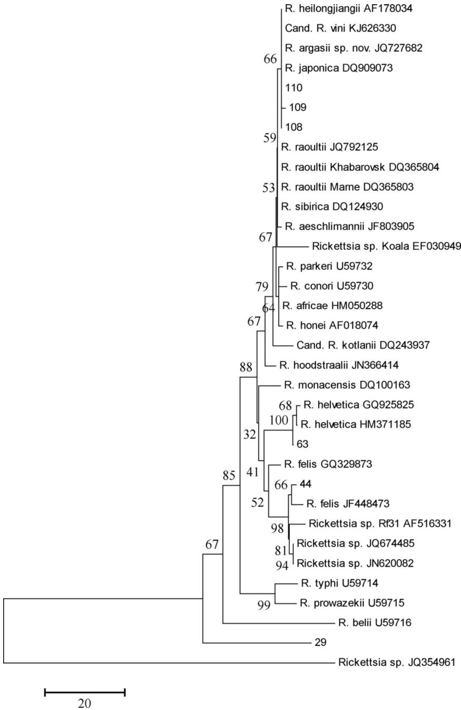

SHORT COMMUNICATION

# Rickettsia species in fleas collected from small mammals in Slovakia

Eva Špitalská1 & Vojtech Boldiš2 & Ladislav Mošanský3 & Olivier Sparagano4 & Michal Stanko3,5

Received: 20 July 2015 /Accepted: 27 August 2015

$©$ Springer-Verlag Berlin Heidelberg 2015

Abstract Epidemiological and epizootiological studies of Rickettsia felis and other Rickettsia spp. are very important, because their natural cycle has not yet been established completely. In total, 315 fleas (Siphonaptera) of 11 species of Ceratophyllidae, Hystrichopsyllidae and Leptopsyllidae families were tested for the presence of Rickettsia species and Coxiella burnetii with conventional and specific quantitative real-time PCR assays. Fleas were collected from five rodent hosts (Myodes glareolus, Apodemus flavicollis, Apodemus agrarius, Microtus subterraneus, Microtus arvalis) and three shrew species (Sorex araneus, Neomys fodiens, Crocidura suaveolens) captured in Eastern and Southern Slovakia. Overall, Rickettsia spp. was found in $1 0 . 8 ~ \%$ (34/ 315) of the tested fleas of Ctenophthalmus agyrtes, Ctenophthalmus solutus, Ctenophthalmus uncinatus and Nosopsyllus fasciatus species. Infected fleas were coming from A. flavicollis, A. agrarius, and M. glareolus captured in Eastern Slovakia. C. burnetii was not found in any fleas. R. felis, Rickettsia helvetica, unidentified Rickettsia, and rickettsial endosymbionts were identified in fleas infesting small

mammals in the Košice region, Eastern Slovakia. This study is the first report of R. felis infection in C. solutus male flea collected from A. agrarius in Slovakia.

Keywords Rickettsia felis . Fleas $\cdot$ Small mammals $\cdot$ Slovakia

# Introduction

Rickettsiae are obligate intracellular Gram-negative bacteria that are associated with arthropod vectors and are responsible for mild to severe diseases in humans, with worldwide distribution (Raoult and Roux 1997). They are classically transmitted to humans via arthropod vectors such as ticks, mites, fleas, and lice. The arthropod association of various rickettsiae is diverse and varied.

Ixodes ricinus, Dermacentor marginatus, Dermacentor reticulatus, Haemaphysalis concinna, Haemaphysalis punctata and Haemaphysalis inermis (the family Ixodidae, the order Acari) are exophilic tick species occurring in Slovakia (Slovák 2010). The presence of six rickettsial species/strains has been confirmed (Rickettsia slovaca, Rickettsia raoultii, Rickettsia monacensis strains IRS3 and IRS4, Rickettsia helvetica and Rickettsia africae), mostly in localities of the southern part of Slovakia. The prevalence of R. helvetica in questing I. ricinus ticks is usually up to $20 \%$ depending on the sea level, locality, and sex of ticks (Spitalská et al. 2014, 2015; Švehlová et al. 2014). Dermacentor species are vectors for R. raoultii and R. slovaca with the prevalence of R. raoultii $8 . 1 { - } 8 . 6 \%$ and $2 2 . 3 \mathrm { - } 2 7 \%$ in D. marginatus and D. reticulatus from vegetation and hosts, respectively. The prevalence of R. slovaca is $2 0 . 6 { - } 2 4 . 3 \ \%$ in $D$ . marginatus and $1 . 7 { - } 3 . 4 \ \%$ in $D$ . reticulatus (Špitalská et al. 2012). R. africae usually transmitted by ticks was also identified in Ceratophyllus garei flea collected from reed warblers

(Acrocephalus scirpaceus) migrated from Africa (Sekeyová et al. 2012). Rickettsia felis is a rickettsial species primarily associated with the cat flea, Ctenocephalides felis. The pathogen is maintained by transovarial and transstadial transmission with no lethal effect. It is the etiological agent of fleaborne spotted fever with clinical symptoms similar to malaria and dengue. However, it appears to be milder than other rickettsioses. The bacteria can also infect humans (Raoult and Parola 2007). The host is usually infected by flea faeces coming into contact with scratched or broken skin (Azad and Beard 1998). The expansion of R. felis hosts and potential vectors can include mites, lice and ticks (Abdad et al. 2011). To our knowledge, this rickettsial species has never been identified in Slovakia to date.

The objective of this work was the molecular detection of Rickettsia species and Coxiella burnetii in fleas collected from rodents and shrews in Eastern and Southern Slovakia.

# Materials and methods

# Origin of the samples

In total, 315 fleas (Siphonaptera) were removed from Myodes glareolus $( n { = } 4 1$ ), Apodemus flavicollis $\scriptstyle ( n = 4 3$ ), Apodemus agrarius $\scriptstyle ( n = 3 5$ ), Microtus subterraneus $( n { = } 3 )$ , Microtus arvalis $( n { = } 1 )$ ), Sorex araneus $( n { = } 2 )$ , Neomys fodiens $( n { = } 1 )$ and Crocidura suaveolens $( n { = } 1 )$ ) captured in Eastern Slovakia, in Košice region (Botanical garden, Košice— Čermeľ and Hýľov) and in Southern Slovakia, in vicinity of Lučenec town (Bušince, Veľká nad Ipľom). M. glareolus, Mi. subterraneus and Mi. arvalis are members of the family Cricetidae and A. flavicollis and A. agrarius of the family Muridae of the order Rodentia. S. araneus, N. fodiens and C. suaveolens are members of the family Soricidae, of the order Soricomorpha, and shrews were released after deparasitation in nature. Hosts and ectoparasites were collected four to five times at the locality between June 2009 and September 2012. Study sites were located in sylvatic mixed forest (Hýľov; $5 0 0 { - } 7 5 0 \ \mathrm { m }$ asl.; $4 8 ^ { \circ } ~ 4 4 ^ { \prime } ~ \mathrm { N }$ , $2 1 ^ { \circ } \ 4 ^ { \prime } \ \mathrm { E }$ and Čermeľ; $2 0 8 { - } 6 0 0 \ \mathrm { m }$ asl.; $4 8 ^ { \circ } ~ 4 5 ^ { \prime } ~ \mathrm { N }$ , $2 1 ^ { \circ } \ 8 ^ { \prime } \ \mathrm { E }$ ), in suburban deciduous forest (Botanical garden, Košice; $2 0 8 ~ \mathrm { m }$ asl.; $4 8 ^ { \circ }$ $4 4 ^ { \prime } \mathrm { N }$ , $2 1 ^ { \circ } 1 4 ^ { \prime } \mathrm { E }$ ), as well as in alluvial habitats near river Ipeľ (Veľká nad Ipľom; 165–170 m asl; $4 8 ^ { \circ } 1 4 ^ { \prime } \mathrm { N }$ , $1 9 ^ { \circ } 3 5 ^ { \prime } \mathrm { ~ E ~ }$ and Bušince; 160–170 m asl; $4 8 ^ { \circ } \ 1 1 ^ { \prime } \ \mathrm { N }$ , $1 9 ^ { \circ } \ 3 0 ^ { \prime } \ 5 9 . 5 8 ^ { \prime \prime } \ ]$ E). Rodents were trapped alive using Swedish bridge metal traps following the protocol of Stanko (1994a) and Stanko and Miklisova (1995). Rodent trapping was carried out using 100–150 traps per site for two-night trapping. Small mammals were euthanized according to the laws of the Slovak Republic under the licences of the Ministry of Environment of the Slovak Republic No. 297/108/06-3.1 and No. 6743/2008- 2.1. Fleas with different engorgements were collected from

infested animals using forceps. The species and sex of the fleas were determined by microscopic examination according to Rosický (1957). Flea samples were stored in $70 \%$ ethanol until molecular analysis.

# DNA extraction and molecular analysis

Fleas were washed with sterile water, dried, transferred to individual tubes and crushed with a sterile Carbon Steel Surgical Scalpel Blade (Surgeon, JAI Surgicals Ltd., India). DNA from fleas was extracted using DNeasy Blood and Tissue Kit (Qiagen) following the manufacturer’s recommendations. The quantity and quality of DNA were assessed by NanoPhotometer Pearl (Implen, Germany). DNA samples were stored at $- 2 0 ~ ^ { \circ } \mathrm { C }$ and later used as templates for the PCR amplifications. Flea samples were screened by PCRbased methods for the presence of tick-borne pathogens, Rickettsia spp. and C. burnetii.

For bacterial infection in flea samples, primer pair fD1- 800r targeted fragment of the 16S rRNA of eubacteria was used (Weisburg et al. 1991). Identification of Rickettsia spp. was performed using the TaqMan PCR based on the genusspecific variable region of the rrs gene and PCR based on the genus-specific variable regions of the gltA and sca4 genes using primer sets RpCS.877p–RpCS.1258n and D767f– D1390r targeting 381- and 623-bp fragments, respectively (Regnery et al. 1991; Sekeyová et al. 2001; Melničáková et al. 2013). The primer pairs CBCOS and CBCOE targeting the com1 gene encoding an approximately 27-kDa outer membrane-associated immunoreactive protein of C. burnetii was employed for the detection of C. burnetii in flea samples (Špitalská and Kocianova 2003). The DNA from Rickettsiauninfected ticks and nuclease-free water were used as negative controls in each reaction. DNAs from R. helvetica and R. slovaca originating from ticks and Rickettsia typhi and C. burnetii originating from the collection of Institute of Virology were used as positive controls. PCR amplifications were conducted using DyNAzyme™ PCR Master Mix (Finnzymes, Finland) and HOT FIREPol® DNA Polymerase (Solis BioDyne, Estonia) as recommended by the manufacturer on thermocycler PTC-200 Peltier Thermal Cycler or Labcycler (SensoQuest, Germany). PCR products were analysed by electrophoresis in a $1 \%$ agarose gel, stained with GelRed™ (Biotium, Hayward, California) and visualized with a UV transilluminator.

Rickettsia-positive flea samples were screened for the presence of R. felis using R. felis-specific nested PCR with specific primers gltA-F1–gltA-R1 and gltA-F2–gltA-R2 amplifying a partial region of gltA gene (Hii et al. 2011). Rickettsia-positive flea samples were screened for the presence of R. helvetica using TaqMan PCR assay targeting a 65-bp fragment of the 23S rRNA gene using DyNAmo™ Probe qPCR (Finnzymes, Finland) on Bio-Rad CFX96™ Real-Time System as

previously described by Boretti et al. (2009). Each run of TaqMan PCR reactions included a negative template control, a positive control and DNA standards containing $3 \times 1 0 ^ { 0 } – 3 \times$ $1 0 ^ { 6 }$ target copies with a sensitivity of three copies of the DNA. Randomly selected amplicons of gltA, sca4 and 16S rRNA genes were purified and analysed by sequencing both DNA strands. The sequencing was performed by Macrogen (http:// www.macrogen.com). Obtained DNA sequences were compared to available sequences in GenBank database using the Basic Local Alignment Search Tool (BLAST) on http:// blast.ncbi.nlm.nih.gov/. A phylogenetic analysis was further performed using MEGA5 software (Tamura et al. 2011).

# Statistical analysis

Statistical analysis to test the differences between the prevalences in males and females was carried out with the Fisher exact test using Past version 2.17b software (Hammer et al. 2001). A $p$ value $< 0 . 0 5$ was considered significant.

# Results

A total of 315 fleas (Siphonaptera) belonging to 11 species of three families, Ceratophyllidae, Hystrichopsyllidae and Leptopsyllidae (Table 1), were analysed individually for the presence of rickettsial species and C. burnetii. Fleas were removed from five rodent hosts (M. glareolus, A. flavicollis, A. agrarius, Mi. subterraneus, Mi. arvalis) and three shrew species (S. araneus, N. fodiens, C. suaveolens). In our study, we confirmed rickettsia in four flea species (Table 1) collected from A. flavicollis, A. agrarius and M. glareolus. Infected fleas were coming from three studied areas in Eastern Slovakia (Botanical garden, Čermeľ and Hýľov). Overall, Rickettsia spp. was found in $1 0 . 8 ~ \%$ (34/315) of the tested

fleas, without statistical significance between flea males and f e m a l e s $\scriptstyle \phantom { = } \left( p = 0 . 8 6 \right)$ . Ct enopht halmus agy rt es and Ctenophthalmus solutus were the most infected species of fleas (10.4 and $1 6 . 0 ~ \%$ , respectively, Table 1). More than one Rickettsia-infected fleas were collected from two A. flavicollis and two A. agrarius. C. burnetii was not found in any flea samples.

Six randomly chosen Rickettsia-positive amplicons were sequenced. The sequence of $g l t A$ gene isolated from C. solutus male flea collected from A. agrarius (marked as 44) was $9 6 \%$ (364/380 bp) identical to a validated bacterium R. felis (CP000053) and $9 8 \ \%$ similar to three uncultured Rickettsia spp. detected in blood patient from Senegal (JQ674485) and in two Anopheles gambiae mosquitoes from Africa (JN620082, JQ354961; Socolovschi et al. 2012). Figure 1 shows a phylogenetic tree constructed on the basis of the gltA sequences. The amplified fragment of sca4 gene from the same flea was $9 8 \%$ (580/591 bp) identical to R. felis (CP000053), Rickettsia spp. in C. felis from Senegal (KF666474) and in a common household insect pest, Liposcelis bostrychophila (the family Liposcelidae, the order Psocoptera; Behar et al. 2010). Subsequently, this DNA of R. felis from C. solutus male was used as positive control in nested PCR to identify the presence of R. felis in all collected fleas. Any other positive sample was not found.

R. helvetica was identified by R. helvetica-specific TaqMan PCR and sequencing of gltA gene isolated from C. agyrtes male collected also from A. agrarius (marked as 63). Using R. helvetica-specific TaqMan PCR assay, all other fleas were negative. Unidentified Rickettsia species were found in Ctenophthalmus uncinatus male (marked as 108) and C. solutus females (marked as 109, 110) from A. agrarius and A. flavicollis. The amplified fragments of gltA gene in these samples were $9 9 . 3 \ \mathrm { ~ \% ~ }$ identical to each other. Sequences showed the greatest similarity to Rickettsia

Table 1 Presence of rickettsiae in fleas (Siphonaptera) collected from small mammals in Eastern and Southern Slovakia   

<table><tr><td>Species</td><td>No. of Rickettsia positive (no. of sequenced)/no. of tested male fleas</td><td>No. of Rickettsia positive (no. of sequenced)/no. of tested female fleas</td></tr><tr><td>Ctenophthalmus agyrites(Hystrichopsyllidae)</td><td>5 (1)/49</td><td>5/47</td></tr><tr><td>C. assimilis(Hystrichopsyllidae)</td><td>0/2</td><td>0/4</td></tr><tr><td>C. solutus(Hystrichopsyllidae)</td><td>9 (1)/68</td><td>12 (2)/63</td></tr><tr><td>C. uncinatus(Hystrichopsyllidae)</td><td>1 (1)/4</td><td>1 (1)/12</td></tr><tr><td>Doratomylla dasycnema(Hystrichopsyllidae)</td><td>0/0</td><td>0/2</td></tr><tr><td>Palaeopsylla soricis(Hystrichopsyllidae)</td><td>0/1</td><td>0/1</td></tr><tr><td>Amalareus penicilliger(Ceratophyllidae)</td><td>0/8</td><td>0/17</td></tr><tr><td>Nosopsyllus fasciatus(Ceratophyllidae)</td><td>0/8</td><td>1/14</td></tr><tr><td>Megabothris turbidus(Ceratophyllidae)</td><td>0/6</td><td>0/6</td></tr><tr><td>Ceratophyllus sciurorum(Ceratophyllidae)</td><td>0/1</td><td>0/0</td></tr><tr><td>Peromyscopsylla bidentata(Leptopsyllidae)</td><td>0/0</td><td>0/2</td></tr><tr><td>Total</td><td>15 (3)/147</td><td>19 (3)/168</td></tr></table>

  
Fig. 1 Phylogenetic tree inferred from comparison of the Rickettsia gltA partial sequences. The evolutionary history was inferred using the neighbor-joining method. The percentage of replicate trees in which the associated taxa clustered together in the bootstrap test (1000 replicates) is shown next to the branches. The evolutionary distances were computed using the number of differences method and are in the units of the number of base differences per sequence. GenBank accession numbers are included

japonica, Rickettsia heilongjiangensis, Candidatus Rickettsia vini, Rickettsia aeschlimannii and R. raoultii, all closely phylogenetically related (Fig. 1). Unfortunately, fragments of sca4 gene were not successfully amplified.

Sequencing of gltA gene isolated from C. uncinatus female collected from M. glareolus (marked as 29) resulted in being unable to identify rickettsial species (Fig. 1). Sequencing of 16S rRNA showed $9 8 \%$ similarity with Rickettsia monteiroi sp. nov. infecting the tick Amblyomma incisum in Brazil (FJ269037; Pacheco et al. 2011), Rickettsia endosymbiont of Nesidiocoris tenuis (the family Miridae, the order Hemiptera; KF646705), Rickettsia endosymbiont of the Chinese white wax scale (JQ063118), Rickettsia endosymbiont of

Macrolophus pygmaeus (HE583202), Rickettsia endosymbiont of Pnigalio soemius (the family Eulophidae, the order Hymenoptera) in Italy (EU881496; Giorgini et al. 2010) and Rickettsia bellii strain 369L42-1 (NR_036774; Roux and Raoult 1995).

# Discussion

This study highlights the presence of three Rickettsia species, R. felis, R. helvetica and unidentified Rickettsia, and rickettsial endosymbionts in fleas infesting rodents in the Košice region, Eastern Slovakia, and in vicinity of Lučenec town, Southern

Slovakia. The rickettsial infections of fleas are poorly known in Slovakia.

Fleas are holometabolous insect parasites with obligatory haematophagous imagos and non-parasitic omnivorous larvae (Krasnov 2008). Fleas are important vectors for various pathogens including viruses, bacteria and tapeworms (Hinaidy 1991; Raoult and Roux 1997; Mehlhorn 2001; Vobis et al. 2005).

From bodies of small mammals, we recorded flea species with varying degrees of host specificity. For example, Doratopsylla dasycnema and Palaeopsylla soricis are flea species with well-marked parasitism to shrews. Several tested species of fleas have a broad host range and infest so wild mice and voles too (e.g. C. agyrtes, Megabothris turbidus); another flea species are closely related to some vole species (e.g. Amalareus penicilliger, Peromyscopsylla bidentata) (Rosický 1957). Positive flea species are parasite generalist (C. agyrtes), or prefer only narrower host range, C. solutus, which prefer mice of the Apodemus genus in lower vegetation zones. Another infected flea species, C. uncinatus, has close parasite relations with M. glareolus in beech and fir–beech forests. Rickettsia sp. was confirmed by TaqMan PCR based on the genus-specific variable region of the rrs gene in Nosopsyllus fasciatus in one sample collected from A. agrarius, but without successful sequencing of gltA and sca4 genes. N. fasciatus is a parasite of synantropical rodents (Mus musculus, Rattus norvegicus) which, in other habitat types, more frequently occur only on mice (Apodemus genus) in lowland conditions of Slovakia (Rosický 1957, Stanko 1994b).

Season influences of flea species composition. Some species have several generations during the year, e.g. C. agyrtes, C. solutus and M. turbidus, dominant species collected in our study. Very few species in Central Europe has only one generation in the autumn-winter season, e. g. species of Peromyscopsylla, Rhadinopsylla, Hystrichopsylla and Atyphloceras (Rosický 1957). In our group of collected fleas, we had only $P .$ bidentata (two specimens); for this reason, sorting and comparison based on season influence were not significant.

This study is the first report of R. felis infection in C. solutus male flea collected from A. agrarius inhabiting in studied areas of Slovakia. Although C. felis has been designated as the main vector of R. felis, the competency of 24 species of fleas, ticks, mites and lice as transmission vectors has yet to be demonstrated (Abdad et al. 2011). Oliveira et al. (2008) reported R. felis in Rhipicephalus sanguineus ticks and suggested some possible horizontal transmission from fleas to ticks via a vertebrate host, presumably a dog. R. sanguineus has never been implicated as a vector of R. felis. However, due to its worldwide distribution overlapping with that of C. felis, it may play the role of an amplifier for horizontal transmission to the more competent vectors.

R. helvetica was first isolated from I. ricinus ticks in Switzerland (Burgdorfer et al. 1979). I. ricinus is the main vector with its distribution all around Europe with different prevalences of R. helvetica infections (Oteo and Portillo 2012). The scope of R. helvetica infection in Slovakia is known in questing I. ricinus ticks (Spitalská et al. 2014, 2015; Švehlová et al. 2014) and in I. ricinus ticks collected from free-living green lizards (Václav et al. 2011) and picked from Prunella modularis (Špitalská et al. 2011) and from roe deer (Štefanidesová et al. 2008). This species is recognized as the cause of spotted fever, and human cases have been reported from Sweden, France, Switzerland and Italy (Nilsson et al. 1999, 2010; Fournier et al. 2000, 2004; Baumann et al. 2003; Nilsson 2009). However, no human strain of R. helvetica exists worldwide. The presence of R. helvetica in C. agyrtes males collected from A. agrarius is the first finding of this species in fleas in Slovakia. Similarly, Sprong et al. (2009) identified R. helvetica in two out of 24 fleas isolated from M. glareolus and Apodemus sylvaticus in the Netherlands. Also, they identified the presence of R. typhi and Rickettsia prowazekii in I. ricinus ticks. The presence of R. helvetica and R. monacensis in pools of Laelaps agilis and Haemogamasus nidi (Laelapidae) and Hirsutiella zachvatkini, Cheladonta costulata, Neotrombicula autumnalis and Neotrombicula vulgaris (Trombiculidae) mites collected from small terrestrial mammals captured in south-western Slovakia was confirmed by Miťková et al. (2015). Authors supposed that mites could be infected during taking blood meal on a bacteraemic host, which was supported by the evidence of presence of the same Rickettsia species in blood of rodents and mites collected from rodents. All the above-mentioned findings support the hypothesis that different microorganisms can be obtained via a blood meal from an infected rodent, or by co-feeding of ectoparasites, and that cross-infections can occur under natural conditions, as different vectors share rodents as reservoir hosts.

Hornok et al. (2014) analysed Ctenocephalides canis and Archaeopsylla erinacei collected from hedgehogs in Hungary and identified Rickettsia spp. with $9 8 - 9 9 \%$ sequence identity with endosymbionts and R. helvetica in A. erinacei and thus expected the role of hedgehogs in the epidemiology of rickettsiosis. R. helv etica was a lso identified in Nycteridopsylla eusarca bat fleas in Hungary (Hornok et al. 2012).

Similar findings about cross-infections via a blood meal or by co-feeding of ectoparasites were recorded by Colombo et al. (2011). They identified the presence of Leishmania infantum in fleas and ticks collected from naturally infected dogs and suggested a hypothesis of other arthropods than sandflies as a possible way of Leishmania transmission.

Flies are well known to carry and transmit deadly diseases such as the sandfly (leishmaniasis), the tsetse fly (trypanosomiasis), and the housefly, Musca domestica (anthrax). Many reports also highlighted the mechanical role of these insects to

carry pathogens on their legs and other body parts making them very successful vectors. Flies can also attack other animals (myiasis) or crops and alongside ticks and mosquitoes are responsible for huge mortality and morbidity worldwide.

However, flies such as Drosophila flies have been used extensively for studying human diseases such as Parkinson’s disease, epilepsy or Huntington’s disease showing the need to study them further to prevent them from transmitting diseases but studying them to develop new drugs against human diseases.

As known, ticks and fleas are ectoparasites of animals as well humans. They cause discomfort and health effects due to bites and ingestion of blood, and they serve as vectors for several animal and human pathogens (Kužner et al. 2013). It is important to know their exact role in the transmission of pathogens to humans and animals to avoid possible zoonotic disease. Effective prevention and treatment of tick and flea infestations in companion animals will help prevent not only disease in animals but human diseases as well (Bonneau et al. 2010). Some studies are aimed to control both parasites and persistent effectiveness. Kužner et al. (2013) confirm immediate and persistent effectiveness of the novel fipronil spot-on product against I. ricinus for 4 weeks and C. felis fleas for 5 weeks. Varloud and Hodgkins (2015) compared efficacy of three ectoparasiticides against C. felis fleas and R. sanguineus ticks and demonstrated that dogs treated with fipronil and (S)-methoprene or dinotefuran, pyriproxyfen and permethrin were protected against all stages of fleas for 2 months following four monthly applications.

The role of fleas in circulation of rickettsiae is not definitively elucidated and requires further studies aimed at monitoring rickettsiae not only in fleas but also in other ectoparasites and their hosts. Also, for validation of both co-feeding transmission and vector competence of ectoparasites of small mammals for rickettsial species, experimental studies are necessary. However, due to worldwide distribution of rickettsiae overlapping with that of ticks and fleas, incompetent vectors may play the role of an amplifier for horizontal transmission of rickettsiae to the competent vector.

Acknowledgments This study was financially supported by the projects VEGA Nos.: 2/0061/13, 2/0059/15 from the Scientific Grant Agency of Ministry of Education and Slovak Academy of Sciences.

# Compliance with ethical standards

Conflict of interest The authors declare that they have no competing interests.

Ethical approval All applicable international, national and/or institutional guidelines for the care and use of animals were followed. All procedures performed in studies involving animals were in accordance with the ethical standards of the institution or practice at which the studies were conducted. Small mammals were euthanized according to the laws of the Slovak Republic under the licences of the Ministry of Environment

of the Slovak Republic No. 297/108/06-3.1 and No. 6743/2008-2.1. This article does not contain any studies with human participants performed by any of the authors.

# References

Abdad MY, Stenos J, Graves S (2011) Rickettsia felis, an emerging fleatransmitted human pathogen. Emerg Health Threats J 4:7168. doi: 10.3402/ehtj.v4i0.7168   
Azad AF, Beard CB (1998) Rickettsial pathogens and their arthropod vectors. Emerg Infect Dis 4:179–86. doi:10.3201/eid0402.980205   
Baumann D, Pusterla N, Péter O, Grimm F, Fournier PE, Schär G, Bossart W, Lutz H, Weber R (2003) Fever after a tick bite: clinical manifestations and diagnosis of acute tick-borne infections in northeastern Switzerland. Dtsch Med Wochenschr 128:1042–1047   
Behar A, McCormick LJ, Perlman SJ (2010) Rickettsia felis infection in a common household insect pest, Liposcelis bostrychophila (Psocoptera: Liposcelidae). Appl Environ Microbiol 76:2280–2285   
Bonneau S, Gupta S, Cadiergues MC (2010) Comparative efficacy of two fipronil spot-on formulations against experimental tick infestations (Ixodes ricinus) in dogs. Parasitol Res 107:735–739   
Boretti FS, Perreten A, Meli MM, Cattori V, Willi B, Wengi N, Hornok S, Honegger H, Hegglin D, Woelfel R, Reusch CE, Lutz H, Hofmann-Lehmann R (2009) Molecular investigation of Rickettsia helvetica infection in dogs, foxes, humans, and Ixodes ticks. Appl Environ Microbiol 75:3230–3237   
Burgdorfer W, Aeschlimann A, Peter O, Hayes SF, Philip RN (1979) Ixodes ricinus: vector of a hitherto undescribed spotted fever group agent in Switzerland. Acta Trop 36:357–367   
Colombo FA, Odorizzi RMFN, Laurenti MD, Galati EAB, Canavez F, Pereira-Chioccola VL (2011) Detection of Leishmania (Leishmania) infantum RNA in fleas and ticks collected from naturally infected dogs. Parasitol Res 109:267–274. doi:10.1007/ s00436-010-2247-6   
Fournier PE, Grunnenberger F, Jaulhac B, Gastinger G, Raoult D (2000) Evidence of Rickettsia helvetica infection in humans, eastern France. Emerg Infect Dis 6:389–392   
Fournier PE, Allombert C, Supputamongkol Y, Carusso G, Brouqui P, Raoult D (2004) Aneruptive fever associated with antibodies to Rickettsia helvetica in Europe and Thailand. J Clin Microbiol 42: 816–818   
Giorgini M, Bernardo U, Monti MM, Nappo AG, Gebiola M (2010) Rickettsia symbionts cause parthenogenetic reproduction in the parasitoid wasp Pnigalio soemius (Hymenoptera: Eulophidae). Appl Environ Microbiol 76:2589–2599   
Hammer O, Harper DAT, Ryan PD (2001) PAST: paleontological statistics soft-ware package for education and data analysis. Palaeontol Electron 4:9   
Hii SF, Kopp SR, Thompson MF, O’Leary CA, Rees RL, Traub RJ (2011) Molecular evidence of Rickettsia felis infection in dogs from northern territory, Australia. Parasite Vectors 4:198   
Hinaidy HK (1991) The biology of Dipylidium caninum. Zentralbl Veterinarmed B 38:329–336   
Hornok S, Kovács R, Meli ML, Kontschán J, Gyuranecz M, Dán Á, Molnár V (2012) First detection of bartonellae in a broad range of bat ectoparasites. Vet Microbiol 159:541–543   
Hornok S, Foldvári G, Rigó K, Meli ML, Tóth M, Molnár V, Gonczi E, Farkas R, Hofmann-Lehmann R (2014) Vector-borne agents detected in fleas of the Northern white-breasted hedgehog. Vector Borne Zoonot Dis 14:1–3   
Krasnov BR (2008) Functional and evolutionary ecology of fleas. Cambridge University press, 593 pp

Kužner J, Turk S, Fourie JJ, Grace S, Marchiondo AA, Rugg D (2013) Efficacy of a novel fipronil spot-on for the treatment and control of induced infestations of adult cat fleas (Ctenocephalides felis) and castor bean ticks (Ixodes ricinus) on cats. Parasitol Res 112:365– 372. doi:10.1007/s00436-012-3144-y   
Mehlhorn H (ed) (2001) Encyclopedic references of parasitology, Vols 1, 2. Springer, Berlin Heidelberg New York   
Melničáková J, Derdáková M, Barák I (2013) A system to simultaneously detect tick-borne pathogens based on the variability of the 16S ribosomal genes. Parasite Vector 6:269   
Miťková K, Berthová L, Kalúz S, Kazimírová M, Burdová L, Kocianová L (2015) First detection of Rickettsia helvetica and R. monacensis in ectoparasitic mites (Laelapidae and Trombiculidae) infesting rodents in south-western Slovakia. Parasitol Res 114:2465–2472. doi:10. 1007/s00436-015-4443-x   
Nilsson K (2009) Septicaemia with Rickettsia helvetica in a patient with acute febrile illness, rash and myasthenia. J Infect 58:79–82   
Nilsson K, Lindquist O, Pahlson C (1999) Association of Rickettsia helvetica with chronic perimyocarditis in sudden cardiac death. Lancet 354:1169–1173   
Nilsson K, Elfving K, Páhlson C (2010) Rickettsia helvetica in patient with meningitis, Sweden 2006. Emerg Infect Dis 16:490–492   
Oliveira KA, Oliveira LS, Dias CCA, Almeida MR, Almada G, Bouyer DH, Galvao MA, Mafra C (2008) Molecular detection of Rickettsia felis in ticks and fleas from an endemic area for Brazilian spotted fever. Mem Inst Oswaldo Cruz 103:191–4   
Oteo JA, Portillo A (2012) Tick-borne rickettsioses in Europe. Ticks Tick Borne Dis 3:271–278   
Pacheco RC, Moraes-Filho J, Marcili A, Richtzenhain LJ, Szabo MP, Catroxo MH, Bouyer DH, Labruna MB (2011) Rickettsia monteiroi sp. nov. infecting the tick Amblyomma incisum in Brazil. Appl Environ Microbiol 77:5207–5211   
Raoult D, Parola P (2007) Rickettsial diseases. CRC Press. 87 pp   
Raoult D, Roux V (1997) Rickettsioses as paradigms of new or emerging infectious diseases. Clin Microbiol Rev 10:694–719   
Regnery RL, Spruill CL, Plikaytis BD (1991) Genotypic identification of rickettsiae and estimation of intraspecies sequence divergence for portions of two rickettsial genes. J Bacteriol 173:1576–1589   
Roux V, Raoult D (1995) Phylogenetic analysis of the genus Rickettsia by 16S rDNA sequencing. Res Microbiol 146:385–396   
Rosický B (1957) Blechy – Aphaniptera. Fauna ČSR 10, Praha, NČSAV, 439 pp   
Sekeyová Z, Roux V, Raoult D (2001) Phylogeny of Rickettsia spp. inferred by comparing sequences of ‘gene D’, which encodes an intracytoplasmic protein. Int J Syst Evol Microbiol 51:1353–1360   
Sekeyová Z, Mediannikov O, Roux V, Subramanian G, Špitalská E, Krištofík J, Darolová A, Raoult D (2012) Identification of Rickettsia africae and Wolbachia sp. in Ceratophyllus garei fleas from Passerine birds migrated from Africa. Vector Borne Zoonot Dis 12:539–543   
Socolovschi C, Pages F, Ndiath MO, Ratmanov P, Raoult D (2012) Rickettsia species in African Anopheles mosquitoes. PLoS ONE 7, E48254   
Slovák M (2010) Pictorial key to the adults of ticks (Acari: Ixodida) of the Slovakia fauna. Entomofauna Carpathica 22:8–13   
Sprong H, Wielinga PR, Fonville M, Reusken C, Brandenburg AH, Borgsteede F, Gaasenbeek C, van der Giessen JWB (2009) Ixodes ricinus ticks are reservoir hosts for Rickettsia helvetica and

potentially carry flea-borne Rickettsia species. Parasite Vector 2: 41. doi:10.1186/1756-3305-2-41   
Stanko M (1994a) Small mammal communities of windbreaks and adjacent fields in the eastern Slovakian lowlands. Folia Zool 43:135–143   
Stanko M (1994b) Fleas synusy (Siphonaptera) of small mammals from the central part of the East Slovak lowlands. Biologia 49:239–246   
Stanko M, Miklisova D (1995) Interactions of small mammal communities of wind-breaks and adjacent fields with respect to epidemiological aspects. Ekologia CSSR 14:3–16   
Špitalská E, Kocianova E (2003) Detection of Coxiella burnetii in ticks collected in Slovakia and Hungary. Eur J Epidemiol 18:263–266   
Špitalská E, Literák I, Kocianová E, Taragel'ová V (2011) The Importance of Ixodes arboricola in transmission of Rickettsia spp., Anaplasma phagocytophilum, and Borrelia burgdorferi sensu lato in the Czech Republic, Central Europe. Vector Borne Zoonot Dis 11: 1235–1241. doi:10.1089/vbz.2010.0210   
Špitalská E, Štefanidesová K, Kocianová E, Boldiš V (2012) Rickettsia slovaca and Rickettsia raoultii in Dermacentor marginatus and Dermacentor reticulatus ticks from Slovak Republic. Exp Appl Acarol 57:189–197. doi:10.1007/s10493-012-9539-8   
Spitalská E, Boldiš V, Derdáková M, Selyemová D, Rusňáková Tarageľová V (2014) Rickettsial infection in Ixodes ricinus ticks in urban and natural habitats of Slovakia. Ticks Tick Borne Dis 5:161– 165. doi:10.1016/j.ttbdis.2013.10.002   
Špitalská E, Stanko M, Mošanský L, Kraljik J, Miklisova D, Mahrikova L, Bona M, Kazimírová M (2015) Seasonal analysis of Rickettsia species in ticks in an agricultural site of Slovakia. Exp Appl Acarol. doi:10.1007/s10493-015-9941-0   
Štefanidesová K, Kocianová E, Boldiš V, Košťanová Z, Kanka P, Špitalská E (2008) Evidence of Anaplasma phagocytophilum and Rickettsia helvetica infection in free-ranging ungulates in central Slovakia. Eur J Wildl Res 54:519–524   
Švehlová A, Berthová L, Sallay B, Boldiš V, Sparagano OAE, Špitalská E (2014) Sympatric occurrence of Ixodes ricinus, Dermacentor reticulatus and Haemaphysalis concinna ticks and Rickettsia and Babesia species in Slovakia. Ticks Tick Borne Dis 5:600–605. doi: 10.1016/j.ttbdis.2014.04.010   
Tamura K, Peterson D, Peterson N, Stecher G, Nie M, Kumar S (2011) MEGA5: molecular evolutionary genetics analysis using maximum likelihood, evolutionary distance, and maximum parsimony methods. Mol Biol Evol 28:2731–2739   
Václav R, Ficova M, Prokop P, Betakova T (2011) Associations between coinfection prevalence of Borrelia lusitaniae, Anaplasma sp., and Rickettsia sp. in hard ticks feeding on reptile hosts. Microb Ecol 61: 245–253. doi:10.1007/s00248-010-9736-0   
Varloud M, Hodgkins E (2015) Five-month comparative efficacy evaluation of three ectoparasiticides against adult cat fleas (Ctenocephalides felis), flea egg hatch and emergence, and adult brown dog ticks (Rhipicephalus sanguineus sensu lato) on dogs housed outdoors. Parasitol Res 114:965–973. doi:10.1007/s00436- 014-4262-5   
Vobis M, D’Haese J, Mehlhorn H, Mencke N (2005) Experimental quantification of the feline leukaemia virus in the cat flea (Ctenophalides felis) and its feces. Parasitol Res 97:S102–106. doi:10.1007/s00436- 005-1452-1   
Weisburg WG, Barns SM, Pelletier DA, Lane DJ (1991) 16S ribosomal DNA amplification for phylogenetic study. J Bacteriol 173:697–70