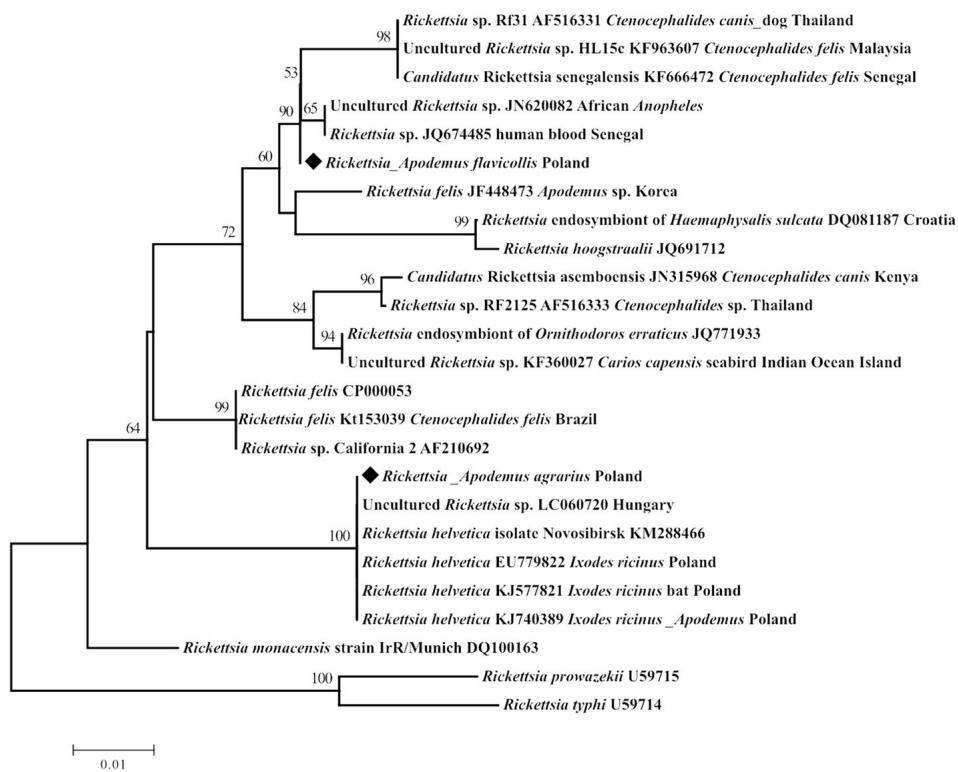

# Spotted fever rickettsiae in wild-living rodents from south-western Poland

Ewa Gajda1 , Joanna Hildebrand1*, Hein Sprong2 , Katarzyna Buńkowska-Gawlik1 , Agnieszka Perec-Matysiak1 and Elena Claudia Coipan2

# Abstract

Background: Rickettsiae are obligate intracellular alpha-proteobacteria. They are transmitted via arthropod vectors, which transmit the bacteria between animals and occasionally to humans. So far, much research has been conducted to indicate reservoir hosts for these microorganisms, but our knowledge is still non-exhaustive. Therefore, this survey was undertaken to investigate the presence of Rickettsia spp. in wild-living small rodents from south-western Poland.

Results: In total, 337 samples (193 from spleen and 144 from blood) obtained from 193 wild-living rodents: Apodemus agrarius, Apodemus flavicollis, and Myodes glareolus were tested by qPCR for Rickettsia spp. based on a fragment of gltA gene. The prevalence of infection was $1 7 . 6 \%$ (34/193). Subsequently, the positive samples were analysed by conventional PCR targeting the gltA gene fragment. The genus Rickettsia was confirmed by sequence analysis in four samples from the blood. In two blood samples from A. agrarius, the identified pathogen was Rickettsia helvetica. The Rickettsia obtained from A. flavicollis was assigned to Rickettsia felis-like organisms group. One isolate from A. agrarius could be determined only to the genus level.

Conclusions: This study shows the presence of Rickettsia DNA in tissues of wild-living rodents, suggesting some potential role of these animals in temporarily maintaining and spreading the bacteria in enzootic cycles.

Keywords: Rickettsia spp., Rodents, PCR, Poland

# Background

Species of Rickettsia bacteria are classified in the order Rickettsiales (α-Proteobacteria) which contains microorganisms infecting eukaryotic cells. The genus Rickettsia is divided into four groups, based on whole-genome analysis data. Rickettsia bellii and Rickettsia canadensis belong to the ancestral group (AG), for which no pathogenicity was recorded. The typhus group (TG) comprises Rickettsia typhi and Rickettsia prowazekii. The spotted fever group (SFG) has several bacterial species, including Rickettsia rickettsii, Rickettsia parkeri, Rickettsia conorii and R. helvetica. The fourth, transitional group (TRG) consists of Rickettsia akari, Rickettsia australis and R. felis. Most of the SFG are transmitted by hard ticks of the family Ixodidae and are considered zoonotic. The TG includes rickettsiae transmitted by fleas, lice and mites [1–3]. The

tick-borne rickettsioses in Europe are caused by R. conorii and R. massiliae, causing Mediterranean spotted fever (MSF), but also by R. slovaca, R. raoultii and R. rioja, causing tick-borne lymphadenopathy (TIBOLA, or Dermacentor-borne necrosis erythema and lymphadenopathy, DEBONEL) [4]. Although human infections with two SGF rickettsiae, R. helvetica and R. monacensis, were reported in Europe, their pathogenic potential remains controversial [5].

Despite various studies on the occurrence of Rickettsia spp. in wild-living small mammals, the role of these animals in maintaining these bacteria is unclear [6–9]. Therefore, we performed a survey on the prevalence of infection with rickettsiae in three rodent species Apodemus agrarius (striped field mouse), Apodemus flavicollis (yellow-necked mouse) and Myodes glareolus (bank vole), trapped in southwestern Poland. We additionally aimed to test detectability of Rickettsia DNA in spleen in comparison to blood samples. To the best of our knowledge, this is the first report of the presence of Rickettsia spp. in wild-living rodents from Poland.

# Methods

# Sample collection

In 2014, wild-living rodents belonging to the species $A$ . agrarius, A. flavicollis and M. glareolus were live captured. The study areas from which the animals were trapped are located in south-western Poland (Lower Silesia). These are irrigation fields Osobowice, water distribution area Mokry Dwór, the nature reserve “Milicz Ponds” and the Ślęża Landscape Park. Wild-living rodents were live trapped during summer and autumn using Sherman traps and wooden traps, with a piece of fried bread with peanut butter and piece of apple as bait. Approximately 100 traps were used at each site. These were set out at intervals in lines; single traps were placed within $3 \textrm { m }$ of one another. The trapping period comprised 2–3 days at each site, and traps were inspected in the morning and just before dusk. The captured animals were brought to the laboratory of the Department of Parasitology University of Wroclaw, then were anaesthetized (Isofluranum) and sacrificed by the cervical dislocation. Whole blood, where possible, was taken from the sinus orbitalis, collected into 0.001 M EDTA and stored at $4 ~ ^ { \circ } \mathrm { C }$ before DNA isolation. Spleen tissues were collected from the same individual and stored frozen before isolation. The animal procedures were approved by the Local Ethics Committee (No. 48/2012).

# Molecular analysis

The DNA was extracted using the following kits for DNA isolation: GeneMATRIX Quick Blood DNA Purification Kit (EURx, Gdansk, Poland) and GeneMATRIX Bio-Trace DNA Purification Kit (EURx) or BIOTRACE Genomic Extraction GPB Mini Kit (GPB GenoPlast Biochemicals, Rokocin, Poland) from blood and spleen samples, respectively. All extraction steps were done in accordance with manufacturer’s instructions. The DNA was stored at ${ } ^ { - 2 0 } \ ^ { \circ } \mathrm { C }$ until analysis for the presence of pathogens. For initial screening of the samples, a duplex qPCR (quantitative real-time polymerase chain reaction) was used. This qPCR assay targeted Rickettsia helvetica, SFG, and TG Rickettsia using citrate synthase (gltA) gene fragments [10, 11]. For R. helvetica specific qPCR we used the forward primer $5 ^ { \prime }$ -ATG ATC CGT TTA GGT TAA TAG GCT TCG GTC-3′, the reverse primer $5 ^ { \prime }$ -TTG TAA GAG CGG ATT GTT TTC TAG CTG TC-3′ and the probe $5 ^ { \prime }$ -Atto425-CGA TCC ACG TGC CGC AGT-BHQ1- $3 ^ { \prime }$ . In the second qPCR we used the forward primer $5 ^ { \prime }$ -TCG CAA ATG TTC ACG GTA CTT T-3′, the reverse primer 5′-TCG TGC ATT TCT TTC CAT TGT $\mathbf { G } { - } 3 ^ { \prime }$ and the probe $5 ^ { \prime }$ -Atto520-TGC AAT AGC AAG AAC CGT AGG CTG GAT G-BHQ1-3′. The qPCR was performed on a LightCycler 480 Real-Time PCR System (Hoffmann-La Roche, Basel, Switzerland) under the following cycling conditions: $9 5 ~ ^ { \circ } \mathrm { C }$ for 5 min,

60 cycles of $9 4 ~ ^ { \circ } \mathrm { C }$ for 5 s, $6 0 ~ ^ { \circ } \mathrm { C }$ for $3 5 \ \mathsf { s }$ , and cooling at $3 7 ~ ^ { \circ } \mathrm { C }$ for 20 s. Samples were considered positive if the $\mathrm { C _ { q } }$ values were below 45 cycles. To confirm the results, we used conventional PCR also targeting the gltA gene fragment of Rickettsia spp. The 849 bp product was amplified by using the primers CS409F $5 ^ { \prime }$ -CCT ATG GCT ATT ATG CTT GC-3′ and Rp1258n 5′-ATT GCA AAA AGT ACA GTG AAC A-3′ [12, 13]. PCR conditions consisted of an initial denaturation at $9 5 ~ ^ { \circ } \mathrm { C }$ for 15 min, 40 cycles of denaturation at $9 4 ~ ^ { \circ } \mathrm { C }$ for $3 0 \ s$ , annealing at $5 4 ~ ^ { \circ } \mathrm { C }$ for 30 s, extension at $7 2 ~ ^ { \circ } \mathrm { C }$ for 55 s and a final extension at $7 2 ~ ^ { \circ } \mathrm { C }$ for 7 min. Additionally, for specifying the identified Rickettsia species, the fragment of outer-membrane protein OmpB gene was used. The conventional PCR was carried out with the specific primers: 120–2788 $5 ^ { \prime }$ -AAA CAA TAA TCA AGG TAC TGT- $\cdot 3 ^ { \prime }$ and 120–3599 5′-TAC TTC CGG TTA CAG CAA AGT- $3 ^ { \prime }$ under the following conditions: $9 4 ~ ^ { \circ } \mathrm { C }$ for 3 min, 40 cycles of $9 5 ~ ^ { \circ } \mathrm { C }$ for 30 s, $5 0 ~ ^ { \circ } \mathrm { C }$ for 30 s, $6 8 ~ ^ { \circ } \mathrm { C }$ for 90s and final extension at $6 8 ~ ^ { \circ } \mathrm { C }$ for 7 min [6, 14]. Each qPCR and PCR run included positive and negative controls. Electrophoresis was done in a $2 \%$ agarose gel stained with SYBR Gold (Invitrogen, Thermo Fisher Scientific Waltham, MA USA). The positive PCR products were purified with ExoSAP-IT (Thermo Fisher Scientific), and the amplicons were sent for sequencing to Baseclear (Leiden, The Netherlands).

Sequences were compared with corresponding sequences registered in the GenBank database using the NCBI BLAST program (http://blast.ncbi.nlm.nih.gov). Multiple sequence alignment for own sequences of the partial gltA gene and similar sequences of Rickettsia available in GenBank was conducted using CLUSTAL W implemented in BioEdit program version 7.0.1 [15]. Phylogenetic analysis was performed using MEGA 6.0 software [16].

# GenBank accession numbers

The novel sequences of Rickettsia from A. agrarius and A. falvicollis were deposited in the GenBank database under the accession numbers KY488349 and KY488187, respectively.

# Results

We tested 193 wild-living rodents consisting of 136 striped field mice (A. agrarius), 31 yellow-necked mice (A. flavicollis), and 26 bank voles (M. glareolus) captured in 2014. The spleen was collected from all rodents and blood samples from 144 of them (Table 1). Rickettsia spp. were detected in $1 0 . 4 \%$ of the samples (35/337): two samples derived from spleen $( 1 . 0 \% )$ and 33 samples from blood $( 2 2 . 9 \% )$ . From one A. agrarius captured in the Ślęża Landscape Park, both blood and spleen

Table 1 Rickettsia spp. detected in rodents $~ \cdot { \boldsymbol { n } } = 1 9 3 ^ { \prime }$ ) from Lower Silesia (Poland)   

<table><tr><td rowspan="2">Rodent species</td><td colspan="2">No. positive/no. examined qPCR for Rickettsia spp.</td><td colspan="2">No. positive conventional PCR (and sequencing) for gltA of Rickettsia spp.</td></tr><tr><td>Blood</td><td>Spleen</td><td>Blood</td><td>Spleen</td></tr><tr><td>Apodemus agrarius</td><td>25/96</td><td>1/136</td><td>4 (3)</td><td>0</td></tr><tr><td>Apodemus flavicollis</td><td>5/25</td><td>0/31</td><td>1</td><td>0</td></tr><tr><td>Myodes glareolus</td><td>3/23</td><td>1/26</td><td>0</td><td>0</td></tr><tr><td>Total</td><td>33/144</td><td>2/193</td><td>5 (4)</td><td>0</td></tr></table>

were positive. The total prevalence of infection was $1 7 . 6 \%$ (34/193).

Following conventional PCR and sequencing on all the qPCR-positive samples, we obtained four sequences that showed similarity with gltA of Rickettsia spp. (Table 1). Two of them (739 bp) were identical and showed $1 0 0 \%$ homology with R. helvetica strain C9P9 (GenBank accession no. U59723) as well as with sequences of R. helvetica isolated from Ixodes persulcatus from Russia (KU310588, KT825960, KM288465) and Ixodes ricinus from Hungary (LC060720). These two R. helvetica isolates originated from blood samples of $A$ . agrarius from the Ślęża Landscape Park. Analysis of shorter part of these sequences (341 bp) indicated $1 0 0 \%$ homology with R. helvetica obtained in Poland from I. ricinus ticks (EU779822, DQ105664) and from I. ricinus derived from mammals, i.e. A. flavicollis (KJ740389) and Rhinolophus hipposideros (KJ577821).

A third sequence, derived from A. flavicollis from the Ślęża Landscape Park clustered within the R. felis-like organisms (RFLOs) group [9]. This sequence showed $9 9 . 3 \%$ with Rickettsia sp. obtained from Anopheles gambiae from Cote d’Ivoire (JN620082), $9 9 . 0 \%$ with Rickettsia sp. Rf31 isolated from Ctenocephalides canis derived from a dog in Thailand (AF516331), and Malaysian uncultured Rickettsia sp. (KF963607) obtained from C. felis, $9 8 . 9 \%$ similarity with the recently described “Candidatus Rickettsia senegalensis” (KF666472) [17], and only $9 7 . 4 \%$ with R. felis (CP000053, AF210692). Additionally, the sequence of R. felis (339 bp) (JF448473) obtained from flea parasitizing on A. agrarius in Korea demonstrated $9 8 . 8 \%$ similarity. Our isolate, as one of the Rickettsia strains collected from Ctenophthalmus solutus flea from A. agrarius in Slovakia [18], showed $9 6 \%$ similarity with partial gltA gene of R. felis (CP000053) and $9 8 \%$ identity with uncultured Rickettsia detected in Africa from Anopheles mosquito (JN620082) and from human blood sample (JQ674485). The phylogenetic tree shows the positions of Rickettsia obtained from Apodemus mice in Lower Silesia (Poland) among recognized Rickettsia species and isolates (Fig. 1). Attempts to further specify the identified Rickettsia species by PCR amplification of fragments of the OmpB gene were not successful.

The fourth sequence, obtained from A. agrarius from the nature reserve “Milicz Ponds” remained determined

at the genus level and it was not included in the further phylogenetic analysis. BLAST search showed that it shares $7 3 \%$ identity with R. felis (KT153040, CP000053) and with R. hoogstraalii (KT791209, JQ691712) at $8 0 \%$ cover query.

# Discussion

Rickettsia species have been detected in ticks in almost every European country [4, 19–21]. Studies conducted in Poland also showed the presence of Rickettsia spp. in ticks. In I. ricinus infections with R. helvetica, R. slovaca, R. raoultii and R. monacensis were reported [22–25], whereas in Dermacentor reticulatus ticks, R. raoultii was found [26, 27]. In Lower Silesia, the area of this study, the occurrence of I. ricinus, I. hexagonus, I. trianguliceps and D. reticulatus was confirmed [28–30]. Recently, DNA of R. helvetica, R. monacensis and R. raoultii were identified from ticks parasitizing dogs and cats in the Wrocław Agglomeration (Lower Silesia) [30].

The reservoir role of wild-living animals, including rodents, in rickettsiae life-cycle is still not clear. Ticks can transovarially and transstadially transmit rickettsiae, and serve as vectors and reservoirs of these pathogens. This phenomenon could suggest that no other hosts are needed to complete the Rickettsia life-cycle. However, according to other research, vertebrates are also suspected to be a reservoir of rickettsiae. They may also be accidental hosts or amplifier hosts, as in R. rickettsia [19, 20]. Several serological and molecular studies have suggested that rodents are susceptible to infection with Rickettsia species. Experimental infections with R. slovaca, R. sibirica, R. conorii, R. acari, R. prowazekii, R. typhi and R. rickettsia in free-living mice and voles, as well as in laboratory rodents have been carried out in Slovakia and USA [31–33]. The differences observed in antibody response to the various infections were dependent on dosage, route of inoculation, bacteria and the species of the rodent [31, 32]. The aim of another experimental study was comparing the sensitivity of conventional PCR and real-time PCR assays for the detection of rickettsial DNA in tissue samples from Rickettsia-infected laboratory rodents. The rickettsial DNA was detected in $3 7 . 9 \%$ of qPCR samples, but with differences between blood and skin biopsy, i.e. $2 3 . 6 \%$ and $6 5 . 6 \%$ , respectively [33].

  
Fig. 1 Phylogenetic analysis of Rickettsia species identified in this study based on the gltA gene. The phylogenetic tree was inferred using the Neighbour-Joining method. The percentage of replicate trees in which the associated taxa clustered together in the bootstrap test (1000 replicates) are shown above the branches. The evolutionary distances were computed using the Maximum Composite Likelihood method

Research addressing the presence of Rickettsia DNA in European rodents in nature conducted in The Netherlands [34], Germany [6], Austria [35], and Slovakia [36] showed a prevalence of Rickettsia infection varying from 2.7 to $2 9 \%$ , with R. helvetica as the most frequent species. However, in other studies in which tissue samples of rodents and other small mammals were examined for the presence of Rickettsia DNA, results were negative [7, 23, 25, 37, 38]. Simultaneously, the presence of rickettsial DNA was revealed in ticks, fleas and mites removed from rodents [18, 23, 25, 34, 36, 37]. The last published research from Slovakia showed that $0 . 5 \%$ of rodents and $5 . 2 \%$ of engorged I. ricinus ticks removed from voles and mice were R. helvetica and R. monacensis-positive, but rickettsial DNA was detected only in A. flavicollis specimens, which were not infested by ticks [39]. Although in the recently conducted xenodiagnostic experiment, infected rodents, as Apodemus spp. or Myodes glareolus were not able to transmit R. helvetica or R. monacensis to Ixodes ticks [8].

Our work provides evidence of the occurrence of rickettsiae in wild-living rodents from Poland. The results are consentient with results of other studies and confirm that infection with Rickettsia in rodents in the natural environment can occur. However, it should be noted

that an accurate comparison of the prevalence of Rickettsia between various studies is difficult, due to the diversity of PCR assays, markers, and tissue utilized to detect the bacteria.

After conventional PCR and sequencing, we confirmed positivity of four samples derived only from blood (Table 1). This can be explained by the high sensitivity of the qPCR and simultaneously the low bacteraemia, which is hard to detect using conventional PCR [24, 36, 40]. The short-lasting bacteremia with Rickettsia and the use of insufficiently sensitive methods may be a reason why in some research, DNA of bacteria was not detected in samples from animals parasitized by positive ticks or fleas. The differences in sensitivity of DNA detection using different PCR assays has also been observed in experimental Rickettsia infection [33]. The results seem to confirm the short-lasting bacteremia with Rickettsia occurring in rodents. The level of detection of Rickettsia DNA in experimentally infected laboratory animals was $2 3 . 6 \%$ in blood and $6 5 . 6 \%$ in skin samples using qPCR, compared to $1 . 8 \%$ and $1 2 . 5 \%$ using a conventional PCR technique [33].

Although I. ricinus is the main vector of R. helvetica [4], this bacterium was identified in fleas removed from mice and voles in the Netherlands [34] and in Slovakia [18]. Moreover, the presence of R. helvetica and R. monacensis in Laelapidae and Trombiculidae mites collected

from small mammals was confirmed by Miťková et al. [36]. Rickettsia felis is mainly transmitted by cat flea, but other vectors have been reported in different parts of the world; in Europe, the reservoir of this bacteria is unknown [21]. Recently, intra- and interspecific transmission of R. felis between co-feeding arthropods (cat fleas transmitted the bacterium to naïve cat fleas and Oriental rat fleas via flea bite) on a vertebrate host was revealed [41]. Thus, the spreading of rickettsiae among different vectors and the demonstration of co-feeding transmission through a vertebrate host represents a novel transmission paradigm for Rickettsia spp. [9]. The reporting of rickettsial DNA in various ectoparasites is not synonymous with the ectoparasite being a competent vector, but the mentioned horizontal transmission could have an implication for the epidemiology of pathogens. Future studies, environmental and experimental, to determine the specific roles of both the arthropod and vertebrate host in acquisition and transmission of Rickettsia spp., should be performed [9].

The confirmation of both tick- and flea-borne Rickettsia spp. in rodents indicates the role of small mammals as hosts for multiple vectors. Furthermore, rodents are known to act as hosts or reservoirs for numerous pathogens and parasites [42]. Their implication in the circulation of multiple vector-borne microorganisms is, therefore, highly possible.

# Conclusions

To our knowledge, this is the first report of the occurrence and the preliminary molecular characterization of Rickettsia spp. in rodents in Poland. Furthermore, the bacterium belonging to R. felis group as well as other flea-borne Rickettsia spp. have never been identified in Poland to date. This study provides evidence that wildliving rodents can be infected with Rickettsia bacteria. Knowledge of rickettsiae biology, ecology and their definitive or reservoir hosts is still non-exhaustive. One of the reasons for this is the difficulty in detecting Rickettsia DNA, especially in blood and tissues of potential vertebrate hosts. Further investigations are needed to confirm the role of rodents in maintaining the bacteria in nature. More sensitive methods for the detection of bacteria, including other molecular markers, as well as environmental and experimental studies on both vectors and putative hosts are required to elucidate the transmission of Rickettsia spp.

# Abbreviations

AG: The ancestral group; DEBONEL: Dermacentor-borne necrosis erythema and lymphadenopathy; MSF: Mediterranean spotted fever; qPCR: Quantitative real-time polymerase chain reaction; RFLOs: Rickettsia felis-like organisms; SFG: The spotted fever group; TG: The typhus group; TIBOLA: Tick-borne lymphadenopathy; TRG: The transitional group

# Acknowledgements

We would like to thank Patrick Hughes, Director of Studies at Wroclaw Language School for making spelling and grammar corrections in this manuscript.

# Funding

The work was done under the frame of EurNegVec COST Action TD1303. Part of this work was supported by the University of Wroclaw project “Academy of Development as the key to strengthening human resources of the Polish economy” co-financed by the European Union under the European Social Fund.

# Availability of data and materials

The data sets are included in the article.

# Authors’ contributions

EG performed procedures on animals, isolated the DNA, performed qPCR and PCR experiments, collected and analysed the data, wrote the manuscript. JH made phylogenetic analyses. HS coordinated implementation and course of the project. KBG and APM performed captured of rodents and procedures on animals. ECC coordinated qPCR, PCR experiments and sequencing. JH, HS, ECC discussed the paper. All authors read and approved the final manuscript.

# Ethics approval

Procedures performed on the animals were approved by the Local Ethics Committee (No. 48/2012).

# Consent for publication

Not applicable.

# Competing interests

The authors declare that they have no competing interests.

# Publisher’s Note

Springer Nature remains neutral with regard to jurisdictional claims in published maps and institutional affiliations.

# Author details

1 Department of Parasitology, Institute of Genetics and Microbiology, Faculty of Biological Sciences, University of Wrocław, Przybyszewskiego 63/77 Str, 51-148 Wrocław, Poland. 2 Centre for Infectious Disease Control, National Institute for Public Health and Environment, Antonie van Leeuwenhoeklaan 9, 3721 MA Bilthoven, The Netherlands.

Received: 30 January 2017 Accepted: 30 August 2017

Published online: 06 September 2017

# References

1. Gillespie JJ, Beier MS, Rahman MS, Ammerman NC, Shallom JM, Purkayastha A, et al. Plasmids and rickettsial evolution: insight from Rickettsia felis. PLoS One. 2007;2(3):e266.   
2. Merhej V, Angelakis E, Socolovschi C, Raoult D. Genotyping, evolution and epidemiological findings of Rickettsia species. Infect Genet Evol. 2014;25:122–37.   
3. Guillemi EC, Tomassone L, Farber MD. Tick-borne rickettsiales: molecular tools for the study of an emergent group of pathogens. J Microbiol Methods. 2015;119:87–97.   
4. Oteo JA, Portillo A. Tick-borne rickettsioses in Europe. Ticks Tick Borne Dis. 2012;3:270–7.   
5. Koetsveld J, Tijsse-Klasen E, Herremans T, Hovius JW, Sprong H. Serological and molecular evidence for spotted fever group Rickettsia and Borrelia burgdorferi sensu lato co-infections in The Netherlands. Ticks Tick Borne Dis. 2016;7(2):371–7.   
6. Schex S, Dobler G, Riehm J, Müller J, Essbauer S. Rickettsia spp. in wild small mammals in Lower Bavaria, South-Eastern Germany. Vector Borne Zoonotic Dis. 2011;11(5):493–502.   
7. Tadin A, Tokarz R, Markotić A, Margaletić J, Turk N, Habuš J, et al. Molecular survey of zoonotic agents in rodents and other small mammals in Croatia. Am J Trop Med Hyg. 2016;94(2):466–73.   
8. Burri C, Schumann O, Schumann C, Gern L. Are Apodemus spp. mice and Myodes glareolus reservoirs for Borrelia miyamotoi, Candidatus Neoehrlichia mikurensis, Rickettsia helvetica, R. monacensis and Anaplasma phagocytophilum? Ticks Tick Borne Dis. 2014;5(3):245–51.

9. Brown LD, Macaluso KR. Rickettsia felis, an emerging flea-borne rickettsiosis. Curr Trop Med Rep. 2016;3:27–39.   
10. Stenos J, Graves SR, Unsworth NB. A highly sensitive and specific real-time PCR assay for the detection of spotted fever and typhus group Rickettsiae. Am J Trop Med Hyg. 2005;73(6):1083–5.   
11. Hofmeester TR, van der Lei PB, Docters van Leeuwen A, Sprong H, van Wieren SE. New foci of Haemaphysalis punctata and Dermacentor reticulatus in the Netherlands. Ticks Tick Borne Dis. 2016;7(2):367–70.   
12. Roux V, Rydkina E, Eremeeva M, comparison RDC s g. a new tool for phylogenetic analysis, and its application for the rickettsiae. Int J Syst Bacteriol 47. 1997;2:252–61.   
13. Wieten RW, Hovius JW, Groen EJ, van der Wal AC, de Vries PJ, Beersma MF, et al. Molecular diagnostics of Rickettsia africae infection in travelers returning from South Africa to The Netherlands. Vector Borne Zoonotic Dis. 2011;11(12):1541–7.   
14. Roux V, Raoult D. Phylogenetic analysis of members of the genus Rickettsia using the gene encoding the outer-membrane protein rOmpB (ompB). Int J Syst Evol Microbiol. 2000;50(4):1449–55.   
15. Hall TA. BioEdit: a user-friendly biological sequence alignment editor and analysis program for Windows 95/98/NT. Nucleic Acids Symp Ser. 1999;41:95–8.   
16. Tamura K, Stecher G, Peterson D, Filipski A, Kumar S. MEGA6: Molecular Evolutionary Genetics Analysis version 6.0. Mol Biol Evol. 2013;30(12):2725–9.   
17. Mediannikov O, Aubadie-Ladrix M, Raoult D. Candidatus ‘Rickettsia senegalensis’ in cat fleas in Senegal. New Microbes New Infect. 2014;3:24–8.   
18. Špitalská E, Boldiš V, Mošanský L, Sparagano O, Stanko M. Rickettsia species in fleas collected from small mammals in Slovakia. Parasitol Res. 2015;114(11):4333–9.   
19. Parola P, Paddock CD, Socolovschi C, Labruna MB, Mediannikov O, Kernif T, et al. Update on tick-borne rickettsioses around the world: a geographic approach. Clin Microbiol Rev. 2013;26(4):657–702.   
20. Rizzoli A, Silaghi C, Obiegala A, Rudolf I, Hubálek Z, Földvári G, et al. Ixodes ricinus and its transmitted pathogens in urban and peri-urban areas in Europe: New hazards and relevance for public health. Front Public Health. 2014;2:251.   
21. Portillo A, Santibánez S, García-Álvarez L, Palomar AM, Oteo JA. Rickettsioses in Europe. Microbes Infect. 2015;17(11–12):834–8.   
22. Chmielewski T, Podsiadly E, Karbowiak G, Tylewska-Wierzbanowska S. Rickettsia spp. in ticks, Poland. Emerg Infect Dis. 2009;15(3):486–8.   
23. Stańczak J, Racewicz M, Michalik J, Cieniuch S, Sikora B, Skoracki M. Prevalence of infection with Rickettsia helvetica in feeding ticks and their hosts in western Poland. Clin Microbiol Infect. 2009;15(Suppl 2):328–9.   
24. Welc-Falęciak R, Kowalec M, Karbowiak G, Bajer A, Behnke JM, Siński E. Rickettsiaceae and Anaplasmataceae infections in Ixodes ricinus ticks from urban and natural forested areas of Poland. Parasit Vectors. 2014;7:121.   
25. Biernat B, Stańczak J, Michalik J, Sikora B, Wierzbicka A. Prevalence of infection with Rickettsia helvetica in Ixodes ricinus ticks feeding on nonrickettsiemic rodent hosts in sylvatic habitats of west-central Poland. Ticks Tick Borne Dis. 2016;7(1):135–41.   
26. Wójcik-Fatla A, Cisak E, Zając V, Sroka J, Sawczyn A, Dutkiewicz J. Study on tick-borne rickettsiae in eastern Poland. I. Prevalence in Dermacentor reticulatus (Acari: Amblyommidae). Ann Agric Environ Med. 2013;20(2):276–9.   
27. Mierzejewska EJ, Pawełczyk A, Radkowski M, Welc-Falęciak R, Bajer A. Pathogens vectored by the tick, Dermacentor reticulatus, in endemic regions and zones of expansion in Poland. Parasit Vectors. 2015;8:490.   
28. Kiewra D, Zaleśny G. Relationship between temporal abundance of ticks and incidence of Lyme borreliosis in Lower Silesia regions of Poland. J Vector Ecol. 2013;38(2):345–52.   
29. Kiewra D, Czulowska A. Evidence for an increased distribution range of Dermacentor reticulatus in south-west Poland. Exp Appl Acarol. 2013;59(4):501–6.   
30. Król N, Obiegala A, Pfeffer M, Lonc E, Kiewra D. Detection of selected pathogens in ticks collected from cats and dogs in the Wrocław agglomeration. South-West Poland Parasit Vectors. 2016;9(1):351.   
31. Řeháček J, Zupancicová M, Kovácová E, Úrvölgyi J, Brezina R. Study of rickettsioses in Slovakia. III. Experimental infection of Apodemus flavicollis Melch. by rickettsiae of the spotted fever (SF) group isolated in Slovakia. J Hyg Epidemiol Microbiol Immunol. 1976;21(3):306–13.   
32. Řeháček J, Úrvölgyi J, Kocianová E, Jedlička L. Susceptibility of some species of rodents to rickettsiae. Folia Parasitol (Praha). 1992;39(3):265–84.   
33. Zemtsova GE, Montgomery M, Levin ML. Relative sensitivity of conventional and real-Time PCR assays for detection of SFG Rickettsia in blood and tissue samples from laboratory animals. PLoS One. 2015;10(1):e0116658.   
34. Sprong H, Wielinga PR, Fonville M, Reusken C, Brandenburg AH, Borgsteede F, et al. Ixodes ricinus ticks are reservoir hosts for Rickettsia helvetica and potentially carry flea-borne Rickettsia species. Parasit Vectors. 2009;2(1):41.

35. Schmidt S, Essbauer SS, Mayer-Scholl A, Poppert S, Schmidt-Chanasit J, Klempa B, et al. Multiple infections of rodents with zoonotic pathogens in Austria. Vector Borne Zoonotic Dis. 2014;14(7):467–75.   
36. Miťková K, Berthová L, Kalúz S, Kazimírová M, Burdová L, Kocianová E. First detection of Rickettsia helvetica and R. monacensis in ectoparasitic mites (Laelapidae and Trombiculidae) infesting rodents in south-western Slovakia. Parasitol Res. 2015;114(7):2465–72.   
37. Barandika JF, Hurtado A, García-Esteban C, Gil H, Escudero R, Barral M, et al. Tick-borne zoonotic bacteria in wild and domestic small mammals in northern Spain. Appl Environ Microbiol. 2007;73(19):6166–71.   
38. Špitalská E, Boldiš V, Koštanová Z, Kocianová E, Štefanidesová K. Incidence of various tick-borne microorganisms in rodents and ticks of central Slovakia. Acta Virol. 2008;52(3):175–9.   
39. Minichová L, Hamšíková Z, Mahríková L, Slovák M, Kocianová E, Kazimírová M, et al. Molecular evidence of Rickettsia spp. in ixodid ticks and rodents in suburban, natural and rural habitats in Slovakia. Parasit Vectors. 2017;10(1):158.   
40. Socolovschi C, Mediannikov O, Raoult D, Parola P. The relationship between spotted fever group Rickettsiae and Ixodid ticks. Vet Res. 2009;40(2):34.   
41. Brown LD, Christofferson RC, Banajee KH, Del Piero F, Foil LD, Macaluso KR. Cofeeding intra- and interspecific transmission of an emerging insect-borne rickettsial pathogen. Mol Ecol. 2015;24(21):5475–89.   
42. Meerburg BG, Singleton GR, Kijlstra A. Rodent-borne diseases and their risks for public health. Crit Rev Microbiol. 2009;35(3):221–70.

# Submit your next manuscript to BioMed Central and we will help you at every step:

• We accept pre-submission inquiries   
• Our selector tool helps you to find the most relevant journal   
• We provide round the clock customer support   
• Convenient online submission   
• Thorough peer review   
• Inclusion in PubMed and all major indexing services   
• Maximum visibility for your research

Submit your manuscript at www.biomedcentral.com/submit

BioMed Central