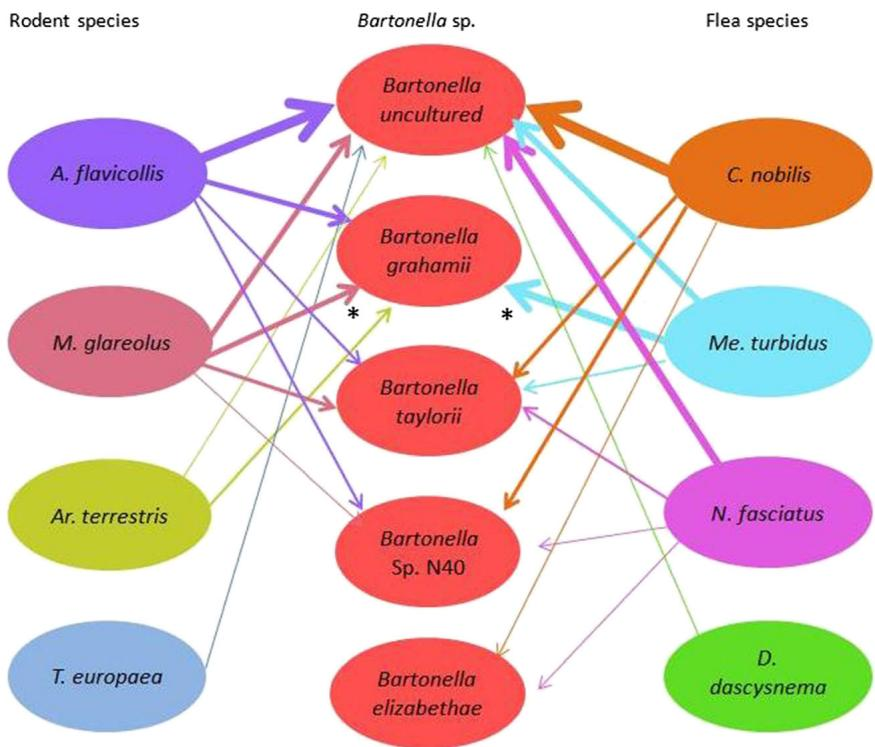

HOST MICROBE INTERACTIONS

# Bartonella, Rodents, Fleas and Ticks: a Molecular Field Study on Host-Vector-Pathogen Associations in Saxony, Eastern Germany

Cornelia Silaghi1,2 & Martin Pfeffer3 & Daniel Kiefer1,4 & Matthias Kiefer5 & Anna Obiegala3

Received: 11 March 2016 /Accepted: 10 May 2016

$©$ Springer Science+Business Media New York 2016

Abstract Bartonellae cause zoonotic diseases and are transmitted by arthropods. Rodents are reservoirs for most Bartonella spp. As the knowledge about Bartonella in rodents and their parasitizing ectoparasites is scarce in Germany, this study’s objectives were to investigate Bartonella spp. in small mammals and in their ectoparasites. A total of 79 small mammals (seven species) were captured and their ectoparasites collected at seven sites around Leipzig, Saxony, Germany, in 2010 and 2011. Altogether, 79 spleen samples, 135 fleas (five species) and 365 ticks (three species) were investigated for Bartonella spp. by PCR targeting the ITS 16S–23S rRNA region. In total, 52 $( 6 5 . 8 \% )$ ) small mammals, 73 $( 5 4 . 1 \% )$ fleas and 51 ( $1 6 . 3 \%$ ticks were positive for Bartonella spp. Most small mammals were positive for uncultured Bartonella sp. $( n = 2 9 )$ followed by Bartonella grahamii $( n = 1 2 )$ ), Bartonella taylorii $( n = 8 )$ and Bartonella sp. N40 $( n = 3 )$ . Likewise, most fleas were positive for uncultured Bartonella sp. $( n = 4 5 )$ ) followed by B. grahamii $( n = 1 4 )$ , B. taylorii $( n { = } 8 )$ ), $B$ . sp. N40 $( n = 5 )$ and Bartonella elizabethae $( n { = } 2 )$ ). Most ticks were positive for $B$ . sp. $( n = 1 9 )$ ) followed by $B$ . grahamii

$( n = 1 0 )$ ), Bartonella chomelii $( n = 3 )$ , B. taylorii $( n = 2 )$ and B. sp. N40 $( n { = } 1 )$ . This study’s results suggest that rodents and fleas may be reservoirs and vectors, respectively. Zoonotic B. grahamii and B. elizabethae were found in rodents and their fleas. Therefore, humans may contract Bartonella infection by contact to wild rodents. Ticks seem of minor importance in transmitting Bartonella spp. found in fleas and rodents. However, ticks might be vectors of B. chomelii.

Keywords Apodemus flavicollis . Myodes glareolus .

Ctenophthalmus nobilis . Bartonella spp. . Ixodes ricinus

# Introduction

Bartonella spp. are facultative intracellular alphaproteobacteria (order Rhizobiales, family Bartonellaceae) and the causative agents of bartonellosis which may result in severe clinical symptoms in humans and domesticated animals worldwide [39]. Bartonellosis, depending on the infecting Bartonella species, may cause chronical (e.g. verruga peruana) and acute (e.g. cat scratch fever) infections displayed by a variety of clinical symptoms [26, 40]. Bartonella quintana, Bartonella bacilliformis and Bartonella henselae are the most common causative agents and are carried by humans and cats (B. henselae) respectively [39]. However, there is an increasing number of clinical reports in humans caused by other bartonellae such as Bartonella elizabethae and Bartonella grahamii which are harboured by rodents [53]. While varying prevalences of bartonellae were found in wild ungulates, carnivores and domesticated animals [9, 12, 19, 32], the highest prevalence and diversity of Bartonella spp. were reported in rodents which are considered to be main reservoirs. To date, about 30 Bartonella species are

known of which ten are harboured by rodents and five of the latter are known to be of zoonotic potential (B. grahamii, B. elizabethae, Bartonella vinsonii subsp. arupensis, Bartonella washoensis and Bartonella tamiae) [14]. High prevalences of Bartonella spp. were reported in rodents from Asian [51] $(21 \% )$ ), African [29] $( 3 4 \% )$ and American countries [22] $(42 \% )$ . In Europe, the prevalence of Bartonella spp. in rodents is ranging from 13.7 to $5 7 . 5 ~ \%$ in studies from Poland [35, 54], Slovenia [21], Spain [13], France [8] and the UK [49].

Bartonella spp. are mainly transmitted by haematophagous arthropod vectors such as fleas, lice, sandflies and ticks [2, 4, 14, 44]. Other vectors such as the woodlouse hunter spider (Dysdera crocata) have been suggested as vectors as well [27]. Amongst ectoparasites infesting rodents, fleas are expected to be main vectors for Bartonella spp. [3, 52]. Ctenophthalmus nobilis also known as Ctenophthalmus agyrtes, the most common flea species parasitizing rodents in Central Europe, is known to transmit B. grahamii and B. taylorii to Myodes glareolus [5]. In European countries such as Poland [38], Italy [42], the Netherlands [44] and France [15], Bartonella spp. were detected in Ixodes ricinus, the most common tick in Central Europe [41]. However, data on Bartonella species in rodents and their parasitizing ectoparasites, such as C. nobilis and I. ricinus, is lacking in Germany and information about host-vector-pathogen associations of the latter are scarce in Europe. Thus, this study’s objectives were to analyse (1) the occurrence of Bartonella species in rodents, their fleas and ticks and (2) to identify their host-vector-pathogen associations in Germany.

# Materials and Methods

# Study Sites

The study site was divided in five animal trapping areas located around the city centre of Leipzig in Saxony which were formerly consecutively named from E to I [45]. Sites E–G are part of the BLeipziger Neuseenland^ (http://www. leipzigerneuseenland.de/), a recultivated former brown coal mining area which is surrounding a lake (Lake Cospuden, 436 ha) and which belongs to the largest recreational area near Leipzig. Site H is a recreational city park called BPark Lößnig-Dölitz^ (http://www. leipzig.de/de/buerger/freizeit/leipzig/parks/park_loessnig/) , near Leipzig which contains several ponds. This park merges into forested areas and is located near a renatured waste disposal mountain. Site I (42 ha) is a game park, located in Leipzig, often frequented by visitors, which belongs to one of the largest riparian forests in Germany (www.leipziger-auwald.de). About 250 game animals are present (http://www.leipzig.de/de/buerger/

freizeit/leipzig/parks/wildpark/wissen/). The study site and trapping areas have been described in detail in previous studies [45].

# Sampling of Small Mammals

Small mammals were trapped with Sherman $©$ live animal traps (H. B. Sherman Traps, Inc., Tallahassee, FL, USA) in 2010 and 2011 (official trapping permit: 36.11-36.45.12/4/10- 026-MH, 364.60/2009-102-2). Traps, baited with apple slices, were placed for at least two consecutive nights per month and site and were checked twice a day. Small mammals were captured with at least 20 traps per subdivided area per month in August and October in 2010, from March to June in 2011 (sites E, H, I) and further in November 2011. Collected animals were anaesthetized with $\mathrm { C O } _ { 2 }$ , euthanized by cervical dislocation and then stored at $- 8 0 ~ ^ { \circ } \mathrm { C }$ until further examinations in the laboratory. Details about small mammal trapping were published before [30]. All small mammals were morphologically identified [48]. Bycaught small mammal species, found dead in traps or brought by a cat, were additionally verified by the use of a conventional PCR targeting the partial cytochrome $b$ gene (354 bp) as described previously [34, 45]. Necropsy was carried out and spleens from the small mammals were collected.

# Collection of Ticks and Fleas

Ectoparasites were collected from the trapped small mammals with tweezers and stored separately for each small mammal in 1.5-ml-sized tubes at $- 8 0 ~ ^ { \circ } \mathrm { C }$ (Eppendorf, Hamburg, Germany) until further examination. The morphological identification of fleas and ticks was performed under a stereomicroscope with standardised taxonomic keys [17, 36, 37, 47]. Fleas and ticks were kept individually in separate 2.0-ml-sized tubes (Eppendorf) for the following DNA extraction.

# DNA Extraction

DNA samples of spleens $( n = 7 9 )$ ) and ticks $( n = 3 6 5$ ) from the small mammals were available from a previous study on tickborne infectious agents [45]. DNA extraction from collected fleas was carried out for each flea individually with the QIAamp DNA Mini Kit (Qiagen, Hilden, Germany) as previously described [46]. Quantity and quality of the extracted DNA were determined with a spectrophotometer (Nano Drop ND-1000, Erlangen, Germany).

# Polymerase Chain Reaction

A conventional PCR targeting 635 bp of the 16S–23S ITS region was performed for detection of Bartonella spp. as

described [25, 43], followed by UV light analysis on $2 \%$ agarose gel dyed with GelRed (Biotium, Hayward CA, USA).

# Sequence Analysis

PCR products were purified with the QIAquick PCR product purification Kit (Qiagen) according to the manufacturer’s instructions and sequenced commercially by Eurofins MWG Operon (Martinsried, Germany). Sequences were analysed with Chromas Lite® (Technelysium Pty Ltd., South Brisbane, Australia) and compared with sequences obtained from GenBank using BLASTn (National Center for Biotechnology Information, Bethesda MD, USA) as previously described [43]. Analysed and aligned sequences were deposited in GenBank under the following Acc. Nos.: KU886369–KU886524.

# Statistical Analysis

Confidence intervals $( 9 5 \ \% \mathrm { C I } )$ for prevalences of Bartonella spp. in small mammals, ticks and fleas were determined by the Clopper and Pearson method with GraphPad Software (GraphPad Software Inc., San Diego, CA, USA). Independence of compared small sample sizes $( n < 3 0 )$ was tested with Fisher’s exact test. The Kruskal-Wallis test with a Bonferroni correction and a significance level of $\alpha { = } 0 . 0 5$ was used to test the independence of flea infestation on rodents per study site. The t test was used to test the independence of flea infestation on M. glareolus and Apodemus spp.

# Results

# Small Mammal, Flea and Tick Collections

Small Mammals

n total, 79 spleen DNA samples were available from small mammals belonging to seven different species (36 M. glareolus, 32 Apodemus flavicollis, 3 Apodemus agrarius, 3 Arvicola terrestris, 3 Crocidura russula, 1 Sorex araneus, 1 Talpa europaea). Altogether, 22 individuals were captured at site I, 30 at site H and 27 at sites E– G. Distribution of each small mammal species per trapping site was described before [45].

# Fleas

A total of 135 fleas were collected from 42 rodents of the species A. flavicollis, M. glareolus and A. agrarius. The three Ar. terrestris and the five insectivores included in this study were not infested by fleas. The flea species

were identified as C. nobilis ${ \mathrm { \Delta } n = 6 7 }$ ; 34 females, 33 males), Megabothris turbidus $\scriptstyle n = 4 0$ ; 28 females, 11 males, 1 unknown), Nosopsyllus fasciatus $n = 2 6$ ; 17 females, 9 males), Doratopsylla dasycnema $\scriptstyle n = 1$ ; 1 unknown) and Megabothris walkeri $\scriptstyle n = 1$ ; 1 m a l e ) . Overall, the infestation rate of fleas was significantly higher on rodents belonging to the genus Apodemus compared to M. glareolus $( p < 0 . 0 0 0 1$ ; $t = 3 6 7 . 5$ ). Significantly more C. nobilis were collected from A. flavicollis and A. agrarius $( 6 2 . 7 ~ \% )$ compared to M. glareolus $( 3 4 . 3 ~ \% )$ $_ { p } { < } 0 . 0 0 0 1$ ; $t = 4 . 8 0 0 5$ ). Significantly more Me. turbidus were collected from M. glareolus $( 7 0 \ \% )$ compared to Apodemus spp. $( 3 0 ~ \% )$ $( p = 0 . 0 0 0 1$ ; $\begin{array} { r }  t { = } 4 . 0 5 1 9 \ \end{array}$ ). In contrast, significantly more N. fasciatus $( 8 4 . 6 ~ \%$ ) were collected from A. flavicollis $( 6 5 . 4 ~ \% )$ and A. agrarius $( 1 9 . 2 \ \% )$ while only $1 5 . 4 \ \%$ were collected from M. glareolus $\scriptstyle { p = 0 . 0 0 0 4 }$ ; $t { = } 3 . 7 1 7 4$ ).

Details about flea infestation rates per rodent species are shown in Table 1. Altogether, 15 rodents were infested with more than one flea species: seven M. glareolus were infested with Me. turbidus and C. nobilis, one M. glareolus with Me. turbidus, N. fasciatus and C. nobilis; one M. glareolus with Me. turbidus, Me. walkeri and C. nobilis; two A. flavicollis with Me. turbidus and C. nobilis; three A. flavicollis with N. fasciatus and C. nobilis and one A. flavicollis with Me. turbidus, N. fasciatus and C. nobilis.

The infestation rate of fleas on rodents per site differed significantly $\left( \chi ^ { 2 } = 9 . 0 3 8 \right.$ ; $p { = } 0 . 0 1 0 9$ ) as most fleas per rodent (4.2) were detected at site H whereas 1.3 fleas per rodent were detected at site I and 2.9 at the sites E– G. Moreover, the highest density of captured rodents was detected at site H $\left( n = 3 0 \right)$ ) compared to site I $( n = 2 2 )$ ) and sites E–G $( n = 2 7 )$ ). Regarding seasonal dynamics, most fleas per rodent were collected in June (4.4) and the least in March (1.0). Altogether, 2.6 fleas per rodent were detected in August and 2.8 in October. The unequal distribution of collected rodents per month does not allow a statistical comparison between months for the flea infestation per rodent. As two C. nobilis were gone missing, 133 of the 135 collected fleas were further processed.

# Ticks

Altogether, 365 DNA samples from attached ticks belonging to three species were available for this study (1 I. trianguliceps; 232 I. ricinus; 13 Ixodes spp.; 117 Dermacentor reticulatus; 2 Dermacentor spp.). I. ricinus ticks were mainly collected from A. flavicollis $( 5 0 . 6 ~ \% )$ and M. glareolus $( 3 3 . 7 \% )$ and from the other small mammal species: S. araneus $( 6 . 7 ~ \% )$ ), Ar. terrestris $( 7 . 8 ~ \% )$ ) and A. agrarius $( 1 . 2 ~ \% )$ . In contrast, significantly more D. reticulatus were collected from M. glareolus $( 9 9 . 2 ~ \%$ ) than from A. flavicollis $( 0 . 8 ~ \% )$ ) $\scriptstyle ( p = 0 . 0 0 4 5$ ; $t = 2 . 9 3 8 5$ ).

Table 1 Number of collected fleas per rodent species   

<table><tr><td rowspan="2">Small mammal species</td><td rowspan="2">Total no.</td><td rowspan="2">Total no. of rodents infested by fleas (%)</td><td colspan="8">Fleas species No. of rodents infested/total no. of fleas (range; median)</td></tr><tr><td>Ctenophthalmus nobilis</td><td>Megabothris turbidus</td><td>Nosopsyllus fasciatus</td><td colspan="2">Doratopsylla dasycnema</td><td colspan="3">Megabothris walkeri</td></tr><tr><td>Apodemus flavicollis</td><td>32</td><td>20 (62.5)</td><td>12 40 (1-3; 2)</td><td>8 12 (1-4; 1)</td><td>6 17 (1-10; 1.5)</td><td>1</td><td>1</td><td></td><td></td><td></td></tr><tr><td>Myodes glareolus</td><td>36</td><td>20 (55.6)</td><td>14 25 (1-4; 1.5)</td><td>12 28 (1-5; 2)</td><td>3 4 (1-2; 1)</td><td></td><td></td><td>1</td><td>1</td><td></td></tr><tr><td>Apodemus agrarius</td><td>3</td><td>2 (66.7)</td><td>1 2</td><td></td><td>1 5</td><td></td><td></td><td></td><td></td><td></td></tr><tr><td>Total</td><td>71</td><td>42</td><td>27 67</td><td>20 40</td><td>10 26</td><td>1</td><td>1</td><td>1</td><td>1</td><td></td></tr></table>

The insectivores $( n = 5$ ) included in this study were not infested by fleas

Table 2 shows the numbers and species of ticks collected from small mammals. Further information about collected ticks was published before [45].

# PCR Analysis for Bartonella spp.

Bartonella spp. in Rodents

In total, 52 of 79 ( $6 5 . 8 ~ \%$ ; $9 5 \ \%$ CI, 54.8–75.4) small mammals contained DNA of Bartonella spp. For A. flavicollis, 27 of 32 $( 8 4 . 4 \%$ ; $9 5 \%$ CI, 67.8–93.6) and for M. glareolus, 21 of 36 ( $5 2 . 8 ~ \%$ ; $9 5 \ \%$ CI, 37.0–68.0) individuals were positive. Though not being infested with fleas, captured Ar. terrestris $\scriptstyle \mathtt { n } = 3$ ; $100 \%$ ; $9 5 \ \%$ CI, 38.1–100) and T. europaea $( n = 1$ ; $100 \%$ ; $9 5 \ \%$ CI, 16.8–100) were positive for Bartonella spp. S. araneus $( n = 1 )$ , $C r$ russula $( n = 3 )$ and A. agrarius $( n = 3 )$ ) were negative (Table 3). Significantly more A. flavicollis were positive for Bartonella spp. compared to M. glareolus $\scriptstyle ( p = 0 . 0 0 8 8 )$ ). Comparing sites, significantly more small mammals were found positive at site I (19 of 22) than at the other sites (E–G, 14 of 27; H, 18 of 30) $\scriptstyle ( p = 0 . 0 3 4 1 )$ ).

# Sequence Analysis for Bartonella spp. in Rodents

All PCR-positive samples were sequenced of which 29 uncultured Bartonella sp. showed $100 \%$ homology to different sequences deposited in GenBank [Acc. Nos.: AJ269796 $\scriptstyle ( n = 5$ , host: Apodemus sylvaticus, country: UK), DQ155380 $\scriptstyle \mathtt { \bar { n } } = 5$ host: M. glareolus, country: UK), DQ155387 $\scriptstyle ( n = 5$ host: A. flavicollis, country: Slovenia), DQ155391 $\scriptstyle { n = 4 }$ host: A. flavicollis, country: Slovenia), DQ155376 $\scriptstyle n = 3$ host: A. agrarius, country: Slovenia), DQ155381 ( $n = 2$ host: M. glareolus, country: Slovenia), DQ155379 $n = 2$ host: M. glareolus, country: Slovenia), KP010210 $\scriptstyle n = 1$ host: Eidolon dupreanum, country: Madagascar), JX276643 $\scriptstyle \left( n = 1 \right.$ host: A. sylvaticus, country: Spain), JN403036 $\scriptstyle \gamma = 1$ host: A. sylvaticus, country: Georgia)]. These different sequences from GenBank showed identity of $2 2 \mathrm { - } 9 6 \%$ compared to each other. Overall, sequences showing $100 \%$ identity to Bartonella grahamii ${ \it n } = 1 2$ ; CP001562), $9 6 - 1 0 0 \ \%$ identity to B. taylorii [AJ269788 $( n = 4 )$ , AJ269796 $( n = 2$ ), AJ269784 $( n = 1 )$ ), HE974357 $( n = 1 ) ]$ ] and $100 \%$ identity to Bartonella sp. N40 $\scriptstyle ( n = 3$ ; AJ269791) were detected in small mammals. Three small mammals showed double infections: one

Table 2 Number of collected ticks per small mammal species   

<table><tr><td rowspan="2">Small mammal species</td><td rowspan="2">Total no.</td><td rowspan="2">Total no. of rodents infested by ticks (%)</td><td colspan="8">Tick species No. of rodents infested/total no. of ticks (range; median)</td><td></td><td></td></tr><tr><td>Ixodes ricinus</td><td>Ixodes spp.</td><td>Dermacentor reticulatus</td><td>Dermacentor spp.</td><td colspan="4">Ixodes trianguliceps</td><td></td><td></td></tr><tr><td>Apodemus flavicollis</td><td>32</td><td>20 (62.5)</td><td>24</td><td>116 (1–21; 9.5)</td><td>4</td><td>9 (1–2; 1.5)</td><td>1</td><td>1 (5)</td><td></td><td></td><td></td><td></td></tr><tr><td>Myodes glareolus</td><td>36</td><td>21 (58.3)</td><td>17</td><td>79 (1–14; 6)</td><td>2</td><td>3 (1–2; 1.5)</td><td>13</td><td>116 (1–22; 10)</td><td>2</td><td>2 (1)</td><td>1</td><td>1</td></tr><tr><td>Apodemus agrarius</td><td>3</td><td>2 (66.7)</td><td>2</td><td>18 (1–17; 8.5)</td><td></td><td>1</td><td>5 (5)</td><td></td><td></td><td></td><td></td><td></td></tr><tr><td>Arvicola terrestris</td><td>3</td><td>2 (66.7)</td><td>2</td><td>3 (1–2; 1.5)</td><td></td><td></td><td></td><td></td><td></td><td></td><td></td><td></td></tr><tr><td>Soricidae</td><td>4</td><td>2 (50)</td><td>2</td><td>12 (1–11; 5.5)</td><td></td><td></td><td></td><td></td><td></td><td></td><td></td><td></td></tr><tr><td>Talpa europaea</td><td>1</td><td>1 (100)</td><td>1</td><td>4 (4)</td><td></td><td></td><td></td><td></td><td></td><td></td><td></td><td></td></tr><tr><td>Total</td><td>79</td><td>48</td><td>48</td><td>232</td><td>6</td><td>12</td><td>15</td><td>122</td><td>2</td><td>2</td><td>1</td><td>1</td></tr></table>

Table 3 Prevalences of uncultured Bartonella sp., B. grahamii, B. taylorii and Bartonella sp. N40 in spleen samples from different small mammal species   

<table><tr><td rowspan="2">Small mammal species</td><td rowspan="2">Total no.</td><td rowspan="2">Total no. of small mammals infected with Bartonella a (%)</td><td colspan="4">Bartonella species Total infected (%)</td></tr><tr><td>Uncultured Bartonella sp.</td><td>B. grahamii</td><td>B. taylorii</td><td>Bartonella sp. N40</td></tr><tr><td>Apodemus flavicollis</td><td>32</td><td>27 (84.4)</td><td>18 (62.0)</td><td>4 (33.3)</td><td>3 (37.5)</td><td>2 (66.7)</td></tr><tr><td>Myodes glareolus</td><td>36</td><td>21 (52.8)</td><td>9 (31.0)</td><td>6 (50)</td><td>5 (62.5)</td><td>1 (33.3)</td></tr><tr><td>Apodemus agrarius</td><td>3</td><td>0 (0)</td><td></td><td></td><td></td><td></td></tr><tr><td>Arvicola terrestris</td><td>3</td><td>3 (100)</td><td>1 (3.5)</td><td>2 (16.7)</td><td></td><td></td></tr><tr><td>Crocidura russula</td><td>3</td><td>0 (0)</td><td></td><td></td><td></td><td></td></tr><tr><td>Sorex araneus</td><td>1</td><td>0 (0)</td><td></td><td></td><td></td><td></td></tr><tr><td>Talpa europaea</td><td>1</td><td>1 (100)</td><td>1 (3.5)</td><td></td><td></td><td></td></tr><tr><td>Total</td><td>79</td><td>52 (65.8)</td><td>29 (100)</td><td>12 (100)</td><td>8 (100)</td><td>3 (100)</td></tr></table>

a Numbers differ from sum of individual Bartonella infections, because of double infections in individual animals (1 M. glareolus: B. uncultured + B. taylorii, 1 M. glareolus: uncultured Bartonella sp. $+ B .$ . grahamii; 1 A. flavicollis: uncultured Bartonella sp. $^ +$ uncultured Bartonella sp.)

A. flavicollis with two different uncultured Bartonella sp. (Acc. Nos.: AJ269796 and JN403036, showing identity of $50 . 3 ~ \%$ compared to each other), one M. glareolus with uncultured Bartonella sp. and $B$ . grahamii and one M. glareolus with uncultured Bartonella sp. and B. taylorii (Table 3). Additionally, sequence analysis revealed one sequence in A. flavicollis which showed low identity of $71 \%$ to several different Bartonella spp. sequences deposited in GenBank (Table 4). Moreover, amplicons detected by conventional PCR in two A. flavicollis could not be further determined by sequencing.

M. glareolus were mainly infected by B. grahamii and B. taylorii (50 and $6 2 . 5 ~ \%$ , respectively) while uncultured Bartonella sp. and Bartonella sp. N40 were mainly detected in A. flavicollis (62 and $6 6 . 7 \%$ , respectively).

# Bartonella spp. in Fleas

A total of $5 4 . 1 \%$ (73/133) of the fleas were positive for DNA of Bartonella spp. ( $9 5 \ \%$ CI, 45.7–62.4). In total, 29 of 65 C. nobilis, 17 of $2 6 \ N .$ . fasciatus and 26 of 40 Me. turbidus were positive. While the single D. dasycnema was positive, the single Me. walkeri was negative for Bartonella spp. Comparing prevalences at sites, ten of 13 $7 6 . 9 \ \%$ ) at site I, 28 of 53 $( 5 2 . 8 \% )$ at sites E–G and 35 of 67 $( 5 2 . 2 \% )$ ) fleas at site H were positive for Bartonella spp. The prevalences did not differ significantly $( \chi ^ { 2 } = 2 . 9 3$ ; $\begin{array} { r } { p { = } 0 . 2 3 0 5 } \end{array}$ ). Positive fleas were collected from 23 positive and 12 negative rodents. Altogether, 15 of the 23 positive rodents were positive for the same Bartonella sp. as their fleas. Positive fleas which were collected from the 12 negative small mammals were positive for uncultured Bartonella sp. $n = 1 3$ identity of 97– $100 \%$ to the following GenBank Acc. Nos.: DQ155387 $( n = 2 )$ ), DQ155391 $( n = 1 )$ , DQ155380 $\scriptstyle ( n = 3$ ), JN403036

$( n = 5 )$ and AY877424 $\scriptstyle n = 2$ , host: Stenoponia tripectinata, country: Portugal)), B. grahamii $\scriptstyle \mathtt { n } = 2$ ; identity to the following Acc. No.: JF766266), B. taylorii $\scriptstyle \mathtt { n } = 2$ ; identity to the following Acc. No.: JF766266), Bartonella sp. N40 $\scriptstyle ( n = 1$ ; identity to the following Acc. No.: JF766266) and B. elizabethae $\scriptstyle n = 1$ ; identity to the following Acc. No.: JF766266).

# Sequencing of Bartonella spp. in Fleas

Sequencing was performed for all positive flea samples $( n = 7 3$ ) (Table 4). Altogether, $9 6 - 1 0 0 \%$ identity was detected for uncultured Bartonella sp. $[ n = 4 5$ ; GenBank Acc. Nos.: DQ155387 $( n = 1 2 )$ , DQ155380 $( n = 1 1 )$ ), DQ155391 $( n { = } 8 )$ ), JN403036 $( n = 8 )$ , AY877424 $\left( n = 3 \right)$ , DQ155384 $( n = 1 )$ ), HM596446 $( n { = } 1 )$ , AJ269794 $\scriptstyle ( n = 1 )$ ]. Overall, 14 sequences showed $100 \%$ identity to $B$ . grahamii [Acc. Nos.: CP001562 $( n = 1 3 )$ ), JN810855 $( n = 1 ) ]$ and eight sequences were $100 \%$ identical to $B$ . taylorii [Acc. Nos.: AJ269788 $( n = 6 )$ , AJ269784 $( n { = } 2 ) ]$ . Sequences were $100 \%$ identical to $B$ . sp. N40 (Acc. No.: AJ269787 $( n = 4 )$ ) and B. elizabethae (Acc. No.: JF766266 $( n { = } 2 )$ ). Double infections of uncultured Bartonella sp. (Acc. No.: JN403036, $n { = } 2$ ) and $B$ . elizabethae were detected in one $N .$ . fasciatus and one $C .$ . nobilis. Sequencing of amplicons from two C. nobilis, two Me. turbidus and three N. fasciatus did not succeed.

B. grahamii was detected significantly more often in Me. turbidus $( 9 3 \%$ ; $\chi ^ { 2 } { = } 2 9 . 6 2 5 5$ ; $p { < } 0 . 0 0 0 1 $ ) than in N. fasciatus $( 7 \% )$ and $C .$ . nobilis $( 0 \% )$ . Bartonella sp. N40 and $B$ . taylorii were mainly but not significantly more often detected in C. nobilis $80 \%$ respectively $50 \%$ , $\begin{array} { r } { p = 0 . 2 9 4 5 } \end{array}$ ). Uncultured Bartonella sp. was mainly detected in $N .$ fasciatus $( 2 8 . 9 ~ \% )$ ) and C. nobilis $( 4 6 . 7 \% )$ however not significantly $( p = 0 . 1 3 2 5 )$ )

Table 4 Prevalences of uncultured Bartonella sp., B. grahamii, B. taylorii, Bartonella sp. N40 and B. elizabethae in fleas collected from rodents   

<table><tr><td rowspan="2">Flea species</td><td rowspan="2">Total no.</td><td rowspan="2">Total no. of fleas infected with Bartonella a (%)</td><td colspan="5">Bartonella species Total infected (%)</td></tr><tr><td>Uncultured Bartonella sp.</td><td>B. grahamii</td><td>B. taylorii</td><td>Bartonella sp. N40</td><td>B. elizabethae</td></tr><tr><td>Ctenophthalmus nobilis</td><td>67</td><td>29 (43.3)</td><td>21 (46.7)</td><td></td><td>4 (50)</td><td>3 (75)</td><td>1 (50)</td></tr><tr><td>Megabothris turbidus</td><td>40</td><td>26 (62.5)</td><td>10 (22.2)</td><td>13 (92.9)</td><td>2 (25)</td><td></td><td></td></tr><tr><td>Nosopsyllus fasciatus</td><td>26</td><td>17 (92.9)</td><td>13 (28.9)</td><td>1 (7.1)</td><td>2 (25)</td><td>1 (25)</td><td>1 (50)</td></tr><tr><td>Doratopsylla dasycnema</td><td>1</td><td>1 (100)</td><td>1 (2.2)</td><td></td><td></td><td></td><td></td></tr><tr><td>Megabothris walkeri</td><td>1</td><td>0 (0)</td><td></td><td></td><td></td><td></td><td></td></tr><tr><td>Total</td><td>135</td><td>73 (53.3)</td><td>45 (100)</td><td>14 (100)</td><td>8 (100)</td><td>4 (100)</td><td>2 (100)</td></tr></table>

a Numbers differ from sum of individual Bartonella infections, because of double infections in individual animals (1 C. nobilis: uncultured Bartonella sp. $+ B$ . elizabethae, 1 N. fasciatus: uncultured Bartonella sp. $+ B$ . elizabethae)

compared to Me. turbidus. B. elizabethae was exclusively detected in fleas.

# Bartonella spp. in Ticks

Altogether, 51 of the 365 ticks were positive for Bartonella spp. ( $1 6 . 3 ~ \%$ ; $9 5 \ \%$ CI, 12.9–20.5). In total, 39 of 232 I. ricinus $1 9 . 1 ~ \%$ ; $9 5 \ \%$ CI, 14.4–24.6) and 6 of 117 D. reticulatus $( 5 . 9 ~ \%$ ; $9 5 \ \%$ CI, 3.9–14.1) were positive for Bartonella spp. (Table 5). Six of 13 Ixodes spp. which could not be further determined were tested positive for Bartonella spp. $5 0 . 0 \%$ ; $9 5 \ \%$ CI, 21.3–72.0). Dermacentor spp. were Bartonella negative $n { = } 2$ ; $9 5 \ \%$ CI, 0–70.1) as well as I. trianguliceps $\scriptstyle ( n = 1$ ; $9 5 \ \%$ CI, 0–83.3). I. ricinus ticks were significantly more often infected with Bartonella spp. than D. reticulatus $( p = 0 . 0 0 2 )$ ). The prevalence at the sites E–G (10 of 194) was significantly lower $\scriptstyle ( \chi ^ { 2 } = 3 1 . 3 1 0 8$ ; $p { < } 0 . 0 0 0 1 $ than at both other sites H (30 of 109) and I (11 of 62). Positive ticks were collected from 19 positive and three negative small mammals. For 18 of the 19 positive rodents, Bartonella sequences were matching those from their ticks. One B. taylorii-positive rodent was infested with a B. grahamii-positive tick.

# Sequence Analysis for Bartonella spp. in Ticks

Sequencing was performed for 35 selected tick samples. Altogether, 20 uncultured Bartonella sp. $[ 9 6 - 1 0 0 \%$ ; identity to the following Acc. Nos.: DQ155387 $( n = 7 )$ ), AJ269787 $( n = 4 )$ , DQ155380 $\scriptstyle ( n = 3 )$ ), DQ155374 $( n = 1 )$ ), DQ155376 $( n = 1 )$ ), DQ155379 $( n = 1 )$ ), DQ155381 $( n = 1 )$ ), DQ155386 $( n = 1 ) ]$ , $1 0 \ B .$ . grahamii [identity to Acc. Nos.: CP001562 $( n { = } 9 )$ ), KF774307 $( n = 1 ) ]$ ], three Bartonella chomelii (identity to Acc. No.: KM215715 $\left( n = 3 \right) ]$ and two B. taylorii [identity of $9 9 - 1 0 0 \ \%$ to Acc. Nos.: JN366404 $( n = 1 )$ ), AJ269788 $\left( n = 1 \right) .$ ] were detected in ticks (Table 5). Double infections

were not detected. Overall, 16 tick samples, detected positive by conventional PCR, were not further processed by sequencing due to previous selection criteria. Additionally, PCR products of five I. ricinus, two $D$ . reticulatus and one Dermacentor spp. could not be determined by sequencing.

Uncultured Bartonella spp. were significantly more often detected in I. ricinus than in $D$ . reticulatus $9 0 . 0 ~ \%$ ; $\chi ^ { 2 } = 6 . 8 9 9 7$ ; $p { = } 0 . 0 0 8 6$ ).

# Host-Vector-Pathogen Associations

The complexity of relations between Bartonella spp., flea and rodent species is shown in Fig. 1. In both fleas and in rodents, uncultured Bartonella spp. were most commonly detected. The figures shows clearly that Bartonella spp. detected in most flea and rodent species are very diverse and that there is just a single host-vector-pathogen association between M. glareolus, Me. turbidus and B. grahamii.

# Discussion

In comparison to other mammals, the highest diversity of Bartonella spp. was described in rodents to date. Altogether, 22 rodent-associated Bartonella spp. and subspecies were described [14]. Some of them were initially isolated from infected humans [8]. The prevalences for Bartonella spp. in rodents from other European countries such as Poland, Denmark, England and Sweden ranged between 11 and $72 \%$ [14]. Results of our study $( 6 5 . 8 ~ \% )$ therefore fall into the upper range of those studies. Co-infections of hosts and vectors with multiple Bartonella species or genotypes are a familiar phenomenon [14]. In the present study, several rodents were also co-infected with two different Bartonella spp. Most commonly, different uncultured Bartonella spp. were detected in

Table 5 Prevalences of uncultured Bartonella sp., B. grahamii, B. taylorii and B. chomelii in ticks collected from different small mammal species   

<table><tr><td rowspan="2">Tick species</td><td rowspan="2">Total no.</td><td rowspan="2">Total no. of ticks infected with Bartonella a (%)</td><td colspan="5">Bartonella species Total infected (%)</td></tr><tr><td>Uncultured Bartonella sp.</td><td>B. grahamii</td><td>B. taylorii</td><td>Bartonella sp. N40</td><td>B. chomelii</td></tr><tr><td>Ixodes ricinus</td><td>232</td><td>39 (17.0)</td><td>17 (90.0)</td><td>6 (60.0)</td><td>1 (50.0)</td><td></td><td>2 (66.7)</td></tr><tr><td>Dermacentor reticulatus</td><td>117</td><td>6 (5.2)</td><td>1 (5.0)</td><td>4 (40.0)</td><td></td><td></td><td>1 (33.3)</td></tr><tr><td>Ixodes spp.</td><td>13</td><td>6 (46.2)</td><td>1 (5.0)</td><td></td><td>1 (50.0)</td><td>1 (100)</td><td></td></tr><tr><td>Dermacentor spp.</td><td>2</td><td>0 (0)</td><td></td><td></td><td></td><td></td><td></td></tr><tr><td>Ixodes trianguliceps</td><td>1</td><td>0 (0)</td><td></td><td></td><td></td><td></td><td></td></tr><tr><td>Total</td><td>365</td><td>51 (14.2)</td><td>19 (100)</td><td>10 (100)</td><td>2 (100)</td><td>1 (100)</td><td>3 (100)</td></tr></table>

a Numbers differ from sum of individual Bartonella infections, because 16 of all 51 positive samples were not further determined by sequencing

combination with B. grahamii and B. taylorii which are common Bartonella species in rodent hosts [14]. In this study, mostly uncultured Bartonella spp. were found in rodents. In a recent study from France, a high prevalence for Bartonella spp. was detected in bank voles $( 3 9 . 3 ~ \% )$ ). However, focusing on the Bartonella species characterisation, also yet unknown genotypes were found as in our study [8]. A. flavicollis was significantly more often infected with Bartonella spp. than M. glareolus in the present study. This observation was made before and it was not explained by the different ecologic habitats of both of these rodent species but rather by specific hostpathogen interactions. While M. glareolus is able to resolve Bartonella infections within 1–2 months, the duration of resolving the infection is still not definitely known for

A. flavicollis [35]. Moreover, it has been observed that reinfection in M. glareolus is more seldom than in A. flavicollis [35]. The flea abundance might directly influence the prevalence of Bartonella infection in the rodent host. Overall, fleas were found significantly more often on Apodemus spp. than on M. glareolus in this study. This may also explain why Apodemus spp. were more often infected with Bartonella sp. than M. glareolus. Furthermore, M. glareolus, in contrast to other small mammal species such as Peromyscus leucopus, is not able to transmit Bartonella spp. transplacentally [5, 23]. This is why vectors are important for the maintenance of Bartonella in these reservoir hosts. B. grahamii was more abundant in M. glareolus than in Apodemus spp. in our study. Previously, it has been reported that M. glareolus is the main

  
Fig. 1 Complex associations between Bartonella, rodent and flea species. C. nobilis $=$ Ctenophthalmus nobilis, N. fasciatus $=$ Nosopsyllus fasciatus, D. dasycnema $=$ Doratopsylla dasycnema, Me. turbidus $=$ Megabothris turbidus, A. flavicollis $=$ Apodemus flavicollis, M. glareolus $=$ Myodes glareolus, T. europaea $=$ Talpa europaea, Ar. terrestris $=$ Arvicola terrestris. *Statistically significant

reservoir for B. grahamii [53]. A former study reported that B. grahamii may be transmitted to the paws of cats by infected rodents which were killed by cats, as contact samples of cat paws were positive [31]. In this way, this pathogenic Bartonella species may be further transmitted by cat scratches to other animals and humans [31].

T. europaea and Ar. terrestris were, though not infested with fleas, positive for Bartonella spp. in our study. It is probable that those small mammals, which were found dead due to being caught by a cat, were not infested with fleas due to the survival strategy of fleas which jump off dead hosts as soon as the hosts’ body temperature is decreasing [18]. The high infestation rate of fleas on small mammals at site BI^ could be due to the high density of captured rodents and may explain why the majority of Bartonella-positive rodents were found there. Fleas vary greatly in their degree of host specificity, from being highly host-specific to host-opportunistic [24]. Most flea species showed a preference for certain rodent species in our study. As Me. turbidus was found predominantly on $M .$ . glareolus and C. nobilis and N. fasciatus significantly more often on Apodemus spp., it seems likely that these flea species have a host preference, but no clear host specificity.

In our study, the prevalences for Bartonella spp. were high in most rodent flea species such as C. nobilis $( 4 3 . 3 ~ \% )$ , N. fasciatus $( 9 2 . 9 ~ \% )$ and Me. turbidus $( 6 2 . 5 ~ \% )$ ). There are only few studies investigating those flea species for the occurrence of Bartonella spp. However, B. taylorii and B. grahamii are known to be transmitted by C. nobilis to M. glareolus [5]. Bartonella sp. has previously been described in N. fasciatus [33]. The prevalence of Bartonella spp. in fleas seemed to be independent of the Bartonella species and of the prevalence in their rodent hosts as most positive fleas derived either from negative rodents or from rodents which were not positive for the same Bartonella species. This observation has been made before, with the conclusion of a vertical transmission path for Bartonella in fleas [7]. B. grahamii, B. taylorii and B. elizabethae are known to occur in fleas which infest rodents [53]. In our study, these Bartonella spp. as well as several uncultured Bartonella spp. were found in fleas. Though B. elizabethae is known to occur in rodents and fleas, we detected this Bartonella species exclusively in fleas [6].

B. grahamii was more abundant in Me. turbidus fleas compared to other flea species. In accordance with this finding, B. grahamii was mainly found in M. glareolus, the main host of Me. turbidus, suggesting a host-vector-pathogen association for M. glareolus, Me. turbidus and B. grahamii. Apart from this observation, no other significant host-vectorpathogen associations were found.

To date, it is not clear whether ticks are involved in the natural life cycle of Bartonella spp. Their epidemiological importance has been considered secondary [16, 28, 50]. However, previous studies from Italy, France, Portugal and Germany reported prevalences ranging between 1.5 and

$3 2 . 3 ~ \%$ in questing I. ricinus ticks respectively in I. ricinus removed from humans [10, 15, 20, 42]. In our study, the prevalence is in the range of the mentioned European studies ( $1 6 . 3 \% )$ ). The Bartonella species detected in ticks in this study were B. chomelii, B. grahamii, B. taylorii and uncultured Bartonella sp. The prevalence in I. ricinus was significantly higher when compared to $D$ . reticulatus. Thus, D. reticulatus appears to be less important in the transmission cycle of Bartonella spp. than I. ricinus. Comparing the results for Bartonella in ticks and fleas, ticks seem to be more dependent on the prevalence and Bartonella sp. detected in their rodent hosts in contrast to fleas. Most positive ticks were collected from positive rodents in our study, and the Bartonella sp. found in ticks were mainly matching the species found in their rodent hosts. These results suggest that ticks, reflecting the infection in their rodent hosts, are of minor importance in the natural life cycle of Bartonella spp. found in rodents and their fleas. However, B. chomelii was exclusively found in ticks but not in fleas and rodent hosts from this study. Formerly, B. chomelii was detected in domesticated ruminants and in their engorged ticks from Spain and Italy [1, 11]. Cattle are suggested to be reservoirs not showing any clinical symptoms [1]. As B. chomelii has never been detected in fleas and rodents thus far, this Bartonella sp. is likely to be transmitted transovarially in tick populations in nature as most positive ticks deriving from rodents were larvae which were naïve before feeding on their rodent hosts.

# Conclusion

In conclusion, a high prevalence of different Bartonella species was found in rodents and their fleas with a high diversity and a tendency towards a host-vector-pathogen association for M. glareolus, Me. turbidus and B. grahamii. Zoonotic bartonellae such as B. grahamii and B. elizabethae were found in rodents and their fleas in this study. Therefore, humans and their companion animals are at risk of contracting Bartonella infection by direct or indirect contact to infected blood of wild living rodents. Ticks seem to be of minor importance in the transmission cycle of Bartonella sp. found in fleas and rodents. However, ticks may play an important role as vectors in the transmission of B. chomelii.

Acknowledgments The authors would like to thank Claudia Thiel for the excellent technical assistance and Dr. Carolin Karnath and Dietlinde Woll for their help in rodent trapping. The Federal Environment Agency of Germany (FKZ 371148) funded part of this project. The work of AO, MP and CS was done under the frame of EurNegVec COST Action TD1303.

# References

1. Antequera-Gómez ML, Lozano-Almendral L, Barandika JF, González-Martín-Niño RM, Rodríguez-Moreno I, García-Pérez AL, Gil H (2015) Bartonella chomelii is the most frequent species infecting cattle grazing in communal mountain pastures in Spain. Appl Environ Microbiol 81(2):623–629   
2. Bajer A, Pawelczyk A, Behnke JM, Gilbert FS, Sinski E (2001) Factors affecting the component community structure of haemoparasites in bank voles (Clethrionomys glareolus) from the Mazury Lake District region of Poland. Parasitology 122:43–54   
3. Billeter SA, Levy MG, Chomel BB, Breitschwerdt EB (2008) Vector transmission of Bartonella species with emphasis on the potential for tick transmission. Med Vet Entomol 22:1–15   
4. Birtles RJ, Hazel SM, Bennett M, Bown K, Raoult D, Begon M (2001) Longitudinal monitoring of the dynamics of infections due to Bartonella species in UK woodland rodents. Epidemiol Infect 126(2):323–329   
5. Bown KJ, Bennet M, Begon M (2004) Flea-borne Bartonella grahamii and Bartonella taylorii in bank voles. Emerg Infect Dis 10(4):684–687   
6. Brenner DJ, O’Connor SP, Winkler HH, Steigerwalt AG (1993) Proposals to unify the genera Bartonella and Rochalimaea, with descriptions of Bartonella quintana comb. nov., Bartonella vinsonii comb. nov., Bartonella henselae comb. nov., and Bartonella elizabethae comb. nov., and to remove the family Bartonellaceae from the order Rickettsiales. Int J Syst Bacteriol 43(4):777–786   
7. Brinkerhoff RJ, Kabeya H, Inoue K, Bai Y, Maruyama S (2010) Detection of multiple Bartonella species in digestive and reproductive tissues of fleas collected from sympatric mammals. ISME J 4(7):955–958   
8. Buffet JP, Marsot M, Vaumourin E, Gasqui P, Masséglia S, Marcheteau E, Huet D, Chapuis JL, Pisanu B, Ferquel E, Halos L, Vourc’h G, Vayssier-Taussat M (2012) Co-infection of Borrelia afzelii and Bartonella spp. in bank voles from a suburban forest. Comp Immunol Microbiol Infect Dis 35(6):583–589   
9. Dehio C, Lanz C, Pohl R, Behrens P, Bermond D, Piémont Y, Pelz K, Sander A (2001) Bartonella schoenbuchii sp. nov., isolated from the blood of wild roe deer. Int J Syst Evol Microbiol 51:1557–1565   
10. Dietrich F, Schmidgen T, Maggi RG, Richter D, Matuschka FR, Vonthein R, Breitschwerdt EB, Kempf VA (2010) Prevalence of Bartonella henselae and Borrelia burgdorferi sensu lato DNA in Ixodes ricinus ticks in Europe. Appl Environ Microbiol 76(5): 1395–1398   
11. Ebani VV, Bertelloni F, Turchi B, Filogari D, Cerri D (2015) Molecular survey of tick-borne pathogens in ixodid ticks collected from hunted wild animals in Tuscany, Italy. Asian Pac J Trop Med 8(9):714–717   
12. Gerrikagoitia X, Gil H, García-Esteban C, Anda P, Juste RA, Barral M (2012) Presence of Bartonella species in wild carnivores of Northern Spain. Appl Environ Microbiol 78(3):885–888   
13. Gil H, García-Esteban C, Barandika JF, Peig J, Toledo A, Escudero R, Jado I, Rodríguez-Vargas M, García-Amil C, Lobo B, Roales P, Rodríguez-Moreno I, Olmeda AS, García-Pérez AL, Anda P (2010) Variability of Bartonella genotypes among small mammals in Spain. Appl Environ Microbiol 76(24):8062–8070   
14. Gutiérrez R, Krasnov B, Morick D, Gottlieb Y, Khokhlova IS, Harrus S (2015) Bartonella infection in rodents and their flea ectoparasites: an overview. Vector Borne Zoonotic Dis 15(1):27–39   
15. Halos L, Jamal T, Maillard R, Beugnet F, Le Menach A, Boulouis HJ, Vayssier-Taussat M (2005) Evidence of Bartonella sp. in questing adult and nymphal Ixodes ricinus ticks from France and co-infection with Borrelia burgdorferi sensu lato and Babesia sp. Vet Res 36(1):79–87

16. Harrison A, Bown KJ, Montgomery WI, Birtles RJ (2012) Ixodes ricinus is not an epidemiologically relevant vector of Bartonella species in the wood mouse (Apodemus sylvaticus). Vector Borne Zoonotic Dis 12(5):366–371   
17. Hillyard PD (1996) Ticks of North-West Europe synopses of the British Fauna No. 52. The Linnean Society of London   
18. Hsu MH, Wu WJ (2001) Off-host observations of mating and postmating behaviors in the cat flea (Siphonaptera: Pulicidae). J Med Entomol 38:352–360   
19. Inoue K, Maruyama S, Kabeya H, Kawanami K, Yanai K, Jitchum S, Jittaparapong S (2009) Prevalence of Bartonella infection in cats and dogs in a metropolitan area, Thailand. Epidemiol Infect 137(11):1568–1573   
20. Janecek E, Mietze A, Goethe R, Schnieder T, Strube C (2012) Bartonella spp. infection rate and B. grahamii in ticks. Emerg Infect Dis 18(10):1689–1690   
21. Knap N, Duh D, Birtles R, Trilar T, Petrovec M, Avsic-Zupanc T (2007) Molecular detection of Bartonella species infecting rodents in Slovenia. FEMS Immunol Med Microbiol 50(1):45–50   
22. Kosoy MY, Regnery RL, Tzianabos T, Marston EL, Jones DC, Green D, Maupin GO, Olson JG, Childs JE (1997) Distribution, diversity, and host specificity of Bartonella in rodents from the Southeastern United States. Am J Trop Med Hyg 57(5):578–588   
23. Kosoy MY, Regnery RL, Kosaya OI, Jones DC, Marston EL, Childs JE (1998) Isolation of Bartonella spp. from embryos and neonates of naturally infected rodents. J Wildl Dis 34(2):305–309   
24. Krasnov BR, Shenbrot GI, Khokhlova IS, Poulin R (2004) Relationships between parasite abundance and the taxonomic distance among a parasite’s host species: an example with fleas parasitic on small mammals. Int J Parasitol 34(11):1289–1297   
25. Maggi RG, Diniz PP, Cadenas MB, Breitschwerdt EB (2006) The use of molecular diagnostic techniques to detect Anaplasma, Bartonella and Ehrlichia species in arthropods or patients. In: The International Canine Vector-Borne Disease Symposium; April 18th-20th, Billesley, Alcester, UK, vol 2006., pp 9–14   
26. Maguiña C, Gotuzzo E (2000) Bartonellosis. New and old. Infect Dis Clin N Am 14(1):1–22, vii   
27. Mascarelli PE, Maggi RG, Hopkins S, Mozayeni BR, Trull CL, Bradley JM, Hegarty BC, Breitschwerdt EB (2013) Bartonella henselae infection in a family experiencing neurological and neurocognitive abnormalities after woodlouse hunter spider bites. Parasit Vectors 6:98   
28. Matsumoto K, Cook JA, Goethert HK, Telford SR 3rd (2010) Bartonella sp. infection of voles trapped from an interior Alaskan site where ticks are absent. J Wildl Dis 46(1):173–178   
29. Meheretu Y, Leirs H, Welegerima K, Breno M, Tomas Z, Kidane D, Girmay K, de Bellocq JG (2013) Bartonella prevalence and genetic diversity in small mammals from Ethiopia. Vector Borne Zoonotic Dis 13(3):164–175   
30. Obiegala A, Pfeffer M, Pfister K, Tiedemann T, Thiel C, Balling A, Karnath C, Woll D, Silaghi C (2014) Candidatus Neoehrlichia mikurensis and Anaplasma phagocytophilum: prevalences and investigations on a new transmission path in small mammals and ixodid ticks. Parasit Vectors 7:563   
31. Oksi J, Rantala S, Kilpinen S, Silvennoinen R, Vornanen M, Veikkolainen V, Eerola E, Pulliainen AT (2013) Cat scratch disease caused by Bartonella grahamii in an immunocompromised patient. J Clin Microbiol 51(8):2781–2784   
32. Overzier E (2013) Habitatabhängige Prävalenzunterschiede zeckenübertragener Erreger in Ixodes ricinus und das Reservoirpotential von Rehwild. Dissertation, LMU München: Tierärztliche Fakultät   
33. Parola P, Sanogo OY, Lerdthusnee K, Zeaiter Z, Chauvancy G, Gonzalez JP, Miller RS, Telford SR 3rd, Wongsrichanalai C, Raoult D (2003) Identification of Rickettsia spp. and Bartonella

spp. in fleas from the Thai-Myanmar border. Ann N Y Acad Sci 990:173–181   
34. Parson W, Pegoraro K, Niederstätter H, Föger M, Steinlechner M (2000) Species identification by means of the cytochrome b gene. Int J Legal Med 114(1-2):23–28   
35. Paziewska A, Harris PD, Zwolińska L, Bajer A, Siński E (2012) Differences in the ecology of Bartonella infections of Apodemus flavicollis and Myodes glareolus in a boreal forest. Parasitology 139(7):881–893   
36. Peus F (1970) Zur Kenntnis der Flöhe Deutschlands. III. Faunistik und Ökologie der Säugetierflöhe. Insectivora, Lagomorpha, Rodentia. – Zoologische Jahrbücher für Systematik, Jena   
37. Peus F (1972) Zur Kenntnis Flöhe Deutschlands. – IV. Faunistik und Ökologie der Säugetierflöhe. Schluß. – Zoologische Jahrbücher für Systematik, Jena   
38. Podsiadly E, Chmielewski T, Sochon E, Tylewska- Wierzbanowska S (2007) Bartonella henselae in Ixodes ricinus ticks removed from dogs. Vector Borne Zoonotic Dis 7:189–192   
39. Prutsky G, Domecq JP, Mori L, Bebko S, Matzumura M, Sabouni A, Shahrour A, Erwin PJ, Boyce TG, Montori VM, Malaga G, Murad MH (2013) Treatment outcomes of human bartonellosis: a systematic review and meta-analysis. Int J Infect Dis 17(10):e811– e819   
40. Relman DA, Falkow S, LeBoit PE, Perkocha LA, Min KW, Welch DF, Slater LN (1991) The organism causing bacillary angiomatosis, peliosis hepatis, and fever and bacteremia in immunocompromised patients. N Engl J Med 324(21):1514   
41. Rizzoli A, Silaghi C, Obiegala A, Rudolf I, Hubálek Z, Földvári G, Plantard O, Vayssier-Taussat M, Bonnet S, Spitalská E, Kazimírová M (2014) Ixodes ricinus and its transmitted pathogens in urban and peri-urban areas in Europe: new hazards and relevance for public health. Front Public Health 2:251   
42. Sanogo YO, Zeaiter Z, Caruso G, Merola F, Shpynov S, Brouqui P, Raoult D (2003) Bartonella henselae in Ixodes ricinus ticks (Acari: Ixodida) removed from humans, Belluno Province, Italy. Emerg Infect Dis 9(3):329–332   
43. Schorn S, Pfister K, Reulen H, Mahling M, Silaghi C (2011) Occurrence of Babesia spp., Rickettsia spp. and Bartonella spp.

in Ixodes ricinus in Bavarian public parks, Germany. Parasit Vectors 4:135   
44. Schouls LM, Van De Pol I, Rijpkema SG, Schot CS (1999) Detection and identification of Ehrlichia, Borrelia burgdorferi sensu lato, and Bartonella species in Dutch Ixodes ricinus ticks. J Clin Microbiol 37(7):2215–2222   
45. Silaghi C, Woll D, Hamel D, Pfister K, Mahling M, Pfeffer M (2012) Babesia spp. and Anaplasma phagocytophilum in questing ticks, ticks parasitizing rodents and the parasitized rodentsanalyzing the host-pathogen-vector interface in a metropolitan area. Parasit Vectors 5:191   
46. Silaghi C, Knaus M, Rapti D, Shukullari E, Pfister K, Rehbein S (2012) Rickettsia felis and Bartonella spp. in fleas from cats in Albania. Vector Borne Zoonotic Dis 12(1):76–77   
47. Siuda K (1991) Kleszcze (Acari: Ixodida) Polski: Zagadnienia ogólne Teil 1 von Kleszcze (Icari: Ixodida) Polski. Monografie parazytologiczne   
48. Stresemann E (1989) Exkursionsfauna von Deutschland, Wirbeltiere. Volume 3. Spektrum Akademischer Verlag, Gustav Fischer, Heidelberg   
49. Telfer S, Clough HE, Birtles LR, Bennett M, Carslake D, Helyar S, Begon M (2007) Ecological differences and coexistence in a guild of microparasites: Bartonella in wild rodents. Ecology 88(7):1841– 1849   
50. Telford SR, Wormser GP (2010) Bartonella spp. transmission by ticks not established. Emerg Infect Dis 16(3):379–384   
51. Tsai YL, Chuang ST, Chang CC, Kass PH, Chomel BB (2010) Bartonella species in small mammals and their ectoparasites in Taiwan. Am J Trop Med Hyg 83(4):917–923   
52. Tsai YL, Chang CC, Chuang ST, Chomel BB (2011) Bartonella species and their ectoparasites: selective host adaptation or strain selection between the vector and the mammalian host? Comp Immunol Microbiol Infect Dis 34(4):299–314   
53. Vayssier-Taussat M, Le Rhun D, Bonnet S, Cotté V (2009) Insights in Bartonella host specificity. Ann N Y Acad Sci 1166:127–132   
54. Welc-Faleciak R, Bajer A, Behnke JM, Siński E (2010) The ecology of Bartonella spp. infections in two rodent communities in the Mazury Lake District region of Poland. Parasitology 137(7):1069– 1077