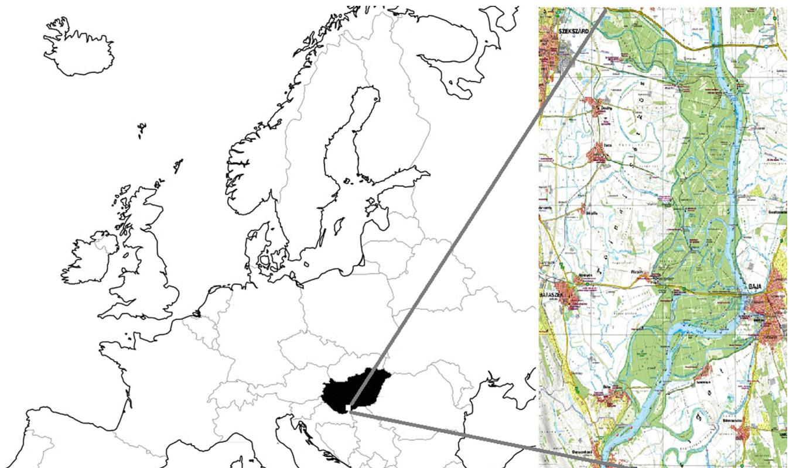

Original article

# Candidatus Neoehrlichia mikurensis and Anaplasma phagocytophilum in natural rodent and tick communities in Southern Hungary

Sándor Szekeres a, Elena Claudia Coipanb, Krisztina Rigóa, Gábor Majoros a, Setareh Jahfarib, Hein Sprongb, Gábor Földvária,∗

a Department of Parasitology and Zoology, Faculty of Veterinary Science, Szent István University, 2 István Street H-1078, Budapest, Hungary   
b Laboratory for Zoonoses and Environmental Microbiology, National Institute for Public Health and Environment, 9 Antonie van Leeuwenhoeklaan, P.O. Box 1, Bilthoven, The Netherlands

# a r t i c l e i n f o

Article history:

Received 28 May 2014

Received in revised form

22 September 2014

Accepted 27 October 2014

Available online xxx

Keywords:

Candidatus Neoehrlichia mikurensis

Anaplasma phagocytophilum

Rodent

Prevalence

Hungary

# a b s t r a c t

The aim of this study was to investigate the natural cycle of the new human pathogenic bacteria Candidatus Neoehrlichia mikurensis and Anaplasma phagocytophilum in Southern Hungary. We collected rodents with live-traps (2010–2013) and questing ticks with flagging in 2012. Small mammals were euthanized, tissue samples were collected and all the ectoparasites were removed and stored in $7 0 \%$ alcohol. We found relatively low overall prevalence of tick infestation $( 8 \% )$ . Samples were analysed for A. phagocytophilum and Candidatus N. mikurensis with multiplex quantitative real-time PCR targeting a part of major surface protein 2 (msp2) and the heat shock protein groEL genes, respectively. The overall prevalence in tissue samples was $6 . 6 \%$ (skin) and $5 . 1 \%$ (spleen) for A. phagocytophilum and $1 . 7 \%$ (skin) and $3 . 4 \%$ (spleen) for Candidatus N. mikurensis. Candidatus N. mikurensis was only detected in Apodemus flavicollis and Apodemus agrarius, while A. phagocytophilum was found in A. flavicollis, A. agrarius, Myodes glareolus, Microtus arvalis and Mus musculus samples. Prevalence of A. phagocytophilum in skin samples of A. flavicollis was significantly higher than prevalence of N. mikurensis $( p < 0 . 0 5 )$ . Among questing Ixodes ricinus ticks we found three $( 8 . 8 \% )$ individuals (female, male, nymph) infected with Candidatus N. mikurensis. Five $( 3 . 1 \% )$ questing ticks had A. phagocytophilum infection (one I. ricinus male, two Dermacentor reticulatus females and two Haemaphysalis concinna females). We found one I. ricinus nymph removed from a male A. flavicollis with A. phagocytophilum infection. Our study provides new data on the occurrence of these pathogens in rodent tissue samples, questing ticks and engorged ticks in Southern Hungary.

$^ { © }$ 2014 Elsevier GmbH. All rights reserved.

# Introduction

Rodents are reservoir hosts for several emerging zoonotic pathogens and with other small mammals (insectivores) have important role in the tick life cycle serving as main feeding and maintenance hosts for the developmental stages of various tick species. They also play an important role in the endemic cycles of tick-borne pathogens (e.g. tick-borne encephalitis virus or Babesia microti) (Silaghi et al., 2012). Therefore, the health of humans can be seriously impaired by contact with infected rodents or ticks that have previously fed on them. Ticks found on small mammals can be

either exophilic or endophilic. Exophilic (or non-nidicolous) species such as Ixodes ricinus await a host on the vegetation thus may act as bridge vectors between small mammals and humans in natural or urban habitats (Oliver et al., 2003). Endophilic (or nidicolous) ticks like subadult stages of Dermacentor reticulatus or all three stages of Ixodes trianguliceps are more specialised regarding their hosts by living in their nests or in their close environment thus may provide stable local niche cycles in rodents’ nest for pathogens such as Anaplasma phagocytophilum (Bown et al., 2006).

Candidatus Neoehrlichia mikurensis is a coccoid Gram-negative pathogen belonging to the family Anaplasmataceae (Kawahara et al., 2004). It was first detected in the late 1990’s in I. ricinus in The Netherlands and Italy and later on it was also found in China in a wild Norway rat (Rattus norvegicus). It was initially called Ehrlichia-like due to a diverging 16S rRNA gene sequence (Schouls et al., 1999). Further findings of the microorganism in rats and Ixodes ovatus ticks in Japan and the passaging of the agent in laboratory rats led to its description as the new species Candidatus

Neoehrlichia mikurensis in 2004 (Kawahara et al., 2004). This emerging zoonotic intracellular tick-borne pathogen forms a separate cluster in the family Anaplasmataceae together with the North American Candidatus Neoehrlichia lotoris, which has been detected in raccoons (Procyon lotor) (Yabsley et al., 2008). In Switzerland, Sweden, Germany, Czech Republic and in China Candidatus N. mikurensis was shown to be a human and in Germany as a canine pathogen (Grankvist et al., 2014; Jahfari et al., 2012; Li et al., 2012; Pekova et al., 2011; Silaghi et al., 2012; Tijsse-Klasen et al., 2014). Most of the human patients were immunocompromised due to splenectomy or immunosuppressive therapy and the reported manifestations of neoehrlichiosis were severe. In China, however, Candidatus N. mikurensis infection was also reported in immunocompetent patients (Li et al., 2012). Ixodes ricinus is most likely the vector in Europe, but the range of reservoir hosts is not fully known. Some studies suggested rodents as potential reservoirs (Jahfari et al., 2012) and recently the reservoir role of Apodemus mice (A. flavicollis, A. sylvaticus) and bank voles (Myodes glareolus) has unambiguously been proven in a xenodiagnostic study (Burri et al., 2014).

Several studies have identified DNA of Candidatus N. mikurensis in questing or host-attached I. ricinus in Europe including Hungary (Derdáková et al., 2014; Hornok et al., 2013; Jahfari et al., 2012). Recently, Northern white-breasted hedgehogs (Erinaceus roumanicus) were shown to carry this pathogen in a city park of Budapest (Földvári et al., 2014). However, potential rodent reservoir hosts have thus far not been examined in Hungary. Accordingly, in this study the occurrence of Candidatus N. mikurensis was investigated in small mammals, ticks parasitizing them and questing ticks in natural habitats in Southern Hungary.

Anaplasma phagocytophilum is an obligate Gram-negative intracellular bacterium. It has been a well known pathogen among the domestic ruminants causing “tick-borne fever” but it is a generalist pathogen and can infect several other land-living vertebrate species (including humans) on the Northern hemisphere where ticks of the I. ricinus complex are endemic. Fatal infection cases were reported in sheep, horse, roe deer, dogs and humans. This bacterium infects and colonizes the neutrophils thus the pathogen decreases the number of the useful immune cells often leading to immunodeficiency (Stuen et al., 2013).

Wild ruminants and probably small mammals (rodents and insectivores) play the most important role in the life cycle of A. phagocytophilum but other animals (bears, wild boars, foxes, horses, reptiles) can also serve as hosts or possible reservoirs (Földvári et al., 2014; Silaghi et al., 2012; Stuen et al., 2013; Víchová et al., 2010, 2014). In the USA the white-footed mouse (Peromyscus leucopus) is considered the major reservoir of this pathogen (Stuen et al., 2013). The bank vole (My. glareolus), the yellow-necked mouse (A. flavicollis) and the field vole (Microtus arvalis) are the candidate rodent reservoirs in Europe (Stuen et al., 2013), but in a xenodiagnostic study the Apodemus spp. mice and My. glareolus did not infect larvae that had fed on them (Burri et al., 2014). Thus, the exact role of European rodent species in the circulation and maintenance of bacteria is unclear and prevalence rate of A. phagocytophilum DNA is low in this group of animals (Stuen et al., 2013). Anaplasma phagocytophilum can also be transmitted by ticks to a wide range of domestic ruminants e.g. bovines (cattle, yak), camelids (llama, alpaca), sheep and goats.

In Europe, the increasing geographic range of I. ricinus as well as the expansion to higher altitudes opened new regions and heights to this pathogen (Jaenson et al., 2012; Medlock et al., 2013). In Hungary the prevalence of A. phagocytophilum infection in rodents (Rigó et al., 2011) and questing ticks (Egyed et al., 2012) was relatively low, but in a recent paper using a more sensitive qPCR the prevalence in hedgehogs (E. roumanicus) was high (Földvári et al., 2014).

This study investigates the occurrence of Candidatus N. mikurensis and A. phagocytophilum DNA in small mammals, ticks parasitizing them and questing ticks in natural habitats in Southern Hungary, with the aim to highlight the role of the rodent species as prospective hosts that contribute to the maintenance of these pathogens in the area.

# Materials and methods

# Sample collection

Between July 2010 and May 2013, small mammals were livetrapped with 100 modified Sherman-traps $( 1 7 \times 7 \times 8 \mathrm { c m } )$ within the Gemenc area which is a forest covered floodplain near the Danube River, in Southern Hungary (Fig. 1). The total number of trapnights (the sum of the total number of nights each trap was used) was 2200. Traps were set at sunset and checked early the following morning. The species and sex of trapped rodents was identified (Aulagnier et al., 2008) and animals belonging to protected species were then released. All the other rodents were euthanized. The carcasses were checked for ticks and other ectoparasites and samples from spleen and skin were collected. The spleen and skin samples in this study did not originate from the same individuals.

During the trapping in May 2012, ticks were collected with flagging from the vegetation in several different locations within the Gemenc area. Ticks collected from the trapped animals and from the vegetation were stored in $7 0 \%$ ethanol, and were later identified using standard identification keys (Hillyard, 1996; Nosek and Sixl, 1972).

# DNA extraction

The DNA was extracted from ticks by alkaline hydrolysis (Guy and Stanek, 1991) before being examined for the presence of the bacteria by polymerase chain reaction. Pool samples were prepared from each 10 larvae originating from the same host individual. The nymphs and adults were processed individually. DNA was isolated from the tissue samples with a modified Miniprep Express Matrix protocol (MP Biomedicals, Santa Ana, USA). We stored the tubes with extracted DNA at $- 2 0 ^ { \circ } \mathsf C$ in the freezer for further analyses.

# Polymerase chain reaction

To determine whether the tissue or tick samples contained any pathogens, we used multiplex quantitative-PCR (qPCR) for A. phagocytophilum and Candidatus N. mikurensis. For Candidatus N. mikurensis we targeted GroEL heat shock protein gene, the product length was 102 bp, with forward primer groEL-F2a $[ 5 ^ { \prime }$ CCTTGAAAATATAGCAAGATCAGGTAG 3 ) (Jahfari et al., 2012). We used two reverse primers groEL-R2a (5 CCACCACGTAACTTATTTAGCACTAAAG 3 ) and groEL-R2b $5 ^ { \prime }$ CCAC-CACGTAACTTATTTAGTACTAAAG 3 ), with the probe groEL-P2a $[ 5 ^ { \prime }$ CCTCTACTAATTATTGCtGAAGATGTAGAAGGTGAAGC ${ \boldsymbol { 3 ^ { \prime } } }$ ). For A. phagocytophilum, we targeted the major surface protein 2 gene with the forward primer apMSP2F $5 ^ { \prime }$ ATGGAAGGTAGTGTTGGTTATG-GTATT 3 ), reverse primer apMSP2R $[ 5 ^ { \prime }$ TTGGTCTTGAAGCGCTCGTA 3 ) and probe apMSP2P $[ 5 ^ { \prime }$ TGGTGCCAGGGTTGAGCTTGAGATTG ${ \boldsymbol { 3 ^ { \prime } } }$ ) (Courtney et al., 2004), resulting in a 77 bp long product. In the analysis of qPCR result we selected the positive samples by two criteria, the shape of curves (compared to positive controls) and CT (threshold cycle) values. Samples were considered positive with CT values below 41 cycles for both Candidatus N. mikurensis and for A. phagocytophilum. In PCR reactions we used negative controls to verify and exclude any contaminations.

  
Fig. 1. Location of the study site in Southern Hungary (Gemenc).

# Data analysis

For statistical analysis R (The R Development Core Team, 2010) and Quantitative Parasitology 3.0 (Rózsa et al., 2000) statistical programmes were used.

# Results

# Rodents

We trapped altogether 525 rodents in the study sites. Tissue samples of six species were analysed: A. flavicollis (skin: 102, spleen: 67), A. agrarius (skin: 202, spleen: 92), Myodes glareolus (skin: 29, spleen: 11), Microtus arvalis (skin: 7, spleen: 4), Micromys minutus (skin: 3), Mus musculus (skin: 5, spleen: 3).

# Ticks

Altogether 343 ticks belonging to five species were found on the vegetation $( n = 1 6 2 )$ ) and on rodents $( n = 1 8 1$ ). Haemaphysalis concinna and I. ricinus occurred on both the rodents and the vegetation. Endophilic I. acuminatus ticks were found only on rodents. Adults of Dermacentor reticulatus and Dermacentor marginatus were collected from the vegetation (Table 1).

# Candidatus Neoehrlichia mikurensis

Six $( 1 . 7 \% )$ out of 348 rodent skin samples and six $( 3 . 4 \% )$ out of 176 spleen samples were positive for Candidatus N. mikurensis (Table 2). Only two (A. flavicollis and A. agrarius) out of six examined rodent species were infected with Candidatus N. mikurensis.

Three $( 8 . 8 \% )$ out of 34 questing I. ricinus ticks were infected (Table 3). The other ticks species and the engorged ticks were negative for this pathogen (Table 4).

Table 1 Tick species, developmental stages and numbers of ticks collected from the vegetation and removed from rodents in Southern Hungary.   

<table><tr><td rowspan="2">Species</td><td>Ticks from rodents</td><td>Questing ticks</td></tr><tr><td>Larva/nymph/female/male</td><td></td></tr><tr><td>I. ricinus</td><td>36/5/0/0</td><td>0/21/5/8</td></tr><tr><td>I. acuminatus</td><td>52/1/3/0</td><td>0/0/0/0</td></tr><tr><td>H. concinna</td><td>15/3/0/0</td><td>33/10/11/8</td></tr><tr><td>D. reticulatus</td><td>0/0/0/0</td><td>0/0/41/23</td></tr><tr><td>D. marginatus</td><td>61/5/0/0</td><td>0/0/2/0</td></tr><tr><td>Sum</td><td>181</td><td>162</td></tr></table>

CT-values of the 15 Candidatus Neoehrlichia mikurensispositive samples varied between 25.55 and 40.03 (average 32.22), however, conventional PCR and sequencing was not successful from these samples (data not shown).

# Anaplasma phagocytophilum

We found 23 $( 6 . 6 \% )$ and 9 $( 5 . 1 \% )$ A. phagocytophilum PCRpositives in the skin and spleen samples of rodents, respectively (Table 2). Anaplasma phagocytophilum prevalence in skin samples of A. flavicollis was significantly higher compared to the Candidatus N. mikurensis prevalence in the same samples (Fisher test, $p { = } 0 . 0 0 3 6 ^ { \cdot }$ ).

Five $( 3 . 1 \% )$ questing ticks were PCR-positive, namely one I. ricinus male, two D. reticulatus females and two H. concinna females (Table 3). One I. ricinus nymph removed from a PCR-positive male A. flavicollis was infected with A. phagocytophilum (Table 4).

CT-values of the 38 Anaplasma phagocytophilum-positive samples varied between 29.14 and 40.86 (average 36.78), however, conventional PCR and sequencing was not successful from these samples (data not shown).

Table 2 Number of ticks on the different rodent species from Southern Hungary and the positivity of the tissue samples for Candidatus N. mikurensis and A. phagocytophilum.   

<table><tr><td rowspan="2">Rodent species</td><td colspan="4">Tick species</td><td colspan="2">N. mikurensis(+/tested/prevalence)</td><td colspan="2">A. phagocytophilum</td></tr><tr><td>I. ricinus</td><td>I. acuminatus</td><td>D. marginatus</td><td>H. concinna</td><td>Skin</td><td>Spleen</td><td>Skin</td><td>Spleen</td></tr><tr><td>A. flavicollis</td><td>34</td><td>54</td><td>46</td><td>15</td><td>3/102/2.9%</td><td>3/67/4.5%</td><td>14/102/13.7%</td><td>3/67/4.5%</td></tr><tr><td>A. agrarius</td><td>2</td><td>2</td><td>11</td><td>-</td><td>3/202/1.5%</td><td>3/92/3.3%</td><td>8/202/4%</td><td>2/92/2.2%</td></tr><tr><td>My. glareolus</td><td>4</td><td>-</td><td>5</td><td>-</td><td>0/29/-</td><td>0/11/-</td><td>1/29/3.5%</td><td>2/11/18.2%</td></tr><tr><td>Mi. arvalis</td><td>1</td><td>-</td><td>4</td><td>3</td><td>0/7/-</td><td>0/4/-</td><td>0/7/-</td><td>1/4/25%</td></tr><tr><td>M. minutus</td><td>-</td><td>-</td><td>-</td><td>-</td><td>0/3/-</td><td>-</td><td>0/3/-</td><td>-</td></tr><tr><td>Mu. musculus</td><td>-</td><td>-</td><td>-</td><td>-</td><td>0/s5/-</td><td>0/3/-</td><td>0/5/-</td><td>1/3/33.3%</td></tr><tr><td>Sum</td><td>41</td><td>56</td><td>66</td><td>18</td><td>6/348/1.7%</td><td>6/177/3.4%</td><td>23/348/6.6%</td><td>9/177/5.1%</td></tr></table>

Table 3 Prevalence of Candidatus N. mikurensis and A. phagocytophilum in questing ticks collected in the study site.   

<table><tr><td rowspan="2">Tick species</td><td>N. mikurensis</td><td>A. phagocytophilum</td></tr><tr><td colspan="2">(+/tested/min. prevalence)</td></tr><tr><td>I. ricinus</td><td>3/34/8.8%</td><td>1/34/2.9%</td></tr><tr><td>D. reticulatus</td><td>0/64/-</td><td>2/64/3.1%</td></tr><tr><td>D. marginatus</td><td>0/2/-</td><td>0/2/-</td></tr><tr><td>H. concinna</td><td>0/62/-</td><td>2/62/3.2%</td></tr><tr><td>Sum</td><td>3/162/1.9%</td><td>5/162/3.1%</td></tr></table>

# Discussion

Numerous studies reported the role of ticks and small mammals in the tick-borne pathogens’ epidemiological cycle in Europe. Rodent species and insectivores are also important hosts of the subadult stages of the exophilic ticks and of all stages of endophilic tick species. In the present study we examined the occurrence of two emerging zoonotic bacteria in a small mammal community and in the associated tick species in Southern Hungary.

We found a lower prevalence of tick infestation $( 8 \% )$ on the small mammals compared with other European studies (Khanakah et al., 2006; Kiffner et al., 2011). This may be a consequence of the relatively frequent floods in Gemenc area which may result in suboptimal conditions for tick questing. The majority of the collected ticks $( 7 0 \% )$ were in larval and nymphal stages. Haemaphysalis concinna, I. ricinus and Dermacentor individuals were collected both from the vegetation and from the captured small mammals. The endophilic ticks like the subadult stages of the Dermacentor species and all stages of I. acuminatus were found on small mammals only. We detected only D. marginatus larvae and nymphs on rodents but no D. reticulatus subadults, although the questing adults of the latter species were present in this area.

Anaplasma phagocytophilum DNA was amplified from five questing individuals of three tick species: two H. concinna and two D. reticulatus adults and one I. ricinus nymph. Other papers have also reported A. phagocytophilum infection in H. concinna and D. reticulatus ticks (Tomanovic´ et al., 2013; Wirtgen et al., 2011). While I. ricinus is known to be the main vector of this microorganism in

Table 4 Prevalence of Candidatus N. mikurensis and A. phagocytophilum in engorged ticks from rodents in Southern Hungary.   

<table><tr><td rowspan="2">Tick species</td><td>N. mikurensis</td><td>A. phagocytophilum</td></tr><tr><td colspan="2">(+/tested/min. prevalence%)</td></tr><tr><td>I. ricinus</td><td>0/41/-</td><td>1/41/2.4%</td></tr><tr><td>I. acuminatus</td><td>0/56/-</td><td>0/56/-</td></tr><tr><td>D. marginatus</td><td>0/66/-</td><td>0/66/-</td></tr><tr><td>H. concinna</td><td>0/18/-</td><td>0/18/-</td></tr><tr><td>Sum</td><td>0/181/-</td><td>1/181/0.6%</td></tr></table>

Europe, the other two tick species are not currently considered vectors. Since our findings are based on the detection of bacterial DNA in questing ticks it does not provide evidence for the vector role of these tick species and this issue should be further investigated by xenodiagnostic experiments.

Among the questing ticks we found a male, a female and a nymphal I. ricinus to be Candidatus N. mikurensis-positive. This is the first report about the presence of this pathogen from Gemenc since Hornok et al. (2013) collected ticks from this area in 2007 but did not find any Candidatus N. mikurensis-positive.

Among the 162 engorged ticks we found one I. ricinus with A. phagocytophilum infection. The PCR positivity of engorged ticks, however, does not prove infection of the tick itself because it contains high amount of host blood. Thus, if we have only prevalence data from engorged ticks, it is not clear whether the tick or the host was infected with the pathogen. Therefore we also collected and analysed ticks from the vegetation as a control group for engorged ticks (Table 3). Based on the limited number of engorged specimens analysed (Table 4), I. acuminatus, D. marginatus and H. concinna ticks are probably not involved in the natural cycle of Candidatus N. mikurensis and A. phagocytophilum.

Anaplasma phagocytophilum has a broad host range from wild and domestic animals to humans. Some ruminants, rodents and insectivores can maintain this pathogen (Stuen et al., 2013). Rodent species were considered the most important reservoirs (Burri et al., 2014; Jahfari et al., 2012; Silaghi et al., 2012; Stuen et al., 2013) in the natural maintenance of both A. phagocytophilum and Candidatus N. mikurensis. Apodemus flavicollis, A. sylvaticus and My. glareolus rodents have recently been shown to be reservoirs of Candidatus N. mikurensis, but not for A. phagocytophilum (Burri et al., 2014). At our study site however, A. flavicollis, A. agrarius and My. glareolus carried A. phagocytophilum. Based on this, the transmission cycle found in our study seems to differ from the recently described situation in Eastern Slovakia where no A. phagocytophilum was detected in rodents at sites where Ixodes trianguliceps was absent (Blanarová ˇ et al., 2014). A previous study of Földvári et al. (2014) found $7 6 . 1 \% A .$ phagocytophilum and $2 . 3 \%$ Candidatus N. mikurensis infection rates in urban hedgehogs (E. roumanicus) in Hungary (Földvári et al., 2014). In the present study, using the same molecular methods, we report lower A. phagocytophilum $( 6 . 6 \% )$ and similar Candidatus N. mikurensis $( 1 . 7 \% )$ infection rates in skin samples of natural rodent communities. The significantly lower A. phagocytophilum prevalence (Fisher-test, $p { < } 0 . 0 0 0 0 1$ ) in natural rodents compared to urban hedgehogs suggests that the studied rodent population seems to contribute to a smaller extent to the life cycle of the pathogen compared to hedgehogs in the urban situation where dilution hosts less frequently occur (Rizzoli et al., 2014). As recently published data indicate, different A. phagocytophilum ecotypes circulate in rodent-associated cycles from that of hedgehog-associated cycles and the human pathogenic ecotype I does not occur in rodents (Jahfari et al., 2014). Unfortunately, in our study, conventional PCR amplification and sequencing of the

two pathogens was not successful due to low DNA concentration in the samples (data not shown).

In case of Candidatus N. mikurensis the spleen samples (containing higher amount of possibly infected blood cells) were reported to be significantly more positive than ear biopsy samples (Silaghi et al., 2012). In the present study we did not observe this difference in Candidatus N. mikurensis prevalence between skin and spleen samples, however, the two samples of the same individuals were not analysed.

The Gemenc area is a natural open habitat with a broad range of possible host species compared with Margaret Island in the heart of Budapest which is a nearly closed habitat with many hedgehogs and frequent human and canine visitors. In natural habitats ticks can find broad range of host species but the chances for ticks to find a host are lower in contrast to the urban (closed) habitats which have only a few potential host species but usually in a higher density (Földvári et al., 2011, 2014; Rizzoli et al., 2014). Pathogen cycles probably differ in urban and natural habitats. The gene pool of pathogens in the natural habitat compared with the “urban” pathogens is probably larger because the genetic diversity of the pathogens follows the diversity of host species (Cisarovsky and Schmid-Hempel, 2014). The selective pressure on the pathogen with wide range of possible host species increases its genetic diversity under natural circumstances. If, in turn the number of hosts is limited, the pathogen has to specialise for these, which decreases its genetic diversity. These local limitations in available hosts might have also led to the evolution of different A. phagocytophilum ecotypes (Jahfari et al., 2014). The presence of similar processes should also be investigated in Candidatus N. mikurensis populations.

In conclusion, this study showed the presence of two zoonotic pathogens in questing ticks, engorged ticks and rodent tissue samples in Southern Hungary. To better understand the cycles of these tick-borne bacteria, potential reservoir hosts, ticks collected from these hosts, and vegetation should be further investigated.

# Acknowledgements

We are grateful to the Gemenc Forest and Game Co. Ltd. who supported our work in the Gemenc area. We thank the Middle Danube Valley Inspectorate for Environmental Protection, Nature Conservation and Water Management, Hungary, for approving capturing and euthanizing of rodents and sample collection. We also thank Imola Molnár, Michaela Kubelová and Alexandra Juhász for their assistance in sample collection.

This study was partially supported by European Union grant FP7-261504 EDENext and was catalogued by the EDENext Steering Committee (www.edenext.eu) as EDENext238. G.F. was supported by the János Bolyai Research Scholarship of the Hungarian Academy of Sciences and by NKB and Research Faculty grants from the Faculty of Veterinary Science, Szent István University. E.C.C. and H.S. were supported by EurNegVec Cost Action TD1303. S.Sz. was supported by the city Council of Hajdúböszörmény, the Campus Hungary Scholarship and TÁMOP-4.2.2.B-10/1-2010-0011.

# References

Aulagnier, S., Haffner, P., Mitchell-Jones, A., Moutou, F., Zima, J., 2008. Mammals of Europe, North Africa and the Middle East. A & C Black Publishers Ltd, London.   
Blanarová,ˇ L., Stanko, M., Carpi, G., Miklisová, D., Víchová, B., Mosanskˇ y,´ L., Bona, M., Derdáková, M., 2014. Distinct Anaplasma phagocytophilum genotypes associated with Ixodes trianguliceps ticks and rodents in Central Europe. Ticks Tick. Borne. Dis. 5, 928–938, http://dx.doi.org/10.1016/j.ttbdis.2014.07.012.   
Bown, K.J., Begon, M., Bennett, M., Birtles, R.J., Burthe, S., Lambin, X., Telfer, S., Woldehiwet, Z., Ogden, N.H., 2006. Sympatric Ixodes trianguliceps and Ixodes ricinus ticks feeding on field voles (Microtus agrestis): potential for increased risk of Anaplasma phagocytophilum in the United Kingdom? Vector-borne Zoonotic Dis. 6, 404–410.

Burri, C., Schumann, O., Schumann, C., Gern, L., 2014. Are Apodemus spp. mice and Myodes glareolus reservoirs for Borrelia miyamotoi, Candidatus Neoehrlichia mikurensis, Rickettsia helvetica R. monacensis and Anaplasma phagocytophilum? Ticks Tick. Borne. Dis. 5, 245–251, http://dx.doi.org/ 10.1016/j.ttbdis.2013.11.007.   
Cisarovsky, G., Schmid-Hempel, P., 2014. Few colonies of the host Bombus terrestris disproportionately affect the genetic diversity of its parasite, Crithidia bombi. Infect. Genet. Evol. 21, 192–197, http://dx.doi.org/ 10.1016/j.meegid.2013.11.010.   
Courtney, J.W., Kostelnik, L.M., Zeidner, N.S., Massung, R.F., 2004. Multiplex real-time PCR for detection of Anaplasma phagocytophilum and Borrelia burgdorferi multiplex real-time PCR for detection of Anaplasma phagocytophilum and Borrelia burgdorferi. J. Clin. Microbiol. 42, 3164–3168, http://dx.doi.org/ 10.1128/JCM.42.7.3164.   
Derdáková, M., Václav, R., Pangrácova-Blanárová, ˇ L., Selyemová, D., Koci, ˇ J., Walder, G., Spitalská, E., 2014. Candidatus Neoehrlichia mikurensis and its co-circulation with Anaplasma phagocytophilum in Ixodes ricinus ticks across ecologically different habitats of Central Europe. Parasit. Vectors 7, 160, http://dx.doi.org/10.1186/1756-3305-7-160.   
Egyed, L., Elo, ˝ P., Sréter-Lancz, Z., Széll, Z., Balogh, Z., Sréter, T., 2012. Seasonal activity and tick-borne pathogen infection rates of Ixodes ricinus ticks in Hungary. Ticks Tick. Borne. Dis. 3, 90–94, http://dx.doi.org/10.1016/j.ttbdis.2012.01.002.   
Földvári, G., Jahfari, S., Rigó, K., Jablonszky, M., Szekeres, S., Majoros, G., Tóth, M., Molnár, V., Coipan, E.C., Sprong, H., 2014. Candidatus Neoehrlichia mikurensis and Anaplasma phagocytophilum in Urban Hedgehogs. Emerg. Infect. Dis. 20, 496–498.   
Földvári, G., Rigó, K., Jablonszky, M., Biró, N., Majoros, G., Molnár, V., Tóth, M., 2011. Ticks and the city: ectoparasites of the Northern white-breasted hedgehog (Erinaceus roumanicus) in an urban park. Ticks Tick. Borne. Dis. 2, 231–234, http://dx.doi.org/10.1016/j.ttbdis.2011.09.001.   
Grankvist, A., Andersson, P.-O., Mattsson, M., Sender, M., Vaht, K., Höper, L., Sakiniene, E., Trysberg, E., Stenson, M., Fehr, J., Pekova, S., Bogdan, C., Bloemberg, G.C.W., 2014. Infections with the tick-borne bacterium Candidatus Neoehrlichia mikurensis mimic non-infectious conditions in patients with B cell malignancies or autoimmune diseases. Clin. Infect. Dis. 58, 1716–1722.   
Guy, E.C., Stanek, G., 1991. Detection of Borrelia burgdorferi in patients with Lyme disease by the polymerase chain reaction. J. Clin. Pathol. 44, 610–611.   
Hillyard, P., 1996. Ticks of North-West Europe. Field Studies Council, Shrewsbury. Hornok, S., Meli, M.L., Gönczi, E., Hofmann-Lehmann, R., 2013. First evidence of Candidatus Neoehrlichia mikurensis in Hungary. Parasit. Vectors 6, 267, http://dx.doi.org/10.1186/1756-3305-6-267.   
Jaenson, T.G.T., Jaenson, D.G.E., Eisen, L., Petersson, E., Lindgren, E., 2012. Changes in the geographical distribution and abundance of the tick Ixodes ricinus during the past 30 years in Sweden. Parasit. Vectors 5, 8, http://dx.doi.org/ 10.1186/1756-3305-5-8.   
Jahfari, S., Coipan, E., Fonville, M., Docters van Leeuwen, A., Hengeveld, P., Heylen, D., Heyman, P., van Maanen, C., Butler, C., Földvári, G., Szekeres, S., van Duijvendijk, G., Tack, W., Rijks, J., van der Giessen, J., Takken, W., van Wieren, S., Takumi, K., Sprong, H., 2014. Circulation of four Anaplasma phagocytophilum ecotypes in Europe. Parasit. Vectors 7, 365.   
Jahfari, S., Fonville, M., Hengeveld, P., Reusken, C., Scholte, E.-J., Takken, W., Heyman, P., Medlock, J., Heylen, D., Kleve, J., Sprong, H., 2012. Prevalence of Neoehrlichia mikurensis in ticks and rodents from North-west Europe. Parasit. Vectors 5, 74, http://dx.doi.org/10.1186/1756-3305-5-74.   
Kawahara, M., Rikihisa, Y., Isogai, E., Takahashi, M., Misumi, H., Suto, C., Shibata, S., Zhang, C., Tsuji, M., 2004. Ultrastructure and phylogenetic analysis of “Candidatus Neoehrlichia mikurensis” in the family Anaplasmataceae, isolated from wild rats and found in Ixodes ovatus ticks. Int. J. Syst. Evol. Microbiol. 54, 1837–1843, http://dx.doi.org/10.1099/ijs.0.63260-0.   
Khanakah, G., Kocianová, E., Vyrosteková, V., Rehácek, J., Kundi, M., Stanek, G., 2006. Seasonal variations in detecting Borrelia burgdorferi sensu lato in rodents from north eastern Austria. Wien. Klin. Wochenschr. 118, 754–758, http://dx.doi.org/10.1007/s00508-006-0730-y.   
Kiffner, C., Vor, T., Hagedorn, P., Niedrig, M., Rühe, F., 2011. Factors affecting patterns of tick parasitism on forest rodents in tick-borne encephalitis risk areas, Germany. Parasitol. Res. 108, 323–335, http://dx.doi.org/ 10.1007/s00436-010-2065-x.   
Li, H., Jiang, J., Liu, W., Zheng, Y., Huo, Q., Tang, K., Zuo, S., Liu, K., Jiang, B., Yang, H., Cao, W., 2012. Human infection with Candidatus Neoehrlichia mikurensis, China. Emerg. Infect. Dis. 18, 10–13, http://dx.doi.org/10.3201/eid1810.1205942012.   
Medlock, J.M., Hansford, K.M., Bormane, A., Derdakova, M., Estrada-Pena, ˜ A., George, J.-C., Golovljova, I., Jaenson, T.G.T., Jensen, J.-K., Jensen, P.M., Kazimirova, M., Oteo, J.a, Papa, A., Pfister, K., Plantard, O., Randolph, S.E., Rizzoli, A., Santos-Silva, M.M., Sprong, H., Vial, L., Hendrickx, G., Zeller, H., Van Bortel, W., 2013. Driving forces for changes in geographical distribution of Ixodes ricinus ticks in Europe. Parasit. Vectors 6, 1, http://dx.doi.org/10.1186/1756-3305-6-1.   
Nosek, J., Sixl, W., 1972. In: Jahrbuch, d. (Ed.), Central-European Ticks (Ixodoidea). Key for Determination.   
Oliver, J.H., Lin, T., Gao, L., Clark, K.L., Banks, C.W., Durden, L.A., James, A.M., Chandler, F.W., 2003. An enzootic transmission cycle of Lyme borreliosis spirochetes in the southeastern United States. Proc. Natl. Acad. Sci. U.S.A. 100, 11642–11645, http://dx.doi.org/10.1073/pnas.1434553100.   
Pekova, S., Vydra, J., Kabickova, H., Frankova, S., Haugvicova, R., Mazal, O., Cmejla, R., Hardekopf, D.W., Jancuskova, T., Kozak, T., 2011. Candidatus Neoehrlichia mikurensis infection identified in 2 hematooncologic patients: benefit of

molecular techniques for rare pathogen detection. Diagn. Microbiol. Infect. Dis. 69, 266–270, http://dx.doi.org/10.1016/j.diagmicrobio.2010.10.004.   
Rigó, K., Gyuranecz, M., Tóth, A.G., Földvári, G., 2011. Detection of Borrelia burgdorferi Sensu Lato and Anaplasma phagocytophilum in small mammals and ectoparasites in Hungary. Vector Borne Zoonotic Dis. 11, 1499–1501, http:// dx.doi.org/10.1089/vbz.2011.0608.   
Rizzoli, A., Silaghi, C., Obiegala, A., Rudolf, I., Hubalek, Z., Foldvari, G., Plantard, O., Vayssier-Taussat, M., Bonnet, S., Spitalska, E., Kazimirova, M., 2014. Ixodes ricinus and its transmitted pathogens in urban and peri-urban areas in Europe: new hazards and relevance for public health. Front. Public Health 2, 251, http://dx.doi.org/10.3389/fpubh.2014.00251.   
Rózsa, L., Reiczigel, J., Majoros, G., 2000. Quantifying parasites in samples of hosts. J. Parasitol. 86, 228–232, http://dx.doi.org/10.1645/0022-3395 (2000)086[0228:QPISOH2.0.CO; 2].   
Schouls, L., van de Pol, I., Rijpkema, S., Schot, C., 1999. Detection and identification of Ehrlichia Borrelia burgdorferi Sensu Lato, and Bartonella Species in Dutch Ixodes ricinus Ticks. J. Clin. Microbiol. 37, 2215–2222.   
Silaghi, C., Woll, D., Mahling, M., Pfister, K., Pfeffer, M., 2012. Candidatus Neoehrlichia mikurensis in rodents in an area with sympatric existence of the hard ticks Ixodes ricinus and Dermacentor reticulatus, Germany. Parasit. Vectors 5, 285, http://dx.doi.org/10.1186/1756-3305-5-285.   
Stuen, S., Granquist, E.G., Silaghi, C., 2013. Anaplasma phagocytophilum – a widespread multi-host pathogen with highly adaptive strategies. Front. Cell. Infect. Microbiol. 3, 31, http://dx.doi.org/10.3389/fcimb.2013.00031.

The R Development Core Team, 2010. R-: A Language and Environment for Statistical Computing.   
Tijsse-Klasen, E., Koopmans, M.P.G., Sprong, H., 2014. Tick-borne pathogen – reversed and conventional discovery of disease. Front. Public Health 2., http://dx.doi.org/10.3389/fpubh.2014.00073.   
Tomanovic, ´ S., Chochlakis, D., Radulovic, ´ Z., Milutinovic, ´ M., Cakic, ´ S., Mihaljica, D., Tselentis, Y., Psaroulaki, A., 2013. Analysis of pathogen co-occurrence in host-seeking adult hard ticks from Serbia. Exp. Appl. Acarol. 59, 367–376, http://dx.doi.org/10.1007/s10493-012-9597-y.   
Víchová, B., Majláthová, V., Nováková, M., Stanko, M., Hvisˇcová,ˇ I., Pangrá- cová, L., Chrudimsky, ´ T., Curlík, ˇ J., Petko, B., 2014. Anaplasma infections in ticks and reservoir host from Slovakia. Infect. Genet. Evol. 22, 265–272, http://dx.doi.org/10.1016/j.meegid.2013.06.003.   
Víchová, B., Majlathova, V., Novakova, M., Straka, M., Petko, B., 2010. First molecular detection of Anaplasma phagocytophilum in European Brown Bear (Ursus arctos). Vector-borne Zoonotic Dis. 10, 543–545.   
Wirtgen, M., Nahayo, a., Linden, a., Losson, B., Garigliany, M., Desmecht, D., 2011. Detection of Anaplasma phagocytophilum in Dermacentor reticulatus ticks. Vet. Rec. 168, 195, http://dx.doi.org/10.1136/vr.d1053.   
Yabsley, M.J., Murphy, S.M., Luttrell, M.P., Wilcox, B.R., Howerth, E.W., Munderloh, U.G., 2008. Characterization of “Candidatus Neoehrlichia lotoris” (family Anaplasmataceae) from raccoons (Procyon lotor). Int. J. Syst. Evol. Microbiol. 58, 2794–2798, http://dx.doi.org/10.1099/ijs.0.65836-0.