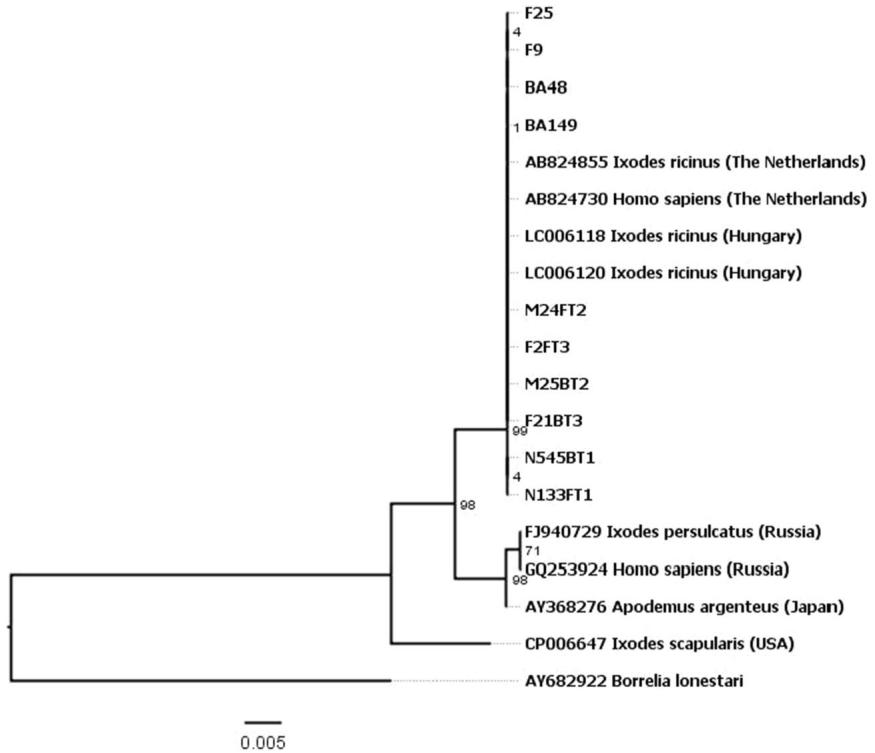
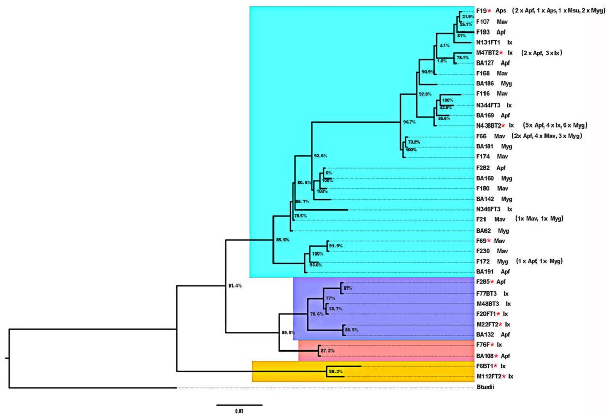

HOST MICROBE INTERACTIONS

# Borrelia miyamotoi and Co-Infection with Borrelia afzelii in Ixodes ricinus Ticks and Rodents from Slovakia

Zuzana Hamšíková1 & Claudia Coipan2 & Lenka Mahríková1 & Lenka Minichová3 & Hein Sprong2 & Mária Kazimírová1

Received: 10 October 2016 / Accepted: 12 December 2016 /Published online: 19 December 2016 $©$ Springer Science+Business Media New York 2016

Abstract Borrelia miyamotoi causes relapsing fever in humans. The occurrence of this spirochete has been reported in Ixodes ricinus and wildlife, but there are still gaps in the knowledge of its eco-epidemiology and public health impact. In the current study, questing I. ricinus (nymphs and adults) and skin biopsies from rodents captured in Slovakia were screened for the presence of $B$ . miyamotoi and Borrelia burgdorferi s.l. DNA. The prevalence of B. miyamotoi and B. burgdorferi s.l. in questing ticks was 1.7 and $1 6 . 9 \%$ , respectively. B. miyamotoi was detected in Apodemus flavicollis $( 9 . 3 \% )$ and Myodes glareolus $( 4 . 4 \% )$ . In contrast, B. burgdorferi s.l. was identified in $1 1 . 9 \%$ of rodents, with the highest prevalence in Microtus arvalis $( 6 8 . 4 \% )$ and a lower prevalence in Apodemus spp. $( 8 . 4 \% )$ and M. glareolus $( 1 2 . 4 \% )$ . Borrelia afzelii was the prevailing genospecies infecting questing I. ricinus $( 3 7 . 9 \% )$ and rodents $( 7 2 . 2 \% )$ . Co-infections of $B$ . miyamotoi and $B$ . burgdorferi s.l. were found in 24.1 and $9 . 3 \%$ of the questing ticks and rodents, respectively, whereas the proportion of ticks and rodents co-infected with B. miyamotoi and B. afzelii was 6.9 and $7 . 0 \%$ , respectively. The results suggest that $B$ . miyamotoi and $B$ . afzelii share amplifying hosts. The sequences

Electronic supplementary material The online version of this article (doi:10.1007/s00248-016-0918-2) contains supplementary material, which is available to authorized users.

of the B. miyamotoi glpQ gene fragment from our study showed a high degree of identity with sequences of the gene amplified from ticks and human patients in Europe. The results seem to suggest that humans in Slovakia are at risk of contracting tickborne relapsing fever, and in some cases together with Lyme borreliosis.

Keywords Rodents $\cdot$ Ticks . Borrelia $\cdot$ Co-infection . Slovakia

# Introduction

Borrelia miyamotoi is a tick-borne relapsing fever spirochete. It is transmitted by species of the Ixodes genus in temperate regions of the northern hemisphere and is considered an emerging pathogen [1–5]. B. miyamotoi was first detected in Ixodes persulcatus in Japan [6], and since then, it has been found in Ixodes spp. in the USA [7, 8] and Canada [9] and I. persulcatus in Russia [10, 11] and Estonia [12]. B. miyamotoi-infected questing and engorged Ixodes ricinus ticks have been found in different European countries and habitat types, including urban and suburban parks [8, 13–25]. Transovarial transmission of B. miyamotoi from tick females to their progeny exists and contributes to the maintenance of the infection in natural foci [26–28]. Wild-living rodents have been indicated as reservoir hosts of B. miyamotoi in North America [7, 29], Japan [30], and Europe [19, 23, 31]. The role of other vertebrates such as freeliving ruminants or ground-dwelling and passerine birds as reservoirs or carriers of infected ticks is suggested [4, 32].

B. miyamotoi has been recognized as a human pathogen only recently, with relapsing fever cases reported, e.g. in Russia [33], North America [34], the Netherlands [35], Japan [36], and Germany [37]. On the other hand, Lyme borreliosis caused by spirochetes of the Borrelia burgdorferi

sensu lato (s.l.) complex is the most common tick-borne human infection in the northern hemisphere [38, 39]. B. burgdorferi s.l. and B. miyamotoi probably share the same vector ticks [16, 20, 28] and rodent hosts [4, 31], whereby Borrelia afzelii and Borrelia bavariensis have been found specifically associated to European rodents [40–42].

In Slovakia, B. miyamotoi was detected first in questing I. ricinus from a suburban forest close to Bratislava town [43] and subsequently in a mountainous region in the central part of the country [24], indicating that endemic foci exist in Slovakia. No clinical cases of tick-borne relapsing fever have been reported from Slovakia [44]. The findings of $B$ . miyamotoi in questing ticks suggest, however, that humans may be at risk of infection.

Because B. miyamotoi and spirochetes of the B. burgdorferi s.l. complex share vectors, they were found to co-occur in natural foci and mixed infections have also been reported in ticks [9, 12, 19]. This indicates a possible risk of co-infections of humans with both pathogens and should be considered in diagnosis of the disease [4, 21].

The aims of this study were (1) to determine the prevalence of B. miyamotoi in questing I. ricinus ticks and rodents from urban/suburban and natural sites in southwestern Slovakia, (2) to molecularly characterize the B. miyamotoi isolates, (3) to assess the role of rodents in the natural circulation of $B$ . miyamotoi, and (4) to determine the rate of co-infection of B. miyamotoi and B. burgdorferi s.l. genospecies in ticks and rodents.

# Material and Methods

# Ticks and Rodents

Questing ticks and rodent tissues were available from a previous study conducted in southwestern Slovakia during 2011– 2014 [45]. From the tick collections from urban/suburban locations in Bratislava and from a non-fragmented deciduous forest at Fúgelka, 1696 questing I. ricinus (547 nymphs, 1149 adults) were randomly selected: Bratislava—282 nymphs, 574 adults; Fúgelka—265 nymphs, 575 adults. Skin samples (ear biopsies) were gathered from 605 rodents: 300 from Bratislava; 305 from Fúgelka. Genomic DNA from ticks and rodent skin was extracted with the Macherey Nagel Nucleospin Tissue kit [45]. DNA lysates derived from individual ticks $5 ~ \mu \mathrm { l }$ each) were pooled. In total, 340 pooled samples (pool size 3–7) were examined for B. burgdorferi s.l. and B. miyamotoi by real-time polymerase chain reaction (qPCR). Individual ticks from pools which tested positive for B. miyamotoi were further examined for the presence of $B$ . miyamotoi and B. burgdorferi s.l. genospecies by conventional PCR and sequencing. All rodent skin samples were analysed individually.

# Polymerase Chain Reaction (PCR)

For the detection of B. burgdorferi s.l. and B. miyamotoi, a triplex qPCR, targeting ospA and flaB genes, was performed with primers previously described [35, 46]. The sequences of primers and probes, as well as the qPCR settings are given in the Online Resource 1 (Table S1). For each run, positive and negative controls and blank samples were included. Samples were considered positive with Ct values below 38 cycles.

The qPCR-positive samples were examined by conventional PCR targeting the glycerophosphodiester phosphodiesterase gene $( g l p Q )$ of B. miyamotoi and the 5S-23S rDNA intergenic spacer (IGS) of B. burgdorferi s.l., according to the protocols described elsewhere [35, 47].

PCR products were purified by using ExoSAP-IT $\textsuperscript { \textregistered }$ PCR Product Cleanup (Affymetrix USB), and amplicons were sequenced on an ABI3730XL sequencer from Life Technologies™.

# Sequence Analysis

Sequences were assembled, edited, and aligned with BioNumerics v. 7.6.1 software. Representative sequences were submitted to the GenBank (see Tables S2, S3). The relatedness among the B. miyamotoi glpQ sequences as well as among the B. burgdorferi s.l. IGS sequences was assessed by phylogenetic analysis. A 689 nt fragment of glpQ trimmed to nucleotides 656747 to 657435 of $B$ . miyamotoi FR64b complete genome (GenBank No. CP004217) was used for phylogenetic analysis of B. miyamotoi. For the phylogeny of B. burgdorferi s.l., an IGS fragment trimmed to nucleotides between positions 438838 and 439196 of whole genome sequence of B. afzelii strain PKo (GenBank No. CP002933) was used. Maximum likelihood (ML) phylogenetic trees were built with MEGA 7.0.14, using the General Time Reversible model and 100 bootstrap replicates. For comparative purposes, glpQ sequences of $B$ miyamotoi, available in GenBank, from worldwide sources and regions were used. The tree for B. miyamotoi was rooted with Borrelia lonestari while that for B. burgdorferi s.l. with Borrelia turdi.

# Statistical Analyses

Fisher’s exact test or the chi-square test were used to test for associations between B. miyamotoi infection rates in ticks and their developmental stage or site, as well as for associations between B. miyamotoi and B. burgdorferi s.l. infection rates in rodents and rodent species or site. A $p < 0 . 0 5$ was considered as significant. Rodent species represented by single specimens were not included in the analyses of species. In I. ricinus, $B$ burgdorferi s.l. infection rates were analysed for pooled samples (pool size 3–7) by the maximum likelihood estimation

(MLE) method according to Biggerstaff et al. [48]. $9 5 \%$ Confidence intervals $9 5 \%$ CI) were calculated individually for each proportion.

# Results

# B. miyamotoi and B. burgdorferi s.l. in Questing Ticks

B. miyamotoi DNA was detected in 29 out of the 1696 tested questing I. ricinus ticks (10 nymphs, 12 females, 7 males) with a total prevalence of $1 . 7 \%$ . Ticks infected with B. miyamotoi were found in both the urban/suburban and the sylvatic habitat (Table 1), and during the whole investigation period (data for individual years are not shown). No significant differences were found in prevalence of infection between habitats (Table 1) or between nymphs and adults $( p = 0 . 8 4 2 )$ ).

Out of the 340 tested pools, 205 were found positive for $B$ . burgdorferi s.l., with an overall MLE of $1 6 . 9 \%$ (Table 2). Identification of genospecies was carried out in $2 9 \ B$ . burgdorferi s.l. isolates out of the 136 individually tested ticks that originated from the B. myiamotoi-positive pools. B. afzelii prevailed $3 7 . 9 \%$ ; 11/29), followed by Borrelia garinii ( $1 3 . 8 \%$ ; 4/29), Borrelia valaisiana $6 . 9 \%$ ; 2/29), and $B$ . bavariensis (3.4%; 1/29). Genospecies could not be identified in 11 $( 3 7 . 9 \% )$ isolates, because the conventional PCR for IGS did not yield any product.

Co-infection with B. burgdorferi s.l. was detected in $2 4 . 1 4 \%$ (7/29; 2 nymphs, 4 females, 1 male) of the $B$ . miyamotoi-infected ticks, out of which 2 ticks (1 nymph, 1 female) carried B. afzelii $( 6 . 9 \% )$ . In the remaining isolates, genospecies were not identified.

# B. miyamotoi and B. burgdorferi s.l. in Rodents

In total, 605 rodents of six species were examined (Tables 3 and 4). B. miyamotoi DNA was detected in 43 specimens (overall prevalence $7 . 1 \%$ ). No significant differences were found between prevalence of infection in rodents captured in the two sites (Table 3). The bacterial DNA was detected only in Apodemus flavicollis and Myodes glareolus, with significantly

higher prevalence in A. flavicollis $\left( { p = 0 . 0 3 4 } \right)$ . Infected rodents were found during the whole investigation period: 19/406 $( 4 . 7 \% )$ in 2012, 2/8 $( 2 5 . 0 \% )$ in 2013, and 22/191 $( 1 1 . 5 \% )$ in 2014. The difference in prevalence between years was significant $( \chi ^ { 2 } = 1 3 . 1 3 2$ ; $p < 0 . 0 1 $ ). The prevalence of infection in rodents was higher in spring (April–June) $8 . 9 \%$ ; 28/314) than in autumn (September–October) $( 5 . 1 \%$ ; 15/291), but without significant difference $( p = 0 . 0 5 7 )$ ). Males $( 8 . 7 \%$ ; 28/320) were infected at a higher rate than females $5 . 3 \%$ ; 15/285); however, the difference between sexes was not significant $( p = 0 . 1 1 3 )$ ).

B. burgdorferi s.l. DNA was detected in 72 rodent specimens (overall prevalence $1 1 . 9 \%$ ) (Table 4), which was significantly higher than the prevalence of infection with $B$ . miyamotoi $( p = 0 . 0 0 6 )$ ). The percentage of rodents infected with B. burgdorferi s.l. was significantly higher in the natural site than in Bratislava (Table 4). The bacterial DNA was detected in all species except for Micromys minutus, with the highest prevalence in Microtus arvalis. The difference in the prevalence of infection between A. flavicollis, M. glareolus, and M. arvalis was significant $( \chi ^ { 2 } = 6 3 . 8 7 4$ ; $p < 0 . 0 0 1 $ ). Infected rodents were captured in all years: 61/406 $( 1 5 . 0 \% )$ in 2012, 3/8 $( 3 7 . 5 \% )$ in 2013, and 8/191 $( 4 . 2 \% )$ in 2014. The difference in prevalence between years was significant $( \chi ^ { 2 } = 1 9 . 6 1 5$ ; $p < 0 . 0 0 1$ ). The prevalence of infection was significantly lower in spring (April–June) $9 . 2 \%$ ; 29/314) than in autumn (September–October) $1 4 . 8 \%$ ; 43/291) $( p = 0 . 0 4 4 )$ ), and it was higher in males ( $1 4 . 4 \%$ ; 46/320) than in females $9 . 1 \%$ ; 26/285), but without significant difference $( p = 0 . 0 5 9 )$ ).

B. afzelii prevailed among the identified genospecies $7 2 . 2 \%$ ; 52/72), followed by $B$ . garinii $4 . 2 \%$ ; 3/72), and $B$ bavariensis $1 . 4 \%$ ; 1/72). Genospecies were not identified in $2 2 . 2 \%$ (16/72) of the isolates. B. garinii and B. bavariensis were detected only in A. flavicollis, whereas $B$ . afzelii infection was found in all Borrelia-infected species: A. flavicollis $( 3 8 . 5 \%$ ; 20/52), A. sylvaticus ( $1 . 9 \%$ ; 1/52), M. glareolus $( 3 4 . 6 \%$ ; 18/52), M. arvalis $2 3 . 1 \%$ ; 12/52), and Microtus subterraneus ( $1 . 9 \%$ ; 1/52).

Co-infection with B. burgdorferi s.l. was detected in $9 . 3 \%$ (4/43) of the B. miyamotoi-infected rodents; all were $A$ flavicollis. Three specimens carried B. afzelii $( 7 . 0 \% )$ , and in one isolate, the genospecies was not identified.

Table 1 Prevalence of Borrelia miyamotoi-infected Ixodes ricinus ticks in two sites in southwestern Slovakia   

<table><tr><td rowspan="2">Site (habitat type)</td><td colspan="2">Bratislava (urban/suburban)</td><td colspan="2">Fúgelka (natural)</td><td>Fisher exact test p</td><td colspan="2">Total</td></tr><tr><td>% (pos/ex)a</td><td>95% CI</td><td>% (pos/ex)</td><td>95% CI</td><td>p</td><td>% (pos/ex)</td><td>95% CI</td></tr><tr><td>Nymphs</td><td>1.4 (4/282)</td><td>0.4–3.8%</td><td>2.3 (6/265)</td><td>0.9–5.1%</td><td>0.534</td><td>1.8 (10/547)</td><td>0.9–3.4%</td></tr><tr><td>Adults</td><td>1.6 (9/574)</td><td>0.8–3.1%</td><td>1.7 (10/575)</td><td>0.9–3.3%</td><td>1.000</td><td>1.6 (19/1149)</td><td>1.0–2.6%</td></tr><tr><td>Total</td><td>1.5 (13/856)</td><td>0.8–2.7%</td><td>1.9 (16/840)</td><td>1.1–3.1%</td><td>0.578</td><td>1.7 (29/1696)</td><td>1.2–2.5%</td></tr></table>

a (pos/ex), number of positive/number of examined $9 5 \%$ CI confidence interval

Table 2 Prevalence of Borrelia burgdorferi s.l.-infected Ixodes ricinus ticks in two sites in southwestern Slovakia   

<table><tr><td rowspan="2">Site (habitat type)</td><td colspan="2">Bratislava (urban/suburban)</td><td colspan="2">Fúgelka (natural)</td><td colspan="2">Total</td></tr><tr><td>% MLEa</td><td>95% CI</td><td>% MLE</td><td>95% CI</td><td>% MLE</td><td>95% CI</td></tr><tr><td>Nymphs</td><td>11.4</td><td>7.8–16.1%</td><td>19.0</td><td>14.0–25.2%</td><td>15.0</td><td>11.8–18.7%</td></tr><tr><td>Adults</td><td>17.0</td><td>13.5–21.1%</td><td>19.3</td><td>15.5–23.9%</td><td>18.2</td><td>15.5–21.2%</td></tr><tr><td>Total</td><td>15.2</td><td>12.5–18.2%</td><td>18.8</td><td>15.7–22.4%</td><td>16.9</td><td>14.8–19.2%</td></tr></table>

a MLE maximum likelihood estimation, $9 5 \%$ CI confidence interval

# Phylogenetic Analysis

Analysis of the glpQ sequences confirmed the presence of $B$ . miyamotoi in ticks and rodent skin. The list of representative sequences with GenBank accession numbers and their source (tick, rodent, site) from this study are given in Table S2. All analysed DNA sequences were $100 \%$ identical compared to each other and showed high identity with sequences of the $B$ . miyamotoi from I. ricinus in the Netherlands (AB824855), from the cerebrospinal fluid of a human patient in the Netherlands (AB824730), from a questing I. ricinus nymph in Hungary (LC006118), and an engorged I. ricinus larva from A. flavicollis in Hungary (LC006120) (Fig. 1). The genetic difference from the Asian and American B. miyamotoi was ${ \sim } 1 . 5$ and ${ \sim } 2 . 5 \%$ , respectively.

Analysis of IGS sequences indicated the presence of four B. burgdorferi s.l. genospecies in questing ticks and three genospecies in rodents. The majority were represented by $B$ . afzelii (Fig. 2). B. garinii and B. bavariensis were found not only in questing ticks, but also in A. flavicollis, whereas $B$ . valaisiana was identified only in ticks. The list of selected sequences with GenBank accession numbers and their source (tick, rodent, site) from this study are given in Table S3.

# Discussion

In the current study, DNA of relapsing fever (B. miyamotoi) and Lyme disease (B. burgdorferi s.l.) spirochetes was simultaneously detected in questing I. ricinus ticks and rodents captured in southwestern Slovakia. Overall prevalence of infection was lower for $B$ . miyamotoi than B. burgdorferi s.l. in ticks (1.7 vs. $1 6 . 9 \%$ ) as well as rodents (7.1 vs. $1 1 . 9 \%$ ). The Borrelia prevalences in questing I. ricinus are in the range reported from other locations in Europe including Slovakia: B. miyamotoi $0 { - } 5 . 4 \%$ [5, 24, 49]; B. burgdorferi s.l. $2 - 5 3 . 2 \%$ [24, 50–52]. According to Barbour et al. [7] or Wagemakers et al. [4], the relatively low prevalence of B. miyamotoi in questing Ixodes spp. could be either due to an adverse effect of the spirochete on survival of infected ticks, or a result of a low acquisition rate from infected hosts by ticks due to a lower

load of B. miyamotoi in infected skin in comparison with $B$ . burgdorferi s.l.

In general, spatial, temporal, and interstadial variations in prevalence and genetic diversity of tick-borne microorganisms, including Borrelia, are phenomena described for a number of sites across Europe [16, 22, 47, 50, 51, 53]. We assume that the observed prevalences of the relapsing fever and Lyme disease spirochetes in different developmental stages of questing I. ricinus ticks and the genetic variability of B. burgdorferi s.l. are determined by the tick phenology and physiology, local habitat structure, and vertebrate host spectrum. Consistent with results of other studies [17, 19, 21–23, 54, 55], we found a significantly higher proportion of questing I. ricinus ticks infected with B. burgdorferi s.l. compared to B. miyamotoi. B. afzelii was the prevailing genospecies, followed by B. garinii, B. valaisiana, and B. bavariensis. Our results on the predominance of the rodent-associated B. afzelii are in line with reports from a number of locations in Europe [17, 47, 53, 54] and support the importance of rodents in the transmission cycles of Borrelia species vectored by I. ricinus [4, 23, 38, 56]. However, due to the limited number of B. burgdorferi s.l. DNA isolates from questing ticks analysed to genospecies level, we can not exclude the presence of B. burgdorferi sensu stricto (s.s.), Borrelia lusitaniae, and/or Borrelia spielmanii in our study sites, as their occurrence has been reported from other locations of Slovakia [41, 57–59].

In contrast to the large amount of data on the ecology of $B$ . burgdorferi s.l., information on factors that determine the geographical spread and circulation of $B$ . miyamotoi, its cocirculation with Lyme disease spirochetes, and associations to reservoir hosts, is still limited. In Europe, rodents (Apodemus spp., M. glareolus) are suggested to be the main reservoirs of B. miyamotoi, with infection prevalences up to $5 . 5 \%$ [19, 23, 31, 60, 61]. To our knowledge, the $9 . 3 \%$ prevalence of infection in the skin of A. flavicollis determined in our study is so far the highest among the examined European rodents. Our results further support findings on the importance of M. glareolus [19, 23, 31] and A. flavicollis [23, 31] in the maintenance of B. miyamotoi. Moreover, to the best of our knowledge, our study provides the first evidence on the infection of wild-living rodents with B. miyamotoi from Slovakia and co-infection of both I. ricinus ticks and rodents with $B$ . miyamotoi and B. burgdorferi s.l.

Table 3 Prevalence of Borrelia miyamotoi-infected rodents in two sites in southwestern Slovakia   

<table><tr><td rowspan="2">Site (habitat type)</td><td colspan="2">Bratislava (urban/suburban)</td><td colspan="2">Fúgelka (natural)</td><td>Fisher exact test p</td><td colspan="2">Total</td></tr><tr><td>% (pos/ex)a</td><td>95% CI</td><td>% (pos/ex)</td><td>95% CI</td><td>p</td><td>% (pos/ex)</td><td>95% CI</td></tr><tr><td>Apodemus flavicollis</td><td>7.8 (14/180)</td><td>4.5–13.0%</td><td>10.8 (19/176)</td><td>6.8–16.6%</td><td>0.364</td><td>9.3 (33/356)</td><td>6.6–12.9%</td></tr><tr><td>Myodes glareolus</td><td>5.9 (7/119)</td><td>2.6–12.2%</td><td>2.8 (3/107)</td><td>0.7–8.6%</td><td>0.340</td><td>4.4 (10/226)</td><td>2.3–8.2%</td></tr><tr><td>Microtus arvalis</td><td></td><td></td><td>0.0 (0/19)</td><td></td><td></td><td>0.0 (0/19)</td><td></td></tr><tr><td>Apodemus sylvaticus</td><td>0.0 (0/1)</td><td></td><td>0.0 (0/1)</td><td></td><td></td><td>0.0 (0/2)</td><td></td></tr><tr><td>Micromys minutus</td><td></td><td></td><td>0.0 (0/1)</td><td></td><td></td><td>0.0 (0/1)</td><td></td></tr><tr><td>Microtus subterraneus</td><td></td><td></td><td>0.0 (0/1)</td><td></td><td></td><td>0.0 (0/1)</td><td></td></tr><tr><td>Total</td><td>7.0 (21/300)</td><td>4.5–10.7%</td><td>7.2 (22/305)</td><td>4.7–10.9%</td><td>1.000</td><td>7.1 (43/605)</td><td>5.2–9.5%</td></tr></table>

${ \bf \tau } ^ { \mathrm { 1 } } ( \mathrm { p o s / e x } )$ , number of positive/number of examined   
$9 5 \%$ CI confidence interval

The associations of B. afzelii, B. burgdorferi s.s., and B. bavariensis (with predominance of B. afzelii) with European wild-living rodents has been proven by several studies and extensively reviewed [38, 40, 41, 56, 62, 63]. Apodemus spp. were found to be more heavily infested with I. ricinus larvae than M. glareolus and M. arvalis, and the prevalence of infection in mice was higher than in M. glareolus. However, voles were more efficient than mice in transmitting B. afzelii to feeding ticks [41, 64]. In contrast to previous findings, in this study, the prevalence of infection with B. burgdorferi s.l. was lower in A. flavicollis than M. glareolus. On the other hand, the prevalence of $B$ . miyamotoi was higher in mice than voles. Interestingly, none of the examined M. arvalis skin was infected with $B$ . miyamotoi, although the prevalence of infection with B. burgdorferi s.l. was in this species the highest among the tested rodents. B. miyamotoi-infected ticks and rodents were found also at the location where M. arvalis were captured. Because the number of examined M. arvalis specimens was relatively low and only their skin was analysed, we cannot draw final conclusions about the role of this rodent

species in the maintenance of $B$ . miyamotoi. Nevertheless, our findings raise questions about the susceptibility of different rodent species to infection with $B$ . miyamotoi and the efficiency in transmitting spirochetes to ticks while pointing to the necessity of further studies on the physiological mechanisms underlying rodent-tick-Borrelia interactions.

Based on the absence or extremely low rate of co-infected ticks, it was previously thought that relapsing fever and Lyme disease spirochetes do not share reservoir hosts [14]. This assumption was also supported by the different modes of transmission of the two groups of borreliae. While both horizontal and transovarial transmission of B. miyamotoi exist in ticks [7, 27], the main route of infection of ticks with B. burgdorferi s.l., and particularly with B. afzelii, is by feeding on the blood of infected hosts or co-feeding [63, 65]. However, the increasing evidence of co-infections of B. burgdorferi s.l. and $B$ . miyamotoi in Ixodes spp. in Europe, Asia, and Northern America indicate that these spirochetes may share amplifying vertebrate hosts [9, 10, 12, 19, 54, 66]. In the present study, 24.14 and $9 . 3 \%$ of $B$ . miyamotoi-infected ticks and rodents

Table 4 Prevalence of Borrelia burgdorferi s.l.-infected rodents in two sites in southwestern Slovakia   

<table><tr><td rowspan="2">Site (habitat type)</td><td colspan="2">Bratislava (urban/suburban)</td><td colspan="2">Fúgelka (natural)</td><td>Fisher exact test p</td><td colspan="2">Total</td></tr><tr><td>% (pos/ex)a</td><td>95% CI</td><td>% (pos/ex)</td><td>95% CI</td><td>p</td><td>% (pos/ex)</td><td>95% CI</td></tr><tr><td>Apodemus flavicollis</td><td>7.2 (13/180)</td><td>4.1–12.3%</td><td>9.1 (16/176)</td><td>5.4–14.6%</td><td>0.565</td><td>8.1 (29/356)</td><td>5.6–11.6%</td></tr><tr><td>Myodes glareolus</td><td>9.2 (11/119)</td><td>4.9–16.3%</td><td>15.9 (17/107)</td><td>9.8–24.5%</td><td>0.158</td><td>12.4 (28/226)</td><td>8.5–17.6%</td></tr><tr><td>Microtus arvalis</td><td></td><td></td><td>68.4 (13/19)</td><td>43.5–86.4%</td><td></td><td>68.4 (13/19)</td><td>43.5–86.4%</td></tr><tr><td>Apodemus sylvaticus</td><td>0.0 (0/1)</td><td></td><td>100.0 (1/1)</td><td></td><td></td><td>50.0 (1/2)</td><td></td></tr><tr><td>Micromys minutus</td><td></td><td></td><td>0.0 (0/1)</td><td></td><td></td><td>0.0 (0/1)</td><td></td></tr><tr><td>Microtus subterraneus</td><td></td><td></td><td>100.0 (1/1)</td><td></td><td></td><td>100.0 (1/1)</td><td></td></tr><tr><td>Total</td><td>8.0 (24/300)</td><td>5.3–11.8%</td><td>15.7 (48/305)</td><td>11.9–20.4%</td><td>0.004</td><td>11.9 (72/605)</td><td>9.5–14.8%</td></tr></table>

a (pos/ex), number of positive/number of examined   
$9 5 \%$ CI confidence interval

  
Fig. 1 Molecular phylogenetic analysis of B. miyamotoi glpQ by maximum likelihood method. F25, F9, BA48, BA149—isolates from rodents; M24FT2, F2FT3, M25BT2, F21BT3, N545BT1, N133FT1—isolates from questing I. ricinus. Details about the isolates and GenBank accession numbers of the glpQ sequences from this study are given in Table S2

  
Fig. 2 Phylogenetic maximum likelihood tree of B. burgdorferi s.l. based on IGS. Blue field: B. afzelii; violet field: B. garinii; pink field: B. bavariensis; yellow field: B. valaisiana. Tips are labelled with the name of the isolate and source (tick or rodent). Numbers of isolates from ticks and rodents are given in parentheses when more isolates belonging to the   
same haplotype were identified. $I x = I .$ . ricinus, $A p f = A$ . flavicollis, Aps $= A$ . sylvaticus, $M y g = M$ . glareolus, $M a \nu = M$ . arvalis, $M s u = M$ . subterraneus. All IGS sequences obtained in this study were included in the phylogenetic analysis. Sequences of selected isolates indicated with asterisks were submitted to GenBank (for details see Table S3).

were co-infected with B. burgdorferi s.l., respectively, among which 6.9 and $7 . 0 \%$ were identified as B. afzelii. Furthermore, co-infections were determined only in A. flavicollis. These findings also indicate that co-infections in vectors and vertebrate hosts are not accidental and interactions between the transmission cycles of the relapsing fever and Lyme disease spirochetes may exist. Better understanding of the physiological and molecular processes underlying the survival, replication, and interactions of the different spirochete species in ticks and rodents is, however, needed.

We identified the same genotype of B. miyamotoi in questing ticks and rodent skin. Sequence analysis revealed high degree of identity with European isolates pathogenic to humans that were detected in cerebrospinal fluid from a human patient (AB824730) and questing I. ricinus (AB824855) in the Netherlands [35], or in questing (LC006118) and rodent-attached I. ricinus from A. flavicollis (LC006120) in Hungary [23]. Analysis of the B. burgdorferi s.l. IGS sequences revealed genetic variability of the B. afzelii and $B$ . garinii isolates and indicate that additional molecular analysis considering other genomic regions is needed to determine the pathogenicity of individual B. afzelii strains.

Furthermore, we identified $B$ . miyamotoi and $B$ . burgdorferi s.l. in tick and rodent isolates throughout the study (2011–2014) suggesting that the spirochetes are endemic in the area and rodents are involved in their enzootic cycles. Although no human cases of B. miyamotoi-associated relapsing fever have been reported from Slovakia, our results indicate that they may occur and co-transmission of the pathogenic agents to humans may be possible.

# Conclusions

We documented the presence of the same genotype of $B$ . miyamotoi in host-seeking I. ricinus ticks and in two rodent species, A. flavicollis and M. glareolus, in southwestern Slovakia. The genotype of B. miyamotoi shows high degree of identity to genotypes described from ticks and human patients in Europe. Ticks and rodents were also infected with B. burgdorferi s.l., with dominance of B. afzelii. Co-infections of $B$ . miyamotoi and B. afzelii were revealed in ticks and rodents, suggesting cocirculation of the two pathogenic bacteria and sharing vectors and reservoir hosts in natural foci of the investigated area. Our findings indicate that humans in Slovakia may be at risk of infection with tick-borne relapsing fever, and in some cases together with Lyme borreliosis. Moreover, they point to the importance of co-infections of ticks and reservoir hosts with different pathogenic microorganisms and their implications to public health.

Acknowledgements The study was funded by EU grant FP7-261504 EDENext and is catalogued by the EDENext Steering Committee (http://www.edenext.eu). The contents of this publication are the sole

responsibility of the authors and do not necessarily reflect the views of the European Commission. The work of Z. Hamšíková was supported by EurNegVec COST Action TD1303. The authors thank Dr. E. Kocianová and Dr. M. Slovák for their help in the methodology. The help of R. Szalayová and students (K. Miťková, L. Burdová, M. Bednáriková, E. Vrbová) with tick collections, rodent trappings, and technical assistance is also acknowledged.

Compliance with Ethical Standards The experiments presented in this paper comply with current laws of the Slovak Republic. Rodent trapping and handling were approved by the Regional Environmental Office in Bratislava (licence ZPO-594/2012-SAB).

Conflict of Interest No competing financial interests exist. The authors declare that they have no conflict of interest.

# References

1. Fonville M, Friesema IHM, Hengeveld PD, Docters van Leeuwen A, Jahfari S, Harms MG, van Vliet AJH, Hofhuis A, van Pelt W, Sprong H, van den Wijngaard CC (2014) Human exposure to tickborne relapsing fever spirochete Borrelia miyamotoi, the Netherlands. Emerg Infect Dis 20:1244–1245   
2. Perronne C (2014) Lyme and associated tick-borne diseases: global challenges in the context of a public health threat. Front Cell Infect Microbiol 4:74   
3. Krause PJ, Fish D, Narasimhan S, Barbour AG (2015) Borrelia miyamotoi infection in nature and in humans. Clin Microbiol Infect 21:631–639   
4. Wagemakers A, Staarink PJ, Sprong H, Hovius JWR (2015) Borrelia miyamotoi: a widespread tick-borne relapsing fever spirochete. Trends Parasitol 31:260–269   
5. Siński E, Welc-Fal ciak R, Zajkowska J (2016) Borrelia miyamotoi: a human tick-borne relapsing fever spirochete in Europe and its potential impact on public health. Adv Med Sci 61:255–260   
6. Fukunaga M, Takahashi Y, Tsuruta Y, Matsushita O, Ralph D, McClelland M, Nakao M (1995) Genetic and phenotypic analysis of Borrelia miyamotoi sp. nov. isolated from the ixodid tick Ixodes persulcatus, the vector for Lyme disease in Japan. Int J Syst Bacteriol 45:804–810   
7. Barbour AG, Bunikis J, Travinsky B, Gatewood Hoen A, Diuk-Wasser MA, Fish D, Tsao JI (2009) Niche partitioning of Borrelia burgdorferi and Borrelia miyamotoi in the same tick vector and mammalian reservoir species. Am J Trop Med Hyg 81:1120–1131   
8. Crowder CD, Carolan HE, Rounds MA, Honig V, Mothes B, Haag H, Nolte O, Luft BJ, Grubhoffer L, Ecker DJ, Schutzer SE, Eshoo MW (2014) Prevalence of Borrelia miyamotoi in Ixodes ticks in Europe and the United States. Emerg Infect Dis 20:1678–1682   
9. Dibernardo A, Cote T, Ogden NH, Lindsay LR (2014) The prevalence of Borrelia miyamotoi infection, and co-infections with other Borrelia spp. in Ixodes scapularis ticks collected in Canada. Parasit Vectors 7:183   
10. Fomenko NV, Livanova NN, Borgoyakov VYu, Kozlova IV, Shulaykina IV, Pukhovskaya NM, Tokarevich NK, Livanov SG, Doroschenko EK, Ivanov LI (2010) Detection of Borrelia miyamotoi in Ixodes persulcatus ticks in Russia. Entomol Rev 90: 1088–1094   
11. Khasnatinov MA, Danchinova GA, Takano A, Kawabata H, Ohashi N, Masuzawa T (2016) Prevalence of Borrelia miyamotoi in Ixodes persulcatus in Irkutsk City and its neighboring territories, Russia. Ticks Tick-Borne Dis 7:394–397

12. Geller J, Nazarova L, Katargina O, Järvekülg L, Fomenko N, Golovljova I (2012) Detection and genetic characterization of relapsing fever spirochete Borrelia miyamotoi in Estonian ticks. PLoS One 7:e51914   
13. Fraenkel C-H, Garpmo U, Berglund J (2002) Determination of novel Borrelia genospecies in Swedish Ixodes ricinus ticks. J Clin Microbiol 40:3308–3312   
14. Richter D, Schlee DB, Matuschka FR (2003) Relapsing fever-like spirochetes infecting European vector tick of Lyme disease agent. Emerg Infect Dis 9:697–701   
15. Hulínská D, Votýpka J, Kříž B, Holinková N, Nováková J, Hulínský V (2007) Phenotypic and genotypic analysis of Borrelia spp. isolated from Ixodes ricinus ticks by using electrophoretic chips and real-time polymerase chain reaction. Folia Microbiol (Praha) 52:315–324   
16. Gern L, Douet V, López Z, Rais O, Morán Cadenas F (2010) Diversity of Borrelia genospecies in Ixodes ricinus ticks in a Lyme borreliosis endemic area in Switzerland identified by using new probes for reverse line blotting. Ticks Tick-Borne Dis 1:23–29   
17. Wilhelmsson P, Fryland L, Börjesson S, Nordgren J, Bergström S, Ernerudh J, Forsberg P, Lindgren P-E (2010) Prevalence and diversity of Borrelia species in ticks that have bitten humans in Sweden. J Clin Microbiol 48:4169–4176   
18. Vayssier-Taussat M, Moutailler S, Michelet L, Devillers E, Bonnet S, Cheval J, Hébert C, Eloit M (2013) Next generation sequencing uncovers unexpected bacterial pathogens in ticks in Western Europe. PLoS One 8:e81439   
19. Cosson J-F, Michelet L, Chotte J, Le Naour E, Cote M, Devillers E, Poulle M-L, Huet D, Galan M, Geller J, Moutailler S, Vayssier-Taussat M (2014) Genetic characterization of the human relapsing fever spirochete Borrelia miyamotoi in vectors and animal reservoirs of Lyme disease spirochetes in France. Parasit Vectors 7:233   
20. Cochez C, Heyman P, Heylen D, Fonville M, Hengeveld P, Takken W, Simons L, Sprong H (2015) The presence of Borrelia miyamotoi, a relapsing fever spirochaete, in questing Ixodes ricinus in Belgium and in The Netherlands. Zoonoses Public Health 62:331–333   
21. Hansford KM, Fonville M, Jahfari S, Sprong H, Medlock JM (2015) Borrelia miyamotoi in host-seeking Ixodes ricinus ticks in England. Epidemiol Infect 143:1079–1087   
22. Sytykiewicz H, Karbowiak G, Chorostowska-Wynimko J, Szpechciński A, Supergan-Marwicz M, Horbowicz M, Szwed M, Czerniewicz P, Sprawka I (2015) Coexistence of Borrelia burgdorferi s.l. genospecies within Ixodes ricinus ticks from central and eastern Poland. Acta Parasit 60:654–661   
23. Szekeres S, Coipan EC, Rigó K, Majoros G, Jahfari S, Sprong H, Földvári G (2015) Eco-epidemiology of Borrelia miyamotoi and Lyme borreliosis spirochetes in a popular hunting and recreational forest area in Hungary. Parasit Vectors 8:309   
24. Venczel R, Knoke L, Pavlovic M, Dzaferovic E, Vaculova T, Silaghi C, Overzier E, Konrad R, Kolenčík S, Derdakova M, Sing A, Schaub GA, Margos G, Fingerle V (2016) A novel duplex realtime PCR permits simultaneous detection and differentiation of Borrelia miyamotoi and Borrelia burgdorferi sensu lato. Infection 44:47–55   
25. Kalmár Z, Sprong H, Mihalca AD, Gherman CM, Dumitrache MO, Coipan EC, Fonville M, Cozma V (2016) Borrelia miyamotoi and Candidatus Neoehrlichia mikurensis in Ixodes ricinus ticks, Romania. Emerg Infect Dis 22:550–551   
26. Scoles GA, Papero M, Beati L, Fish D (2001) A relapsing fever group spirochete transmitted by Ixodes scapularis ticks. Vector Borne Zoonot Dis 1:21–34   
27. Rollend L, Fish D, Childs JE (2013) Transovarial transmission of Borrelia spirochetes by Ixodes scapularis: a summary of the literature and recent observations. Ticks Tick-Borne Dis 4:46–51   
28. van Duijvendijk G, Coipan C, Wagemakers A, Fonville M, Ersöz J, Oei A, Földvári G, Hovius J, Takken W, Sprong H (2016) Larvae of

Ixodes ricinus transmit Borrelia afzelii and B. miyamotoi to vertebrate hosts. Parasit Vectors 9:97   
29. Bunikis J, Barbour AG (2005) Third Borrelia species in whitefooted mice. Emerg Infect Dis 11:1150–1151   
30. Taylor KR, Takano A, Konnai S, Shimozuru M, Kawabata H, Tsubota T (2013) Borrelia miyamotoi infections among wild rodents show age and month independence and correlation with Ixodes persulcatus larval attachment in Hokkaido, Japan. Vector Borne Zoonot Dis 13:92–97   
31. Burri C, Schumann O, Schumann C, Gern L (2014) Are Apodemus spp. mice and Myodes glareolus reservoirs for Borrelia miyamotoi, Candidatus Neoehrlichia mikurensis, Rickettsia helvetica, R. monacensis and Anaplasma phagocytophilum? Ticks Tick-Borne Dis 5:245–251   
32. Han S, Hickling GJ, Tsao JI (2016) High prevalence of Borrelia miyamotoi among adult blacklegged ticks from white-tailed deer. Emerg Infect Dis 22:316–318   
33. Platonov AE, Karan LS, Kolyasnikova NM, Makhneva NA, Toporkova MG, Maleev VV, Fish D, Krause PJ (2011) Humans infected with relapsing fever spirochete Borrelia miyamotoi, Russia. Emerg Infect Dis 17:1816–1823   
34. Krause PJ, Narasimhan S, Wormser GP, Rollend L, Fikrig E, Lepore T, Barbour A, Fish D (2013) Human Borrelia miyamotoi infection in the United States. N Engl J Med 368:291–293   
35. Hovius JW, de Wever B, Sohne M, Brouwer MC, Coumou J, Wagemakers A, Oei A, Knol H, Narasimhan S, Hodiamont CJ, Jahfari S, Pals ST, Horlings HM, Fikrig E, Sprong H, van Oers MHJ (2013) A case of meningoencephalitis by the relapsing fever spirochaete Borrelia miyamotoi in Europe. Lancet 382:658   
36. Sato K, Takano A, Konnai S, Nakao M, Ito T, Koyama K, Kaneko M, Ohnishi M, Kawabata H (2014) Human infections with Borrelia miyamotoi, Japan. Emerg Infect Dis 20:1391–1393   
37. Boden K, Lobenstein S, Hermann B, Margos G, Fingerle V (2016) Borrelia miyamotoi-associated neuroborreliosis in immunocompromised person. Emerg Infect Dis 22:1617–1620   
38. Kurtenbach K, Hanincová K, Tsao JI, Margos G, Fish D, Ogden NH (2006) Fundamental processes in the evolutionary ecology of Lyme borreliosis. Nature Rev Microbiol 4:660–669   
39. Stanek G, Wormser GP, Gray J, Strle F (2012) Lyme borreliosis. Lancet 379:461–473   
40. Kurtenbach K, De Michelis S, Etti S, Schäfer SM, Sewell H-S, Brade V, Kraiczy P (2002) Host association of Borrelia burgdorferi sensu lato—the key role of host complement. Trends Microbiol 10: 74–79   
41. Hanincová K, Schäfer SM, Etti S, Sewell HS, Taragelová V, Ziak D, Labuda M, Kurtenbach K (2003) Association of Borrelia afzelii with rodents in Europe. Parasitology 126:11–20   
42. Rudenko N, Golovchenko M, Grubhoffer L, Oliver Jr JH (2011) Updates on Borrelia burgdorferi sensu lato complex with respect to public health. Ticks Tick-Borne Dis 2:123–128   
43. Subramanian G, Sekeyova Z, Raoult D, Mediannikov O (2012) Multiple tick-associated bacteria in Ixodes ricinus from Slovakia. Ticks Tick-Borne Dis 3:405–409   
44. Public Health Authority of the Slovak Republic (http://www.uvzsr. sk/en/ (Accessed 15 May 2016)   
45. Svitálková Z, Haruštiaková D, Mahríková L, Berthová L, Slovák M, Kocianová E, Kazimírová M (2015) Anaplasma phagocytophilum prevalence in ticks and rodents in an urban and natural habitat in south-western Slovakia. Parasit Vectors 8:276   
46. Heylen D, Tijsse E, Fonville M, Matthysen E, Sprong H (2013) Transmission dynamics of Borrelia burgdorferi s.l. in a bird tick community. Environ Microbiol 15:663–673   
47. Coipan EC, Jahfari S, Fonville M, Maassen CB, Giessen J, Takken W, Takumi K, Sprong H (2013) Spatio temporal dynamics of emerging pathogens in questing Ixodes ricinus. Front Cell Infect Microbiol 3:36

48. Biggerstaff BJ (2009) PooledInfRate, version 4.0: a Microsoft® Office Excel© Add-In to compute prevalence estimates from pooled samples. Centers for Disease Control and Prevention, Fort Collins   
49. Reiter M, Schött A-M, Müller A, Stockinger H, Stanek G (2015) A newly established real-time PCR for detection of Borrelia miyamotoi in Ixodes ricinus ticks. Ticks Tick-Borne Dis 6:303–308   
50. Rauter C, Hartung T (2005) Prevalence of Borrelia burgdorferi sensu lato genospecies in Ixodes ricinus ticks in Europe: a metaanalysis. Appl Environ Microbiol 71:7203–7216   
51. Pangrácová L, Derdáková M, Pekárik L, Hviščová I, Víchová B, Stanko M, Hlavatá H, Peťko B (2013) Ixodes ricinus abundance and its infection with the tick-borne pathogens in urban and suburban areas of eastern Slovakia. Parasit Vectors 6:238   
52. Rizzoli A, Silaghi C, Obiegala A, Rudolf I, Hubálek Z, Földvári G, Plantard O, Vayssier-Taussat M, Bonnet S, Špitalská E, Kazimírová M (2014) Ixodes ricinus and its transmitted pathogens in urban and peri-urban areas in Europe: new hazards and relevance for public health. Front Public Health 2:251   
53. Hönig V, Svec P, Halas P, Vavruskova Z, Tykalova H, Kilian P, Vetiskova V, Dornakova V, Sterbova J, Simonova Z, Erhart J, Sterba J, Golovchenko M, Rudenko N, Grubhoffer L (2015) Ti c ks a nd t i c k- b o r ne p a t h o ge n s i n S o u t h B oh e m i a (Czech Republic)—spatial variability in Ixodes ricinus abundance, Borrelia burgdorferi and tick-borne encephalitis virus prevalence. Ticks Tick-Borne Dis 6:559–567   
54. Kiewra D, Stanczak J, Richter M (2014) Ixodes ricinus ticks (Acari, Ixodidae) as a vector of Borrelia burgdorferi sensu lato and Borrelia miyamotoi in lower Silesia, Poland—preliminary study. Ticks Tick-Borne Dis 5:892–897   
55. Michelet L, Delannoy S, Devillers E, Umhang G, Aspan A, Juremalm M, Chirico J, van der Wal FJ, Sprong H, Boye Pihl TP, Klitgaard K, Bødker R, Fach P, Moutailler S (2014) High throughput screening of tick-borne pathogens in Europe. Front Cell Infect Microbiol 4:103   
56. Hofmeester TR, Coipan EC, van Wieren SE, Prins HHT, Takken W, Sprong H (2016) Few vertebrate species dominate the Borrelia burgdorferi s.l. life cycle. Environ Res Lett 11:043001

57. Majláthová V, Majláth I, Víchová B, Pet’ko B (2006) Borrelia lusitaniae and green lizards (Lacerta viridis), Karst region, Slovakia. Emerg Infect Dis 12:1895–1901   
58. Smetanová K, Burri C, Pérez D, Gern L, Kocianová E (2007) Detection and identification of Borrelia burgdorferi sensu lato genospecies in ticks from three different regions in Slovakia. Wien Klin Wochenschr 119:534–537   
59. Derdáková M, Tarageľová V, Koči J, Ondrisková E, Pekárik L, Lenčáková D, Selyemová D, Majláthová V, Peťko B (2012) Genetic variability of Borrelia burgdorferi s.l. in Slovakia, an update after ten years of research. In: X. České a slovenské parazitologické dny. Program a sborník abstraktů, Masarykova univerzita, Brno, p. 87   
60. Cerar T, Korva M, Avšič-Županc T, Ružić-Sabljić E (2015) Detection, identification and genotyping of Borrellia spp. in rodents in Slovenia by PCR and culture. BMC Vet Res 11:188   
61. Tadin A, Tokarz R, Markotić A, Margaletić J, Turk N, Habuš J, Svoboda P, Vucelja M, Desai A, Jain K, Lipkin WI (2016) Molecular survey of zoonotic agents in rodents and other small mammals in Croatia. Am J Trop Med Hyg 94:466–473   
62. Gassner F, Takken W, Lombaers-van der Plas C, Kastelein P, Hoetmer AJ, Holdinga M, van Overbeek LS (2013) Rodent species as natural reservoirs of Borrelia burgdorferi sensu lato in different habitats of Ixodes ricinus in The Netherlands. Ticks Tick-Borne Dis 4:452–458   
63. van Duijvendijk G, Sprong H, Takken W (2015) Multi-trophic interactions driving the transmission cycle of Borrelia afzelii between Ixodes ricinus and rodents: a review. Parasit Vectors 8:643   
64. Radzijevskaja J, Paulauskas A, Rosef O, Petkevičius S, Mažeika V, Rekašius T (2013) The propensity of voles and mice to transmit Borrelia burgdorferi sensu lato infection to feeding ticks. Vet Parasitol 197:318–325   
65. Voordouw MJ (2015) Co-feeding transmission in Lyme disease pathogens. Parasitology 142:290–302   
66. Kjelland V, Rollum R, Korslund L, Slettan A, Tveitnes D (2015) Borrelia miyamotoi is widespread in Ixodes ricinus ticks in southern Norway. Ticks Tick-Borne Dis 6:516–521