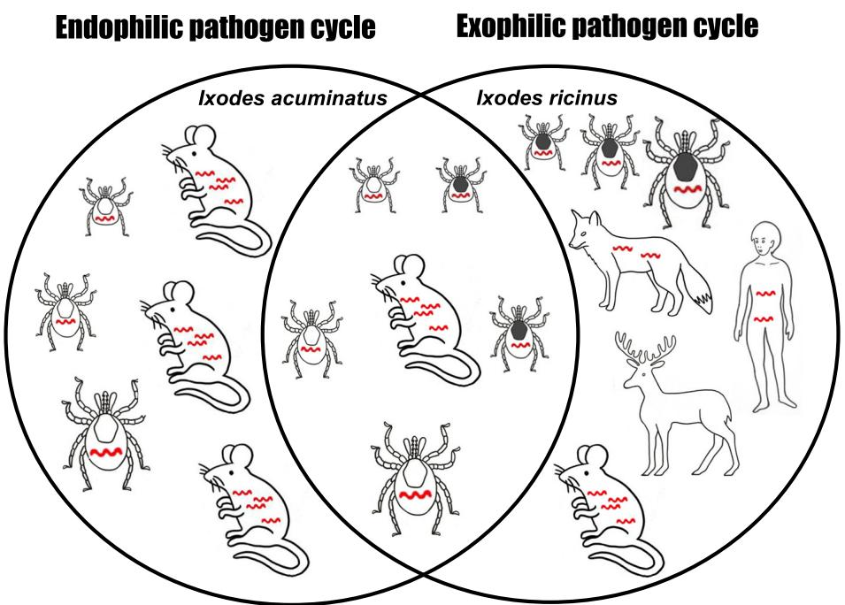

# R E S EAR CH

# Open Access

# Eco-epidemiology of Borrelia miyamotoi and Lyme borreliosis spirochetes in a popular hunting and recreational forest area in Hungary

CrossMark

Sándor Szekeres1 , Elena Claudia Coipan2 , Krisztina Rigó1 , Gábor Majoros1 , Setareh Jahfari2 , Hein Sprong2 and Gábor Földvári1*

# Abstract

Background: Borrelia miyamotoi, the newly discovered human pathogenic relapsing fever spirochete, and Borrelia burgdorferi sensu lato are maintained in natural rodent populations. The aim of this study was to investigate the natural cycle of B. miyamotoi and B. burgdorferi s.l. in a forest habitat with intensive hunting, forestry work and recreational activity in Southern Hungary.

Methods: We collected rodents with modified Sherman-traps during 2010–2013 and questing ticks with flagging in 2012. Small mammals were euthanized, tissue samples were collected and all ectoparasites were removed and stored. Samples were screened for pathogens with multiplex quantitative real-time polymerase chain reaction (qPCR) targeting a part of flagellin gene, then analysed with conventional PCRs and sequencing.

Results: 177 spleen and 348 skin samples of six rodent species were individually analysed. Prevalence in rodent tissue samples was $0 . 2 ~ \%$ (skin) and $0 . 5 ~ \%$ (spleen) for B. miyamotoi and $6 . 6 ~ \%$ (skin) and $2 . 2 ~ \%$ (spleen) for B. burgdorferi s.l. Relapsing fever spirochetes were detected in Apodemus flavicollis males, B. burgdorferi s.l. in Apodemus spp. and Myodes glareolus samples. Borrelia miyamotoi was detected in one questing Ixodes ricinus nymph and B. burgdorferi s.l in nymphs and adults. In the ticks removed from rodents DNA amplification of both pathogens was successful from I. ricinus larvae (B. miyamotoi $5 . 6 \% ,$ B. burgdorferi s.l. $1 1 . 1 \ \%$ ) and one out of five nymphs while from Ixodes acuminatus larvae, and nymph only B. burgdorferi s.l. DNA was amplified. Sequencing revealed B. lusitaniae in a questing I. ricinus nymph and altogether 17 B. afzelii were identified in other samples. Two Dermacentor marginatus engorged larva pools originating from uninfected hosts were also infected with B. afzelii.

Conclusions: This is the first report of B. miyamotoi occurrence in a natural population of A. flavicollis as well as in Hungary. We provide new data about circulation of B. burgdorferi s.l. in rodent and tick communities including the role of I. acuminatus ticks in the endophilic pathogen cycle. Our results highlight the possible risk of infection with relapsing fever and Lyme borreliosis spirochetes in forest habitats especially in the high-risk groups of hunters, forestry workers and hikers.

Keywords: Borrelia miyamotoi, Borrelia burgdorferi sensu lato, Ticks, Ixodes acuminatus, Rodents, Apodemus flavicollis, Endophilic pathogen cycle, Hunters, Hungary

# Background

Rodents support tick populations by providing a stable blood source as well as serve as important reservoirs for tick-borne pathogens [1, 2]. Exophilic (or non-nidicolous) ticks, such as all stages of Ixodes ricinus and adult Dermacentor marginatus, await a host on the vegetation, and are usually less host-specific, thus may act as bridge vectors between small mammals and humans in natural or urban habitats [3–5]. Therefore, understanding the epidemiology of these zoonotic agents in rodents and ticks has great public health relevance.

People working in the forests (e.g. hunters and forestry workers) and hikers have the highest probability to get into contact with ticks and therefore, with tick-borne pathogens. The seroprevalence of tick-borne pathogens in forestry workers has been reported to be higher compared to the average population in Europe, including Hungary [6, 7]. We have relatively few data on the infection rates of hunters with tick-borne pathogens and consequent risk of tick-borne diseases [8–13].

Human pathogenic members of the genus Borrelia consist of two main groups of spirochetes. The first, the causative agents of Lyme borreliosis (LB), is widespread throughout the Northern Hemisphere and transmitted by members of the Ixodes ricinus complex, while the second group, causing relapsing fever (RF) in humans, is transmitted by soft ticks, hard ticks [14] and lice [15]. Borrelia miyamotoi, belonging to the relapsing fever group, is transmitted by the same Ixodes species that also transmit LB spirochetes and is the only known agent causing relapsing fever transmitted by hard ticks. Borrelia miyamotoi was isolated for the first time in Japan in 1995 from Ixodes persulcatus ticks as well as from Apodemus argenteus mice [16, 17] and, over the last decade, it has also been detected in I. ricinus ticks throughout Europe [18–22]. Its ability to cause disease was unknown [23] until the first human cases of B. miyamotoi infection were reported in Russia in 2011 [24] and, more recently, in the USA and the Netherlands [25, 26].

Pathogenic members of B. burgdorferi s.l. - B. afzelii, B. garinii, B. burgdorferi s.s., B. bavariensis and B. spielmanii - are the causative agents of Lyme borreliosis, which is the most prevalent vector-borne disease in the temperate zone of the Northern Hemisphere. A further three species of the B. burgdorferi s.l. complex (B. bissettii, B. lusitaniae and B. valaisiana) have only occasionally been detected in patients [27]. These bacteria can cause various serious dermatological, rheumatological and neurological symptoms. In Hungary, 947–1811 patients are reported yearly to have LB [28]. Considering other European and North-American data the estimated LB incidence may be ten times higher in Hungary [29].

Based on the high seroprevalence of B. miyamotoi in forestry workers, reported in the Netherlands [6], and

the relatively common occurrence of the relapsing fever spirochetes in questing ticks in Europe [30, 31], B. miyamotoi infection probably also occurs in Hungary. However, the currently used diagnostic methods for patients are not suitable for detecting these spirochetes. A recent seroepidemiological study in the Netherlands showed that forestry workers and patients suspected for human granulocytic anaplasmosis have significantly higher seroprevalence of B. miyamotoi compared to the average population [6]. They suggest that some LB patients might also have B. miyamotoi infection (either undiagnosed or misdiagnosed or asymptomatic).

We have, also, sporadic information about the natural cycle of B. miyamotoi. Borrelia miyamotoi has so far been detected only from Apodemus argenteus (small Japanese field mouse) from Japan [17], Peromyscus leucopus (whitefooted mouse) from USA [32] and Myodes glareolus (bank vole) from France [31]. Based on xenodiagnostic experiments of Burri et al. (2014), Myodes glareolus and Apodemus flavicollis (yellow-necked field mouse) are proven reservoirs of B. miyamotoi [33], and A. argenteus and $P .$ leucopus are candidate reservoir species. Up to date, no other eco-epidemiological studies focusing on the natural cycle of B. miyamotoi in Europe were performed.

The aim of this study was to investigate the occurrence of causative agents of relapsing fever and Lyme borreliosis in rodents and ticks in a natural habitat of Southern Hungary, where forestry works, hunting and recreational activities are intensive.

# Methods

Our study site, Gemenc (46° 07′ N, 18° 46′ E), is a floodplain habitat in the southern part of the Hungarian Danube flow. This area has an intensive wildlife management with high density of game animals (red deer, roe deer, fallow deer and wild boar), and is frequently visited by forestry workers, hunters and tourists. According to the data of the Gemenc Forest and Game Co. Ltd., 700 hunters visited the area between September 2014 and February 2015. There are 600 forestry and maintenance workers who enter the forest on a daily basis and approximately 50000 tourists visit the area with 1500 children in summer camps yearly (Károly Árva, personal communication). The details of the sample collection (small mammal trapping and tick flagging) and DNA extraction have been described elsewhere [34]. Engorged larvae from the same tick species removed from the same rodent individual were pooled; all other samples were processed individually.

To determine whether tissue or tick samples contained any pathogens, we used a multiplex quantitative real-time PCR (qPCR) designed for B. miyamotoi and B. burgdorferi s.l. [35]. Briefly, we targeted a part of the flagellin B (flaB) gene. For B. miyamotoi we used forward primer FlabBm.motoiF (5' AGAAGGTGCTCAAGCAG 3') reverse

primer FlabB.m.motoiR (5' TCGATCTTTGAAAGTGA-CATAT 3'), with the probe FlabBm.motoiPro (5' AGCAC AACAGGAGGGAGTTCAAGC 3') [26]. For B. burgdorferi s.l. we used forward primer B-FlaB-F (5' CAGAIAGA GGTTCTATACAIATTGAIATAGA 3') and reverse primers B-FlaB-Rc (5' GTGCATTTGGTTAIATTGCGC 3') and B-FlaB-Rt (5' GTGCATTTGGTTAIATTGTGC 3'), with the probe B-FlaB-P (5' CAACTIACAGAIGAA XTAAIAGAAT TGCTGAICA 3', $\mathrm { X = }$ black hole quencher) [35]. In the analysis of qPCR results we selected the positive samples by two criteria, the shape of curves (compared to positive controls) and CT (threshold cycle) values. Samples were considered positive with CT values below 38 cycles for B. miyamotoi and below 41 cycles for B. burgdorferi s.l.

All qPCR-positive samples were examined by conventional PCR and sequencing. We targeted the glycerophosphodiester phosphodiesterase gene (glpQ) of B. miyamotoi with forward primer glpQ-BM-F2 (5' ATGGGTTCAAACA AAAAGTCACC 3') and reverse primer glpQ-BM-R1 (5' CCAGGGTCCAATTCCATCAGAATATTGTGCAAC 3') [26]. We amplified the intergenic spacer region (IGS) of B. burgdorferi s.l. with forward primer B5Sborseq $5 ^ { \prime }$ -GAGTT CGCGGGAGAGTAGGTTATTGCC-3') and reverse primer B23Sborseq (5'-TCAGGGTACTTAGATGGTTCAC TTCC-3') [36]. In the PCR assay we used negative controls to verify and exclude any contaminations. All samples that were positive by conventional PCR have been submitted to sequencing.

For statistical analysis, R [37] and Quantitative Parasitology 3.0 [38] statistical programs were used. Results with p-values under 0.05 were considered significant.

# Results

Tissue samples of six rodent species were individually collected and analysed: A. flavicollis (skin: 102, spleen: 67), A. agrarius (skin: 202, spleen: 92), Myodes glareolus (skin: 29, spleen: 11), Microtus arvalis (skin: 7, spleen: 4), Micromys minutus (skin: 3), Mus musculus (skin: 5, spleen: 3).

Altogether, $8 \%$ of rodents were infested with ticks. The overall prevalence in rodent tissue samples was $0 . 3 \ \%$ (skin) and $0 . 5 \%$ (spleen) for B. miyamotoi and $6 . 6 \%$ (skin) and $2 . 3 \ \%$ (spleen) for $B .$ . burgdorferi s.l. (Table 1). Borrelia miyamotoi was detected in two $A$ . flavicollis males. Borrelia burgdorferi s.l. was found in A. flavicollis, Apodemus agrarius and My. glareolus samples.

In questing Ixodes ricinus (21 nymphs and 13 adults), B. burgdorferi s.l was detected in three nymphs and five adults and B. miyamotoi was detected in one nymph (Table 2).

In the four tick species removed from rodents, B. miyamotoi was detected in engorged I. ricinus larvae and B. burgdorferi s.l. was detected in engorged I. ricinus larvae and a nymph, I. acuminatus larvae and a nymph, and $D$ . marginatus larvae (Table 3). The two B.

Table 1 Occurrence of B. miyamotoi and B. burgdorferi s.l. in rodent tissue samples from Southern Hungarya   

<table><tr><td rowspan="2">Rodent species</td><td colspan="2">B. miyamotoi(+/tested/prevalence)</td><td colspan="2">B. burgdorferis.l.</td></tr><tr><td>skin</td><td>spleen</td><td>skin</td><td>spleen</td></tr><tr><td>A. flavicollis</td><td>1/102/0.9 %</td><td>1/67/1.5 %</td><td>6/102/5.8 %</td><td>3/67/4.5 %</td></tr><tr><td>A. agrarius</td><td>0/202/-</td><td>0/92/-</td><td>16/202/7.9 %</td><td>1/92/1 %</td></tr><tr><td>My. glareolus</td><td>0 /29/-</td><td>0 /11/-</td><td>1/29/3.5 %</td><td>0/11/-</td></tr><tr><td>Mi. arvalis</td><td>0 /7/-</td><td>0 /4/-</td><td>0 /7/-</td><td>0/4/-</td></tr><tr><td>M. minutus</td><td>0 /3/-</td><td>-</td><td>0 /3/-</td><td>-</td></tr><tr><td>Mu. musculus</td><td>0 /5/-</td><td>0 /3/-</td><td>0 /5/-</td><td>0/3/-</td></tr><tr><td>Sum</td><td>1/348/0.3 %</td><td>1/177/0.5 %</td><td>23/348/6.6 %</td><td>4/177/2.3 %</td></tr></table>

a Skin and spleen samples were not taken from the same individual

miyamotoi-positive I. ricinus larva pools originated from two A. flavicollis males with unknown infectious status. Developmental stage and host infectious status for sequenced B. burgdorferi-positive I. ricinus samples are shown in Table 4. Two I. acuminatus larva pools originated from A. flavicollis hosts with unknown infectious status and one larva pool and one nymph were removed from uninfected A. flavicollis hosts. In the ticks removed from rodents DNA amplification of both pathogens was successful from I. ricinus larvae (B. miyamotoi $5 . 6 \ \%$ , B. burgdorferi s.l. $1 1 . 1 \ \%$ ) while from 2 Ixodes acuminatus larvae $( 7 . 7 ~ \% )$ , and the single tested nymph only B. burgdorferi s.l. DNA was amplified. There was no significant difference in B. burgdorferi s.l. minimum infection prevalence between I. ricinus and I. acuminatus larvae $\left( \mathtt { p } > 0 . 0 5 \right)$ . Three Dermacentor marginatus larva samples (two pools and one single; $4 . 5 \ \%$ minimum infection prevalence) removed from two uninfected A. flavicollis and an uninfected A. agrarius were also B. burgdorferi s.l.-positive.

Sequencing was successful for $1 8 \ B .$ . burgdorferi s.l.- positive samples: one B. lusitaniae was found in a questing I. ricinus nymph and altogether 17 B. afzelii were identified in questing I. ricinus nymphs and adults, in engorged I. ricinus larvae and a nymph, engorged I.

Table 2 Prevalence of B. miyamotoi and B. burgdorferi s.l. in questing ticks collected in Southern Hungary   

<table><tr><td>Tick species and stage</td><td>B. miyamotoi (+/tested/prevalence)</td><td>B. burgdorferis.l.</td></tr><tr><td>I. ricinus females</td><td>0/5/-</td><td>2/5/40 %</td></tr><tr><td>I. ricinus males</td><td>0/8/-</td><td>3/8/37.5 %</td></tr><tr><td>I. ricinus nymphs</td><td>1/21/4.8</td><td>3/21/14.3 %</td></tr><tr><td>D. reticulatusa</td><td>0/64/-</td><td>0/64/-</td></tr><tr><td>D. marginatusa</td><td>0/2/-</td><td>0/2/-</td></tr><tr><td>H. concinnb</td><td>0/62/-</td><td>0/62/-</td></tr></table>

a adults   
$^ { \mathrm { b } } 3 3$ larvae, 10 nymphs and 19 adults

Table 3 Prevalence of B. miyamotoi and B. burgdorferi s.l. in engorged ticks from rodents in Southern Hungary   

<table><tr><td>Tick species and stage</td><td>B. miyamotoi(+/tested/prevalence)</td><td>B. burgdorferis.l.</td></tr><tr><td>I. ricinuslarva pools containing 36 larvae</td><td>2/14/5.6 %a</td><td>4/14/11.1 %a</td></tr><tr><td>I. ricinusnymphs</td><td>0/5/-</td><td>1/5/20 %</td></tr><tr><td>I. acuminatuslarva pools containing 52 larvae</td><td>0/13/-</td><td>4/13/7.7 %a</td></tr><tr><td>I. acuminatusnymph</td><td>0/1/-</td><td>1/1/100 %</td></tr><tr><td>I. acuminatusfemales</td><td>0/3/-</td><td>0/3/-</td></tr><tr><td>D. marginatuslarva pools containing 61 larvae</td><td>0/19/-</td><td>3/19/4.9 %a</td></tr><tr><td>D. marginatusnymphs</td><td>0/5/-</td><td>0/5/-</td></tr><tr><td>H. concinnalarva pools containing 15 larvae</td><td>0/7/-</td><td>0/7/-</td></tr><tr><td>H. concinnanymphs</td><td>0/3/-</td><td>0/3/-</td></tr></table>

a minimum infection prevalence

acuminatus larvae and a nymph, and in rodent skin samples. Two Dermacentor marginatus engorged larva pools originating from uninfected hosts were also infected with B. afzelii (Table 4). We sequenced B. miyamotoi amplicons from one questing I. ricinus nymph, one engorged I. ricinus larva pool and a skin sample of an A. flavicollis.

# Discussion

Small mammals are one of the most important sources of blood meal for the subadult stages of ticks. Rodents have high metabolic and reproduction rate with relatively large body surface compared to their body weight and these small mammals are in high densities in the natural habitats. All these features make rodents suitable hosts for ticks and also suitable reservoirs for many pathogens [2]. The present study identified B. miyamotoi and B. burgdorferi s.l. from samples of different years (2011–2012) indicating that these pathogens seem to have a stable cycle in this area even surviving rodents that usually live for less than a year.

Borrelia miyamotoi spirochetes have been previously detected only in wild A. argenteus in Asia, P. leucopus in North-America and My. glareolus in Europe [16, 31, 32].

Table 4 Sequenced B. miyamotoi and B. burgdorferi s.l. samples from Southern Hungary   

<table><tr><td>Borrelia species</td><td>Source</td><td>Host infection status</td><td>GenBank accession number</td></tr><tr><td>B. lusitaniae</td><td>questing I. ricinus nymph</td><td>-</td><td>KM657411</td></tr><tr><td>B. afzelii</td><td>A. flavicollis male skin</td><td>-</td><td>KM657412</td></tr><tr><td>B. afzelii</td><td>A. agrarius male skin</td><td>-</td><td>KM657417</td></tr><tr><td>B. afzelii</td><td>questing I. ricinus nymph</td><td>-</td><td>KM657413</td></tr><tr><td>B. afzelii</td><td>questing I. ricinus nymph</td><td>-</td><td>KM657418</td></tr><tr><td>B. afzelii</td><td>questing I. ricinus female</td><td>-</td><td>KM657421</td></tr><tr><td>B. afzelii</td><td>questing I. ricinus female</td><td>-</td><td>KM657423</td></tr><tr><td>B. afzelii</td><td>questing I. ricinus male</td><td>-</td><td>KM657414</td></tr><tr><td>B. afzelii</td><td>questing I. ricinus male</td><td>-</td><td>KM657415</td></tr><tr><td>B. afzelii</td><td>engorged I. ricinus larva from A. flavicollis female</td><td>unknown</td><td>KM657425</td></tr><tr><td>B. afzelii</td><td>engorged I. ricinus pool (4 larvae) from A. flavicollis female</td><td>uninfected</td><td>KM657426</td></tr><tr><td>B. afzelii</td><td>engorged I. ricinus pool (8 larvae) from A. flavicollis \( male^a \)</td><td>unknown</td><td>KM657416</td></tr><tr><td>B. afzelii</td><td>engorged I. ricinus nymph from A. flavicollis male</td><td>unknown</td><td>KM657424</td></tr><tr><td>B. afzelii</td><td>engorged I. acuminatus pool (6 larvae) from A. flavicollis \( male^b \)</td><td>unknown</td><td>KM657427</td></tr><tr><td>B. afzelii</td><td>engorged I. acuminatus pool (10 larvae) from A. flavicollis \( male^b \)</td><td>unknown</td><td>KM657428</td></tr><tr><td>B. afzelii</td><td>engorged I. acuminatus nymph from A. flavicollis \( male^c \)</td><td>uninfected</td><td>KM657419</td></tr><tr><td>B. afzelii</td><td>engorged D. marginatus pool (4 larvae) from A. agrarius male</td><td>uninfected</td><td>KM657422</td></tr><tr><td>B. afzelii</td><td>engorged D. marginatus pool (8 larvae) from A. flavicollis \( male^c \)</td><td>uninfected</td><td>KM657420</td></tr><tr><td>B. miyamotoi</td><td>questing I. ricinus nymph</td><td>-</td><td>LC006119.1</td></tr><tr><td>B. miyamotoi</td><td>engorged I. ricinus pool (8 larvae) from A. flavicollis \( male^a \)</td><td>unknown</td><td>LC006120.1</td></tr><tr><td>B. miyamotoi</td><td>A. flavicollis female spleen</td><td>-</td><td>LC006118.1</td></tr></table>

a co-infection   
b from the same rodent individual   
c from the same rodent individual

The reservoir role of A. flavicollis and My. glareolus was proven under xenodiagnostic laboratory conditions [33]. Our study provides the first evidence for the presence of B. miyamotoi infection in a wild A. flavicollis population. Further eco-epidemiological studies in other natural habitats will shed more light on the importance of one of the most common rodents in Europe, A. flavicollis, in the cycle of B. miyamotoi.

Relapsing fever spirochetes’ DNA was detectable in five samples (including A. flavicollis skin and spleen, questing and engorged I. ricinus) with a sensitive qPCR method [26]. Borrelia miyamotoi DNA sequencing was successful from only three samples: one questing I. ricinus nymph, one pooled sample containing eight I. ricinus larvae from an A. flavicollis male and one spleen removed from an A. flavicollis female. All three sequences were $1 0 0 \%$ identical suggesting the circulation of the same B. miyamotoi genotype between natural populations of the yellow-necked field mouse and I. ricinus. In the case of an A. flavicollis male skin and one questing I. ricinus nymph sample the conventional PCR and sequencing were not successful, probably due to low DNA concentration. We found, altogether, $4 8 \ B ,$ burgdorferi s.l. positive samples in all types of samples and from 18 of them we could also sequence the LB spirochete. Compared to Egyed et al. (2012) [39], who found $2 . 5 \ \%$ average minimum infection prevalence of B. burgdorferi s.l. in questing I. ricinus in different collection sites in Hungary, our study, although within a much smaller sample size, shows a much higher prevalence $( 2 3 . 5 ~ \% )$ . To get a better estimate of the pathogen prevalence in the area, the study has to be performed with at least ten times larger questing tick sample size. In one questing I. ricinus nymph we found Borrelia lusitaniae infection. This nymph may have fed as larva on lizards that are common hosts for I. ricinus larvae and potential reservoirs of these spirochetes [40, 41]. Lacerta viridis (green lizard), Lacerta agilis (sand lizard) and Podarcis muralis (common wall lizard) live in this region [42] and L. agilis was observed also in the vicinity of our trapping sites (Balázs Velekei, personal communication). The presence of B. lusitaniae is of public health relevance, since this spirochete can also infect humans [43].

Borrelia afzelii was the most prevalent among the sequenced LB spirochetes (17/18) in the present study. This is the most widespread Borrelia species in Europe [27], usually maintained by rodents [33, 44]. This spirochete is probably the most important LB causative agent in Hungary [45]. In a seroepidemiological study in the neighbouring Austria a nearly linear increase of LB seroprevalence with duration of hunting activity was shown among hunters [8]. Lakos et al. [7] reported that erythema migrans occurred ten times more frequently

among forestry workers than in the average population, but the rate of seropositivity was much higher (indicating frequent asymptomatic seropositivity). The hunters’ elevated risk of tick bites is obvious [11] and infections with other tick-borne pathogens, such as Anaplasma phagocytophilum in the neighbouring Slovakia [12], Rickettsia spp. in Germany [13] and tick-borne encephalitis virus in Italy [9], were also observed in this group. Thus, the presence of at least two pathogenic LB spirochetes in the Gemenc area can pose a risk of LB infection to the occupationally exposed persons.

Ixodes acuminatus individuals are endophilic (or nidicolous) ticks. All stages of this species live in rodents’ nests, thus, being capable of maintaining a local cycle of pathogens similar to the natural cycle of A. phagocytophilum and Babesia microti with the endophilic I. trianguliceps [46, 47]. We found B. burgdorferi s.l. in one nymph and four larval pools (4/52, minimum infection prevalence: $7 . 7 \ \%$ ) of I. acuminatus. Rigó et al. [44] detected B. afzelii in an adult I. acuminatus female and the three sequenced I. acuminatus samples in the present study identified the same LB spirochete. Although this tick species is not currently considered a competent vector [48], our previous [44] and current data refer to an important role of I. acuminatus in the endophilic pathogen cycle of B. afzelii (Fig. 1). Ixodes ricinus ticks are the connecting link (bridge vectors) between the rodent’s local (nest) infection and the “world outside the nest” i.e. other vertebrate hosts including humans. Between these two Ixodes species we could not find any significant difference in B. burgdorferi s.l. prevalence. Thus, I. acuminatus may have similarly important role in the endophilic pathogen cycle as I. ricinus has in the exophilic pathogen cycle involving human infection. This double natural cycle has also been observed in the case of B. burgdorferi s.l. and I. ricinus vs. I. hexagonus [49] and might be a general trait for several tick-borne pathogens. Being present in two different (endophilic and exophilic) transmission cycles is clearly an evolutionarily stable strategy increasing survival of the LB spirochetes. Both of these cycles have to be considered and monitored in order to forecast and prevent human infection risk. Furthermore, I. acuminatus occasionally can bite humans [50] posing a direct infection threat as well.

We also found B. burgdorferi s.l. infection in three engorged D. marginatus (two larva pools and one single larva sample) that were removed from uninfected hosts. The two pools contained four and eight specimens respectively, and the bacterium identified in these samples was B. afzelii. One of these pools was collected from one Borrelia-negative A. flavicollis male, the other pool was removed from a Borrelia-negative A. agrarius male. The single engorged B. burgdorferi s.l.-positive $D$ .

  
Fig. 1 The two transmission cycles involved in the natural maintenance of Borrelia afzelii. Scutum of larvae, nymphs and adults of the exophilic tick, I. ricinus are marked with dark grey and with white colour in case of the endophilic tick, I. acuminatus. Red spirochetes indicate ticks and hosts that can potentially be infected with B. afzelii. Cervids are important tick maintenance hosts, however they are not reservoirs of LB spirochetes, thus they are known to be dilution hosts [54, 55]. Original drawings were made by Gábor Majoros

marginatus larva was removed from an A. flavicollis female which was also shown to be negative for $B _ { \cdot }$ . burgdorferi s.l. In previous studies, questing adult $D$ . reticulatus ticks in Germany had $1 1 . 3 ~ \%$ prevalence of Borrelia spp. (detected with indirect immunofluorescence assay) [51] but in controlled experiments, American Dermacentor spp. were unable to transmit LB spirochete [52]. While being capable of biting humans [53], the possibility exists that $D _ { \bullet }$ . marginatus is able to maintain LB spirochetes, we do not claim that Dermacentor spp. have an epidemiological role in LB transmission, however these findings suggest further investigation. One engorged I. ricinus larva pool from an unidentified rodent ${ \bf \dot { n } } = 8$ larvae) had co-infection with B. afzelii and B. miyamotoi. Cosson et al. [31] found B. miyamotoi co-infection with another LB spirochete, B. garinii in France. This indicates that I. ricinus might spread both pathogens even synchronously and act like a bridge vector between the most important rodent species and humans. This tick species is the key risk factor for humans acquiring most tick-borne pathogens in Europe [5], especially in areas with frequent human presence as the popular hunting ground and touristic destination in our study site.

Up until now, no human cases of B. miyamotoi have been reported in Hungary. The presence of this newly described pathogen in ticks and rodents, as shown here, a recent case of human infection [26], and the high

seropositivity of forestry workers in the Netherlands [6] suggest, however, that human cases might occur, but they might be overlooked. The symptoms of tick-borne relapsing fever could easily be confused with those caused by other better known pathogens or with those of Lyme borreliosis.

# Conclusions

The presence of the newly described human pathogen, Borrelia miyamotoi in a natural habitat with frequent human visitors has important public health implications. This study is the first report of this bacterium in wild A. flavicollis as well as in Hungary. Apodemus flavicollis, A. agrarius and My. glareolus were found to be involved in the natural cycle of LB spirochetes. Our results suggest an important role of I. acuminatus ticks in the endophilic pathogen cycle of B. afzelii, similar to the role of I. ricinus in the exophilic pathogen cycle.

Forestry workers, hunters, woodcutters, gamekeepers and hikers are especially exposed to ticks in areas of intense transmission of bacteria within enzootic cycles (i.e. forests). Consequently, they have to be considered as a high risk population for both LB spirochetes and B. miyamotoi. In these high exposure groups, surveillance and prevention are the most crucial pillars of the protection against tick-borne pathogens like B. burgdorferi s.l. and B. miyamotoi.

# Competing interests

The authors declare that they have no competing interests.

# Authors’ contributions

GM, HS and GF designed and supervised different parts of the study. SSz, KR, GM and GF collected samples. SSz, ECC, KR, GM, SJ and GF performed laboratory analyses. SSz, ECC, KR, GM, SJ, HS and GF analysed data. GF conceived the figure, GM made the drawings; SSz, GM and GF prepared the figure. SSz and GF wrote the manuscript. All authors read and approved the final manuscript.

# Acknowledgements

We are grateful to the Gemenc Forest and Game Co. Ltd. who supported our work in the area. We thank the Middle Danube Valley Inspectorate for Environmental Protection, Nature Conservation and Water Management, Hungary, for approving capturing and euthanizing of rodents and sample collection.

This study was partially supported by European Union grant FP7- 261504 EDENext and was catalogued by the EDENext Steering Committee (www.edenext.eu) as EDENext285. G. F. was supported by the János Bolyai Research Scholarship of the Hungarian Academy of Sciences and an NKB and Research Faculty grants from the Faculty of Veterinary Science, Szent István University. E. C. C. and H. S. were supported by EurNegVec Cost Action TD1303. S. Sz. was supported by the city Council of Hajdúböszörmény, the Campus Hungary Scholarship and TÁMOP-4.2.2.B-10/1-2010-0011.

# Author details

1 Department of Parasitology and Zoology, Faculty of Veterinary Science, Szent István University, 2 István Street H-1078, Budapest, Hungary. 2 Laboratory for Zoonoses and Environmental Microbiology, National Institute for Public Health and Environment, 9 Antonie van Leeuwenhoeklaan, P.O. Box 1, Bilthoven, The Netherlands.

Received: 13 November 2014 Accepted: 28 May 2015

Published online: 06 June 2015

# References

1. Silaghi C, Woll D, Mahling M, Pfister K, Pfeffer M. Candidatus Neoehrlichia mikurensis in rodents in an area with sympatric existence of the hard ticks Ixodes ricinus and Dermacentor reticulatus, Germany. Parasit Vectors. 2012;5:285.   
2. Ostfeld RS, Levi T, Jolles AE, Martin LB, Hosseini PR, Keesing F. Life History and Demographic Drivers of Reservoir Competence for Three Tick-Borne Zoonotic Pathogens. PLoS One. 2014;9:e107387.   
3. Oliver JH, Lin T, Gao L, Clark KL, Banks CW, Durden LA, et al. An enzootic transmission cycle of Lyme borreliosis spirochetes in the southeastern United States. Proc Natl Acad Sci. 2003;100(20):11642–5.   
4. Estrada-Peña A, de la Fuente J. The ecology of ticks and epidemiology of tick-borne viral diseases. Antiviral Res. 2014;108:104–28.   
5. Rizzoli A, Silaghi C, Obiegala A, Rudolf I, Hubalek Z, Foldvari G, et al. Ixodes ricinus and its transmitted pathogens in urban and peri-urban areas in Europe: new hazards and relevance for public health. Front public Heal. 2014;2:251.   
6. Jahfari S, Herremans T, Platonov AE, Kuiper H, Karan LS, Vasilieva O, et al. High seroprevalence of Borrelia miyamotoi antibodies in forestry workers and individuals suspected of human granulocytic anaplasmosis in the Netherlands. New Microbes New Infect. 2014;2:144–9.   
7. Lakos A, Igari Z, Solymosi N. Recent lesson from a clinical and seroepidemiological survey: low positive predictive value of Borrelia burgdorferi antibody testing in a high risk population. Adv Med Sci. 2012;57:356–63.   
8. Cetin E, Sotoudeh M, Auer H, Stanek G. Paradigm Burgenland: risk of Borrelia burgdorferi sensu lato infection indicated by variable seroprevalence rates in hunters. Wien Klin Wochenschr. 2006;118:677–81.   
9. Pugliese A, Beltramo T, Torre D. Seroprevalence study of Tick-borne encephalitis, Borrelia burgdorferi, Dengue and Toscana virus in Turin Province. Cell Biochem Funct. 2007;25:185–8.   
10. Nuti M, Serafini DA, Bassetti D, Ghionni A, Russino F, Rombolà P, et al. Ehrlichia Infection in Italy. Emerg Infect Dis. 1998;4:663–5.   
11. Kubo N, Arashima Y, Yoshida M, Kawabata M, Nishinarita S, Hayama T, et al. Qestionnaire Surveys of Cases of Tick Bite and Lyme Borreliosis in Hunters in

Hokkaido with Reference to Detection of Anti-Borrelia burgdorferi Antibody. Intern Med. 1992;31:1163–8.   
12. Nováková M, Víchová B, Majláthová V, Lesnáková A, Pochybová M, Pe’tko B. Fist case of human granulocytic anaplasmosis from Slovakia. Ann Agric Env Med. 2010;17:173–5.   
13. Jansen A, La Scola B, Raoult D, Lierz M, Wichmann O, Stark K, et al. Antibodies against Rickettsia spp. in Hunters, Germany. Emerg Infect Dis. 2008;14:1961–3.   
14. Platonov AE, Maleev VV, Karan’ LS. Relapsing borrelioses fevers: forgotten and new ones. Ter Arkh. 2010;82:74–80.   
15. Raoult D, Birtles RJ, Montoya M, Perez E, Tissot-Dupont H, Roux V, et al. Survey of three bacterial louse-associated diseases among rural Andean communities in Peru: prevalence of epidemic typhus, trench fever, and relapsing fever. Clin Infect Dis. 1999;29:434–6.   
16. Fukunaga M, Takahashi Y, Tsuruta Y, Matsushita O, Ralph D, McClelland M, et al. Genetic and phenotypic analysis of Borrelia miyamotoi sp. nov., isolated from the ixodid tick Ixodes persulcatus, the vector for Lyme disease in Japan. Int J Syst Bacteriol. 1995;45:804–10.   
17. Fukunaga M, Koreki Y. The flagellin gene of Borrelia miyamotoi sp. nov. and its phylogenetic relationship among Borrelia species. FEMS Microbiol Lett. 1995;134:255–8.   
18. Richter D, Schlee DB, Matuschka F-R. Relapsing fever-like spirochetes infecting European vector tick of Lyme disease agent. Emerg Infect Dis. 2003;9:697–701.   
19. Geller J, Nazarova L, Katargina O, Järvekülg L, Fomenko N, Golovljova I. Detection and genetic characterization of relapsing fever spirochete Borrelia miyamotoi in Estonian ticks. PLoS One. 2012;7:e51914.   
20. Kiewra D, Stańczak J, Richter M. Ixodes ricinus ticks (Acari, Ixodidae) as a vector of Borrelia burgdorferi sensu lato and Borrelia miyamotoi in Lower Silesia, Poland–preliminary study. Ticks Tick Borne Dis. 2014;5:892–7.   
21. Michelet L, Delannoy S, Devillers E, Umhang G, Aspan A, Juremalm M, et al. High-throughput screening of tick-borne pathogens in Europe. Front Cell Infect Microbiol. 2014;4.   
22. Cochez C, Heyman P, Heylen D, Fonville M, Hengeveld P, Takken W, Simons L, Sprong H: The Presence of Borrelia miyamotoi, A Relapsing Fever Spirochaete, in Questing Ixodes ricinus in Belgium and in The Netherlands. Zoonoses Public Health 2014:in press.   
23. Tijsse-Klasen E, Koopmans MPG, Sprong H. Tick-borne pathogen - reversed and conventional discovery of disease. Front Public Heal. 2014;2:73.   
24. Platonov AE, Karan LS, Kolyasnikova NM, Makhneva NA, Toporkova MG, Maleev VV, et al. Humans Infected with Relapsing Fever Spirochete Borrelia, Russia. Emerg Infect Dis. 2011;17:1816–23.   
25. Krause PJ, Narasimhan S, Wormser GP, Rollend L, Fikrig E, Lepore T, et al. Human Borrelia miyamotoi Infection in the United States. N Engl J Med. 2013;368:291–3.   
26. Hovius JWR, de Wever B, Sohne M, Brouwer MC, Coumou J, Wagemakers A, et al. A case of meningoencephalitis by the relapsing fever spirochaete Borrelia miyamotoi in Europe. Lancet. 2013;382:658.   
27. Stanek G, Wormser GP, Gray J, Strle F. Lyme borreliosis. Lancet. 2012;379:461–73.   
28. Zöldi V, Juhász A, Nagy C, Papp Z, Egyed L. Tick-borne encephalitis and lyme disease in Hungary: the epidemiological situation between 1998 and 2008. Vector Borne Zoonotic Dis. 2013;13:256–65.   
29. Lakos A. Lyme borreliosis-experience of the last 25 years in Hungary. Orv Hetil. 2009;150:725–32.   
30. Crowder CD, Carolan HE, Rounds MA, Honig V, Mothes B, Haag H, et al. Prevalence of Borrelia miyamotoi in Ixodes Ticks in Europe and the United States. Emerg Infect Dis. 2014;20:1678–82.   
31. Cosson J-F, Michelet L, Chotte J, Le Naour E, Cote M, Devillers E, et al. Genetic characterization of the human relapsing fever spirochete Borrelia miyamotoi in vectors and animal reservoirs of Lyme disease spirochetes in France. Parasit Vectors. 2014;7:233.   
32. Scoles GA, Papero M, Beati L, Fish D. A Relapsing Fever Group Spirochete Transmitted by Ixodes scapularis Ticks. Vector Borne Zoonotic Dis. 2001;1:21–34.   
33. Burri C, Schumann O, Schumann C, Gern L. Are Apodemus spp. mice and Myodes glareolus reservoirs for Borrelia miyamotoi, Candidatus Neoehrlichia mikurensis, Rickettsia helvetica, R. monacensis and Anaplasma phagocytophilum? Ticks Tick Borne Dis. 2014;5:245–51.   
34. Szekeres S, Coipan EC, Rigó K, Majoros G, Jahfari S, Sprong H, et al. Candidatus Neoehrlichia mikurensis and Anaplasma phagocytophilum in natural rodent and tick communities in Southern Hungary. Ticks Tick Borne Dis. 2015;6:111–6.

35. Heylen D, Tijsse E, Fonville M, Matthysen E, Sprong H. Transmission dynamics of Borrelia burgdorferi s.l. in a bird tick community. Environ Microbiol. 2013;15:663–73.   
36. Coipan EC, Fonville M, Tijsse-Klasen E, van der Giessen JWB, Takken W, Sprong H, et al. Geodemographic analysis of Borrelia burgdorferi sensu lato using the 5S-23S rDNA spacer region. Infect Genet Evol. 2013;17:216–22.   
37. The R Development Core Team. R: A Language and Environment for Statistical Computing. Volume 1. 2010.   
38. Rózsa L, Reiczigel J, Majoros G. Quantifying parasites in samples of hosts. J Parasitol. 2000;86:228–32.   
39. Egyed L, Elő P, Sréter-Lancz Z, Széll Z, Balogh Z, Sréter T. Seasonal activity and tick-borne pathogen infection rates of Ixodes ricinus ticks in Hungary. Ticks Tick Borne Dis. 2012;3:90–4.   
40. Földvári G, Rigó K, Majláthová V, Majláth I, Farkas R, Pet’ko B. Detection of Borrelia burgdorferi sensu lato in lizards and their ticks from Hungary. Vector Borne Zoonotic Dis. 2009;9:331–6.   
41. Majláthová V, Majláth I, Derdáková M, Víchová B, Petko B. Borrelia lusitaniae and Green Lizards (Lacerta viridis), Karst Region, Slovakia. Emerg Infect Dis. 2006;12:1895–901.   
42. Mayer J. The vertebrates of Béda-Karapancsa landscape protection area, South Hungary. Dunántúli Dolg Természetudományi Sor. 1992;6:257–72.   
43. Collares-Pereira M, Couceiro S, Franca I, Kurtenbach K, Scha SM, Baptista S, et al. First Isolation of Borrelia lusitaniae from a Human Patient. J Clin Microbiol. 2004;42:1316–8.   
44. Rigó K, Gyuranecz M, Tóth AG, Földvári G. Detection of Borrelia burgdorferi sensu lato and Anaplasma phagocytophilum in small mammals and ectoparasites in Hungary. Vector Borne Zoonotic Dis. 2011;11:1499–501.   
45. Földvári G, Farkas R, Lakos A. Borrelia spielmanii Erythema Migrans, Hungary. Emerg Infect Dis. 2005;11:2004–5.   
46. Bown KJ, Begon M, Bennett M, Birtles RJ, Burthe S, Lambin X, et al. Sympatric Ixodes trianguliceps and Ixodes ricinus Ticks Feeding on Field Voles (Microtus agrestis): Potential for Increased Risk of Anaplasma phagocytophilum in the United Kingdom? Vector-borne Zoonotic Dis. 2006;6:404–10.   
47. Bown KJ, Lambin X, Telford GR, Ogden NH, Telfer S, Woldehiwet Z, et al. Relative importance of Ixodes ricinus and Ixodes trianguliceps as vectors for Anaplasma phagocytophilum and Babesia microti in field vole (Microtus agrestis) populations. Appl Environ Microbiol. 2008;74:7118–25.   
48. Petney TN, Moser E, Littwin N, Pfäffle M, Senta V, Taraschewski H. Additions to the “Annotated Checklist of the Ticks of Germany”: Ixodes acuminatus and Ixodes inopinatus. Syst Appl Acarol Acarol. 2015;20:221–4.   
49. Gern L, Rouvinez E, Toutoungi LEG. Transmission cycles of Borrelia burgdorferi sensu lato involving Ixodes ricinus and/or I. hexagonus ticks and the European hedgehog, Erinaceus europaeus, in suburban and urban areas in Switzerland. Folia Parasitol (Praha). 1997;44:309–14.   
50. Hillyard P. Ticks of North-West Europe. Shrewsbury: Field Studies Council; 1996.   
51. Kahl O, Janetzki C, Gray J, Stein J, Bauch R. Tick infection rates with Borrelia: Ixodes ricinus versus Haemaphysalis concinna and Dermacentor reticulatus in two locations in eastern Germany. Med Vet Entomol. 1992;6:363–6.   
52. Gray J, Kahl O, Lane RS, Stanek G. Lyme Borreliosis Biology, Epidemiology and Control. 2002.   
53. Földvári G, Rigó K, Lakos A. Transmission of Rickettsia slovaca and Rickettsia raoultii by male Dermacentor marginatus and Dermacentor reticulatus ticks to humans. Diagn Microbiol Infect Dis. 2013;76:387–9.   
54. Kurtenbach K, De Michelis S, Etti S, Schäfer SM, Sewell H-S, Brade V, et al. Host association of Borrelia burgdorferi sensu lato–the key role of host complement. Trends Microbiol. 2002;10:74–9.   
55. Pacilly FCA, Benning ME, Jacobs F, Leidekker J, Sprong H, Van Wieren SE, et al. Blood feeding on large grazers affects the transmission of Borrelia burgdorferi sensu lato by Ixodes ricinus. Ticks Tick Borne Dis. 2014;5:810–7.

# Submit your next manuscript to BioMed Central and take full advantage of:

• Convenient online submission   
• Thorough peer review   
• No space constraints or color figure charges   
• Immediate publication on acceptance   
• Inclusion in PubMed, CAS, Scopus and Google Scholar   
• Research which is freely available for redistribution

Submit your manuscript at www.biomedcentral.com/submit