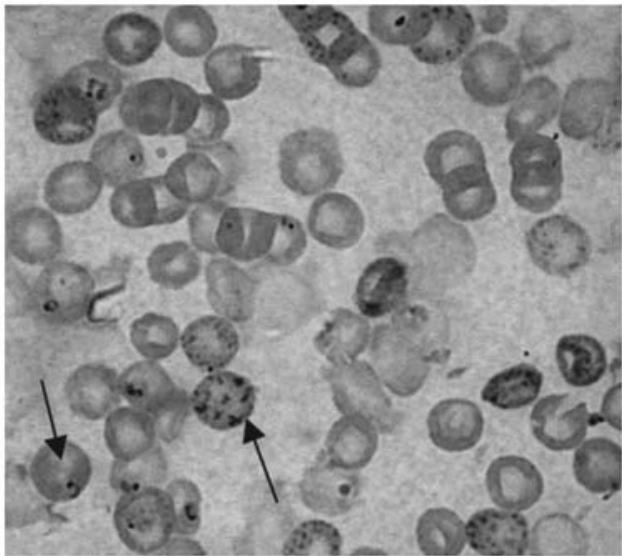
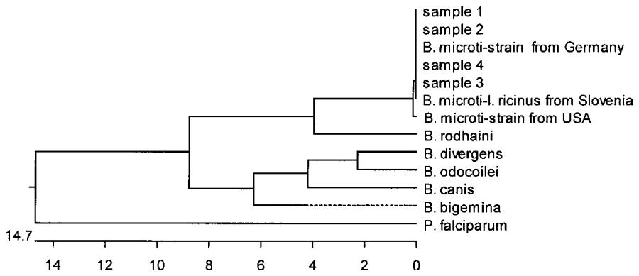

# The molecular evidence of Babesia microti infection in small mammals collected in Slovenia

D. DUH1 , M. PETROVEC1 , T. TRILAR2 and T. AVSIC-ZUPANC1 *

1 Institute of Microbiology and Immunology, Medical Faculty, 1000 Ljubljana, Slovenia   
2 Slovenian Museum of Natural History, 1000 Ljubljana, Slovenia

(Received 10 July 2002; revised 7 October 2002; accepted 7 October 2002)

# SUMMARY

In Europe, the zoonotic cycle of Babesia microti has not been determined so far. Recently, B. microti was detected in Ixodes ricinus ticks in Slovenia by using molecular methods. In order to investigate the mammalian hosts of $B$ . microti in Slovenia we collected 261 small mammals representing 11 species. They were tested for the presence of babesial parasites with a PCR assay based on the nuclear small subunit rRNA gene (nss-rDNA). The bank vole (Clethrionomys glareolus) and yellownecked mouse (Apodemus flavicollis) were infected with $B$ . microti. The prevalence rate was $1 5 { \cdot } 9 \%$ for C. glareolus and $1 1 { \cdot } 8 \%$ for A. flavicollis. Nucleotide sequences of amplified portions of $B$ . microti nss-rDNA from C. glareolus and $A$ . flavicollis were indistinguishable from each other and identical with those previously described in I. ricinus ticks collected in Slovenia. The results of this study represent molecular evidence of $B$ . microti in small mammals in Europe.

Key words: Babesia microti, Clethrionomys glareolus, Apodemus flavicollis, molecular analysis, Slovenia.

# INTRODUCTION

Protozoa of the genus Babesia are some of the most ubiquitous and widespread blood parasites (Telford et al. 1993). Babesia microti is the main causative agent of human babesiosis, a tick-borne zoonosis increasingly recognized in the north-eastern and midwestern USA (Homer et al. 2000 ; Kjemtrup & Conrad, 2000). The life-cycle of B. microti in the USA has been well described: the white-footed mouse (Peromyscus leucopus) is the most important reservoir and the tick Ixodes scapularis is the main vector (Piesman & Spielman, 1980; Spielman et al. 1981; Telford & Spielman, 1993). Microtus pennsylvanicus, M. montanus and M. ochrogaster serve as minor reservoir hosts (Watkins et al. 1991; Burkot et al. 2000).

However, the zoonotic status of $B$ . microti in Europe remains an open question. In different countries across Europe this parasite has been found in a variety of small mammals. The absence of indigenous cases of babesiosis caused by B. microti was explained by the selective feeding behaviour of the proposed vector I. trianguliceps (Kjemtrup & Conrad, 2000). Although I. trianguliceps was experimentally established as a competent vector of B. microti, this tick species does not bite humans (Randolph, 1995). Recently, B. microti has been detected in I. ricinus in Slovenia, Poland and Switzerland by means of molecular identification (Duh, Petrovec &

* Corresponding author: Institute of Microbiology and Immunology, Medical Faculty, Zaloska 4, 1000 Ljubljana, Slovenia. Tel: +386 1 543 7450. Fax: +386 1 543 7401. E-mail : tatjana.avsic@mf.uni-lj.si

Avsic-Zupanc, 2001; Skotarczak & Cichocka, 2001; Foppa et al. 2002). In transmission studies Gray et al. (2002) demonstrated that I. ricinus could serve as a vector of $B$ . microti in Europe. I. ricinus is defined as an opportunistic tick species utilizing a wide range of vertebrates as hosts and it readily bites humans (Sonenshine, 1993).

In Slovenia, the reservoir of $B$ . microti had not been investigated. Therefore we conducted this study to determine whether small mammals, captured in Slovenia, are infected with babesial parasites and also to assess the DNA sequence homologies between amplicons derived from small mammals and those previously obtained from I. ricinus ticks.

# MATERIALS AND METHODS

# Field collections

Small mammals were trapped between 1996 and 2000 in 2 ecologically different regions of Slovenia: the Subpannonian (UTM: WM77, WM88, WM96, XM08, XM09) and the Pre-alpine (UTM: VM41, VM51, VL49, VL58) region. The vegetation in these regions comprises predominantly broad-leaved forest, coniferous forest of boreal type and elements of the mountainous Mediterranean (Mrsic, 1997). Animals were captured in live traps, Eliot special and Sherman type, and sacrificed by ether hyperanaesthesia. To aid identification, animals were weighed and total head–body length, tail, ear and hind-foot lengths were measured. The blood was collected from the axillar artery and thin blood smears were immediately prepared.

Table 1. Detection of Babesia microti in small mammals, captured in Slovenia, using PCR assays and subsequent sequence analysis   

<table><tr><td>Species</td><td>Common name</td><td>No. tested</td><td>Percentage B. microti positive (no.)</td></tr><tr><td>Apodemus flavicollis</td><td>Yellow-necked mouse</td><td>127</td><td>11·8 (15)</td></tr><tr><td>Clethrionomys glareolus</td><td>Bank vole</td><td>69</td><td>15·9 (11)</td></tr><tr><td>Apodemus agrarius</td><td>Striped field mouse</td><td>35</td><td>0 (0)</td></tr><tr><td>Apodemus sylvaticus</td><td>Wood mouse</td><td>17</td><td>0 (0)</td></tr><tr><td>Microtus arvalis</td><td>Common vole</td><td>4</td><td>0 (0)</td></tr><tr><td>Microtus agrestis</td><td>Field vole</td><td>1</td><td>0 (0)</td></tr><tr><td>Neomys fodiens</td><td>Water shrew</td><td>1</td><td>0 (0)</td></tr><tr><td>Neomys anomalus</td><td>Miller&#x27;s water shrew</td><td>1</td><td>0 (0)</td></tr><tr><td>Sorex araneus</td><td>Common shrew</td><td>3</td><td>0 (0)</td></tr><tr><td>Sorex minutum</td><td>Pigmy shrew</td><td>1</td><td>0 (0)</td></tr><tr><td>Mus musculus</td><td>Eastern house mouse</td><td>2</td><td>0 (0)</td></tr></table>

# Microscopy

Thin blood smears were air-dried and stained with The Dade Diff-Quik Staining Set (Dade AG, Dudingen, Switzerland) which is a modification of the Pappenheim technique (Giemsa-May-Gru¨nwald). Blood smears were examined by light microscopy at $\times 1 0 0 0$ .

# Analysis of DNA sequences

DNA was extracted from a small piece $( 1 ~ \mathrm { m m } ^ { 3 } )$ ) of spleen from individual animals using the QIAamp DNA Tissue Kit (Qiagen, GmbH, Hilden, Germany). Homogenized samples were lysed by overnight incubation at $5 6 ~ ^ { \circ } \mathrm { C }$ in the lysis buffer. Samples were applied to the QIAamp spin column following the manufacturer’s instructions.

To detect babesial parasites, each sample was tested with primers PIRO-A and PIRO-B, which were designed to amplify the 407, 408 and 435 basepair (bp) fragments of the nuclear small subunit ribosomal RNA gene (nss-rDNA) of $B$ . odocoilei, B. divergens and B. microti, respectively (Olmeda et al. 1997 ; Armstrong et al. 1998). All samples that demonstrated a positive reaction with the PIRO-A and -B primer set were additionally tested with BAB-1 and BAB-4 primers, specific for nss-rDNA of $B$ . microti (Persing et al. 1992). When using primers PIRO-A and -B, the amplification protocol was slightly changed from the original description; the annealing temperature was raised to $6 0 ~ ^ { \circ } \mathrm { C }$ .

Distinctive amplicons were sequenced on both strands by using the BigDye Terminator Cycle Sequencing Ready Reaction Kit (ABI PRISM, PE Applied Biosystems, California, USA). The sequences obtained were analysed with computer programs SeqMan and EditSeq of the Lasergene 1999 software package (Dnastar, Madison, Winsconsin, USA). Sequence alignments were performed with the MegAlign program of the same software package.

  
Fig. 1. Babesia microti in erythrocytes of Apodemus flavicollis trapped in Slovenia. Parasites were mostly shaped as small dots or ring forms, and were located on the periphery of multiply infected erythrocytes.

# RESULTS

A total of 261 small mammals comprising 11 species (Table 1) were captured and tested for the presence of babesial parasites. Only $C$ . glareolus and $A$ . flavicollis were infected with babesiae as detected by PCR (Table 1).

Thin blood smears were not available for all 261 animals tested. However, all animals with positive blood smears were also positive when tested with PCR. Intra-erythrocytic parasites of infected animals displayed various morphologies, mostly small dot and ring forms, which were centrally placed. When the erythrocytes were multiply infected, the parasites were placed on the periphery of the cells (Fig. 1). The characteristic Maltese cross (tetrad) was rarely seen. We also noticed that all animals tested positive with PCR had 8–10 times larger spleen than normally present in mice.

  
Fig. 2. Phylogenetic relationships of Babesia species and tested samples inferred from multiple sequence alignment of 392 bp (primer sequences were removed) of nss-rDNA. All samples were obtained by amplification with PIRO-A and -B primers. Samples 1 and 2 were amplified from Clethrionomys glareolus, samples 3 and 4 were amplified from Apodemus flavicollis. The sequences obtained were aligned with those of Babesia divergens (GenBank accession no. U16370), B. odocoilei (U16369), B. bigemina (X59607), B. canis (L19079), German strain of B. microti (AF231349), American strain of B. microti (U09833), B. microti from tick Ixodes ricinus from Slovenia (AF373332), B. rodhaini (M87565) and Plasmodium falciparum (M19172). Units at the bottom of the phylogenetic tree indicate the percentage of nucleotide substitutions.

When samples were tested with the PIRO-A and -B primer set, 11 $( 1 5 { \cdot } 9 \%$ ; 6 males and 5 females) of 69 $C$ . glareolus and 15 $( 1 1 { \cdot } 8 \%$ ; 12 males and 3 females) of $1 2 7 . A$ . flavicollis, were infected (Table 1). All samples positive with the PIRO-A and -B primers were additionally positive when tested with primers BAB-1 and -4, specific for $B$ . microti. Eight amplicons (4 sized 435 bp and 4 sized 238 bp) from C. glareolus and A. flavicollis were sequenced. The gene sequences obtained from 435 bp large fragments (PIRO-A and -B primers) showed $1 0 0 \%$ identity with the $B$ . microti strain from Germany (GenBank accession no. AF231349) and $9 9 { \cdot } 7 \%$ identity with the $B$ . microti strain from USA (U09833) (Fig. 2). Gene sequences sized 238 bp (BAB-1 and -4 primers) were $1 0 0 \%$ identical to $B$ . microti (U09833). The unique sequences determined in this study were deposited in GenBank under the accession nos: AY149572, AY149573.

# DISCUSSION

The zoonotic cycle of $B$ . microti and its role as an aetiological agent of human babesiosis in the USA is well known (Kjemtrup & Conrad, 2000). In Europe, detection of $B$ . microti has been made in a variety of small mammals by microscopical identification in Giemsa’s-stained blood smears and by xenodiagnosis. The following 10 species proved to be infected: C. glareolus, Microtus arvalis, M. agrestis, M. socialis, M. nivalis, Neomys anomalus, A. flavicollis, A. agrarius, A. sylvaticus and Mus musculus (Sebek, Rosicky & Sixl, 1977; Walter & Liebisch, 1980; Healing, 1981; Karbowiak et al. 1999). The prevalence rates for $B$ . microti vary between $0 { \cdot } 1 \%$ and $2 5 \%$ depending on the species and numbers of rodents tested, localities and time of the year (Sebek et al. 1977). However, microscopy is labour-intensive and requires well-trained microscopists for accurate

identification. Tsuji et al. (2001) has demonstrated the use of molecular methods in the case of emerging parasitic infections. They have detected $B$ . microti in rodents in Japan, and the parasites were morphologically identical to the American strain of $B$ . microti but different from the American strain when sequences of nss-rDNA were compared (Tsuji et al. 2001).

In our study, B. microti has been detected for the first time in $C$ . glareolus and A. flavicollis by PCR and subsequent sequence analysis. Although, $A$ . sylvaticus and $A$ . agrarius were previously implied as hosts of $B$ . microti in Europe, no babesial parasites were detected in these 2 animal species collected in Slovenia. In our country, $A$ . agrarius is found only in 3 isolated locations and it does not share the same habitat as $A$ . flavicollis and C. glareolus. However, A. sylvaticus is as widely distributed as $A$ . flavicollis and C. glareolus but it prefers an open habitat, meadows and fields, and it usually harbours less ticks (Krystufek, 1991). The low number of animals per species could be the reason that none of the remaining 7 species were positive. The prevalence rate for $B$ . microti determined in our study was $1 5 { \cdot } 9 \%$ for $C$ . glareolus and $1 1 { \cdot } 8 \%$ for $A$ . flavicollis. The prevalence rate is higher than in most European countries probably due to the greater sensitivity and specificity of the molecular methods used (Krause et al. 1996).

Parasite morphology was, in many cases, similar to the other findings in Europe, yet in some animals the parasites were placed on the periphery of the multiply infected erythrocytes. In a recent study, Gray et al. (2002) noticed different morphology in the American and European strain of B. microti in infected gerbil erythrocytes. However, the 238 bp long nucleotide sequences of the nss-rDNA of both strains were identical (Gray et al. 2002). Small mammals which tested positive for $B$ . microti had dramatically enlarged spleens. Similar observations have been

previously described and splenomegaly was indicated as a characteristic feature of $B$ . microti-infected animals (Watkins et al. 1991). Males were more often infected then females. This is in concordance with other studies and it is ascribed to the greater activity, home range size and high testosterone levels of sexually mature males (Hughes & Randolph, 2001).

The nss-rDNA sequences of $B$ . microti from $C$ . glareolus and A. flavicollis were indistinguishable from each other. Moreover, they were identical with sequences of nss-rDNA of $B$ . microti obtained from I. ricinus ticks, collected in the same zoogeographical regions in Slovenia (Duh et al. 2001). The German strain of $B$ . microti, isolated from I. ricinus nymphs in Berlin in 1982, was recently sequenced (Zahler, Rinder & Gothe, 2000). When compared, the sequence of $B$ . microti strain from Germany (AF231349) showed $1 0 0 \%$ identity with the sequences of nss-rDNA of $B$ . microti obtained from small mammals and from ticks in Slovenia. Only 1 nucleotide difference (G–A, transition mutation) was seen when the above-mentioned sequences were compared to the American strain of $B$ . microti (U09833).

The puzzling question of the absence of indigenous human cases of babesiosis caused by $B$ . microti in Europe, remains to be answered. The molecular characterization of $B$ . microti in small mammals as well as in ticks in Slovenia clearly indicates the wide distribution of this parasite in nature. In Japan, B. microti-like parasites were detected in rodents. However, only 1 transfusion-acquired case of human babesiosis has been described so far (Tsuji et al. 2001 ; Wei et al. 2001). They suggested that $B$ . microti in the USA may be more pathogenic and virulent for humans. Further implication of a lower virulence of the European strain of B. microti was recently presented by Foppa et al. (2002) in Switzerland. The results of their study indicated that residents in Switzerland are exposed to bites of I. ricinus ticks infected with B. microti. Namely, $1 { \cdot } 5 \%$ of human sera were immunoglobulin G-reactive against $B$ . microti antigen yet no clinically documented cases of human babesiosis were described (Foppa et al. 2002).

In conclusion, our results represent the first study in Europe, in which $B$ . microti has been directly identified in C. glareolus and A. flavicollis by PCR and subsequent sequence analysis.

# REFERENCES

ARMSTRONG, P. M., KATAVOLOS, P., CAPORALE, D. A., SMITH, R. P., SPIELMAN, A. & TELFORD, S. R. (1988). Diversity of Babesia infecting deer ticks (Ixodes dammini). American Journal of Tropical Medicine and Hygiene 58, 739–742.   
BURKOT, T. R., SCHNEIDER, B. S., PIENIAZEK, N. J., HAPP, C. M., RUTHERFORD, J. S., SLEMENDA, S. B., HOFFMEISTER, E., MAUPIN, G. O. & ZEIDNER, N. S. (2000). Babesia microti and Borrelia bissettii transmission by Ixodes spinipalpis ticks

among prairie voles, Microtus ochrogaster, in Colorado. Parasitology 121, 595–599.   
DUH, D., PETROVEC, M. & AVSIC-ZUPANC, T. (2001). Diversity of Babesia infecting European sheep ticks (Ixodes ricinus). Journal of Clinical Microbiology 39, 3395–3397.   
FOPPA, I. M., KRAUSE, P. J., SPIELMAN, A., GOETHERT, H., GERN, L., BRAND, B. & TELFORD, S. R. (2002). Entomologic and serologic evidence of zoonotic transmission of Babesia microti, in eastern Switzerland. Emerging Infectious Diseases 8, 722–726.   
GRAY, J., VON STEDINGK, L. V., GURTELSCHMID, M. & GRANSTROM, M. (2002). Transmission studies of Babesia microti in Ixodes ricinus ticks and gerbils. Journal of Clinical Microbiology 40, 1259–1263.   
HEALING, T. D. (1981). Infections with blood parasites in the small British rodents Apodemus sylvaticus, Clethrionomys glareolus and Microtus agrestis. Parasitology 83, 179–189.   
HOMER, M. J., AGUILAR-DELFIN, I., TELFORD, S. R., KRAUSE, P. J. & PERSING, D. H. (2000). Babesiosis. Clinical Microbiology Reviews 13, 451–469.   
HUGHES, V. L. & RANDOLPH, S. E. (2001). Testosterone depresses innate and acquired resistance to ticks in natural rodent hosts : a force for aggregated distributions of parasites. Journal of Parasitology 87, 49–54.   
KARBOWIAK, G., STANKO, M., RYCHLIK, L., NOWAKOWSKI, W. & SIUDA, K. (1999). The new data about zoonotic reservoir of Babesia microti in small mammals in Poland. Acta Parasitologica 44, 142–144.   
KJEMTRUP, A. M. & CONRAD, P. A. (2000). Human babesiosis: an emerging tick-borne disease. International Journal for Parasitology 30, 1323–1337.   
KRAUSE, P. J., TELFORD, S., SPIELMAN, A., RYAN, R., MAGERA, J., RAJAN, T. V., CHRISTIANSON, D., ALBERGHINI, T. V., BOW, L. & PERSING, D. (1996). Comparison of PCR with blood smear and inoculation of small animals for diagnosis of Babesia microti parasitemia. Journal of Clinical Microbiology 34, 2791–2794.   
KRYSTUFEK, B. (1991). Mammals of Slovenia, 1st Edn. Prirodoslovni muzej Slovenije, Ljubljana.   
MRSIC, N. (1997). Biotic Diversity in Slovenia ; Slovenia – the Hot Spot of Europe, 1st Edn. Ministrstvo za okolje in prostor, Uprava RS za varstvo narave, Ljubljana.   
OLMEDA, A. S., ARMSTRONG, P. M., ROSENTHAL, B. M., VALLADARES, B., DEL CASTILLO, A., DE ARMAS, F., MIGUELEZ, M., GONZALEZ, A., RODRIGUEZ, J. A., SPIELMAN, A. & TELFORD, S. R. (1997). A subtropical case of human babesiosis. Acta Tropica 67, 229–234.   
PERSING, D. H., MATHIESEN, D., MARSHALL, W. F., TELFORD, S. R., SPIELMAN, A., THOMFORD, J. W. & CONRAD, P. A. (1992). Detection of Babesia microti by polymerase chain reaction. Journal of Clinical Microbiology 30, 2097–2103.   
PIESMAN, J. & SPIELMAN, A. (1980). Human babesiosis on Nantucket Island: prevalence of Babesia microti in ticks. American Journal of Tropical Medicine and Hygiene 29, 742–746.   
RANDOLPH, S. E. (1995). Quantifying parameters in the transmission of Babesia microti by the tick Ixodes trianguliceps amongst voles (Clethrionomys glareolus). Parasitology 110, 287–295.   
SEBEK, Z., ROSICKY, B. & SIXL, W. (1977). The occurrence of babesiasis affecting small terrestrial mammals and the importance of this zoonosis in Europe. Folia Parasitologica 24, 221–228.

SKOTARCZAK, B. & CICHOCKA, A. (2001). Isolation and amplification by polymerase chain reaction DNA of Babesia microti and Babesia divergens in ticks in Poland. Annals of Agricultural and Environmental Medicine 8, 187–189.   
SONENSHINE, D. E. (1993). Biology of Ticks, 1st Edn. Oxford University Press Inc., New York.   
SPIELMAN, A., ETKIND, P., PIESMAN, J., RUEBUSH, T. K., JURANEK, D. D. & JACOBS, M. S. (1981). Reservoir hosts of human babesiosis on Nantucket Island. American Journal of Tropical Medicine and Hygiene 30, 560–565.   
TELFORD, S. R., GORENFLOT, A., BRASSEUR, P. & SPIELMAN, A. (1993). Babesial infections in humans and wildlife. In Parasitic Protozoa (ed. Kreier, J. P.), pp. 1–47. Academic Press, California.   
TELFORD, S. R. & SPIELMAN, A. (1993). Reservoir competence of white-footed mice for Babesia microti. Journal of Medical Entomology 30, 223–227.   
TSUJI, M., WEI, Q., ZAMOTO, A., MORITA, C., ARAI, S., SHIOTA, T., FUJIMAGARI, M., ITAGAKI, A., FUJITA, H. & ISHIHARA, C. (2001). Human babesiosis in Japan: epizootiologic

survey or rodent reservoir and isolation of new type of Babesia microti-like parasite. Journal of Clinical Microbiology 39, 4316–4322.   
WALTER, G. & LIEBISCH, A. (1980). [Studies of the ecology of some blood protozoa of wild small mammals in North Germany (author’s transl)]. Acta Tropica 37, 31– 40.   
WATKINS, R. A., MOSHIER, S. E., O’DELL, W. D. & PINTER, A. J. (1991). Splenomegaly and reticulocytosis caused by Babesia microti infections in natural populations of the montane vole, Microtus montanus. Journal of Protozoology 38, 573–576.   
WEI, Q., TSUJI, M., ZAMOTO, A., KOHSAKI, M., MATSUI, T., SHIOTA, T., TELFORD, S. R. & ISHIHARA, C. (2001). Human babesiosis in Japan: isolation of Babesia microti-like parasites from an asymptomatic transfusion donor and from a rodent from an area where babesiosis is endemic. Journal of Clinical Microbiology 39, 2178–2183.   
ZAHLER, M., RINDER, H. & GOTHE, R. (2000). Genotypic status of Babesia microti within the piroplasms. Parasitology Research 86, 642–646.