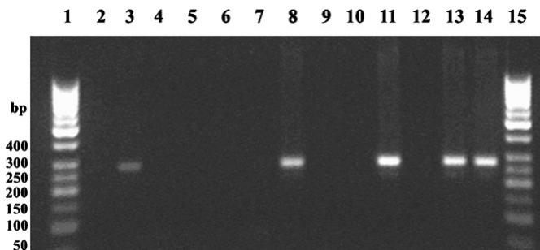
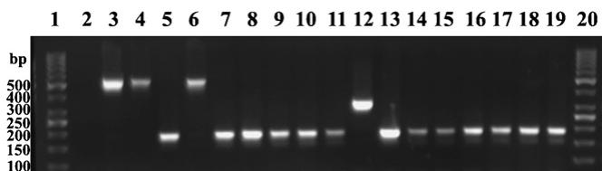

# Diversity in prevalence and genospecies of Borrelia burgdorferi sensu lato in Ixodes ricinus ticks and rodents in Lithuania and Norway

Algimantas Paulauskasa,-, Daiva Ambrasienea , Jana Radzijevskajaa , Olav Rosefb , Jurga Turcinavicienec

a Department of Biology, Vytautas Magnus University, Vileikos str. 8, Kaunas LT-44404, Lithuania b Telemark University College, Bø i Telemark, Norway c Vilnius University, Lithuania

Accepted 1 April 2008

# Abstract

A total of 1679 questing Ixodes ricinus ticks collected in Lithuania and $5 3 5 I .$ ricinus ticks collected in Norway from locations with different habitats were investigated for the presence of Borrelia burgdorferi sensu lato. In Lithuania, 223 ticks $( 1 3 . 3 \% )$ were infected with B. burgdorferi s.l., and in Norway, 28 ticks $( 5 . 2 \% )$ . The highest prevalence of B. burgdorferi s.l was found in deciduous and mixed forests ( $1 9 . 4 \%$ in Lithuania, $8 . 6 \%$ in Norway). A lower prevalence was determined in pine forests $8 . 6 \%$ in Lithuania) and costal zones $4 . 3 \%$ in Norway), and the least prevalence was found in grasslands $2 . 5 \%$ in Lithuania, $1 \%$ in Norway). A total of 398 rodents belonging to 9 species were livecaptured in Lithuania and Norway. Prevalence of B. burgdorferi s.l. in rodents varied between species and sampling sites in both countries. In Lithuania, the prevalence of infection was higher in Microtus arvalis (range $2 5 \mathrm { - } 5 7 \%$ in different sampling sites) and in Myodes glareolus (range $1 4 - 7 1 \%$ ) than in Apodemus flavicollis (range $0 - 3 7 \%$ ) and in A. agrarius (range $1 1 - 3 3 \%$ ). In Norway, the prevalence of B. burgdorferi s.l. in rodents was lower (range from $5 \%$ in A. sylvaticus to $6 \%$ in A. flavicollis). B. afzelii was the predominant genospecies in ticks and rodents in Lithuania and Norway. In Lithuania, B. afzelii was found in $7 6 \%$ , B. garinii in $1 0 \%$ , B. burgdorferi sensu stricto in $7 \%$ , and Borrelia spp. in $6 \%$ of infected ticks. Double infections were observed in $1 \%$ of the infected ticks. In Norway, B. afzelii was found in $6 8 \%$ , B. garinii in $21 \%$ , and B. burgdorferi s.s. in $1 1 \%$ of infected ticks. All infected rodents from both countries hosted B. afzelii genospecies. Only the red squirrel (Sciurus vulgaris) harbored both B. afzelii and B. burgdorferi s.s.

$©$ 2008 Elsevier GmbH. All rights reserved.

Keywords: Borrelia burgdorferi; Ixodes ricinus; Ticks; Rodents; Genospecies; Diversity

# Introduction

The northward expansion and increased density of Ixodes ricinus tick populations in Fennoscandia and the

increasing incidence of tick-borne diseases like Lyme borreliosis could be related to climate change and warmer winter temperatures (Lindgren et al., 2000; Gray, 2002; Su¨ ss and Schrader, 2004). Such a temperature rise could boost tick density and distribution, host supply for immature ticks in autumn and winter as well as the overwintering success of reservoir hosts.

Lyme borreliosis is the most common tick-borne disease in Europe and North America. It is a complex multisystem disorder caused by a group of genetically diverse spirochetes, Borrelia burgdorferi sensu lato. Nowadays, 12 species of the B. burgdorferi s.l. complex were identified (Parola and Raoult, 2001; Richter et al., 2004; Derdakova and Lencakova, 2005; Rauter and Hartung, 2005). Genospecies commonly associated with human infection and disease include B. burgdorferi sensu stricto (distributed mostly in North America), B. afzelii (distributed in western Europe, Central Europe, and Russia), and B. garinii (distributed in Europe, Russia, and northern Asia). In some areas, different genospecies seem to be preferentially associated with different reservoir hosts, particularly B. afzelii with Apodemus mice and Myodes (formerly Clethrionomys) voles, B. burgdorferi s.s. and B. afzelii with red squirrels (Sciurus vulgaris), and B. garinii and B. valaisiana with some birds (Humair and Gern, 2000).

Cases of Lyme borreliosis have been recorded in Lithuania since 1987 (Zˇ ygutiene˙, 2000), and a total of 11,115 cases were reported during 1999–2005. In Norway, cases of Lyme borreliosis were notified sporadically from 1983, under the category ‘other infectious diseases’(Nygard et al., 2005( ). Since 1991, it has been a specified notifiable disease. About 1195 cases of Lyme borreliosis were reported from Norway during 1999–2005. The annual numbers of cases in both countries showed no clear trend over the period, but varied each year between 766 (20.7 per 100,000 inhabitants) and 3688 (105.6 per 100,000 inhabitants) in Lithuania and between 111 (2.4 per 100,000 inhabitants) and 280 (6.2 per 100,000 inhabitants) cases in Norway (Nygard et al., 2005 ( ; Smith et al., 2006).

The distribution of B. burgdorferi s.l is determined by the distribution of its primary vector I. ricinus, and environmental factors may limit or increase tick population densities and correspondingly the number of infected ticks (Ostfeld et al., 2006). This ixodid tick is relatively sensitive to desiccation and is common in woodlands and grasslands with each species having its own particular optimal environmental conditions and habitats that determine the geographic distribution of the ticks. As shown by some studies, the greatest tick infection prevalence occurred in deciduous woodlands harboring a diverse mix of host species (Gray, 1998). Genetic diversity of vector ticks from different regions may influence genetic diversity of Borrelia and the epidemiology of tick-borne diseases (Paulauskas et al., 2006).

I. ricinus, the main vector of B. burgdorferi s.l., is common and widespread in Lithuania and in a narrow zone along the coastal area of Norway. Although recent studies in Europe have demonstrated a central role of small rodents, especially Apodemus mice and Myodes voles, in the epidemiology of Lyme borreliosis (Humair et al., 1999; Kurtenbach et al., 2002; Hanincova´ et al.,

2003; Pawełczyk et al., 2004; Sin´ ski et al., 2006), their role as reservoirs of B. burgdorferi s.l. in Lithuania and Norway has not been investigated till now.

Information on the B. burgdorferi s.l. distribution in the environment and knowledge about pathogen–vector–reservoir interactions are essential to our understanding of the epidemiology and prevention of Lyme borreliosis. The purpose of the present study was to determine the prevalence of B. burgdorferi s.l. – specifically that of B. afzelii, B. garinii, and B. burgdorferi s.s. – in populations of I. ricinus and rodents collected in different habitats in Lithuania and Norway.

# Materials and methods

# Tick collection

During the spring–summer of 2003–2006, unfed I. ricinus ticks were collected by flagging undergrowth with $1 \mathrm m ^ { 2 }$ white towel in different habitats (grassland, pine forest, deciduous and mixed forest, coastal zone): 1679 ticks (151 nymphs, 851 females, 677 males) in 18 locations of Lithuania and 535 ticks (67 larvae, 288 nymphs, 124 females, 56 males) in 9 locations of Norway (Tables 1 and 2). The ticks were preserved in $70 \%$ ethanol solution until analysis.

# Rodent collection

A total of 398 small rodents were live-trapped with locally constructed wooden traps (permission to trap wild small mammals provided according to regulation No. 586 (2002-11-11) of Ministry of the Environment of the Republic of Lithuania) in deciduous and mixed forest and ecotonal areas during 2005–2006. In Lithuania, 248 rodents belonging to 8 species (Table 3) were collected in 7 sampling sites located in Kaunas $( 5 4 ^ { \circ } 8 7 ^ { \prime }$ N, $2 3 ^ { \circ } 9 0 ^ { \prime }$ E), Dusetos $3 5 ^ { \circ } 7 5 ^ { \prime }$ N, $2 5 ^ { \circ } 8 7 ^ { \prime }$ E), Birzai $5 6 ^ { \circ } 2 7 ^ { \prime } \mathrm { ~ N ~ }$ , $2 4 ^ { \circ } 9 9 ^ { \prime }$ E), and in the coastal area of the Curonian Lagoon: Kintai $\langle 5 5 ^ { \circ } 4 2 ^ { \prime } \mathrm { ~ N ~ }$ , $2 1 ^ { \circ } 2 6 ^ { \prime }$ E), Bloziai $( 5 5 ^ { \circ } 3 8 ^ { \prime } \mathrm { ~ N ~ }$ , $2 1 ^ { \circ } 2 6 ^ { \prime }$ E), Muize $\langle 5 5 ^ { \circ } 3 9 ^ { \prime } \mathrm { ~ N ~ }$ , $2 1 ^ { \circ } 2 4 ^ { \prime }$ E); Vente $5 5 ^ { \circ } 3 4 ^ { \prime }$ N, $2 1 ^ { \circ } 2 0 ^ { \prime }$ E). The 150 rodents trapped in 6 locations in Norway belonged to 5 species (Table 3). Two rodent sampling sites were located in a coastal zone of western Norway: Stranda $( 6 2 ^ { \circ } 0 3 ^ { \prime } \mathrm { ~ N ~ }$ , $0 6 ^ { \circ } 5 6 ^ { \prime } \mathrm { ~ E ~ }$ ) and Svanoya $( 6 1 ^ { \circ } 2 8 ^ { \prime } \mathrm { ~ N ~ }$ , $0 5 ^ { \circ } 0 5 ^ { \prime }$ E). Three sampling sites were situated in southern Norway: Hinnebu $( 5 8 ^ { \circ } 3 5 ^ { \prime } \mathrm { ~ N ~ }$ , $0 8 ^ { \circ } 2 8 ^ { \prime }$ E) in a continental area, Tjore $( 5 8 ^ { \circ } 1 9 ^ { \prime } \mathrm { ~ N ~ }$ , $0 8 ^ { \circ } 3 1 ^ { \prime } \mathrm { ~ E ~ }$ ), and Jomfruland $5 8 ^ { \circ } 5 2 ^ { \prime } \mathrm { ~ N ~ }$ , $0 9 ^ { \circ } 3 6 ^ { \prime }$ E) in a coastal area. Lista ${ 5 8 ^ { \circ } 0 7 ^ { \prime } } \mathrm { ~ N } ,$ , $0 6 ^ { \circ } 4 0 ^ { \prime } \mathrm { ~ E ~ }$ ) was situated in the south-eastern part of Norway.

Ear tissue samples were taken from each rodent, placed into $1 . 5 \mathrm { m l }$ coded tubes with $70 \%$ ethanol solution, and stored at $4 ^ { \circ } \mathrm { C }$ until being processed.

Table 1. Borrelia burgdorferi s.l. prevalence in questing Ixodes ricinus ticks in different habitats in Lithuania   

<table><tr><td rowspan="3">Location</td><td colspan="3">Females</td><td colspan="3">Males</td><td colspan="3">Nymphs</td><td colspan="3">Total</td></tr><tr><td>N</td><td colspan="2">Prevalence</td><td>N</td><td colspan="2">Prevalence</td><td>N</td><td colspan="2">Prevalence</td><td>N</td><td colspan="2">Prevalence</td></tr><tr><td></td><td>n</td><td>%</td><td></td><td>n</td><td>%</td><td></td><td>n</td><td>%</td><td></td><td>n</td><td>%</td></tr><tr><td>Type I: grassland</td><td>103</td><td>4</td><td>4</td><td>113</td><td>2</td><td>2</td><td>24</td><td>0</td><td>0</td><td>240</td><td>6</td><td>2.5</td></tr><tr><td>Klaipèda (55°69&#x27;N, 21°18&#x27;E)</td><td>19</td><td>1</td><td>5</td><td>21</td><td>0</td><td>0</td><td>11</td><td>0</td><td>0</td><td>51</td><td>1</td><td>2</td></tr><tr><td>Kretinga (55°43&#x27;N, 21°08&#x27;E)</td><td>20</td><td>1</td><td>5</td><td>17</td><td>0</td><td>0</td><td>4</td><td>0</td><td>0</td><td>41</td><td>1</td><td>2</td></tr><tr><td>Panevëžys (55°73&#x27;N, 24°42&#x27;E)</td><td>20</td><td>0</td><td>0</td><td>30</td><td>2</td><td>7</td><td>0</td><td>0</td><td>0</td><td>50</td><td>2</td><td>4</td></tr><tr><td>Ukmerge (55°26&#x27;N, 24°77&#x27;E)</td><td>44</td><td>2</td><td>5</td><td>45</td><td>0</td><td>0</td><td>9</td><td>0</td><td>0</td><td>98</td><td>2</td><td>2</td></tr><tr><td>Type II: pine forest</td><td>336</td><td>36</td><td>10.7</td><td>212</td><td>12</td><td>5.7</td><td>24</td><td>1</td><td>4</td><td>572</td><td>49</td><td>8.6</td></tr><tr><td>Ignalina (55°53&#x27;N, 25°97&#x27;E)</td><td>93</td><td>10</td><td>11</td><td>44</td><td>3</td><td>7</td><td>1</td><td>0</td><td>0</td><td>138</td><td>13</td><td>9</td></tr><tr><td>Varèna (54°18&#x27;N, 24°55&#x27;E)</td><td>16</td><td>1</td><td>6</td><td>18</td><td>0</td><td>0</td><td>3</td><td>1</td><td>33</td><td>37</td><td>2</td><td>5</td></tr><tr><td>Vilnius (54°50&#x27;N, 25°30&#x27;E)</td><td>227</td><td>25</td><td>11</td><td>150</td><td>9</td><td>6</td><td>20</td><td>0</td><td>0</td><td>397</td><td>34</td><td>8.6</td></tr><tr><td>Type III: deciduous and mixed forest</td><td>412</td><td>82</td><td>19.9</td><td>352</td><td>72</td><td>20.5</td><td>103</td><td>14</td><td>14</td><td>867</td><td>168</td><td>19.4</td></tr><tr><td>Biržai (56°15&#x27;N, 25°55&#x27;E)</td><td>97</td><td>18</td><td>19</td><td>66</td><td>14</td><td>21</td><td>6</td><td>0</td><td>0</td><td>169</td><td>32</td><td>19</td></tr><tr><td>Joniškis (56°27&#x27;N, 23°62&#x27;E)</td><td>24</td><td>4</td><td>17</td><td>18</td><td>1</td><td>6</td><td>3</td><td>0</td><td>0</td><td>45</td><td>5</td><td>11</td></tr><tr><td>Kaunas (54°87&#x27;N, 23°97&#x27;E)</td><td>38</td><td>9</td><td>24</td><td>39</td><td>6</td><td>15</td><td>42</td><td>0</td><td>0</td><td>119</td><td>15</td><td>13</td></tr><tr><td>Kelmé (55°64&#x27;N, 22°98&#x27;E)</td><td>28</td><td>1</td><td>4</td><td>36</td><td>11</td><td>31</td><td>5</td><td>0</td><td>0</td><td>69</td><td>12</td><td>17</td></tr><tr><td>Marijampolé (54°60&#x27;N, 23°30&#x27;E)</td><td>17</td><td>4</td><td>24</td><td>24</td><td>5</td><td>21</td><td>19</td><td>6</td><td>32</td><td>60</td><td>15</td><td>25</td></tr><tr><td>Mažeikiai (56°44&#x27;N, 22°41&#x27;E)</td><td>16</td><td>1</td><td>6</td><td>15</td><td>3</td><td>20</td><td>0</td><td>0</td><td>0</td><td>31</td><td>4</td><td>13</td></tr><tr><td>Prienai (54°60&#x27;N, 23°89&#x27;E)</td><td>27</td><td>6</td><td>22</td><td>21</td><td>1</td><td>5</td><td>14</td><td>2</td><td>14</td><td>62</td><td>9</td><td>15</td></tr><tr><td>Radvilškis (55°85&#x27;N, 23°37&#x27;E)</td><td>54</td><td>13</td><td>24</td><td>35</td><td>13</td><td>37</td><td>0</td><td>0</td><td>0</td><td>89</td><td>26</td><td>29</td></tr><tr><td>Šiauliai (56°00&#x27;N, 23°24&#x27;E)</td><td>53</td><td>10</td><td>19</td><td>54</td><td>6</td><td>11</td><td>14</td><td>6</td><td>43</td><td>121</td><td>22</td><td>18</td></tr><tr><td>Šiluté (55°33&#x27;N, 21°46&#x27;E)</td><td>18</td><td>6</td><td>33</td><td>3</td><td>0</td><td>0</td><td>0</td><td>0</td><td>0</td><td>21</td><td>6</td><td>29</td></tr><tr><td>Utena (55°52&#x27;N, 25°58&#x27;E)</td><td>40</td><td>10</td><td>25</td><td>41</td><td>12</td><td>29</td><td>0</td><td>0</td><td>0</td><td>81</td><td>22</td><td>27</td></tr><tr><td>Total</td><td>851</td><td>122</td><td>14.3</td><td>677</td><td>86</td><td>12.7</td><td>151</td><td>15</td><td>10</td><td>1679</td><td>223</td><td>13.3</td></tr></table>

N: number of tested ticks; $n$ : number of infected ticks.

Table 2. Borrelia burgdorferi s.l. prevalence in questing Ixodes ricinus ticks in different habitats in Norway   

<table><tr><td rowspan="3">Locations</td><td colspan="2">Females</td><td colspan="2">Males</td><td colspan="2">Nymphs</td><td colspan="2">Larvae</td><td colspan="2">Total</td></tr><tr><td>N</td><td>Prevalence</td><td>N</td><td>Prevalence</td><td>N</td><td>Prevalence</td><td>N</td><td>Prevalence</td><td>N</td><td>Prevalence</td></tr><tr><td></td><td>n</td><td>%</td><td>n</td><td>%</td><td>n</td><td>%</td><td>n</td><td>%</td><td>n</td></tr><tr><td>Type I: grassland</td><td>53</td><td>0</td><td>0</td><td>13</td><td>0</td><td>0</td><td>3</td><td>0</td><td>23</td><td>1</td></tr><tr><td>Kjosvik (59°19&#x27;N, 09°16&#x27;E)</td><td>7</td><td>0</td><td>0</td><td>10</td><td>0</td><td>0</td><td>0</td><td>0</td><td>0</td><td>17</td></tr><tr><td>Eiken (61°4&#x27;N, 05°40&#x27;E)</td><td>46</td><td>0</td><td>0</td><td>8</td><td>0</td><td>0</td><td>3</td><td>0</td><td>23</td><td>1</td></tr><tr><td>Type III: deciduous and mixed forest</td><td>57</td><td>6</td><td>11</td><td>25</td><td>2</td><td>8</td><td>97</td><td>8</td><td>7</td><td>0</td></tr><tr><td>Tjore (58°19&#x27;N, 08°31&#x27;E)</td><td>10</td><td>0</td><td>0</td><td>7</td><td>1</td><td>14</td><td>2</td><td>0</td><td>0</td><td>19</td></tr><tr><td>Hitra (63°33&#x27;N, 08°45&#x27;E)</td><td>2</td><td>0</td><td>0</td><td>1</td><td>0</td><td>0</td><td>44</td><td>2</td><td>5</td><td>52</td></tr><tr><td>Hinnebu (58°35&#x27;N, 08°28&#x27;E)</td><td>30</td><td>4</td><td>13</td><td>9</td><td>0</td><td>0</td><td>1</td><td>0</td><td>0</td><td>40</td></tr><tr><td>Svanoya (61°28&#x27;N, 05°05&#x27;E)</td><td>10</td><td>0</td><td>0</td><td>4</td><td>0</td><td>0</td><td>46</td><td>5</td><td>11</td><td>60</td></tr><tr><td>Bakke (60°15&#x27;N, 06°1&#x27;E)</td><td>5</td><td>2</td><td>40</td><td>4</td><td>1</td><td>25</td><td>4</td><td>1</td><td>25</td><td>15</td></tr><tr><td>Type IV: coastal zone</td><td>14</td><td>1</td><td>7</td><td>18</td><td>2</td><td>11</td><td>188</td><td>8</td><td>4</td><td>257</td></tr><tr><td>Odderoya (58°08&#x27;N, 08°01&#x27;E)</td><td>6</td><td>1</td><td>17</td><td>10</td><td>2</td><td>20</td><td>113</td><td>3</td><td>3</td><td>129</td></tr><tr><td>Jomfruland (58°52&#x27;N, 09°36&#x27;E)</td><td>8</td><td>0</td><td>0</td><td>8</td><td>0</td><td>0</td><td>75</td><td>5</td><td>7</td><td>128</td></tr><tr><td>Total</td><td>124</td><td>7</td><td>6</td><td>56</td><td>4</td><td>7</td><td>288</td><td>16</td><td>5.6</td><td>535</td></tr></table>

N: number of tested ticks; n: number of infected ticks.

# DNA extraction

A modified procedure with the ammonium hydroxide solution $( 2 . 5 \% )$ (Stan´ czak et al., 1999; Ambrasiene˙ et al.,

2004) was used for genomic DNA extraction from ticks. From rodent ear samples, DNA was extracted using the Genomic DNA purification Kit KO512 (MBI Fermentas, Lithuania) according to the manufacturer’s protocol.

Table 3. Prevalence of Borrelia burgdorferi s.l. in different rodent species in Lithuania and Norway   

<table><tr><td rowspan="2">Collection area</td><td rowspan="2">Rodent species</td><td colspan="3">2005</td><td colspan="3">2006</td><td colspan="3">Total</td></tr><tr><td>No. examined</td><td>No. positive</td><td>Prevalence (%)</td><td>No. examined</td><td>No. positive</td><td>Prevalence (%)</td><td>No. examined</td><td>No. positive</td><td>Prevalence (%)</td></tr><tr><td rowspan="8">Lithuania</td><td>My. glareolus</td><td>20</td><td>5</td><td>25</td><td>37</td><td>7</td><td>19</td><td>57</td><td>12</td><td>21</td></tr><tr><td>Ap. flavicollis</td><td>22</td><td>8</td><td>36</td><td>63</td><td>1</td><td>2</td><td>85</td><td>9</td><td>11</td></tr><tr><td>Ap. agrarius</td><td>18</td><td>2</td><td>11</td><td>12</td><td>0</td><td>0</td><td>30</td><td>2</td><td>7</td></tr><tr><td>Ap. sylvaticus</td><td>1</td><td>0</td><td>0</td><td>0</td><td>0</td><td>0</td><td>1</td><td>0</td><td>0</td></tr><tr><td>Mi. arvalis</td><td>14</td><td>8</td><td>57</td><td>41</td><td>21</td><td>51</td><td>55</td><td>29</td><td>53</td></tr><tr><td>Mi. agrestis</td><td>9</td><td>4</td><td>44</td><td>9</td><td>0</td><td>0</td><td>18</td><td>4</td><td>22</td></tr><tr><td>Mus musculus</td><td>1</td><td>1</td><td></td><td>0</td><td>0</td><td>0</td><td>1</td><td>1</td><td></td></tr><tr><td>Rattus norvegicus</td><td>1</td><td>1</td><td></td><td>0</td><td>0</td><td>0</td><td>1</td><td>0</td><td>0</td></tr><tr><td rowspan="5">Norway</td><td>My. glareolus</td><td>6</td><td>0</td><td>0</td><td>0</td><td>0</td><td>0</td><td>6</td><td>0</td><td>0</td></tr><tr><td>Ap. sylvaticus</td><td>41</td><td>2</td><td>5</td><td>0</td><td>0</td><td>0</td><td>41</td><td>2</td><td>5</td></tr><tr><td>Ap. flavicollis</td><td>1</td><td>0</td><td>0</td><td>100</td><td>6</td><td>6</td><td>101</td><td>6</td><td>6</td></tr><tr><td>Mi. agrestis</td><td>1</td><td>1</td><td></td><td>0</td><td>0</td><td>0</td><td>1</td><td>1</td><td></td></tr><tr><td>Sciurus vulgaris</td><td>1</td><td>1</td><td></td><td>0</td><td>0</td><td>0</td><td>1</td><td>1</td><td></td></tr></table>

My: Myodes; Ap: Apodemus; Mi: Microtus.

# Detection of Borrelia burgdorferi s.l.

The prevalence of B. burgdorferi s.l. infection in ticks and rodent samples was determined by polymerase chain reaction. PCR was performed according to Stan´ czak et al. (1999), using the oligonucleotide primers FL6 ( $5 ^ { \prime }$ -TTCAGGGTCTCAAGCGTCTTGGACT-30 ) and FL7 ( $5 ^ { \prime }$ -GCATTTTCAATTTTAGCAAGT-GATG-30 ) according to sequences of conserved regions of the fla gene of B. burgdorferi s.l. PCR products were resolved by $1 . 5 \%$ agarose gel electrophoresis with addition of ethidium bromide and visualized under UV light (EASY Win32, Herolab, Germany). The achieved specific amplification products of 276 base pairs (bp) were considered as a positive result (Fig. 1).

# Detection of Borrelia burgdorferi s.l. genospecies

A total of 190 tick lysates containing B. burgdorferi s.l. DNA (according to PCR data) were examined for the presence of 3 human pathogenic genospecies: B. afzelii, B. garinii, and B. burgdorferi s.s. The ospA gene located on the linear 49-kb plasmid was used as target in Multiplex PCR performed according to Demaerschalck et al. (1995). The following genospecies-specific primers were used in the PCR: for B. burgdorferi s.s. GI-L/GI-R ( $5 ^ { \prime }$ -AACAAAGACGGCAAGTACGATCTAATT- $3 ^ { \prime } /$ ${ 5 } ^ { \prime }$ -TTACAGTAATTGTTAAAGTTGAAGTGCC-30 ),

  
Fig. 1. PCR amplification of the fla gene of Borrelia burgdorferi s.l. from Ixodes ricinus lysates. Lanes 1 and 15: 50-bp marker; lane 2: negative control; lanes 3, 8, 11, 13: positive tick samples (276-bp fragment); lanes 4–7, 9, 10, 12: negative tick samples; lane 14: positive control of $B .$ . burgdorferi s.l.

for B. garinii (GII-L/GII-R $5 ^ { \prime }$ -TGATAAAAA-CAACGGTTCTGGAAC- $3 ^ { \prime } / 5 ^ { \prime }$ -GTAACTTTCAATG-TTGTTTTGCCG-30 ), and for B. afzelii GIII-L/ GIII-R $5 ^ { \prime }$ -TAAAGACAAAACATCAACAGATGA-AATG- $3 ^ { \prime } / 5 ^ { \prime }$ -TTCCAATGTTACTTTATCATTAGCT-ACTT-30 ).

PCR amplification products were resolved onto $2 . 0 \%$ agarose gel electrophoresis and visualized under UV light. The specific products of 544 bp (B. burgdorferi s.s), 345 bp (B. garinii), and 189 bp (B. afzelii) were considered to represent positive results.

# Results and discussion

# Prevalence of Borrelia burgdorferi s.l. in ticks

According to PCR analysis, $1 3 . 3 \%$ (223 out of 1679) of I. ricinus ticks collected in Lithuania and $5 . 2 \%$ (28 out of 535) of I. ricinus ticks collected in Norway were infected with B. burgdorferi s.l. (Tables 1 and 2; Fig. 1).

Our data (Tables 1 and 2) showed that both questing nymphs and adults ticks were infected. In Lithuania, the overall infection rate in nymphs $10 \%$ , 15 out of 151) was lower than that in adult ticks $( 1 3 . 6 \%$ , 208 out of 1528). In Norway, the difference between overall infection rates of nymphs and adults was negligible – $6 . 1 \%$ (11 out of 180) in adult and $5 . 6 \%$ (16 out of 288) in nymphal ticks. In addition, $1 . 5 \%$ (1 out of 67) of the questing I. ricinus larvae collected in Norway were found infected with B. burgdorferi s.l. The prevalence of infection in nymphs and adults is highly variable in Europe (Rauter and Hartung, 2005). Adults generally showed a higher rate of infection, presumably because they had the possibility to become infected during larval and nymphal feeding.

The prevalence of B. burgdorferi s.l. in ticks varied locally in both countries: from $1 . 6 \%$ to $2 9 . 2 \%$ and from $0 \%$ to $2 6 . 7 \%$ in different locations of Lithuania and Norway, respectively (Tables 1 and 2), but no correlation between the prevalence of infection and the geographical area was found. It was important to take into account the distribution of vegetation, especially landscapes with southern-taiga dark coniferous forests or secondary forests replacing them and open nemoral broadleaved-mixed forests. The data were arranged into 4 groups according to habitat type: I – grassland; II – pine forest; III – deciduous and mixed forest, and IV – coastal zone (Tables 1 and 2). Our results show that the prevalence of B. burgdorferi s.l. in ticks is related to the habitat type. Differences in the prevalence of B. burgdorferi s.l. among habitat types were significant $( p \leqslant 0 . 0 0 2 )$ . The highest prevalence of B. burgdorferi s.l was found for deciduous and mixed forests $1 9 . 4 \%$ , 168 out of 867, in Lithuania and $8 . 6 \%$ , 16 out of 186, in Norway). A lower prevalence $8 . 6 \%$ , 49 out of 572) was determined for pine forests in Lithuania and for the coastal zone in Norway $( 4 . 3 \%$ , 11 out of 257), and very small amounts of infected ticks $( 2 . 5 \%$ , 6 out of 240, in Lithuania and $1 \%$ , 1 out of 92 in Norway) were found in grassland (Tables 1 and 2).

The data in our study confirm that suitable habitats for I. ricinus corresponded to areas with a higher prevalence of B. burgdorferi s.l. I. ricinus ticks are sensitive to desiccation and require a relative humidity of at least $80 \%$ throughout the year, so that they are confined to areas where a good cover of vegetation is present (Parola and Raoult, 2001). According to previous studies conducted in Europe, differences in

vegetation can influence tick abundance and the circulation of pathogens (Wang et al., 1999; Rauter and Hartung, 2005). Because ticks acquire spirochetes from a wide variety of mammals and birds, the abundance of reservoir hosts is also an important factor for the maintenance of B. burgdorferi in tick populations. Thus, the high prevalence of B. burgdorferi s.l. infection in ticks found in deciduous and mixed forests could be associated with suitable environmental conditions and with a generally high abundance of various host species for ticks. In addition, in deciduous and mixed forest, the most frequently captured rodent species are A. flavicollis and My. glareolus – both reservoir hosts of B. burgdorferi s.l. (Gray, 1998; Sin´ ski et al., 2006). Lower prevalences of infection were determined in pine forest with less humidity, only minimal amounts of leaf litter and a lower diversity and abundance of hosts.

# Borrelia burgdorferi s.l. genospecies in Ixodes ricinus ticks

Multiplex PCR analysis indicated that B. burgdorferi s.s., B. garinii, and B. afzelii were present in ticks collected in Lithuania and Norway (Fig. 2, Table 4). B. afzelii has been found as the dominant genospecies in I. ricinus collected in Lithuania and Norway.

In Lithuania, among the 190 infected ticks samples, $7 6 \%$ (143) contained DNA from B. afzelii, $1 0 \%$ (19) contained DNA from B. garinii, and $7 \%$ (14) contained DNA from B. burgdorferi s.s. Double infections were observed in $1 \%$ (2) of ticks (B. afzelii+B. burgdorferi s.s. and B. afzelii $+ B .$ . garinii). In other 12 samples $( 6 \% )$ of infected ticks, Borrelia infection was not identified to the genospecies level by using the taken primers. In Norway, among the 28 infected ticks samples, B. afzelii was found in $6 8 \%$ (19), B. garinii in $21 \%$ (6), and B. burgdorferi s.s. in $1 1 \%$ (3).

Diversity of B. burgdorferi s.l. genospecies in ticks varied in different habitats (Table 4). In grassland, only B. afzelii genospecies occurred. In pine forests, infected

  
Fig. 2. Identification of Borrelia burgdorferi s.s., B. garinii, and B. afzelii in $2 \%$ agarose gel after PCR amplification of the ospA gene of B. burgdorferi s.l. Lanes 1 and 20: 50-bp marker; lane 2: negative control; lane 3: positive control (544 bp); lanes 4 and 6: The presence of DNA bands indicates samples infected with B. burgdorferi s.s. (544 bp); lanes 5 and 7–11, 13–18: infected with B. afzelii (189 bp); lane 12: sample infected with B. garinii (345 bp); lane 19: positive control (189 bp).

Table 4. Prevalence and distribution of Borrelia genospecies in questing Ixodes ricinus ticks in different habitats in Lithuania and Norway   

<table><tr><td rowspan="2">Habitat</td><td colspan="6">Lithuania</td><td colspan="4">Norway</td></tr><tr><td>N</td><td>B. afzelii n/ %</td><td>B. garinii n/ %</td><td>Bb-ss n/ %</td><td>Mix n/ %</td><td>Non-typed n/%</td><td>N</td><td>B. afzelii n/ %</td><td>B. garinii n/ %</td><td>Bb-ss n/ %</td></tr><tr><td>Type I: grassland</td><td>3</td><td>3/100</td><td>0</td><td>0</td><td>0</td><td>0</td><td>1</td><td>1/100</td><td>0</td><td>0</td></tr><tr><td>Type II: pine forest</td><td>31</td><td>22/71</td><td>6/19</td><td>3/10</td><td>0</td><td>0</td><td>-</td><td>-</td><td>-</td><td>-</td></tr><tr><td>Type III: deciduous and mixed forest</td><td>156</td><td>118/76</td><td>13/8</td><td>11/7</td><td>2/1</td><td>12/8</td><td>16</td><td>10/63</td><td>6/37</td><td>0</td></tr><tr><td>Type IV: coastal zone</td><td>-</td><td>-</td><td>-</td><td>-</td><td>-</td><td>-</td><td>11</td><td>8/73</td><td>0</td><td>3/27</td></tr><tr><td>Total</td><td>190</td><td>143/75</td><td>19/10</td><td>14/7</td><td>2/1</td><td>12/6</td><td>28</td><td>19/68</td><td>6/21</td><td>3/11</td></tr></table>

N: number of tested ticks; $n$ : number of ticks infected with a particular genospecies; $\%$ : percentage of infected ticks in a particular habitat; Bb-ss: Borrelia burgdorferi s.s.

ticks harbored 3 B. burgdorferi s.l. genospecies: $71 \%$ B. afzelii, $1 9 \%$ B. garinii, and $1 0 \%$ B. burgdorferi s.s. Among the infected ticks collected in deciduous and mixed forests in Lithuania, $7 6 \%$ were infected with B. afzelii, $8 \%$ with B. garinii, $7 \%$ with B. burgdorferi s.s., $1 \%$ of the ticks was double infected, and $8 \%$ harbored another B. burgdorferi s.l. genospecies. In Norway, infected ticks collected in deciduous and mixed forests harbored B. afzelii $( 6 3 \% )$ and $B .$ garinii $( 3 7 \% )$ . In the coastal zones, the collected ticks were infected with B. burgdorferi s.s $( 7 3 \% )$ and $B .$ . afzelii $( 2 7 \% )$ .

# Prevalence of Borrelia in rodents

A total of 68 of 398 $( 1 7 . 1 \% )$ rodent ear samples, screened by PCR amplification of the fla gene, were found positive for $B .$ . burgdorferi s.l. infection. The overall prevalence of B. burgdorferi s.l. in rodents from Lithuania was $2 3 . 4 \%$ (58 out of 248). Among rodents collected in Norway, only $6 . 7 \%$ (10 out of 150) harbored B. burgdorferi s.l. infection.

In rodent samples from Lithuania, $53 \%$ of the common voles (Microtus arvalis), $22 \%$ of the field voles (Mi. agrestis), $21 \%$ of the bank voles (My. glareolus), $1 1 \%$ of the yellow-necked mice (Apodemus flavicollis), and $7 \%$ of the striped field mice (A. agrarius) were infected (Table 3). The prevalence of infection varied between sampling sites: Mi. arvalis $3 3 - 5 4 \%$ , My. glareolus $0 { - } 7 1 \%$ , A. flavicollis $0 { - } 5 0 \%$ , and A. agrarius $0 { - } 2 0 \%$ . In Norway, the prevalence of infection was in A. flavicollis $6 \%$ and in A. sylvaticus $5 \%$ . One captured field vole and one red squirrel were also infected, but none of the 6 captured bank voles was infected with B. burgdorferi s.l.

According to Multiplex PCR analysis, all infected rodents from both countries hosted B. afzelii. Only the red squirrel harbored both B. afzelii and B. burgdorferi s.s.

The highest prevalence of B. burgdorferi s.l. infection was detected in voles collected in Lithuania (Mi. arvalis, Mi. agrestis, and $M y$ . glareolus). Infected Mi. arvalis were detected in all 4 sampling places where the species was captured. Infected My. glareolus were detected in 5 of 6 sampling location. The infection prevalences in voles and mice in Lithuania contrast with data obtained in neighboring Poland and Slovakia (Hanincova´ et al., 2003; Pawełczyk et al., 2004; Sin´ ski et al., 2006). According to recent studies in Poland (Pawełczyk et al., 2004; Sin´ ski et al., 2006), the prevalence of B. burgdorferi s.l. infection in A. flavicollis and $M y$ . glareolus was rather low, $4 . 3 { - } 4 . 5 \%$ and $1 . 2 \mathrm { - } 2 . 5 \%$ , respectively. But the infection rate of A. flavicollis was similar to that obtained in our study in Norway $( 5 . 9 \% )$ The infection rate of My. glareolus $( 2 1 \% )$ in Lithuania is similar to that obtained in a former study conducted in Switzerland, $2 7 . 7 \%$ (Humair et al., 1999). In western Slovakia (Hanincova´ et al., 2003), different from our investigation, a higher proportion of mice than voles was infected with B. burgdorferi s.l. Kurtenbach et al. (1998) and Gray et al. (1999) reported about only a limited participation of small rodents in the circulation of B. burgdorferi s.l. for sites in the UK and southwestern Ireland, respectively. According to Gray et al. (1999), low numbers of captured My. glareolus $( 1 . 5 \% )$ and A. sylvaticus $( 2 . 6 \% )$ were infected with B. burgdorferi s.l. In the study by Kurtenbach et al. (1998), most of the infected rodents carried B. garinii infections in internal organs, and only $8 . 5 \%$ of them were able to infect xenodiagnostic larvae, all with B. burgdorferi s.s.

The molecular methods used in the present study allowed to identify different Borrelia genospecies from different habitats, which is important for pathogenetic, diagnostic, and preventative implications in Lithuania and Norway. B. afzelii was found to be the predominant genospecies in I. ricinus ticks collected from various localities in Lithuania. Prevalence of this genospecies is similar in the neighboring country Latvia $6 4 . 9 \%$ after

Bormane et al., 2004) and in north-eastern Poland $( 4 7 \%$ after Stan´ czak et al., 2000), but it is different from western Germany $( 3 9 . 9 \%$ after Maetzel et al., 2005), Slovakia, and southern Poland (Lencakova et al., 2006) where B. garinii is predominant $( 4 5 . 5 \% )$ , and eastern Poland where B. burgdorferi s.s. is predominant $( 6 2 . 8 \%$ after Cisak et al., 2006). Genotyping of B. burgdorferi s.l. detected in the southern, southern-western, eastern, and north-eastern parts of Norway revealed a pattern of infection similar to that in Lithuania. Recent study conducted in two locations of southern Norway (Jenkins et al., 2001) showed a $1 6 \mathrm { - } 1 7 \%$ prevalence of B. burgdorferi s.l. in ticks. The dominant Borrelia species at both sites was B. afzelii, followed by B. burgdorferi s.s. B. garinii was found only in a single tick. According to our findings, the dominant Borrelia species in ticks in Norway was B. afzelii, followed by B. garinii and B. burgdorferi s.s.

The results obtained in our investigation on the diversity of B. burgdorferi s.l. genospecies in Lithuania and Norway are similar to those of studies conducted in other countries (Humair and Gern, 2000; Kurtenbach et al., 2002; Hanincova´ et al., 2003) in that B. afzelii is closely associated with rodents, specifically with mice and voles.

# Conclusions

The present study suggests that I. ricinus ticks in deciduous and mixed forest habitats have higher B. burgdorferi s.l. infection rates than those in other habitats. These types of habitat may be considered as areas with an increased risk of acquiring Lyme borreliosis in Lithuania and Norway.

The role of small rodents as reservoirs of B. burgdorferi s.l. in Lithuania and Norway were investigated for the first time in this study. All infected rodents from both countries harbored B. afzelii. Only a red squirrel, collected in Norway, harbored both B. afzelii and B. burgdorferi s.s. The prevalence of B. afzelii in rodents varied between species and sampling sites. In Lithuania, a high infection rate was detected in the common vole, and higher proportions of voles than mice were infected. Small rodents like Mi. arvalis, My. glareolus, and A. flavicollis may represent zoonotic reservoirs of B. afzelii in Lithuania, and A. flavicollis and A. sylvaticus in Norway.

# Acknowledgements

This work was partially supported by the Norwegian Center for International Cooperation in Higher Education (grant CCP 03/02: ENLINO Master program

network) and Lithuanian State Science and Studies Foundation.

# References

Ambrasiene˙, D., Turcˇ inavicˇ iene˙, J., Vasˇ cˇ ilo, I., Zˇ ygutiene˙, M., 2004. The prevalence of Borrelia burgdorferi in Ixodes ricinus ticks detected by PCR in Lithuania. Veterinarija ir Zootechnika 28, 45–47.   
Bormane, A., Lucenko, I., Duks, A., Mavtchoutko, V., Ranka, R., Salmina, K., Baumanis, V., 2004. Vectors of tick-borne diseases and epidemiological situation in Latviai in 1993–2002. Int. J. Med. Microbiol. 293 (Suppl. 37), 36–47.   
Cisak, E., Wo´ jcik-Fatla, A., Stojek, N., Chmielewska-Badora, J., Zwolin´ ski, J., Buczek, A., Dutkiewicz, J., 2006. Prevalence of Borrelia burgdorferi genospecies in Ixodes ricinus ticks from Lublin region. Ann. Agric. Environ. Med. 13, 301–306.   
Demaerschalck, I., Messaoud, A., Kesel, M., Hoyois, B., Lobet, Y., Hoet, P., Bigaignon, G., Bollen, A., Godfroid, E., 1995. Simultaneous presence of different Borrelia burgdorferi genospecies in biological fluids of Lyme disease patients. J. Clin. Microbiol. 33, 602–608.   
Derdakova, M., Lencakova, D., 2005. Association of genetic variability within the Borrelia burgdorferi sensu lato with the ecology, epidemiology of Lyme borreliosis in Europe. Ann. Agric. Environ. Med. 12, 165–172.   
Gray, J.S., 1998. The ecology of ticks transmitting Lyme borreliosis. Exp. Appl. Acarol. 22, 249–258.   
Gray, J.S., 2002. Biology of Ixodes species ticks in relation to tick-borne zoonoses. Wien. Klin. Wochenschr. 114, 473–478.   
Gray, J.S., Kirstein, F., Robertson, J., 1999. Borrelia burgdorferi sensu lato in Ixodes ricinus ticks and rodents in a recreational park in south-western Ireland. Exp. Appl. Acarol. 23, 717–729.   
Hanincova´ , K., Scha¨ fer, S., Etti, S., Sewell, H., Taragelova, V., Ziak, D., Labuda, M., Kurtenbach, K., 2003. Association of Borrelia afzelii with rodents in Europe. Parasitology 126, 11–20.   
Humair, P.F., Gern, L., 2000. The wild hidden face of Lyme borreliosis in Europe. Microbes Infect. 2, 915–922.   
Humair, P.F., Rais, O., Gern, L., 1999. Transmission of Borrelia afzelii from Apodemus mice and Clethrionomys voles to Ixodes ricinus ticks: differential transmission pattern and overwintering maintenance. Parasitology 118, 33–42.   
Jenkins, A., Kristiansen, B.E., Allum, A.G., Aakre, R.K., Strand, L., Kleveland, E.J., van de Pol, I., Schouls, L., 2001. Borrelia burgdorferi sensu lato and Ehrlichia spp. in Ixodes ticks from southern Norway. J. Clin. Microbiol. 39, 3666–3671.   
Kurtenbach, K., Peacey, M., Rijpkema, S., Hoodless, A., Nuttall, P., Randolph, S., 1998. Differential transmission of the genospecies of Borrelia burgdorferi sensu lato by game birds and small rodents in England. Appl. Environ. Microbiol. 64, 1169–1174.   
Kurtenbach, K., De Michelis, S., Etti, S., Scha¨ fer, S.M., Sewell, H.S., Brade, V., Kraiczy, P., 2002. Host association

of Borrelia burgdorferi sensu lato – the key role of host complement. Trends Microbiol. 10, 74–79.   
Lencakova, D., Hizo-Teufel, C., Pet’ko, B., Schulte-Spechtel, U., Stanko, M., Wilske, B., Fingerle, V., 2006. Prevalence of Borrelia burgdorferi s.l. OspA types in Ixodes ricinus ticks from selected localities in Slovakia and Poland. Int. J. Med. Microbiol. 296 (Suppl. 40), 108–118.   
Lindgren, E., Ta¨ lleklint, L., Polfeldt, T., 2000. Impact of climatic change on the northern latitude limit and population density of the disease-transmitting European tick, Ixodes ricinus. Environ. Health Perspect. 108, 119–123.   
Maetzel, D., Maier, W.A., Kampen, H., 2005. Borrelia burgdorferi infection prevalences in questing Ixodes ricinus ticks (Acari: Ixodidae) in urban and suburban Bonn, western Germany. Parasitol. Res. 95, 5–12.   
Nygard, K., Broch Brantsæter, A., Mehl, R., 2005. Dissemi-( nated and chronic Lyme borreliosis in Norway, 1995–2004. Eurosurveill. 10, 235–238.   
Ostfeld, R.S., Canham, C.D., Oggenfuss, K., Winchcombe, R.J., Keesing, F., 2006. Climate, deer, rodents, and acorns as determinants of variation in Lyme-disease risk. PLoS Biol. 4 (6), e145 Epub 2006, May 9.   
Parola, P., Raoult, D., 2001. Tick-borne bacterial diseases emerging in Europe. Clin. Microbiol. Infect. 7, 80–83.   
Paulauskas, A., Radzijevskaja, J., Rosef, O., Turcˇ inavicˇ iene˙, J., Ambrasiene˙, D., Makarevie` iu¯te˙, D., 2006. Genetic variations of ticks (Ixodes ricinus L.) in the Lithuanian and Norwegian populations. Exp. Appl. Acarol. 40, 259–270.   
Pawełczyk, A., Ogrzewalska, M., Zadrozna, I., Sin´ ski, P., 2004. The zoonotic reservoir of Borrelia burgdorferi sensu lato in the Mazury lakes district of north-eastern Poland. Int. J. Med. Microbiol. 293 (Suppl. 37), 167–171.   
Rauter, C., Hartung, T., 2005. Prevalence of Borrelia burgdorferi sensu lato genospecies in Ixodes ricinus ticks

in Europe: a meta-analysis. Appl. Environ. Microbiol. 71, 7203–7216.   
Richter, D., Schlee, D.B., Allgower, R., Matuschka, F., 2004. Relationship of a novel Lyme disease spirochete, Borrelia spielmani sp. nov., with its hosts in central Europe. Appl. Environ. Microb. 70, 6414–6419.   
Sin´ ski, E., Pawełczyk, A., Bajer, A., Behnke, J., 2006. Abundance of wild rodents, ticks and environmental risk of Lyme borreliosis: a longitudinal study in an area of mazury lakes district of Poland. Ann. Agric. Environ. Med. 13, 295–300.   
Smith, R., Takkinen, J., Editorial Team, 2006. Lyme borreliosis: Europe-wide coordinated surveillance and action needed? Eurosurveill. 11, E060622.1.   
Stan´ czak, J., Racewicz, M., Kubica-Biernat, B., Kruminis-Łozowska, W., Da˛browski, J., Adamczyk, A., Markowska, M., 1999. Prevalence of Borrelia burgdorferi sensu lato in Ixodes ricinus ticks (Acari, Ixodidae) in different Polish woodlands. Ann. Agric. Environ. Med. 6, 127–132.   
Stan´ czak, J., Kubica-Biernat, B., Racewicz, M., Kruminis-Łozowska, W., Kur, W., 2000. Detection of three genospecies of Borrelia burgdorferi sensu lato in Ixodes ricinus ticks collected from different regions of Poland. Int. J. Med. Microbiol. 290 (Suppl. 40), 559–566.   
Su¨ ss, J., Schrader, C., 2004. Tick-borne human pathogenic microorganisms found in Europe and those considered nonpathogenic. Part I: ticks and viruses. Bundesgesundheitsblatt Gesundheitsforschung Gesundheitsschutz 47, 392–404 [German].   
Wang, G., van Dam, A., Schwarz, I., Dankert, J., 1999. Molecular typing of Borrelia burgdorferi sensu lato: taxonomic, epidemiological, and clinical implications. Clin. Microbiol. Rev., 633–653.   
Zˇ ygutiene˙, M., 2000. The entomological and acarological situation in Lithuania. EpiNorth 2, 10–11.