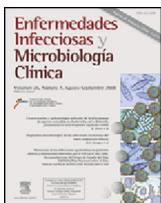
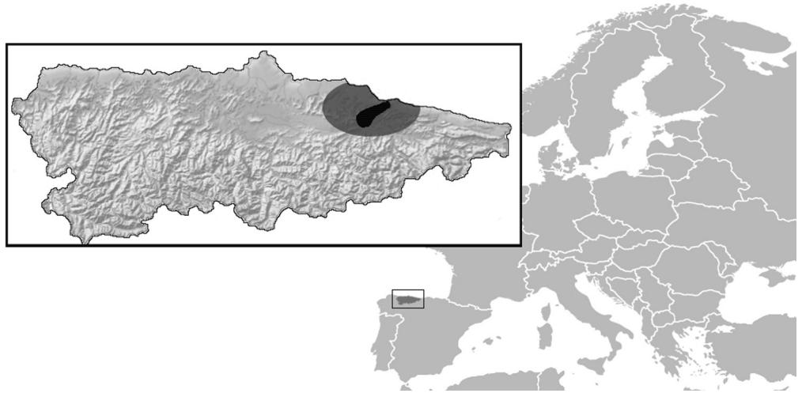
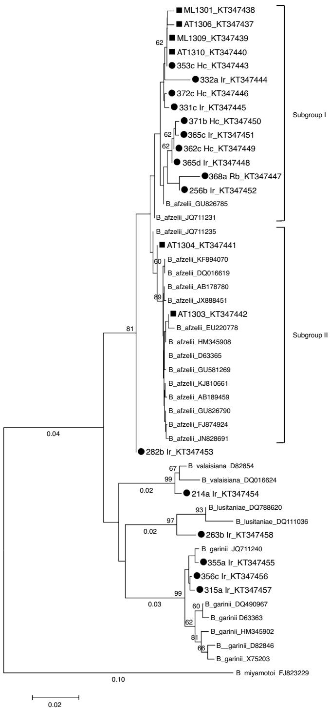

# Enfermedades Infecciosas y Microbiologia Clinica

www.elsevier.es/eimc

Original article

# Borrelia burgdorferi sensu lato prevalence and diversity in ticks and small mammals in a Lyme borreliosis endemic Nature Reserve in North-Western Spain. Incidence in surrounding human populations

Alberto Espí a,∗, Ana Del Cerro a, Aitor Somoano b, Verónica García c, José M. Prieto a, José F. Barandika d, Ana L. García-Pérez d

a Servicio Regional de Investigación y Desarrollo Agroalimentario (SERIDA), Área de Sanidad Animal, Centro de Biotecnología Animal, Deva, Gijón, Asturias, Spain   
b Servicio Regional de Investigación y Desarrollo Agroalimentario (SERIDA), Área de Cultivos Hortofrutícolas y Forestales, Villaviciosa, Asturias, Spain   
c Servicio de Salud del Principado de Asturias, Hospital de Cabue˜nes, Gijón, Asturias, Spain   
d NEIKER - Instituto Vasco de Investigación y Desarrollo Agrario, Derio, Bizkaia, Spain

# a r t i c l e i n f o

Article history:

Received 15 March 2016

Accepted 20 June 2016

Available online xxx

Keywords:

Lyme borreliosis

Borrelia burgdorferi sensu lato

Ticks

Small mammals

# a b s t r a c t

To determine the prevalence and diversity of Borrelia burgdorferi sensu lato (s.l.) in an endemic Nature Reserve (Sierra del Sueve) in North-Western Spain, and the risk of human exposure to infected ticks in Asturias, 1013 questing ticks and 70 small mammals were collected between 2012 and 2014. A retrospective descriptive analysis was also carried out on human Lyme borreliosis (LB) cases reported to the local hospital (Cabuenes). ˜

Samples were screened for B. burgdorferi s.l. presence by a nested PCR assay, and genospecies were confirmed by sequencing. B. burgdorferi s.l. was detected in $1 . 4 \%$ (12/845) of I. ricinus questing nymphs, $9 . 1 \%$ (2/33) of questing adults, and $1 2 . 9 \%$ (9/70) of small mammals, as well as in the other tick species. PCR positive samples of 17 questing tick and 6 small mammals were sequenced. Four genospecies were identified: B. afzelii, B. garinii, B. lusitaniae, and B. valaisiana. Phylogenetic analyses based on the flaB gene showed the heterogeneity of B. afzelii in this area.

The detection of B. burgdorferi s.l. among questing ticks and small mammals in the study area, as well as the abundance of ticks and of large wild and domestic mammals, indicate a high risk of infection by B. burgdorferi s.l. in the area. Reporting of LB cases to the local hospital support this, and shows the need of thorough monitoring of B. burgdorferi infection in ticks and hosts in the area. More investigations are needed to assess the role of different wildlife species and the risk of transmission to humans.

$^ { © }$ 2016 Elsevier Espana, ˜ S.L.U. and Sociedad Espanola ˜ de Enfermedades Infecciosas y Microbiologıa´

Clınica.´ All rights reserved.

# Prevalencia y diversidad de Borrelia burgdorferi sensu lato en garrapatas y pequenos ˜ mamíferos de una Reserva Natural del noroeste de Espana˜ donde la borreliosis de Lyme es endémica. Incidencia en las poblaciones humanas circundantes

r e s u m e n

Palabras clave:

Borreliosis de Lyme

Borrelia burgdorferi sensu lato

PCR

Garrapatas

Pequenos˜ mamíferos

Entre 2012 y 2014 se recogieron 1.013 garrapatas de la vegetación y 70 pequenos˜ mamíferos en la Reserva Natural de la Sierra del Sueve (Asturias) y zonas colindantes, con el fin de determinar la prevalencia de Borrelia burgdorferi sensu lato (s.l.) y el riesgo de exposición humana a garrapatas infectadas en Asturias, área endémica de borreliosis de Lyme. También se incluye un estudio descriptivo y retrospectivo de pacientes diagnosticados de borreliosis en un hospital local (Hospital de Cabuenes, ˜ Gijón).

E-mail address: aespi@serida.org (A. Espí).

B. burgdorferi s.l. se detectó, mediante una PCR anidada, en el $1 { , } 4 \%$ (12/845) de las ninfas y en el $9 , 1 \%$ (2/33) de los adultos de la garrapata I. ricinus, en porcentajes variables de las restantes especies y en el $1 2 { , } 9 \%$ (9/70) de los pequenos ˜ mamíferos. Se secuenciaron un total de 17 muestras de garrapatas de la vegetación y 6 de pequenos˜ mamíferos detectándose 4 genoespecies causantes de la borreliosis de Lyme: B. afzelii, B. garinii, B. lusitaniae, y B. valaisiana. Los análisis filogenéticos basados en el gen flaB mostraron la heterogeneidad de B. afzelii en el área de estudio.

La detección de B. burgdorferi s.l. en garrapatas de la vegetación y pequenos ˜ mamíferos de la zona de estudio, así como la gran abundancia de garrapatas y la presencia de grandes poblaciones de animales silvestres y domésticos, son indicativos de que el riesgo de infección en esta área es relevante. Este hecho está en consonancia con los casos de borreliosis de Lyme descritos en este estudio, mostrando la necesidad de establecer un seguimiento continuado de la enfermedad.

$^ { © }$ 2016 Elsevier Espana, ˜ S.L.U. y Sociedad Espanola ˜ de Enfermedades Infecciosas y Microbiologıa´ Clınica. ´

Todos los derechos reservados.

# Introduction

Lyme borreliosis (LB) is a tick-transmitted disease of humans and animals distributed worldwide and caused by spirochetes of the Borrelia burgdorferi s.l. group. LB has been reported throughout Europe where it is the most common tick-borne infection, as well as it is in the USA.1 Recent surveys showed that the overall prevalence of LB may be stabilizing, but its geographical distribution is increasing.2 The genus Borrelia contains several major human and animal pathogens, among which some species cause LB. In Europe, at least five species of B. burgdorferi s.l. (B. afzelii, B. garinii, B. burgdorferi sensu stricto, B. spielmanii, and B. bavariensis) can cause this disease and three species (B. bissettii, B. lusitaniae, and B. valaisiana) have occasionally been detected in patients, but are not recognized as important pathogens.3 B. garinii is the genospecies mostly involved in clinical cases in Spain.4

Three tick species, Ixodes ricinus, I. hexagonus and I. uriae, are considered vectors of LB spirochetes in Europe,1 being Ixodes ricinus the species that more often bites humans. LB spirochetes perpetuate through cycles involving rodent reservoir hosts, such as Apodemus spp. mice in Eurasia.5 Despite the existence of past and present clinical reports of human LB in Asturias (North-Western Spain),6–10 there is scarce quantitative data on the prevalence of B. burgdorferi s.l. in ixodid ticks and potential reservoirs in this area, except for the11 study on immature-stage I. ricinus ticks. The study area displays suitable environmental conditions to maintain the complex life-cycle of B. burgdorferi, including abundant reservoir and tick populations. Therefore, the aim of this preliminary study was to determine the presence, prevalence and genetic characteristics of B. burgdorferi s.l. in questing ticks and small mammals in Asturias. We also report several recent cases of Lyme disease in humans diagnosed in this area as indicative survey.

# Materials and methods

# Study area

The study was carried out in Asturias region, an Oceanic climate region in North-Western Spain (Fig. 1). Rainfall in the region is abundant and evenly distributed along the year. Average seasonal temperature is mild, even in winter. The main study area is the “Sierra del Sueve” Natural Reserve $\langle 4 3 ^ { \circ } 2 8 ^ { \prime } 4 8 ^ { \prime \prime } \mathrm { N }$ , $5 ^ { \circ } 1 4 ^ { \prime } 3 2 ^ { \prime \prime } \mathsf { W } ,$ ), an $8 0 \mathrm { - k m } ^ { 2 }$ pre-coastal mountain range (maximum altitude 1167 m) where livestock and wildlife are abundant, including cattle, horses, wild boar (Sus scrofa), red deer (Cervus elaphus), a significant number of fallow deer (Dama dama) and small mammals. Some orchards were also prospected as sample points outside the Natural Reserve in neighbor municipalities.

# Questing tick collection

Ticks were collected by dragging a blanket $( 1 \times 1 \mathrm { m } )$ over the vegetation in grazing lawns, shrubs and woods since these constitute the main biotopes in the study area. Sampling at each site was conducted twice a month from January 2012 to December 2014. Tick-drags were inspected every $1 0 \mathrm { m }$ , then gathered specimens were transported to the laboratory, counted and identified using a taxonomic key12 and stored at $- 8 0 ^ { \circ } \mathsf C$ until being tested. Only adults and nymphs were selected for analysis because transovarial infection of LB is rare or non-existent. 13

# Micromammal collection and processing

A total of 70 small mammals were captured between 2011 and 2013, deploying 917 Sherman live traps (H.B. Sherman Traps, Tallahassee, FL) placed at the same biotopes as tick survey in Sierra del Sueve (6 points), and 50 snap traps (Topcat® Andermatt Biocontrol, Switzerland) placed in orchards from neighbor municipalities (10 points). Experimental procedures were approved by the Regional Animal Ethics Committee (Consejería de Agroganadería y Recursos Autóctonos del Principado de Asturias) and were conducted in accordance with the guidelines established by the current laws of the country. Captured live animals were anaesthetized with ketamine hydrochloride (Imalgene: Merial) at a dose of $1 0 \mathrm { m g / k g }$ intramuscularly, euthanized by intraperitoneal injection of T-61 solution (Intervet) and processed by a competent person. Alternatively, cervical dislocation or concussion to the head (Directive 2010/63/UE) was carried out in field if the captured animal was in poor health. Dead animals and traps were thoroughly examined for ticks. Any tick found was collected into tubes containing $7 5 \%$ ethanol. Then, all animals were aseptically dissected and several tissues were collected (ear, lung, heart, liver, spleen, kidney and urinary bladder) for PCR analysis.

# DNA extraction and PCR amplification

Total DNA was extracted from ticks and small mammals using DNeasy Blood and Tissue Kit (Qiagen, Valencia, Spain). Adult ticks were analyzed individually and nymphs were pooled into groups of 5 individuals belonging to the same species and collected at the same time and from the same sampling sites. Small mammal’s tissues of each individual were pooled and DNA was extracted according to the manufacturer’s protocol. In each DNA extraction round (19 samples or less per round) a negative control sample free of any template was included. Detection of B. burgdorferi s.l. DNA in ticks and rodents was carried out using a nested PCR assay, with specific primers for a 389-pb portion of the flagellin gene (flaB) as described previously by Clark et al.14

  
Figure 1. Location of Asturias in North Spain, and the area where study was conducted (43◦28 N, 5◦14 O). Natural Reserve of “Sierra del Sueve” and surroundings are indicated in dark gray and light gray correspondently.

# Gene sequencing and phylogenetic analysis

PCR products were purified using QIAquick Gel Extraction Kit (Qiagen, Valencia, Spain). Amplicons from Borrelia specific reactions were cloned in pGEM T-easy plasmid vector (Promega, Madrid, Spain) before sequencing or were sequenced directly for species identification. Amplicons or plasmids inserts were sent to SECUGEN (Madrid, Spain) for Sanger sequencing using internal forward PCR primer or T7 primer $[ 5 ^ { \prime }$ -TAA TAC GAC TCA CTA TAG GG-3 ). At least two independent clones of a PCR product were sequenced. Sequences obtained were compared with known sequences from databases (GeneBank) by using the Basic Local Alignment Search Tool (BLASTN) at the National Center for Biotechnology Information (NCBI). For phylogenetic analyses, sequences were aligned with Clustal W algorithm15 using the MEGAN 6 package. The phylogenetic tree was constructed using the Neighbor-Joining method16 based on the Kimura 2-parameter distance method,17 with bootstrap analysis of 1000 replicates.18

# Study of human borreliosis in Asturias

A ten-year (2004–2014) descriptive and retrospective study of patients treated of borreliosis from Cabuenes˜ Hospital (the main hospital of eastern Asturias) was carried out. Epidemiological, clinical diagnostic and therapeutic parameters were compiled. Patients with diagnosis confirmed by ELISA (IgM: Vidas Lyme IgM. France; IgG: Liaison Borrelia IgG, Italy) and subsequently by Western Blot (IgM e IgG: Sekisui Virotech Line ImmunoBlot, Germany) were included. Suspected cases with clinical symptoms and evolution, but without conclusive ELISA results, were also taken into account.

# Statistical analysis

$\mathsf { A } 2 \times 2$ chi-squared test or Fisher’s exact test (when $n < 1 0$ ) were performed to compare B. burgdorferi prevalence regarding season, geographic orientation, vegetation type and tick stage (nymphs and adults). The differences were considered statistically significant at $p { \le } 0 . 0 5$ . These analyses were performed using R package (free software environment available at http://www.r-project.org/).

# Results

# Questing ticks

From 2012 to 2014 a total of 39,386 ticks were collected from vegetation cover; 22,239 were larvae, 16,726 were nymphs and 421 were adults. Tick abundance – as the number of ticks collected per $1 0 0 \mathrm { m } ^ { 2 }$ transect – was 65.0 for larvae, 48.9 for nymphs and 1.2 for adults. Seven tick species of the genera Ixodes, Haemaphysalis, Dermacentor and Rhipicephalus were collected from vegetation. I. ricinus accounted for $5 9 . 6 \%$ (251/421 $[ 9 5 \% C ]$ : 54.9–64.2]) and H. concinna for $2 0 . 4 \%$ (86/421[95%CI: 16.8–24.5]) of adult ticks identified, whereas other species as H. punctata, D. reticulatus, H. inermis and R. bursa accounted for $8 . 0 { - } 4 . 0 \%$ , and I. frontalis was only occasionally found. Table 1 shows the distribution of 878 unfed I. ricinus ticks randomly selected for LB analysis and analyzed in 202 pools. Evidence of presence of B. burgdorferi (PCR-positive ticks) was found in I. ricinus questing nymphs (1.4% [95%CI: 0.8–2.5] minimum expected prevalence) and adults $6 . 1 \%$ [95%CI: 1.7–19.6]) collected from all sampling sites. PCR-positive ticks belong to all vegetation types and all geographic sites taken into account in the study area. Prevalence of infection between different geographic orientation, vegetation type and tick stage was no significantly different (Fisher exact test $p$ value $> 0 . 0 5$ ). Another 135 non-Ixodes ticks were also selected for LB analysis in 47 pools. B. burgdorferi PCR-positive ticks were found in $3 . 9 \%$ (5/127) Haemaphysalis spp., $2 5 . 0 \% ( 1 / 4 ) D$ . reticulatus and 25.0% (1/4) R. bursa.

# Small mammals

Twenty six out of a total of 70 small mammals examined were captured in “Sierra del Sueve” Natural Reserve and belonged to six species (Table 2). A total of 55 I. ricinus larvae were collected from $6 5 . 4 \%$ (17/26 $[ 9 5 \% C ]$ : 46.2–80.6]) trapped mammals. No adults or nymphs were found feeding on them. B. burgdorferi s.l. was detected in $1 1 . 5 \%$ (3/26 [95%CI: 4.0–29.0]) of the small mammals tested by PCR, all of them belonging to the species Apodemus sylvaticus. Another 44 specimens belonging to five species of small mammals were gathered in experimental and commercial orchards located in a $2 0 \mathrm { k m }$ radius around the Natural Reserve (Table 2). No ticks were found feeding on all of them despite being captured all along the year and mainly in summer when larvae in Asturias are more abundant. However, Arvicola scherman $( 4 0 . 0 \%$ $[ 9 5 \% \mathrm { C I }$ : 16.8–68.7]) and Microtus lusitanicus ( $1 8 . 2 \%$ $[ 9 5 \% C ]$ : 5.1–4.8]) yielded positive results to Borrelia infections.

Table 1 Borrelia burgdorferi s.l. in I. ricinus ticks collected in Sierra del Sueve, Spain, 2012–2014.   

<table><tr><td rowspan="2">Epidemiological factors</td><td>Ticks tested</td><td colspan="2">Ticks infected</td><td rowspan="2">Genospecies</td></tr><tr><td>No. (pools)</td><td>No. (pools)</td><td>%a</td></tr><tr><td colspan="5">Geographic orientation</td></tr><tr><td>North</td><td>337 (73)</td><td>7-31 (7)</td><td>2.08</td><td>B. afzelii, B. garinii, B. valaisiana</td></tr><tr><td>South</td><td>541 (129)</td><td>7-31 (7)</td><td>1.29</td><td>B. afzelii</td></tr><tr><td colspan="5">Vegetation type</td></tr><tr><td>Grassland</td><td>244 (52)</td><td>4-20 (4)</td><td>1.64</td><td>B. afzelii, B. garinii, B. valaisiana</td></tr><tr><td>Shrubs</td><td>330 (78)</td><td>6-22 (6)</td><td>1.82</td><td>B. afzelii, B. garinii</td></tr><tr><td>Woodland</td><td>304 (72)</td><td>4-20 (4)</td><td>1.32</td><td>B. afzelii</td></tr><tr><td colspan="5">Seasons</td></tr><tr><td>Winter</td><td>234 (50)</td><td>2-10 (2)</td><td>0.85</td><td>B. afzelii</td></tr><tr><td>Spring</td><td>287 (71)</td><td>5-21 (5)</td><td>1.74</td><td>B. afzelii, B. garinii, B. valaisiana</td></tr><tr><td>Summer</td><td>114 (26)</td><td>4-16 (4)</td><td>3.51</td><td>B. afzelii</td></tr><tr><td>Autumn</td><td>243 (55)</td><td>3-15 (3)</td><td>1.23</td><td>B. afzelii</td></tr><tr><td colspan="5">Tick stage:</td></tr><tr><td>Adult</td><td>33</td><td>2</td><td>6.06</td><td>B. afzelii</td></tr><tr><td>Nymph</td><td>845 (169)</td><td>12-60 (12)</td><td>1.42</td><td>B. afzelii, B. garinii, B. valaisiana</td></tr></table>

a “Minimum expected prevalence”: percentage of positives is calculated assuming that any pool would contain one infected tick.

# Gene sequencing and phylogenetic analysis

In 17 of 22 PCR-positive tick samples, B. burgdorferi s.l., genospecies were identified based on the sequencing of the flaB gene PCR product. Nucleotide sequences obtained in this study were submitted to GenBank under accession numbers from KT347437 to KT347458. B. afzelii was the most prevalent genospecies $7 6 . 5 \%$ ; $n = 1 3$ ), and was detected in I. ricinus $( 6 1 . 5 \% )$ , H. concinna $( 3 0 . 8 \% )$ and R. bursa $( 7 . 7 \% )$ ticks. B. garinii $( 1 1 . 8 \%$ ; $n = 2$ ), B. lusitaniae $( 5 . 9 \%$ ; $n = 1$ ) and B. valaisiana $( 5 . 9 \%$ ; $n = 1$ ) were only found in I. ricinus ticks. One sequence, corresponding to an I. ricinus tick, was considered too short (207 pb) to be included in the phylogenetic analysis and hence was removed. In small mammals, 6 out of 9 PCR positive samples were successfully sequenced but the other three samples could not be identified at the genospecies level due to the low quality of the sequences (Table 2). These 22 sequences plus 27 retrieved from GenBank were aligned and a phylogenetic tree was constructed by the NJ method (Fig. 2). The tree topology, showed that the strains belonging to the same genospecies clustered together, in three main clades (bootstrap $> 7 0 \%$ ) defined by the reference strains included for comparison. Small mammals-derived sequences clustered with B. afzelii strains, whereas tick-derived sequences clustered with B. afzelii, B. garinii, B. lusitaniae and B. valaisiana strains. Within the B. afzelii clade, two subgroups could be differentiated. Fourteen of the B. afzelii positive samples (10 ticks and 4 small mammals) predominated in the subgroup I. In contrast, flaB sequences from small mammals AT1304 and AT1303 grouped with the reference sequences included in the analysis (subgroup II).

The tick-derived sample 282b Ir is closely related to B. afzelii but it forms a subgroup separated from the other Borrelia strains. Based on pairwise distances, flaB sequences from tick and small mammal B. afzelii strains were $9 7 . 6 \substack { - 1 0 0 \% }$ similar. Samples 282b Ir, AT1304 and AT1303 shared high similarity rates $( 9 9 . 7 \mathrm { - } 1 0 0 \% )$ with all the reference sequences. flaB sequences from tick samples 214a Ir and 263b Ir displayed $9 8 . 8 \substack { - 9 9 . 9 \% }$ homogeneity with B. valaisiana and B. lusitaniae reference strains, respectively. The similarity among the B. garinii flaB sequences was $9 9 . 0 \%$ , and was between 97.9 and $9 9 . 7 \%$ identical to sequences derived from GenBank.

# Study of human borreliosis in Asturias

From 2004 to 2014 a total of 18 LB cases were diagnosed. The mean age of patients was $3 7 . 2 \pm 4 . 9$ (SD) years (4 cases under 12 years of age), with a slight male predominance (1.25:1). $7 2 . 2 \%$ recalled the body region of the bite, being the most frequent place extremities, however only $3 8 . 9 \%$ of the cases they visualized the tick. We considered that tick bites have happened in the same place as patients live, according with their proof: $3 8 . 9 \%$ Gijón, Villaviciosa $2 7 . 9 \%$ , Ribadesella, Colunga Carreno˜ Arriondas $5 . 6 \%$ $5 . 6 \% 5 . 6 \% 5 . 6 \%$ and a case imported from USA. The symptoms were: erythema migrans $( 6 6 . 7 \% )$ , cephalea $( 5 . 6 \% )$ , chest pain $( 5 . 6 \% )$ , cervical pain $\left( 5 . 6 \% \right)$ , extremities pain $( 3 8 . 9 \% )$ , articular pain $( 1 1 . 1 \% )$ , malaise $( 5 0 . 0 \% )$ , fever $( 4 4 . 4 \% )$ , facial paralysis $( 1 1 . 2 \% )$ , paresthesia $( 1 1 . 2 \% )$ , dysarthria $\left( 5 . 6 \% \right)$ and palpitations $( 5 . 6 \% )$ . General physical examination was non-specific. The duration of symptoms before diagnosis was registered in $6 6 \%$ of cases, with an average duration of $1 9 . 6 \pm 9 . 3$ (SD) days. Hemogram and biochemical analyses

Table 2 Small mammals captured and PCR/sequencing results.   

<table><tr><td rowspan="2">Animal species</td><td rowspan="2">Common name</td><td colspan="2">Captured no. (%)a</td><td colspan="2">PCR/Sequencing no. (%)b</td><td rowspan="2">Genospecies</td></tr><tr><td>Natural reserve</td><td>Surroundings</td><td>Natural reserve</td><td>Surroundings</td></tr><tr><td>Apodemus sylvaticus</td><td>Wood mouse</td><td>19(73.1)</td><td>17(38.6)</td><td>3(15.8)</td><td>-</td><td>B. burgdorferis.l.</td></tr><tr><td>Apodemus flavicollis</td><td>Yellow-necked field mouse</td><td>1(3.8)</td><td>-</td><td>-</td><td>-</td><td>-</td></tr><tr><td>Microtus lusitanicus</td><td>Lusatian pine vole</td><td>3(11.5)</td><td>11(25.0)</td><td>-</td><td>2(18.2)</td><td>B. afzelii</td></tr><tr><td>Microtus agrestis</td><td>Field vole</td><td>1(3.8)</td><td>-</td><td>-</td><td>-</td><td>-</td></tr><tr><td>Crocidura russula</td><td>White-toothed shrew</td><td>1(3.8)</td><td>3(6.8)</td><td>-</td><td>-</td><td>-</td></tr><tr><td>Crocidura suaveolens</td><td>Lesser white-toothed shrew</td><td>1(3.8)</td><td>-</td><td>-</td><td>-</td><td>-</td></tr><tr><td>Sorex coronatus</td><td>Crowned shrew</td><td>-</td><td>3(6.8)</td><td>-</td><td>-</td><td>-</td></tr><tr><td>Arvicola scherman</td><td>Montane water vole</td><td>-</td><td>10(23.8)</td><td>-</td><td>4(40.0)</td><td>B. afzelii</td></tr><tr><td>Total</td><td></td><td>26</td><td>44</td><td>3(11.5)</td><td>6(13.6)</td><td></td></tr></table>

a Percentages of captured animals from the total number of captured animals.   
b Percentages of positive animals from the total number of each animal species.

  
Figure 2. Phylogenetic tree (Neighbor-Joining) based on the partial sequence of B. burgdorferi s.l. flaB gene (338 bp). Sequences used in the analysis included B. afzelii AB178780, GU826785, JQ711231, JQ711235, KF894070, DQ16619, JX888451, EU220778, HM345908, D63365, GU581269, KJ810661, AB189459, GU826790, FJ874924, JN828691; B. garinii DQ490967, HM345902, X75203, D82846, D63363, JQ711240; B. valaisiana D82854, DQ016624; B. lusitaniae DQ788620, DQ016624, and B. miyamotoi FJ823229 as outgroup. Scale bar indicates an evolutionary distance of 0.02 nucleotides per position in the sequence. Bootstraps (1000 replicates) values >than $6 0 \%$ are shown below the branches. B. burgdorferi sensu lato sequences obtained in the present study are labeled by a solid circle (tick) or by a square (rodent). Ir: I. ricinus; Hc: H. concinna; Rb: R. bursa; ML: M. lusitanicus; AT: Arvicola

were performed in all cases, with an average of $1 0 , 7 3 8 \pm 1 7 5 7 . 4$ (SD) leukocytes and of $6 8 3 3 \pm 1 4 0 6 . 3$ (SD) neutrophils. C-reactive protein analysis was performed in $8 3 \%$ of cases, with an average value of $1 9 . 3 6 \pm 6 . 4 5$ (SD) $\mathrm { m g / L }$ . In half of the cases the Erythrocyte Sedimentation Rate speed was assessed with an average

value of $4 0 . 8 9 \pm 9 . 3 9$ (SD) mm/hour. Only in one patient the cerebrospinal fluid was affected (lymphocytic pleocytosis). In two cases the electrocardiogram was abnormal. ELISA for B. burgdorferi was performed in all cases, being positive in 15 of them, dubious in 2 cases and negative in one case. Diagnosis was: $6 1 . 1 \%$ LD, $2 2 . 3 \%$ suspected LD, $1 1 . 1 \%$ atrioventricular blockade secondary to borreliosis and $5 . 6 \%$ neuroborreliosis. We confirmed $7 7 . 8 \%$ of the cases, those with clinical and evolution compatible, with positive serology confirmed by Western Blot. Despite the inconclusive results of the serology, the rest of the cases appeared under suspicion and they have been considered and treated as borreliosis, given their compatible symptoms and clinical evolution. The $7 2 . 2 \%$ of cases required hospitalization, with an average duration of $1 6 \pm 2 . 7$ (SD) days. Antibiotic therapy was the treatment in all cases: doxycycline $3 8 . 9 \%$ , amoxicillin $2 2 . 2 \%$ , ceftriaxone $2 2 . 2 \%$ , $1 1 . 1 \%$ cefuroxime, amoxicillin-clavulanic acid $5 . 6 \%$ . The average duration of treatment was $1 9 \pm 1 . 6$ (SD) days. Only two cases suffered long-term neuropathy sequelae.

# Discussion

Asturias, as well as nearby Atlantic regions in Northern Spain, is endemic for LB. Several clinical reports on LB cases diagnosed on local hospitals from Asturias and neighbor regions during the last years still support the importance of this disease.9,10,19,20 Most of the known competent tick vectors of B. burgdorferi belong to the I. ricinus-persulcatus complex.21 As expected, in our study B. burgdorferi DNA was detected in I. ricinus. Interestingly, it was also detected in H. concinna, H. punctata, R. bursa and D. reticulatus. The prevalence of B. burgdorferi s.l. in ticks in several European areas varied significantly.22–25 Indeed, our results indicate that B. burgdorferi s.l. is widespread in the study area at higher infection rates in ticks that those reported in the Basque Country (Northern Spain) by Barandika26 and at slightly lower rates than those previously reported in Asturias by Ruiz-Fons et al.11

The role of A. sylvaticus as competent reservoir and vector of the LB agent may depend on habitat features since those affect both rodent presence and activity and tick density as well. Moreover, the abundant presence of large mammals in the Natural Reserve gives ticks a chance to increase their population, whereas in the surrounding orchards large mammals are scarce. Given the high B. burgdorferi s.l. prevalence in voles from orchards (Table 2), the circulation of this bacterium within vole subterranean burrows should not be discarded. In that sense, relatively high densities of Laelaps agilis, an obligate hematophagous parasitic mite which might bear B. burgdorferi s.l.,27,28 have been observed in the pinna of many specimens of A. scherman (Somoano, A. and Espí, A., unpublished results). Further studies focused on mite community of the nest of these voles might clarify the species involved in this cycle.29 Nevertheless, A. scherman and M. lusitanicus could be competent reservoir hosts but not necessarily competent vectors of ticks.30

B. afzelii was the only genospecies detected on small mammals and the most common genospecies detected in questing ticks in our study. Nevertheless, we also detected two B. garinii, one B. valaisiana and one B. lusitaniae in questing ticks. Similar results were reported in the Basque Country, were B. afzelii was among the identified genospecies in both small mammals and questing ticks.26 In our study, the NJ tree reveal that the flaB sequences derived from Asturian small mammals and questing ticks clustered with B. afzelii, B. garinii, B. lusitaniae and B. valaisiana type strains. Two main subgroups are clearly differentiate within the B. afzelli cluster, subgroup I clustering almost all of the sequences described in this work, and subgroup II were two small mammals sequences (AT1304 and AT1303) and the reference sequences were included.

The detection of B. burgdorferi s.l. among questing ticks and small mammals in “Sierra del Sueve” area, as well as the tick abundance and the presence of large populations of wild and domestic animals indicate that the risk of infection in this area is relevant. This is in agreement with clinical reports of LB from local hospitals as we observed in our descriptive and retrospective study of patients treated of borreliosis from Cabuenes ˜ Hospital, showing the relevance of establishing continuous monitoring of LB and B. burgdorferi s.l. prevalence in ticks and reservoir hosts. Our findings, although preliminary, provide completely new information for Asturias and supposes a starting point for further research.

# Conflict of interest statement

The authors declare that they have no competing financial interests.

# Acknowledgements

This work was supported by funding from INIA RTA2011-00008- C02-01 and the European Regional Development Fund (ERDF). Special thanks to Marcos Minarro˜ for sharing with us the captured specimens from orchards. We also thank Rosa Casáis and Marta Munoz˜ for the revision of the manuscript.

# References

1. Piesman J, Gern L. Lyme borreliosis in Europe and North America. Parasitology. 2004;129 Suppl:S191–220.   
2. Rizzoli A, Hauffe HC, Carpi G, Vourc’h G, Neteler M, Rosà R. Lyme borreliosis in Europe. Euro Surveill [online journal]. 2011;16:1–8 [accesed 14 December 2015] Available at: http://www.eurosurveillance.org/ViewArticle. aspx?ArticleId=19906   
3. Stanek G, Wormser GP, Gray J, Strle F. Lyme borreliosis. Lancet. 2012;379:461–73.   
4. Portillo A, Santibánez˜ S, Oteo JA. Enfermedad de Lyme. Enferm Infecc Microbiol Clin. 2014;32:37–42.   
5. Richter D, Klug B, Spielman A, Matuschka FR. Adaptation of diverse Lyme Disease spirochetes in a natural rodent reservoir host. Infect Immun. 2004;72:2442–4.   
6. Uría D, Calatayud M, Mongelos J, Miguel M, Cobos A, Suárez T. Meningopolineuritis como manifestación de la enfermedad de Lyme. Med Clin (Barc). 1987;89:381–3.   
7. Asensi-Álvarez JM, Martínez AM, Guerrero A, Asensi V, Escudero R, de la Iglesia P, Arribas JM. Epidemiologic study of Lyme disease in Asturias. Enferm Infecc Microbiol Clin. 1993;11:420–3.   
8. Batalla-Celorio A, Gonzalez-Camino F, Suárez-Súarez E, Martínez-González J, Hevia-Nava S, Barriales-Álvarez V. Bloqueo auriculoventricular completo transitorio en la enfermedad de Lyme. Rev Esp Cardiol. 1999;52:529–31.   
9. Gómez de la Torre R, Suárez del Villar R, Álvarez-Carreno˜ F. Parálisis diafragmática y artromialgia por enfermedad de Lyme. An Med Interna. 2003;20:46–55.   
10. Pérez-Guirado A, Fernández-Fernández RI, Arbesú-Fernández E, Santos-Rodríguez P. Enfermedad de Lyme: a propósito de dos casos. Rev Pediatr Aten Primaria. 2013;15:105–19.

11. Ruiz-Fons F, Fernández-de-Mera IG, Acevedo P, Gortázar C, de la Fuente J. Factors driving the abundance of Ixodes ricinus ticks and the prevalence of zoonotic I. ricinus-borne pathogens in natural foci. Appl Environ Microbiol. 2012;78:2669–76.   
12. Manilla G, Fauna D’Italia: Acari. Ixodida. Bologna: Edizioni Calderini; 1998.   
13. Eisen L, Lane RS. Vectors of Borrelia burgdorferi sensu lato. In: Gray JS, Kahl O, Lane RS, Stanek G, editors. Lyme borreliosis: biology, epidemiology and control. 1st edn New York: CABI Publishing; 2002. p. 91–115.   
14. Clark K, Hendricks A, Burge D. Molecular identification and analysis of Borrelia burgdorferi sensu lato in lizards in the southeastern United States. Appl Environ Microbiol. 2005;71:2616–25.   
15. Thompson JD, Higgins DG, Gibson TJ. CLUSTAL W: improving the sensitivity of progressive multiple sequence alignment through sequence weighting, position-specific gap penalties and weight matrix choice. Nucleic Acids Res. 1994;22:4673–80.   
16. Saitou N, Nei M. The neighbor-joining method: a new method for reconstructing phylogenetic trees. Mol Biol Evol. 1987;4:406–25.   
17. Tamura K, Stecher G, Peterson D, Filipski A, Kumar S. MEGA6: molecular evolutionary genetics analysis version 6.0. Mol Biol Evol. 2013;30:2725–9.   
18. Brown JK. Bootstrap hypothesis tests for evolutionary trees and other dendrograms. Proc Natl Acad Sci U S A. 1994;91:12293–7.   
19. Pazos-Ferro A, Matesanz-Fernández M, Rubal-Bran D, Iniguez-Vázquez ˜ I, Rabunal-Rey˜ R, Monte-Secades R. Enfermedad de Lyme en el área sanitaria de Lugo. Galicia Clin. 2010;71:7–14.   
20. López-Reboiro ML, Ventura-Valcarcel P, Pineiro-Fernández ˜ J, Romay-Lema E, Suárez-Gil R, Coira A, Moreno-Lugris C. Enfermedad de Lyme en el Área Sanitaria de Lugo: desde 1995 al 2012. 35th Congreso Nacional de la Sociedad Espanola˜ de Medicina Interna (SEMI); 2014 Nov; Murcia, Spain. Póster I-054. Available at: http://www.itcpostergallery.com/xxxvsemi/index.php   
21. Tsao JI. Reviewing molecular adaptations of lyme borreliosis spirochetes in the context of reproductive fitness in natural transmission cycles. Vet Res. 2009;40:36, http://dx.doi.org/10.1051/vetres/2009019   
22. Gray J, Kahl O, Janetzki C, Stein J, Guy E. The spatial distribution of Borrelia burgdorferi-infected Ixodes ricinus in the Connemara region of County Galway, Ireland. Exp Appl Acarol. 1995;19:163–72.   
23. Günes¸ T, Kaya S, Poyraz Ö, Engin A. The prevalence of Borrelia burgdorferi sensu lato in Ixodes ricinus ticks in the Sinop region of Turkey. Turkish J Vet Anim Sci. 2007;31:153–8.   
24. Jouda F, Perret JL, Gern L. Density of questing Ixodes ricinus nymphs and adults infected by Borrelia burgdorferi sensu lato in Switzerland: spatio-temporal pattern at a regional scale. Vector Borne Zoonotic Dis. 2004;4:23–32.   
25. Richter D, Matuschka FR. Candidatus Neoehrlichia mikurensis, Anaplasma phagocytophilum, and Lyme Disease spirochetes in questing European vector ticks and in feeding ticks removed from people. J Clin Microbiol. 2012;50:943–7.   
26. Barandika JF. Las garrapatas exófilas como vectores de agentes zoonóticos: estudio sobre la abundancia y actividad de las garrapatas en la vegetación, e investigación de la presencia de agentes patógenos en garrapatas y micromamíferos. Ph.D. thesis. Universidad de León; 2010.   
27. Kampen H, Schöler A, Metzen M, Oehme R, Hartelt K, Kimmig P, Maier WA. Neotrombicula autumnalis (Acari, Trombiculidae) as a vector for Borrelia burgdorferi s.l. Exp Appl Acarol. 2004;33:93–102.   
28. Netusilˇ J, ZákovskᡠA, Vostal K, Norek A, Stanko M. The occurrence of Borrelia burgdorferi sensu lato in certain ectoparasites (Mesostigmata, Siphonaptera) of Apodemus flavicollis and Myodes glareolus in chosen localities in the Czech Republic. Acta Parasitol. 2013;58:337–41.   
29. Airoldi JP, Solomon L, Duca AV. Gamasid mites (Acari) in the nests of the fossorial form of the water vole, Arvicola terrestris L. Rev Suisse de Zool. 1989;96:161–89.   
30. Gern L, Humair PF. Ecology of Borrelia burgdorferi sensu lato in Europe. In: Gray J, Kahl O, Lane RS, Stanek G, editors. Lyme Borreliosis: Biology, Epidemiology and Control. CABI International; 2002. p. 149–74.