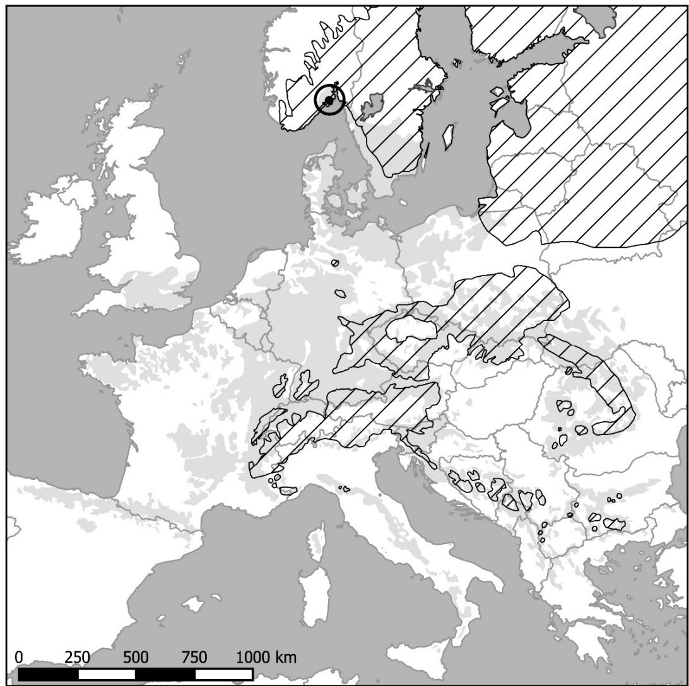
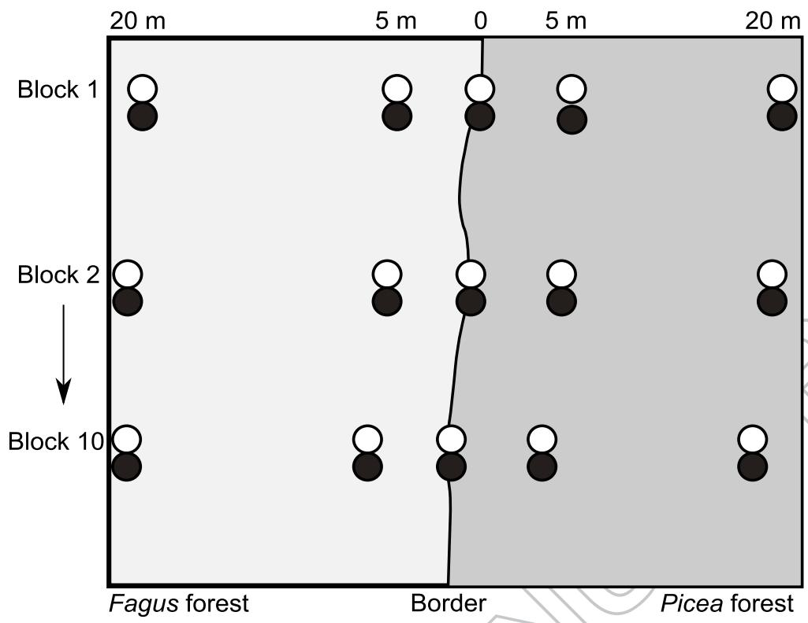
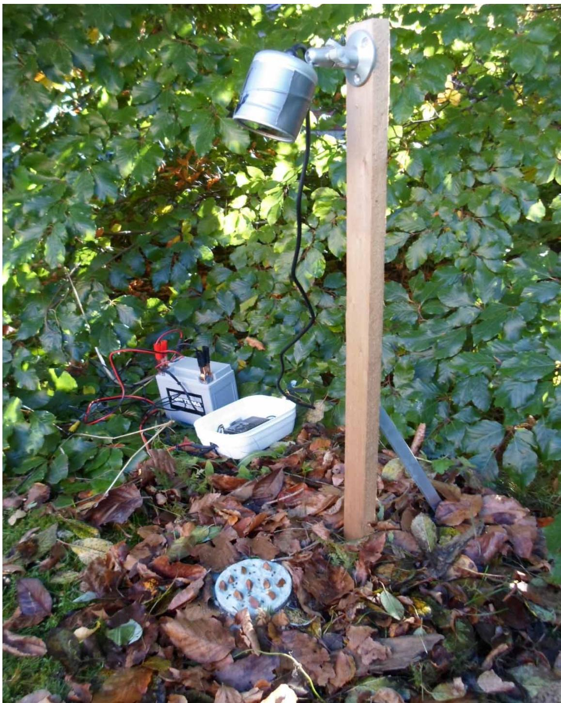
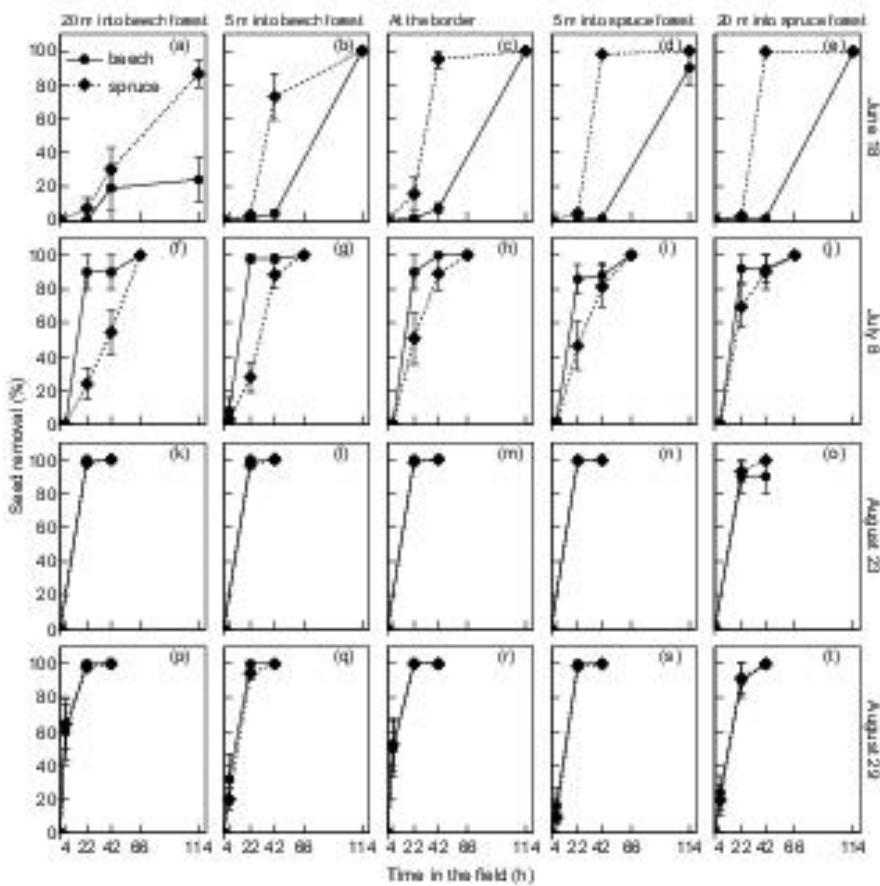
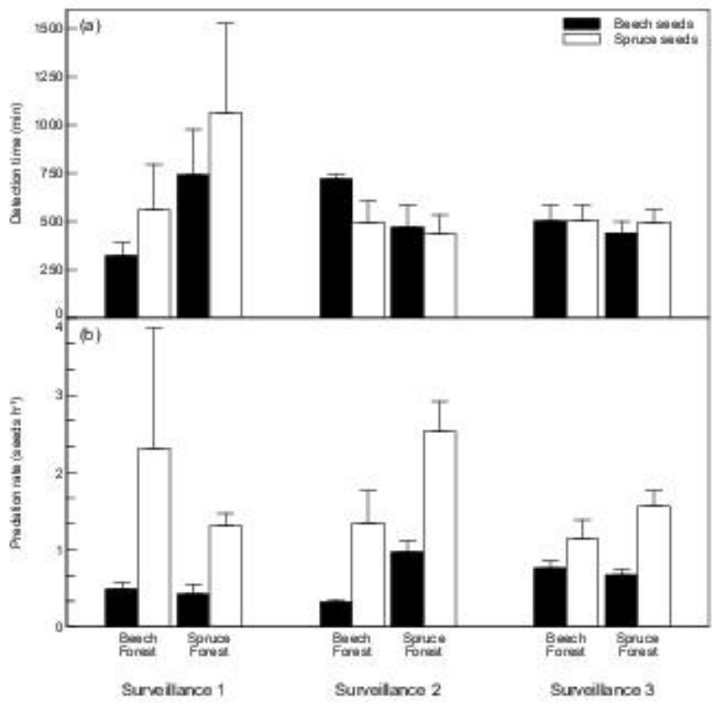

# Spatial and temporal patterns in seed predation as revealed by reciprocal experiments and video-surveillance in neighbouring beech and spruce forests

Vanessa Marie Ellingsen, Johan Asplund & Mikael Ohlson

To cite this article: Vanessa Marie Ellingsen, Johan Asplund & Mikael Ohlson (2016): Spatial and temporal patterns in seed predation as revealed by reciprocal experiments and video-surveillance in neighbouring beech and spruce forests, Scandinavian Journal of Forest Research, DOI: 10.1080/02827581.2016.1215523

To link to this article: http://dx.doi.org/10.1080/02827581.2016.1215523

Accepted author version posted online: 20 Jul 2016.  
Published online: 20 Jul 2016.

Submit your article to this journal

Article views: 5

View related articles

View Crossmark data

Publisher: Taylor & Francis & Informa UK Limited, trading as Taylor & Francis Group

Journal: Scandinavian Journal of Forest Research

DOI: 10.1080/02827581.2016.1215523

# Spatial and temporal patterns in seed predation as revealed by reciprocal experiments and video-surveillance in neighbouring beech and spruce forests

Vanessa Marie Ellingsen, Johan Asplund and Mikael Ohlson*

Department of Ecology and Natural Resource Management, Norwegian University of Life Sciences, PO Box 5003, NO-1432 Ås, Norway

*Corresponding author, e-mail: mikael.ohlson@nmbu.no

Running headline: Beech and spruce seed predation

# Abstract

European beech and Norway spruce are late successional and competitive species meeting each other in southern Norway. Beech are predicted to expand northwards with increased temperature implying increased competition between the two tree species. Seed survival is a key processes in this competition and here we estimate detection times and predation rates of beech and spruce seeds in adjacent beech and spruce forests by combining quantitative and qualitative approaches based on reciprocal seed predation experiments and video surveillance. These experiments were repeated over two growing seasons and by using video surveillance technique, we were able to precisely reveal seed detection times and high seed predation rates, up to 15 seeds $\mathrm{min}^{-1}$ , with bank vole and chaffinch as main predators. Moreover, the two main predators were different in their seed preferences, i.e. beech seeds were exclusively removed or predated by the vole, while the finch consumed spruce seeds only. As we show high predation rates, even small variations in seed predator population densities would impact the regeneration success of beech and spruce. Because the highest predation rates were recorded for spruce seeds, it is likely that this will alter the competitive balance between the two tree species in favour of beech.

Key-words: Fagus sylvatica, Picea abies, seed detection time, seed predation rate, seed predators, seed removal, video monitoring

# Introduction

European beech *Fagus sylvatica* is a widespread and ecologically important forest tree in central and western Europe. Today, beech forests reach their native northern distribution limit in the south-eastern parts of Norway (Bjune et al. 2013). However, the distribution of beech is expected to expand substantially towards the north due to climate warming (Hickler et al. 2012) and this expansion is projected to result in a fundamental transformation of contemporary Norwegian forests as they are typically dominated by Norway spruce (*Picea abies*). Such a transformation will imply severe competition between European beech and Norway spruce as both are late successional species and strong competitors with a well-developed ability to establish in low light conditions under closed forest canopies (Giesecke et al. 2007; Seppä et al. 2009). Interestingly, the long-term history of beech and spruce forests in south-eastern Norway is noteworthy similar because both forest types are of recent origin and appear here at about the same time in late Holocene, i.e. approximately 1500 years ago (Bjune et al. 2009; Ohlson et al. 2011; Bjune et al. 2013). Moreover, both European beech and Norway spruce are masting trees that are characterized by a periodic synchronous seed production (Jensen 1985; Zackrisson et al. 1999; Nopp-Mayr et al. 2012).

Seeds and their ability to establish seedlings play key-roles in the process of tree regeneration (Birkedal et al. 2009; Yu et al. 2013), which in turn is the driving force behind the migration and expansion of tree distribution limits. Yet, tree seeds are not only of fundamental importance for the trees themselves – they are also a high-quality food resources that are consumed by a broad range of seed eating animals (granivores), from small-sized insects to larger vertebrates such as birds and mammals. This seed predation, can lead to mass mortality of seeds and has the potential to function as a key-determinant of tree regeneration success (Thompson 1987; Crawley 1992). For example, post dispersal seed losses through predation have frequently been recorded to reach $100\%$ in large and heavy

seeded forest trees such as oak and beech (Shaw 1968; Crawley 1983; Jensen 1985; Crawley & Long 1995), while losses in tree species with relatively smaller seeds, e.g. spruce- and pine species, are reported to be typically lower as they rarely have been recorded to reach more than $50\%$ (Abbott & Quink 1970; Radvanyi 1970; Nystrand & Granström 2000; Rossi et al. 2012). However, despite decades of research on seed predation, rather little is known about how important a role it plays in tree recruitment (Worthy et al. 2006; Guo et al. 2015) and there is consequently a need for more knowledge, in particular with regard to seasonal patterns in seed predation rates and variations among forest types. It is important to note here, though, that some seed predators may actually act as secondary seed dispersers, which in turn may increase the probability for seed survival and seedling establishment (see e.g. Jensen 1985; Nilsson 1985; Zhang et al. 2016).

In this study, we have performed a reciprocal seed predation experiment in which we placed both large beech seeds and relatively small spruce seeds in neighbouring beech and spruce forests at various distances from the border between the two forest types. By using video surveillance and by estimating seed predation throughout two consecutive growing seasons, we combine a quantitative and qualitative approach to test the following five hypotheses: (I) large beech seeds provide more nutrients and energy for the seed predators than small spruce seeds and beech seeds will be predated at higher rates than spruce seeds; (II) seed predation will be seed size specific as large beech seeds will be predated by small mammals such as e.g. rodents, while smaller spruce seeds will be taken by birds and insects. To test this hypothesis, the use of video surveillance will be of particular importance as it has been shown to be a powerful tool to identify seed predators and their activity (Jansen et al. 2004; Pons & Pausas 2007; Jansen et al. 2012; Sunyer et al. 2013); (III) as granivore animals increase their seed consumption and build up a winter storage of seeds at the end of the growing season (Hansson 1971; Hansson 1979; Clayton et al. 1996), we predict that seed

predation rates will increase over the season; (IV) seed predation will be relatively higher on spruce seeds early in the season and beech seeds will be the preferred seed type later in the season. We base this hypothesis on the assumption that seed predator guilds are more likely to find seed types that are naturally present at any given time (Crawley 1992) and the fact that spruce seeds are naturally available early in the season, i.e. late winter to early spring (Hagner 1965), while beech seeds become available at the end of the season in early autumn (Watt 1923; Giesecke et al. 2007); and (V) lastly we predict that seed predation will be highest in the internal part of the respective seed types' residence forest and gradually decline with greater distance away from their native range. This hypothesis is based on the idea that seed predators are specialist natural enemies that are adapted to consume the seeds that occur naturally in their residence habitat (Janzen 1970; Connell 1971; Comita et al. 2014). In addition, we have tested if seed predation rates differ between light- and dark coloured seed exposure backgrounds. Here we expect that both beech and spruce seeds will be more visible and thus more predated when exposed on a light background. This will be the case in particular in seed predators using visual cues to identify the food item (Nystrand & Granström 1997). By testing these hypotheses, we aim to advance the understanding of the role seed predators play in determining the reproductive ecology and competitive balance between two late successional tree species, which both are strong competitors and ecologically important in a major part of Europe.

# Material and Methods

Study site

Our study site, Brønakollane (59°20' N; 10°06' E), is located in the Oslo rift geological area about 15 km north of the town Larvik in SE Norway (Fig. 1). The site is characterized by an

Tree density is variable and ranging from ca. $10 - 20\mathrm{m}^2\mathrm{ha}^{-1}$ . The terrain is rugged and boulders and rock outcrops are common. The forest floor and understory vegetation is generally sparse in the beech forest and consists mainly of Oxalis acetosa, Anemone nemorosa, Deschampsia flexuosa, Festuca altissima, Poa nemoralis and some scattered Dryopteris ferns. A 3-5 cm thick ectohumus layer consisting of beech leaves in various stages of decay covers much of the ground in the beech forest. Norway spruce forests surround the beech forest reserve and the border between the beech and spruce forest is very sharp and distinct as the spruce forests are planted and managed for forestry. Our spruce forest site, which has a tree density of about $25 - 30\mathrm{m}^2\mathrm{ha}^{-1}$ , is dominated by trees that are ca. 80 year old, is characterized by a richer forest floor and understory vegetation than the beech forest as bilberry (Vaccinium myrtillus) and bryophytes, mainly the feather mosses Hylocomium splendens and Pleurozium schreberi are abundant here. Old tree logs occur on the ground in both forests, but are more abundant in the beech forest than in the spruce forest. Common seed-eating birds are finches (Fringilla spp.), tits (Parus spp.), Eurasian nuthatch (Sitta europaea), Eurasian jay (Garrulus glandarius) and woodpigeon Columba palumbus. The most abundant species among the seed-eating mammals are red squirrel (Sciurus vulgaris) and the small forest rodents (Apodemus flavicollis) and (Myodes glareolus). Asplund et al. (2015) gives further information about environmental conditions and Ohlson et al. (2016) describes the establishment and late Holocene history of the beech forest.

# 2014 experimental design

The experiment was set up in 10 blocks where each block was composed of five positions along a perpendicular axis to the border between the beech and spruce forests (hereafter

referred to as forest axis). The five positions along the axis were located at distances of 5 and $20\mathrm{m}$ into the beech forest; at the border between the beech and spruce forest; and at 5 and 20 m into the spruce forest. The distance from one block to another was approximately $10\mathrm{m}$ . In each position, two plastic Petri-dishes (9 cm diameter) were placed immediately adjacent to each other (Fig. 2), giving a total of 100 dishes. One of the two dishes was filled to the brim with light coloured fine grained sand and the other was filled to the brim with dark coloured fine grained sand (BILTEMA blasting sand 17-542 and 17-022, respectively). To avoid flooding of the dishes during periods of rain, we had perforated the bottom of all Petri dishes with small holes. We also positioned the dish sand surface in level with the surrounding forest floor by fitting the dishes in small and shallow depressions that we had prepared in the forest floor. This was done to ease the access to the sand surface for ground living seed predators such as e.g. Carabid beetles and small mammals.

We placed 5 beech and 20 spruce seeds on the sand surfaces in each of the Petri-dishes at the start of an observation period (start-time approximately 10 am). The difference in seed number between beech and spruce was partly motivated by the difference in seed size and energy content; beech is large seeded and spruce is relatively small seeded with a seed dry weight of ca. 0.25 and $0.006\mathrm{g}$ , respectively. The number of exposed seeds was also motivated by practical reasons, i.e. Petri dish size and number of easily countable seeds. All seeds used in the experiment were grown and harvested for commercial use in the forestry sector and we carefully checked that all seeds that were exposed on the Petri-dishes were filled and fully mature (the beech and spruce seeds were bought from Svenska skogsplanter and Det norske Skogfrøverk, respectively). As we used 50 experimental positions with 2 Petri-dishes at each position, the observation periods started by an exposure of 500 beech and 2000 spruce seeds on the dishes (except for the first period in which 1000 beech seeds were exposed). We recorded seed numbers, i.e. seed removal, at given time-intervals until no seeds

were left on the Petri dishes. As such, seed numbers were recorded after 4-5 h, 18-26 h, 40-44 h, 66 h and 114 h exposure in the field. To detect seasonal patterns in seed removal rates we repeated this procedure in four observation periods with the following starting dates in 2014: June 18; July 8; August 23; and August 29. The length of the time-intervals we had to cover before all seeds were removed from the Petri dishes differed during the season and the two August trials were terminated after 40-44 h, the July trial after 66 h and the June trial was ended after 114 h (albeit a few seeds were still left in the beech forests at the end of the June trial). No recordings were made at the 4-5 h time interval for the June 18 and August 23 trials.

# 2015 experimental design and video surveillance

We set up video-surveillance equipment in the beech and spruce forests on June $23^{\mathrm{rd}}$ . In each forest, four surveillance stations were set up at a distance of $5 - 30\mathrm{m}$ from the border between the two forests, giving a total of 8 positions that were surveyed. A Petri dish with sand (same light type as used in 2014) and exposed beech and spruce seeds was placed at all positions and we recorded predator identity and the time and date when seeds were consumed or removed by using charge-coupled device (CCD) cameras and mini digital video recorders (mini DVR). We used cameras with IR-illumination (AVTECH Model: KPC267, Taipei City, Taiwan, customized with a $25\mathrm{mm}$ lens) to record predator activity during both day- and night-time. The cameras were mounted in waterproof housings focusing on the Petri dishes and each camera was connected to a mini DVR with a SD-card reader (SecuMate MPEG4 Motion, Spyville.com, Monterey, Tennessee, USA). DVR detection area was set to cover the whole Petri dish and detection sensitivity was set at a high level (7 out of 10), which resulted in several recordings that were triggered by rain, tree shadows etc., but we chose this setting

in order not miss any seed predators, such as small Carabid beetles. Both the cameras and the mini DVRs were powered by sealed 12-volt 19 Ah motorcycle batteries (Fig. 3). All DVRs and batteries were sealed in water-proof bags during the surveillances. Steen & Aase (2011) and Steen (2012) give further details about equipment technical details.

We performed three surveillance sessions during the summer season and the observations started on June $23^{\mathrm{rd}}$ , July $29^{\mathrm{th}}$ and August $27^{\mathrm{th}}$ , respectively. All sessions started with seed exposure at noon time. Five beech and 20 spruce seeds were exposed on the sand surface at the first surveillance session, while 10 beech and 20 spruce seeds were used at the second and third surveillances (the rationale for increasing the number of beech seeds was to obtain more video recording data of seed predators). Each surveillance session continued until all seeds were removed or consumed and session durability varied due to weather conditions (e.g. heavy rainfall) and predation rates, but typically lasted for about $36\mathrm{h}$ . In total, we have 316 video clips that reveal seed predators who are responsible for the consumption or removal of 544 spruce and 187 beech seeds.

We calculated seed detection time and seed predation rate from the video data as follows: detection time (min) = the time elapsed from the seeds were exposed on the Petri dish to the first seed being removed or consumed; and predation rate (seeds $\mathrm{h}^{-1}$ ) = cumulative number of seeds taken from a Petri dish divided by the time elapsed since seed exposure at surveillance start.

# Seed removal versus seed predation

In the results for the 2014 experiment we use "seed removal" as we do not know whether seeds were removed or consumed (predated). In contrast, as we used video surveillance in 2015, we can discriminate between seed predation and seed removal. However, for simplicity

we use the term "seed predation" in the figures for the 2015 results and in the discussion section when discussing general trends and patterns.

# Statistical analyses

Initial analyses revealed that seed removal rates were strikingly similar between light- and dark seed exposure substrates in the 2014 experiment, i.e. the overall average seed predation was $85.7 \pm 1.5$ and $86.2 \pm 1.5\%$ ( $\pm 1$ SE) for the light- and dark type, respectively. We have therefore lumped the data for the light- and dark substrates in all further statistical analyses as there was no significant difference between the two substrate types (Mann Whitney U statistics $= 404823$ ; $\mathrm{P} = 0.984$ ; $n = 900$ ).

In order to test for the effect of seed type, position along the forest axis (forest border, 5 and $20\mathrm{m}$ into the beech and spruce forests), time since placement in the field and start date of the 2014 experiment, we performed a generalized linear mixed model (GLMM), followed by Wald's $\chi^2$ test, using logit link function and assuming binomial distribution of errors. We used subject (individual Petri dish location for each experiment) nested within block as random factors. Removal was expressed as categorically as $1$ ( $\geq 25\%$ of seeds removed) or $0$ (<25% of seeds removed).

In the 2015 experiment we used a linear mixed effects model, followed by Wald's $\chi^2$ test, to test for the effect of forest type, seed type and surveillance session on seed detection times and seed predation rates. In a second linear mixed effects model we tested for the effect forest type and the two main seed predators (bank vole vs. common chaffinch) on seed detection times and seed predation rates. In both these models, we used subject (individual Petri dish location for each experiment) as random factors. All video data were

logarithmically transformed to meet assumptions of normality and equal variance. All analyses were performed using R v. 3.1. Figure 1 was produced with Quantum GIS 2.4; Figure 2 with Inkscape 0.84; and Figure 3 and 4 with Veusz 1.22.

# Results

# 2014 experiment

Generally, seed removal rates were high and they showed an increasing trend during the season, as reflected by the significant effect of the start date (Table 1). As an example of this, nearly $100\%$ of both beech and spruce seeds were removed already after $18\mathrm{h}$ exposure in both August trials (Fig. 4 k-t). Spruce seeds placed out early in the season (June 18) were removed more rapidly than beech seeds (Fig. 4 a-e). For example, after $40\mathrm{h}$ exposure in the first recording, the removal was ten times higher on spruce seeds than that on beech seeds, except for the position $20\mathrm{m}$ inside the beech forest, where the removal $\%$ was rather similar (Fig. 4 a-e). In contrast, beech seeds were removed more rapidly than spruce seeds in the second recording that started on July $8^{\mathrm{th}}$ (Fig 4 f-j). However, in the two latest recordings in August, in which the overall removal rate was very high, there was no difference between the two seed types (Fig. 4 k-t). Despite this obvious pattern, the Seed type $\times$ Start date interaction term was not significant (Table 1). Instead, we found a significant Seed type $\times$ Start date $\times$ Time in the field interaction term representing difference in slopes. This is because the proportion of seeds taken always became close to $100\%$ after sufficient exposure time in the field (Fig. 4).

There was no overall difference in seed removal rates between the two seed types or among the positions along the forest axis (Table 1). However, there was a significant Seed type $\times$ Forest position interaction as spruce seed removal decreased when moving from the

internal spruce forest and into the internal beech forest, while beech seed removal did not show any consistent trend along this axis (Fig. 4). Later in the season, when the overall seed removal rates were very high, seed removal patterns in spruce and beech seeds were quite similar.

# 2015 video experiment

Our video data show that bank vole (Myodes glareolus) and common chaffinch (Fringilla coelebs) were by far the most important post seed dispersal predators, followed by Carabid beetles (probably belonging to the genera Pterostichus). These beetles were recorded only in the spruce forest and they only removed spruce seeds. Interestingly, spiders and ants also appeared to consume or remove spruce seed remains that were left by seed eating voles and finches. As was the case with the beetles, also the ants were recorded only in the spruce forest, while the spiders were detected only in the beech forest (Table 2).

After we had exposed the seeds in the field, it took $562 \pm 56$ min (mean ± SE) for a seed predator to detect a seed and the shortest detection time, i.e. on average $323\mathrm{min}$ , was recorded for beech seeds in the beech forest at the first surveillance session. The longest detection time, i.e. $2790\mathrm{min}$ , was found for spruce seeds in the spruce forest at the same session and generally, seed detection times were highly variable (Fig. 5a and Table 3).

Overall, the average predation rate was $1.1 \pm 0.1$ seeds $\mathrm{h}^{-1}$ (mean $\pm$ SE) and the predation rate in the spruce forest was higher than in the beech forest (Table 3). Predation rates also differed significantly between the seed types as spruce seeds were predated at higher rates than beech seeds. However, when the first beech seed was detected by a vole, all the remaining seeds could be removed within as short time as one minute and 30 seconds, see Video S1 in Supporting Information. This pattern with rather long detection time followed by

high predation rates was a general trend for beech throughout all three surveillance sessions. This was also the case for spruce seeds, although the pattern was not as distinct as for the beech seeds. As an example, a finch could typically consume all 20 spruce seeds within approximately 2 min (Video S2 in Supporting Information). Seed predation rates increased early in the season for to peak at the second surveillance. Interestingly, the seasonal change was significant in the spruce forest only (Fig. 5b and the F x Su interaction in Table 3).

The two main predators were markedly different in their seed preferences, i.e. beech seeds were exclusively removed or predated by the bank vole, while the finch consumed spruce seeds only, although it tried to open beech seeds at two occasions, but failed. However, the overall seed detection time did not differ between the two species (on average $683 \pm 120$ versus $541 \pm 59$ (mean $\pm$ SE) min for finch and vole, respectively), but the finch detected spruce seeds much faster in the beech forest as compared to the spruce forest (on average 353 vs. 1014 min – see the significant F x P interaction Table 4). In contrast to the detection time, the predation rates differed significantly between the two species as the finch took seeds notably faster than the bank vole (Table 4). In this context, the comparison between the two animal species may not be entirely biologically meaningful as the finch only took spruce seeds while the bank vole, who predated both seed types, always preferred beech seeds first. Moreover, the finch is a typical daytime forager, while the vole is active by night, which imply that the seed predation rate for the finch could be high by default since we always exposed the seeds on daytime at about noon.

The behaviour of Carabid beetles, ants and spiders in their search for and removal of spruce seeds is shown in Video S3 in Supporting Information.

# Discussion

With this study, we have shown that seed predators were capable to rapidly remove and consume tree seeds from the forest floor. We also show that the there was a clear difference between the two study years as the results from 2014 show that the large beech seeds were taken in a faster rate than the smaller spruce seeds, while the opposite was the case in 2015. Thus, only the 2014 results give support for our first hypothesis that the large beech seeds should be predated at higher rates than the relatively much smaller spruce seeds. Further, the results from 2014 revealed that all the seeds in the experimental set could be completely removed or consumed within $18\mathrm{h}$ . However, the video results from 2015, with high temporal resolution, showed that all the seeds actually could be removed within as short time as $2\mathrm{min}$ . For our second hypothesis, i.e. that beech seeds will be predated by different predator species, it is supported by the marked difference in seed choice between the main seed predators in our study, i.e. the bank vole, who preferred large beech seeds, and the chaffinch and the Carabid beetles who only took small spruce seeds. Contemporaneous with the difference between the two seed types, our results show that the seed predation rate increased significantly from June to July over both the 2014 and the 2015 seasons, which could be interpreted as a support for our third hypothesis that seed predation rates increase over the season. However, this should not be taken as a firm support, because we can not separate an actual seasonal effect from the ability of the seed predators to learn where to find the seeds as the location of the Petri dishes and the video recording positions were the same during the entire experimental periods. It is for example well established that forest rodents are able to learn and remember food items and their positions (e.g. Muñoz & Bonal 2008). This is further corroborated by our video recordings, which show that the bank vole is a key seed predator and capable of learning and remembering the seed positions (Video S1 – note that it is the same vole with the black spot on the back that returns). Because of the short return time between the beech seed catches, our video recordings also suggest that it is likely that the

bank vole collected the beech seeds for storage and later consumption as these seeds are much richer in nutrients and fat than the spruce seeds. Generally, as regard the third hypothesis, we believe that the learning capability of the seed predators is the dominant factor.

# Seasonal changes

The seasonal changes in predation rates were more pronounced for beech seeds than for spruce seeds. Concurrent with the naturally high availability of spruce seeds early in the season (Hagner 1965), spruce seed consumption rates were relatively higher than those for beech seeds early in the season (see Fig. 4), giving support for our fourth hypothesis that spruce seed predation will be highest early in the season as it is likely that seed predators are adapted to synchronize their foraging with naturally available seed sources (see e.g. Comita et al. 2014). However, low natural availability of both spruce and beech seeds during our experimental periods (beech occur naturally in September and October in our study site), may also be of importance here as this probably increased the attractiveness of the seeds exposed in our experiments. Moreover, that we found no difference between the seed types in the August trials of 2014 is likely due to seed removal rates that were overall very rapid (confirmed by our video recordings in 2015) which in turn will mask any difference between the seed types given the interval between our observations in 2014.

As our video surveillance revealed that the same two seed predator species (finches and bank voles) were responsible for the majority of the seed removal and predation in both the spruce and beech forest, there is no support for our final hypothesis; i.e. that seed predators are specialist natural enemies that are adapted to consume the seeds that occur naturally in their residence habitat. However, as Carabid beetles and ants were recorded only

in the spruce forest and seed removing spiders were recorded exclusively in the beech forest (Video S3), this may suggest that the seed predator communities differed between the beech and spruce forests. Nevertheless, it is important to note that only $6\%$ of the seeds were removed by other predators than voles and finches in the spruce forest, and the corresponding proportion was even lover in the beech forest (Table 2). In this context, we were also surprised that so few seed predator species were recorded as both beech and spruce seeds are known to be important food sources for a broad range of granivores (see e.g. Nilsson 1985; Nopp-Mayr 2012). For example, we had expected to see e.g. jays, doves and squirrels, which are all capable to consume the large and nutrient rich beech seeds. Taken together, our results provide insights about the role that some seed predators might play in the competition between two late successional tree species, which will be further discussed below.

# Seed predators and their impact on tree regeneration

Our video recordings show that the chaffinch predated spruce seeds in a higher rate than the bank vole, which is corroborated by Warzecha & Parker (2014), who also used video surveillance and found that granivorous birds can be as important, or even more important, than rodents as seed predators. Given that one of the main seed predators in our study was a bird, which uses visual cues for foraging (Butler & Gillings 2004), it was unexpected that we found no difference in seed removal rates between seeds exposed on light and dark sand. On the other hand, it was expected that the bank vole did not discriminate between the two sand types as seed predator rodents mostly feed during night time and detect seeds by olfactory cues rather than by sight (Hansson 1971; Vander Wall 1998).

That the seed predation rate increased during the season is in line with the fact that the abundance of forest rodents, which are important seed predators, typically increase from early

spring until autumn (Hansson 1979; Montgomery 1981; Pucek et al. 1993). Moreover, the proportion of seeds in the diet of forest rodents has been shown to increase during the growing season to peak at $50 - 60\%$ in the autumn (Hansson 1971), which further underpins our result that seed predation rates increased over the season. The finding that seed predation rates were higher later in the season may have species-specific consequences for tree regeneration success. As such, species that produce seeds later in the season, e.g. beech, are at greater risk of being negatively affected by seed predators than are species that spread their seeds early in the season. However, the effect of seed predation on tree recruitment is also dependent on seed density, which should be highest in the residence forest of each seed type (Crowley 1992). This will in particular be the case during mast seed years as both European beech and Norway spruce are masting species (Nilsson 1985; Zackrisson et al. 1999). As such, when seed density is high, seed predation will be less important due to predator saturation. On the other hand, if seed density is limiting, seed predation will cause a reduction in plant recruitment, although it is difficult to predict accurately the impact of seed predators on plant communities because post-dispersal seed predation rates are typically highly variable as shown by our results (see also Hulme & Borelli 1999). The functional role of seed predators as determinants of plant establishment success is thus far from simple, and is complicated further by the fact that many seed predators do also function as secondary seed dispersers (Nilsson 1985; Wrobel & Zwolak 2013; Zhang et al. 2016) and their activity could accordingly move seeds to safe sites sensu Harper (1977), which in turn will cause an increase in plant recruitment.

The results from 2014 show that our significant interaction term Seed type x Forest axis (S x F in Table 1) gives partial support for our fifth hypothesis, i.e. that seed removal rates will be highest in the internal part of the respective seed types' home forest. A general justification for the existence of this kind of patterns is that plants are frequently the

source of niche separation in animal communities because plants furnish animals with a variety of foods and structurally complex habitats for shelter (Silvertown 2004). However, our significant interaction term gives only partial support for the hypothesis because only the results for the spruce seeds were confirmative, which showed lower removal rates in the beech forest than in the spruce forest and removal rates that decreased along the axis into the beech forest. This in turn suggests that the competitive balance between spruce and beech may be altered in favour of beech because of relatively high predation rates on spruce seeds. Our findings from 2014 on spruce seed removal are in line with the hypothesis proposed by Janzen (1970) and Connell (1971) that natural enemies, such as seed predators, reduce survival rates of seeds and seedlings close to conspecific reproductive adults and thus maintain plant community diversity. A recent meta-analysis provide strong evidence that seed mortality is dependent on distance to reproductive conspecific adults and seed densities (Comita et al. 2014), which gives further support for the Janzen-Connell hypothesis.

However, our video data from 2015 do not support the fifth hypothesis as the spruce seeds were detected as well as predated fastest in the beech forest and this may be an evidence for the importance of the between year variations in seed predator activity and seed availability as shown by Birkedal et al. (2010) and Nopp-Mayr et al. (2012). In our case, between year variation is likely to be of particular importance as the main beech seed predator, the bank vole, has large cyclic variations in populations density (Selås et al. 2013), which implies that beech regeneration will be favoured in years with low bank vole population densities and mast seed production (see e.g. Nilsson 1985). Even though the predation rates of both beech and spruce seeds will vary among years, in particular in a long time perspective, Meiners & LoGiudice (2003) suggest that the spatial pattern of seed predation will be similar over time. In contrast to our results for spruce seeds, removal rates of beech seeds were only marginally dependent of forest type (Table Y) and are thus not in line with the Janzen-Connell

hypothesis. However, previous studies have also failed to detect density and distance-dependent seed predation in European beech as well as in Japanese beech *Fagus crenata* (Jensen 1985; Akashi 1997). In this context, it seems to be a general pattern that seed predation rates in large seeded species (e.g. beech) tend to be less density- and distance dependent than in small seeded species (Heithaus 1981; Jensen 1985; Casper 1988; Hulme 1994; Hulme 1996; Hulme 1997; Hulme 1998). The reason for this is likely because of long distance dispersal through bird vectors (e.g. Perea et al. 2012).

# Conclusion

Here we have shown that there are two main seed predators, i.e. bank vole and common chaffinch and that they have the capacity to rapidly consume high numbers of large beech seeds as well as small spruce seeds, which in turn will influence the competition between the two tree species. As we recorded the highest predation rates for spruce seeds, and that these seeds are consumed by a broader range of seed predator species, it is likely that seed predation alters the competitive balance between spruce and beech in favour of beech. Moreover, as the bank vole was the only main beech seed predator, this imply that beech regeneration will be favoured when vole population densities are low, which typically occur in regular intervals in our study area.

# Acknowledgements

We thank the Research Council of Norway for financial support (project 225018) and Ronny Steen for building the surveillance equipment and for giving us fundamental advice. We also thank Geir A. Sonerud for help with seed predator identification and Anne Sofie Bergene Strømme and Silje Skjelnes Vågen for assistance in the field.

# References

Abbott HG, Quink TF. 1970. Ecology of eastern white pine seed caches made by small forest mammals. Ecology. 51:271-278.   
Akashi N. 1997. Dispersion pattern and mortality of seeds and seedlings of Fagus crenata Blume in a cool temperate forest in western Japan. Ecol Res. 12:159-165.   
Asplund J, Ohlson M, Gauslaa Y. 2015. Tree species shape the elemental composition in the lichen Hypogymnia physodes transplanted to pairs of spruce and beech trunks. Fungal Ecol. 16:1-5.   
Birkedal M, Fischer A, Karlsson M, Lof M, Madsen P. 2009. Rodent impact on establishment of direct seeded Fagus sylvatica, Quercus robur and Quercus petraea on forest land. Scand J For Res. 24. 298-307.   
Birkedal M, Lof M, Olsson G, Bergsten U. 2010. Effects of granivore rodents on direct seeding of oak and beech in relation to site preparation and sowing date. For Ecol Manage. 259. 2382-2389.   
Bjune AE, Helvik I, Birks HJB. 2013. The *Fagus sylvatica* forests in the Larvik region, south-eastern Norway: their origin and history. Veg Hist Archaeobotany. 22:215-229.   
Bjune AE, Ohlson M, Birks HJB, Bradshaw RHW. 2009. The development and local stand-scale dynamics of a Picea abies forest in southeastern Norway. The Holocene. 19:1073-1082.   
Casper BB. 1988. Post-dispersal seed predation may select for wind dispersal but not seed number per dispersal unit in Cryptantha flava. Oikos. 52:27-30.   
Clayton NS, Mellor R, Jackson A. 1996. Seasonal patterns of food storing in the Jay Garrulus glandarius. Ibis. 138:250-255.   
Comita LS, Queenborough SA, Murphy SJ, Eck JL, Xu K, Krishnadas M, Beckman N, Zhu Y. 2014. Testing predictions of the Janzen-Connell hypothesis: a meta-analysis of

experimental evidence for distance- and density-dependent seed and seedling survival. J Ecol. 102:845-856.   
Connell JH. 1971. On the role of natural enemies in preventing competitive exclusion in some marine animals and in rain forest trees. In: den Boer PJ, Gradwell GR, editors. Dyn Popul. Wageningen: Centre for Agricultural Publishing and Documentation; p. 298-312.   
Crawley MJ. 1983. Herbivory: Dynamics of Animal Plant Interactions. Oxford: Blackwell.   
Crawley MJ. 1992. Seed predators and plant population dynamics. In: Fenner, editor. Seeds Ecol Regen Plant Communities. Oxon: CABI; p. 157-191.   
Crawley MJ, Long CR. 1995. Alternate bearing, predator satiation and seedling recruitment in Quercus robur L. J Ecol. 83:683-696.   
Giesecke T, Hickler T, Kunkel T, Sykes MT, Bradshaw RHW. 2007. Towards an understanding of the Holocene distribution of Fagus sylvatica L. J Biogeogr. 34:118-131.   
Guo H, Zhao H, Wang S, Wang X, Zhu Z. 2015. Determining the recruitment limitation of three native woody species in the Chinese pine (Pinus tabuliformis Carr.) plantations on the Loess Plateau, China. Scand J For Res. 30. 538-546.   
Hagner S. 1965. Cone crop fluctuations in Scots pine and Norway spruce. Stud For Suec. 33:1-23.   
Hansson L. 1971. Small rodent food, feeding and population dynamics: a comparison between granivorous and herbivorous species in Scandinavia. Oikos. 22:183-198.   
Hansson L. 1979. Food as a limiting factor for small rodent numbers. Oecologia. 37:297-314.   
Harper JL. 1977. Population Biology of Plants. London: Academic Press.   
Heithaus ER. 1981. Seed predation by rodents on three ant-dispersed plants. Ecology. 62:136-145.   
Hickler T, Vohland K, Feehan J, Miller PA, Smith B, Costa L, Giesecke T, Fronzek S, Carter TR, Cramer W, et al. 2012. Projecting the future distribution of European potential natural vegetation zones with a generalized, tree species-based dynamic vegetation model. Glob Ecol Biogeogr. 21:50-63.   
Hulme PE. 1994. Post-dispersal seed predation in grassland: its magnitude and sources of variation. J Ecol. 82:645-652.   
Hulme PE. 1996. Natural regeneration of yew (Taxus baccata L.): microsite, seed or herbivore limitation? J Ecol. 84:853-861.   
Hulme PE. 1997. Post-dispersal seed predation and the establishment of vertebrate dispersed plants in Mediterranean scrublands. Oecologia. 111:91-98.   
Hulme PE. 1998. Post-dispersal seed predation: consequences for plant demography and evolution. Perspect Plant Ecol Evol Syst. 1:32-46.

Hulme PE, Borelli T. 1999. Variability in post-dispersal seed predation in deciduous woodland: relative importance of location, seed species, burial and density. Plant Ecol. 145:149-156.   
Janzen DH. 1970. Herbivores and the number of tree species in tropical forests. Am Nat. 104:501-528.   
Jensen TS. 1985. Seed-seed predator interactions of European beech, Fagus silvatica and forest rodents, Clethrionomys glareolus and Apodemus flavicollis. Oikos. 44:149-156.   
Meiners SJ, LoGiudice K. 2003. Temporal consistency in the spatial pattern of seed predation across a forest - old field edge. Plant Ecol. 168:45-55.   
Montgomery WI. 1981. A removal experiment with sympatric populations of Apodemus sylvaticus (L.) and A. flavicollis (Melchior) (Rodentia: Muridae). Oecologia, 51:123-132.   
Muñoz A, Bonal R. 2008. Seed choice by rodents: learning or inheritance? Behav Ecol Sociobiol. 62:913-922.   
Nilsson SG. 1985. Ecological and evolutionary interactions between reproduction of beech *Fagus silvatica* and seed eating animals. Oikos. 44:157-164.   
Nopp-Mayr U, Kempter I, Muralt G, Gratzer G. 2012. Seed survival on experimental dishes in a central European old-growth mixed-species forest – effects of predator guilds, tree masting and small mammal population dynamics. Oikos. 121:337–346.   
Nystrand O, Granström A. 1997. Post-dispersal predation on Pinus sylvestris seeds by Fringilla spp: ground substrate affects selection for seed color. Oecologia. 110:353-359.   
Nystrand O, Granström A. 2000. Predation on Pinus sylvestris seeds and juvenile seedlings in Swedish boreal forest in relation to stand disturbance by logging. J Appl Ecol. 37:449-463.   
Ohlson M, Brown KJ, Birks HJB, Grytnes J-A, Hornberg G, Niklasson M, Seppä H, Bradshaw RHW. 2011. Invasion of Norway spruce diversifies the fire regime in boreal European forests. J Ecol. 99:395-403.   
Ohlson M, Ellingsen VM, del Olmo, Lie MH, Nybakken L, Asplund J. 2016. Late Holocene fire history as revealed by size, age and composition of the soil charcoal pool in neighbouring beech and forest landscapes in SE Norway. Holocene (in press).   
Perea R, Miguel AS, Martínez-Jauregui M, Valbuena-Carabaña M, Gil L. 2012. Effects of seed quality and seed location on the removal of acorns and beechnuts. Eur J For Res. 131:623-631.   
Pucek Z, Jedrzejewski W, Jedrzejewska B, Pucek M. 1993. Rodent population dynamics in a primeval deciduous forest [Bialowieza National Park] in relation to weather, seed crop, and predation. Acta Theriol (Warsz). 38:199-232.   
Radvanyi A. 1970. Small mammals and regeneration of white spruce forests in western Alberta. Ecology. 51:1102-1105.

Rossi S, Morin H, Laprise D, Gionest F. 2012. Testing masting mechanisms of boreal forest species at different stand densities. Oikos. 121:665-674.   
Selås V, Kobro S, Sonerud GA. 2013. Population fluctuations of moths and small rodents in relation to plant reproduction indices in southern Norway. Ecosphere. 4:1-11.   
Seppä H, Alenius T, Bradshaw RHW, Giesecke T, Heikkilä M, Muukkonen P. 2009. Invasion of Norway spruce (Picea abies) and the rise of the boreal ecosystem in Fennoscandia. J Ecol. 97:629-640.   
Shaw MW. 1968. Factors affecting the natural regeneration of sessile oak (Quercus petraea) in North Wales: II. Acorn losses and germination under field conditions. J Ecol. 56:647-660.   
Silvertown J. 2004. Plant coexistence and the niche. Trends Ecol Evol. 19:605-611.   
Steen R. 2012. Pollination of Platanthera chlorantha (Orchidaceae): new video registration of a hawkmoth (Sphingidae). Nord J Bot. 30:623-626.   
Steen R, Aase ALTO. 2011. Portable digital video surveillance system for monitoring flower-visiting bumblebees. J Pollinat Ecol. 5:90-94.   
Thompson K. 1987. Seeds and seed banks. New Phytol. 106:23-34.   
Vander Wall SB. 1998. Foraging success of granivorous rodents: effects of variation in seed and soil water on olfaction. Ecology. 79:233-241.   
Watt AS. 1923. On the ecology of British beechwoods with special reference to their regeneration. J Ecol. 11:1-48.   
Wróbel A, Zwolak R. 2013. The choice of seed tracking method influenced fate of beech seeds dispersed by rodents. Plant Ecol. 214:471-475.   
Yu F, Wang D, Shi X, Yi X, Li G. 2013. Seed dispersal by small rodents favors oak over pine regeneration in the pine-oak forests of the Qinling mountains, China. Scand J For Res. 28. 540-549.   
Zackrisson O, Nilsson M-C, Jäderlund A, Wardle DA. 1999. Nutritional effects of seed fall during mast years in boreal forest. Oikos. 84:17-26.   
Zhang H, Yan C, Chang G, Zhang Z. 2016. Seed trait-mediated selection by rodents affects mutualistic interactions and seedling recruitment of co-occurring tree species. Oecologia. 180:475-484.

# Supporting Information

Additional Supporting Information may be found in the online version of this article:

Three video-clips showing different seed predators when taking or consuming seeds.

Video S1 The bank vole first removes all ten large beech seeds in a short time, for then to return and consume spruce seeds.

video/avi 11.8 MB

Video S2 The chaffinch stays to consume most of the spruce seeds in one session.

video/avi 7.1 MB

Video S3 How Carabid beetles, ants and spiders search for and remove spruce seeds.

video/avi 8.9 MB

Values in bold are significant at $P < 0.05$ .

Table 1. Generalized linear mixed model (GLMM) testing for the effect of seed type, position along the forest axis, start date and time in the field. $\chi^2$ and $P$ -values from Wald $\chi^2$ test.   

<table><tr><td></td><td>x²</td><td>P</td></tr><tr><td>Seed type (S)</td><td>1.41</td><td>0.235</td></tr><tr><td>Forest axis (F)</td><td>0.30</td><td>0.585</td></tr><tr><td>Start date (Sd)</td><td>89.46</td><td>&lt;0.001</td></tr><tr><td>Time in the field (T)</td><td>101.37</td><td>&lt;0.001</td></tr><tr><td>S × F</td><td>5.52</td><td>0.019</td></tr><tr><td>S × Sd</td><td>0.58</td><td>0.448</td></tr><tr><td>F × Sd</td><td>1.64</td><td>0.201</td></tr><tr><td>S × T</td><td>12.39</td><td>&lt;0.001</td></tr><tr><td>F × T</td><td>4.24</td><td>0.039</td></tr><tr><td>Sd × T</td><td>28.93</td><td>&lt;0.001</td></tr><tr><td>S × F × Sd</td><td>0.01</td><td>0.927</td></tr><tr><td>S × F × T</td><td>5.08</td><td>0.024</td></tr><tr><td>S × Sd × T</td><td>10.00</td><td>0.002</td></tr><tr><td>F × Sd × T</td><td>0.03</td><td>0.853</td></tr><tr><td>S × F × Sd × T</td><td>17.40</td><td>&lt;0.001</td></tr></table>

Table 2. Proportion $(\%)$ * of exposed spruce seeds eaten or removed by different groups of animals in neighbouring spruce- and beech forests.   

<table><tr><td>Forest type</td><td>Voles</td><td>Finches</td><td>Beetles</td><td>Spiders</td><td>Ants</td></tr><tr><td>Spruce</td><td>45.6</td><td>34.7</td><td>5.6</td><td>0</td><td>0.7</td></tr><tr><td>Beech</td><td>36.3</td><td>40.7</td><td>0</td><td>3.7</td><td>0</td></tr></table>

*The proportion is lower than $100\%$ because some seeds were removed by other agents than seed predators, i.e. heavy rain and wind.

Table 3. Generalized linear mixed model (GLMM) testing for the effect of Forest type (beech vs spruce), seed type (beech vs spruce) and Surveillance occasion (start dates 23 June, 29 July and 27 August) on seed detection time and seed predation rate. Values in bold are significant at $P < 0.05$ . $\chi^2$ and $P$ -values are derived from Wald $\chi^2$ test. Values in bold are significant at $P < 0.05$ .

<table><tr><td rowspan="2">Factor</td><td colspan="2">Seed detection time</td><td colspan="2">Seed predation rate</td></tr><tr><td>x2</td><td>P</td><td>x2</td><td>P</td></tr><tr><td>Forest (F)</td><td>0.03</td><td>0.870</td><td>6.14</td><td>0.013</td></tr><tr><td>Seed (S)</td><td>0.04</td><td>0.846</td><td>38.22</td><td>&lt;0.001</td></tr><tr><td>Surveillance (Su)</td><td>0.18</td><td>0.912</td><td>9.52</td><td>0.009</td></tr><tr><td>F × S</td><td>0.41</td><td>0.520</td><td>2.00</td><td>0.157</td></tr><tr><td>F × Su</td><td>6.89</td><td>0.032</td><td>10.70</td><td>0.005</td></tr><tr><td>S × Su</td><td>1.22</td><td>0.544</td><td>1.05</td><td>0.592</td></tr><tr><td>F × S × Su</td><td>0.33</td><td>0.850</td><td>1.41</td><td>0.494</td></tr></table>

Table 4. Generalized linear mixed model (GLMM) testing for the effect of Forest type (beech vs spruce) and the two main seed predators (bank vole vs common chaffinch) on seed detection time and seed predation rate. Values in bold are significant at $P < 0.05$ .   

<table><tr><td rowspan="2">Factor</td><td colspan="2">Seed detection time</td><td colspan="2">Seed predation rate</td></tr><tr><td>χ2</td><td>P</td><td>χ2</td><td>P</td></tr><tr><td>Forest (F)</td><td>0.045</td><td>0.831</td><td>2.43</td><td>0.119</td></tr><tr><td>Predator (P)</td><td>0.47</td><td>0.492</td><td>34.80</td><td>&lt;0.001</td></tr><tr><td>F × P</td><td>5.91</td><td>0.015</td><td>0.79</td><td>0.373</td></tr></table>

Figure 1. Natural distribution of European beech *Fagus sylvatica* (grey areas) and Norway spruce *Picea abies* (striped areas) and the location of the study area Brønakollane (black circle) at the northern distribution limit for native beech forests in SE Norway. The distribution maps are adopted from the European Forest Genetics Programme http://euforgen.org.

Figure 2. Experimental set-up. The black and white circles represent the Petri dishes filled with black and white sand and placed at different distances into the beech and spruce forest.

Figure 3. Digital charge-coupled device (CCD) camera and mini digital video recorder (mini DVR with SD card) to record seed predator activity on a petri dish with exposed beech- and spruce seeds.

Figure 4. Seed predation (mean $\pm$ S.E.) of beech (solid lines and circles) and spruce (stippled lines and diamonds) seeds placed in neighbouring beech and spruce forests at various distance from the border (20 m into the beech forest [a,f,k,p]; 5 m into the beech forest [b,g,l,q], at the border [c,h,m,r]). Each row of panels represent the date the seeds were placed in the field (a-c = June 18; d-g = July 8; h-i = August 23; j-l = August 29).

Figure 5. Seed detection time (a) and seed predation rate (b) for beech- and spruce seeds in neighbouring beech and spruce forests. Values are mean +1 SE.

