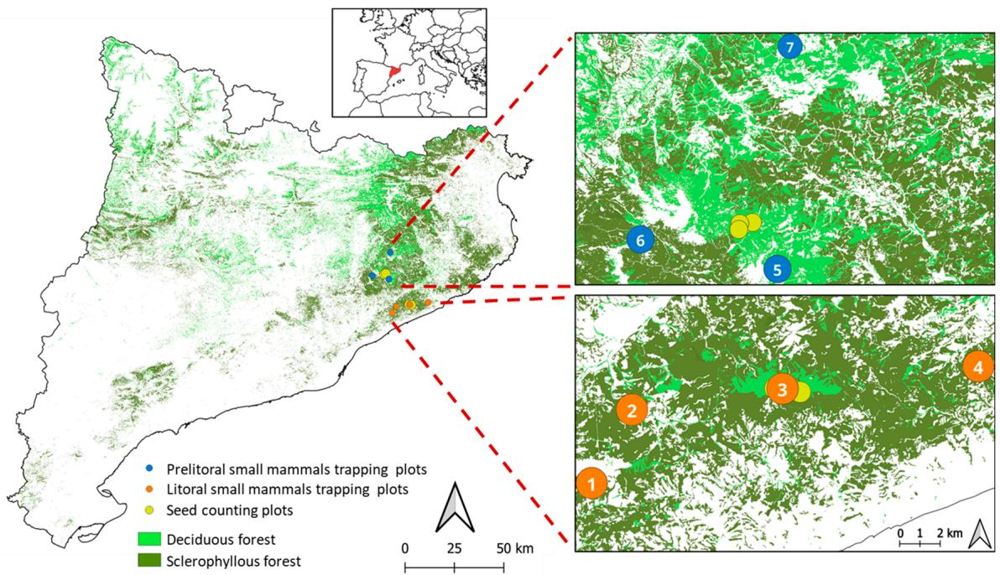
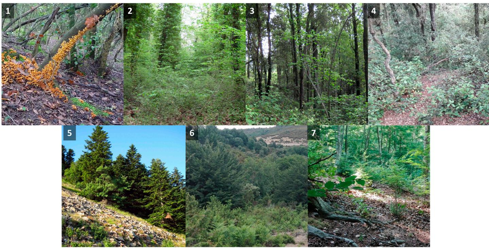
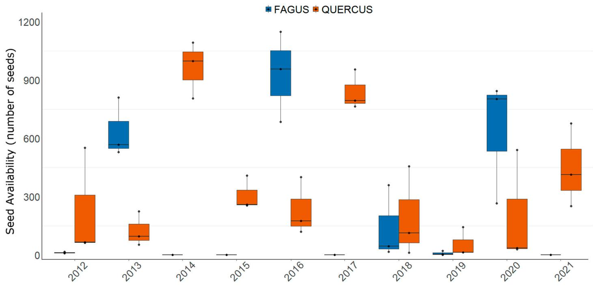
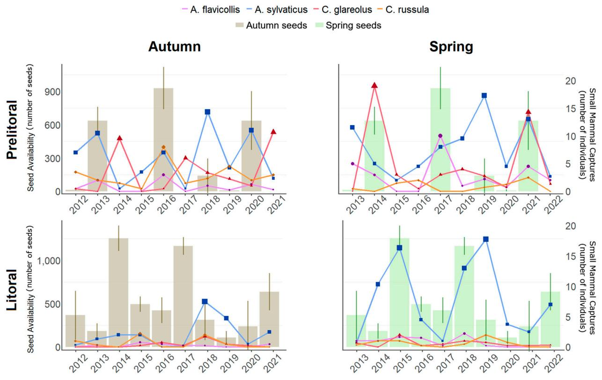

Article

# Seed Availability and Small Mammal Populations: Insights from Mediterranean Forests

César Llanos-Guerrero * , Lídia Freixas-Mora, Marc Vilella $\textcircled{1}$ , Carme Bartrina $\textcircled{1}$ and Ignasi Torre $\textcircled{1}$

Small Mammal Research Area and BiBio Research Group, Natural Sciences Museum of Granollers, Francesc Macià 51, 08402 Granollers, Spain; lfreixas@mcng.cat (L.F.-M.); marc.vilella16@gmail.com (M.V.); carmebartrina97@gmail.com (C.B.); itorre@mcng.cat (I.T.)   
* Correspondence: cesar.llanosgue@gmail.com

Abstract: Plant–animal interactions play a crucial role in ecosystem functioning, especially through seed dispersal mechanisms. Understanding how small mammal populations respond to seed availability is essential for ecosystem management and biodiversity conservation, especially in the context of habitat loss and climate change. We conducted a 10-year study in mixed Mediterranean oak–beech forests to investigate the population dynamics of common small mammal species in response to seed availability. Our findings revealed distinct responses among species, influenced by life history traits, foraging behaviour, and diet. Wood mice (Apodemus sylvaticus) showed a rapid population increase with seed availability both in the same year of seed fall and the following year, suggesting a flexible foraging strategy and a dependence on arboreal seed producers. Yellow-necked mice (Apodemus flavicollis) revealed immediate population increases in response to seed availability in the autumn, probably because of their arboreal habits and preference for exploiting seeds prior to maturation. Bank voles (Clethrionomys glareolus) showed responses with population peaks in years following high seed availability, indicating a slower demographic response to resource abundance. Surprisingly, the greater white-toothed shrew (Crocidura russula) responded indirectly to seed availability in Mediterranean forests, suggesting complex interactions with seed-associated invertebrates or dependence on other variables not considered. Our findings highlight the importance of understanding how changes in seed availability influence the population ecology of small mammals, with significant implications for the conservation and management of Mediterranean forest ecosystems in the context of climate change and recurrent droughts. These results emphasise the need to consider species interactions, resource availability, and climate change in the conservation and management of evolving ecosystems.

Keywords: Mediterranean mixed forests; plant–small mammal interactions; rodents; seed availability; shrews; seed predators

check for updates

Citation: Llanos-Guerrero, C.; Freixas-Mora, L.; Vilella, M.; Bartrina, C.; Torre, I. Seed Availability and Small Mammal Populations: Insights from Mediterranean Forests. Forests 2024, 15, 1148. https://doi.org/ 10.3390/f15071148

Academic Editor: Danilo Russo

Received: 4 June 2024

Revised: 28 June 2024

Accepted: 30 June 2024

Published: 2 July 2024

Copyright: © 2024 by the authors. Licensee MDPI, Basel, Switzerland. This article is an open access article distributed under the terms and conditions of the Creative Commons Attribution (CC BY) license (https:// creativecommons.org/licenses/by/ 4.0/).

# 1. Introduction

Plant–animal interactions play important ecological functions and are a fundamental aspect of ecosystem structure. Efficient seed dispersal is crucial for plant population stability, maintaining functional connections among metapopulations and colonising new habitats [1,2]. With the contemporary increase in habitat loss and fragmentation, dispersal has become even more relevant, especially in forests, as it can influence species composition and ecosystem functioning at regional and global scales [3–5]. On the other hand, the relationship between seed production by plant species and the population response of small mammals is particularly important [6–9].

Small mammals, such as small rodents, can be considered seed dispersers and predators, playing a crucial role in seed dispersal and vegetation regeneration and thus influencing ecosystem dynamics and diversity [10]. This group is generally more tolerant to habitat fragmentation and less prone to extinction than large herbivores [11,12]. They are

distributed on all continents with high species richness and high population densities [13] and are often considered keystone species that affect many ecosystem processes [14]. Seed production by plant species is a key factor in the ecology of small mammals, providing an abundant and nutritious food source that can influence their reproduction, survival, and movement within the ecosystem [15–17].

In temperate and boreal forests, massive seed production can trigger a significant increase in small mammal abundance [18,19]. This phenomenon occurs when a plant species locally synchronises its seed production in the same year, creating an overabundance of food that can be exploited by small mammals, whose reproduction is closely correlated with food availability [19–21]. This reproductive strategy has long been discussed in the literature, and it is not perfectly understood for most species, although it seems particularly clear in wind-pollinated trees of the northern hemisphere such as beech and oak trees [22–26]. Therefore, the relationship between seed production by plant species and small mammal population responses is crucial for forest ecosystem functioning [27]. Understanding this relationship is essential for the conservation and management of biodiversity in protected areas, as well as for the restoration of degraded ecosystems affected by climate change [28].

Ecologists have long been interested in understanding how resource pulses elicit different consumer responses and how these responses affect community dynamics through competitive interactions [29]. Many animal species that feed on trees seeds or fruits increase in numbers in response to an increased food supply. For example, Apodemus species, which store acorns during the autumn season, reach peak levels the following year because of increased winter survival. This phenomenon has been observed in the forests of the northern hemisphere [30–32].

The relationship between seed production and the abundance and diversity of small mammals has been studied in diverse ecological contexts [33–39]. However, a better understanding of these processes is required in Mediterranean ecosystems, where global change models predict extreme decreases in precipitation and increases in temperature, directly affecting forest dynamics [40,41]. This will increase the frequency and intensity of dry spells characteristic of this climate, which in turn will increase the soil aridity. Thus, Mediterranean forests are likely to suffer warming-related reductions in growth and production [40,42,43], and the Mediterranean domain is projected to shift towards the North in the coming decades [44].

Seed production in Mediterranean ecosystems forest is influenced by key environmental factors, including climatic variability, water availability, and interactions with other organisms [45,46]. Some of the most abundant and relevant seed producers in the northeast of the Iberian Peninsula are different species of oak (Quercus petraea, Quercus ilex, and Quercus canariensis) and beech (Fagus sylvatica). Previous studies have identified several climatic factors that affect the synchronous seed production of these species. For example, in the case of beech, high seed production depends on the summer temperature in the two years prior to the sampling year [45,47,48]. On the other hand, the acorns of the different Quercus species mature during the summer, when water limitation and elevated temperatures usually generate high abortion rates in tree species [41,46,49]. The same is true for beech, whose growth and production are limited by the hot and dry summers of the Mediterranean climate [43,49,50]. The prediction of climatic extremes resulting from global warming is expected to threaten the functioning of Mediterranean ecosystem forests, where summer droughts and forest fires are recurrent events, which may have a significant impact on seed production and ultimately on small mammal populations [51,52].

It has been shown that some common small mammal species in Mediterranean forests, such as wood mice (Apodemus sylvaticus), yellow-necked mice (Apodemus flavicollis), and bank vole (Clethrionomys glareolus) [53], respond to seed availability [31,37,54]. Furthermore, in addition to food availability, other factors such as intraspecific and interspecific competition, predation, and vegetation structure can also affect small mammal populations in Mediterranean forests [55]. The interplay among these factors can create spatial and

temporal patterns in the distribution and abundance of small mammal species in response to seed production [29,56,57].

Knowledge of how seed availability influences the population dynamics of small mammals can provide valuable information for biodiversity monitoring and management of the ecosystems in protected areas such as those found in the northeast of the Iberian Peninsula. Moreover, understanding the mechanisms regulating the relationship between seed production and small mammals may have implications for restoring degraded ecosystems or those affected by climate change. Therefore, restoring the dynamics of plant–animal interactions, including seed dispersal by small mammals, may be essential for the recovery of vegetation and ecosystem functionality in forests [58,59].

The main objective of this study was to investigate the population dynamics of the most common small mammal species in response to seed availability in mixed oak (Q. petraea, Q. canariensis, and Q. ilex) and beech (F. sylvatica) forests in a Mediterranean area. This region encompasses a diverse range of climates and forest landscapes, creating a gradient that includes varying environmental conditions. The small mammal communities were monitored over 10 years (2012–2022) in seven live trapping stations sampled in the spring and autumn, and the availability of seeds was measured at representative habitats. This transition along the gradient represents a unique opportunity to understand how vegetation changes and ecosystems respond to spatial variations, which is crucial for understanding and conserving biodiversity and natural resources in diverse forest environments.

We expected that species responses to seed availability would be associated with lifehistory traits (e.g., the timing of reproduction, [37,60]), foraging behaviour (e.g., degree of arboreality [61,62]; seed-hoarding behaviour [36]), and feeding strategies (e.g., insectivores, granivores [33,63,64]). Therefore, we expected that tree-dwelling granivorous rodents would have faster population responses to seeds if they were available before seed fall and delayed responses associated with seed availability on the ground and seed caches. In addition, owing to their scatter-hoarding behaviour, we expected floor-dwelling rodent species—having limited access to seeds only when they fall from the trees—would have delayed population responses mostly caused by this behaviour. Also, we predicted that insectivorous shrews would have only delayed responses associated with the increase in seed predatory insects. Finally, we also expected that specific population responses to seed availability would affect community diversity estimates.

# 2. Methods

# 2.1. Study Area

The study area represented an extensive gradient of climates and forest landscapes ranging from low-elevation coastal environments under Mediterranean influence, towards elevated areas in the pre-coastal mountain range with marked Euro-Siberian influence [65]. We sampled seven habitats (Figure 1) that were considered representative of the two prevailing climatic and forest domains (i.e., Mediterranean and Euro-Siberian), where seed measurements were performed in mixed oak (Q. petraea/canariensis/ilex) and mixed beech (Fagus/Quercus) forest areas.

Our work in the pre-coastal range focused on the protected areas of Montseny Natural Park Biosphere Reserve and Guilleries-Savassona Natural Area. The mean annual temperature is $1 1 . 3 ^ { \circ } \mathrm { C }$ and the annual rainfall is $1 4 1 5 . 2 \mathrm { m m }$ [66]. Moreover, the highest peak, “Turó de l’Home”, has an altitude of $1 7 1 2 \mathrm { m }$ [67]. The vegetation is mainly composed of F. sylvatica, Q. petraea, Corylus avellana, and Acer opalus mixed with Q. ilex and Ilex aquifolium [68], but our sites were mainly located in beech forests.

The study area of the coastal range is located in Montnegre and Corredor Natural Park. This area is smaller (approximately ${ \bar { 1 } } 5 0 \mathrm { k m } ^ { 2 } ,$ ), and the culminating ridge of Montnegre is slightly more than $3 \mathrm { k m }$ long above $7 0 0 \mathrm { m }$ in altitude [69]. The mean annual temperature is $1 4 . 5 ^ { \circ } \mathrm { C }$ and the annual rainfall is $1 0 6 7 . 4 \mathrm { m m }$ [70]. The vegetation is composed of Q. petraea, Q. canariensis, and Q. ilex [68].

  
Figure 1. Location of this study in Catalonia, Spain. Small mammal sampling plots are represented Figure 1. Location of this study in Catalonia, Spain. Small mammal sampling plots are represented in n blue (F. sylvatica forest area) and orange (Quercus sp. forest area). Seed counting plots are repre-blue (F. sylvatica forest area) and orange (Quercus sp. forest area). Seed counting plots are represented sented in yellow. Deciduous and sclerophyllous forests are represented in light and dark green, in yellow. Deciduous and sclerophyllous forests are represented in light and dark green, respectively.sented in yellow. Deciduous and sclerophyllous forests are represented in light and dark green, respectively. Numbers correspond to the Plot ID, as in Figure 2 and Table 1. This figure was pre-Numbers correspond to the Plot ID, as in Figure 2 and Table 1. This figure was prepared with QGISrespectively. Numbers correspond to the Plot ID, as in Figure 2 and Table 1. This figure was pre-(Development Team, 2023), and geographical information from “Institut Cartogràfic i Geològic depared with QGIS (Development Team, 2023), and geographical information from “Institut Car-Catalunya” was used.togràfic i Geològic de

  
ow: sampling plots from the pre-coastal range. The numbers of each image correspond to the Plot  Figure 2. Small mammal sampling plots. Upper row: sampling plots from the coastal range. Lower D in Figure 1 and Table 1 (photos from www.semice.org; accessed on 14 December 2023).  row: sampling plots from the pre-coastal range. The numbers of each image correspond to the Plot ID in Figure 1 and Table 1 (photos from www.semice.org; accessed on 14 December 2023).

Table 1. Description of small mammal sampling plots. Plot_ID: number associated with the plot. Altitude: height at sea level expressed in meters. Scrub: percentage of shrub cover. Forest: Percentage of tree cover. Urban: percentage of urban area.   

<table><tr><td>Plot_ID</td><td>Name</td><td>Vegetation</td><td>Altitude</td><td>Scrub</td><td>Forest</td><td>Urban</td></tr><tr><td>1</td><td>Alzinar Sot del Fangar</td><td>Quercus</td><td>516</td><td>3.62%</td><td>95.57%</td><td>0.82%</td></tr><tr><td>2</td><td>Riera de Vallgorguina</td><td>Quercus</td><td>193</td><td>10.32%</td><td>80.58%</td><td>9.10%</td></tr><tr><td>3</td><td>Roueda del Turó Gros</td><td>Quercus</td><td>750</td><td>0.00%</td><td>100.00%</td><td>0.00%</td></tr><tr><td>4</td><td>Turó de Miralles</td><td>Quercus</td><td>257</td><td>5.39%</td><td>94.61%</td><td>0.00%</td></tr><tr><td>5</td><td>Avetosa de Passavets</td><td>Abies-Fagus</td><td>1442</td><td>9.86%</td><td>90.14%</td><td>0.00%</td></tr><tr><td>6</td><td>Fageda de la Cortada</td><td>Fagus</td><td>1200</td><td>25.58%</td><td>74.42%</td><td>0.00%</td></tr><tr><td>7</td><td>Fageda de les Valls</td><td>Fagus</td><td>908</td><td>1.99%</td><td>98.01%</td><td>0.00%</td></tr></table>

# 2.2. Small Mammal Sampling

Small mammal abundance was assessed using a capture–mark–recapture study following the SEMICE (www.semice.org; accessed on 14 December 2023) monitoring scheme [71] in live trapping plots placed in representative habitats of the study area. The plots selected included the following main habitats (Table 1): riverbed (one plot), holm oak (Q. ilex, two plots), oak grove (Q. canariensis, one plot), beech (F. sylvatica, two plots), and fir (A. alba, one plot). Sampling was conducted twice a year, in spring and autumn, to cover the life cycle of the target species [72,73]. The time series spanned ten years, from spring 2012 to autumn 2022. The sampling plots were grids of 36 traps, using both a $6 \times 6$ and $9 \times 4$ (riverbed) scheme design. To mitigate size-related biases in small mammal community assessments, Longworth traps (Longworth Scientific Instrument Co., Oxford, UK; $2 5 \times 6 . 5 \times 8 . 5 \mathrm { c m }$ [74,75]) and Sherman traps (Sherman folding small animal trap; $2 3 \times 7 . 5 \times 9 \mathrm { c m }$ ; Sherman Co., Tallahassee, FL, USA) were alternated in position one at a time [76]. The traps were placed $1 5 \mathrm { m }$ apart, baited with a piece of apple to prevent dehydration and with a mixture of tuna and flour as an energy source. A handful of hydrophobic cotton was included as bedding material and thermal isolator [77,78]. The traps were set for three consecutive nights and checked in the early morning of the first, second, and third day. The species captured were identified, sexed, weighed, tagged with ear-tags in the case of rodents (Style 1005-1, National Band Co., Newport, RI, USA) and fur clips for shrews, and released at the point of capture [79]. The number of different individuals captured over the three days (excluding recaptures) was considered an index of relative abundance. Owing to the high mean values of detectability, indices of abundance of the species analysed were assumed to be unbiased (i.e., low probability of non-detecting the species when actually present) [53].

The seven sampling plots covered the range of habitats and climates observed in the coastal and the pre-coastal ranges of the Barcelona province (Figure 2). In the pre-coastal mountain range, the plots were located in the beech forest domain, while in the coastal mountain range, they were located in areas of mixed oak forests. Elevations of the plots ranged from $1 9 3 \mathrm { m }$ to 1442 m above sea level.

# 2.3. Seed Availability Data

Seed availability was assessed from 2012 to 2021 in three plots situated in Mediterranean mixed forests (Q. canariensis, Q. petraea, and Q. ilex) and three plots in beechdominated forests, by counting and weighting the seeds—intact and preyed/infested—in 20 small quadrats $( 5 0 \times 5 0 \mathrm { c m } , 0 . 2 5 \mathrm { m } ^ { 2 } )$ fixed on the ground [37,40]. Each quadrat was set under a tree and placed $2 5 \mathrm { - } 3 0 \mathrm { m }$ apart forming a $5 \times 4$ grid. Seed counting was performed six times a year every two weeks, from the end of August to the end of November. To prevent double counting, the sampling quadrats were cleaned after each check. We considered the whole number of seeds counted during each check and plot as the seed index (20 quadrats on a $5 \mathrm { m } ^ { 2 }$ surface), calculating the mean annual count of the three plots as an estimate of seed availability in the nearby small mammal plots. Since the number of seeds

and their weight were highly correlated $( \mathbf { r } = 0 . 9 7 )$ ), we considered only the first variable for the analyses.

To assess the variability in seed counts across spatial and temporal scales and to validate the use of annual averaged seed counts as a reliable indicator of seed availability in our study area, we conducted statistical analyses using Linear Mixed Models [80] in RStudio software [81]. Specifically, we employed LMMs where seed counts at each sampling plot served as the response variable, with year included as a fixed effect and plot as a random effect. This approach allowed us to compare the explanatory power of the fixed predictor (year) against the variability attributed to the random factor (plot). By employing these models, we aimed to evaluate whether seed counts varied more significantly among sampling plots or across different years, thereby ensuring robustness in our characterisation of annual seed availability dynamics.

# 2.4. Data Analysis

To assess the effects of seed availability on the relative abundance of small mammals we used Generalized Linear Mixed Models [82]. The number of individuals captured for each species during each trapping season was included as the response variable, and the predictor variables were the seed index of the previous year (to test for delayed population responses of small mammals [33–35,57,82]), the seed index of the corresponding year (to test the response of small mammals in the same year), and the sampling season (spring or autumn). We also included the two-level interactions between season and each seed count. Plot, year, and area (prelitoral or litoral) were included as random factors to account for the natural variability among locations and data collection times. Variance inflation factors were calculated to evaluate possible multicollinearity in the explanatory variables (VIF; R package car; [83]). Since seed availability showed synchrony (both spatially and temporally, [84–86]), we also expected similar responses to seed availability of synchronic small populations [87,88]. Since models with a Poisson distribution showed high values of overdispersion, all models were run with a negative binomial error distribution to cope with overdispersion [89] by means of the $" \log ^ { \prime \prime }$ link function, R package lme4 [90].

Additionally, we used LMMs to analyse the role of seed availability on the whole community of small mammals (i.e., changes in species richness and evenness) using Hill’s numbers [91], which allowed us to calculate the effective number of species (or equiprobable species) by using the parameter $^ { \prime \prime } { \mathsf { q } } ^ { \prime \prime }$ , which indicates the sensitivity of the index to the relative abundance of species. Thus, if $\mathsf { q } = 0$ (Order 0), the result indicates species richness (number of species); if $\mathsf { q } = 1$ (Order 1), it 1 yields the exponential of the Shannon index; if ${ \mathfrak { q } } = 2$ (Order 2), the inverse Simpson index is obtained (Hsieh et al., 2016). The same structure as the GLMM was used, but in that case, different diversity order values were used as the response variable ( $0 =$ species richness; $1 =$ species diversity; $2 =$ species dominance), resulting in three different model sets [92]. To calculate the diversity value according to each order in each plot and each year, we used the R package vegan [93].

The GLMM and LMM were built using the R package lme4 [90], using the dredge function of the package MuMIn [94], and model complexity (parsimony) was assessed by the corrected Akaike information criterion (AICc), selecting those with $\Delta \mathrm { A I C c } \leq 2$ with respect to the lowest-valued model [95]. For the selected models, we calculated pseudo-$\mathrm { R } ^ { 2 }$ values by means of the R function r.squaredGLMM and the delta method for variance estimation [96].

# 3. Results

# 3.1. Seed Availability

The main seed-producing species at the sampling plots were beech (Fagus sylvatica) and Quercus species (Quercus sp.). The models demonstrated that annual variability explains a larger proportion of the seed count variability than spatial variability among plots. This is evidenced by the R-squared values, where annual factors alone explained $8 4 \%$ and $7 2 \%$ o f the variability in seed counts in beech and oak forest areas, respectively. When both annual

and spatial factors were considered, the variability explained increased only to $8 6 \%$ for beech forest areas and $9 1 \%$ for oak forest areas. As expected, these findings suggest that the seed availability of both tree genera varied significantly among the years studied.

The seed availability patterns over time were similar within the plots of each treeThe seed availability patterns over time were similar within the plots of each tr species. Thus, a certain interannual synchrony in the availability of seeds was observedspecies. Thus, a certain interannual synchrony in the availability of seeds was observ (Figure 3). During the study period, Quercus seeds were observed each year(Figure 3). During the study period, Quercus seeds were observed each year (mean = 500. (measeed $\mathrm { n } = 5 0 0 . 7 3$ seeds35.77 $^ { \prime } 5 \mathrm { ~ m } ^ { 2 } \pm 4 3 \mathrm { ~ \bar { 5 } . 7 \mathrm { ~ \bar { 7 } ~ } }$ SD,%), $C . { \mathrm { V . = 8 7 \% } }$ ), but Fagus seeds were only observedeeds were only observed in five yea in five years (mean = 236.26 seeds(mean = 236.26 seeds/5 m2 ± 364.01 $^ { \prime } 5 \mathrm { ~ m } ^ { 2 } \pm 3 6 4 . 0 1$ SD,%) a $\mathrm { C . V . } = 1 5 4 \%$ ) and showed higherhigher heterogeneity heterogeneity in their availability.their availability.

  
Figure 3. Seed availability per year for the main tree species. The median number ofFigure 3. Seed availability per year for the main tree species. The median number of seeds $\pm$ eds (±ququartiles) tiles) of the two main seed-producing tree species counted over 10 years (2012–2021) in the six stuof the two main seed-producing tree species counted over 10 years (2012–2021) in the six study plots plots (black dots indicate the value of seeds counted in eac(black dots indicate the value of seeds counted in each plot).

# 3.2. Small Mammal Captures

During 2012-2022, a total of 1007 small mammals were trapped (58% A. sylvaticus, $2 2 \%$ During 2012-2022, a total oC. glareolus, 13% A. flavicollis, and $8 \%$ 07 small mC. russula).

C. glareolus, 13% A. flavicollis, and 8% C. russula). We obtained between one and three significant statistical models (GLMM and LMM) We obtained between one and three significant statistical models (GLMM and LMfor each response variable (Appendix A), and the most parsimonious models are shown for each rin Table 2.

able 2. The predictive performance of our models exhibited relatively low explanatory power with respect to the predictors, explaining only between $5 \%$ and $1 8 \%$ of the variance in the Table 2. Statistical models (GLMM and LMM) selected for each smresponse variable. The random factors had a greater influence.

ess (response variables). Predictors: season (autumn as reference), seed availability of the cThe abundance of A. sylvaticus was higher in the spring (Table 2). The interaction rent year, seed availability of the previous year. Coefficients represent the effects of predictor varbetween seed availability of the previous year and season was significant in all selected models of this species (Appendix A), suggesting a late response to seed dropping during 0.01; * p < 0.05. the following spring. Seeds from the same year also had significantly positive effects, A. sylvaticus A. flavicollis C. glareoindicating an instant response to seed availability.

Table 2. Statistical models (GLMM and LMM) selected for each small mammal species and speciesse variables). Predictors: season (autumn as reference), seed availability of th richness (response variables). Predictors: season (autumn as reference), seed availability of the current year, seed availability of the previous year. Coefficients represent the effects of predictor variables onseed availability of the previous year. Coefficients represent the effects of pred species abundance ecies abundancees abundance (±undance (±SE). dance (±SE). Si $( \pm \mathrm { S E } )$ . Significant coefficients are indicated as follows:E). Significant coefficients are indicatedSignificant coefficients are indicated aificant coefficients are indicated as follcant coefficients are indicated as follow $^ { * * * } p < 0 . 0 0 1$ ;  0 $^ { * * } p < 0 . 0 1$ $^ { * } p < 0 . 0 5$ .   

<table><tr><td>Variables</td><td>A. sylvaticus</td><td>A. flavicollis</td><td>C. glareolus</td><td>C. russula</td><td>Species Richness</td></tr><tr><td rowspan="2">(Intercept)</td><td>0.92 ***</td><td>-1.48</td><td>-1.89 ***</td><td>-0.43 ***</td><td>1.91 ***</td></tr><tr><td>(0.01)</td><td>(0.88)</td><td>(0.01)</td><td>(0.01)</td><td>(0.44)</td></tr><tr><td rowspan="2">SeasonSpring</td><td>0.82 ***</td><td>1.08 ***</td><td></td><td></td><td>0.39 *</td></tr><tr><td>(0.01)</td><td>(0.00)</td><td></td><td></td><td>(0.15)</td></tr><tr><td rowspan="2">Seed of the same year</td><td>0.29 ***</td><td>0.69 ***</td><td>-0.68 ***</td><td></td><td></td></tr><tr><td>(0.01)</td><td>(0.00)</td><td>(0.01)</td><td></td><td></td></tr><tr><td rowspan="2">Seed of the previous year</td><td>-0.03 *</td><td>0.27 ***</td><td>0.66 ***</td><td>0.44 ***</td><td>0.25 **</td></tr><tr><td>(0.01)</td><td>(0.00)</td><td>(0.01)</td><td>(0.01)</td><td>(0.09)</td></tr><tr><td rowspan="2">Spring: seed same year</td><td></td><td>-0.70 ***</td><td></td><td></td><td></td></tr><tr><td></td><td>(0.00)</td><td></td><td></td><td></td></tr><tr><td rowspan="2">Spring: seed previous year</td><td>0.59 ***</td><td>0.51 ***</td><td></td><td></td><td></td></tr><tr><td>(0.01)</td><td>(0.00)</td><td></td><td></td><td></td></tr><tr><td>AICc</td><td>632.41</td><td>275.99</td><td>286.70</td><td>308.97</td><td>198.71</td></tr><tr><td>Dispersion ratio</td><td>0.88</td><td>1.11</td><td>0.66</td><td>0.76</td><td>-</td></tr><tr><td>Num. Obs.</td><td>114</td><td>114</td><td>114</td><td>114</td><td>80</td></tr><tr><td>Family</td><td>Negative binomial</td><td>Negative binomial</td><td>Negative binomial</td><td>Negative binomial</td><td>Gaussian</td></tr><tr><td>R² marginal</td><td>0.17</td><td>0.18</td><td>0.11</td><td>0.05</td><td>0.09</td></tr><tr><td>R² conditional</td><td>0.62</td><td>0.83</td><td>0.91</td><td>0.47</td><td>0.58</td></tr></table>

Regarding seed availability, we observed that seeds of the same and the previous year had significant effects on the abundance of A. flavicollis (Table 2). The response to seed availability in the same year was positive in the autumn, while it was positive in the spring after the seed fall in the previous year. This showed that in the year of seed fall, there was a population response in the autumn that extended until the next spring, but there was no anticipated response.

Both seed availability in the year of seed fall and the year after seed fall affected the abundance of C. glareolus, with the former having a negative effect and the latter having a positive effect (Table 2). Despite strong interannual variation in population abundance (Figure 4), this species did not show clear seasonal population changes.

The abundance of C. russula showed a positive response to seed availability in the previous year (Table 2).

Species richness (Order 0) increased in the spring and was associated with the seeds available in the previous year (Table 2). However, season and seed availability did not have effects on community diversity (Order 1) or evenness (Order 2); thus, no model appears in Table 2 for these two response variables.

  
Figure 4. Mean number of seeds (bars ± SE) available within the same year (in autumn; brown col-Figure 4. Mean number of seeds (bars ± SE) available within the same year (in autumn; brown our) and in the previous year (in spring; green colour) and average number of captures (lines) of colour) and in the previous year (in spring; green colour) and average number of captures (lines) of the four small mammal species in the spring and autumn.the four small mammal species in the spring and autumn.

# 4. Discussion 4. Discussion

Our seed-producing species, F. sylvatica and Quercus sp., exhibited fluctuating seed Our seed-producing species, F. sylvatica and Quercus sp., exhibited fluctuating seed availability, varying among years, being very high in some years and scarce in others. availability, varying among years, being very high in some years and scarce in others. Previous studies have identified several climatic variables that influence seed production Previous studies have identified several climatic variables that influence seed production in these species. In the case of F. sylvatica, high seed production has been linked to summer in these species. In the case of F. sylvatica, high seed production has been linked to summer temperatures in the two years prior to the production year [46,48,49]. In contrast, other temperatures in the two years prior to the production year [46,48,49]. In contrast, other climatic variables associated with variable seed production in Quercus sp. have been iden-climatic variables associated with variable seed production in Quercus sp. have been identitified, such as high spring temperatures that synchronise flowering or annual differencesfied, such as high spring temperatures that synchronise flowering or annual differences in in summer drought [26,9summer drought [26,97].

The results showed that variability in seed availability had important implications for The results showed that variability in seed availability had important implications for the population dynamics of small mammals that depend (directly or indirectly) on these the population dynamics of small mammals that depend (directly or indirectly) on these food sources, specifically, A. sylvaticus, A. flavicollis, C. glareolus, and C. russula, the four main food sources, specifically, A. sylvaticus, A. flavicollis, C. glareolus, and C. russula, the four main species of small mammal communities found in forests of the study area [53]. These species species of small mammal communities found in forests of the study area [53]. These species revealed distinct patterns in responding to seasonality and variability in seed availability of revealed distinct patterns in responding to seasonality and variability in seed availability the most frequent seed producers. Our results suggested that life history traits, feeding strat-of the most frequent seed producers. Our results suggested that life history traits, feeding egies, and foraging behaviour, were involved in the particular population responses of small strategies, and foraging behaviour, were involved in the particular population responses of mammal species to seed availability in Mediterranean mixed forests. small mammal species to seed availability in Mediterranean mixed forests.

A. sylvaticus was the most abundant species in the communities studied, as was previously found in the area [53,55]. As a seed predator, this species has a relevant role in forest regeneration owing to its seed disperser activity [98]. The wood mouse is a alist species and exhibits considerable plasticity in terms of feeding, using the most abun-generalist species and exhibits considerable plasticity in terms of feeding, using the most abundant source available [37,99,100]. This species showed a positive response to seeds within the same year, showing population responses to food availability and suggesting arboreal behaviour [62], as well as changing their breeding effort based on the availability of resources at the moment [101]. Studies performed in Mediterranean mixed forests revealed a strong association between seed availability and wood mouse dynamics during the autumn–winter period, with populations increasing towards the following spring [37,46].

Our results agreed with former studies [37,46] that also revealed a strong positive response to seeds of the previous year, which affected the abundance in the following spring. This pattern could be associated with seed scatter-hoarding behaviour, which allows the storage of acorns during the seed-falling season (autumn), and probably increases winter survival after feeding on seed caches well outside the period of natural seed availability [102]. This response suggested that the species takes full advantage of food availability throughout the year, affecting the length of its reproductive season [37,55,99]. In the Mediterranean, this species shows reproductive activity from late autumn to spring but, depending on suitable weather conditions, it can be extended towards the summer [37,87]. A.sylvaticus displayed consistent population dynamics, with boom and bust dynamics [91], increasing from autumn to spring and decreasing from spring to autumn because of summer breeding latency due to the characteristics of the Mediterranean climate [73,87,103]. This plasticity in food choice could be an advantage in changing environments, where seed availability is variable [104].

Similar to A. sylvaticus, A. flavicollis may eventually feed on small invertebrates, but its main diet consists of high-energy seeds and fruits [33]. Therefore, yellow-necked mice responded to seed availability either in the autumn or in the spring of the following year. Interestingly, this was the only studied species showing a stronger population response to the availability of seeds in the autumn of the current year (i.e., mice abundance versus seed availability in autumn) than to the availability of seeds of the previous year. In fact, A. flavicollis seems to be more adapted to the extraction of seeds from beech and other deciduous trees before maturation and dropping, a behaviour closely related to its arboreal habits and ease of climbing [100,105,106]. This species has very strict forest requirements and prefers deciduous tree-covered habitats [107,108]. A. flavicollis can also extend its reproductive period based on food availability and weather, which are key factors in the biology of the species [105,106,109]. This immediate response may be related to a strategy of maximising energy to survive during colder months or when other resources are scarce, with seeds being the food in which it specialises [38,110]. Thus, the rapid population response of A. flavicollis suggests a strategy of taking advantage of peaks in seed production while also ensuring forest regeneration by immediate seed dispersion.

C. glareolus dynamics were affected by the availability of seeds from the current (negative) and previous (positive) years. This means that the lowest densities were detected during the years of seed availability and the highest densities in the years without seed availability but following a year of seed production. This apparent contradiction can be observed after modelling rodent populations under seed production events [102]. C. glareolus is a herbivorous forest specialist in the study area [111], primarily feeding on leaves and seeds, although it may consume insects and earthworms [35,102]. In temperate regions, tree species have years in which seed production is very high, and such a year is followed by several years with very low production, showing fluctuating cycles [33]. All previous studies recorded a response of this species in the year following seed fall [33–35,57] because years of high seed availability produced a clear change in the age structure and densities of bank voles in the following spring and autumn. Because of this intense delayed response, the populations of this species probably exhibit self-regulation mediated by density dependence, producing population outbreaks or crashes regardless of food supplies [35,82]. Therefore, the strong dependence on seed availability produced significant interannual variations in abundance, but without seasonality (i.e., similar abundance in the spring and autumn).

In contrast, C. russula is a fascinating example of how interactions between small mammals and other species in their environment can interrelate in the Mediterranean forests. Although traditionally classified as an insectivore, this shrew has demonstrated an interesting and previously poorly documented response to seed availability, highlighting the importance of understanding the complexities of species ecology in the context of fluctuating resource production. First, it is essential to consider the relationship between the biology of the white-toothed shrew and its response to variability in seed production,

because its diet in Europe consists primarily of soil invertebrates [64,110]. This means that the response of C. russula to seed availability could not be direct; however, an increase in seed production may result in higher numbers of seed-predatory insects in the autumn, both through increased reproduction of these species and aggregation in seed-rich trees [112–114]. Both Quercus and Fagus trees suffer from invertebrates specialised in seed predation, where Curculio elephas and Cydia fagiglandana are some of the most important [33,115,116]. This coincides precisely with the population peak of C. russula, suggesting a relationship between its demography and the increase in invertebrates due to seed production, increasing the recruitment of juveniles in the summer after a seed fall year [55,60,110]. A similar situation occurred with house mice (Mus musculus) in New Zealand [117]. Furthermore, shrew populations will benefit from the increase in infested acorns on the ground as far as the season progresses since rodents leave infested acorns in situ [46]. Although the results are suggestive, we need to stress that forests are unsuitable habitats for C.russula, which shows a strong preference for scrublands [55,60,118] and a spatial retraction of its distribution range in the coastal area because of afforestation [55,60]. This means that the results obtained need to be considered with caution and that responses to seed availability could be also related to masked effects of weather on insect dynamics.

Regarding the response of the whole community, species richness increased in spring, probably because of the increased abundance of both mice (wood mice and yellow-necked mice) in that period. Additionally, the positive response to the availability of seeds in the previous year could be due to the population densities of the species normally encountered, where wood mice are the dominant species, and the rest are underrepresented. Consequently, wood mice abundance and their variations probably play an important role in explaining the community richness results. On the other hand, considering the Order 1 and 2 diversity indices, which are influenced by species evenness and dominance, no explanatory variable was included. This suggested that the representation of species in the community structure was not influenced by the variables tested. Other factors may have played relevant roles in the study area.

Given the dependence of seed production on local weather conditions at our study sites, it is crucial to pay attention to these factors, especially considering climate change predictions that could affect the region. It has been projected that increasing temperatures and drought episodes will result in a pronounced shift towards drier conditions in the region [119]. An increase in temperature has already been observed in Montseny in recent years [120,121]. These climatic changes may have a significant impact on Quercus species, with possible consequences for fauna that depend on these resources and for upstream ecological processes in forest ecosystems [122]. Previous studies have evaluated the effects of drier conditions on Mediterranean oak species and found a decrease in acorn production and greater variability among years [26,123,124]. These changing conditions can directly or indirectly alter the dynamics of forest ecosystems. The response of small mammals to seed availability not only reflects their ecological importance but also shows the challenges faced by these species. In a scenario of reduced seed production due to adverse climatic factors, small mammal populations will experience difficulties in their survival and persistence. This interdependence underscores the pressing need to understand and monitor these interactions in the context of climate change to implement effective conservation strategies that will safeguard biodiversity and the functionality of forest ecosystems in the future.

# 5. Conclusions

This study highlights how seed production variability can significantly influence the ecology of small mammals. In the face of projections indicating contractions in the potential distribution of all species studied [125], ranging from moderate in the shrew to large in all three rodents, climate change has emerged as one of the greatest challenges to biodiversity and ecosystem functioning globally. With the Mediterranean region predicted to experience an increase in the intensity and frequency of extreme weather events, seed production will certainly be affected, triggering a cascade of effects in forest ecosystems involving

multiple trophic levels [126–128]. This scenario will directly affect food availability for small mammals, which play critical roles in the ecosystem [10,129], such as seed dispersal, nutrient transfer, and regulation of insect populations [125], as well as serving as prey for several local predators [53,88]. In this context, our study highlights the importance of considering species interactions, resource availability, and climate change in the conservation and management of Mediterranean forest ecosystems. With the increasing need to address the conservation and functioning of ever-changing ecosystems, understanding how seed production, small mammals, and climate interact is a fundamental step in developing effective management and conservation strategies. This research provides a foundation for future studies and the implementation of adaptive conservation measures to ensure the resilience of forest ecosystems to the challenges of climate change.

Supplementary Materials: The following supporting information can be downloaded at: https://www.mdpi.com/article/10.3390/f15071148/s1, Table S1. Raw data materia.

Author Contributions: Conceptualization, I.T., L.F.-M. and C.L.-G.; methodology, I.T. and L.F.-M.; formal analysis, C.L.-G. and M.V.; writing—original draft preparation, C.L.-G. and I.T.; writing—review and editing, C.L.-G., L.F.-M., C.B., M.V. and I.T.; visualization, C.L.-G. and C.B.; supervision, I.T. and L.F.-M.; funding acquisition, I.T. and L.F.-M. All authors have read and agreed to the published version of the manuscript.

Funding: This research was funded by Diputació de Barcelona under Grant number 2023/0005732.

Data Availability Statement: Data is contained within the article or Supplementary Material.

Acknowledgments: We would like to express our sincere thanks to all those who assisted with this study. First, the Biodiversity and Bioindicators (BiBio) research team, with special mention to Esther Amores. Alfons Raspall provided the pictures of small mammals. We also thank Antoni Arrizabalaga (labs’ head) for providing administrative support and guarantee to the SEMICE program and the Dormouse Project over the years. We also recognise the role of volunteers and professionals in charge of SEMICE stations (James Manresa, Marçal Pou, Joan Manel Riera, Alfons Raspall), who kindly recorded data in the study area and the Projecte Liró team that carried out the seed counting (Laura Jou and Silvia Míguez). We also thank the authorities of Montnegre, Guilleries, and Montseny Natural Parks for permission to work inside their limits.

Conflicts of Interest: The authors declare no conflict of interest.

# Appendix A. Complete Species Model Tables

Table A1. Models and predictor variables for Apodemus sylvaticus. Numbers indicate the rank order of statistical support of the selected models. Predictors: season (autumn as reference), seed availability of the current year, seed availability of the previous year. Coefficients represent the effects of predictor variables on species abundance. Values in parentheses are standard errors. Significant coefficients are indicated as follows: $^ { * * * } p < 0 . 0 0 1$ ; $^ { * * } p < 0 . 0 1$ ; $^ { * } p < 0 . 0 5$ .   

<table><tr><td></td><td>Model 1</td><td>Model 2</td><td>Model 3</td></tr><tr><td>(Intercept)</td><td>0.92 ***</td><td>1.03 *</td><td>0.92 ***</td></tr><tr><td></td><td>(0.01)</td><td>(0.40)</td><td>(0.01)</td></tr><tr><td>SeasonSpring</td><td>0.82 ***</td><td>0.77 ***</td><td>0.84 ***</td></tr><tr><td></td><td>(0.01)</td><td>(0.19)</td><td>(0.01)</td></tr><tr><td>Seed of the same year</td><td>0.29 ***</td><td></td><td>0.38 ***</td></tr><tr><td></td><td>(0.01)</td><td></td><td>(0.01)</td></tr><tr><td>Seed of the previous year</td><td>-0.03 *</td><td>-0.14</td><td>-0.03 *</td></tr><tr><td></td><td>(0.01)</td><td>(0.15)</td><td>(0.01)</td></tr><tr><td>Spring: seed same year</td><td></td><td></td><td>-0.18 ***</td></tr><tr><td></td><td></td><td></td><td>(0.01)</td></tr><tr><td>Spring: seed previous year</td><td>0.59 ***</td><td>0.57 **</td><td>0.56 ***</td></tr><tr><td></td><td>(0.01)</td><td>(0.18)</td><td>(0.01)</td></tr></table>

Table A1. Cont.   

<table><tr><td></td><td>Model 1</td><td>Model 2</td><td>Model 3</td></tr><tr><td>AICc</td><td>632.41</td><td>633.44</td><td>634.04</td></tr><tr><td>Delta</td><td>0.00</td><td>1.03</td><td>1.63</td></tr><tr><td>Dispersion ratio</td><td>0.88</td><td>0.87</td><td>0.91</td></tr><tr><td>Num. Obs.</td><td>114</td><td>114</td><td>114</td></tr><tr><td>R2m</td><td>0.17</td><td>0.14</td><td>0.17</td></tr><tr><td>R2c</td><td>0.62</td><td>0.53</td><td>0.62</td></tr></table>

Table A2. Models and predictor variables for Crocidura russula. Numbers indicate the rank order of statistical support of the selected models. Predictors: season (autumn as reference), seed availability of the previous year. Coefficients represent the effects of predictor variables on species abundance. Values in parentheses are standard errors. Significant associations are indicated as follows: $^ { * * * } p < 0 . 0 0 1 ; \mathrm { } ^ { * } p < 0 . 0 5 .$ $^ { * } p < 0 . 0 5$ .   

<table><tr><td></td><td>Model 1</td><td>Model 2</td><td>Model 3</td></tr><tr><td>(Intercept)</td><td>-0.43 ***</td><td>-0.24</td><td>-0.27</td></tr><tr><td></td><td>(0.01)</td><td>(0.64)</td><td>(0.66)</td></tr><tr><td>SeasonSpring</td><td></td><td>-0.41</td><td>-0.39</td></tr><tr><td></td><td></td><td>(0.32)</td><td>(0.33)</td></tr><tr><td>Seed of the previous year</td><td>0.44 ***</td><td>0.40*</td><td>0.55*</td></tr><tr><td></td><td>(0.01)</td><td>(0.19)</td><td>(0.22)</td></tr><tr><td>Spring: seed previous year</td><td></td><td></td><td>-0.36</td></tr><tr><td></td><td></td><td></td><td>(0.30)</td></tr><tr><td>AICc</td><td>308.97</td><td>309.63</td><td>310.47</td></tr><tr><td>Delta</td><td>0.00</td><td>0.66</td><td>1.50</td></tr><tr><td>Dispersion Ratio</td><td>0.76</td><td>0.77</td><td>0.75</td></tr><tr><td>Num. Obs.</td><td>114</td><td>114</td><td>114</td></tr><tr><td>R2m</td><td>0.05</td><td>0.06</td><td>0.06</td></tr><tr><td>R2c</td><td>0.47</td><td>0.46</td><td>0.48</td></tr></table>

Small mammal community diversity.

Table A3. Models with diversity indexes and predictor variables. Numbers indicate the rank order of statistical support of the selected models. Predictors: season (autumn as reference), seed availability of the previous year. The results of the diversity indices in relation to the predictor variables. Significant associations are indicated as follows: $^ { * * * } p < 0 . 0 0 1$ ; $^ { * * } p < 0 . 0 1$ ; $^ { * } p < 0 . 0 5$ .   

<table><tr><td></td><td></td><td colspan="2">Order 0 (Richness)</td><td colspan="2">Order 1 (Shannon)</td><td>Order 2 (Simpson)</td></tr><tr><td></td><td>Model 1</td><td>Model 2</td><td>Model 3</td><td>Model 1</td><td>Model 2</td><td>Model 1</td></tr><tr><td>(Intercept)</td><td>1.91 ***</td><td>2.11 ***</td><td>1.90 ***</td><td>0.50 **</td><td>0.50 **</td><td>0.31 **</td></tr><tr><td></td><td>(0.44)</td><td>(0.42)</td><td>(0.38)</td><td>(0.16)</td><td>(0.19)</td><td>(0.10)</td></tr><tr><td>SeasonSpring</td><td>0.39 *</td><td></td><td>0.37 *</td><td></td><td>0.10 *</td><td></td></tr><tr><td></td><td>(0.15)</td><td></td><td>(0.16)</td><td></td><td>(0.04)</td><td></td></tr><tr><td>Seed of the previous year</td><td>0.25 **</td><td>0.24 **</td><td></td><td></td><td></td><td></td></tr><tr><td></td><td>(0.09)</td><td>(0.09)</td><td></td><td></td><td></td><td></td></tr><tr><td>AICc</td><td>198.71</td><td>200.63</td><td>200.70</td><td>75.94</td><td>77.79</td><td>-3.34</td></tr><tr><td>Delta</td><td>0.00</td><td>1.92</td><td>1.99</td><td>0.00</td><td>1.85</td><td>0.00</td></tr><tr><td>Num. Obs.</td><td>80</td><td>80</td><td>80</td><td>80</td><td>80</td><td>80</td></tr><tr><td>R2m</td><td>0.09</td><td>0.06</td><td>0.04</td><td>0.00</td><td>0.01</td><td>0.00</td></tr><tr><td>R2c</td><td>0.58</td><td>0.54</td><td>0.50</td><td>0.46</td><td>0.49</td><td>0.48</td></tr></table>

# References

1. Hanski, I. Metapopulation Ecology; Metapopulation Ecology; OUP Oxford: Oxford, UK, 1999; ISBN 9780198540656.   
2. Auffret, A.G.; Plue, J.; Cousins, S.A.O. The Spatial and Temporal Components of Functional Connectivity in Fragmented Landscapes. Ambio 2015, 44, 51–59. [CrossRef]   
3. Howe, H.F.; Miriti, M.N. When Seed Dispersal Matters. Bioscience 2004, 54, 651–660. [CrossRef]   
4. Bakker, J.P.; Poschlod, P.; Strykstra, R.J.; Bekker, R.M.; Thompson, K. Seed Banks and Seed Dispersal: Important Topics in Restoration Ecology. Acta Bot. Neerl. 1996, 45, 461–490. [CrossRef]   
5. Qiu, T.; Aravena, M.-C.; Ascoli, D.; Bergeron, Y.; Bogdziewicz, M.; Boivin, T.; Bonal, R.; Caignard, T.; Cailleret, M.; Calama, R.; et al. Masting Is Uncommon in Trees That Depend on Mutualist Dispersers in the Context of Global Climate and Fertility Gradients. Nat. Plants 2023, 9, 1044–1056. [CrossRef]   
6. Koskela, E. Offspring Growth, Survival and Reproductive Success in the Bank Vole: A Litter Size Manipulation Experiment. Oecologia 1998, 115, 379–384. [CrossRef] [PubMed]   
7. Karels, T.J.; Byrom, A.E.; Boonstra, R.; Krebs, C.J. The Interactive Effects of Food and Predators on Reproduction and Overwinter Survival of Arctic Ground Squirrels. J. Anim. Ecol. 2000, 69, 235–247. [CrossRef]   
8. Fletcher, R.J.; Didham, R.K.; Banks-Leite, C.; Barlow, J.; Ewers, R.M.; Rosindell, J.; Holt, R.D.; Gonzalez, A.; Pardini, R.; Damschen, E.I.; et al. Is Habitat Fragmentation Good for Biodiversity? Biol. Conserv. 2018, 226, 9–15. [CrossRef]   
9. Deák, B.; Valkó, O.; Török, P.; Kelemen, A.; Bede, Á.; Csathó, A.I.; Tóthmérész, B. Landscape and Habitat Filters Jointly Drive Richness and Abundance of Specialist Plants in Terrestrial Habitat Islands. Landsc. Ecol. 2018, 33, 1117–1132. [CrossRef]   
10. Godó, L.; Valkó, O.; Borza, S.; Deák, B. A Global Review on the Role of Small Rodents and Lagomorphs (Clade Glires) in Seed Dispersal and Plant Establishment. Glob. Ecol. Conserv. 2022, 33, e01982. [CrossRef]   
11. Cardillo, M.; Mace, G.M.; Jones, K.E.; Bielby, J.; Bininda-Emonds, O.R.P.; Sechrest, W.; Orme, C.D.L.; Purvis, A. Multiple Causes of High Extinction Risk in Large Mammal Species. Science 2005, 309, 1239–1241. [CrossRef]   
12. Ripple, W.J.; Newsome, T.M.; Wolf, C.; Dirzo, R.; Everatt, K.T.; Galetti, M.; Hayward, M.W.; Kerley, G.I.H.; Levi, T.; Lindsey, P.A.; et al. Collapse of the World’s Largest Herbivores. Sci. Adv. 2023, 1, e1400103. [CrossRef] [PubMed]   
13. Burgin, C.; Wilson, D.; Mittermeier, R.; Rylands, A.; Lacher, T.; Sechrest, W. Illustrated Checklist of the Mammals of the World; Lynx Editions: Cerdanyola del Vallès, Spain, 2020.   
14. Delibes-Mateos, M.; Smith, A.T.; Slobodchikoff, C.N.; Swenson, J.E. The Paradox of Keystone Species Persecuted as Pests: A Call for the Conservation of Abundant Small Mammals in Their Native Range. Biol. Conserv. 2011, 144, 1335–1346. [CrossRef]   
15. Alves, P.C.; Ferrand, N.; Hackländer, K. Lagomorph Biology: Evolution, Ecology, and Conservation; Springer: Berlin/Heidelberg, Germany, 2008.   
16. Ferguson-Lees, J.; Christie, D.A. Raptors of the World; Princenton Field Guides; Houghton Mifflin: Boston, MA, USA, 2001; ISBN 9780618127627.   
17. Wu, R.; Chai, Q.; Zhang, J.; Zhong, M.; Liu, Y.; Wei, X.; Pan, D.; Shao, X. Impacts of Burrows and Mounds Formed by Plateau Rodents on Plant Species Diversity on the Qinghai-Tibetan Plateau. Rangel. J. 2015, 37, 117–123. [CrossRef]   
18. Schnurr, J.L.; Canham, C.D.; Ostfeld, R.S.; Inouye, R.S. Neighborhood Analyses of Small-Mammal Dynamics: Impacts on Seed Predation and Seedling Establishment. Ecology 2004, 85, 741–755. [CrossRef]   
19. Rosemier, J.N.; Storer, A.J. Assessing the Responses of Native Small Mammals to an Incipient Invasion of Beech Bark Disease through Changes in Seed Production of American Beech (Fagus grandifolia). Am. Midl. Nat. 2010, 164, 238–259. [CrossRef]   
20. Andrzejewski, R. Supplementary Food and the Winter Dynamics of Bank Vole Populations. Acta Theriol. 1975, 20, 23–40. [CrossRef]   
21. Negus, N.C.; Pinter, A.J. Reproductive Responses of Microtus Montanus to Plants and Plant Extracts in the Diet. J. Mammal. 1966, 47, 596–601. [CrossRef] [PubMed]   
22. Koenig, W.D.; Knops, J.M.H. Patterns of Annual Seed Production by Northern Hemisphere Trees: A Global Perspective. Am. Nat. 2000, 155, 59–69. [CrossRef] [PubMed]   
23. Kelly, D.; Sork, V.L. Mast Seeding in Perennial Plants: Why, How, Where? Annu. Rev. Ecol. Syst. 2002, 33, 427–447. [CrossRef]   
24. Koenig, W.D.; Knops, J.M.H.; Carmen, W.J. Testing the Environmental Prediction Hypothesis for Mast-Seeding in California Oaks. Can. J. For. Res. 2010, 40, 2115–2122. [CrossRef]   
25. Gea-izquierdo, G.; Cañellas, I.; Montero, G. Producción de Bellota en las Dehesas Españolas de Encina. Investig. Agrar. Sist. Recur. For. 2006, 15, 339–354.   
26. Bogdziewicz, M.; Szymkowiak, J.; Fernández-Martínez, M.; Peñuelas, J.; Espelta, J.M. The Effects of Local Climate on the Correlation between Weather and Seed Production Differ in Two Species with Contrasting Masting Habit. Agric. Meteorol. 2019, 268, 109–115. [CrossRef]   
27. Pires, M.M.; Galetti, M.; Donatti, C.I.; Pizo, M.A.; Dirzo, R.; Guimarães, P.R. Reconstructing Past Ecological Networks: The Reconfiguration of Seed-Dispersal Interactions after Megafaunal Extinction. Oecologia 2014, 175, 1247–1256. [CrossRef] [PubMed]   
28. Dickman, C. Rodent-Ecosystem Relationships: A Review. In Ecologically-Based Management of Rodent Pests; Singleton, G.R., Hinds, L.A., Leirs, H., Zhang, Z., Eds.; Australian Centre for International Agricultural Research: Canberra, Australia, 1999; pp. 113–133; ISBN 1-86320-262-5.   
29. Selva, N.; Hobson, K.A.; Cortés-Avizanda, A.; Zalewski, A.; Donázar, J.A. Mast Pulses Shape Trophic Interactions between Fluctuating Rodent Populations in a Primeval Forest. PLoS ONE 2012, 7, e51267. [CrossRef]

30. Watts, C.H.S. The Regulation of Wood Mouse (Apodemus sylvaticus) Numbers in Wytham Woods, Berkshire. J. Anim. Ecol. 1969, 38, 285–304. [CrossRef]   
31. Pucek, Z.; Jedrzejewski, W.; Jedrzejewska, B.; Pucek, M. Rodent Population Dynamics in a Primeval Deciduous Forest (BiałOwieza˙ National Park) in Relation to Weather, Seed Crop, and Predation. Acta Theriol. 1993, 38, 199–232. [CrossRef]   
32. Shimada, T.; Saitoh, T. Re-evaluation of the Relationship between Rodent Populations and Acorn Masting: A Review from the Aspect of Nutrients and Defensive Chemicals in Acorns. Popul. Ecol. 2006, 48, 341–352. [CrossRef]   
33. Jensen, T.S. Seed-Seed Predator Interactions of European Beech, Fagus Silvatica and Forest Rodents, Clethrionomys Glareolus and Apodemus flavicollis. Oikos 1985, 44, 149. [CrossRef]   
34. Selås, V.; Framstad, E.; Rolstad, J.; Sonerud, G.A.; Spidsø, T.K.; Wegge, P. Bilberry Seed Production Explains Spatiotemporal Synchronicity in Bank Vole Population Fluctuations in Norway. Ecol. Res. 2021, 36, 409–419. [CrossRef]   
35. Jensen, T.S. Seed Production and Outbreaks of Non-Cyclic Rodent Populations in Deciduous Forests. Oecologia 1982, 54, 184–192. [CrossRef]   
36. Nóbrega, E.K.; Vidal-Cardos, R.; Muñoz, A.; Ferrandiz-Rovira, M. Impacts of Human Forest Management on Seed Dispersal Patterns by Scatter-Hoarding Rodents. For. Int. J. For. Res. 2023, 97, 234–242. [CrossRef]   
37. Sunyer, P.; Muñoz, A.; Mazerolle, M.J.; Bonal, R.; Espelta, J.M. Wood Mouse Population Dynamics: Interplay among Seed Abundance Seasonality, Shrub Cover and Wild Boar Interference. Mamm. Biol. 2016, 81, 372–379. [CrossRef]   
38. Juškaitis, R. Spatial Distribution of the Yellow-Necked Mouse (Apodemus flavicollis) in Large Forest Areas and Its Relation with Seed Crop of Forest Trees. Mamm. Biol. 2002, 67, 206–211. [CrossRef]   
39. Bartrina, C. Relationships between Meteorological Conditions, Seed Production and Edible Dormouse (Glis glis L., 1766) Reproduction at the North-Ern East of the Iberian Peninsula. Master’s Thesis, Universitat Autònoma de Barcelona, Bellaterra, Spain, 2021.   
40. Spinoni, J.; Vogt, J.V.; Naumann, G.; Barbosa, P.; Dosio, A. Will Drought Events Become More Frequent and Severe in Europe? Int. J. Climatol. 2018, 38, 1718–1736. [CrossRef]   
41. Garcia-Barreda, S.; Valeriano, C.; Camarero, J.J. Drought Constrains Acorn Production and Tree Growth in the Mediterranean Holm Oak and Triggers Weak Legacy Effects. Agric. Meteorol. 2023, 334, 109435. [CrossRef]   
42. Vicente-Serrano, S.M.; Lopez-Moreno, J.I.; Beguería, S.; Lorenzo-Lacruz, J.; Sanchez-Lorenzo, A.; García-Ruiz, J.M.; Azorin-Molina, C.; Morán-Tejeda, E.; Revuelto, J.; Trigo, R.; et al. Evidence of Increasing Drought Severity Caused by Temperature Rise in Southern Europe. Environ. Res. Lett. 2014, 9, 044001. [CrossRef]   
43. Serra-Maluquer, X.; Gazol, A.; Sangüesa-Barreda, G.; Sánchez-Salguero, R.; Rozas, V.; Colangelo, M.; Gutiérrez, E.; Camarero, J.J. Geographically Structured Growth Decline of Rear-Edge Iberian Fagus Sylvatica Forests After the 1980s Shift Toward a Warmer Climate. Ecosystems 2019, 22, 1325–1337. [CrossRef]   
44. Peñuelas, J.; Sardans, J. Global Change and Forest Disturbances in the Mediterranean Basin: Breakthroughs, Knowledge Gaps, and Recommendations. Forests 2021, 12, 603. [CrossRef]   
45. Lebourgeois, F.; Delpierre, N.; Dufrêne, E.; Cecchini, S.; Macé, S.; Croisé, L.; Nicolas, M. Assessing the Roles of Temperature, Carbon Inputs and Airborne Pollen as Drivers of Fructification in European Temperate Deciduous Forests. Eur. J. Res. 2018, 137, 349–365. [CrossRef]   
46. Puig-Gironès, R.; Muriana, M.; Real, J.; Sabaté, S. Unravelling the Influence of Annual Weather Conditions and Mediterranean Habitat Types on Acorn Production, Availability and Predation. Ecol. Manag. 2023, 543, 121149. [CrossRef]   
47. Vacchiano, G.; Hacket-Pain, A.; Turco, M.; Motta, R.; Maringer, J.; Conedera, M.; Drobyshev, I.; Ascoli, D. Spatial Patterns and Broad-Scale Weather Cues of Beech Mast Seeding in Europe. New Phytol. 2017, 215, 595–608. [CrossRef] [PubMed]   
48. Nussbaumer, A.; Waldner, P.; Apuhtin, V.; Aytar, F.; Benham, S.; Bussotti, F.; Eichhorn, J.; Eickenscheidt, N.; Fabianek, P.; Falkenried, L.; et al. Impact of Weather Cues and Resource Dynamics on Mast Occurrence in the Main Forest Tree Species in Europe. Ecol. Manag. 2018, 429, 336–350. [CrossRef]   
49. Camarero, J.J.; Colangelo, M.; Gazol, A.; Azorín-Molina, C. Drought and Cold Spells Trigger Dieback of Temperate Oak and Beech Forests in Northern Spain. Dendrochronologia 2021, 66, 125812. [CrossRef]   
50. Thiel, D.; Kreyling, J.; Backhaus, S.; Beierkuhnlein, C.; Buhk, C.; Egen, K.; Huber, G.; Konnert, M.; Nagy, L.; Jentsch, A. Different Reactions of Central and Marginal Provenances of Fagus Sylvatica to Experimental Drought. Eur. J. Res. 2014, 133, 247–260. [CrossRef]   
51. McKone, M.J.; Kelly, D.; Lee, W.G. Effect of Climate Change on Mast-Seeding Species: Frequency of Mass Flowering and Escape from Specialist Insect Seed Predators. Glob. Chang. Biol. 1998, 4, 591–596. [CrossRef]   
52. Pérez-Ramos, M.; Ourcival, J.M.; Limousin, J.M.; Rambal, S. Mast Seeding under Increasing Drought: Results from a Long-Term Data Set and from a Rainfall Exclusion Experiment. Ecology 2010, 97, 3051–3068. [CrossRef] [PubMed]   
53. Torre, I.; Raspall, A.; Arrizabalaga, A.; Díaz, M. SEMICE: An Unbiased and Powerful Monitoring Protocol for Small Mammals in the Mediterranean Region. Mamm. Biol. 2018, 88, 161–167. [CrossRef]   
54. Zwolak, R.; Bogdziewicz, M.; Rychlik, L. Beech Masting Modifies the Response of Rodents to Forest Management. Ecol. Manag. 2016, 359, 268–276. [CrossRef]   
55. Torre, I.; Jaime-González, C.; Díaz, M. Habitat Suitability for Small Mammals in Mediterranean Landscapes: How and Why Shrubs Matter. Sustainability 2022, 14, 1562. [CrossRef]

56. Stenseth, N.C.; Viljugrein, H.; Jedrzejewski, W.; Mysterud, A.; Pucek, Z. Population Dynamics of Clethrionomys Glareolus and Apodemus flavicollis: Seasonal Components of Density Dependence and Density Independence. Acta Theriol. 2002, 47, 39–67. [CrossRef]   
57. Selås, V. Evidence for Different Bottom-up Mechanisms in Wood Mouse (Apodemus sylvaticus) and Bank Vole (Myodes glareolus) Population Fluctuations in Southern Norway. Mamm. Res. 2020, 65, 267–275. [CrossRef]   
58. Fischer, C.; Gayer, C.; Kurucz, K.; Riesch, F.; Tscharntke, T.; Batáry, P. Ecosystem Services and Disservices Provided by Small Rodents in Arable Fields: Effects of Local and Landscape Management. J. Appl. Ecol. 2018, 55, 548–558. [CrossRef]   
59. Ssuuna, J.; Makundi, R.H.; Isabirye, M.; Sabuni, C.A.; Babyesiza, W.S.; Mulungu, L.S. Rodent Species Composition, Relative Abundance, and Habitat Association in the Mabira Central Forest Reserve, Uganda. J. Vertebr. Biol. 2020, 69, 20021.1-15. [CrossRef]   
60. Torre, I.; Bastardas-Llabot, J.; Arrizabalaga, A.; Díaz, M. Population Dynamics of Small Endotherms under Global Change: Greater White-Toothed Shrews Crocidura russula in Mediterranean Habitats. Sci. Total Environ. 2020, 705, 135799. [CrossRef] [PubMed]   
61. Montgomery, W.I. The use of arboreal runways by the woodland rodents, Apodemus sylvaticus (L.), A. flavicollis (Melchior) and Clethrionomys glareolus (Schreber). Mamm. Rev. 1980, 10, 189–195. [CrossRef]   
62. Buesching, C.D.; Newman, C.; Twell, R.; Macdonald, D.W. Reasons for Arboreality in Wood Mice Apodemus sylvaticus and Bank Voles Myodes glareolus. Mamm. Biol. 2008, 73, 318–324. [CrossRef]   
63. Khammes, N.; Aulagnier, S. Diet of the Wood Mouse, Apodemus sylvaticus in Three Biotopes of Kabylie of Djurdjura (Algeria). Folia Zool. Brno 2007, 56, 243–252.   
64. Brahmi, K.; Aulagnier, S.; Slimani, S.; Mann, C.S.; Doumandji, S.; Baziz, B. Diet of the Greater White-Toothed Shrew Crocidura russula (Mammalia: Soricidae) in Grande Kabylie (Algeria). Ital. J. Zool. 2012, 79, 239–245. [CrossRef]   
65. Rivas-Martínez, S.; Penas, Á.; del Río, S.; Díaz González, T.E.; Rivas-Sáenz, S. Bioclimatology of the Iberian Peninsula and the Balearic Islands. In The Vegetation of the Iberian Peninsula; Loidi, J., Ed.; Springer International Publishing: Cham, Switzerland, 2017; Volume 1, pp. 29–80. ISBN 978-3-319-54784-8.   
66. Meteocat Meteocat (Servei Meteorològic de Catalunya). Available online: https://www.meteo.cat/ (accessed on 23 August 2023).   
67. de Bolòs, O. La Vegetació Del Montseny; Diputació de Barcelona: Barcelona, Spain, 1983.   
68. Ferrandiz-Rovira, M.; Freixas, L.; Torre, I.; Míguez, S.; Arrizabalaga, A. Male-Biased Litter Sex Ratio in the Southernmost Iberian Population of Edible Dormouse: A Strategy against Isolation? Anim. Biol. 2016, 66, 415–425. [CrossRef]   
69. Panareda, J.M.; Pintó, J.; Mas, R. La Vegetación Forestal En El Macizo Del Montnegre (Cordillera Litoral Catalana): Robledales de Quercus Canariensis y Quercus Petraea, Encinares y Alcornocales. In Proceedings of the I Congreso de la Federación International de Fitosociología, Oviedo, Spain, 26–28 September 1996.   
70. Meteomar Meteomar. Predicció Meteorològica Del Maresme. Available online: http://www.meteomar.cat/ (accessed on 23 August 2023).   
71. Torre, I.; López-Baucells, A.; Stefanescu, C.; Freixas, L.; Flaquer, C.; Bartrina, C.; Coronado, A.; López-Bosch, D.; Mas, M.; Míguez, S.; et al. Concurrent Butterfly, Bat and Small Mammal Monitoring Programmes Using Citizen Science in Catalonia (NE Spain): A Historical Review and Future Directions. Diversity 2021, 13, 454. [CrossRef]   
72. Carrilho, M.; Teixeira, D.; Santos-Reis, M.; Rosalino, L. Small Mammal Abundance in Mediterranean Eucalyptus Plantations: How Shrub Cover Can Really Make a Difference. Ecol. Manag. 2017, 391, 256–263. [CrossRef]   
73. Massoud, D.; Lao-Pérez, M.; Ortega, E.; Burgos, M.; Jiménez, R.; Barrionuevo, F.J. Divergent Seasonal Reproductive Patterns in Syntopic Populations of Two Murine Species in Southern Spain, Mus Spretus and Apodemus sylvaticus. Animals 2021, 11, 243. [CrossRef] [PubMed]   
74. Caceres, N.C.; Nápoli, R.P.; Hannibal, W. Differential Trapping Success for Small Mammals Using Pitfall and Standard Cage Traps in a Woodland Savannah Region of Southwestern Brazil. Mammalia 2011, 75, 45–52. [CrossRef]   
75. Nicolas, V.; Colyn, M. Relative Efficiency of Three Types of Small Mammal Traps in an African Rainforest. Belg. J. Zool. 2006, 136, 107–111.   
76. Torre, I.; Freixas, L.; Arrizabalaga, A.; Díaz, M. The Efficiency of Two Widely Used Commercial Live-Traps to Develop Monitoring Protocols for Small Mammal Biodiversity. Ecol. Indic. 2016, 66, 481–487. [CrossRef]   
77. Machtinger, E.T.; Williams, S.C. Practical Guide to Trapping Peromyscus Leucopus (Rodentia: Cricetidae) and Peromyscus Maniculatus for Vector and Vector-Borne Pathogen Surveillance and Ecology. J. Insect Sci. 2020, 20, 5. [CrossRef] [PubMed]   
78. Torre, I.; Bustamante, P.; Flaquer, C.; Oliveira, F. Is Bedding Material a More Effective Thermal Insulator than Trap Cover for Small Mammal Trapping? A Field Experiment. J. Therm. Biol. 2023, 118, 103738. [CrossRef] [PubMed]   
79. Gurnell, J.; Flowerdew, J. Live Trapping Small Mammals. A Practical Guide; Mammal Society: London, UK, 2019; Volume 3, ISBN 978-0-9935673-5-3.   
80. Zuur, A.; Ieno, E.N.; Walker, N.; Saveliev, A.A.; Smith, G.M. Mixed Effects Models and Extensions in Ecology with R; Statistics for Biology and Health; Springer: New York, NY, USA, 2009; ISBN 9780387874586.   
81. R Core Team. Stats: The R Stats Package; R Core Team: Vienna, Austria, 2023.   
82. Mallorie, H.C.; Flowerdew, J.R. Woodland Small Mammal Population Ecology in Britain: A Preliminary Review of the Mammal Society Survey of Wood Mice Apodemus sylvaticus and Bank Voles Clethrionomys Glareolus, 1982–1987. Mamm Rev 1994, 24, 1–15. [CrossRef]   
83. Fox, J.; Weisberg, S. An R Companion to Applied Regression; SAGE Publications: Thousand Oaks, CA, USA, 2014; ISBN 141297514X.

84. Kelly, D. The Evolutionary Ecology of Mast Seeding. Trends Ecol. Evol. 1994, 9, 465–470. [CrossRef]   
85. Bogdziewicz, M.; Fernández-Martínez, M.; Bonal, R.; Belmonte, J.; Espelta, J.M. The Moran Effect and Environmental Vetoes: Phenological Synchrony and Drought Drive Seed Production in a Mediterranean Oak. Proc. R. Soc. B Biol. Sci. 2017, 284, 20171784. [CrossRef]   
86. Fernández-Martínez, M.; Garbulsky, M.; Peñuelas, J.; Peguero, G.; Espelta, J.M. Temporal Trends in the Enhanced Vegetation Index and Spring Weather Predict Seed Production in Mediterranean Oaks. Plant Ecol. 2015, 216, 1061–1072. [CrossRef]   
87. Díaz, M.; Torre, I.; Arrizabalaga, A. Relative Roles of Density and Rainfall on the Short-Term Regulation of Mediterraneanwood Mouse Apodemus sylvaticus Populations. Acta Theriol. 2010, 55, 251–260. [CrossRef]   
88. Oro, D.; Sanz-Aguilar, A.; Carbonell, F.; Grajera, J.; Torre, I. Multi-Species Prey Dynamics Influence Local Survival in Resident and Wintering Generalist Predators. Oecologia 2021, 197, 437–446. [CrossRef]   
89. Lesnoff, M.; Lancelot, R. aods3: Analysis of Overdispersed Data Using S3 Methods; R Package Version 0.4-1. 2012. Available online: https://cran.r-project.org/package=aods3 (accessed on 3 February 2024).   
90. Bates, D.; Mächler, M.; Bolker, B.; Walker, S. Fitting Linear Mixed-Effects Models Using Lme4. J. Stat. Softw. 2015, 67, 1–48. [CrossRef]   
91. Hill, M.O. Diversity and Evenness: A Unifying Notation and Its Consequences. Ecology 1973, 54, 427–432. [CrossRef]   
92. Chao, A.; Gotelli, N.J.; Hsieh, T.C.; Sander, E.L.; Ma, K.H.; Colwell, R.K.; Ellison, A.M. Rarefaction and Extrapolation with Hill Numbers: A Framework for Sampling and Estimation in Species Diversity Studies. Ecol. Monogr. 2014, 84, 45–67. [CrossRef]   
93. Oksanen, J.; Blanchet, F.G.; Friendly, M.; Kindt, R.; Legendre, P.; McGlinn, D.; Minchin, P.R.; O’Hara, R.B.; Simpson, G.L.; Solymos, P.; et al. vegan: Community Ecology Package; R Package Version 2.6-4. 2022. Available online: https://cran.r-project.org/ package=vegan (accessed on 14 February 2024).   
94. Barton, K. MuMIn: Multi-Model Inference. 2009. Available online: http://r-forge.r-project.org/projects/mumin/ (accessed on 15 February 2024).   
95. Burnham, K.P.; Anderson, D.R. Model Selection and Multimodel Inference: A Practical Information-Theoretic Approach, 2nd ed.; Springer: New York, NY, USA, 2002.   
96. Nakagawa, S.; Schielzeth, H. A General and Simple Method for Obtaining R2 from Generalized Linear Mixed-Effects Models. Methods Ecol. Evol. 2013, 4, 133–142. [CrossRef]   
97. Espelta, J.M.; Cortés, P.; Molowny-Horas, R.; Sánchez-Humanes, B.; Retana, J. Masting Mediated by Summer Drought Reduces Acorn Predation in Mediterranean Oak Forests. Ecology 2008, 89, 805–817. [CrossRef]   
98. Perea, R. Dispersión y Predación de Semillas Por La Fauna: Implicaciones En La Regeneración Forestal de Bosques Templados. Ecosistemas 2012, 21, 224–229.   
99. Sánchez-González, B.; Navarro-Castilla, A.; Hernández, M.C.; Barja, I. Ratón de Campo—Apodemus sylvaticus. In Virtual Encyclopaedia of Spanish Vertebrates; Salvador, A., Barja, I., Eds.; Museo Nacional de Ciencias Naturales: Madrid, Spain, 2016.   
100. Hansson, L. The Food of Bank Voles, Wood Mice and Yellow-Necked Mice. Symp. Zool. Soc. Lond. 1985, 55, 141–168.   
101. Brouard, M.J.; Knowles, S.C.L.; Dressen, S.; Coulson, T.; Malo, A.F. Factors Affecting Woodland Rodent Growth. J. Zool. 2020, 312, 174–182. [CrossRef]   
102. Zwolak, R.; Clement, D.; Sih, A.; Schreiber, S.J. Mast Seeding Promotes Evolution of Scatter-Hoarding. Philos. Trans. R. Soc. B Biol. Sci. 2021, 376, 20200375. [CrossRef] [PubMed]   
103. Soriguer, R.; Amat, J. Datos Sobre La Biología y Dinámica Mumérica de Una Población de Ratones de Campo (Apodemus sylvaticus) En Andalucía Occidental. Boletín Estac. Cent. Ecol. 1979, 8, 79–83.   
104. Díaz, M.; Santos, T.; Tellería, J. Effects of Forest Fragmentation on the Winter Body Condition and Population Parameters of an Habitat Generalist, the Wood Mouse Apodemus sylvaticus: A Test of Hypotheses. Acta Oecologica 1999, 20, 39–49. [CrossRef]   
105. Arrizabalaga, A.; Torre, I. Apodemus flavicollis (Melchior, 1834). In Atlas Y Libro Rojo De Los Mamíferos Terrestres de España; Palomo, L.J., Gisbert, J., Blanco, J.C., Eds.; Dirección General para la Biodiversidad-SECEM-SECEMU: Madrid, Spain, 2007; pp. 445–448.   
106. Hernández, M.C. Ratón Leonado—Apodemus flavicollis. In Virtual Encyclopaedia of Spanish Vertebrates; López, P., Martín, J., Barja, I., Eds.; Museo Nacional de Ciencias Naturales: Madrid, Spain, 2019.   
107. Urgoiti, J.; MuÑoz, A.; Espelta, J.M.; Bonal, R. Distribution and Space Use of Seed-Dispersing Rodents in Central Pyrenees: Implications for Genetic Diversity, Conservation and Plant Recruitment. Integr. Zool. 2018, 13, 307–318. [CrossRef] [PubMed]   
108. Regalado, I.; Comas, L. Nuevos Datos Sobre La Distribución y Hábitats Del Ratón Leonado (Apodemus flavicollis) En Catalunya. Resúmenes VI Jorn. SECEM 2003, 21, 146.   
109. Stradiotto, A.; Nieder, L.; Stradiotto, F. Spatial Behaviour of the Yellow-Necked Mouse (Apodemus flavicollis, Melchior 1834) at Contrasting Population Density and Resource Availability. Ph.D. Thesis, Università degli Studi di Parma, Dipartimento di Biologia evolutiva e funzionale, Parma, Italy, 2008. Available online: https://hdl.handle.net/1889/944 (accessed on 23 February 2024).   
110. López-Fuster, M.J. Crocidura russula. In Atlas And Red Book Of The Terrestrial Mammals Of Spain; Palomo, L.J., Gisbert, J., Blanco, J.C., Eds.; Dirección Genral para la Biodiversidad-SECEM-SECEMU: Madrid, Spain, 2007.   
111. Torre, I.; Arrizabalaga, A. Habitat Preferences of the Bank Vole Myodes glareolus in a Mediterranean Mountain Range. Acta Theriol. 2008, 53, 241–250. [CrossRef]   
112. Bogdziewicz, M.; Marino, S.; Bonal, R.; Zwolak, R.; Steele, M.A. Rapid Aggregative and Reproductive Responses of Weevils to Masting of North American Oaks Counteract Predator Satiation. Ecology 2018, 99, 2575–2582. [CrossRef]

113. Bogdziewicz, M.; Espelta, J.M.; Muñoz, A.; Aparicio, J.M.; Bonal, R. Effectiveness of Predator Satiation in Masting Oaks Is Negatively Affected by Conspecific Density. Oecologia 2018, 186, 983–993. [CrossRef]   
114. Jakub, K.; Peter, K.; Filip, T.; Ševˇcík, M.; Ivan, B. Diet of Shrews (Soricidae) in Urban Environment (Nitra, Slovakia). Rend. Lincei 2017, 28, 559–567. [CrossRef]   
115. Bonal, R.; Muñoz, A.; María Espelta, J. Mismatch between the Timing of Oviposition and the Seasonal Optimum. The Stochastic Phenology of Mediterranean Acorn Weevils. Ecol. Entomol. 2010, 35, 270–278. [CrossRef]   
116. Jimenez-Pino, A.; Maistrello, L.; Lopez-Martinez, M.A.; Ocete-Rubio, M.E.; Soria-Iglesias, F.J. Distribución Espacial de Cydia Fagiglandana (Zeller) En Una Dehesa de Encinas (Quercus ilex L.). Span. J. Agric. Res. 2011, 9, 570–579. [CrossRef]   
117. Alley, J.C.; Berben, P.H.; Dugdale, J.S.; Fitzgerald, B.M.; Knightbridge, P.I.; Meads, M.J.; Webster, R.A. Responses of Litter-dwelling Arthropods and House Mice to Beech Seeding in the Orongorongo Valley, New Zealand. J. R. Soc. N. Z. 2001, 31, 425–452. [CrossRef]   
118. Torre, I.; Díaz, M.; Arrizabalaga, A. Additive Effects of Climate and Vegetation Structure on the Altitudinal Distribution of Greater White-Toothed Shrews Crocidura russula in a Mediterranean Mountain Range. Acta Theriol. 2014, 59, 139–147. [CrossRef]   
119. Peñuelas, J.; Sardans, J.; Filella, I.; Estiarte, M.; Llusià, J.; Ogaya, R.; Carnicer, J.; Bartrons, M.; Rivas-Ubach, A.; Grau, O.; et al. Assessment of the Impacts of Climate Change on Mediterranean Terrestrial Ecosystems Based on Data from Field Experiments and Long-Term Monitored Field Gradients in Catalonia. Env. Exp. Bot. 2018, 152, 49–59. [CrossRef]   
120. Boada, M. Manifestacions Del Canvi Ambiental Global al Montseny; Universitat Autònoma de Barcelona: Bellaterra, Spain, 2002; ISBN 8469980165.   
121. García-Mozo, H.; Mestre, A.; Galán, C. Phenological Trends in Southern Spain: A Response to Climate Change. Agric. Meteorol. 2010, 150, 575–580. [CrossRef]   
122. Fernández-Martínez, M.; Belmonte, J.; Maria Espelta, J. Masting in Oaks: Disentangling the Effect of Flowering Phenology, Airborne Pollen Load and Drought. Acta Oecologica 2012, 43, 51–59. [CrossRef]   
123. Peñuelas, J.; Filella, I.; Comas, P. Changed Plant and Animal Life Cycles from 1952 to 2000 in the Mediterranean Region. Glob Chang Biol 2002, 8, 531–544. [CrossRef]   
124. Sánchez-Humanes, B.; Espelta, J.M. Increased Drought Reduces Acorn Production in Quercus Ilex Coppices: Thinning Mitigates This Effect but Only in the Short Term. For. Int. J. For. Res. 2011, 84, 73–82. [CrossRef]   
125. Araújo, M.B.; Guilhaumon, F.; Rodríguez, D.; Pozo, I.; Gómez, R. Impactos, Vulnerabilidad y Adaptación al Cambio Climático de La Biodiversidad Española 2. Fauna de Vertebrados. Proyecciones de Las Áreas de Distribución Potencial de La Fauna de Vertebrados de La España Peninsular Por Efecto Del Cambio Climático; Ministry of Environment, and Rural and Marine Affairs: Madrid, Spain, 2011.   
126. Tuel, A.; Eltahir, E.A.B. Why Is the Mediterranean a Climate Change Hot Spot? J. Clim. 2020, 33, 5829–5843. [CrossRef]   
127. Giorgi, F.; Lionello, P. Climate Change Projections for the Mediterranean Region. Glob. Planet. Chang. 2008, 63, 90–104. [CrossRef]   
128. Newbold, T.; Oppenheimer, P.; Etard, A.; Williams, J.J. Tropical and Mediterranean Biodiversity Is Disproportionately Sensitive to Land-Use and Climate Change. Nat. Ecol. Evol. 2020, 4, 1630–1638. [CrossRef] [PubMed]   
129. Davidson, A.D.; Lightfoot, D.C. Interactive Effects of Keystone Rodents on the Structure of Desert Grassland Arthropod Communities. Ecography 2007, 30, 515–525. [CrossRef]

Disclaimer/Publisher’s Note: The statements, opinions and data contained in all publications are solely those of the individual author(s) and contributor(s) and not of MDPI and/or the editor(s). MDPI and/or the editor(s) disclaim responsibility for any injury to people or property resulting from any ideas, methods, instructions or products referred to in the content.