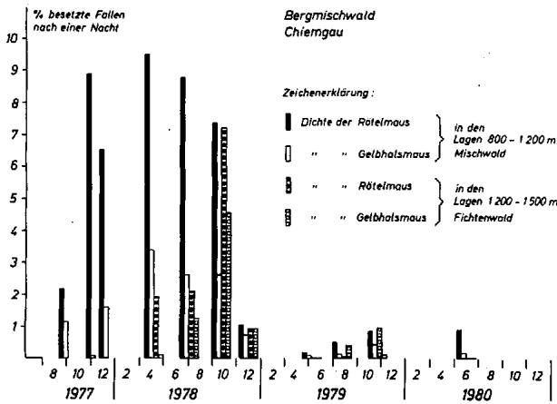
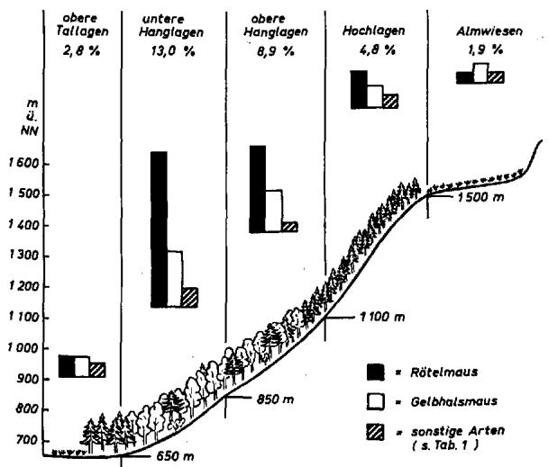
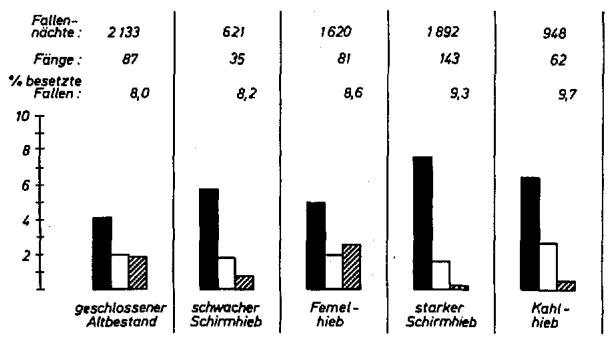
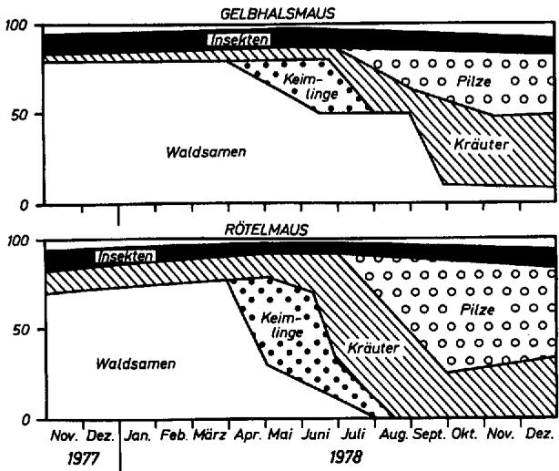
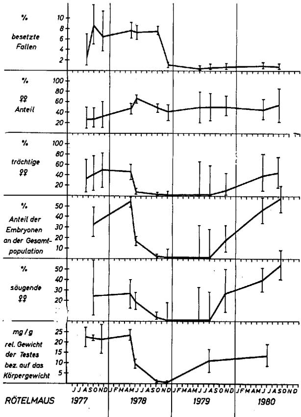
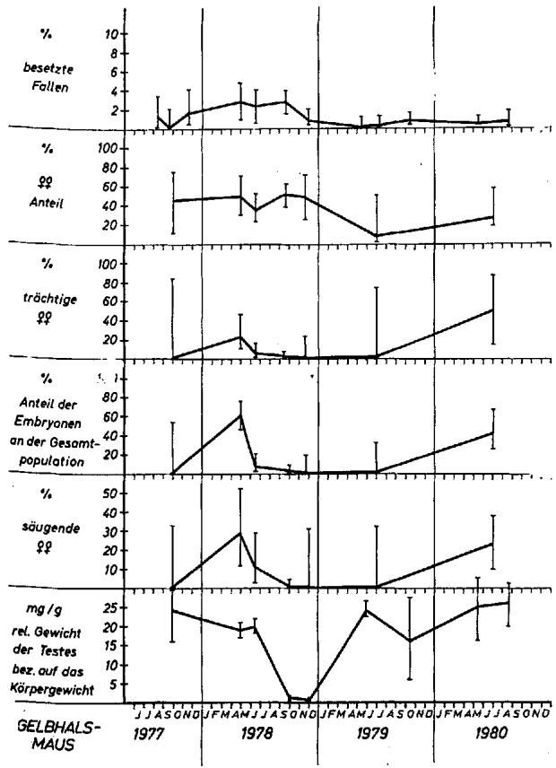

# Anzeiger für Schädlingskunde Pflanzenschutz Umweltschutz

54. Jahrgang $\cdot$ Heft 4, April 1981

Anz. Schädlingskde., Pflanzenschutz, Umweltschutz 54, 49-53 (1981)

$\odot$ 1981, Verlag Paul Parey, Berlin und Hamburg

ISSN 0340-7330/InterCode: ASUMDT

Lehrstuhl für angewandte Zoologie der Universität München

# Zur Verbreitung, Ernährung und Populationsdynamik der Rötelmaus (Clethrionomys glareolus) und der Gelbialsmaus (Apodemus flavicollis) in einem Waldgebiet der Bayerischen Alpen

Von W. BÄUMLER

Mit 6 Abbildungen und einer Tabelle

# Abstract

# Distribution, nutrition and population dynamics of the bank vole (Clethrionomys glareolus) and the yellow-necked field mouse (Apodemus flavicollis)

in a mountain forest of the Bavarian Alps

Nearly 1,300 small mammals, resp. 814 bank voles and 362 yellow-necked field mice were captured during the years 1977-1980 in an area of $50\mathrm{km}^2$ in Chiemgau near Ruhrpolding (Bavaria) in different altitudes and forest stands. After a rich seed production of beech (Fagus sylvatica) und spruce (Picea abies) in the year 1977 both species reproduced during the following winter under the snow cover. Until the following spring the density was increased 40- resp. 30-fold compared to the lowest density level in spring 1979. An analysis of the stomach contents showed that mice and voles had consumed mainly beechnuts in the winter 1977/78. In the following springtime seedlings of beech and maple were preferred until the cotyledones faded. Then mushrooms, first of all Ascomycetae and herbs were the main components in the diet. With these changes of nutrition the fertility and as a consequence also the number of animals were reduced beginning in summer 1978 until spring 1979. The density decreased at first in the high populated areas resp. in the lower altitudes of $650 - 900\mathrm{m}$ in mixed forests and later also in the higher altitudes of $1200 - 1450\mathrm{m}$ in spruce forests. In the following years the fertility (weight of gonads, number of embryos, percentage of pregnant and lactating females) of both species was increased continuously again without any detectable influence of food or season. However there was nearly no seed production in this last period of observation and the density remained low.

# 1. Einleitung

Für Untersuchungen über die Okologie und Populationsdynamik von Mäusen bieten Gebirge, wie z. B. die Alpen, besonderss gänstige Voraussetzungen. Unterschiede des Klimas, des Bodens oder der Vegetation sind hier auf engstem Raum sehr deutlich ausgeprügt. Deshalb ist der Einfluss verschiedener Umweltfaktoren auf die Verbreitung, Dichte und Populationsentwicklung von Mäusen im Gebirge möglich erherkennbar als in standörtlich weniger differenzierten Gebieten. Dies belege bisherige Untersuchungen über

Mäuse im Alpenraum z. B. von Burg (1923), KAHMANN (1950), LANGENSTEIN-Issel (1950), HEINRICH (1951), V. WETTSTEIN (1954), CLAude (1967), GRUBER und KAHMANN (1968), RADDA (1968), MAHNERT (1970), sowie von Pfaller und TENORA (1972).

Eigene Untersuchungen über den Einfluss alpiner Kleinsäuger auf die Verjüngung des Bergmischwaldes in den Chiemgauer Alpen (BÄUMLER und HOHENADL, 1980) boten Gelegenheit, die Verbreitung, Ernährung und Populationsentwicklung von 2 dominanten Mäusearten, damit der Rötelmaus und der Gelbhalsmaus, in dieser Waldgebiet etwas eingehender zu studieren.

Herrn Prof. P. Burschel, Lehrstuhl für Waldbau, München, der diese Untersuchungen im Rahmen eines Forschungsprojekte über die Verjungung in thisem Bergmischwaldgebiet ermöglicht und Herrn Prof. W. SCHWENKE, der die vorliegende Arbeit angegeregt hat, Herrn H. SOMMER, techn. Ass., und Herrn Dipl. Forstw. NAGELE, die mir bei den Freiland- und Laborarbeiten geholfen haben, der Bayerrischen Staatsforstverwaltung, der Deutschen Forschungsgemeinschaft (DFG) und allen, die diesen Projekt fordern und unterstützen, sei an dieser Stelle gedankt.

# 2. Material und Methodik

Im Bereich der Forstämter Ruhpolding und Traunstein (Chiemgau, Oberbayern) wurden in den Jahren 1977-81 in Höhenlagen zwischen 700-1500 m in verschiedene characteristischen Biotopen这点 Waldgebiets Kleinsaugerfänge mit Schlag- und Verbendfallen durchgeführt. In einem etwa $50\mathrm{km}^2$ große Waldgebiet waren vom Lehrstuhl für Waldbau, München, 26 Versuchsflächen angelegt worden. Diese ca. 0,5 ha große Versuchsparzellen mit einer 0,1-0,2 ha großen wilddicht gezäuntekernfläche,lagen in Höhenstufen zwischen 800 und $1250\mathrm{m}$ , in Nord-, Nordwest- und Sudexposition an 12-35° geneigten Hangen. Der Fichten-Tannen-Buchenwald war hier entweder noch vollig geschlossen oder infolge von 4 Behandlungssformen,)namlich leidfter und starker Schirmschlag, Femelschlag und Kahlschlag, unterschiedlich stark aufgelucht.

Auf diesen Flächen wurden ab Juni 1977 bis September 1980 in Zeitabständen von 3-5 Monaten jeweils 27 Schlagfallen 2-5 Tage lang aufgestellt und i.d. R. tatsächlich kontrolliert. Zusätzlich wurden gelegentlich Fänge auf Wiesen und Almflächen in den Tal-und Hochlagen, sowie in Latschenfeldern und in Felspartien in Höhenlagen von 650—1500 m durchgeführt. Eine genaue Beschreibung der

Versuchsflächen, der Anordnung der Fallen und der Dichtschaftzung wurde bereits früher gegeben (BAUMLER und HoHENADL, 1980). Bei der Berechnung der relativen Dichte, bzw. bei der Ermittlung des Prozentsatzes der besetzten Fallen wurde hier stets nur das Fangergebnis der beiden ersten Nächte berücksichtigt.

Die Totfänge wurden nach dem Aufsammeln(sofort in einer transportablen Tiefkuhltruhe eingefroren, ins Labor gebracht und hier bisher untersucht. Bei der Sektion der Tiere wurden folgende Daten erfasst: Art, Altersstufe (juvenil, subadult, adult und senescent), Geschlecht, Körperlänge, Gewicht des Körpers mit und ohne Verdauungstrakt, Gewicht des gefüllten Magens, der Leber, der Milz, des Herzzens, der Nieren und Nebennieren, der Gonaden, bzw. des Hodens und des Nebenhodens ohne Fettanhang, sowie des Uterus. Notiert wurden ferner bei den weiblichen Tiernen die Zahl der Embryonen, der Status "säugend" oder "nicht säugend" anhand der Ausbildung der Zitzen, Offnung oder Verschluß der Vulva, das Vorhandensein von Gelbkörpern in den Ovarien, sowie Zahl und Sätze der Uterusnarben. Bei den Männchen wurde die Lage der Hoden, "inguinal" oder „skrotal",vermerkt.

Der Mageninhalt wurde nach dem von HANSSON (1970) beschriebenen Verfahren gereinigt, mazeriert, gegebenenfalls angefasst und mikroskopisch analysiert. Folgende Bestandteile wurden anteilmäßig geschetzt: Samen und Keimlunge, wobei solche von Waldbäumen, insbesondere von Buche, Fichte oder Ahorn anhand charakteristischer mikroskopischer Merkmale, wie z. B. Größe und Form der Stärkekorner, Vorhandensein bestimmter Kristallformen, Schalenreste usw. gesondert erhoben wurden. Ferner wurde der Anteil von Krautern, Gräsen, Insekten, Pilzmyzel, bzw. von Pilzsporen und nicht definierten Substanzen am Gesamtvolumen des Mageninhalts geschählt. Alle Daten wurden auf Lochkarten gestanzt und mittels EDV ausgewertet, wobei teils eigene, teils BMDP-Programme (Dixon, 1979) verwendet wurden.

# 3. Ergebnisse

# 3.1. MauSEDichte

In Tab. 1 sind zunachst die Fänge, geordnet nach der Häufigkeit, aufgeführrt. Im Zeitraum vom August 1977 bis zum Oktober 1980 wurden in thisem Gebiet 1304 Mäuse gefangen, wobei stets die Rötelmaus gefolgt von der Gelbhalsmaus dominierte (Tab. 1). Im Gesamtdurchschnitt waren $4,6\%$ der Fallen von thisen beiden Arten nach einer Nacht besetzt.

Tabelle 1. Fangergebnisse in ca. 25000 Fallennächten im Zeitraum vom August 1977 bis Oktober 1980   

<table><tr><td>Tierart</td><td>N Anzahl der gelefgenen Tiere</td><td>Abundanz 0/% be-setzte Fallen pro Nacht</td><td>Dominanz 0/% vom gesamten Fang-ergebnis</td></tr><tr><td>Rötelmaus</td><td>814</td><td>3,2</td><td>62,4</td></tr><tr><td>Clethrionomls glareolus</td><td></td><td></td><td></td></tr><tr><td>Celbalsmaus</td><td>362</td><td>1,4</td><td>27,7</td></tr><tr><td>Apodemus flavicollis</td><td></td><td></td><td></td></tr><tr><td>Kurzohrmaus</td><td>69</td><td>0,3</td><td>5,3</td></tr><tr><td>Pitymys subterraneus</td><td></td><td></td><td></td></tr><tr><td>Waldspitzmaus</td><td>31</td><td>0,1</td><td>2,4</td></tr><tr><td>Sorex araneus</td><td></td><td></td><td></td></tr><tr><td>Erdmaus</td><td>15</td><td>0,1</td><td>1,1</td></tr><tr><td>Microtus agrestis</td><td></td><td></td><td></td></tr><tr><td>Alpenspitzmaus</td><td>9</td><td>0,1</td><td>0,7</td></tr><tr><td>Sorex alpinus</td><td></td><td></td><td></td></tr><tr><td>Haselmaus</td><td>4</td><td>0,1</td><td>0,3</td></tr><tr><td>Muscardinus avellanarius</td><td></td><td></td><td></td></tr><tr><td>insgesamt</td><td>1304</td><td>5,1</td><td>100,0</td></tr></table>

Die Mäusedichte war allerdings räumlich und zeitlich sehr unterschied. Im Mai 1978 erreichten die Rötel- und die Gelbalsmaus Dichtemaxima mit 8,7 bzw. $2,8^{0/0}$ besetzten Fallen in rund 1200 Fallennächten (= Anzahl der Fallen $\times$ Anzahl der Nächte). Im gleichen Monat des folgenden Jahres wurde die geringste Dichte mit $0,2^{0/0}$ bzw. $0,1^{0/0}$ besetzten Fallen in thisem Gebiet beobachtet. Dies entspricht einem Dichteunterschied von etwa $40:1$ bei der Rötelmaus und $30:1$ bei der Gelbalsmaus.

Die Dichtezunahme beider Mäusearten im Herbst 1977 und Frühjahr 1978 stand offensichtlich im Zusammenhang mit einem Waldsamenjahr. Nach Erhebungen von VeItsISTAs (1980) fielen im Jahr 1977/78 bis zu $137\mathrm{kg}$ Buchheckern und $29\mathrm{kg}$ Fichtensamen pro ha auf den Versuchsflächen nieder. Dadurch wurde die Nahrungsbasis dieser samen- und keimlingsfressenden Mäuse verbessert und eine starke Vermehrung auch in den Wintermonaten 1977/78 erhögt. Im darauffolgenden Jahr 1978 standen ab Juli keine unverholzten Keimlinge mehr zur Verfügung und es fielen auch kaum noch Samen nieder. Die Dichte der Mäuse ging dann wieder auf die genannten Minimalwerte zurück.

  
Abb.1. Dichteentwicklung der Rötel- und Gelbhalsmaus im Bergmischwald (Fichte, Buche, Tanne) in Höhenlagen von 800 bis $1200\mathrm{m}$ und im Hochlagen-Fichtenwald zwischen 1200 und $1500\mathrm{m}$

Wie der Abb. 1 ferner zu entnahmen ist, erfolgte der Dichteanstieg zunähst in den unteren Hanglagen bzw. in $800 - 900\mathrm{m}$ , wo reichlich Buchheckern niedergefallen waren. In den Hochlagen über $1200\mathrm{m}$ , wo fast nur Fichtensamen zur Verfügung standen, wurde das Dichtemaximum erst im Juli 1978 erreicht, als die Dichteentwicklung in den tieferen Lagen bereits rücklaufig war.

Auch die räumlichen Dichteunterschiede waren hier sehr deutlich ausgeprügt (Abb. 2). Betrachtet man den gesamten Untersuchungszeitraum 1977 bis 1980, so waren auf den Flächen im unteren Teil der Höhe im Durchschnitt $5,8\%$ der Fallen von der Rötelmaus besetzt, während das Minimum mit nur $0,5\%$ besetzten Fallen an der Baumgrenze bzw. auf den nadelwaldreichen Nordseiten, in Rinnen mit Kaltluftabflüß und in ebenen Tallagen beobachtet wurde.

Allgemein wurde der Eindruck gewonnen, daß diese Waldwuhlmaus hier vor allem Dort zahlreich auftrat,

  
Abb. 2. Die Bevolkierungsdichte der Rötelmaus, der Gelb-halsmaus und der übrigen Mäusearten in verschiedene Hohenstufen

wo Himbeeren und Brombeeren üppiger wuchsen, insbesondere also in den warmen unteren Hanglagen, wo die organische Auflage des Waldbodens rasch zersetzt wurde und wo tiefründige Böden, wie z. B. terra fusca oder Braunerden mit einem spaltenreichen Untergrund entwickelt waren. Als ein Überangebot an Waldsamen vorhanden war, spielte wahrrscheinlich das Angebot an Nistmöglichkeiten eine wichtige Rolle. In dieser Zeit wurde das Dichtemaximum in hohlraumreichen Blockfeldern der unteren Hanglagen beobachtet.

Kältere Lagen und flachgrundige Böden mit kiesigem-steinigem Untergund und mit Grasbewuchs, z. B. Rendsina-Böden wurden dagegen von dieser Waldwuhlmausweitgehend gemieden. Hier wurde in windgeschützten Mulden und in Schneetälden, in denen sich Feinerde angesammelt hatte, gelegentlich die Kurzohrmaus (Pitymys subterraneus) gefangen (Tab. 1).

Die Verbreitung der Gelbhalsmaus war dagegen weniger differenziert. D.h. diese Langschwanzmaus wurde auf allen untersuchen Standorten in dieser Waldgebiet, in den Hoch- und Tallagen, auf den Nord- und Südseiten, in Mulden und auf Geländeruppen in annahernd gleicher Dichte aber stets weniger haufig als die Rötelmaus angetroffen. Selfst auf Almwiesen, wo nur sehr weniger Rötelmause gefangen wurden, besetzte diese Langschwanzmaus noch knapp $1 \text{‰}$ der Fallen in rund 1200 Fallennächten.

Eine sichere systematische Abgrenzung aller Individuen von der Waldmaus (A. sylvaticus) oder eine morphologische Differenzierung der Individuen aus verschiedene Höhenlagen, wie sie HEINRICH (1951) vorgenommen hat, war hier allerdings nicht möglich (vgl. NIETHAMMER, 1979) und bleibt weiteren Untersuchungen vorbehalten.

Vorerst kann man nur sagen, daß die als Gelb-halsmäuse angesprochenen Individuen hier besonderss zahlreich im Bereich von bewohnten und unbewohn- ten Hütten und auf Flächen mit einer Ruderalflora auftraten.

Abb.3.Die Abhängigkeit der MauSEDichte vom Grad der Auflichtung des Waldes   
  
Rötelmaus   
Gelbghalsmaus   
sonstige Arten

Für die Verbreitung dieser beiden Mäusearten war ferner der Grad der Auflichtung des Waldes von Bedeutung (Abb. 3). Aber auch hier war der Einfluss auf die Wohndichte bei der Rötelmaus wiederum deutlicher ausgeprügt $(\mathrm{Chi}^2 = 26,1 > \mathrm{Chi}_4^2;0,05 = 9,5)$ als bei der Gelbhalsmaus $(\mathrm{Chi}^2 = 4,1 < \mathrm{Chi}_4^2;0,05 = 9,5)$ (Abb. 3).

# 3.2. Ernährung

Im Hinblick auf das beobachtete Dichtemaximum nach einem Waldsamenjahr im Mai 1978 und das folgende Minimum im Mai 1979 erschienen die Ernährung der Tiere von besonderem Interesse. Wie der Abb.4 zu entnahmen ist, bestand der Mageninhalt im November 1977 bei beiden Arten vorwiegend aus Bucheckern. Ahorn- und Fichtensamen, die in geringen Mengen niedergefallen waren, konnten nur vereinzelt nachgewiesen werden. Im Frühjahr 1978 wurden dann vorwiegend Keimlinge der austreibenden Waldsamen gefressen, insbesondere Buche und Ahorn. Nachdem diese Keimlinge im Juli verholzten und von den Mausen nicht mehr gerne angenommen waren, wie entsprechende Füfterungsversuche zeigten, waren im Magen vernehrt Reste von Krautern und Gräsern vorhanden. Als dann im folgenden Herbst Gräser und Kräuter abweilkten, ernährt sie sich die Rötelmaus i.e. L. von Pilzen, wobei Ascomyceten überwogen. Bemerkenswert ist, daß mit dieser Umstellung der Ernährung eine fast schlagartige Abnahme der Fruchtbarkeit und der Dichte beider Arten verbunden war.

# 3.3. Fruchtbarkeit und Vermehrung

In der Abb. 5 ist gaz denochs die Dichte-entwicklung der Rötelmaus und darüber im Vergleich dazu die Veränderung einiger Parameter der Fruchtbarkeit dieser dominanten Art darestellt. Bemerkenswert ist zunachst, daß der Weibchenanteil in der Progradationsphase im Herbst 1977 mit $34\text{‰}$ signifikant $(\mathrm{Chi}^2 = 13,6\mathrm{Chi}_1^2;0,01 = 6,6)$ geringer war als zur Zeit des Dichtemaximums im Juni 1978, wo $67\text{‰}$ der Rötelmauspopulation aus Weibchen bestand. In den beiden folgenden Jahren 1979 und 1980 war das Geschlechterverhältnis dann wieder ausgegliichen, bzw. vom Verhältnis $1:1$ nicht signifikant verschieden.

Bislang ist nicht geklärt, worauf diese Verschiebungen des Geschlechterverhältnisses zurückzuführen sind.

  
Abb.4. Die Zusammensetzung des Mageninhalts bei der Rötel- und der Gelbhalsmaus in verschiedene Phasen der Bevölkerungsentwicklung

Verletzungen, die bei hoher Dichte z. B. bei Feldmaus-mannchen halten beobachtet wurden, bzw. Bißwunden, die i. d. R. aus Kämpfen der Mannchen untereinander herrühren und eine Eliminierung des mannlichen Geschlechts bedingten (FRANK, 1953; BÄUMLER, 1976), wurden hier bei keiner Mauseart bemerkt. Wahrscheinlich ist aber die Abwanderrungsrate der Mannchen bei hoher Dichte größter als die der Weibchen, Denn in ungeeigneten Biotopen, z. B. in den Hochlagen, auf Wiesen und Weideflächen wurden auch in der Gradationsphase signifikant $(\mathrm{Chi}^2 = 10,2$ $\mathrm{Chi}_1^2$ $0,01 = 6,6)$ ) mehr Mannchen $(72\%)$ ) als Weibchen $(28\%)$ gefangen.

Der starke Rückgang der Populationsdichte im Herbst 1978 war ferner vorgezeichnet durch die fast schlagartige Verminderung der Fertility und fast vollige Einstellung der Vermehrung bereits im Juni 1978, als die Keimlinge der Waldbäume verholzten und als Hauptnahrungsquelle nicht mehr zur Vergebung standen. Innerhalb eines Monats (3.5. - 12.6. 1978) ging der Anteil der trächtigen Weibchen von $48\%$ auf $7\%$ zurück und der Anteil der Embryonen an der Gesamtpopulation sank gleichzeitig von $55\%$ auf $15\%$ ab. Der Prozentsatz der laktierenden Weibchen nahm etwas langsamer ab und erreichte erst im Herbst 1978 fast 0 (Abb. 5).

Ebenso drastisch wie bei den Weibchen wurde auch die Fruchtbarkeit der Mannchen mit der Verschlechte-rung der Nahrungsvorsorgung im Juni 1978 reduziert. Das durchschnittliche Hodengewicht sank vom Opti- mum im Mai 1978 mit $23,6\pm 9,4\mathrm{mg}$ pro g Körpergewicht $(n = 50)$ auf $9,7\pm 9,6\mathrm{mg / g}$ imDMAuaffol-genden Monat $(n = 76)$ hochsignifikant ab.

Ganzählich wie bei der Rötelmaus verlief die Entwicklung bei der Gelbhalmsmaus (Abb. 6). Eine Verschreibung des Geschlechterverhältnisses wurde hier allerdings nicht beobachtet. Nachdem im Juni 1978 das Dichtemaximum erreicht worden war, sank auch bei der Gelbhalmsmaus die Fruchtbarkeit, bzw. das Gewicht der Gonaden sowie der Anteil trächtiger und sägender Weibchen auf sehr niedrige Werte ab. Der

  
Abb. 5. Die Änderung der Fruchtbarkeit der Rötelmaus im Vergleich zur Dichteentwicklung. Die $95 \text{‰}$ -Vertrauensbereiche wurden nach den Angaben von Sachs (1979) ermittelt

eigentliche Zusammenbruch der Bevölkerungsdichte erfolgte dann wie bei der Rötelmaus mit einiger Verzügerung erst im Spätherbst 1978. Danach nahm auch die Fertilität der Gelbhalsmaus über die zwei folgenden Jahre hinweg wieder zu. Die Populationsdichte blieb jedoch bei beiden Arten auf einem relativ niedrigem Niveau (Abb. 5 und 6).

Es liegt auf der Hand, daß das Nahrungsangebot für die Bevölkerungsentwicklung dieser beiden Arten entscheidend war. Wahrscheinlich spielten jedoch noch andere Faktoren eine wichtige Rolle. Z. B. wurde die Fertilität, bzw. das Gonadengewicht der Rötemäuse in der Laborzucht durch eine Änderung der Ernährung nicht in dem Ausmaß beeinflübt, wie das im Freiland in den verschiedenen Gradationsphasen der Fall war. Um welche Fertilitätsfaktoren es sich damit handelt, müssen erst weitere Untersuchungen zeigen. Man kann vorerst nur vermuten, daß die relativ große Fruchtbarkeit im Jahr 1980 wohl deshalb nicht zu einem starken Dichteanstieg führende, weil nicht genugend Nahrungsenergie zur Verfügung stand, bzw. weil keine nennenswerte Menge an Waldsamen niedergefallen war. Wahrscheinlich konnte deshalb ein großer Teil der Nestlinge nicht aufgezogen werden. Nach Beobachtungen von MIGULA (1969) und eigenen Erfahrungen aus der Laborzucht benötigen Müase ganz allgemein für das Säugen der Jungen wesentlich mehr und höherwertige Nahrung als für die Haltung der Tiere, bzw. für das Austragen von Embryonen

notwendig ist. Nach BuJALSKA (1977) ist zudem die Nestlingsmortaltität ein Schlüsselfaktor für die Populationsentwicklung der Rötelmaus.

  
Abb.6.Dichteentwicklung und Anderung der Fertilität bei der Gelbhalsmaus (vgl.Abb.5)

# Zusammenfassung

Nach einem Waldsamenjahr stieg die Populationsdichte der Rötel- und der Gelbalsmaus bis zum Juni des folgenden Jahres auf das 40- bzw. 30fadhe bzw. auf schätzungsweise 40 Rötermäuse und 15 Gelbalsmäuse pro ha (s. BÄUMLER und HOHENADL, 1980) an. Das Minimum mit einer geschätzten Dichte von 0,5-1 Indiv./ha wurde im Frühjahr des nachsten Jahres erreicht. Eine starke Einschränkung der Fruchtbarkeit bzw. eine Reduktion der Gonaden sowie eine Verminderung der Anzahl trächtiger und saugender Weibchen ging dem Zusammenbruch der Bevölkerungsdichte voraus. Danach erfolgte wieder eine kontinuierliche Zunahme der Fruchtbarkeit bei beiden Arten. Die Dichte blieb jedoch niedrig, vermutlich deshalb, weil die Nahrungsbasis nicht wesentlich verbessert wurde, bzw. weil bislang keine nennenswerte Menge an Samen mehr niedergefallen ist.

Hinsichtlich der räumlichen Verteilung war eine deutliche Abhängigkeit von der Höhenlage, der Vegetation, der

Bodenart und der Behandlung des Waldes erkennbar. Die Unterschiede in den ökologischen Ansprüchen waren hier allerdings bei der Rötelmaus deutlicher ausgeprügt als bei der Gelbhalsmaus.

# Literaturverzeichnis

BURG, G., 1923: Die Rötelmaus der Schweiz. Zool. Palae- arct., Dresden, 1, 64-67.   
BAUMLER, W., 1977: Herbizideinsatz und Mäuse in Forstkulturen. Anz. Schädlingskde., Pflanzenschutz, Umweltschutz 50, 51-55.   
BAUMLER, W., und HOHENADL, W., 1980: Über den Einfluss alpiner Kleinsäuger auf die Verjungung in einem Bergmischwald der Chiemgauer Alpen. Forstw. Centralbl. 4, 207-221.   
BUJALSKA, G., 1977: Regulatory mechanisms and dynamics of an island population of Clethribionomys glareolus (Schreber, 1780). Eppo Bull. 7, 411-414.   
CLAUDE, C., 1967: Morphologie und Altersstruktur von zwei schweizerischen Rötelmauspopulationen, Clethriomomys glareolus (Schreber, 1780). Z. f. Saugieterkde. 32, 159-166.   
DIXON, J., 1979: BMDP Biomedical Computer Programs. Univ. Calif. Press, 880 S.   
FRANK, F., 1966: Verschiebung des Geschlechterverhältnisses in der Wuhlmausgruppe (Microtidae). Naturwiss. 53, S. 90.   
GRUBER, U., und KAHMANN, H., 1968: Eine biometrische Untersuchung an alpinen Rötelmausen (Clethrionomys glareolus, Schreber, 1780). SäugetierkdI. Mitt. 16, 310-338.   
HEINRICH, G., 1951: Die deutschen Waldmäuse. Zool. Jahrb., Systematik 80, 99-122.   
KAHMANN, H., 1950: Lebensbild der Kurzohrmaus in den Alpen. Natur und Volk 80, 71-77.   
LANGENSTEIN-IsSEL, B., 1950: Biologische und ökologische Untersuchungen über die Kurzohrmaus (Pitymys subterraneus de Sélys-Longchamps). Pflanzenbau und Pflanzenschutz 1, 145—183.   
MAHNERT, V., 1970: Über Endo- und Ektoparasiten von Kleinsägern in den Ostalpen (Nordtirol). Diss. Phil. Fak. Univ. Innsbruck, 139 S.   
MIGULA, P., 1969: Bioenergetics of pregnancy and lactation in the European common vole. Acta theriol. 14, 167-179.   
PFALLER, K., und TENORA, F., 1972: Über Cestoden-Larvenstadien aus Muriden und Microtiden (Rodentia) in Tirol. Ber. Nat.-med. Ver. Innsbruck 59, 25-28.   
RADDA, A., 1968: Populationsstudien an Rötelmauscn. Oecologia 1, 219-235.   
SACHS, L., 1980: Statistische Auswertungsmethoden. 3. Aufl. Springer-Verlag, Berlin, Heidelberg, New York, 545 S.   
VELTSISTAS, T., 1980: Die Samenproduktion einiger Waldbäume alpiner Bergmischwälder im Chiemgau. Diss. Univ. München, in Vorber.   
WETSTEIN, O. v., 1954: Über die Rötelmäuse Osterreichs. SäugetierkdI. Mitt. 2, 118-124.   
ZEJDA, J., 1966: Notes on the population dynamics in the Bank vole, Clethbrionomys glareolus (Schreber, 1780). Lynx 6, 191-194.

Anschrift des Verfassers: Dr. habil. W. BÄUMLER, Lehrstuhl für angewandte Zoologie der Universität München, Amalienstraße 52, 8000 München.