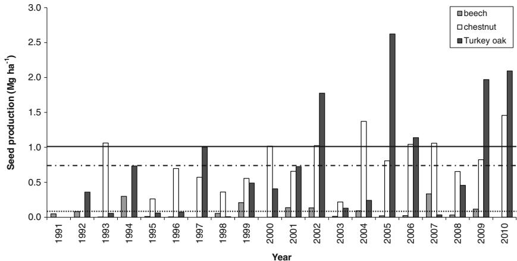
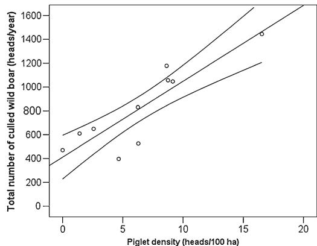
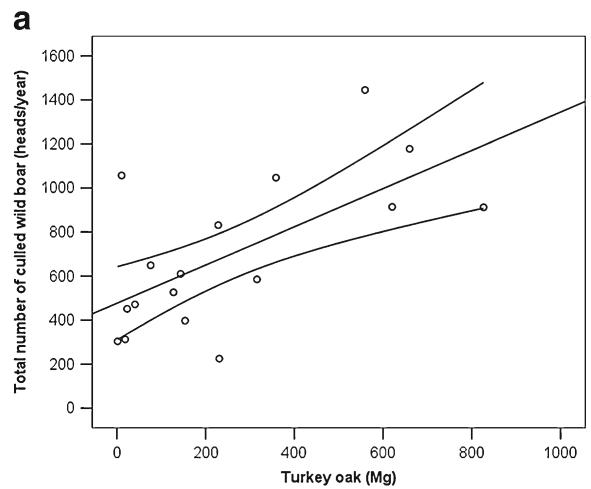
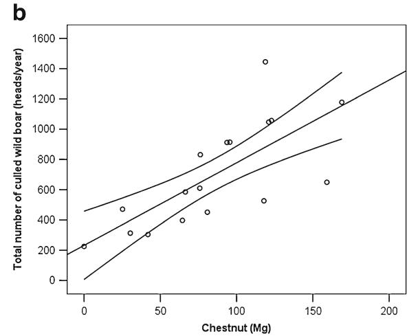
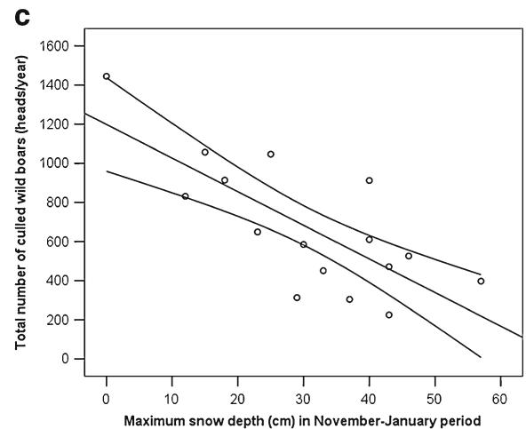
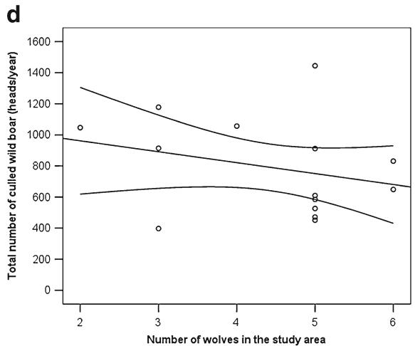

# Mast seeding in deciduous forests of the northern Apennines (Italy) and its influence on wild boar population dynamics

Andrea Cutini $\cdot$ Francesco Chianucci & Roberta Chirichella $\cdot$ Emanuela Donaggio & Luca Mattioli $\cdot$ Marco Apollonio

Received: 27 November 2012 / Accepted: 7 March 2013 / Published online: 5 April 2013 $©$ INRA and Springer-Verlag France 2013

# Abstract

& Context Pulsed food resources may strongly affect the population dynamics of several consumer species, with consequences on the ecosystem. One of the most common pulsed resources is forest mast seeding.   
& Aims We analysed mast seeding in deciduous forests in a mountainous area of northern Apennines and its effect on population dynamics of wild boar (Sus scrofa L.).   
& Methods We performed a quantitative, 20-year analysis on annual seed production in Turkey oak (Quercus cerris L.), beech (Fagus sylvatica L.) and chestnut (Castanea sativa Mill.) forest stands using litter traps. The wild boar population density was estimated by means of drive censuses and hunting bag records. The role of other biotic (density of predators) and abiotic (climate) factors potentially affecting wild boar mortality was also investigated.   
& Results Turkey oak and chestnut showed high levels of seed production, whereas lower levels were found in beech.

Handling Editor: Bruno Fady

Contribution of the co-authors Andrea Cutini and Marco Apollonio: designing the experiment, running the experiment, writing the paper and supervising the work. Francesco Chianucci and Roberta Chirichella: running the experiment, analyzing the data, writing the paper. Emanuela Donaggio and Luca Mattioli: running the experiment and analyzing the data.

A. Cutini $( \lor \triangleleft ) \cdot$ F. Chianucci Consiglio per la ricerca e la sperimentazione in agricoltura, Forestry Research Centre (CRA-SEL), Viale Santa Margherita 80, 52100 Arezzo, Italy e-mail: andrea.cutini@entecra.it

R. Chirichella : E. Donaggio : M. Apollonio Department of Science for Nature and Environmental Resources, University of Sassari, via Muroni 25, 07100 Sassari, Italy

L. Mattioli Province of Arezzo, Piazza della Libertà 3, 52100 Arezzo, Italy

The pulsed resources of chestnut and Turkey oak positively affected piglet density. Analyses also highlighted the influence of snow cover and wolves on wild boar population dynamics.

& Conclusion Wild boar can be considered a pulse rate species, the management of which can be improved by annual monitoring of seed production.

Keywords Forest seed production $\cdot$ Pulsed resource . Forest management $\cdot$ Sus scrofa L. $\cdot$ Silvicultural treatment . Game management

# 1 Introduction

The complexity of interactions between fauna and natural resources has recently been investigated with a focus on wildlife population dynamics to identify key mechanisms that influence ecosystem function (Bieber and Ruf 2005; Ostfeld and Keesing 2000). Many terrestrial ecosystems are characterised by pulsed resources, i.e. the temporary availability of extremely abundant food resources (for an overview, see Ostfeld and Keesing 2000). The most common pulsed resource is most likely mast seeding, i.e. the intermittent, synchronous production of large seed crops by plant populations. This phenomenon has been explained using the predator satiation hypothesis, which predicts that high variability in seed production is a defensive strategy that satiates seed predators in mast years and starves them in the intervening periods. Tests of this hypothesis have provided somewhat equivocal results (Curran and Leighton 2000; Silvertown 1980) but have in general supported the relevance of mast seeding in determining the population dynamics of seed predators.

It is well known that mast seeding is a key food resource for numerous mammal and bird communities (Clotfelter et al. 2007; Formosoff 1933). Indeed, vertebrate populations

show a strong numerical response to mast seeding; this is the case for several species of mice (Elkinton et al. 1996), the Florida shrub jay (Aphelochoma coerulescens Bosc) (DeGange et al. 1989) and the acorn woodpecker (Melanerpes formicivorus Swainson) (Hannon et al. 1987).

Several studies have demonstrated that ungulate populations are strongly influenced by the spatial distribution of resources and the seasonal variation in food quality and availability (e.g. Tufto et al. 1996). However, the effects of mast seeding on ungulates remain poorly documented. Understanding the implications of pulsed resources on the population dynamics of ungulates represents a crucial issue for conservation and management programs in most European countries, where, during the last few decades, ungulates have exhibited geographic and demographic expansion (Apollonio et al. 2010).

Among ungulates, the wild boar (Sus scrofa L.) exhibits strong responses to food pulses (Bieber and Ruf 2005; Groot Bruinderink et al. 2009; Jedrzejewska et al. 1997). Its omnivorous diet consists mainly of vegetation (Schley and Roper 2003). In Italy, as well as in the whole Mediterranean region, the abundant crops of tree seeds (such as acorns, chestnuts and beech nuts) are the wild boar’s main natural source of food from September to late spring (Massei et al. 1997). This species can reach high densities owing to its high ecological adaptability. It can be considered a typical r-strategy species, with high ecological plasticity and very high reproductive capacity due to its relatively short gestation period and high mean litter size (Fernàndez-Llario and Carranza 2000; Fonseca et al. 2011; Herrero et al. 2008; Saez-Royuela and Telleria 1986).

Wild boar population densities have been growing notably during the last few decades (Apollonio et al. 2010; Saez-Royuela and Telleria 1986) due to the abandonment of rural areas, restocking, lack of predators and supplementary feeding (Saez-Royuela and Telleria 1986). In addition, changes in silvicultural systems have entailed a general decline in wood exploitation, improving the productivity and structural complexity of forest ecosystems (Cutini et al. 2011) and reducing the human pressure on ungulates in general and on the wild boar in particular.

Wild boar population expansion has caused this species to be one of the most problematic among ungulates in Europe. This expansion has resulted in substantial damage to agricultural crops (Schley et al. 2008), generate conflicts as a results of the invasion of urban environments in many countries (Cahill et al. 2012; Geisser and Reyer 2004; Jansen et al. 2007), and also produced a steady increase in the number of vehicle collisions in several European countries (Groot Bruinderink and Hazebroek 1996; Lagos et al. 2012; Langbein et al. 2011).

When analysing the forest–ungulate system, a long-term perspective is required to fully understand the interactions between wildlife species and their environment. There is a lack of quantitative evidence to support the widespread hypothesis of a link between wild boar population dynamics and mast seeding (Jedrzejewska et al. 1997). The analysis of long-term records of mast data, however, would greatly contribute to an understanding of the population dynamics of wild boars in specific environmental contexts, given that forest–fauna systems operate over long time scales. In addition, irrespective of the mechanisms involved in masting, a quantitative approach is necessary to adequately assess the responses and adaptations of the wild boar to pulsed resources and to develop management strategies that take into account annual variation in mast seeding (Bieber and Ruf 2005).

The aim of this study was to use an integrated approach to assess the relationship between mast seeding in deciduous forests and wild boar population dynamics in a northern Apennine forested area in Italy. In particular, we analysed 20 years of annual seed production in forest stands by some of the most widespread deciduous species in Italy and Europe, i.e. Turkey oak (Quercus cerris L.), beech (Fagus sylvatica L.) and chestnut (Castanea sativa Mill.), which are significant food resources for the wild boar. By controlling for the effect of other major ecological factors that are thought to affect mortality in the wild boar (i.e. climatic conditions and density of predators), we analysed how seed production in deciduous forests can influence wild boar density, with the ultimate goal of developing strategies for integrated management.

# 2 Materials and methods

# 2.1 Study site

This study was conducted in a mountainous area in the province of Arezzo (Alpe di Catenaia, 4,579 ha, $4 3 ^ { \circ } 4 8 ^ { \prime } \mathrm { ~ N ~ }$ , $1 1 ^ { \circ } 4 9 ^ { \prime } \mathrm { E }$ ), which is representative of typical forested areas in the northern and central Apennines. The study site included a protected area (2,795 ha) in which hunting is forbidden, while hunting is permitted in the remaining portion of the study site. The altitude ranged from 330 to 1,414 m a.s.l. The climate at the study site is temperate, with warm, dry summers and cold, rainy winters. The mean annual rainfall was 1,224 mm, and the mean annual temperature was $9 . 5 ~ ^ { \circ } \mathrm { C }$ (Cutini et al. 2009).

Approximately $87 \%$ of the area was covered with forests. Deciduous even-aged forests, aged mainly between 50 and 70 years old, were prevalent; these stands almost entirely originated from the conversion of coppice woods, which was the most widely applied silvicultural treatment

in the past. The forest stands were fairly homogeneous and uniformly managed according to a 20-year forest plan. The ungulate community within the study area consisted of roe deer (Capreolus capreolus L.) and wild boar. Red deer (Cervus elaphus L.) appeared in 2007, and they are only rarely observed. Supplementary feeding did not occur in the study area. The natural predators of ungulate species in the study area are the red fox (Vulpes vulpes L.) and the wolf (Canis lupus L).

# 2.2 Annual seed production

The data for seed production were selected from a network of permanent research sites covering different conifer and broadleaf stands in Italy. Among the research sites, three permanent plots of beech, chestnut and Turkey oak, each 1 ha in size, were selected at the Alpe di Catenaia study site on the basis of the following criteria:

1. Availability of concurrent mast data for the main, widespread and most important deciduous species in Apennines.   
2. Availability of long-term time series data for mast seeding.   
3. Availability of long-term time series data for wild boar population dynamics.

The species composition in each stand was pure. Table 1 lists the main stand characteristics of each plot. Pure stands of beech, chestnut and Turkey oak covers, respectively, 20.5, 11.7 and $1 6 . 1 \%$ of the study site.

Estimates of the annual seed production were obtained using the litterfall method, of which the procedures, sampling strategy, reliability and accuracy were discussed by Chianucci and Cutini (2013) and are briefly described below. Nine $0 . 2 5 \mathrm { - } \mathrm { m } ^ { 2 }$ litter traps were positioned in each plot $1 \textrm { m }$ above ground level. Litterfall was collected every 2 weeks during the autumn and winter and monthly during the rest of the year. Frequent litter collection during leaf fall minimised seed predation (e.g. by insects or birds). The main litter components were subsequently sorted and dried in a forced air stove at $8 5 ~ ^ { \circ } \mathrm { C } \pm 2$ for at least $2 4 ~ \mathrm { h }$ to reach a constant dry weight.

Litter collection is a straightforward method to estimate litter components such as seed production in a quantitative way $( \mathrm { M g \ h a } ^ { - 1 } )$ ). Relative to indirect approaches, collecting litter takes a great deal of time. In order to get a compromise between monitoring mast seeding over a long-time period and to assess seed production in the three different and most important deciduous species, we were forced to not add replicates in the original experimental design.

Tukey’s pair-wise comparison test was used to compare differences in annual seed production between species in cases where a one-way ANOVA indicated that a significant difference existed in the variable of interest.

Years with an average seed production $\geq 6 6 \mathrm { t h }$ percentile were classified as mast seed years, while years with an average seed production ${ \le } 3 3 \mathrm { r d }$ percentile were classified as scarce seed years. The remaining years were classified as intermediate seed years.

# 2.3 Wild boar densities and hunting bag records

Beginning in 2000, density estimates for wild boar were calculated based on drive censuses conducted every May (this method is also described by Mattioli et al. 1995) by the Fish and Wildlife Service of the Province of Arezzo. Annual censuses encompassed approximately $80 \%$ wooded area and $20 \%$ other cover types. A ring of government employees, researchers and volunteers encircled between nine and 15 plots in the forest (each 14–52 ha in size), then moved inwards, counting and observing the wild boars in the contained area and reporting the number of juveniles (0– 1 years) and adults. The density of individuals in each area was then weighted by the surface area and the percentage of forested land cover within a 1-km buffer around the drive area (for further details, see Davis et al. 2012). Bad weather conditions prevented drive census estimates in 2006 and 2010; as such, the wild boar density data series consisted of 10 years. As this method was designed for species with an even distribution, we analysed wild boar population dynamics using hunting bag records. The use of hunting bag records also enabled us to extend the wild boar time series back to 1995 (17 years).

Hunting was organised by the Fish and Wildlife Service of the Province of Arezzo. Wild boars (juveniles and adults) were

Table 1 Main characteristics of the research plots   

<table><tr><td>Species</td><td>Altitude (m a.s.l.)</td><td>Age (years)</td><td>Stems (no. ha-1)</td><td>Basal area (m2 ha-1)</td><td>Dom. heighta (m)</td><td>Plot establish</td><td>Data (no. years)</td></tr><tr><td>Beech</td><td>1,050</td><td>66</td><td>542</td><td>25.7</td><td>23.8</td><td>1991</td><td>20</td></tr><tr><td>Chestnut</td><td>904</td><td>60</td><td>401</td><td>30.8</td><td>25.2</td><td>1993</td><td>18</td></tr><tr><td>Turkey oak</td><td>915</td><td>56</td><td>350</td><td>28.1</td><td>24.0</td><td>1992</td><td>19</td></tr></table>

a Dominant height is the mean height of the 100 tallest stems per hectare

hunted with hounds by teams of 25–50 hunters in designated areas. The hunting season began on the third Sunday of September and ended on January 31st. Since 1995, total numbers of culled boars were recorded and reported to the Service, which checked and validated data.

# 2.4 Other factors related to population dynamics

Climatic variables from the wild boar birth period through the end of the hunting season (Geisser and Reyer 2005), along with the density of predators (Mattioli et al. 2011), were considered as possible sources of mortality for juveniles. Temperature, precipitation and snow cover data were collected at four weather stations located in and around the study area by the National Forest Service. Data were available since 1991 (20 years). We calculated the average temperature and precipitation for each day, and we selected the following parameters as predictor variables that potentially influence wild boar population dynamics:

1. Mean temperature $( ^ { \circ } \mathrm { C } )$ and precipitation (mm) during March–May (i.e. the birth and post-birth period).   
2. Mean temperature $( ^ { \circ } \mathrm { C } )$ and precipitation (mm) during June–August (i.e. the driest period).   
3. Mean temperature $( ^ { \circ } \mathrm { C } )$ and maximum snow depth (cm) during November–January (i.e. the coldest period).

Data on wolf density were obtained from snow tracking, wolf howling, molecular analysis and direct observations conducted each year (for further details, see Apollonio et al. 2004; Gazzola et al. 2002; Scandura 2005; Scandura et al. 2006). The density was estimated as the minimum number of wolves within the study area. Wolf data were sourced from the long-term monitoring of wolf presence in the province of Arezzo by our teams in cooperation with the Fish and Wildlife Service of the Province of Arezzo.

# 2.5 Statistical analyses

We analysed the relationship between annual wild boar density and hunting bag records using Pearson’s correlation coefficient $( r _ { \mathrm { p } } )$ test.

We predicted the annual variation in total culled animals (as a proxy for juvenile wild boars; see results in Section 3.2 for details) by fitting generalised linear models (GLMs) with a normal error distribution (GLM, family $=$ Gaussian). Accordingly, we considered a number of ecological factors that potentially influence the total number of culled animals:

1. Annual seed production of the previous year in beech, Turkey oak and chestnut stands; because the area covered by tree species varied, a weighting factor was introduced and was equal to the high forest area covered by each species.   
2. Mean temperature and precipitation during March–May and June–August and mean temperature and maximum snow depth during November–January.   
3. Annual density of wolves.

According to the revealed correlation between the present wild boars density (i.e. the number of culled wild boars in the current year) and the density in the previous year (i.e. the number of culled wild boars in the previous year, by means of autocorrelation function: $\mathrm { A C F } { = } 0 . 3 5 2$ ) we decided to add among independent variables the number of culled animals at time [year−1 ].

To avoid collinearity issues, we built a correlation matrix (Pearson’s correlation coefficient— $\boldsymbol { \mathbf { \mathit { \Sigma } } } ^ { \mathcal { \boldsymbol { r } } _ { \mathrm { p } } }$ —and $t$ test) that included explanatory variables that potentially predict the density of juvenile wild boars; we detected the absence of $r _ { \mathrm { p } } { > } 0 . 7$ and $t { < } 0 . 0 5$ (Sokal and Rohlf 1995) among pairs of explanatory variables. We used the Akaike information criterion modified for small sample sizes $\mathrm { \ A I C _ { c } }$ ; Burnham et al. 2011; Symonds and Mousalli 2011) to select the best predicting model.

To avoid the retention of overly complex models (i.e. models with additional parameters that result in minimal increases in model fit), we excluded models that simply represented more complex versions of models with lower $\mathrm { A I C } _ { \mathrm { c } }$ values (Richards et al. 2011). The Akaike weight $w _ { i }$ for a given model $i$ of a set of $n { = } R$ models was computed as follows:

$$
w _ {i} = \frac {\exp (- \Delta A I C _ {c i} / 2)}{\sum_ {r = 1} ^ {R} \exp (- \Delta A I C _ {c r} / 2)}
$$

Table 2 Statistics of seed production observed in the research plots   

<table><tr><td rowspan="2">Species</td><td rowspan="2">Min</td><td>Max</td><td>Mean (±SE)</td><td>CV</td><td colspan="3">Number of years</td></tr><tr><td>(Mg ha-1)</td><td></td><td>%</td><td>Mast ≥66 percentile</td><td>Intermed. 33-66 percentile</td><td>Scarce ≤33 percentile</td></tr><tr><td>Beech</td><td>0.000</td><td>0.335</td><td>0.080 (0.022)</td><td>124</td><td>7</td><td>6</td><td>7</td></tr><tr><td>Chestnut</td><td>0.000</td><td>1,457</td><td>0.758 (0.093)</td><td>54</td><td>6</td><td>6</td><td>6</td></tr><tr><td>Turkey oak</td><td>0.006</td><td>2,624</td><td>0.757 (0.184)</td><td>100</td><td>6</td><td>7</td><td>6</td></tr></table>

  
Fig. 1 Annual seed production of the deciduous tree species from 1991 (1992 for oak, 1993 for chestnut) to 2010. The dot line refers to beech mast seeding threshold, the dark straight line refers to chestnut mast seeding threshold, the dot-dashed line refers to Turkey oak mast seeding threshold

which quantifies the probability that the model is the best approximating one. We performed a parameter estimation and derived the $R ^ { 2 }$ for the most parsimonious model.

We checked for normality and homogeneity by visually inspecting the plots of residuals against fitted values for the most parsimonious model. Moreover, we tested for the absence of autocorrelation of the residuals in the model using the Durbin–Watson test $\mathrm { ( D W = 1 } . 7 5 4 7$ , $\scriptstyle p = 0 . 0 9 7 6$ ). Statistical analyses were performed using $R$ version 2.13.1; all means are reported with standard errors.

# 3 Results

# 3.1 Annual seed production

The three broadleaves showed marked differences in mast seeding (Table 2). Compared to oak and chestnut, seed production was relatively low in beech, which exhibited an average $\pm$ SE nut mass of $0 . 0 8 0 { \pm } 0 . 0 2 2 \ \mathrm { M g \ h a } ^ { - 1 } \ \mathrm { y e a r } ^ { - 1 }$ . Overall, seed production significantly differed between beech and the other two species (one-way ANOVA and Tukey’s test, $p { < } 0 . 0 1$ ); by contrast, seed production did not significantly differ between Turkey oak and chestnut. The average seed production was 0. $7 5 7 { \pm } 0 . 1 8 4 ~ \mathrm { M g ~ h a } ^ { - 1 }$ year−1 in Turkey oak and $0 . 7 5 8 { \pm } 0$ . $0 9 3 \mathrm { M g h a } ^ { - 1 }$ year−1 in chestnut.

Table 3 Pearson's correlation coefficients $( r _ { \mathrm { p } } )$ and significance $( p )$ of correlation between seed production in the tree species   

<table><tr><td></td><td>Turkey oak</td><td>Beech</td><td>Chestnut</td></tr><tr><td>Turkey oak</td><td></td><td>rp=-0.091 (p=0.711)</td><td>rp=0.315 (p=0.203)</td></tr><tr><td>Beech</td><td>rp=-0.091 (p=0.711)</td><td></td><td>rp=-0.156 (p=0.535)</td></tr><tr><td>Chestnut</td><td>rp=0.315 (p=0.203)</td><td>rp=-0.156 (p=0.535)</td><td></td></tr></table>

Although seed production was similar in chestnut and oak, the pattern of production varied considerably (Fig. 1). Turkey oak showed higher annual variation $( \mathrm { C V = 1 0 0 ~ \% }$ ) compared with chestnut $C V { = } 5 4 \%$ ). A similar pattern was observed in beech $( \mathrm { C V = } 1 2 4 \ \%$ ). In Turkey oak, the annual seed production twice exceeded $2 \mathrm { \Delta M g \ h a } ^ { - 1 } \mathrm { \ y e a r } ^ { - 1 }$ , and production exceeded $1 ~ \mathrm { M g } ~ \mathrm { h a } ^ { - 1 }$ year−1 six times; in chestnut, the annual seed production exceeded $1 ~ \mathrm { M g ~ h a } ^ { - 1 } ~ \mathrm { y e a r } ^ { - 1 }$ seven times.

Mast seeding occurred in $3 5 \ \%$ of observations in beech, in $32 \%$ of observations in Turkey oak and in $33 \%$ of observations in chestnut; the balance between scarce and mast years was even in all three species.

A simultaneous mast seed year occurred for Turkey oak and chestnut three times: in 2002, 2006 and 2010 (Fig. 1); however, seed production was not correlated between the species (Table 3).

# 3.2 Wild boar densities and hunting bag records

The mean ± SE estimated total wild boar density (juveniles and adults) in the study area during 2000–2011 was $1 1 . 6 { \pm } 2 . 0 $ individuals per $\mathrm { k m } ^ { 2 }$ . Juveniles (0–1 years) comprised $55 \%$ of

  
Fig. 2 Variation of total number of culled wild boar (heads/year) as a function of piglet density (heads/100 ha). Linear regression lines along with $9 5 \ \%$ confidence intervals were shown on the graph

temperature Nov–Jan ${ } ^ { \circ } \mathrm { C }$ ; Tw); rain Mar–May (mm; Rp); rain Jun– Aug (mm; Rs); maximum snow depth (cm; Sn); wolf density (N/ $4 5 ~ \mathrm { k m } ^ { 2 }$ ; Wo); number of culled wild boars in the previous year (Npy) on the total number of culled wild boars in the Alpe di Catenaia study site

Table 4 Number of parameters $( \mathrm { N p } )$ , Akaike Information Criterion corrected for small sample size (AICc), difference in AICc between each model and the model with the lowest AICc for effects, Turkey oak seed production (Mg/study area; Tu); mean temperature Jun–Aug ${ } ^ { \circ } \mathrm { C } ,$ , Ts); chestnut seed production (Mg/study area; Ch); beech seed production (Mg/study area; Be); mean temperature Mar–May $^ { \circ } \mathrm { C }$ ; Tp); mean   

<table><tr><td>Parameters</td><td>Np</td><td>AICc</td><td>ΔAICc</td><td>wi</td></tr><tr><td>Tu + Ch + Sn + Wo + Npy</td><td>5</td><td>175.41</td><td>0.00</td><td>0.996</td></tr><tr><td>Tu + Ch + Sn + Wo + Rs + Npy</td><td>6</td><td>186.50</td><td>11.09</td><td>0.004</td></tr><tr><td>Tu + Ch + Sn + Wo + Rs + Ts + Npy</td><td>7</td><td>234.96</td><td>59.55</td><td>0.000</td></tr><tr><td>Tu + Ch + Sn + Wo + Rs + Ts + Rp + Npy</td><td>8</td><td>246.78</td><td>71.37</td><td>0.000</td></tr><tr><td>Tu + Ch + Sn + Wo + Rs + Ts + Rp + Tw + Npy</td><td>9</td><td>278.61</td><td>103.2</td><td>0.000</td></tr><tr><td>Tu + Ch + Sn + Wo + Rs + Ts + Rp + Tw + Tp + Npy</td><td>10</td><td>279.42</td><td>104.01</td><td>0.000</td></tr><tr><td>Tu + Ch + Sn + Wo + Rs + Ts + Rp + Tw + Tp + Be + Npy</td><td>11</td><td>301.17</td><td>125.76</td><td>0.000</td></tr><tr><td>Tu + Ch + Sn + Wo + Rs + Ts + Rp + Tw + Tp + Be + Npy + Tu*Ch</td><td>12</td><td>398.75</td><td>223.34</td><td>0.000</td></tr><tr><td>Tu + Ch + Sn + Wo + Rs + Ts + Rp + Tw + Tp + Be + Npy + Sn*Tw</td><td>12</td><td>447.59</td><td>272.18</td><td>0.000</td></tr><tr><td>Tu + Ch + Sn + Wo + Rs + Ts + Rp + Tw + Tp + Be + Npy + Rs*Ts</td><td>12</td><td>451.63</td><td>276.22</td><td>0.000</td></tr></table>

the total wild boar density, at $6 . 4 { \pm } 1 . 5 $ per $\mathrm { k m } ^ { 2 }$ , while the mean adult density was $5 . 2 \pm 0 . 7$ per $\mathrm { k m } ^ { 2 }$ . The lowest total density was observed in 2009 (3.7 individuals per $\mathrm { k m } ^ { 2 \cdot }$ ), while the highest total density was recorded in 2003 (24.9 individuals per $\mathrm { k m } ^ { 2 \cdot }$ ), one year after the sole observation of simultaneous mast seeding among all the deciduous species (Fig. 1).

The mean ± SE number of culled individuals in the study area was $7 0 0 . 9 { \pm } 8 4 . 3 $ year−1 . The lowest number of culled individuals (225) occurred in 1995, while the maximum number of culled individuals (1,445) occurred in 2003, one year after the sole observation of simultaneous mast seeding among all the deciduous species (Fig. 1).

We found a strong correlation between the total number of culled animals and the juvenile density estimated using drive census data (Pearson’s correlation; $r _ { \mathrm { p } } { = } 0 . 8 7$ , $p { < } 0 . 0 1$ ; Fig. 2), whereas no correlation was found between the total number of culled animals and the estimated adult density (Pearson correlation; $r _ { \mathrm { p } } { = } 0 . 4 7$ , $p { = } 0 . 1 7 $ ). Accordingly, we used the total number of culled animals (available from 1995 to 2011) as a proxy for juvenile density (only available from 2000 to 2011). In this way, we were able to extend our analyses over a longer time series.

# 3.3 Variables influencing wild boar density

The top ten GLMs predicting the total number of culled animals are reported in Table 4. The most parsimonious model $\mathrm { \Delta A I C _ { c } } { = } 1 7 5 . 4 1$ , $R ^ { 2 } { = } 0 . 9 0$ ) had a probability of 99. $6 \%$ of being the best approximating model. Parameter estimates of the best model are reported in Table 5. The total number of culled animals was positively correlated with the annual seed production by Turkey oak and chestnut but negatively correlated with the maximum snow depth and wolf density (Fig. 3). As expected, the time series lag of 1 year (i.e. the number of culled animals in the previous year) was included in our best model and was positively correlated with the dependent variable (Tables 4 and 5).

# 4 Discussion and conclusions

Quantitative analyses of seed production exist in the literature but are generally characterised by short time series; moreover, seed production is frequently measured as the number of seeds per unit ground area (Drobyshev et al. 2010; Mencuccini et al.

See the text for description of predictor variables

Table 5 Parameters (β) and standard errors (SE) estimated by the best generalised linear model $( \mathrm { A I C c } = 1 7 5 . 4 1 $ , $w _ { i } { = }$ 0.996, $R ^ { 2 } { = } 0 . 9 0$ , see Table 4) predicting the total number of culled wild boars in Alpe di Catenaia study site   

<table><tr><td>Predictors</td><td>β</td><td>SE</td></tr><tr><td>Intercept</td><td>834.56</td><td>207.51</td></tr><tr><td>Turkey oak seed production (Mg/study area)</td><td>0.63</td><td>0.12</td></tr><tr><td>Chestnut seed production (Mg/study area)</td><td>2.01</td><td>0.76</td></tr><tr><td>Max snow depth (cm)</td><td>-11.49</td><td>2.08</td></tr><tr><td>Wolf density (N/45 km2)</td><td>-0.32</td><td>0.15</td></tr><tr><td>Number of culled wild boars in the previous year</td><td>0.21</td><td>0.09</td></tr></table>

  
Fig. 3 Variation of total number of culled wild boar as a function of a Turkey oak and b chestnut seed production $\mathrm { ( M g ) }$ , c maximum snow depth during November–January period (cm) and d minimum number   
of wolves in the study area. Linear regression lines along with $9 5 \ \%$ confidence intervals were shown on each graph

1995; Yasaka et al. 2003) rather than as seed mass per unit ground area. In the present study, a quantitative analysis of 20 years of seed production enabled us to investigate the mast seeding behaviour of three different deciduous tree species, along with the degree of variation among the species within the same area. With respect to food availability, our results indicated high productivity in Turkey oak and chestnut stands, consistent with studies in other areas of Italy (Cutini 2000; Cutini 2002). The low seed production observed in beech may reflect a high degree of coppice wood exploitation occurred in the past, which could result in delayed growth of a forest stand, in spite of the high litter production observed in the stand (Cutini et al. 2009), as compared with literature (Cutini 2002; Lebret et al. 2001). Regardless of beech seed production, the study area can be considered a highly favourable habitat for wild boar with regard to forest seed supply.

Litter collection is a straightforward approach to quantitatively assess seed production. The major drawback of the method is the procedure is time and labour consuming. This

is a particularly relevant issue when performing long-time monitoring and research programs, because a compromise between continuous monitoring and adequate spatial sampling is very difficult to fulfil. Even though we considered the mast seeding estimated using litter traps as reasonable average values for the deciduous species covering the study area, the lack of replicates implies that generalisation of the outcome should be carefully evaluated.

The analyses presented here indicate that mast seeding in chestnut and Turkey oak positively correlates with wild boar piglet density (i.e. the portion of the population that drives dynamics) (Bieber and Ruf 2005), while beech mast was uncorrelated. In addition, chestnut seemed to have a major impact on wild boar $_ { \beta = 2 . 0 1 }$ ) relative to Turkey oak $_ { \it 1 3 - 0 . 6 3 ) }$ ), most likely due to their different patterns of seed production. In fact, chestnut showed limited annual variation in seed production $( \mathrm { C V = } 5 4 ~ \%$ ) compared with acorn production in Turkey oak $( \mathrm { C V = 1 0 0 ~ \% }$ ), despite their similar average seed production. Thus, chestnut seed production has a greater

influence on wild boar density because this resource is less limited and more constant over time than is Turkey oak seed production.

Several studies have reported a relationship between mast occurrence and average body weight in the wild boar (Groot Bruinderink and Hazebroek 1995). In addition, mast seeding can influence the reproductive cycle of females (Groot Bruinderink et al. 2009), given that gestation may begin at any time during the hunting season in mast years (Servanty et al. 2007). However, it is important to note that the presence of different tree species in the same area, especially with regard to Turkey oak and chestnut, guarantees a steady provision of food for wild boar, as either of the two major mast-producing trees can compensate for low production in the other. Thus, the presence of the chestnut tree is especially relevant, as its current European distribution closely matches that of the largest wild boar population and presumably is responsible for wild boar abundance in that group (Apollonio et al. 2010; Conedera et al. 2004).

Additionally, our analysis showed that mast availability was not the only factor affecting wild boar piglet density. Other environmental (snow depth) and biotic (wolf density) factors negatively affected piglet density. In mountainous areas, such as the current study area, winter is the harshest season for wild boar. High snow cover and low temperatures are hypothesised to reduce boar density through reduced reproductive performance of sows, increased mortality rate and reduced accessibility to ground vegetation and invertebrates. By contrast, mild winters with low snow cover facilitate food accessibility and reduce energy expenditure, which result in a lower mortality rate (Okarma et al. 1995). In the current study, the mean summer temperature was not a limiting environmental factor for the wild boar because the drought season was not as extreme as in the Mediterranean climate, where hot, dry summers greatly influence wild boar mortality rates (Massei et al. 1996).

Unlike the findings of Melis et al. (2006), in which wolves had a weak limiting effect on the wild boar across its Eurasian range, our results suggested a significant influence of these predators on wild boar density on the local scale. In fact, in the Italian Apennines, wolves mainly prey on wild boar piglets (Mattioli et al. 1995; Mattioli et al. 2011) due to the small size and vulnerability of the piglets. However, it should be noted that we were not able to consider hunting as a factor affecting population size because hunting bags were used as a proxy for population density. Thus, this result should be interpreted with caution.

At present, the number of ungulates in Europe is increasing and their nutritional condition and ability to breed may become density dependent, as a result of competition for limited food resources (Groot Bruinderink and Hazebroek 1995). The current study agrees with other reports, supporting the assertion that, under fluctuating conditions such as variation in food

resources, climate and density of predators, wild boar can be considered a pulse rate species (Bieber and Ruf 2005; Jedrzejewska et al. 1997) with a strong dependency on mast to satisfy energetic requirements in winter (Groot Bruinderink and Hazebroek 1995).

Consequently, we conclude that an integrated approach is required for the management of deciduous forests and wild boar populations in highly favourable habitats (such as those in this study). Forest management plans that maintain coppice woods or, alternatively, increase high forest areas may limit or enhance food resources for wild boar populations and, as a consequence, reduce or increase the impact of wild boar populations on human activities.

More generally, management strategies for the wild boar should be integrated with an assessment of mast production in the most widespread, palatable forest species (e.g. oak, chestnut), along with an analysis of annual winter climate (i. e. snow depth) to take an adaptive approach when planning proper hunting bags. An increase in hunting pressure on piglets after a full mast of chestnut and/or oak (Bieber and Ruf 2005) may be an effective measure to control wild boar population growth in highly favourable habitats and may limit the impact of this animal on human activities.

Acknowledgements We are grateful to the Province of Arezzo, Comunità Montana del Casentino, DREAm Italia and, especially, to Piero Pedone, Fabio Polvani, Alfredo Bresciani and Ivana Fantoni for logistical support and assistance. We thank Marco Mencucci (Corpo Forestale dello Stato) for providing meteo data. We also wish to thank all the technicians of the Forestry Research Centre and all the students and volunteers for their help during field data collection, with particular thanks to Tessa Giannini, Umberto Cerofolini, Luigi Mencacci, Giovanni Venturi and Claudia Becagli. The English language was reviewed and edited by George Falk. We wish to thank three anonymous reviewers, which help us to greatly improve the manuscript.

Funding This study was funded by the Italian Ministry of Agriculture and Forest Policy, within the framework of the national research project “The implementation of game management in rural and mountainous areas”. The study was also funded by Province of Arezzo, within the research project “Behavioural ecology of wild boar and relations with damages to agriculture and forestry (CIDAN)” and by “Ente Cassa di Risparmio di Firenze” within the “Jacopo FICAI” fellowship “Relationship between forest and wildlife”.

# References

Apollonio M, Mattioli L, Scandura M, Mauri L, Gazzola A, Avanzinelli E (2004) Wolves in the Casentinesi Forests: insights for wolf conservation in Italy from a protected area with a rich wild prey community. Biol Conserv 120:249–260   
Apollonio M, Andersen R, Putman R (2010) European ungulates and their management in the 21st century. Cambridge University Press, Cambridge   
Bieber C, Ruf T (2005) Population dynamics in wild boar Sus scrofa, ecology, elasticity of growth rate and implications for the management of pulsed resource consumers. J Appl Ecol 42:1203–1213

Burnham KP, Anderson DR, Huyvaert KP (2011) AIC model selection and multimodel inference in behavioural ecology, some background, observations, and comparisons. Behavioural Ecology and Sociobiology 65:23–35   
Cahill S, Llimona F, Cabañeros L, Calomardo F (2012) Characteristics of wild boar (Sus scrofa) habituation to urban areas in the collserola natural park (Barcelona) and comparison with other locations. Anim Biodivers Conserv 35:221–233   
Chianucci F, Cutini A (2013) Estimation of canopy properties in deciduous forests with digital hemispherical and cover photography. Agric For Meteorol 168:130–139   
Clotfelter ED, Pedersen AB, Cranford JA, Ram N, Snajdr EA, Nolan V Jr, Ketterson ED (2007) Acorn mast drives long-term dynamics of rodent and songbird populations. Oecologia 154:493–503   
Conedera M, Krebs P, Tinner W, Pradella M, Torriani D (2004) The cultivation of Castanea sativa (Mill.) in Europe, from its origin to its diffusion on a continental scale. Veg Hist Archaeobot 13:161–179   
Curran LM, Leighton M (2000) Vertebrate responses to spatiotemporal variation in seed production of mast fruiting Dipterocarpaceae. Ecol Monogr 70:101–128   
Cutini A (2000) Biomass, litterfall and productivity in chestnut coppices of various age at Monte Amiata (central Italy). Ecol Mediterr 26:33–41   
Cutini A (2002) Litterfall and Leaf Area Index in the CONECOFOR permanent plots. J Limnol 61:62–68   
Cutini A, Bongi P, Chianucci F, Pagon N, Grignolio S, Amorini E, Apollonio M (2011) Roe deer (Capreolus capreolus L.) browsing effects and use of chestnut and Turkey oak coppiced areas. Ann For Sci 68:667–674   
Cutini A, Chianucci F, Giannini T (2009). Effetti del trattamento selvicolturale su caratteristiche della copertura, produzione di lettiera e di seme in cedui di faggio in conversione. Ann Centro Ric Selvic 36: 109–124. http://www.selvicoltura.eu/cont__5046_20412.phtml. Accessed 7 February 2013.   
Davis ML, Stephens PA, Willis SG, Bassi E, Marcon A, Donaggio E, Capitani C, Apollonio M (2012) Prey selection by an apex predator: the importance of sampling uncertainty. PLoS One 7:1–10   
DeGange AR, Fitzpatrick JW, Layne JN, Woolfenden GE (1989) Acorn harvesting by Florida scrub jays. Ecology 70:348–356   
Drobyshev I, Övergaard R, Saygin I, Niklasson M, Hickler T, Karlsson M, Sykes MT (2010) Masting behaviour and dendrochronology of European beech (Fagus sylvatica L.) in southern Sweden. For Ecol Manag 259:2160–2171   
Elkinton JS, Healy WM, Buonaccorsi JP, Hazzard AM, Smith HR, Liebhold AM (1996) Interactions among gypsy moths, whitefooted mice, and acorns. Ecology 77:2332–2342   
Fernàndez-Llario P, Carranza J (2000) Reproductive performance of the wild boar in a Mediterranean ecosystem under drought condition. Ethol Ecol Evol 12:335–343   
Fonseca C, da Silva AA, Alves J, Vingada J, Soares AMVM (2011) Reproductive performance of wild boar females in Portugal. Eur J Wildl Res 57:363–371   
Formosoff AN (1933) The crop of cedar nuts, invasions into Europe of the Siberian nutcracker (Nucifuga cariocatastes macrorynchus) and fluctuation in numbers of squirrel (Sciurus vulgaris). J Anim Ecol 2:70–81   
Gazzola A, Avanzinelli E, Mauri L, Scandura M, Apollonio M (2002) Temporal changes of howling in south European wolf packs. Ital J Zool 69:157–161   
Geisser H, Reyer HU (2004) Efficacy of hunting, feeding, and fencing to reduce crop damage by wild boars. J Wildl Manag 68:939–946   
Geisser H, Reyer HU (2005) The influence of food and temperature on population density of wild boar Sus scrofa in the Thurgau (Switzerland). J. Zool 267:89–96   
Groot Bruinderink GWTA, Hazebroek E (1995) Modelling carrying capacity for wild boar Sus scrofa scrofa in a forest/heathland ecosystem. Wildl Biol 1:81–87

Groot Bruinderink GWTA, Hazebroek E (1996) Ungulate traffic collisions in Europe. Conserv Biol 10:1059–1067   
Groot Bruinderink GWTA, Hazebroek E, van der Voot H (2009) Diet and condition of wild boar, Sus scrofa, without supplementary feeding. J. Zool 233:631–648   
Hannon SJ, Mumme RL, Koening WD, Spon S, Pitelka FA (1987) Poor acorn crop, dominance, and decline in numbers of acorn woodpeckers. J Anim Ecol 56:197–207   
Herrero J, García-Serrano A, García-González R (2008) Reproductive and demographic parameters in two Iberian wild boar Sus scrofa populations. Acta Theriol 53:355–364   
Jedrzejewska B, Jedrzejewski W, Bunevich AN, Milkowski L, Krasinski A (1997) Factors shaping population densities and increased rates of ungulates in Bialowieza Primeval Forest (Poland and Belarus) in the 19th and 20th centuries. Acta Theriol 42:399–451   
Jansen A, Luge E, Guerra B, Wittschen P, Gruber AD, Loddenkemper C, Schneider T, Lierz M, Ehlert D, Appel B, Stark K, Nöckler K (2007) Leptospirosis in urban wild boars, Berlin. Germany. Emerg. Infect. Dis 13:739–741   
Lagos L, Picos J, Valero E (2012) Temporal pattern of wild ungulate-related traffic accidents in northwest Spain. Eur J Wildl Res 58:661–668   
Langbein J, Putman R, Pokorny B (2011) Traffic collisions involving deer and other ungulates in Europe and available measures for mitigation. In: Putman R, Apollonio M, Andersen R (eds) Ungulate management in Europe: problems and practices. Cambridge University Press, pp 215–259   
Lebret M, Nys C, Forgeard F (2001) Litter production in an Atlantic beech (Fagus sylvatica L.) time sequence. Ann For Sci 58:755–768   
Massei G, Genov PV, Staines BW (1996) Diet, food availability and reproduction of wild boar in a Mediterranean coastal area. Acta Theriol 41:307–320   
Massei G, Genov PV, Staines BW (1997) Factors influencing home range and activity of wild boar (Sus scrofa) in a Mediterranean coastal area. J. Zool 242:411–423   
Mattioli L, Apollonio M, Mazzarone V, Centofanti E (1995) Wolf food habits and wild ungulate availability in the Foreste Casentinesi National Park, Italy. Acta Theriol 40:387–402   
Mattioli L, Capitani C, Gazzola A, Scandura M, Apollonio M (2011) Prey selection and dietary response by wolves in a high-density multi-species ungulate community. Eur J Wildl Res 57:909–922   
Melis C, Szafranska PA, Jedrzejewska B, Bartòn K (2006) Biogeographical variation in the population density of wild boar (Sus scrofa) in western Eurasia. J Biogeogr 33:803–811   
Mencuccini M, Piussi P, Zanzi Sulli A (1995) Thirty years of seed production in a subalpine Norway spruce forest, Patterns of temporal and spatial variation. For Ecol Manag 76:109–125   
Okarma H, Jedrzejewski B, Jedrzejewska W, Krasinski Z, Milkowski L (1995) The role of predation, snow cover, acorn crop, and manrelated factors on ungulate mortality in Bialoweza Primeval Forest. Poland. Eur. J. Wildl. Res 40:197–217   
Ostfeld RS, Keesing F (2000) Pulsed resources and community dynamics of consumers in terrestrial ecosystems. Tree 15:232–237   
Richards SA, Wittingham MJ, Stephens PA (2011) Model selection and model averaging in behavioural ecology, the utility of IT-AIC framework. Behav Ecol Sociobiol 65:77–89   
Saez-Royuela C, Telleria JL (1986) The increased population of the wild boar (Sus scrofa L.) in Europe. Mammal. Rev2 16:97–101   
Scandura M (2005) Individual sexing and genotyping from blood spots on the snow: a reliable source of DNA for noninvasive genetic surveys. Conserv Genet 6:871–874   
Scandura M, Capitani C, Iacolina L, Apollonio M (2006) An empirical approach for reliable microsatellite genotyping of wolf DNA from multiple noninvasive sources. Conserv Genet 7:813–823   
Schley L, Dufrêne M, Krier A, Frantz AC (2008) Patterns of crop damage by wild boar (Sus scrofa) in Luxembourg over a 10-year period. Eur J Wildl Res 54:589–599

Schley L, Roper TJ (2003) Diet of wild boar Sus scrofa in Western Europe, with particular reference to consumption of agricultural crops. Mammal Rev 33:43–56   
Servanty S, Gaillard JM, Allainéb D, Brandta S, Baubeta E (2007) Litter size and fetal sex ratio adjustment in a highly polytocous species, the wild boar. Behav Ecol 18:427–432   
Silvertown JW (1980) The evolutionary ecology of mast seeding in trees. Biol J Linn Soc 14:235–250   
Sokal RR, Rohlf FJ (1995) Biometry: the principles and practice of statistics in biological research, 3rd edn. Freedman, New York

Symonds MRE, Mousalli A (2011) A brief guide to model selection, multimodel inference and model averaging in behavioural ecology using Akaike’s information criterion. Behav Ecol Sociobiol 65:13–21   
Tufto J, Andersen R, Linnel J (1996) Habitat use and ecological correlates of home range size in a small cervid, the roe deer. J Anim Ecol 65:715–724   
Yasaka M, Terazawa K, Koyama H, Kon H (2003) Masting behaviour of Fagus crenata in northern Japan, spatial synchrony and predispersal seed predation. For Ecol Manag 184:277–284