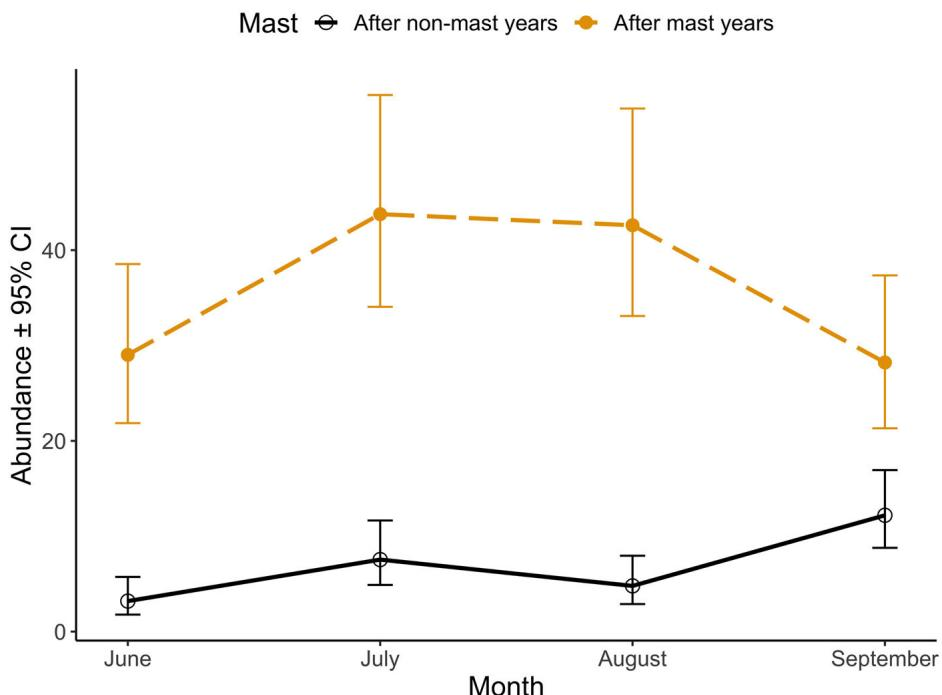
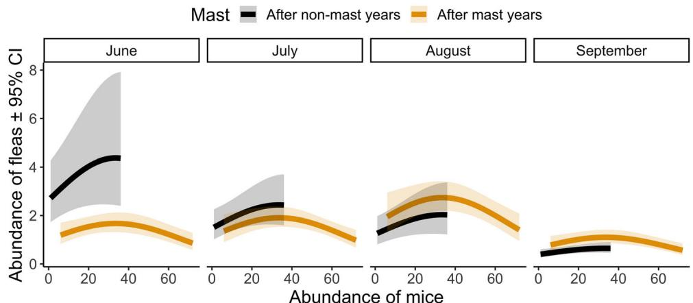
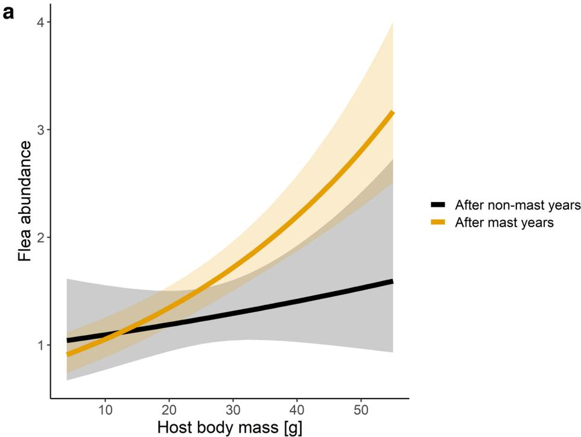
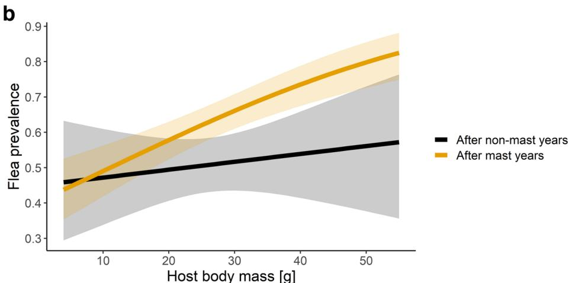

# From trees to fleas: masting indirectly affects flea abundance on a rodent host

Ivan BALÁž, $^{1}$ Michał BOGDZIEWICZ, $^{2,3}$ Sylwia DZIEMIAN-ZWOLAK, $^{2}$ Carlotta LO PRESTI, $^{4}$ Aleksandra WROBEL, $^{5}$ Milena ZDUNIAK $^{2}$ and Rafał ZWOLAK $^{2}$

$^{1}$ Faculty of Natural Sciences and Informatics, Constantine the Philosopher University in Nitra, Nitra, Slovakia, $^{2}$ Department of Systematic Zoology, Adam Mickiewicz University in Poznań, Poznań, Poland, $^{3}$ INRAE, LESSEM, University Grenoble Alpes, Saint-Martind'Hères, France, $^{4}$ University of Catania, Catania, Italy and $^{5}$ Department of Zoology, Poznań University of Life Sciences, Poznań, Poland

# Abstract

Mast seeding causes strong fluctuations in populations of forest animals. Thus, this phenomenon can be used as a natural experiment to examine how variation in host abundance affects parasite loads. We investigated fleas infesting yellow-necked mice in beech forest after 2 mast and 2 non-mast years. We tested 2 mutually exclusive scenarios: (1) as predicted by classical models of density-dependent transmission, an increase in host density will cause an increase in ectoparasite abundance (defined as the number of parasites per host), versus (2) an increase in host density will cause a decline in flea abundance ("dilution," which is thought to occur when parasite population growth is slower than that of the host). In addition, we assessed whether masting alters the relationship between host traits (sex and body mass) and flea abundance. We found a hump-shaped relationship between host and flea abundance. Thus, the most basic predictions are too simple to describe ectoparasite dynamics in this system. In addition, masting modified seasonal dynamics of flea abundance, but did not affect the relationship between host traits and flea abundance (individuals with the highest body mass hosted the most fleas; after controlling for body mass, parasite abundance did not vary between sexes). Our results demonstrate that pulses of tree reproduction can indirectly, through changes in host densities, drive patterns of ectoparasite infestation.

Key words: Apodemus flavicollis, Fagus sylvatica, indirect effects, pulsed resources, Siphonaptera

# INTRODUCTION

Masting, or synchronized, intermittent production of large seed crops by populations of perennial plants (Kelly & Sork 2002) provides pulsed resources that

Correspondence: Rafal Zwolak, Department of Systematic Zoology, Adam Mickiewicz University, Collegium Biologicum, Uniwersytetu Poznańskiego 6, 61-614 Poznan, Poland. Email: rafal.zwolak@gmail.com; rzwolak@amu.edu.pl

can satiate consumers (Zwolak et al. 2022) and trigger far-ranging effects in food webs (Clark et al. 2019). So far, most research focused on the impact of mastling on granivores, and subsequent cascading effects on predators and their alternative prey (King 1983; Jedrzejewska & Jedrzejewski 1998; Ostfeld & Keesing 2000; Bogdiewicz et al. 2016b; Szymkowiak & Thomson 2019). Parasites have been relatively neglected in this regard (but see Pedersen & Greives 2008; Vandegrift & Hudson 2009), with a notable exception of ticks, due to

concerns about tick-borne diseases that affect humans (Ostfeld et al. 1995; Jones et al. 1998; Ostfeld et al. 2006; Bogdiewicz & Szymkowiak 2016; Bregnard et al. 2021). Yet, masting has a considerable potential to inform parasite ecology. Pulses of massive seed production cause drastic changes in host densities. These changes can be used as a natural experiment on the parasitic effects of overcrowding. Such experiments are vital because host density plays a central role in theories on parasite transmission and population dynamics (Anderson & May 1978; McCallum et al. 2001; Roberts et al. 2002). Masting can be used to evaluate these theories with empirical data. In addition, the link between host density and parasite abundance (i.e. the number of parasites per host: Bush et al. 1997) is highly relevant in applied science. As an example, there is a concern that overcrowding of hosts in nature reserves can increase transmission rates, with negative effects on the viability of host populations (Lebarbenchon et al. 2006).

Most of our knowledge about parasite population dynamics comes from research on endoparasites, especially endoparasitic worms (Dobson & Hudson 1992; Arneberg et al. 1998). However, the link between host and parasite abundance might be different in ecto- versus endoparasites. In contrast to endoparasites, ectoparasites rarely affect host survival or reproduction (Raveh et al. 2015—although exceptions certainly exist: Brown & Brown 2004; López-Olvera et al. 2015). Consequently, the relation between host and ectoparasite population dynamics is thought to be mostly one-way, with lower potential for feedbacks. In addition, many species of hosts can prevent excessive build-up of ectoparasites through increased grooming (Hart 1990). This behavior can form a ceiling on the parasite abundance and has a relatively low cost that includes trade-offs with other behaviors (e.g. vigilance: Raveh et al. 2011). In endoparasites, the ceiling is usually through competition for space and resources in intestinal track of the host, and by increased mortality of heavily parasitized hosts (Coltman et al. 1999; Lello et al. 2004); thus, high endoparasite loads come with stronger negative impacts on hosts. These differences suggest that studying ectoparasites is essential if our goal is to verify whether there are robust, wide generalizations about the links between host and parasite abundances.

There are 2 most basic and mutually exclusive predictions on the effects of host population density on the abundance of directly transmitted parasites. First, there can be a positive relationship between parasite and host abundance. A major mechanism of this relationship is increased transmission of parasites in dense host populations (Anderson & May 1978; Roberts et al. 2002). In ad

dition, high host densities can lead to increased competition for food, lower body condition, and therefore greater susceptibility to infestation (Krasnov et al. 2005). In most systems, empirical studies support the positive relationship between host and parasite abundance (Arneberg et al. 1998; Chapman et al. 2005; Young et al. 2015).

Alternatively, increased host population density can negatively affect parasite abundance ("dilution"). If host densities rapidly increase, the infestation rates might decline, as parasites, especially those with relatively long life cycles, are temporarily diluted among hosts. This pattern has also been found by empirical studies, although perhaps not as frequently as the first one (Krasnov et al. 2007; Godfrey et al. 2008; Renwick & Lambert 2013; Zwolak et al. 2013; Samsing et al. 2014).

In addition to host abundance, parasite levels depend on characteristics of individual hosts. Sex and body mass are among the most widely studied and ecologically important individual traits of animals. These traits also affect infestation with parasites (Dziemian et al. 2015; Young et al. 2015; Hammond et al. 2019). Sex of the host can affect parasite loads through its effects on hormone levels (testosterone has immunosuppressive properties: Trigunaite et al. 2015) and behavior: in many species, males have larger home ranges than females (e.g. Ostfeld 1990; Fisher & Owens 2000; Perry & Garland 2002), and thus increased chances of encounter with parasites. High body mass presents larger food resource for parasites (translating into higher parasite abundance: Harrison et al. 2010; Meagher et al. 2019), but also indicates better condition and higher ability to resist infestation (potentially resulting in lower parasite abundance: Beldomenico et al. 2008; Beldomenico & Begon 2010). However, the surplus of food resulting from resource pulses can weaken the link between sex and space use (South et al. 2007) or between body mass and condition (Hertel et al. 2018). Thus, we predicted that host sex and body mass will have a reduced impact on parasite abundance after mast versus non-mast years.

We tested these notions in a study system consisting of fleas infesting yellow-necked mice [Apodemus flavicollis (Melchior, 1834)] in a beech (Fagus sylvatica) forest. We conducted 4 years of rodent trapping and parasite surveys over contrasting conditions of seed availability and rodent abundance (2 post-mast years of high rodent abundance, interlaced with 2 years of population crashes that occurred after seed production failures). We found that the most basic predictions are insufficient to describe the relationship between host and parasite populations in this system. Instead of a linear trend, we found a hump-shaped relationship between yellow-necked mouse and

flea abundance. We also determined that hosts with the highest body mass tended to host the most fleas, host sex did not affect flea loads, and, contrary to our predictions, masting did not influence these patterns.

# MATERIALS AND METHODS

# Natural history

European beech (F. sylvatica) is a large $(30 - 40\mathrm{m}$ tall), monoecious broadleaved tree that is widely distributed and economically important in Europe (Packham et al. 2012). Beech is flowering in April-May and seeds fall in autumn, often after first frosts (Packham et al. 2012). Seeds are relatively large $(12 - 18\mathrm{mm}$ long: Packham et al. 2012), highly nutritious (see Grodziński & Sawicka-Kapusta 1970), and consumed by a wide range of granivores (Packham et al. 2012). Beech masts every 2-12 years; in the long term, average interval between mast events varies between 4 and 8 years (Pidek et al. 2010). Mast years are typically followed by a complete seed production failure next year (Bogdziewicz et al. 2020).

Yellow-necked mouse is a common rodent in forests of Europe and western Asia (Pucek 1981). Adults weigh between 20 and $60\mathrm{g}$ and measure between 80 and $130\mathrm{mm}$ in length (head and body; tail is again as long). The yellow-necked mouse is solitary, nocturnal, and omnivorous. Home ranges of males are considerably larger than those of females (Stradiotto et al. 2009). Yellow-necked mice are considered tree seed specialists (Selva et al. 2012), and abundance of the yellow-necked mouse strongly fluctuates in response to tree masting (Zwolak et al. 2016a,b). Typically, after autumn masting, the abundance of mice is high in the spring and summer the following year, and crashes to very low numbers 2 years after masting (Zwolak et al. 2016a, 2018). The post-mast increases are associated with high overwinter survival and winter breeding (Jansen 1982; Pucek et al. 1993). Causes of the subsequent crashes probably involve density-dependent inhibition of maturation and breeding, or the action of natural enemies, such as predators, disease, or parasites (Pucek et al. 1993; Elias et al. 2006; Pedersen & Greives 2008).

Fleas (Insecta, Siphonaptera) are laterally flattened, wingless, periodic ectoparasites of higher vertebrates, with preference for small, burrowing mammals. Their hind legs are long and highly adapted for jumping. Fleal life cycle consists of several larval stages followed by complete metamorphosis (Bitam et al. 2010). In most species, worm-like larvae are not parasitic and feed on

organic matter found in the host nest, while the adults rely on blood meals. Between blood meals, adult fleas may occur on the host itself ("fur fleas"), or in host dens or other resting places ("nest fleas") (Krasnov et al. 2008). The transmission of fleas is direct and results from synchronous or asynchronous use of the same nests by different hosts, and from physical contact. Fleas are important vectors of numerous diseases (viral, bacterial, and rickettsial) and parasites (protozoans and helminths) (Bitam et al. 2010).

# Study sites

We conducted this research over 4 years (2010-2013) in Gorzowska Forest, located in Western Poland $(52.77^{\circ}\mathrm{N}, 15.07^{\circ}\mathrm{E},$ elevation $60 - 80\mathrm{m})$ . The study area is situated in a temperate climate zone. It receives an average annual precipitation of $523~\mathrm{mm}$ , and its mean monthly temperatures range from $-4^{\circ}\mathrm{C}$ in January to $23^{\circ}\mathrm{C}$ in July. We selected 12 stands located in beech forests (8 used in 2010-2012; 12 in 2013). The stands were single-aged, about 80 years old, and managed for wood. Mast years occurred in 2009 and 2011, with seed production of about 300 seeds per $\mathrm{m}^2$ during both events (counted on the ground: see Hilton & Packham 1997; Chianucci et al. 2021). In 2010 and 2012, beech did not produce viable seeds. See Zwolak et al. 2016a,b for further details on study sites and seed production.

# Trapping procedure

The trapping was conducted each year of the study during June-September, in 5-day sessions at monthly intervals. At each stand, we established an $8 \times 8$ trapping grid, with 10-m spacing between trap points (0.49 ha). At each trap point, we placed one wooden live trap ("dziekanówka" type, widely used in Poland; size $21 \times 8 \times 9.5$ cm; produced by A. Marcinkiewicz, Rajgród, Poland) baited with rolled oats and sunflower seeds. The traps were checked every morning (starting at $\sim 0800$ ) and evening (starting $\sim 1800$ ). We recorded species and sex of all captured animals, visually estimated their reproductive status (dividing males into scrotal vs. non-scrotal, and females into pregnant vs. lactating vs. not pregnant/lactating), weighted them using $\mathrm{Pesola}^{\mathrm{TM}}$ scales, and marked with uniquely numbered Monel ear tags (National Band & Tag Company, Newport, USA). Finally, captured yellow-necked mice were placed for $1 - 2\mathrm{min}$ in white cotton bags, and their fur was gently ruffled. Then, we released mice, and collected fleas that escaped onto the bag. This method has been successfully

used before (Kowalski et al. 2014), but to provide additional validation, we carefully combed the fur of 100 individual mice for additional fleas. We found a high correlation between flea abundance measured with the cotton bag method, and the cotton bag plus combing method (Pearson's $r = 0.90$ , $95\%$ CI: 0.85-0.93).

Yellow-necked mice, followed by bank voles (Myodes glareolus) were the most common species captured (Zwolak et al. 2016a). Since both yellow-necked mice and bank voles feed on seeds and increase in abundance after beech masting, their abundances were highly correlated (Zwolak et al. 2016b). Other, relatively rare species included field mice (Apodemus agrarius), harvest mouse (Micromys minutus), voles (Microtus spp.), and shrews (Sorex araneus and S. minutus) (Zwolak et al. 2016a).

# Flea identification

Fleas collected from yellow-necked mice were preserved in vials filled with $70\%$ ethyl alcohol. A random subset of fleas was identified to species $(n = 837$ ; species identification was conducted in 3 out of 4 years of the study: 2010, 2011, and 2013). These individuals were processed with the O'Mahony's method and mounted on microscope slides using Canada balm (Rosicky 1957). The fleas were identified to species using morphological features and keys developed by Rosicky (1957), Skuratowicz (1967), Beaucournu and Launay (1990), and Brinck-Lindroth and Smit (2007).

# Statistical analyses

To analyze the effects of masting on yellow-necked mouse abundance, we used a generalized linear mixed model (GLMM) with the number of unique individuals captured at a given site in each trapping session as the response variable. Explanatory variables included masting (categorical variable: yes or no) in interaction with month (categorical variable with 4 levels). Site was included as a random intercept effect. We used quasipoisson error distribution and log link function.

All flea species were pooled for analyses because our hypotheses concerned total flea burden. To analyze the effects of changes in host abundance on fleas, we used a GLMM with flea abundance (per host) as the response variable. Explanatory effects included host abundance (the number of unique yellow-necked mice captured in a given trapping session at a given site: linear and quadratic effect), masting, and month. Using the sum of yellow-necked mouse and bank vole abundance as an explanatory variable (an index of total host density:

see e.g. Stanko et al. 2002; Young et al. 2015) did not improve model fit (evaluated with Akaike Information Criterion). To verify whether masting affects the relationship between flea and host abundance or the temporal dynamics of flea abundance, we included interactions between host abundance and masting, and between month and masting. Random intercepts included host ID (i.e. unique individual mouse) and study site. Model diagnostics revealed temporal autocorrelation of residuals; thus, we also included first-order autoregressive (AR1) temporal correlation structure in the model. We used negative binomial error distribution (log link function).

Parasite abundance is a function of prevalence (the fraction of hosts infected) and mean intensity (mean number of parasites in infected hosts: Bush et al. 1997). We also analyzed prevalence separately to check if this measure reveals new patterns. Flea prevalence was estimated in the same manner, but the model had binomial error distribution (log link function).

Effects of host individual traits on flea abundance were modeled with body mass, sex, and their interactions with mast as explanatory variables. Random intercepts involved host and study site. The model included temporal autocorrelation and had quasipoisson error distribution (log link function). Effects of host individual traits on flea prevalence were estimated using a similar model, but with binomial error distribution (logit link function).

We analyzed data in R (R Core Team 2021). Generalized linear mixed models were implemented with package glmmTMB (Brooks et al. 2017) and evaluated with packages performance (Lüdecke et al. 2021) and DHARMa (Hartig 2022). We used package MuMIn (Barton 2020) to calculate coefficients of determination (pseudo- $R^2$ , Nakagawa & Schielzeth 2013) for abundance models; in logistic regression (prevalence models), $R^2$ is less useful because it can be very low even for perfect regression relationships (Mittlböck & Schemper 1996). Marginal $R^2$ represents variance explained by fixed factors and conditional $R^2$ variance explained by both fixed and random factors (Nakagawa & Schielzeth 2013).

# RESULTS

# Host abundance

Yellow-necked mouse abundance was about 5 times higher during summers after mast years, relative to summers after non-mast years $\chi^2 = 175.1$ , $\mathrm{df} = 1$ , $P < 0.0001$ ; Fig. 1). The monthly dynamics were also influenced by masting (interaction $\mathrm{mast} \times \mathrm{month}$ : $\chi^2 = 26.4$ , $\mathrm{df} = 3$ , $P < 0.0001$ ). After mast years, the

  
Figure 1 Monthly dynamics of yellow-necked mouse abundance (per trapping grid, $0.49\mathrm{ha}$ ) after mast (dashed line) and non-mast (solid line) years. The estimates are from a quasipoisson generalized linear mixed model (see Materials and Methods) and whiskers represent $95\%$ confidence intervals.

abundances peaked in June and July; after non-mast years, the abundance was highest in September (Fig. 1). The coefficient of determination $(R^2)$ for this model equaled 0.747 (marginal) and 0.790 (conditional).

# Flea abundance and prevalence

We collected a total of 3725 fleas from 1273 infested mice (prevalence $59\%$ ). We identified 7 flea genera and 10 species (Table S1, Supporting Information). Ctenophthalmus agyrites accounted for $48\%$ of fleas, Ctenophthalmus solutus for $34\%$ , and Megabothris turbidus for $7\%$ . Other species contributed less than $5\%$ of individuals. The abundance ranking was similar across years (Table S1, Supporting Information).

The abundance of fleas had a hump-shaped relationship with host abundance (Table 1A; Fig. 2). After accounting for changes in mouse abundance, masting did not affect flea populations (Table 1A). However, the monthly dynamics of flea abundance differed between mast and non-mast years (Table 1A). After non-mast years, flea abundance declined over the summer, but after mast years, the highest flea abundance occurred in August (Fig. 2). Marginal $R^2$ for this model equaled 0.149, and conditional $R^2 = 0.283$ . Flea prevalence

mirrored the temporal patterns of flea abundance, but was not influenced by mouse abundance (Table 1B).

Mice with higher body mass were more heavily parasitized by fleas (body mass effect in Table 2). Host sex did not affect flea abundance nor prevalence (sex effect in Table 2). Masting had a significant effect on flea prevalence, and marginally non-significant on flea abundance (Table 2; note that this effect was most likely mediated by mast-related changes in host abundance: Table 1). Contrary to our predictions, masting did not modify the effects of host body mass or sex on flea abundance or prevalence (although the mast x body mass interactions approached significance: Table 2; Fig. 3). The host traits model explained relatively little variation in flea abundance: marginal $R^2$ equaled 0.096, and conditional $R^2 = 0.843$ .

# DISCUSSION

We found that tree reproductive cycle influenced ectoparasite abundance on their rodent hosts. Most likely, the effect of masting was indirect, mediated through changes in host population density. However, the hump-shaped relationship between host and parasite abundance reported in this study was more complex than the linear relationships outlined in our predictions. The abundance

Table 1 Determinants of abundance (A) and prevalence (B) of fleas parasitizing yellow-necked mice (Apodemus flavicollis)   

<table><tr><td>Predictor</td><td>x²</td><td>df</td><td>P-value</td></tr><tr><td>(A)</td><td colspan="3">Flea abundance</td></tr><tr><td>Host abundance (quadratic effect)</td><td>12.1</td><td>2</td><td>0.002</td></tr><tr><td>Masting</td><td>0.6</td><td>1</td><td>0.443</td></tr><tr><td>Month</td><td>81.9</td><td>3</td><td>&lt;0.0001</td></tr><tr><td>Host abundance (quadratic effect) × masting</td><td>3.2</td><td>2</td><td>0.199</td></tr><tr><td>Masting × month</td><td>22.5</td><td>3</td><td>&lt;0.0001</td></tr><tr><td>(B)</td><td colspan="3">Flea prevalence</td></tr><tr><td>Host abundance (quadratic effect)</td><td>2.6</td><td>2</td><td>0.271</td></tr><tr><td>Masting</td><td>1.91</td><td>1</td><td>0.167</td></tr><tr><td>Month</td><td>48.7</td><td>3</td><td>&lt;0.0001</td></tr><tr><td>Host abundance (quadratic effect) × masting</td><td>5.12</td><td>2</td><td>0.077</td></tr><tr><td>Masting × month</td><td>9.47</td><td>3</td><td>0.024</td></tr></table>

Significant effects are in bold.

  
Figure 2 Hump-shaped relationship between flea and host abundance, estimated across months (June-September) and after mast (yellow) versus non-mast (black) years. Lines denote estimates from a negative binomial generalized linear mixed model. Shaded regions denote $95\%$ confidence intervals.

of fleas had a positive relationship with yellow-necked mouse abundance when host densities were low to intermediate (<40 individuals/site). This is in agreement with basic models of density-dependent transmission (Anderson & May 1978). Yet, contrary to the mass-action model, when host densities were high (>40 individuals/ grid), the relationship changed to negative, and flea abundance declined. Furthermore, even though some rodent densities recorded in this study were extremely low, we did not find a host density threshold, which would be necessary for parasite persistence, as predicted by basic theoretical models (Anderson & May 1978; McCallum et al. 2001; see also Renwick & Lambin 2013).

Such a hump-shaped pattern of abundance is infrequent in host-parasite interactions. Studies typically find a positive relationship between host and endoparasite abundance (reviewed by Arneberg et al. 1998). In contrast, studies on ectoparasites often found a negative relationship (Stanko et al. 2002; Renwick & Lambin 2013; Zwolak et al. 2013; but see e.g. Young et al. 2015). Few researchers reported more complex patterns (e.g. curvilinear increase to a plateau: Krasnov et al. 2002a). Perhaps the dominance of linear trends in published studies reflects that most investigations have been limited to first-order effects of host abundance. Moreover, to detect the hump-shaped relationship, it is necessary to

  
Figure 3 Relationship between host body mass, flea abundance (a), and flea prevalence (b). Lines represent estimates from negative binomial (b) and binomial (b) generalized linear mixed models. Shaded regions denote $95\%$ confidence intervals. The interactions between host body mass and masting did not reach statistical significance (abundance: $P = 0.09$ ; prevalence: $P = 0.10$ ).

investigate a wide range of host densities (Fig. 1). This condition is fulfilled in masting systems, where densities of granivorous hosts can be extremely high after masting, but then typically crash to very low numbers (Ostfeld & Keesing 2000).

What could be the mechanism of non-linear changes in flea abundance? An increase in host density leads to increased contact rates among individuals, and higher probability of parasite transmission (Côté & Poulin

1995; Sih et al. 2018; Fernandes et al. 2021). In our study system, the potential for higher contact rates at high host densities is indicated by increased home range overlap that occurs in yellow-necked mice after mast years (Bogdzielwicz et al. 2016c). Perhaps this effect caused an increase in flea abundance, which was reversed when fleas began to compete with each other (e.g. for high-quality feeding spots on the host: Hawlena et al. 2007), and when hosts started suffering from high

Table 2 Effects of individual host traits on abundance (A) and prevalence (B) of fleas parasitizing yellow-necked mice (Apodemus flavicollis) after mast and non-mast years   

<table><tr><td>Predictor</td><td>x²</td><td>df</td><td>P-value</td></tr><tr><td>(A)</td><td colspan="3">Flea abundance</td></tr><tr><td>Body mass</td><td>47.12</td><td>1</td><td>&lt;0.0001</td></tr><tr><td>Sex</td><td>0.05</td><td>1</td><td>0.829</td></tr><tr><td>Masting</td><td>3.81</td><td>1</td><td>0.051</td></tr><tr><td>Body mass × masting</td><td>2.87</td><td>1</td><td>0.090</td></tr><tr><td>Sex × masting</td><td>0.16</td><td>1</td><td>0.692</td></tr><tr><td>(B)</td><td colspan="3">Flea prevalence</td></tr><tr><td>Body mass</td><td>23.67</td><td>1</td><td>&lt;0.0001</td></tr><tr><td>Sex</td><td>0.01</td><td>1</td><td>0.922</td></tr><tr><td>Masting</td><td>7.19</td><td>1</td><td>0.007</td></tr><tr><td>Body mass × masting</td><td>2.66</td><td>1</td><td>0.103</td></tr><tr><td>Sex × masting</td><td>0.54</td><td>1</td><td>0.463</td></tr></table>

Significant effects are in bold.

infestation levels. Skin inflammation (dermatitis) caused by flea bites triggers increased grooming (Eads et al. 2017), which causes flea mortality and plays a crucial role in host-mediated regulation of ectoparasite loads (Hawlena et al. 2007). It is unclear, however, why this effect would lead to a decline in flea abundance, rather than a plateau (Krasnov et al. 2002a).

An alternative explanation is that host population growth increases a proportion of "transient" individuals with no burrows (Gliwicz 1992). Burrows are necessary for flea reproduction and larvae development (Krasnov et al. 2002a). Thus, transient individuals can affect flea transmission, but do not participate in their life cycle (Krasnov et al. 2002a). A growing proportion of transient individuals in high density host populations might dilute flea abundances. We note, however, that an increase in the proportion of transient animals was thought to cause a decline in flea prevalence in Krasnov et al. (2002a), but in our study prevalence was unaffected by changes in host abundance. Nevertheless, an increase in transient hosts could act synergistically with increased grooming, leading to a decline in flea abundance at high rodent densities. Finally, changes in flea abundance with host numbers were unlikely to be driven by alterations in flea communities because flea species composition remained similar in the years of high and low rodent density (Table S1, Supporting Information).

We also detected that mast and non-mast years differed in the monthly dynamics of flea abundance and preva

lence. Causes of seasonality in parasite infestations are complex and can be difficult to pinpoint (Altizer et al. 2006). In our study system, seasonality in flea abundance can result from direct weather effects on flea survival (Krasnov et al. 2001, 2002b), but also from seasonal changes in host social behavior, population structure, and immune defenses (Altizer et al. 2006). Masting can influence all these factors. First, beech masting is associated with specific weather conditions (Bogdzielwicz et al. 2017; Nussbaumer et al. 2018), which can affect flea reproduction and survival, and contribute to the differences in monthly dynamics during mast and non-mast years. Furthermore, mast-related fluctuations in population size can affect host behavior (including space use: Bogdzielwicz et al. 2016c), population structure (Falls et al. 2007), and body condition (Bogdzielwicz et al. 2016b). Thus, determining the exact mechanism of the differences is challenging.

On the other hand, masting did not modify the influence of body mass on parasite loads (prevalence and abundance) and did not change the lack of relationship between flea loads and host sex. Thus, our prediction that masting modifies the influence of host traits on ectoparasite infestation was not supported. We found that host mass was positively associated with flea prevalence and abundance. In many species, larger individuals have more parasites (e.g. Young et al. 2015; Meagher et al. 2019), and the interaction between yellow-necked mice and fleas fits this pattern. The most popular hypotheses that explain such findings state that larger individuals represent an easier and higher quality target for parasites because such hosts eat more, range further, and provide parasites with more resources, or that there is a trade-off between growth and immunity that leaves larger hosts more vulnerable (van der Most et al. 2011).

In mammals, males often harbor more parasites than do females (Moore & Wilson 2002). In many cases, this difference is apparent even after accounting for sex-related differences in body size (Zwolak et al. 2013; Patterson et al. 2015; Hammond et al. 2019) and can be caused by the immunosuppressive effect of testosterone (Trigunaite et al. 2015), and by male-female differences in ranging or grooming behavior (Krasnov et al. 2012). In other species, males and females do not differ in parasite loads or the difference can be attributed to body size dimorphism (Moore & Wilson 2002). This seems to be the case with Apodemus mice and their ectoparasites: males tend to be more heavily infested than females, but they are also larger, and after taking into account the body size, the sex-bias in the ectoparasite abundance and prevalence vanishes (this study; Harrison et al. 2010;

Kowalski et al. 2014). This also explains why masting did not change this pattern. While changes in food resources associated with masting could, at least in theory, affect the magnitude of sex differences in immunocompetence (through effects on body condition) or in ranging patterns (Bogdiewicz et al. 2016b), they are unlikely to affect body size dimorphism because it results from sexual selection (Moore & Wilson 2002).

As a caveat, studying ecological responses to masting is inherently difficult because only multidecade data sets can contain numerous repetitions of masting events. Our research was based on a 4-year series of observations, which included 2 mast years. A longer time series would be needed to exclude the possibility of more complex dynamics, such as long time lags between peaks of the flea and rodent abundance. This remains an important direction for future studies.

Another apparent caveat is that our models explained relatively low proportion of variation in flea abundance. This indicates their limited predictive power. However, our goal was to test the hypothesized relationships between tree masting and flea populations. Thus, we divided the models into 2 groups (one focused on the effects of changes in host populations and another on the effects of hosts traits) rather than try to construct one, highly predictive model.

In conclusion, we documented non-linear changes in parasite abundance with increase in host density. Such a phenomenon indicates that mechanisms driving flea infestation are more complex than predicted by the basic epidemiological models or the dilution effect. Moreover, our results demonstrate that pulses of tree reproduction can drive patterns of ectoparasite infestation in granivorous hosts. While previous studies documented that masting, and subsequent increase in rodent host abundance, leads to a higher density of free-ranging ectoparasite stages (tick nymphs: Jones et al. 1998; Bregnard et al. 2021), this study is the first to document masting-related changes in ectoparasite infestation of individual hosts. Thus, it reveals another indirect effect of masting on interactions in forest food webs (Clark et al. 2019).

# ACKNOWLEDGMENTS

A.W. was supported by the "Sonatina" grant no. 2020/36/C/NZ8/00013, M.Z. by the "Preludium" grant no. 2016/21/N/NZ8/01059, and R.Z. by the "Harmonia" grant no. 2018/30/M/NZ8/0052. All grants were awarded by the National Science Centre, Poland.

# REFERENCES

Altizer S, Dobson A, Hosseini P, Hudson P, Pascual M, Rohani P (2006). Seasonality and the dynamics of infectious diseases. *Ecology Letters* 9, 467-84.   
Anderson RM, May RM (1978). Regulation and stability of host-parasite population interactions: I. Regulatory processes. Journal of Animal Ecology 47, 219-47.   
Arneberg P, Skorping A, Grenfell B, Read AF (1998). Host densities as determinants of abundance in parasite communities. Proceedings of the Royal Society of London. Series B: Biological Sciences 265, 1283-9.   
Barton K (2020). MuMIn: Multi-model inference. R package version 1.43.17. Available from URL: https://CRAN.R-project.org/package=MuMIn   
Beaucournu JC, Launay H (1990). Les puces (Siphonaptera) de France et du Bassin mediter-ranéen occidental: par Jean-Claude Beaucournu et Henri Launay. Faune de France 76, Lechevalier, Paris, p. 548.   
Beldomenico PM, Began M (2010). Disease spread, susceptibility and infection intensity: vicious circles? Trends in Ecology & Evolution 25, 21-7.   
Beldomenico PM, Telfer S, Gebert S, Lukomski L, Bennett M, Began M (2008). The dynamics of health in wild field vole populations: a haematological perspective. Journal of Animal Ecology 77, 984-97.   
Bitam I, Dittmar K, Parola P, Whiting MF, Raoult D (2010). Fleas and flea-borne diseases. International Journal of Infectious Diseases 14, e667-76.   
Bogdiewicz M, Kelly D, Thomas PA, Lageard JG, Hacket-Pain A (2020). Climate warming disrupts mast seeding and its fitness benefits in European beech. Nature Plants 6, 88-94.   
Bogdziewicz M, Szymkowiak J (2016a). Oak acorn crop and Google search volume predict Lyme disease risk in temperate Europe. *Basic and Applied Ecology* 17, 300-7.   
Bogdiewicz M, Szymkowiak J, Kasprzyk I et al. (2017). Masting in wind-pollinated trees: System-specific roles of weather and pollination dynamics in driving seed production. Ecology 98, 2615-25.   
Bogdiewicz M, Zwolak R, Crone EE (2016b). How do vertebrates respond to mast seeding? Oikos 125, 300-7.   
Bogdziewicz M, Zwolak R, Redosh L, Rychlik L, Crone EE (2016c). Negative effects of density on space use of small mammals differ with the phase of the

masting-induced population cycle. Ecology and Evolution 6, 8423-30.   
Bregnard C, Rais O, Herrmann C, Kahl O, Brugger K, Voordouw MJ (2021). Beech tree masting explains the inter-annual variation in the fall and spring peaks of Ixodes ricinus ticks with different time lags. Parasites & Vectors 14, 570.   
Brinck-Lindroth G, Smit FGAM (2007). The Fleas (Siphonaptera) of Fennoscandia and Denmark. Vol. 41. Brill, Leiden, Boston.   
Brooks ME, Kristensen K, van Benthem KJ et al. (2017). glmmTMB balances speed and flexibility among packages for zero-inflated generalized linear mixed modeling. The R Journal 9, 378-400.   
Brown CR, Brown MB (2004). Group size and ectoparasitism affect daily survival probability in a colonial bird. Behavioral Ecology and Sociobiology 56, 498-511.   
Bush AO, Lafferty KD, Lotz JM, Shostak AW (1997). Parasitology meets ecology on its own terms: Margolis et al. revisited. The Journal of Parasitology 83, 575-83.   
Chapman CA, Gillespie TR, Speirs ML (2005). Parasite prevalence and richness in sympatric colobines: Effects of host density. American Journal of Primatology: Official Journal of the American Society of Primatologists 67, 259-66.   
Chianucci F, Tattoni C, Ferrara C et al. (2021). Evaluating sampling schemes for quantifying seed production in beech (Fagus sylvatica) forests using ground quadrats. Forest Ecology and Management 493, 119294.   
Clark JS, Nunez CL, Tomasek B (2019). Foodwebs based on unreliable foundations: spatiotemporal mast- ing merged with consumer movement, storage, and diet. Ecological Monographs 89, e01381.   
Coltman DW, Pilkington JG, Smith JA, Pemberton JM (1999). Parasite-mediated selection against inbred Soay sheep in a free-living island population. Evolution; Internation Journal of Organic Evolution 53, 1259-67.   
Côté IM, Poulin R (1995). Parasitism and group size in social animals: a meta-analysis. *Behavioral Ecology* 6, 159-65.   
Dobson AP, Hudson PJ (1992). Regulation and stability of a free-living host-parasite system: Trichostrongylus tenuis in red grouse. II. Population models. Journal of Animal Ecology 61, 487-98.   
Dziemian S, Sikora B, Pilacinska B, Michalik J, Zwolak R (2015). Ectoparasite loads in sympatric ur

ban populations of the northern white-breasted and the European hedgehog. Parasitology Research 114, 2317-23.   
Eads DA, Biggins DE, Eads SL (2017). Grooming behaviors of black-tailed prairie dogs are influenced by flea parasitism, conspecifics, and proximity to refuge. Ethology 123, 924-32.   
Elias SP, Witham JW, Hunter ML Jr (2006). A cyclic red-backed vole (Clethrionomys gapperi) population and seedfall over 22 years in Maine. Journal of Mammalogy 87, 440-5.   
Falls JB, Falls EA, Fryxell JM (2007). Fluctuations of deer mice in Ontario in relation to seed crops. Ecological Monographs 77, 19-32.   
Fernandes FR, da Silva Abreu S, Cruz LD (2021). Transmission networks and ectoparasite mite burdens in Oecomys paricola (Rodentia: Cricetidae). Parasitology 148, 443-50.   
Fisher DO, Owens IP (2000). Female home range size and the evolution of social organization in macropod marsupials. Journal of Animal Ecology 69, 1083-98.   
Gliwicz J (1992). Patterns of dispersal in non-cyclic populations of small rodents. In: Stenseth NC, Lidicker WZ, eds. Animal Dispersal: Small Mammals as a Model. Chapman and Hall, London, UK, pp. 147-59.   
Godfrey SS, Bull CM, Nelson NJ (2008). Seasonal and spatial dynamics of ectoparasite infestation of a threatened reptile, the tuatara (Sphenodon punctatus). Medical and Veterinary Entomology 22, 374-85.   
Grodzinski W, Sawicka-Kapusta K (1970). Energy values of tree-seeds eaten by small mammals. Oikos 21, 52-8.   
Hammond TT, Hendrickson CI, Maxwell TL et al. (2019). Host biology and environmental variables differentially predict flea abundances for two rodent hosts in a plague-relevant system. International Journal for Parasitology: Parasites and Wildlife 9, 174-83.   
Harrison A, Scantlebury M, Montgomery WI (2010). Body mass and sex-biased parasitism in wood mice Apodemus sylvaticus. Oikos 119, 1099-104.   
Hart BL (1990). Behavioral adaptations to pathogens and parasites: five strategies. *Neuroscience & Biobehavioral Reviews* 14, 273-94.   
Hartig F (2022). Package "DHARMa": Residual Diagnostics for Hierarchical (Multi-Level/Mixed) Regression Models. Available from URL: https://CRAN.R-project.org/package=DHARMa   
Hawlena H, Abramsky Z, Krasnov BR, Saltz D (2007). Host defence versus intraspecific competition in the regulation of infrapopulations of the flea Xenopsylla

conformis on its rodent host Meriones crassus. International Journal for Parasitology 37, 919-25.   
Hertel AG, Bischof R, Langval O et al. (2018). Berry production drives bottom-up effects on body mass and reproductive success in an omnivore. *Oikos* 127, 197-207.   
Hilton GM, Packham JR (1997). A sixteen-year record of regional and temporal variation in the fruiting of beech (Fagus sylvatica L.) in England (1980-1995). Forestry 70, 7-16.   
Jędrzejewska B, Jędrzejewski W (1998). Predation in Vertebrate Communities: The Bialowieza Primeval Forest as a Case Study, Vol. 135. Springer Science & Business Media, Berlin.   
Jensen TS (1982). Seed production and outbreaks of noncyclic rodent populations in deciduous forests. Oecologia 54, 184-92.   
Jones CG, Ostfeld RS, Richard MP, Schauber EM, Wolff JO (1998). Chain reactions linking acorns to gypsy moth outbreaks and Lyme disease risk. Science 279, 1023-6.   
Kelly D, Sork VL (2002). Mast seeding in perennial plants: Why, how, where? Annual Review of Ecology and Systematics 33, 427-47.   
King CM (1983). The relationships between beech (Nothofagus sp.) seedfall and populations of mice (Mus musculus), and the demographic and dietary responses of stoats (Mustela erminea), in three New Zealand forests. Journal of Animal Ecology 52, 141-66.   
Kowalski K, Bogdiewicz M, Eichert U, Rychlik L (2014). Sex differences in flea infections among rodent hosts: Is there a male bias? Parasitology Research 114, 337-41.   
Krasnov B, Khokhlova I, Shenbrot G (2002). The effect of host density on ectoparasite distribution: An example of a rodent parasitized by fleas. Ecology 83, 164-75.   
Krasnov BR, Bordes F, Khokhlova IS, Morand S (2012). Gender-biased parasitism in small mammals: Patterns, mechanisms, consequences. Mammalia 76, 583.   
Krasnov BR, Khokhlova IS, Arakelyan MS, Degen AA (2005). Is a starving host tastier? Reproduction in fleas parasitizing food-limited rodents. *Functional Ecology* 19, 625-31.   
Krasnov BR, Khokhlova IS, Fielden LJ, Burdelova NV (2001). Effect of air temperature and humidity on the survival of pre-imaginal stages of two flea species (Siphonaptera: Pulicidae). Journal of Medical Entomology 38, 629-37.

Krasnov BR, Stanko M, Morand S (2007). Host community structure and infestation by ixodid ticks: Repeatability, dilution effect and ecological specialization. Oecologia 154, 185-94.   
Krasnov BR (2008). Functional and Evolutionary Ecology of Fleas: A Model for Ecological Parasitology. Cambridge University Press, Cambridge, UK.   
Lebarbenchon C, Poulin R, Gauthier-Clerc M, Thomas F (2006). Parasitological consequences of overcrowding in protected areas. *EcoHealth* 3, 303-7.   
Lello J, Boag B, Fenton A, Stevenson IR, Hudson PJ (2004). Competition and mutualism among the gut helminths of a mammalian host. Nature 428, 840-4.   
López-Olvera JR, Serrano E, Armenteros A et al. (2015). Sex-biased severity of sarcoptic mange at the same biological cost in a sexually dimorphic ungulate. Parasites & Vectors 8, 583.   
Lüdecke D, Ben-Shachar M, Patil I, Waggoner P, Makowski D (2021). performance: An R package for assessment, comparison and testing of statistical models. Journal of Open Source Software 6, 3139.   
McCallum H, Barlow N, Hone J (2001). How should pathogen transmission be modelled? Trends in Ecology & Evolution 16, 295-300.   
Meagher S, Winters KL, McCravy KW, Zwolak R (2019). Complex and diverse drivers of parasite loads in a cosmopolitan insect. Journal of Parasitology 105, 659-68.   
Mittlböck M, Schemper M (1996). Explained variation for logistic regression. Statistics in Medicine 15, 1987-97.   
Moore SL, Wilson K (2002). Parasites as a viability cost of sexual selection in natural populations of mammals. Science 297, 2015-8.   
Nakagawa S, Schielzeth H (2013). A general and simple method for obtaining $R^2$ from Generalized Linear Mixed-effects Models. Methods in Ecology and Evolution 4, 133-42.   
Nussbaumer A, Waldner P, Apuhtin V et al. (2018). Impact of weather cues and resource dynamics on mast occurrence in the main forest tree species in Europe. Forest Ecology and Management 429, 336-50.   
Ostfeld RS (1990). The ecology of territoriality in small mammals. Trends in Ecology & Evolution 5, 411-5.   
Ostfeld RS, Canham CD, Oggenfuss K, Winchcombe RJ, Keesing F (2006). Climate, deer, rodents, and acorns as

determinants of variation in Lyme-disease risk. PLoS Biology 4, e145.   
Ostfeld RS, Cepeda OM, Hazler KR, Miller MC (1995). Ecology of Lyme disease: Habitat associations of ticks (Ixodes scapularis) in a rural landscape. Ecological Applications 5, 353-61.   
Ostfeld RS, Keesing F (2000). Pulsed resources and community dynamics of consumers in terrestrial ecosystems. Trends in Ecology & Evolution 15, 232-7.   
Packham JR, Thomas PA, Atkinson MD, Degen T (2012). Biological Flora of the British Isles: Fagus sylvatica. Journal of Ecology 100, 1557-608.   
Patterson JE, Neuhaus P, Kutz SJ, Ruckstuhl KE (2015). Patterns of ectoparasitism in North American red squirrels (Tamiasciurus hudsonicus): Sex-biases, seasonality, age, and effects on male body condition. International Journal for Parasitology: Parasites and Wildlife 4, 301-6.   
Pedersen AB, Greives TJ (2008). The interaction of parasites and resources cause crashes in a wild mouse population. Journal of Animal Ecology 77, 370-7.   
Perry G, Garland T Jr (2002). Lizard home ranges revisited: effects of sex, body size, diet, habitat, and phylogeny. Ecology 83, 1870-85.   
Pidek IA, Svitavská-Svobodova H, van der Knaap WO et al. (2010). Variation in annual pollen accumulation rates of Fagus along a N-S transect in Europe based on pollen traps. Vegetation History and Archaeobotany 19, 259-70.   
Pucek Z (1981). Keys to Vertebrates of Poland: Mammals. PWN, Warszawa.   
Pucek Z, Jedrzejewski W, Jedrzejewska B, Pucek M (1993). Rodent population dynamics in a primeval deciduous forest (Bialowieza National Park) in relation to weather, seed crop, and predation. Acta Theriologica 38, 199-232.   
R Core Team (2021). R: A language and environment for statistical computing. R Foundation for Statistical Computing, Vienna, Austria. Available from URL: https://www.R-project.org/.   
Raveh A, Kotler BP, Abramsky Z, Krasnov BR (2011). Driven to distraction: detecting the hidden costs of flea parasitism through foraging behaviour in gerbils. *Ecology Letters* 14, 47-51.   
Raveh S, Neuhaus P, Dobson FS (2015). Ectoparasites and fitness of female Columbian ground squirrels. Philosophical Transactions of the Royal Society B: Biological Sciences 370, 20140113.

Renwick AR, Lambin X (2013). Host-parasite interactions in a fragmented landscape. International Journal for Parasitology 43, 27-35.   
Roberts MG, Dobson AP, Arneberg P et al. (2002). Parasite community ecology and biodiversity. In: Hudson PJ, Rizzoli A, Grenfell BT, Heesterbeek H, Dobson AP, eds. The Ecology of Wildlife Diseases. Oxford University Press, Oxford, pp. 63-82.   
Rosicky B (1957). Blechy - Aphaniptera. Fauna CSR, sv. 10. CSAV, Praha.   
Samsing F, Oppedal F, Johansson D, Bui S, Dempster T (2014). High host densities dilute sea lice Lepeophtheirus salmonis loads on individual Atlantic salmon, but do not reduce lice infection success. Aquaculture Environment Interactions 6, 81-9.   
Selva N, Hobson KA, Cortes-Avizanda A, Zalewski A, Donazar JA (2012). Mast pulses shape trophic interactions between fluctuating rodent populations in a primeval forest. PLoS ONE 7, e51267.   
Sih A, Spiegel O, Godfrey S, Leu S, Bull CM (2018). Integrating social networks, animal personalities, movement ecology and parasites: a framework with examples from a lizard. Animal Behaviour 136, 195-205.   
Skuratowicz W (1967). Pchly-Siphonaptera (Aphaniptera). Kluczdo Oznaczania Owadow Polski 29, 1-141.   
South JM, Emmons LH, Bernard H (2007). Behavioral monogamy and fruit availability in the large treeshrew (Tupaia tana) in Sabah, Malaysia. Journal of Mammalogy 88, 1427-38.   
Stanko M, Miklisova D, De Bellocq JG, Morand S (2002). Mammal density and patterns of ectoparasite species richness and abundance. *Oecologia* 131, 289-95.   
Stradiotto A, Cagnacci F, Delahay R, Tioli S, Nieder L, Rizzoli A (2009). Spatial organization of the yellow-necked mouse: Effects of density and resource availability. Journal of Mammalogy 90, 704-14.   
Szymkowiak J, Thomson RL (2019). Nest predator avoidance during habitat selection of a songbird varies with mast peaks and troughs. Behavioral Ecology and Sociobiology 73, 91.   
Trigunaite A, Dimo J, Jorgensen TN (2015). Suppressive effects of androgens on the immune system. *Cellular Immunology* 294, 87-94.   
Vandegrift KJ, Hudson PJ (2009). Response to enrichment, type and timing: small mammals vary in their response to a springtime cicada but not a carbohydrate pulse. Journal of Animal Ecology 78, 202-9.

van der Most PJ, de Jong B, Parmentier HK, Verhulst S (2011). Trade-off between growth and immune function: A meta-analysis of selection experiments. Functional Ecology 25, 74-80.   
Webber QM, Vander Wal E (2020). Heterogeneity in social network connections is density-dependent: implications for disease dynamics in a gregarious ungulate. Behavioral Ecology and Sociobiology 74, 77.   
Young HS, Dirzo R, McCauley DJ et al. (2015). Drivers of intensity and prevalence of flea parasitism on small mammals in East African savanna ecosystems. The Journal of Parasitology 101, 327-35.   
Zwolak R, Bogdiewicz M, Rychlik L (2016a). Beech masting modifies the response of rodents to forest management. Forest Ecology and Management 359, 268-76.   
Zwolak R, Bogdzielicz M, Wrobel A, Crone EE (2016b). Advantages of masting in European beech: Timing of granivore satiation and benefits of seed caching support the predator dispersal hypothesis. Oecologia 180, 749-58.   
Zwolak R, Celebias P, Bogdziewicz M (2022). Global patterns in the predator satiation effect of

masting—A meta-analysis. PNAS 119, e2105655 119.   
Zwolak R, Meagher S, Vaughn JW, Dziemian S, Crone EE (2013). Reduced ectoparasite loads of deer mice in burned forest: From fleas to trees? *Ecosphere* 4, 132.   
Zwolak R, Witczuk J, Bogdzielicz M, Rychlik L, Pagacz S (2018). Simultaneous population fluctuations of rodents in montane forests and alpine meadows suggest indirect effects of tree masting. Journal of Mammalogy 99, 586-95.

# SUPPLEMENTARY MATERIALS

Additional supporting information may be found online in the Supporting Information section at the end of the article.

Table S1 Proportional abundance (in %) of fleas infesting yellow-necked mice in Gorzowska Forest in 2010 ( $n = 216$ ), 2011 ( $n = 490$ ), and 2013 ( $n = 131$ ). Identification of flea species was not conducted in 2012. Percentages of the 3 most abundant species (each year and in total) are in bold.

# Cite this article as:

Baláž I, Bogdiewicz M, Dziemian-Zwolak S et al. (2022). From trees to fleas: masting indirectly affects flea abundance on a rodent host. Integrative Zoology 00, 1-13. https://doi.org/10.1111/1749-4877.12671