# Food and foraging preferences of the edible dormouse Glis glis at two sites in Poland

Author(s): Mirosław Jurczyszyn

Source: Folia Zoologica, 67(2):76-83.

Published By: Institute of Vertebrate Biology, Academy of Sciences of the Czech Republic https://doi.org/10.25225/fozo.v67.i2.a5.2018

URL: http://www.bioone.org/doi/full/10.25225/fozo.v67.i2.a5.2018

BioOne (www.bioone.org) is a nonprofit, online aggregation of core research in the biological, ecological, and environmental sciences. BioOne provides a sustainable online platform for over 170 journals and books published by nonprofit societies, associations, museums, institutions, and presses.

Your use of this PDF, the BioOne Web site, and all posted and associated content indicates your acceptance of BioOne’s Terms of Use, available at www.bioone.org/page/terms_of_use.

Usage of BioOne content is strictly limited to personal, educational, and non-commercial use. Commercial inquiries or rights and permissions requests should be directed to the individual publisher as copyright holder.

# Food and foraging preferences of the edible dormouse Glis glis at two sites in Poland

Mirosław JURCZYSZYN

Adam Mickiewicz University, Faculty of Biology, Institute of Environmental Biology, Department of Systematic Zoology, Umultowska 89, 61-614 Poznań, Poland; e-mail: mj_otis@poczta.onet.pl, jurc@amu.edu.pl

Received 30 Januray 2018; Accepted 11 July 2018

Abstract. Food preferences of the edible dormouse were revealed with the use of radio-tracking. Studies were conducted on two plots in July and August of two years: one year with good beech (Fagus sylvatica) mast and the second with poor beech mast. Study plots were located in Roztocze National Park (RNP) where beech constituted about $80 \%$ of the tree stand) and in Sieraków Landscape Park (SLP) where beech formed about $30 \%$ of the tree stand. Six individuals (three males, three females) were radio-tracked in both years on each plot. Every animal was radio-tracked during four nights by using continuous recording during which the duration of foraging on particular tree species was recorded.

On both study plots, the dormice foraged mostly on the common beech, eating both ripe fruit, ripening fruit and vegetative parts of trees. In a beech mast year, on both study plots, the animals foraged on the beech (both July and August) and on the fir Abies alba in RNP and on the common hazel Corylus avellana in SLP (in August). Bigger differences in diets between the two populations studied were found in a non-mast year, resulting from differential foraging and exploitation of subdominant tree and bush species on the plots. The dormice foraged mostly on food that was characterized by the highest nutritional value at a given time.

Key words: masting year, non-masting year, radio-tracking, continuous observation

# Introduction

The edible dormouse Glis glis (Linnaeus, 1766) is an animal feeding primarily on plant food (Kryštufek 2010). Like other species in the Gliridae family, it has no caecum, which limits the value of food with a high cellulose content due to an inability to digest it (Feldhamer et al. 1999). Therefore, the edible dormouse seeks flowers and developing fruits of trees and shrubs with high nutritional value (Holišová 1968, Rodolfi 1994, Gigirey & Rey 1998). A very important source of food, limited mainly to the second half of summer and autumn, is beechnuts (Schlund et al. 2002, Bieber & Ruf 2004, Fietz et al. 2005), which are obviously available only where mature European beech Fagus sylvatica occurs. Edible dormice living in tree stands lacking this tree use the fruits of other species, such as oak Quercus sp., hazel Corylus avellana, hornbeam Carpinus betulus, dogwoods Cornus sp., hawthorn Crataegus sp., maple Acer sp., apple tree Malus sp., pear Pyrus sp., wild cherry Prunus avium, birch Betula sp., glossy buckthorn Frangula alnus, blackberry Rubus sp. (Ognev 1947, Kahmann 1965, Holišová 1968, Gigirey & Rey 1999,

Juškaitis et al. 2015). The composition of edible dormouse food varies throughout the year and in different years, depending on its availability. In the spring and early summer, they consume significant amounts of low-energy foods such as leaves (Fietz et al. 2005). In the years of crop failure among trees producing high-calorie fruits, the dormouse eats leaves, buds, flowers and bark of trees and shrubs, as well as fungi (Ognev 1947, Kahmann 1965, Holišová 1968, Jackson 1994). The proportion of animal food in the form of arthropods (Hymenoptera, Coleoptera, Hemiptera, Myriapoda, Arachnidae), snails and vertebrates (mainly birds, their eggs and chicks) is generally low and, according to most researchers, limited to the spring and early summer, when there is a shortage of appropriate plant food (Ognev 1947, Kahmann 1965, Holišová 1968, Gigirey & Rey 1999, Koppmann-Rumpf et al. 2003, Nowakowski et al. 2006, Nowakowski & Godlewska 2006, Adamík & Král 2008, Juškaitis et al. 2015). The influence of habitat on the composition of the diet is exemplified by one of the Italian populations living in spruce forest, in which from July to October most of the dormouse

food was of animal origin (Franco 1990). According to the theory of optimal foraging, dormice eat food that ensures maximum energy gain, and where there is plenty of high quality food other less profitable ones are omitted (Schoener 1987).

Cornils et al. (2017) suggested that edible dormice try to avoid areas with large fluctuations in food availability in order to survive years without mast in their home ranges. The populations studied in the present work occupy forests in which beech is the most abundant tree species. However, there is a significant difference between these areas in terms of the percentage of beech in the forest stand. On one research area (Roztocze National Park) it constitutes over $80 \%$ of all the trees, and each of the remaining species comprise less than $5 \%$ . On the second research area (Sieraków Landscape Park), beech accounts for less than $30 \%$ and other species form a dozen or more percentages in the composition of the stand. Because the amount of fruits produced by beech varies over the years from very high abundance, when the branches bend under the weight of beechnuts, to a complete lack of them (Hilton & Packham 1997, 2003, Kantorowicz 2000), we can expect a different diet in the dormice in years of masting and non-masting in this tree species.

The aim of the present study was to investigate whether dormice from both populations will mostly forage on beech according to the principles of optimal foraging in the year of prodigious quantities of beechnuts. Beechnuts have one of the highest calorific values among tree species occurring in this part of Europe (Grodziński & Sawicka-Kapusta 1970). It is possible that even in the first half of summer (July) the animals will feed most of the time on this tree species, because as early as mid-July, the beechnuts already contain one third of the amount of fruit fat present in fully ripe nuts (Bieber & Ruf 2004). The second aim of this study was to check which other species of trees and shrubs are used by edible dormice as a source of food in masting and non-masting years of beech. It is not

easy to find a year of complete failure of beechnuts, because usually at least a small number of trees bear fruits (Chałupka 1990, Hilton & Packham 1997).

# Material and Methods

Studies were conducted on two areas: one located in the Roztocze National Park (RNP) in southeast Poland $5 0 ^ { \circ } 3 6 ^ { \prime }$ N, $2 2 ^ { \circ } 5 7 ^ { \prime } \mathrm { ~ E ~ }$ ) and the other in the Sieraków Landscape Park (SLP) in western Poland $( 5 2 ^ { \circ } 3 7 ^ { \prime } \mathrm { N } ,$ , $1 6 ^ { \circ } 0 6 ^ { \prime } \mathrm { E }$ ). The two sites are about $5 0 0 \mathrm { k m }$ apart. In RNP beech constituted more than $80 \%$ of the tree stand and in SLP nearly $30 \%$ (see below for more detail). The study was carried out in the years 2005 and 2006. The first was a year almost without beechnuts on both study plots (though in SLP there could be no beech nuts at all), the latter was a mast seeding year for beech. According to the classification of Kantorowicz (2000), in 2005 the fruiting rate was the lowest category: “no crop”, meaning that the proportion of cropping trees (CCT) was about $0 \%$ and in 2006 it was the close to the highest level of “good crop”, meaning that CCT was about $1 0 0 \ \%$ when all the beech trees were fruiting. This paper will use the terms non-masting year for 2005 and masting year for 2006.

Dormice were caught in live traps before and after radio-tracking. Traps were fastened on the tree branches in irregular grids 20 to $4 0 \mathrm { m }$ apart. A mixture of oat flakes, peanut butter and fruits was used as bait. Some of the animals caught were fitted with radio transmitters (made by Titley Electronics, Australia), around their neck, that amounted to no more than $5 \%$ of the animal’s body mass. Only adult overwintered edible dormice were chosen for this study. In both years from 1 to 21 July and from 4 to 24 August, six individuals (three males, three females) were radiotracked in both RNP and SLP. The same individuals were studied in July and August, but different groups in 2005 and 2006. The transmitters could work for about three months, so generally it was not necessary

Table 1. Mean total observation time (in minutes) of male and female edible dormice during four nights in July and August 2005 and in July and August 2006 in Roztocze National Park and Sieraków Landscape Park.   

<table><tr><td rowspan="3">Year</td><td></td><td colspan="4">Mean time of the edible dormice observations during four nights (minutes)</td></tr><tr><td></td><td colspan="2">Roztocze National Park</td><td colspan="2">Sieraków Landscape Park</td></tr><tr><td></td><td>Male</td><td>Female</td><td>Male</td><td>Female</td></tr><tr><td rowspan="2">2005</td><td>July</td><td>1323</td><td>1287</td><td>942</td><td>975</td></tr><tr><td>August</td><td>1393</td><td>1571</td><td>1228</td><td>1228</td></tr><tr><td rowspan="2">2006</td><td>July</td><td>1575</td><td>1594</td><td>1494</td><td>1471</td></tr><tr><td>August</td><td>1481</td><td>1411</td><td>1653</td><td>1515</td></tr></table>

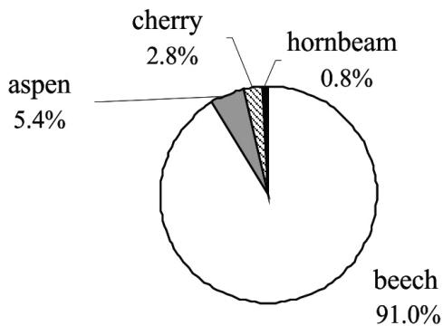  
July of the masting year

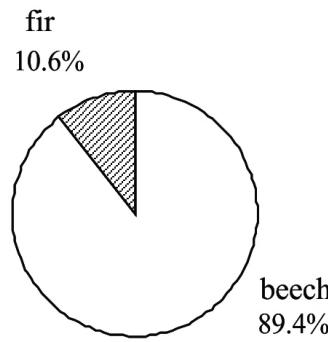  
August of the masting year

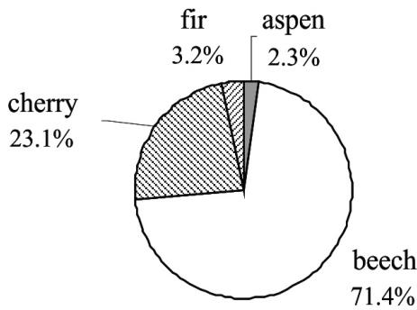  
July of the non-masting year

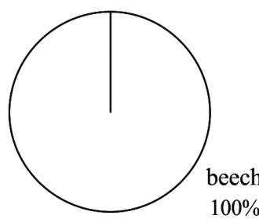  
August of the non-masting year   
Fig. 1. Percentage of the feeding time of Glis glis on different species of trees in July and August during the mast year (2006) and the non-mast year (2005) in the Roztocze National Park.

to change them during the season (although for technical reasons changes were made in 2006 in two males).

Every animal was radio-tracked during four nights in July and four nights in August by continuous observation. Three dormice were simultaneously tracked with directional antennas and telemetry receivers (Australis 26k, Titley). The animals were observed during rainless nights with little or no wind. In July, dormice were tracked from the beginning to the end of their nocturnal activity. In August it was similar, but due to a long night and problems with maintaining concentration for so many hours, there was a break in observations between midnight and $0 1 . 0 0 \mathrm { ~ h ~ }$ . The mean duration of observation of males and females at both sites is shown in Table 1.

The time spent foraging on different species of trees and shrubs was recorded. Feeding was detected on the basis of characteristic noises coming from the crowns of trees and shrubs, as well as remains of eaten food falling to the forest floor. If feeding sounds were sometimes drowned out by the wind, the indicator was the falling food remains. As far as possible it

was also noted what parts of the plant were eaten. The easiest to detect were the heavy fruits of beech, oak, hazel and stones of wild cherries falling to the ground. Due to the frequent difficulties in accurately determining what animals ate in a given tree or shrub, the detailed contribution of individual plant organs in the dormouse diet is not given here.

Counting all the trees of each species gives a figure for the relative availability of each species with which to compare the actual use measured by observations. In order to provide an index of tree species availability, all trees with a height of at least 4 m and bushes with a height of at least $3 \mathrm { m }$ were counted in the RNP and SLP. Trees of this lower height often touched the lower branches of tall trees.

The assessment area of trees and shrubs was equal to the total area (Minimum Convex Polygon 100 $\%$ ) occupied by all the studied dormice, which was determined as a result of research carried out at the same time. The height of the shrubs considered was arbitrarily adopted although some of them, for example hazel and elder Sambucus nigra, already bore fruits. The $\mathbb { \chi } 2$ test was used to compare the percentage

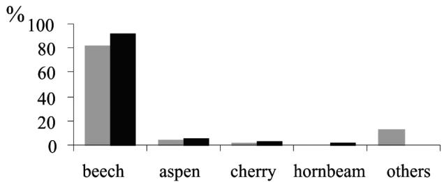  
July of the masting year

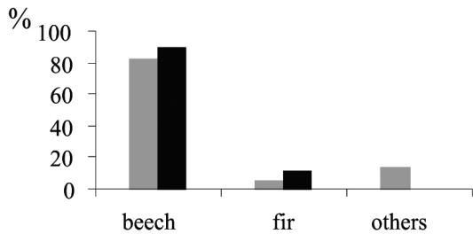  
August of the masting year

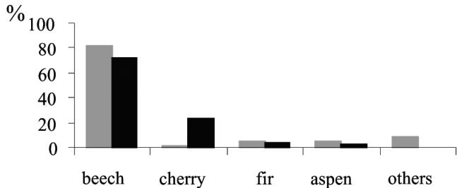  
July of the non-masting year

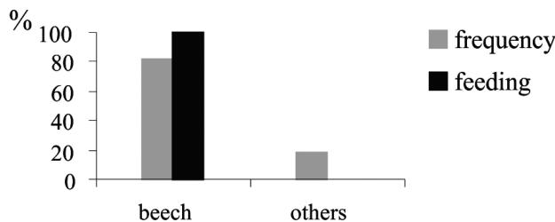  
August of the non-masting year   
Fig. 2. Comparison of feeding time of dormice $( 3 3 )$ and $3 \mathcal { Q } \mathcal { Q } ^ { \prime }$ ) in July and August of the masting year (2006) and non-masting year (2005) on different trees and shrubs with the frequency of these plant species within the research area at Roztocze National Park.

of feeding time with the frequency of plant species. Statistical analyses were performed using Statistica 13 for Windows.

The studies were approved by the local ethical commission and the General Directorate for Environmental Protection.

# Results

# Food preferences in RNP

In the area where the edible dormice were active the dominant tree species was beech $( 8 1 . 9 ~ \% )$ . Other species were elder $( 4 . 9 ~ \% )$ , aspen Populus tremula $( 4 . 4 \% )$ , silver fir Abies alba $( 4 . 3 ~ \% )$ , rowan Sorbus aucuparia $( 1 . 4 ~ \% )$ , and wild cherry Prunus avium $( 1 . 2 ~ \% )$ . Other species such as Scots pine Pinus sylvestris, Norway spruce Picea abies, hornbeam Carpinus betulus, oak Quercus sp., common pear Pyrus communis, guelder-rose Viburnum opulus, silver birch Betula pendula and Prunus sp. were less frequent $( < 1 \%$ each).

In July of the masting year, dormice mainly fed on beech (Fig. 1), where they spent $91 \%$ of the total feeding time. Most often they showed activity in high beech trees, therefore it was difficult to observe directly what they ate. Among the falling leftovers it was not always possible to recognize the type of food consumed, except beech nuts. Therefore, no information was collected on which parts of the beech were most often eaten. It was only possible to recognize that green parts of the

beech were eaten, including buds, leaves and young bark. The unripe beech nut debris, eaten by dormice, fell from the trees quite often in July. They foraged on aspen, wild cherry and hornbeam for a much shorter time. In the case of wild cherry, the animals ate fleshy parts without the stones.

In August of the masting year, the dormice foraged only on beech and fir (Fig. 1). As in July, the animals spent most of their time feeding on beech, eating mainly beech nuts, as well as the vegetative parts of this tree. It was not possible to determine exactly in what proportions dormice ate different parts of the fir, but it is known that they ate the seeds, because the falling scales of cones were observed.

In July of the non-masting year, animals foraged mainly on beech and wild cherry (Fig. 1). On wild cherry they ate the flesh of the fruit, leaving the stones mostly untouched. In August of the non-masting year, the animals were found only on beech. It was observed that beechnuts (rare in the forest during this period) were also eaten with different parts of the beech.

The feeding duration of animals on different species of trees did not reflect their representation on the study area either in the masting year (July: $\chi ^ { 2 } = 6 0 4 . 4$ , $P < 0 . 0 0 1$ , ${ \mathfrak { n } } = 6$ ; August: $\chi ^ { 2 } = 3 7 4 . 2$ , $P < 0 . 0 0 1$ , $\mathrm { n } = 6$ ) or non-masting year (July: $\chi ^ { 2 } = 4 7 9 . 9$ , $P < 0 . 0 0 1$ , ${ \mathfrak { n } } = 6$ ; in August they only foraged on beech).

In both months of the masting year, these mammals preferred foraging on beech and in August also on fir.

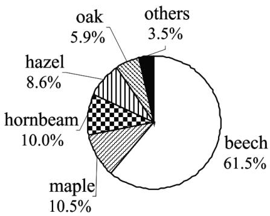  
July of the masting year

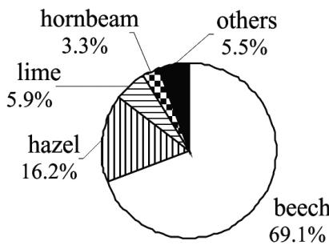  
August of the masting year

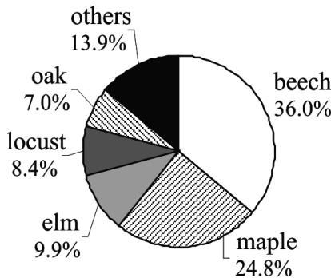  
July of the non-masting year

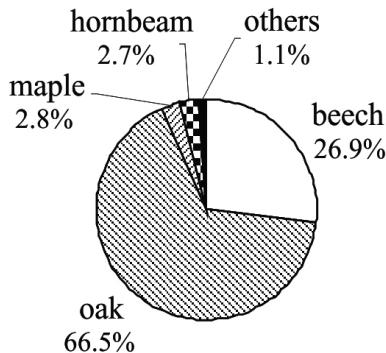  
August of the non-masting year   
Fig. 3. Percentage of the feeding time of Glis glis on the species of trees and shrubs in July and August in the mast year (2006) and the non-mast year (2005) in the Sieraków Landscape Park. Other tree species: in July of the mast year – lime $( 2 \% )$ , locust $( 1 \ \% )$ , spruce $( 0 . 5 \% )$ ; in August of the mast year – maple $( 2 . 3 \% )$ , pedunculate oak $( 1 . 3 \% )$ , locust $\left( 0 . 9 \ \% \right)$ ), elm $( 0 . 7 ~ \% )$ ), alder $( 0 . 3 \% )$ ; in July of the non-mast year – hornbeam $( 3 . 5 ~ \% )$ ), aspen $( 3 . 4 \% )$ , ash $( 2 . 5 \% )$ , hazel $( 1 . 6 \% )$ , hawthorn $( 1 . 5 \% )$ , horse-chestnut $( 1 . 4 \% )$ ); in August of the non-mast year – lime $( 0 . 3 \% )$ , horse-chestnut $( 0 . 2 \% )$ ), hazel $( 0 . 2 \% )$ , locust $( 0 . 2 \% )$ , elm $( 0 . 2 \% )$ .

In the non-masting year in July they fed on beech and wild cherry, and in August on beech (Fig. 2).

# Food preferences in SLP

In SLP, the most numerous tree species in the area used by the studied dormice was beech $( 2 8 . 6 ~ \% )$ . In the central part of the study area, the share of this tree was at least twice as high as on its periphery, an area rarely visited by the animals. Less numerous species were Norway maple Acer platanoides $( 1 2 . 2 \ \% )$ , hornbeam $( 1 1 . 6 ~ \% )$ ), elder $( 7 . 7 ~ \% )$ ), common hazel $( 6 . 7 \ \% )$ , common alder Alnus glutinosa $( 6 . 5 ~ \% )$ ), ash Fraxinus excelsior $(6 \% )$ , pedunculate oak Quercus robur $( 5 . 5 ~ \% )$ , locust Robinia pseudoacacia $( 5 . 3 ~ \% )$ , sycamore Acer pseudoplatanus $( 3 . 9 ~ \% )$ ), lime Tilia cordata $( 1 . 2 \% )$ , Scots pine $( 1 . 1 \ \% )$ ) and dogwood (1 $\%$ ). The remaining species: elm Ulmus laevis, horsechestnut Aesculus hippocastanum, aspen, hawthorn Crataegus monogyna, European crab apple Malus

sylvestris, silver birch, spindle Euonymus europaeus, Norway spruce, common pear, European yew Taxus baccata and Ribes sp. formed less than $1 \%$ .

In the masting year, dormice spent most time on beech (Fig. 3), eating beech nuts and vegetative parts of the tree. In July, however, about $10 \%$ of feeding time was spent on Norway maple and hornbeam, and slightly less on the hazel and pedunculate oak. The dormice fed for a relatively short time in lime, locust and Norway spruce trees. In August, feeding on beech took up nearly $70 \%$ of the time for the animals. They consumed a significant amount of hazel, but clearly less than beech. The remains of beech and hazel nuts eaten by dormice often fell from these trees. On other tree species including lime, hornbeam, maple and oak they foraged for a few percent of the time, and on the locust, elm and alder less than $1 \%$ (Fig. 3).

In July of the non-masting year, animals foraged on several different species of trees and shrubs (Fig. 3).

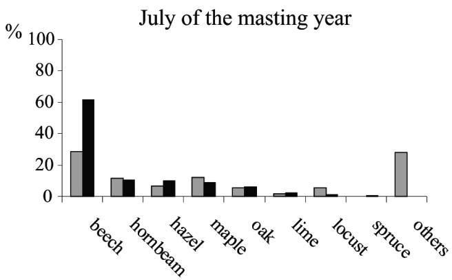

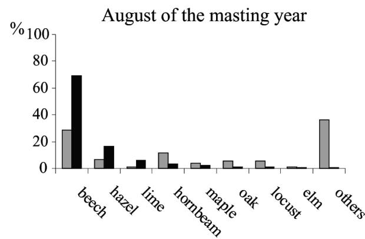

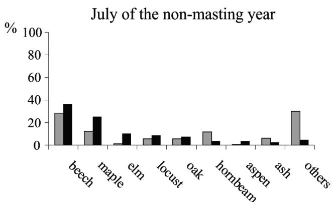

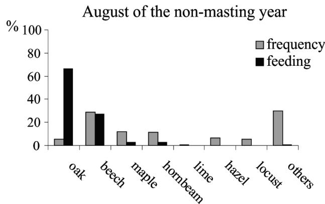  
Fig. 4. Comparison of feeding time of dormice $3 3 8$ and $3 \mathcal { Q } \mathcal { Q } )$ ) in July and August of the masting year (2006) and non-masting year (2005) on different trees and shrubs, with the frequency of these plant species on the research area at Sieraków Landscape Park.

Most foraging was on beech and Norway maple, which together accounted for more than half of the feeding time. Between $5 \%$ and $10 \%$ of feeding time was spent on the elm, locust and pedunculate oak trees. To a small extent they fed on a few other species, including hornbeam, aspen, ash, hazel, hawthorn and horse-chestnut. In August of the nonmasting year dormice spent about two-thirds of their feeding time on pedunculate oak (Fig. 3), where they ate mainly acorns, but also vegetative parts of the tree. At that time of year, over $50 \%$ of oaks bore fruits, representing a condition between “mean crop” and “good crop”, according to Kantorowicz’s classification (2000). The foraging time on beech was half that spent on oak. Fruits were not found on beech at that time, so dormice fed on other parts of the tree. In August, a small proportion of feeding time was spent on Norway maple and hornbeam, and marginal feeding time on lime, horse-chestnut, hazel, locust and elm.

The time spent feeding on different species of trees did not reflect their representation in the research area either in the masting year (July: $\chi 2 = 1 5 7 2 . 9$ , $P { < } 0 . 0 0 1$ , ${ \mathfrak { n } } = 6$ ; August: $\chi 2 = 1 9 7 7 . 6$ , $P < 0 . 0 0 1$ , ${ \mathfrak { n } } = 6$ ) or the non-masting year (July: $\chi 2 = 1 4 0 8 . 6$ , $P < 0 . 0 0 1$ , ${ \mathfrak { n } } = 6$ ;

August: $\chi 2 = 3 9 5 0 . 5 $ , $P < 0 . 0 0 1$ , $\mathrm { n } = 6$ ). In the masting year, dormice preferred to feed on beech and hazel in both months of research and on lime only in August (Fig. 4). In the non-masting year, several species were preferred in July, including beech, Norway maple, elm, locust and oak, in August only oak.

# Discussion

On both research areas, the edible dormice most often fed on beech, eating its fruits and vegetative parts. Ripe beechnuts are eagerly eaten by dormouse as they are characterized by high nutritional values (Grodziński & Sawicka-Kapusta 1970, Fietz et al. 2005). This mammal also eats beech nuts that are just ripening, probably due to their relatively high calorific value already around mid-July (Bieber & Ruf 2004). In western Germany, dormice start to feed on poorly developed beechnuts even in May (Fietz et al. 2005). In the non-masting year, at RNP and SLP, animals probably ate male flower buds on beech, which are formed in the summer of the year preceding the flowering (Chałupka 1990). In the non-masting year 2005, flower buds had to be numerous, as it preceded the masting year 2006.

In the masting year, beech was the preferred tree in both dormouse populations studied, in both July

and August. Edible dormice also preferred two other species whose fruits belong to the group with the highest calorific value (Grodziński & Sawicka-Kapusta 1970), namely fir in RNP and hazel in SLP. Feeding on fir seeds is intriguing because, due to their high resin content they are eaten reluctantly by rodents (Turček 1956).

Bigger differences between dormice from both sites occurred in the non-masting year (2005), related to the difference in composition and percentage of subdominant species of trees and shrubs between RNP and SLP. Due to the lack of beechnuts in the first half of the summer, the only species preferred in RNP was wild cherry, abundant in fruits but these are of low calorific value (Rieger 2006). At the same time, the animals in SLP preferred a few trees, which included beech, Norway maple, elm, locust and oak. With the exception of the beech, in which no nuts were found in 2005, dormice consumed not only vegetative elements but also unripe fruits of other trees. In August of the non-masting year, the different species composition of the trees on both sites also affected the large differences in the diet between the two populations. In RNP, they foraged exclusively on beech trees, looking for the scarce fruiting trees, eating vegetative parts including bark (although consumed only in small amounts) and probably developing flower buds. In SLP, however, the preferred species was not beech, but the pedunculate oak, on which acorns occurred. This tree species grows scattered throughout the forest, so it was easily accessible to dormice. Acorns are food with lower calorific content than hazelnuts and beechnuts (Grodziński & Sawicka-Kapusta 1970). However, when the latter were unavailable in the non-masting year, dormice eagerly ate the oak fruits, staying on this tree species for two-thirds of the time that they spent feeding. At the RNP site there was a very big difference between the time of feeding on wild cherries in the masting year and the non-masting year, despite the fact that in both years there were a lot of fruits. It seems that in the masting year, the dormice would feed on beech nuts, which at that time were only ripening, but they already had a high nutritional value in this period (Bieber & Ruf 2009), certainly higher than that of sweet cherries.

The analysis of feeding times indicates that in the dormouse diets in the RNP and SLP there are differences resulting from a slightly different tree stand composition. For the same reason, there are most likely discrepancies between the results obtained in different forests. However, the phases of development of trees and shrubs during the season mean that there

is a similar general scheme of using different types of food by dormice. In the deciduous forests of Slovakia during the early summer, the basic food of this rodent was bark, buds and leaves of spindle, and in August the later maturing hazelnuts, dogwood fruits, hornbeam fruits, maple fruits and others (Holišová 1968). In Lithuania, beyond the distributional range of beech, after emergence from hibernation edible dormice fed on the previous year’s acorns, vegetative parts of plants and animal food. Later in June and July they fed on the seeds of birches, raspberries and fruits of glossy buckthorn, but in late summer and in autumn fresh acorns dominated the diet of this rodent (Juškaitis et al. 2015). In western Germany, the amount of leaves and juicy fruits (apples, raspberries, blackberries) declined from July to September, and the beech, oak, hazel and maple fruits grew during the season (Fietz et al. 2005, Sailer & Fietz 2009). In the forests of southern Europe, where there is a different vegetation composition, a similar pattern of changes in diet was found in northern Italy by Kahmann (1965), and on the Iberian Peninsula by Gigirey & Rey (1999).

Due to the method used, it was not determined whether dormice in RNP and SLP used animal food. However, in captivity, both at the Ecological Station of the Adam Mickiewicz University in Poznań and at the Zoological Garden in Poznań, the eating of moths was observed very frequently. The hunt for moths was also seen in the RNP in early July 1991, during attempts to observe edible dormice using night vision devices. According to most researchers, dormice eat animals only sporadically (Ognev 1947, Holišová 1968, Gigirey & Rey 1999, Nowakowski & Godlewska 2006), most often in spring and in the first half of summer, when there is no highvalue plant food available and dormice face the high costs of reproduction (Gigirey & Rey 1999, Hürner & Michaux 2009). Unusually favourable conditions exist for many creatures that may constitute dormouse food during spring and early summer in RNP where there are many standing dead trees, far more than in SLP.

During the study in RNP and SLP, no evidence was found for predation by edible dormice on birds. In some populations, apparently in the northern part of the species‘ range, this occurs relatively often in spring and early summer (Koppman-Rumpf et al. 2003, Juškaitis 2006, Adamík & Král 2008, Juškaitis et al. 2015). According to those authors, in the predated bird nests (Ficedula albicollis, F. hypoleuca, Parus major, P. caeruleus, P. ater, P. palustris, Sitta europea, Erithacus rubecula, Sturnus vulgaris, Phoenicurus phoenicurus, Jynx torquilla), not only eggs and chicks are eaten, but also adult birds.

The results of these studies in RNP and SLP indicate that dormice foraged mostly on food, which during the study period was characterized by having the highest nutritional value. The choice of food could also be influenced by taste, as evidenced by feeding on the fruits of wild cherry despite its low nutritional value.

# Acknowledgements

I would like to thank dozens of students of Adam Mickiewicz University for their invaluable help in difficult field work. I am grateful to David Orwin for comments and English proofreading. The Adam Mickiewicz University, EkoFundusz Foundation and the management of the Roztocze National Park supported this research. I thank two anonymous reviewers, whose comments have greatly improved this article.

# Literature

Adamík P. & Král M. 2008: Nest losses of cavity nesting birds caused by dormice (Gliridae, Rodentia). Acta Theriol. 53: 185–192.   
Bieber C. & Ruf T. 2004: Seasonal timing of reproduction and hibernation in the edible dormouse (Glis glis). In: Barnes M.M. & Carem H.V. (eds.), Life in the cold: evolution, mechanisms, adaptation and application. Fairbanks, Alaska: 113–125.   
Bieber C. & Ruf T. 2009: Habitat differences affect life history tactics of a pulsed resource consumer, the edible dormouse (Glis glis). Popul. Ecol. 51: 481–492.   
Chałupka W. 1990: Selected issues of development and growth. In: Białobok L.S. (ed.), Common beech Fagus sylvatica. PAN Instytut Dendrologii, Kórnik-Poznań: 123–141. (in Polish)   
Cornils J.S., Hoelzl F., Rotter B. et al. 2017: Edible dormice (Glis glis) avoid areas with a high density of their preferred food plant – the European beech. Front. Zool. 14: 23.   
Feldhamer G.A., Drickamer L.C., Vessey S.H. & Merrit J.F. 1999: Mammalogy: adaptation, diversity, and ecology. McGraw-Hill Higher Education, Boston.   
Fietz J., Pflug M., Schlund W. & Tataruch F. 2005: Influences of the feeding ecology on body mass and possible implications for reproduction in the edible dormouse (Glis glis). J. Comp. Physiol. B 175: 45–55.   
Franco D. 1990: Feeding habits of a dormouse population (Myoxus glis) of the Asiago Plateau (Venetian Prealps). Hystrix (n.s.) 2: 11–22.   
Gigirey A. & Rey J.M. 1998: Autumn diet of the edible dormouse in Galicia, northwest Spain. Acta Theriol. 43: 325–328.   
Gigirey A. & Rey J.M. 1999: Feacal analysis of the edible dormouse (Glis glis) in the northwest Iberian Peninsula. Z. Säugetierkd. 64: 376–379.   
Grodziński W. & Sawicka-Kapusta K. 1970: Energy values of tree-seed eaten by mammals. Oikos 21: 52–58.   
Hilton G.M. & Packham J.R. 1997: A sixteen-year record of regional and temporal variation in the fruiting of beech (Fagus sylvatica L.) in England (1980-1995). Forestry 70: 7–16.   
Hilton G.M. & Packham J.R. 2003: Variation in the masting of common beech (Fagus sylvatica L.) in northern Europe over two centuries (1800-2001). Forestry 76: 319–328.   
Holišová V. 1968: Notes on the food of dormice (Gliridae). Zool. Listy 17: 109–114.   
Hürner H. & Michaux J. 2009: Ecology of the edible dormouse (Glis glis) in a western edge population in southern Belgium. Vie Milieu 59: 243–250.   
Jackson J. 1994: The edible or fat dormouse (Glis glis) in Britain. Q. J. Forest. 88: 119–125.   
Juškaitis R. 2006: Interactions between dormice (Gliridae) and hole-nesting birds in nestboxes. Folia Zool. 55: 225–236.   
Juškaitis R., Baltrūnaitė L. & Augutė V. 2015: Diet of the fat dormouse (Glis glis) on the northern periphery of its distributional range. Mammal Res. 60: 155–161.   
Kahmann H. 1965: Le Loir (Glis glis, Linnaeus, 1776) dans les Monts Gargano, Italie (Apulie). Mammalia 29: 72–94.   
Kantorowicz W. 2000: Half a century of seed years in major tree species of Poland. Silvae Genet. 49: 245–249.   
Koppmann-Rumpf B., Heberer C. & Schmidt K.H. 2003: Long-term study of the reaction of the edible dormouse Glis glis to climatic changes and its interactions with hole-breeding passerines. Acta Zool. Acad. Sci. Hung. 49 (Suppl. 1): 69–76.   
Kryštufek B. 2010: Glis glis (Rodentia: Gliridae). Mamm. Species 42: 195–206.   
Nowakowski W.K. & Godlewska M. 2006: The importance of animal food for Dryomys nitedula (Pallas) and Glis glis (L.) in Białowieża Forest (East Poland): analysis of faeces. Pol. J. Ecol. 54: 359–367.   
Nowakowski W.K., Remisiewicz M. & Kosowska J. 2006: Food preferences of Glis glis (L.), Dryomys nitedula (Pallas) and Graphiurus murinus (Smuts) kept in captivity. Pol. J. Ecol. 54: 369–378.   
Ognev S.I. 1947: Mammals of the USSR and neighbouring countries. Izdatielstvo Akademii Nauk SSSR, Moskva, Leningrad. (in Russian)   
Rieger M. 2006: Introduction to fruit crops. Food Products Press, Binghamton.   
Rodolfi G. 1994: Dormice Glis glis activity and hazelnut consumption. Acta Theriol. 39: 215–220.   
Sailer M. & Fietz J. 2009: Seasonal differences in the feeding ecology and behavior of male edible dormice (Glis glis). Mammal. Biol. 74: 114–124.   
Schlund W., Sharfe F. & Ganzhorn J.U. 2002: Long-term comparison of food availability and reproduction in the edible dormouse (Glis glis). Mamm. Biol. 67: 219–232.   
Schoener T.W. 1987: A brief history of optimal foraging ecology. In: Kamil A.C., Krebs J.R. & Pulliam H.R. (eds.), Foraging behaviour. Plenum Press, New York: 5–67.   
Turček F.J. 1956: Quantitative experiments on the consumption of tree-seeds by the mice of the species Apodemus flavicollis. Ann. Zool. Soc. Zool.-Bot. Fenn. Vanamo 10: 50–59.